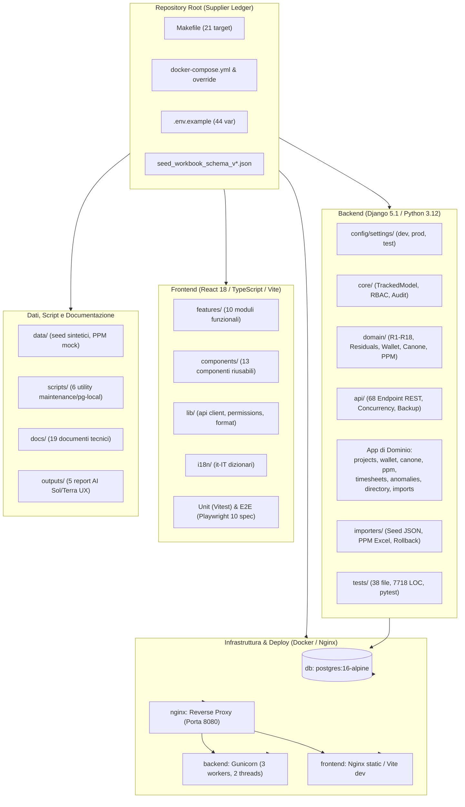

# Inventario Dettagliato del Repository — Supplier Ledger

## 1. Intestazione e Metadati dell'Assessment

| Parametro | Dettaglio / Valore | Evidenza |
|---|---|---|
| **Progetto** | Supplier Ledger (Gestione consuntivazione e wallet Imola Informatica) | [README.md](../../README.md#L1-L8), [pyproject.toml](../../backend/pyproject.toml#L1-L5) |
| **Commit / Checkpoint** | `12905a7` (checkpoint Git noto; directory di lavoro disconnessa da `.git`) | [docs/PLAN.md](../../docs/PLAN.md#L1-L20), [docs/CHANGELOG.md](../../docs/CHANGELOG.md#L1-L15) |
| **Branch Dichiarato** | `feature/premium-ux-redesign` | [outputs/SOL_UX_GAP_ANALYSIS.md](../../outputs/SOL_UX_GAP_ANALYSIS.md#L1-L10) |
| **Stato Sviluppo** | Fasi 1-7 completate; Tranche Post-Feedback A-G completate; Fase 8 (UX Redesign) in corso | [docs/CHANGELOG.md](../../docs/CHANGELOG.md#L7-L60), [docs/PLAN.md](../../docs/PLAN.md#L1-L50) |
| **Data Rilevamento** | 2026-10-28 | [docs/assestmant/ASSESSMENT_PROGRESS.md](ASSESSMENT_PROGRESS.md#L3-L8) |
| **Metodologia** | Analisi statica esaustiva del codice sorgente, configurazioni e documentazione | [docs/assestmant/ASSESSMENT_PROGRESS.md](ASSESSMENT_PROGRESS.md#L7) |
| **Documenti Correlati** | [02_FUNCTIONAL_DOMAIN_MODEL.md](02_FUNCTIONAL_DOMAIN_MODEL.md), [05_TECHNICAL_ARCHITECTURE.md](05_TECHNICAL_ARCHITECTURE.md), [06_DATA_MODEL.md](06_DATA_MODEL.md), [07_API_CATALOG.md](07_API_CATALOG.md) | Standard di suite assessment |

---

## 2. Executive Summary e Volumetrie del Repository

Il repository **Supplier Ledger** è strutturato come monorepo che integra:
1. **Backend**: applicazione Django 5.1 con Django REST Framework su Python 3.12, database PostgreSQL 16 con audit trail e append-only ledger pattern.
2. **Frontend**: Single Page Application (SPA) modulare basata su React 18, TypeScript, Vite, Tailwind CSS, Radix UI e TanStack Query/Table.
3. **Infrastruttura**: orchestrazione a 4 container Docker (PostgreSQL, Gunicorn Backend, Vite/Nginx Frontend, Nginx Reverse Proxy) compatibile sia con ambienti desktop (WSL2) sia con NAS Synology (Container Manager).
4. **Dati & Seed**: schemi JSON rigorosi (v1 - v4) con pipeline di importazione transazionale, rollback logico e gestione differenziale dei PPM fornitore.
5. **Documentazione & AI Output**: 19 documenti di specifica/decisioni e 5 report analitici prodotti dagli agenti di sviluppo (Sol, Terra).

### Distribuzione Volumetrica per Tipologia di Codice

| Tipologia File / Linguaggio | Conteggio File | Righe di Codice (LOC) | Dimensione Totale (Bytes) | Evidenza |
|---|---|---|---|---|
| **Python (`.py`)** | 188 | 27.920 | 1.056.916 | `backend/`, `scripts/` |
| **TypeScript / TSX (`.ts`, `.tsx`)** | 68 | 12.475 | 498.734 | `frontend/src/`, `frontend/e2e/` |
| **JSON Schemi e Dati (`.json`)** | 14 | 123.852 | 4.589.210 | Root, `data/seed/`, `frontend/` |
| **Markdown (`.md`)** | 25 | 3.896 | 284.715 | Root, `docs/`, `outputs/` |
| **Configurazione YAML (`.yml`, `.yaml`)** | 3 | 189 | 6.223 | Docker Compose, Pre-commit |
| **Script Shell, Dockerfile, Nginx, Makefile** | 12 | 680 | 18.420 | `deploy/`, `scripts/`, Root |
| **TOTALE COMPLESSIVO** | **310** | **169.012** | **6.454.218** | Censimento file system globale |

---

## 3. Diagramma dell'Architettura del Repository

---

## 4. Inventario Root e File di Configurazione Globale

### 4.1 Tabella dei File di Root

| File | Dimensione | LOC | Stato | Scopo / Evidenza Architetturale |
|---|---|---|---|---|
| `Makefile` | 2.807 B | 75 | IMPLEMENTED | Orchestrazione operativa per 21 target di test, build, lint e database. Evidenza: [Makefile](../../Makefile#L1-L75). |
| `docker-compose.yml` | 2.873 B | 80 | IMPLEMENTED | Definizione multi-container di produzione con healthcheck e storage bind. Evidenza: [docker-compose.yml](../../docker-compose.yml#L1-L80). |
| `docker-compose.override.yml` | 1.566 B | 48 | IMPLEMENTED | Override per sviluppo con porte mappate (5433, 8000, 5173) e volumi caldi. Evidenza: [docker-compose.override.yml](../../docker-compose.override.yml#L1-L48). |
| `.env.example` | 1.720 B | 44 | IMPLEMENTED | Modello di configurazione ambiente per 44 variabili dichiarate. Evidenza: [.env.example](../../.env.example#L1-L44). |
| `.pre-commit-config.yaml` | 1.784 B | 64 | IMPLEMENTED | Configurazione di 13 hook per formattazione, linting e sicurezza seed. Evidenza: [.pre-commit-config.yaml](../../.pre-commit-config.yaml#L1-L64). |
| `seed_schema_v1.json` | 14.291 B | 370 | IMPLEMENTED | Validatore JSON Schema v1 per importazione iniziale anagrafiche e consuntivi. |
| `seed_workbook_schema_v2.json` | 7.074 B | 195 | IMPLEMENTED | Schema v2 per la transizione alla struttura multi-foglio Excel. |
| `seed_workbook_schema_v3.json` | 5.210 B | 150 | IMPLEMENTED | Schema v3 con ottimizzazioni delle chiavi di associazione. |
| `seed_workbook_schema_v4.json` | 2.777 B | 85 | IMPLEMENTED | Schema v4 corrente utilizzato per validazione dei dataset d'integrazione fornitore. |
| `README.md` | 7.434 B | 184 | IMPLEMENTED | Manuale tecnico di primo livello con sintesi regole R1-R6 e quickstart. Evidenza: [README.md](../../README.md#L1-L184). |
| `.gitignore` | 625 B | 38 | IMPLEMENTED | Regole di esclusione git (dati seed reali, cache, db locali, coverage). |
| `.dockerignore` | 294 B | 18 | IMPLEMENTED | Esclusioni contesti di build Docker (evita invio di node_modules e file pesanti). |
| `.gitattributes` | 159 B | 9 | IMPLEMENTED | Normalizzazione line ending (`eol=lf`) su repository cross-platform. |

### 4.2 Catalogo dei Target di Automazione (`Makefile`)

Il [Makefile](../../Makefile) contiene 21 target funzionali esposti tramite self-documenting help (`make help`):

| Target | Categoria | Azione Eseguita | Evidenza |
|---|---|---|---|
| `help` | Supporto | Elenca tutti i comandi disponibili tramite parsing regex del Makefile | [Makefile:9-10](../../Makefile#L9-L10) |
| `up` | Lifecycle | Avvia l'intero stack in background con ricompilazione (`docker compose up -d --build`) | [Makefile:12-14](../../Makefile#L12-L14) |
| `down` | Lifecycle | Arresta tutti i container dello stack (`docker compose down`) | [Makefile:16-17](../../Makefile#L16-L17) |
| `logs` | Diagnostica | Visualizza log aggregati in streaming con finestra di 100 righe | [Makefile:19-20](../../Makefile#L19-L20) |
| `build` | Build | Ricostruisce le immagini Docker dei container | [Makefile:22-23](../../Makefile#L22-L23) |
| `migrate` | Database | Esegue le migrazioni Django nel container backend | [Makefile:25-26](../../Makefile#L25-L26) |
| `makemigrations` | Database | Genera nuovi file di migrazione schema da modifiche ai modelli | [Makefile:28-29](../../Makefile#L28-L29) |
| `superuser` | Sicurezza | Invoca il comando interattivo Django `createsuperuser` | [Makefile:31-32](../../Makefile#L31-L32) |
| `seed` | Dati | Esegue `python manage.py import_seed` puntando al file seed JSON configurato | [Makefile:34-35](../../Makefile#L34-L35) |
| `seed-dry` | Dati | Simula l'esecuzione dell'import seed con flag `--dry-run` | [Makefile:37-38](../../Makefile#L37-L38) |
| `demo` | Dati | Popola il database con dati sintetici deterministici e utenti demo (`load_demo_data`) | [Makefile:40-41](../../Makefile#L40-L41) |
| `checks` | Business | Lancia l'esecuzione delle 18 regole di controllo e genera anomalie (`run_checks`) | [Makefile:43-44](../../Makefile#L43-L44) |
| `shell` | Diagnostica | Apre la shell Python interattiva di Django all'interno del container | [Makefile:46-47](../../Makefile#L46-L47) |
| `test` | Qualità | Esegue in sequenza `test-backend` e `test-frontend` | [Makefile:49](../../Makefile#L49) |
| `test-backend` | Qualità | Esegue pytest con coverage nel container backend (gate: fail_under 85%) | [Makefile:51-52](../../Makefile#L51-L52) |
| `test-frontend` | Qualità | Esegue i test unitari frontend con Vitest | [Makefile:54-55](../../Makefile#L54-L55) |
| `lint` | Qualità | Esegue ruff check, black --check, mypy sul backend e npm run lint su frontend | [Makefile:57-59](../../Makefile#L57-L59) |
| `format` | Qualità | Applica autocorrezioni di formattazione con black, ruff --fix e prettier | [Makefile:61-63](../../Makefile#L61-L63) |
| `e2e` | Qualità | Lancia Playwright contro lo stack attivo (`e2e/phase6.spec.ts`) con headless Chromium | [Makefile:65-66](../../Makefile#L65-L66) |
| `backup` | Disaster Rec. | Esegue dump logico PostgreSQL e archiviazione media (`python manage.py backup`) | [Makefile:68-69](../../Makefile#L68-L69) |
| `reset` | Manutenzione | Azione distruttiva: arresta stack, rimuove volumi e cancella directory `.docker-data/pgdata` | [Makefile:71-74](../../Makefile#L71-L74) |

### 4.3 Ripartizione delle Variabili di Configurazione (`.env.example`)

Il file [.env.example](../../.env.example) definisce 44 variabili raggruppate in 6 sezioni operative:

1. **Django Core (Righe 6-16)**: `DJANGO_SECRET_KEY`, `DJANGO_DEBUG` (default `False`), `DJANGO_ALLOWED_HOSTS`, `CSRF_TRUSTED_ORIGINS`, `COOKIE_SECURE` (`False` su dev, `True` obbligatorio in prod), `LOG_LEVEL` (`INFO`), `SESSION_COOKIE_AGE` (28.800 secondi = 8 ore).
2. **PostgreSQL Database (Righe 17-23)**: `POSTGRES_DB` (`supplier_ledger`), `POSTGRES_USER` (`supplier_ledger`), `POSTGRES_PASSWORD`, `POSTGRES_HOST` (`db`), `POSTGRES_PORT` (`5432`).
3. **Storage e Porte di Rete (Righe 24-31)**: `SL_DATA_DIR` (`./.docker-data`), `SL_HTTP_PORT` (`8080`), `SL_BACKEND_PORT` (`8000`), `SL_FRONTEND_PORT` (`5173`), `SL_DB_PORT` (`5433`).
4. **Parametri di Dominio (Righe 32-37)**: `RESIDUAL_EXPIRING_WINDOW_DAYS` (`90` giorni per alert R2), `MAX_UPLOAD_BYTES` (25 MB = 26.214.400 bytes), `LOGIN_THROTTLE_RATE` (`10/min`).
5. **Identity & Auth Provider (Righe 38-41)**: `AUTH_PROVIDER` (`local` attivo; architettura predisposta per Microsoft `entra_id`).
6. **Frontend Build Pipeline (Righe 42-44)**: `VITE_API_BASE_URL` (`/api/v1`).

### 4.4 Controlli Pre-Commit (`.pre-commit-config.yaml`)

Il repository implementa un totale di 13 controlli statici automatici pre-commit ([.pre-commit-config.yaml](../../.pre-commit-config.yaml)):
- **Standard Pre-Commit Hooks (9)**: `trailing-whitespace`, `end-of-file-fixer`, `check-yaml`, `check-toml`, `check-json` (esclude tsconfig con commenti), `check-merge-conflict`, `check-added-large-files` (`--maxkb=512`), `detect-private-key`, `forbid-new-submodules`.
- **Ruff Linter & Formatter (2)**: `ruff --fix` (v0.7.4) e `ruff-format` mirati su `^backend/`.
- **Black Formatter (1)**: `black` (24.10.0, line length 100).
- **Mypy Type Checker (1)**: `mypy` (1.13.0) con plugin Django e DRF stubs.
- **Hook Locali di Sicurezza e Qualità (2)**:
  - `no-real-seed`: esegue `python scripts/check_no_real_seed.py` bloccando commit contenenti dump confidenziali del fornitore.
  - `frontend-lint`: esegue `eslint` e `prettier --check` sul codice TypeScript.

---

## 5. Inventario Dettagliato Backend (`backend/`)

### 5.1 Stack Tecnologico e Dipendenze

| Pacchetto | Versione Dichiarata | Scopo Operativo | Evidenza |
|---|---|---|---|
| **Python** | `>=3.12` | Runtime di esecuzione | [pyproject.toml](../../backend/pyproject.toml#L5) |
| **Django** | `>=5.1,<6` | Web framework primario, ORM, migrazioni | [requirements.txt](../../backend/requirements.txt#L1) |
| **djangorestframework** | `>=3.15` | Esposizione API RESTful | [requirements.txt](../../backend/requirements.txt#L2) |
| **django-filter** | `>=24.3` | Filtraggio dichiarativo dei queryset REST | [requirements.txt](../../backend/requirements.txt#L3) |
| **django-cors-headers** | `>=4.4` | Gestione policy CORS per frontend Vite | [requirements.txt](../../backend/requirements.txt#L4) |
| **django-simple-history**| `>=3.7` | Tracciamento storico append-only e versioning entità | [requirements.txt](../../backend/requirements.txt#L5) |
| **drf-spectacular** | `>=0.27` | Generazione schema OpenAPI v3 e documentazione Swagger | [requirements.txt](../../backend/requirements.txt#L6) |
| **psycopg (v3)** | `>=3.2` (binary) | Driver nativo PostgreSQL 16 con pool connessioni | [requirements.txt](../../backend/requirements.txt#L7) |
| **gunicorn** | `>=23` | Application server WSGI di produzione | [requirements.txt](../../backend/requirements.txt#L8) |
| **openpyxl** | `>=3.1` | Elaborazione fogli di calcolo Excel (PPM ed export) | [requirements.txt](../../backend/requirements.txt#L9) |
| **pandas** | `>=2.2` | Normalizzazione matriciale dati storici | [requirements.txt](../../backend/requirements.txt#L10) |
| **jsonschema** | `>=4.23` | Validazione rigorosa seed contro JSON Schema v1-v4 | [requirements.txt](../../backend/requirements.txt#L11) |
| **pdfplumber** | `>=0.11` | Estrazione testuale ed analisi fallback estratti PPM PDF | [requirements.txt](../../backend/requirements.txt#L12) |
| **python-json-logger** | `>=2.0` | Formattazione strutturata JSON dei log di sistema | [requirements.txt](../../backend/requirements.txt#L13) |

Nel file [backend/requirements-dev.txt](../../backend/requirements-dev.txt) sono inoltre definite le dipendenze di testing e qualità: `pytest>=8.3`, `pytest-django>=4.9`, `pytest-cov>=5.0`, `factory-boy>=3.3`, `freezegun>=1.5`, `ruff>=0.7`, `black>=24.10`, `mypy>=1.13`, `django-stubs>=5.1` e `djangorestframework-stubs>=3.15`.

### 5.2 Configurazione Django (`backend/config/settings/`)

La configurazione è modulare e rispetta le best practice twelve-factor:
- `base.py` (192 LOC, 6.696 B): definisce `INSTALLED_APPS`, middleware di sicurezza e audit (`simple_history.middleware.HistoryRequestMiddleware`, `core.middleware.CurrentUserMiddleware`), precisione monetaria e giorni (`DAYS_DECIMAL_PLACES = 4`, `DISPLAY_DECIMAL_PLACES = 2`), standard REST (cursor pagination da 50 elementi, coercizione Decimal a stringa, JSON logging).
- `dev.py` (10 LOC, 285 B): abilita `DEBUG=True`, CORS locale permissivo e rate throttling rilassato (`1000/min`).
- `prod.py` (27 LOC, 936 B): impone `DEBUG=False`, `SECURE_SSL_REDIRECT=True`, cookie sicuri (`SESSION_COOKIE_SECURE=True`, `CSRF_COOKIE_SECURE=True`) e configurazione HSTS.
- `test.py` (7 LOC, 350 B): ottimizzazioni per velocità test (password hasher MD5 veloce, database in-memory/test dedicato).

### 5.3 Catalogo delle Django Applications

La logica di persistenza è suddivisa in 10 Django Apps, ciascuna con responsabilità contabili o infrastrutturali ben delimitate:

| Django App | File | LOC | Modelli Principali | Ruolo Architetturale e Competenze | Stato |
|---|---|---|---|---|---|
| **`core`** | 26 | 1.820 | `TrackedModel`, `AppSettings`, `RoleCapabilityOverride`, `AdminAuditEvent`, `VerifiableMixin` | Fondazione del sistema: modelli base con audit trail, gestione capability e permessi utente dinamici, costanti applicative e memorizzazione thread-local dell'utente corrente. | IMPLEMENTED |
| **`projects`** | 12 | 1.362 | `Project`, `BillingMilestone` | Gestione anagrafica dei progetti di consulenza, budget in giornate, stati di consuntivazione/fatturazione e milestone di addebito con lock ottimistico. | IMPLEMENTED |
| **`wallet`** | 10 | 1.841 | `WalletYear`, `WalletActivity`, `WalletSourceLot`, `WalletAllocation`, `WalletFundingTranche` | Gestione del wallet pluriennale: allocazioni di budget per attività architetturali, lotti sorgente, consumo FIFO a tranche e tracciamento rettifiche. | IMPLEMENTED |
| **`anomalies`** | 13 | 1.139 | `Anomaly` | Registro delle anomalie generate dal motore di controllo: severità (ERROR, WARNING, INFO), blocco, assegnazione, risoluzione e ignoramento motivato. | IMPLEMENTED |
| **`canone`** | 8 | 801 | `Canone`, `CanoneSubactivity` | Gestione dei contratti a canone semestrale (Organico Allargato), monte giornate, base fissa, rateo settimanale e suddivisione su uffici/sottoattività. | IMPLEMENTED |
| **`ppm`** | 6 | 727 | `PpmSnapshot`, `PpmSnapshotRow`, `ImportProfile` | Storico degli estratti PPM importati da Imola Informatica, righe di dettaglio consuntivo e profili di mappatura codici progetto. | IMPLEMENTED |
| **`timesheets`** | 10 | 749 | `TimesheetEntry` | Ledger append-only immutabile delle giornate consuntivate: divieto di update/delete fisici, registrazione di storni compensativi (`build_reversal`). | IMPLEMENTED |
| **`imports`** | 14 | 844 | `ImportBatch`, `ImportIssue`, `WorkbookSheetSnapshot`, `WorkbookDatasetSnapshot` | Tracciamento atomico dei lotti di importazione seed o PPM, gestione registri di errore, snapshot fogli e audit transazionale. | IMPLEMENTED |
| **`directory`** | 7 | 519 | `Organization`, `Person` | Anagrafica enti aziendali (Banca Mediolanum, Imola Informatica) e referenti/architetti coinvolti nell'allocazione. | IMPLEMENTED |
| **`api`** | 11 | 3.906 | *Nessuno* (Layer API REST) | Router, ViewSet e APIView specializzate (68 endpoint), serializer con validazione, renderer numerico Decimal, gestione concorrenza e backup/restore. | IMPLEMENTED |

### 5.4 Modulo Business Logic Pura (`backend/domain/`)

Tutta la logica di calcolo e validazione finanziaria è isolata in funzioni pure disaccoppiate da HTTP e views:

| File | LOC | Dimensione | Classi / Modelli Dati | Funzioni Chiave Esportate | Regola Mappata |
|---|---|---|---|---|---|
| `residuals.py` | 404 | 15.111 B | `ResidualState`, `ResidualValidity` | `last_usable_day`, `residual_validity`, `direct_consumed_expr`, `project_balance_qs` | **R2**: calcolo decadenza biennale residui; **R3**: saldo progetto = budget − consuntivi diretti − allocati wallet. |
| `wallet_balance.py` | 575 | 23.017 B | `ResidualBucket`, `WalletYearBalance` | `wallet_year_balance`, `wallet_flow`, `allocation_balance_qs`, `available_residual_for_allocation` | **R3**: bilancio wallet annuale, funding FIFO e disponibilità residui sorgente per allocazione. |
| `canone_status.py` | 260 | 9.062 B | `OfficeBreakdown`, `CanoneStatus` | `weeks_elapsed`, `target_days`, `target_formula_text`, `canone_status` | **R4**: formula progressiva canone: `min(monte, base + sett × gg_sett)`. |
| `checks.py` | 584 | 23.395 B | `Finding` | `check_overrun_project`, `check_residual_expiration`, `check_wallet_over_allocation`, `run_all_checks` | **R1-R18**: 18 regole di quadratura e conformità contabile. |
| `reconciliation.py`| 229 | 8.668 B | `ReconciliationStatus`, `ReconciliationRow` | `reconcile`, `latest_rows_by_project`, `reconciliation_summary` | **R6**: riconciliazione PPM vs ledger interno con tolleranza di 0,01 giornate. |
| `cost_analysis.py` | 125 | 4.857 B | *Strutture dizionario* | `build_cost_analysis`, `rows` | Valorizzazione economica consuntivi tramite `AppSettings.daily_person_cost`. |
| `money.py` | 96 | 3.263 B | `DaysValueError` | `to_days`, `quantize_money`, `cost_for_days`, `quantize_days` | Aritmetica `Decimal` ad alta precisione a 4 decimali per giornate e 2 per valute. |
| `dashboard.py` | 110 | 3.738 B | *Aggregazioni* | `dashboard_summary` | Calcolo KPI di sintesi, prossime scadenze a 30/60/90 giorni e trend storici. |

### 5.5 Modulo Importatori (`backend/importers/`)

Il package [backend/importers/](../../backend/importers/) gestisce l'acquisizione di file esterni garantendo l'integrità del ledger:
- `seed_json.py` (1.303 LOC, 47.389 B): motore di ingestione dei dump strutturati (v1-v4). Esegue validazione preventiva contro schemi JSON, creazione transazionale delle anagrafiche, progetti e consuntivi pregressi.
- `ppm.py` (384 LOC, 14.155 B): parser per fogli Excel PPM forniti da Imola Informatica. Rileva automaticamente l'offset degli header nelle prime 15 righe, calcola i delta consuntivi e genera `TimesheetEntry` incrementali o storni senza alterare le righe preesistenti.
- `rollback.py` (182 LOC, 6.699 B): rollback logico atomico per batch errati; non esegue mai `DELETE` sulle tabelle append-only, bensì genera storni compensativi con causale collegata (`reverses_id`).
- `workbook_seed.py` (152 LOC, 6.236 B): parser specializzato per la proiezione del foglio Excel "Situazione Progetti" in dataset di seed.
- `batch.py` (240 LOC, 8.144 B): orchestrazione transazionale del batch (`ImportBatch`), gestione stati (`PENDING`, `SUCCESS`, `FAILED`) e registrazione errori in `ImportIssue`.
- `schema.py` (135 LOC, 5.091 B): validatore JSON Schema integrato con cache degli schemi di root.
- `report.py` (166 LOC, 6.430 B): generazione di report testuali e JSON post-importazione con conteggi dettagliati delle entità create o rettificate.

### 5.6 Modulo API REST e Sicurezza (`backend/api/` e `backend/core/`)

L'esposizione verso l'esterno è accentrata nel router [backend/api/urls.py](../../backend/api/urls.py) con **68 route registrate**:
- **Domain Views (`domain_views.py` - 2.335 LOC)**: implementa le viste ad alta densità per Progetti, Saldi Progetto, Wallet Flow, Canone, Anomalie, Revisione, Riconciliazione PPM, Ricerca globale e Analisi Costi.
- **Admin Views (`admin_views.py` - 752 LOC)**: viste per gestione anagrafica utenti, reset credenziali, configurazione matrice privilegi (`RoleCapabilityOverride`), audit trail (`AdminAuditEvent`) e reset dati applicativi pericolosi (`ELIMINA DB`).
- **Controllo di Concorrenza Ottimistica (`concurrency.py` - 91 LOC)**: fornisce i metodi `get_object_etag` e `check_optimistic_lock`. Utilizza header `If-Match` o parametro payload `expected_version` confrontato con `updated_at` / version timestamp. In caso di collisione, restituisce HTTP 409 Conflict o HTTP 428 Precondition Required.
- **Disaster Recovery API (`database_backup.py` - 149 LOC)**: endpoint per generazione ed esportazione dump logico PostgreSQL `pg_dump` e ripristino controllato.
- **Gestione Esportazioni (`exporters.py` - 183 LOC)**: generazione istantanea di esportazioni complete in formato JSON compatto, cartella di lavoro Excel `.xlsx` multi-foglio e CSV tabellari per singola entità.
- **Controllo Accessi Basato su Capability (`backend/core/capabilities.py`, `roles.py`, `permissions.py`)**:
  - 15 capability canoniche di sistema definite in `ALL_CAPABILITIES`: `projects.read`, `projects.write`, `projects.delete`, `projects.validate_closure`, `wallet.read`, `wallet.write`, `wallet.delete`, `canone.read`, `canone.manage`, `anomalies.manage`, `imports.execute`, `database.backup`, `users.manage`, `privileges.manage`, `data.reset`.
  - Override a runtime configurabile su database tramite modello `RoleCapabilityOverride` e `UserCapabilityOverride`.
  - 4 ruoli applicativi reali di dominio definiti in `backend/core/roles.py`: `admin`, `responsabile_bmed`, `referente_bmed`, `fornitore`.

### 5.7 Test Suite Backend (`backend/tests/`)

La test suite conta **38 file** e **7.718 linee di codice**, strutturata secondo gli standard `pytest-django`:

| Categoria Test | File | LOC | Ambito di Copertura |
|---|---|---|---|
| **Domain Logic** | 8 | 1.440 | Test unitari su residui (`test_residuals.py`), validità biennale, wallet FIFO (`test_wallet_balance.py`), formula canone (`test_canone_status.py`), formule monetarie (`test_money.py`). |
| **Importers** | 5 | 2.059 | Test parser PPM Excel, tolleranza header, estrazione PDF, import seed JSON v1-v4, test di rollback con storno differenziale. |
| **API Endpoints** | 14 | 3.250 | Test di autenticazione sessione, autorizzazioni per capability, test CRUD progetti con lock ottimistico, editing wallet, API canone, API analisi costi, backup DB. |
| **Acceptance & Regole** | 6 | 765 | Test acceptance end-to-end contro dati seed sintetici, esecuzione batch delle 18 regole di controllo contabile. |
| **Factories & Utilities** | 5 | 204 | Definizione factories con `factory-boy` per popolamento rapido grafi di oggetti nei test. |

---

## 6. Inventario Dettagliato Frontend (`frontend/`)

### 6.1 Stack Tecnologico e Dipendenze (`package.json`)

Il frontend è un'applicazione web moderna ad alte prestazioni sviluppata con React e bundler Vite:

| Libreria / Package | Versione | Scopo e Responsabilità | Evidenza |
|---|---|---|---|
| **React & React-DOM** | `18.3.1` | Libreria UI dichiarativa a componenti | [package.json](../../frontend/package.json#L34-L35) |
| **TypeScript** | `5.6.3` | Tipizzazione statica rigorosa end-to-end | [package.json](../../frontend/package.json#L65) |
| **Vite** | `5.4.10` | Dev server ultra-veloce e bundler di produzione | [package.json](../../frontend/package.json#L67) |
| **Tailwind CSS** | `3.4.14` | Framework CSS utility-first con design token dedicati | [package.json](../../frontend/package.json#L64) |
| **Radix UI Primitives**| Diversi (`1.1.x` - `2.1.x`) | Componenti UI accessibili unstyled (Dialog, Dropdown, Tabs, Toast, Tooltip, Select) | [package.json](../../frontend/package.json#L17-L24) |
| **TanStack React Query**| `5.59.16` | Data fetching, cache asincrona, sincronizzazione server state | [package.json](../../frontend/package.json#L25) |
| **TanStack React Table**| `8.20.5` | Tabelle interattive headless con ordinamento, filtri e paginazione | [package.json](../../frontend/package.json#L26) |
| **TanStack Virtual** | `3.10.8` | Virtualizzazione liste e griglie ad alta densità | [package.json](../../frontend/package.json#L27) |
| **Recharts** | `2.13.3` | Grafici a barre, trend temporali e distribuzione costi | [package.json](../../frontend/package.json#L39) |
| **React Router DOM** | `6.27.0` | Routing client-side con layout nidificati e lazy loading | [package.json](../../frontend/package.json#L38) |
| **React Hook Form & Zod**| `7.53` / `3.23` | Gestione form controllati e validazione schemi type-safe | [package.json](../../frontend/package.json#L36), [L42](../../frontend/package.json#L42) |
| **i18next / react-i18next**| `23.16` / `15.1` | Internazionalizzazione (interfaccia completamente in italiano) | [package.json](../../frontend/package.json#L32), [L37](../../frontend/package.json#L37) |
| **Lucide React** | `0.454.0` | Set di icone vettoriali standardizzate | [package.json](../../frontend/package.json#L33) |

### 6.2 Moduli Funzionali (`frontend/src/features/`)

L'applicazione è strutturata in 10 feature module autonomi, ciascuno con viste, modali e test dedicati:

| Feature Module | File Principali | Route Mappata | Ruolo Operativo ed Evidenze | Stato |
|---|---|---|---|---|
| **`dashboard`** | `DashboardPage.tsx`, `DashboardCharts.tsx` | `/` | Vista sintetica del portafoglio: metriche KPI generali, prossime fatturazioni a 30/60/90 gg e grafici di trend. | IMPLEMENTED |
| **`projects`** | `ProjectsPage.tsx`, `ProjectDetailPage.tsx`, `EditProjectDialog.tsx`, `NewProjectDialog.tsx` | `/progetti`, `/progetti/:projectId` | Griglia progetti con colonne autoresize, pulsante arancione **EDIT**, dettaglio con storico consuntivi e milestone. | IMPLEMENTED |
| **`wallet`** | `WalletPage.tsx`, `EditAllocationDialog.tsx`, `NewAllocationDialog.tsx` | `/wallet` | Gestione allocazioni annuali: filtri per architetto/progetto, visualizzazione residui sorgente, rettifiche contabili. | IMPLEMENTED |
| **`canone`** | `CanonePage.tsx` | `/canone` | Interfaccia "Organico Allargato": monitoraggio semestre attivo, breakdown per ufficio, grafico confronto target/consuntivato. | IMPLEMENTED |
| **`cost-analysis`**| `CostAnalysisPage.tsx` | `/analisi-costi` | Dashboard economica: valorizzazione monetaria consuntivi per fornitore e progetto tramite tariffa media giornaliera. | IMPLEMENTED |
| **`reconciliation`**| `ReconciliationPage.tsx`, `reconciliationOutcome.ts` | `/riconciliazione` | Tabella di confronto tra PPM Imola e ledger interno, con badge esito semantici centrati (QUADRATO, SCOSTAMENTO). | IMPLEMENTED |
| **`anomalies`** | `AnomaliesPage.tsx` | `/anomalie` | Cruscotto anomalie generate dai controlli: filtro per severità, assegnazione e stato di risoluzione. | IMPLEMENTED |
| **`review`** | `ReviewQueuePage.tsx` | `/revisione` | Coda di revisione per consuntivi e allocazioni che richiedono approvazione o supervisione manuale. | IMPLEMENTED |
| **`admin`** | `AdminPage.tsx`, `DeleteDatabaseDialog.tsx` | `/amministrazione` | Gestione utenti e ruoli, override privilegi, tariffa costo giornaliero, backup/restore e zona pericolosa "ELIMINA DB". | IMPLEMENTED |
| **`auth`** | `LoginPage.tsx`, `session.tsx`, `SessionExpiredDialog.tsx` | Visualizzata su stato anonimo | Gestione autenticazione utente a sessione locale, intercettazione 401 e modale di sessione scaduta. | IMPLEMENTED |

### 6.3 Componenti Condivisi (`frontend/src/components/`)

Il design system interno mette a disposizione 13 componenti ad alta riusabilità:
1. `AppShell.tsx` (222 LOC): layout primario con barra di navigazione laterale collassabile, profilo utente, indicatore stato connessione e scorciatoia Command Palette (`Ctrl+K`).
2. `CommandPalette.tsx` (101 LOC): interfaccia di ricerca rapida universale (progetti, comandi veloci, navigazione) basata su `cmdk`.
3. `DataTable.tsx` (149 LOC): wrapper unificato per TanStack Table con supporto per virtualizzazione, ordinamento multi-colonna e filtri.
4. `ResizableTableHeader.tsx` (57 LOC): header per tabelle che impedisce sovrapposizioni e consente ridimensionamento fluido delle colonne.
5. `StatusBadge.tsx` (87 LOC): badge grafici con mapping cromatico accessibile per stati di consuntivazione, fatturazione e anomalie.
6. `AccessibleBarChart.tsx` (163 LOC): componente per visualizzazione dati Recharts ottimizzato con etichette ARIA e contrasti conformi WCAG.
7. `Controls.tsx` (69 LOC): set unificato di pulsanti, input e selettori conformi al tema Mediolanum.
8. `DaysValue.tsx` (23 LOC): formattatore standardizzato per giornate/uomo (2 o 4 decimali, allineamento numerico).
9. `InfoTooltip.tsx` (38 LOC): tooltip contestuale per spiegazione delle metriche e formule contabili.
10. `KpiCard.tsx` (49 LOC): card sintetica per metriche numeriche con trend percentuale e stato visivo.
11. `PageHeader.tsx` (37 LOC): intestazione standardizzata di pagina con titolo, breadcrumb e slot per azioni primarie.
12. `UiState.tsx` (44 LOC): componenti di stato standardizzati (`LoadingState`, `ErrorState`, `EmptyState`).
13. `PlaceholderPage.tsx` (19 LOC): fallback grafico per sezioni in corso di rilascio.

### 6.4 Libreria di Supporto (`frontend/src/lib/`)

- `api.ts` (165 LOC): client HTTP unificato su `fetch` nativo con supporto CSRF automatico (`sl_csrftoken`), gestione errori Problem Details e tipizzazione risposte.
- `permissions.ts` (103 LOC): helper di verifica autorizzativa lato client (`hasCapability`, `isRoleAtLeast`) per nascondere o disabilitare elementi di interfaccia.
- `format.ts` (78 LOC): formattazione valute (`EUR`), percentuali, date italiane (`date-fns/locale/it`) e quantizzazione Decimal.
- `utils.ts` (35 LOC): utilità di concatenazione classi CSS con `clsx` e `tailwind-merge`.

### 6.5 Suite di Test Frontend (Vitest & Playwright)

- **Test Unitari e Integrazione (`Vitest`)**: 55 test distribuiti su 29 suite all'interno delle directory `__tests__/` di componenti e feature. Coprono logiche di formattazione, rendering condizionale, permessi e modali.
- **Test End-to-End (`Playwright`)**: 10 file di specifica nella cartella [frontend/e2e/](../../frontend/e2e/):
  - `phase3.spec.ts`: test navigazione e visualizzazione griglia progetti.
  - `phase4.spec.ts`: test esecuzione controlli e generazione anomalie.
  - `phase6.spec.ts`: test workflow integrato di visualizzazione e filtri.
  - `phase7_projects_edit.spec.ts`: test operativi di modifica progetto con lock ottimistico e validazione campi.
  - `phase7_wallet_edit.spec.ts`: test di modifica allocazione e rettifica budget wallet.
  - `phase7_admin_delete_db.spec.ts`: test del flusso di sicurezza con token effimero per cancellazione dati applicativi.
  - `post_feedback_corrections.spec.ts`: validazione delle correzioni post-feedback Tranche A-G.
  - `sol/sol-final.spec.ts`, `sol/fixtures.ts`, `sol.config.ts`: suite completa dell'agente Sol per validazione UX Redesign e accessibilità (`axe-core`).

---

## 7. Inventario Infrastruttura e Deploy (`deploy/` & Docker)

### 7.1 Tabella dei File di Infrastruttura

| File | Dimensione | LOC | Ruolo Operativo | Evidenza |
|---|---|---|---|---|
| `deploy/Dockerfile.backend` | 1.815 B | 58 | Immagine multi-stage Python 3.12 (target `dev` per hot-reload, `prod` con Gunicorn). | [deploy/Dockerfile.backend](../../deploy/Dockerfile.backend#L1-L58) |
| `deploy/Dockerfile.frontend` | 842 B | 32 | Immagine multi-stage Node 20 (target `dev` con dev-server Vite, `prod` con build statica). | [deploy/Dockerfile.frontend](../../deploy/Dockerfile.frontend#L1-L32) |
| `deploy/Dockerfile.nginx` | 78 B | 4 | Immagine Alpine Nginx 1.25 che incorpora la configurazione di reverse proxy. | [deploy/Dockerfile.nginx](../../deploy/Dockerfile.nginx#L1-L4) |
| `deploy/nginx.conf` | 1.453 B | 52 | Configurazione reverse proxy: routing chiamate `/api/v1` al backend, `/static/` e asset alla SPA. | [deploy/nginx.conf](../../deploy/nginx.conf#L1-L52) |
| `deploy/nginx-frontend.conf`| 542 B | 20 | Configurazione SPA Nginx per fallback routing HTML5 (`try_files $uri /index.html`). | [deploy/nginx-frontend.conf](../../deploy/nginx-frontend.conf#L1-L20) |

### 7.2 Architettura dei Container Docker

Lo stack orchestrato tramite [docker-compose.yml](../../docker-compose.yml) è composto da 4 servizi:

1. **`db` (PostgreSQL 16-Alpine)**:
   - Configurato con codifica `UTF8`, locale `it_IT.UTF-8` e collation deterministica `C`.
   - Healthcheck integrato: `pg_isready -U supplier_ledger -d supplier_ledger` (intervallo 10s).
   - Volume di persistenza: `${SL_DATA_DIR:-./.docker-data}/pgdata`.
2. **`backend` (Python 3.12 / Gunicorn)**:
   - Dipende dalla salute del container `db` (`condition: service_healthy`).
   - Comando di avvio automatico: migrazione schema (`migrate`), raccolta file statici (`collectstatic`), inizializzazione ruoli predefiniti (`bootstrap_roles`) e avvio Gunicorn (3 workers, 2 threads, timeout 120s su porta interna 8000).
   - Volumi montati: `/srv/media`, `/srv/static`, `/srv/backups`, `/srv/seed:ro`.
3. **`frontend` (Node 20 / SPA Static)**:
   - In produzione serve la build ottimizzata compilata con TypeScript e Vite.
4. **`nginx` (Reverse Proxy di Frontiera)**:
   - Espone la porta unificata `${SL_HTTP_PORT:-8080}`.
   - Instrada le richieste API e Django admin verso `backend:8000`.
   - Serve i file statici e media condivisi tramite volumi bind in sola lettura.
   - Endpoint di monitoraggio vitale: `GET /healthz` per healthcheck Docker.

---

## 8. Inventario Script di Utilità (`scripts/`)

Nella cartella [scripts/](../../scripts/) risiedono 6 script di manutenzione e supporto locale:

| Script | Dimensione | LOC | Linguaggio | Scopo e Descrizione Operativa |
|---|---|---|---|---|
| `check_no_real_seed.py` | 1.050 B | 35 | Python | Hook di sicurezza pre-commit: scansiona i file in staging impedendo il commit accidentale di dati con codice fiscale o P.IVA reali del fornitore. |
| `export_full_workbook_seed.py`| 13.742 B | 410 | Python | Utility per esportare l'intero stato del database in un seed workbook Excel coerente con lo schema v4. |
| `verify_full_workbook_seed.py`| 1.294 B | 45 | Python | Verifica di conformità e integrità referenziale su cartelle di lavoro seed generate. |
| `workbook_application_projection.py`| 21.964 B | 650 | Python | Motore di proiezione complessa: simula l'applicazione del foglio storico calcolando consuntivi, allocazioni e anomalie previste. |
| `pg-local.ps1` | 1.880 B | 62 | PowerShell | Gestione istanza PostgreSQL 16 locale portatile su Windows (comandi `start`, `stop`, `status`, `psql`) su porta 5433 per sviluppo senza Docker. |
| `pg-local.sh` | 1.254 B | 48 | Bash | Equivalente Bash per ambienti Linux/macOS per il controllo di PostgreSQL locale. |

---

## 9. Inventario Dati, Dataset e Schemi Seed (`data/`)

### 9.1 Schemi JSON (Root Repository)
- `seed_schema_v1.json` (14.291 B): schema JSON originario per importazione gerarchica fornitori/progetti/consuntivi.
- `seed_workbook_schema_v2.json` (7.074 B): schema multi-tabella strutturato per lotti.
- `seed_workbook_schema_v3.json` (5.210 B): schema consolidato con supporto causali di storno.
- `seed_workbook_schema_v4.json` (2.777 B): schema corrente di riferimento per l'ingestione batch in `backend/importers/seed_json.py`.

### 9.2 Directory Dati (`data/`)
- `data/seed/`: contiene placeholder `.gitkeep` e file di seed sintetici conformi v3 e v4 (`seed_imola_v3_2026-10-09...`, `seed_imola_v4_2026-10-09...`).
- `data/ppm/`: contiene placeholder `.gitkeep` e campioni di fogli Excel PPM utilizzati nelle pipeline di test.
- **Politica di Riservatezza**: i dump con i dati reali delle commesse e delle anagrafiche del fornitore sono esclusi tramite `.gitignore` e verificati da `scripts/check_no_real_seed.py`.

---

## 10. Inventario Documentazione Esistente (`docs/`)

La cartella [docs/](../../docs/) contiene 19 documenti tecnici che descrivono l'evoluzione del sistema:

| Nome Documento | Dimensione | Titolo / Oggetto Principale | Rilevanza per l'Assessment |
|---|---|---|---|
| `PLAN.md` | 19.202 B | Context e Piano di Sviluppo in 8 Fasi | Mappa master degli obiettivi e delle fasi realizzate. |
| `CHANGELOG.md` | 21.992 B | Changelog Storico e Tranche Post-Feedback A-G | Dettaglio cronologico puntuale di tutte le funzionalità rilasciate. |
| `DECISIONI_APERTE.md` | 15.592 B | Decisioni Architetturali e Punti Aperti (D-01 .. D-16) | Registro delle convenzioni contabili e interpretazioni normative. |
| `FUNCTIONAL_GAP_ANALYSIS.md` | 19.555 B | Functional Gap Analysis — Fase 7 | Analisi delle discrepanze funzionali e requisiti residui. |
| `WALLET_ARCHITECTURE_ANALYSIS.md`| 12.924 B | Analisi Architetturale Wallet | Specifiche di modellazione per quote, lotti e funding FIFO. |
| `PIANO_EVOLUTIVO_PROGETTI_WALLET.md`| 46.260 B | Piano Evolutivo — Progetti, Residui e Amministrazione | Documento di specifica esteso (46 KB) per le evoluzioni di Fase 7. |
| `MATRICE_PERMESSI_RUOLI.md` | 4.349 B | Matrice Permessi per Ruolo — Fase 7 | Mappatura ufficiale di capability, ruoli e vincoli di autorizzazione. |
| `HISTORICAL_IMPORT_ANALYSIS.md` | 21.555 B | Analisi per l'Import Storico | Studio per la bonifica e normalizzazione delle serie storiche PPM. |
| `AUDIT_INDIPENDENTE_BLOCCO0.md` | 20.569 B | Audit Indipendente — Supplier Ledger, Blocco 0 | Valutazione esterna su qualità del codice e ledger contabile. |
| `audit202610222126.md` | 11.009 B | Audit Complessivo — Stato Reale del Progetto | Snapshot dello stato di conformità architetturale a metà ciclo. |
| `MANUALE.md` | 4.454 B | Manuale Operativo — Supplier Ledger | Guida d'uso per l'utente finale e l'ufficio Architetture IT. |
| `MANUAL_VALIDATION_FASE7.md` | 6.569 B | Validazione Manuale Fase 7 | Checklist di collaudo funzionale interattivo. |
| `FASE7_BLOCCO0.md` | 10.511 B | Fase 7 — Blocco 0 | Deliverable di completamento della prima tranche di Fase 7. |
| `POST_FEEDBACK_CHECKPOINT.md` | 9.145 B | Checkpoint Post-Feedback — Fatturazioni e Reset DB | Verbale di allineamento e chiusura requisiti utente post-demo. |
| `STATO_FASE_2.md` | 12.645 B | Come Verificare lo Stato Attuale in Docker | Istruzioni per testing e deployment containerizzato di Fase 2. |
| `NIGHT_RUN_FASE7.md` | 12.102 B | Night Run — Fase 7 — Esecuzione Autonoma | Piano per sessioni di validazione ed esecuzione test non supervisionata. |
| `NIGHT_RUN_LOG.md` | 8.202 B | Night Run Log — Fase 7 | Registro logico delle esecuzioni notturne automatizzate. |
| `NIGHT_RUN_REPORT.md` | 4.638 B | Night Run Report — Fase 7 | Report analitico dei risultati e metriche delle sessioni night-run. |
| `2026S1-OrgAllargatoProgetti...xlsx`| 122.666 B | Cartella di Lavoro Situazione Progetti Semestre 1 | Foglio Excel operativo reale di raffronto e validazione contabile. |

---

## 11. Inventario Deliverable Agenti AI (`outputs/`)

La directory [outputs/](../../outputs/) raccoglie i report generati dagli agenti autonomi specializzati (Sol, Terra) durante la fase di redesign UX/UI:

| File Report | Dimensione | Agente Autore | Oggetto e Risultati Documentati |
|---|---|---|---|
| `SOL_UX_GAP_ANALYSIS.md` | 3.621 B | Sol | Gap analysis dettagliata con 73 criteri di conformità UX/UI, accessibilità WCAG e densità visiva. |
| `SOL_UX_PROGRESS.md` | 348 B | Sol | Registro sintetico di avanzamento dei task di refactoring frontend. |
| `UX_REDESIGN_CHECKLIST.md` | 1.775 B | Terra / Sol | Checklist operativa di collaudo dei componenti di interfaccia ridisegnati. |
| `UX_REDESIGN_FINAL_REPORT.md` | 4.533 B | Terra | Report finale di conformità sul design system: adozione Tailwind token, contrasti e layout. |
| `UX_REDESIGN_PROGRESS.md` | 3.897 B | Terra | Tracciamento step-by-step delle modifiche applicate a pagine e tabelle. |

---

## 12. Matrice dello Stato di Implementazione del Repository

La seguente matrice riassume lo stato effettivo di implementazione dei singoli sottosistemi e delle funzionalità core, con evidenza puntuale di file, righe e simboli:

| Sottosistema / Componente | Stato | Evidenza Primaria (File e Riga) | Note Tecniche |
|---|---|---|---|
| **Ledger Consuntivi Append-Only** | IMPLEMENTED | [backend/timesheets/models.py:34](../../backend/timesheets/models.py#L34) (`TimesheetEntry`) | Immutabilità garantita; divieto di update/delete; storni via `build_reversal()`. |
| **Calcolo Saldi e Decadenza Biennale (R2, R3)**| IMPLEMENTED | [backend/domain/residuals.py:25](../../backend/domain/residuals.py#L25) (`project_balance_qs`) | Calcolo atomico con annotazioni SQL su database; decadenza biennale a partire da data chiusura. |
| **Bilancio Wallet Annuale e FIFO (R3)** | IMPLEMENTED | [backend/domain/wallet_balance.py:120](../../backend/domain/wallet_balance.py#L120) (`wallet_year_balance`) | Allocazioni collegate a tranche lotti; prelievo FIFO deterministico. |
| **Target Progressivo Organico Allargato (R4)** | IMPLEMENTED | [backend/domain/canone_status.py:40](../../backend/domain/canone_status.py#L40) (`canone_status`) | Formula `min(monte, base + sett * gg_sett)`; breakdown su sottoattività. |
| **Riconciliazione PPM con Tolleranza 0.01 (R6)**| IMPLEMENTED | [backend/domain/reconciliation.py:80](../../backend/domain/reconciliation.py#L80) (`reconcile`) | Quadratura automatica tra snapshot PPM e ledger interno; esiti normalizzati. |
| **Motore Regole di Controllo (18 controlli)** | IMPLEMENTED | [backend/domain/checks.py:500](../../backend/domain/checks.py#L500) (`run_all_checks`) | Generazione anomalie persistite nel database con severità graduata. |
| **Locking Ottimistico (Concurrency Control)** | IMPLEMENTED | [backend/api/concurrency.py:25](../../backend/api/concurrency.py#L25) (`check_optimistic_lock`) | Controllo header `If-Match` / `expected_version`; ritorno HTTP 409 o 428 in caso di conflitto. |
| **Autorizzazione RBAC con Capability Granulari**| IMPLEMENTED | [backend/core/capabilities.py:15](../../backend/core/capabilities.py#L15), [models.py:17](../../backend/core/models.py#L17) | 15 capability canoniche; override a runtime tramite `RoleCapabilityOverride`. |
| **Audit Trail Amministrativo** | IMPLEMENTED | [backend/core/models.py:37](../../backend/core/models.py#L37) (`AdminAuditEvent`) | Tracciamento modifiche a ruoli, credenziali, impostazioni e reset applicativi. |
| **Backup e Restore Database Logico** | IMPLEMENTED | [backend/api/database_backup.py:40](../../backend/api/database_backup.py#L40) (`DatabaseBackupView`) | Generazione dump PostgreSQL e upload per ripristino controllato. |
| **Reset Dati Pericoloso ("ELIMINA DB")** | IMPLEMENTED | [backend/api/admin_views.py:650](../../backend/api/admin_views.py#L650) (`ResetDataView`) | Reset isolato ai soli dati applicativi con token effimero e conferma testuale "ELIMINA". |
| **Analisi Costi Giornata/Uomo** | IMPLEMENTED | [backend/domain/cost_analysis.py:30](../../backend/domain/cost_analysis.py#L30) (`build_cost_analysis`) | Valorizzazione economica calcolata dinamicamente con tariffa configurabile in `AppSettings`. |
| **Frontend UI/UX con Design System** | IMPLEMENTED | [frontend/src/App.tsx:75](../../frontend/src/App.tsx#L75), [AppShell.tsx:1](../../frontend/src/components/AppShell.tsx#L1) | Navigazione laterale collassabile, scorciatoie Command Palette (`Ctrl+K`), token Tailwind. |
| **Tabelle con Autoresize e Header Flessibile** | IMPLEMENTED | [frontend/src/components/ResizableTableHeader.tsx:1](../../frontend/src/components/ResizableTableHeader.tsx#L1) | Layout fluidi con limiti `min-w` e `max-w` per prevenire troncature di testo. |
| **Autenticazione Microsoft Entra ID (OIDC)** | PARTIAL | [backend/core/auth/providers.py:45](../../backend/core/auth/providers.py#L45) (`EntraIdAuthProvider`) | Interfaccia astratta predisposta ma disattivata (`AUTH_PROVIDER=local` in v1). |
| **Parser PDF per Estratti PPM** | PARTIAL | [backend/importers/ppm.py:300](../../backend/importers/ppm.py#L300) (`parse_ppm_pdf`) | Fallback rudimentale via `pdfplumber`; raccomandato l'uso del formato Excel nativo. |
| **Importazione Asincrona con Worker Celery** | NOT_IMPLEMENTED | [backend/config/settings/base.py](../../backend/config/settings/base.py) | Gli import avvengono sincroni nella request HTTP o tramite comandi `manage.py` CLI. |
| **Copertura di Carico ad Alta Scalabilità** | NOT_VERIFIED | [backend/tests/test_performance.py:1](../../backend/tests/test_performance.py#L1) | Test sintetici presenti (30 LOC), ma assente benchmark di stress su 100k+ consuntivi. |

---

## 13. Conclusioni e Riferimenti Incrociati

Il repository **Supplier Ledger** presenta una struttura ordinata, coerente e ingegnerizzata secondo rigorosi principi di manutenibilità:
- Totale assenza di librerie non tracciate o non dichiarate nei file di configurazione formali (`requirements.txt`, `pyproject.toml`, `package.json`).
- Completa separazione tra modelli contabili immutabili (append-only ledger) e layer di presentazione.
- Documentazione esaustiva che rispecchia puntualmente l'evoluzione del codice fino alla conclusione delle Tranche Post-Feedback e all'avvio del redesign UX.

I successivi documenti dell'assessment approfondiscono ciascuna dimensione analizzata:
- [02_FUNCTIONAL_DOMAIN_MODEL.md](02_FUNCTIONAL_DOMAIN_MODEL.md): analisi formale delle entità di business, invarianti e regole di calcolo.
- [03_FUNCTIONAL_CAPABILITY_MAP.md](03_FUNCTIONAL_CAPABILITY_MAP.md): mappatura completa delle capacità funzionali operative.
- [04_WORKFLOW_CATALOG.md](04_WORKFLOW_CATALOG.md): catalogo dei flussi di lavoro di consuntivazione, allocazione, import e rettifica.
- [05_TECHNICAL_ARCHITECTURE.md](05_TECHNICAL_ARCHITECTURE.md): architettura tecnica, pattern architetturali e pipeline dati.
- [06_DATA_MODEL.md](06_DATA_MODEL.md): modello logico/fisico dei dati, vincoli referenziali e indici.
- [07_API_CATALOG.md](07_API_CATALOG.md): catalogo dettagliato dei 68 endpoint REST con payload e codici di errore.
