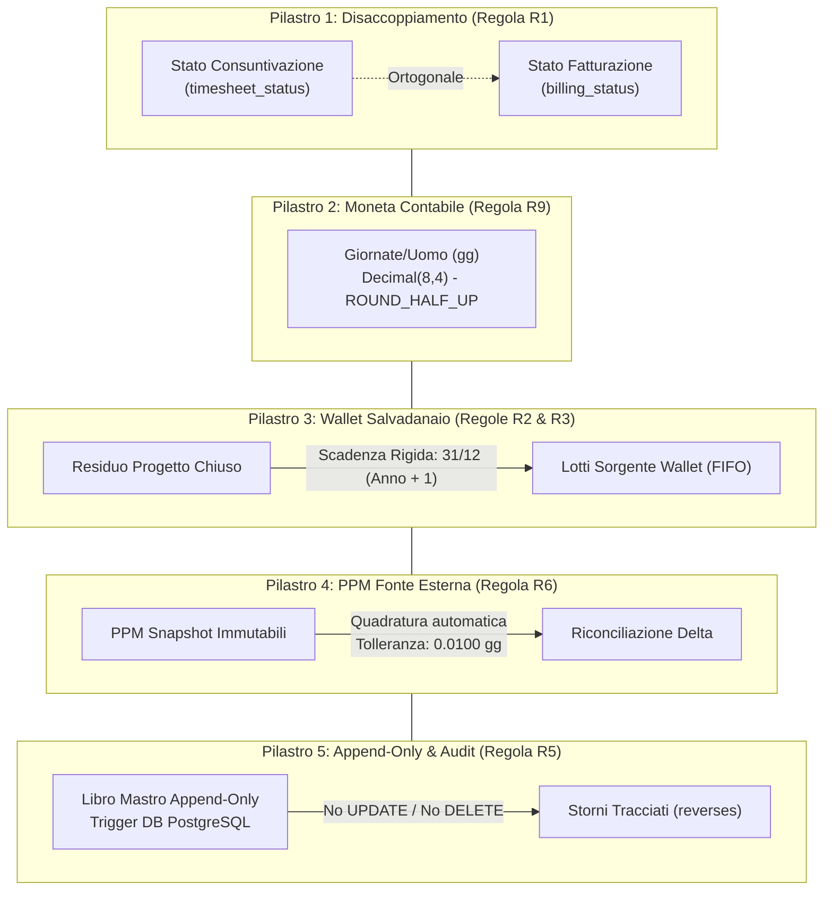
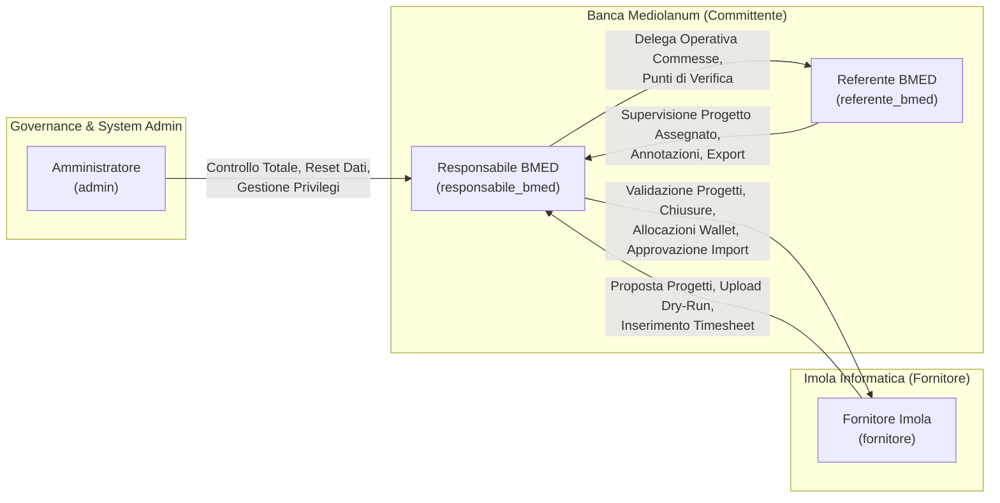
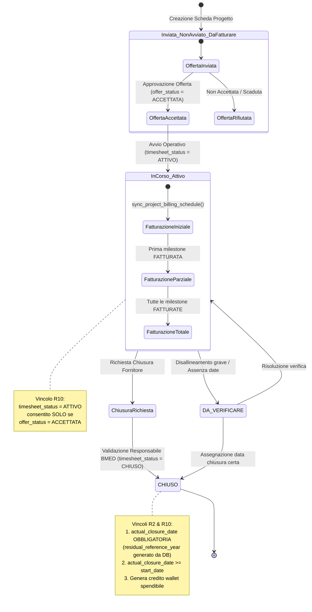
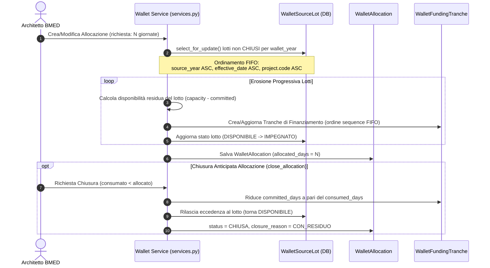
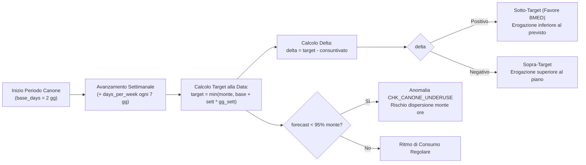
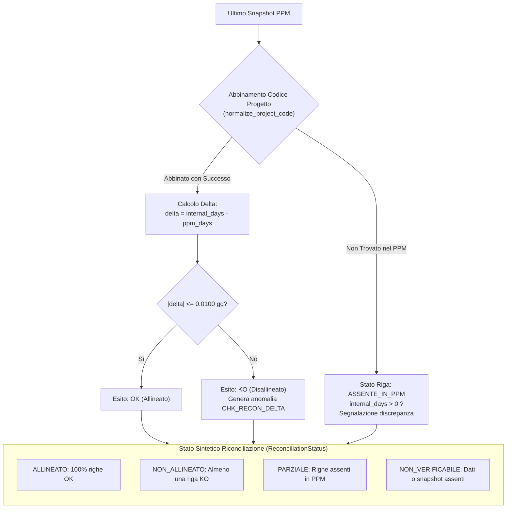
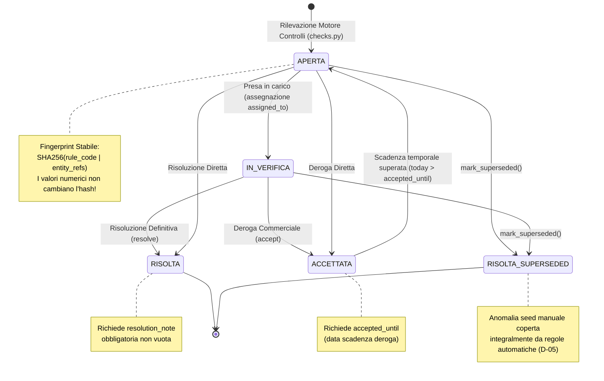
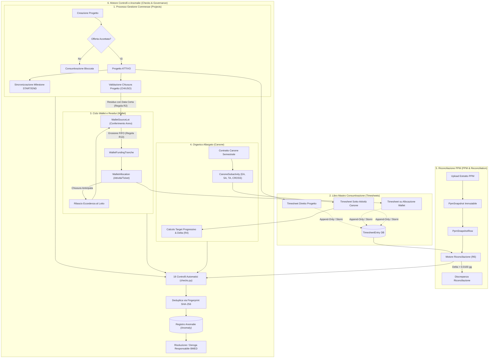

# 02 - Modello del Dominio Funzionale (Functional Domain Model) - Supplier Ledger

> **Stato del Documento**: IMPLEMENTED  
> **Versione**: 1.0.0  
> **Data di Rilascio**: 2026-10-28  
> **Destinatari**: Solution Architect, Business Analyst, Tech Lead, Project Manager  
> **Baseline Progetto**: `backend/` (`core`, `directory`, `projects`, `wallet`, `canone`, `ppm`, `timesheets`, `anomalies`, `imports`, `domain/`)  
> **Riferimenti Incrociati**:
> - [01_REPOSITORY_INVENTORY.md](./01_REPOSITORY_INVENTORY.md) (Inventario del repository e baseline software)
> - [05_TECHNICAL_ARCHITECTURE.md](./05_TECHNICAL_ARCHITECTURE.md) (Architettura software, componenti e pattern architetturali)
> - [06_DATA_MODEL.md](./06_DATA_MODEL.md) (Dettaglio schemi relazionali ORM, trigger DB e vincoli)
> - [07_API_CATALOG.md](./07_API_CATALOG.md) (Catalogo completo delle interfacce RESTful ed endpoint di dominio)
> - [08_BUSINESS_RULES.md](./08_BUSINESS_RULES.md) (Catalogo formale delle 18 regole di business R1-R18)
> - [09_SECURITY_AUTHORIZATION.md](./09_SECURITY_AUTHORIZATION.md) (Modello di sicurezza, ruoli e matrice di autorizzazione)
> - [12_DEPLOYMENT_OPERATIONS.md](./12_DEPLOYMENT_OPERATIONS.md) (Pipeline operative, backup, migrazioni e deployment)

---

## 1. Executive Overview del Dominio Funzionale

### 1.1 Il Contesto di Business: Committente e Fornitore
Il sistema **Supplier Ledger** è l'infrastruttura centrale di governo contabile, operativo ed economico che disciplina il rapporto di fornitura specialistica tra l'ufficio **Architetture IT di Banca Mediolanum (BMED)** (committente) e **Imola Informatica** (fornitore strategico di servizi professionali e architetturali).

Nel contesto bancario istituzionale, la Direzione Architetture IT gestisce decine di iniziative complesse distribuite su tre tipologie operative fondamentali:
1. **Progetti a Giornate (AQL - Accordi Quadro a Giornate)**: commesse con budget definito in giornate/uomo, deliverable specifici e date previste.
2. **Progetti a Corpo**: commesse con deliverable predefiniti e valore complessivo fisso.
3. **Canoni di Organico Allargato**: contratti semestrali o trimestrali finalizzati a garantire presidio architetturale continuo e flessibile per gli uffici specialistici (*Enterprise Architecture*, *Solution Architecture*, *Technology Architecture* e uffici orizzontali *CROSS*).
4. **Attività su PPM Interno**: commesse gestite direttamente nel portafoglio progetti aziendale BMED.

### 1.2 Le Sfide Strutturali Risolte dalla Piattaforma
Storicamente, la gestione di questi contratti era affidata a una composizione eterogenea di fogli di calcolo Excel condivisi, registrazioni manuali e snapshot periodici estratti dal sistema aziendale di Project Portfolio Management (**PPM**). Tale assetto generava criticità sistemiche:
- **Disallineamento Temporale tra Esecuzione e Fatturazione**: la consuntivazione delle prestazioni sul campo non coincideva con i flussi di fatturazione commerciale, rendendo impossibile capire in tempo reale se una commessa fosse completata operativamente o se vi fossero ancora fatture pendenti.
- **Dispersione Economica dei Residui di Budget**: al termine di progetti completati con un consumo inferiore al budget contrattualizzato, le giornate residue rimanevano disperse nei singoli conti d'ordine, senza una chiara tracciabilità temporale della loro fruibilità successiva.
- **Errori di Quadratura Aritmetica**: l'utilizzo di fogli di calcolo soggetti a formattazioni arbitrarie e arrotondamenti binari float (`0.1 + 0.2`) introduceva scostamenti contabili cumulativi non riconducibili a reali discrepanze operative.
- **Asimmetria Informativa committente-fornitore**: l'assenza di un registro comune certificato provocava contestazioni periodiche sulle giornate erogate e sullo stato di avanzamento delle attività.

### 1.3 I Cinque Pilastri Funzionali di Supplier Ledger



1. **Disaccoppiamento Ortogonale tra Consuntivazione e Fatturazione (Regola R1)**: Lo stato di avanzamento operativo dei consumi delle giornate (`timesheet_status`) e lo stato commerciale di incasso/liquidazione (`billing_status`) sono trattati come due dimensioni analitiche rigorosamente indipendenti. Un progetto può essere completato e chiuso dal punto di vista dell'erogazione pur mantenendo tranche di fatturazione pianificate nel tempo, o viceversa ([`backend/projects/models.py#L114-L125`](file:///c:/Users/gianvito.bleve/OneDrive%20-%20Banca%20Mediolanum%20SPA/Documenti/Progetti/imola/backend/projects/models.py#L114-L125)).
2. **Le Giornate/Uomo come Moneta Contabile Rigorosa (Regola R9)**: L'unità fondamentale del sistema è la giornata/uomo (8 ore lavorative). Tutte le grandezze temporali ed economiche sono memorizzate ed elaborate tramite il tipo [`DaysField`](file:///c:/Users/gianvito.bleve/OneDrive%20-%20Banca%20Mediolanum%20SPA/Documenti/Progetti/imola/backend/core/fields.py#L15-L28) (`Decimal(8,4)` con quantizzazione a `0.0001` gg e arrotondamento contabile `ROUND_HALF_UP`). L'uso dei tipi `float` IEEE 754 è categoricamente escluso dall'architettura del software ([`backend/domain/money.py#L1-L45`](file:///c:/Users/gianvito.bleve/OneDrive%20-%20Banca%20Mediolanum%20SPA/Documenti/Progetti/imola/backend/domain/money.py#L1-L45)).
3. **Il Wallet dei Residui come Salvadanaio a Scadenza Certa (Regole R2 & R3)**: Le giornate di budget non consuntivate alla chiusura di un progetto non vanno perdute, ma confluiscono nel **Wallet** (salvadanaio crediti). La fruibilità del credito è soggetta a una scadenza legale rigida: il 31 dicembre dell'anno successivo a quello di chiusura effettiva della commessa (`actual_closure_date.year + 1`). Il disponibile spendibile non è mai un numero cablato nel database, bensì il risultato di una formula di bilancio calcolata in tempo reale ([`backend/domain/residuals.py#L48-L110`](file:///c:/Users/gianvito.bleve/OneDrive%20-%20Banca%20Mediolanum%20SPA/Documenti/Progetti/imola/backend/domain/residuals.py#L48-L110), [`backend/domain/wallet_balance.py#L157-L289`](file:///c:/Users/gianvito.bleve/OneDrive%20-%20Banca%20Mediolanum%20SPA/Documenti/Progetti/imola/backend/domain/wallet_balance.py#L157-L289)).
4. **Il PPM come Fonte di Verità Esterna Certificata (Regola R6)**: Il sistema aziendale PPM di Banca Mediolanum è la fonte contabile autorevole esterna. Supplier Ledger acquisisce periodicamente gli estratti PPM preservandoli in snapshot immutabili ([`backend/ppm/models.py#L36-L67`](file:///c:/Users/gianvito.bleve/OneDrive%20-%20Banca%20Mediolanum%20SPA/Documenti/Progetti/imola/backend/ppm/models.py#L36-L67)), calcolando lo scostamento tra consuntivi interni e PPM con una tolleranza predefinita di `0.0100` gg (`DEFAULT_TOLERANCE`).
5. **Libro Mastro Append-Only e Tracciabilità Integrale (Regola R5)**: Nessuna registrazione contabile (`TimesheetEntry`) può essere modificata (`UPDATE`) o cancellata (`DELETE`). Qualsiasi correzione viene effettuata mediante un'operazione esplicita di storno contabile (`reverses`), garantita sia a livello di modello applicativo sia da trigger SQL nativo a livello PostgreSQL ([`backend/timesheets/models.py#L147-L170`](file:///c:/Users/gianvito.bleve/OneDrive%20-%20Banca%20Mediolanum%20SPA/Documenti/Progetti/imola/backend/timesheets/models.py#L147-L170)).

---

## 2. Glossario Funzionale di Business

La tabella seguente fornisce la definizione rigorosa di tutti i concetti, costrutti e grandezze contabili che compongono il dominio funzionale di Supplier Ledger.

| Termine Funzionale | Simbolo / Modello | Definizione di Business | Regole / Vincoli Associati | File di Riferimento |
| :--- | :--- | :--- | :--- | :--- |
| **Giornata/Uomo (gg)** | `DaysField` | Unità contabile fondamentale del dominio, corrispondente a 8 ore standard di erogazione specialistica. | Precisione a 4 cifre decimali (`0.0001` gg), arrotondamento `ROUND_HALF_UP`. Mai `float`. | [`core/fields.py#L15`](file:///c:/Users/gianvito.bleve/OneDrive%20-%20Banca%20Mediolanum%20SPA/Documenti/Progetti/imola/backend/core/fields.py#L15), [`domain/money.py#L12`](file:///c:/Users/gianvito.bleve/OneDrive%20-%20Banca%20Mediolanum%20SPA/Documenti/Progetti/imola/backend/domain/money.py#L12) |
| **Budget Progetto** | `Project.budget_days` | Monte complessivo delle giornate contrattualizzate per uno specifico progetto tra BMED e Imola. | Non negativo (`CheckConstraint: budget_days >= 0`). | [`projects/models.py#L93`](file:///c:/Users/gianvito.bleve/OneDrive%20-%20Banca%20Mediolanum%20SPA/Documenti/Progetti/imola/backend/projects/models.py#L93) |
| **Consuntivo Diretto** | `direct_consumed_days` | Somma algebrica delle giornate erogate e registrate direttamente a valere sulla commessa originaria. | Include eventuali movimenti di storno (con segno negativo). Append-only. | [`domain/residuals.py#L113`](file:///c:/Users/gianvito.bleve/OneDrive%20-%20Banca%20Mediolanum%20SPA/Documenti/Progetti/imola/backend/domain/residuals.py#L113), [`timesheets/models.py#L34`](file:///c:/Users/gianvito.bleve/OneDrive%20-%20Banca%20Mediolanum%20SPA/Documenti/Progetti/imola/backend/timesheets/models.py#L34) |
| **Consuntivo via Wallet** | `consumed_via_wallet_days` | Giornate consumate su attività esterne o ticket tecnici finanziati dalle quote wallet generate dal progetto. | Rilevato tramite join su `wallet_allocations.timesheet_entries`. | [`domain/residuals.py#L132`](file:///c:/Users/gianvito.bleve/OneDrive%20-%20Banca%20Mediolanum%20SPA/Documenti/Progetti/imola/backend/domain/residuals.py#L132) |
| **Residuo Operativo Progetto** | `residual_days` | Saldo algebrico delle giornate non consumate: `budget_days - direct_consumed - allocated_to_wallet`. | Calcolato a livello query; non persistito su colonna statica. | [`domain/residuals.py#L185`](file:///c:/Users/gianvito.bleve/OneDrive%20-%20Banca%20Mediolanum%20SPA/Documenti/Progetti/imola/backend/domain/residuals.py#L185) |
| **Quota Rilasciata al Wallet** | `released_to_wallet_days` | Anticipazione esplicita di una porzione del residuo di un progetto ancora attivo resa disponibile al wallet. | Permette l'utilizzo di economie previste senza attendere la chiusura formale del progetto. | [`projects/models.py#L94`](file:///c:/Users/gianvito.bleve/OneDrive%20-%20Banca%20Mediolanum%20SPA/Documenti/Progetti/imola/backend/projects/models.py#L94) |
| **Lotto Sorgente Wallet** | `WalletSourceLot` | Conferimento formale del residuo spendibile di un progetto chiuso con data certa nel monte wallet di un anno. | Unico per coppia `(wallet_year, source_project)`. Conserva `source_year` e data. | [`wallet/models.py#L121`](file:///c:/Users/gianvito.bleve/OneDrive%20-%20Banca%20Mediolanum%20SPA/Documenti/Progetti/imola/backend/wallet/models.py#L121) |
| **Allocazione Wallet** | `WalletAllocation` | Impegno formale di un plafond di giornate per una specifica attività o ticket assegnato a un architetto. | Stati: `APERTA`, `CHIUSA`. Motivi chiusura: `ESAURITA`, `CON_RESIDUO`. | [`wallet/models.py#L163`](file:///c:/Users/gianvito.bleve/OneDrive%20-%20Banca%20Mediolanum%20SPA/Documenti/Progetti/imola/backend/wallet/models.py#L163) |
| **Tranche di Finanziamento** | `WalletFundingTranche` | Singolo segmento di alimentazione di un'allocazione a valere su uno specifico lotto sorgente ordinato via FIFO. | Traccia `initial_reserved_days`, `committed_days` e `consumed_days`. | [`wallet/models.py#L270`](file:///c:/Users/gianvito.bleve/OneDrive%20-%20Banca%20Mediolanum%20SPA/Documenti/Progetti/imola/backend/wallet/models.py#L270) |
| **Canone (Organico Allargato)** | `Canone` | Contratto forfettario periodico (semestrale o trimestrale) che disciplina un monte giornate complessivo. | Vincolo `total_days > 0`. Traccia date limite ed estrazione. | [`canone/models.py#L49`](file:///c:/Users/gianvito.bleve/OneDrive%20-%20Banca%20Mediolanum%20SPA/Documenti/Progetti/imola/backend/canone/models.py#L49) |
| **Target Progressivo Canone** | `target` | Quota teorica di giornate che dovrebbero risultare erogate alla data corrente secondo il piano contrattuale. | Formula: $\min(monte, base + sett \times gg\_sett)$. Soglia allerta sottoutilizzo: 95%. | [`domain/canone_status.py#L34`](file:///c:/Users/gianvito.bleve/OneDrive%20-%20Banca%20Mediolanum%20SPA/Documenti/Progetti/imola/backend/domain/canone_status.py#L34) |
| **Sotto-Attività Canone** | `CanoneSubactivity` | Dettaglio operativo del canone associato a uno specifico ufficio architetturale (`EA`, `SA`, `TA`, `CROSS`). | Traccia `reserved_days`, `quarter_estimate_days`, `forecast_remaining_days`. | [`canone/models.py#L130`](file:///c:/Users/gianvito.bleve/OneDrive%20-%20Banca%20Mediolanum%20SPA/Documenti/Progetti/imola/backend/canone/models.py#L130) |
| **Milestone di Fatturazione** | `BillingMilestone` | Scadenza commerciale pianificata per l'emissione e liquidazione di una tranche economica. | Stati: `PIANIFICATA`, `FATTURATA`, `SPOSTATA`, `ANNULLATA`, `DA_VERIFICARE`. | [`projects/models.py#L230`](file:///c:/Users/gianvito.bleve/OneDrive%20-%20Banca%20Mediolanum%20SPA/Documenti/Progetti/imola/backend/projects/models.py#L230) |
| **Slot Automatico Milestone** | `BillingScheduleSlot` | Marcatura delle due milestone standard generate dal piano di progetto: `START` (avvio) ed `END` (fine). | Vincolo di unicità: massimo una milestone START e una END per commessa. | [`projects/models.py#L59`](file:///c:/Users/gianvito.bleve/OneDrive%20-%20Banca%20Mediolanum%20SPA/Documenti/Progetti/imola/backend/projects/models.py#L59), [`projects/billing.py#L20`](file:///c:/Users/gianvito.bleve/OneDrive%20-%20Banca%20Mediolanum%20SPA/Documenti/Progetti/imola/backend/projects/billing.py#L20) |
| **Snapshot PPM** | `PpmSnapshot` | Archiviazione immutabile e lossless di un estratto esportato periodicamente dal PPM aziendale. | Tipi: `PPM_WALLET`, `PPM_CANONE`, `PPM_PROGETTI`. Verifica quadratura totale. | [`ppm/models.py#L36`](file:///c:/Users/gianvito.bleve/OneDrive%20-%20Banca%20Mediolanum%20SPA/Documenti/Progetti/imola/backend/ppm/models.py#L36) |
| **Coda di Revisione** | `ReviewQueue` | Backlog operativo dei progetti chiusi senza data certa o in stato `DA_VERIFICARE` (Decisione D-03). | I residui rimangono bloccati finché l'utente non assegna una data effettiva valida. | [`domain/residuals.py#L269`](file:///c:/Users/gianvito.bleve/OneDrive%20-%20Banca%20Mediolanum%20SPA/Documenti/Progetti/imola/backend/domain/residuals.py#L269) |
| **Anomalia Contabile** | `Anomaly` | Segnalazione di violazione di coerenza rilevata dal motore dei 18 controlli automatici o dal seed. | Ciclo di vita: `APERTA`, `IN_VERIFICA`, `RISOLTA`, `ACCETTATA`. Fingerprint immutabile. | [`anomalies/models.py#L49`](file:///c:/Users/gianvito.bleve/OneDrive%20-%20Banca%20Mediolanum%20SPA/Documenti/Progetti/imola/backend/anomalies/models.py#L49) |
| **Fingerprint Anomalia** | `fingerprint` | Impronta hash SHA-256 univoca calcolata come `SHA256(rule_code \| entity_refs)`. Esclude i valori. | Garantisce deduplica esatta: modifiche di contesto aggiornano il record senza duplicati. | [`anomalies/models.py#L43`](file:///c:/Users/gianvito.bleve/OneDrive%20-%20Banca%20Mediolanum%20SPA/Documenti/Progetti/imola/backend/anomalies/models.py#L43) |
| **Storno Contabile** | `TimesheetEntry.reverses` | Registrazione di compensazione avente giornate di segno opposto a fronte di un movimento errato. | Unico meccanismo ammesso per correggere consuntivi errati senza infrangere l'append-only. | [`timesheets/models.py#L78`](file:///c:/Users/gianvito.bleve/OneDrive%20-%20Banca%20Mediolanum%20SPA/Documenti/Progetti/imola/backend/timesheets/models.py#L78) |

---

## 3. Gli Attori e i Ruoli del Sistema

L'accesso e le facoltà operative nel sistema sono definiti nel modulo [`backend/core/roles.py`](file:///c:/Users/gianvito.bleve/OneDrive%20-%20Banca%20Mediolanum%20SPA/Documenti/Progetti/imola/backend/core/roles.py) e mappati sui gruppi standard di Django. Il framework autorizzativo a grana fine è implementato in [`backend/core/capabilities.py`](file:///c:/Users/gianvito.bleve/OneDrive%20-%20Banca%20Mediolanum%20SPA/Documenti/Progetti/imola/backend/core/capabilities.py) e consente override dinamici tramite la tabella DB `RoleCapabilityOverride`.

### 3.1 Catalogo degli Attori di Dominio



#### 1. Amministratore (`admin`)
- **Descrizione**: Responsabile tecnico di piattaforma e sicurezza applicativa.
- **Perimetro di Dominio**:
  - Accesso incondizionato all'intero sistema e alla console Django Admin.
  - Esecuzione delle funzioni di manutenzione straordinaria e reset totale dati (`data.reset`).
  - Gestione account utente (`users.manage`) e configurazione privilegi/capability (`privileges.manage`).
  - Backup e ripristino transazionale del database.

#### 2. Responsabile BMED (`responsabile_bmed`)
- **Descrizione**: Responsabile apicale dell'ufficio Architetture IT di Banca Mediolanum.
- **Perimetro di Dominio**:
  - Ownership economica e contrattuale di tutte le commesse attive con Imola Informatica.
  - Approvazione e consolidamento definitivo dei batch di caricamento (`imports.apply`).
  - Convalida formale della chiusura dei progetti e conferimento dei residui al wallet (`projects.validate_closure`).
  - Delibera delle allocazioni di spesa sul monte wallet e ridimensionamento quote (`wallet.edit`).
  - Gestione operativa del canone semestrale e assegnazione sotto-attività agli uffici (`canone.manage`).
  - Risoluzione formale delle anomalie o rilascio di deroghe temporanee con data di scadenza (`anomalies.resolve`).

#### 3. Referente BMED (`referente_bmed`)
- **Descrizione**: Architetto senior dell'ufficio Architetture IT preposto alla guida tecnica di specifici progetti.
- **Perimetro di Dominio**:
  - Visibilità read-only completa sul quadro di commessa e rendicontazione economica.
  - Facoltà di annotazione ristretta esclusivamente ai progetti di cui risulta `client_owner` (`projects.annotate_own`):
    - Aggiornamento delle note di avanzamento e promemoria operativi.
    - Manutenzione della data di fine prevista (`planned_end_date`).
    - Apertura, commento e chiusura formale dei punti di verifica (`verification_points`).
  - Estrazione dei report e aggregazioni dati (`exports.run`).

#### 4. Fornitore Imola (`fornitore`)
- **Descrizione**: Project Manager e architetti specialisti di Imola Informatica.
- **Perimetro di Dominio**:
  - Censimento e proposta iniziale di nuove schede progetto e milestone (`projects.create`).
  - Caricamento degli estratti periodici PPM e workbook in modalità simulata/dry-run (`imports.upload`).
  - Proposta di avanzamento e richiesta di validazione della chiusura progetti (`projects.validate_closure`).
  - Inserimento delle rendicontazioni di timesheet operativo (`timesheets.create`).
  - Consultazione ed export dei dati di propria pertinenza (`exports.run`).

### 3.2 Matrice Canonica Capability vs Ruoli

La tabella seguente riporta la configurazione canonica delle 15 capability di sistema ([`backend/core/capabilities.py#L25-L73`](file:///c:/Users/gianvito.bleve/OneDrive%20-%20Banca%20Mediolanum%20SPA/Documenti/Progetti/imola/backend/core/capabilities.py#L25-L73)):

| Codice Capability | Descrizione Funzionale | Admin (`admin`) | Responsabile BMED (`responsabile_bmed`) | Referente BMED (`referente_bmed`) | Fornitore (`fornitore`) |
| :--- | :--- | :---: | :---: | :---: | :---: |
| `data.reset` | Ripristino totale / svuotamento dati di esercizio (Riservata) | **SI** | NO | NO | NO |
| `users.manage` | Creazione, abilitazione e modifica anagrafica utenti (Riservata) | **SI** | NO | NO | NO |
| `privileges.manage` | Modifica override matrice capability (Riservata) | **SI** | NO | NO | NO |
| `projects.create` | Creazione nuove schede progetto e configurazione iniziale | **SI** | **SI** | NO | **SI** |
| `projects.edit` | Modifica massiva anagrafica, budget e date contrattuali | **SI** | **SI** | NO | NO |
| `projects.validate_closure` | Transizione stato a CHIUSO e rilascio residui a wallet | **SI** | **SI** | NO | **SI** |
| `projects.annotate_own` | Modifica note, planned_end_date e punti verifica propri | **SI** | **SI** | **SI** (solo owner) | NO |
| `timesheets.create` | Inserimento consuntivi sul libro mastro append-only | **SI** | **SI** | NO | **SI** |
| `wallet.edit` | Creazione allocazioni wallet, ridimensionamento e chiusura | **SI** | **SI** | NO | NO |
| `canone.manage` | Manutenzione parametri canone, sotto-attività e target | **SI** | **SI** | NO | NO |
| `accounting.adjust` | Registrazione storni contabili e rettifiche di riconciliazione | **SI** | **SI** | NO | NO |
| `imports.upload` | Caricamento file (Excel/PPM) in modalità simulata DRY-RUN | **SI** | **SI** | NO | **SI** |
| `imports.apply` | Consolidamento transazionale definitivo del batch importato | **SI** | **SI** | NO | NO |
| `exports.run` | Esportazione workbook Excel e report aggregati | **SI** | **SI** | **SI** | **SI** |
| `anomalies.resolve` | Risoluzione anomalie e concessione deroghe temporanee | **SI** | **SI** | NO | NO |

> [!IMPORTANT]
> Le tre capability `data.reset`, `users.manage` e `privileges.manage` sono dichiarate in `RESERVED_CAPABILITIES` ([`backend/core/capabilities.py#L75`](file:///c:/Users/gianvito.bleve/OneDrive%20-%20Banca%20Mediolanum%20SPA/Documenti/Progetti/imola/backend/core/capabilities.py#L75)). Il sistema impedisce programmaticamente l'assegnazione di tali privilegi a ruoli diversi da `admin`, anche in presenza di record di override manuale nel database.

---

## 4. Ciclo di Vita dei Progetti e degli Stati Contabili (Regola R1 & R10)

### 4.1 L'Ortogonalità Tridimensionale degli Stati
Nel modello dati di Supplier Ledger non esiste un generico "stato del progetto". Conformemente alla **Regola R1** ([`backend/projects/models.py#L3`](file:///c:/Users/gianvito.bleve/OneDrive%20-%20Banca%20Mediolanum%20SPA/Documenti/Progetti/imola/backend/projects/models.py#L3)), l'avanzamento di una commessa è tracciato da tre dimensioni contabili e contrattuali mutuamente indipendenti:

```mermaid
flowchart TD
    subgraph D1["1. Dimensione Contrattuale: offer_status"]
        O_INV["INVIATA"] -->|Accettazione BMED| O_ACC["ACCETTATA"]
        O_INV -->|Decadenza| O_SCA["SCADUTA"]
        O_INV -->|Rifiuto formale| O_NON["NON_ACCETTATA"]
    end

    subgraph D2["2. Dimensione Operativa: timesheet_status"]
        T_NAV["NON_AVVIATO"] -->|Avvio Lavori (Solo se ACCETTATA)| T_ATT["ATTIVO"]
        T_ATT -->|Chiusura (Richiede actual_closure_date)| T_CHI["CHIUSO"]
        T_NAV -.->|Incertezza Seed/PPM| T_VER["DA_VERIFICARE"]
        T_ATT -.->|Anomalia Consuntivi| T_VER
    end

    subgraph D3["3. Dimensione Commerciale: billing_status"]
        B_DAF["DA_FATTURARE"] -->|Prima Tranche Emessa| B_PAR["PARZIALE"]
        B_PAR -->|Saldo Integrale Incassato| B_TOT["TOTALE"]
        B_DAF -->|Rinuncia/Storno| B_NON["NON_FATTURABILE"]
        B_DAF -.->|Scostamento Scadenze| B_VER["DA_VERIFICARE"]
    end

    O_ACC ==>|Prerequisito Vincolante| T_ATT
```

### 4.2 Diagramma di Stato e Transizioni Vincolate

Il diagramma seguente formalizza le transizioni ammesse e i controlli applicativi implementati in `Project.clean()` ([`backend/projects/models.py#L197-L228`](file:///c:/Users/gianvito.bleve/OneDrive%20-%20Banca%20Mediolanum%20SPA/Documenti/Progetti/imola/backend/projects/models.py#L197-L228)):



### 4.3 Vincoli di Integrità e Validazione di Modello
Il ciclo di vita del progetto è presidiato da tre livelli di vincolo:

1. **Prerequisito di Consuntivazione (Regola R10)**:
   ```python
   # backend/projects/models.py
   if self.timesheet_status == TimesheetStatus.ATTIVO and self.offer_status != OfferStatus.ACCETTATA:
       errors["timesheet_status"] = "Il progetto non può passare ad ATTIVO se l'offerta non è ACCETTATA."
   ```
2. **Obbligatorietà della Data di Chiusura e Deroga Seed (Decisioni D-03 e D-14)**:
   Un progetto marcato come `CHIUSO` deve obbligatoriamente valorizzare `actual_closure_date`. L'unica eccezione transitoria ammessa è riservata ai record importati dai caricamenti storici (`SEED_JSON` o `WORKBOOK_JSON`), gestiti a livello di constraint database e trigger SQL dedicato (`trg_project_closed_requires_seed_batch`):
   ```python
   # backend/projects/models.py
   if self.timesheet_status == TimesheetStatus.CHIUSO and self.actual_closure_date is None:
       if not is_seed:
           errors["actual_closure_date"] = "La data di chiusura è obbligatoria per un progetto CHIUSO..."
   ```
3. **Consistenza Cronologica delle Date**:
   A livello di check constraint database (`backend/projects/models.py#L164-L169`), `planned_end_date >= start_date` e `actual_closure_date >= start_date`. Qualsiasi inversione temporale viene intercettata preventivamente.

---

## 5. Il Ciclo di Vita del Wallet e dei Residui (Regole R2, R3, R13)

### 5.1 La Regola R2: Anno di Riferimento e Scadenza del Residuo
Quando una commessa si conclude senza che l'intero budget sia stato consumato, il residuo contabile maturato può essere riutilizzato per finanziare nuove attività architetturali. La **Regola R2** stabilisce le norme perenni di eleggibilità e scadenza del credito:

1. **Determinazione dell'Anno di Riferimento (`residual_reference_year`)**:
   L'anno di riferimento del residuo deriva in modo deterministico e non sovrascrivibile dall'anno solare della data di chiusura effettiva (`actual_closure_date.year`). Nel modello relazionale, questo valore è memorizzato tramite una colonna generata e persistita dal database ([`backend/projects/models.py#L128-L133`](file:///c:/Users/gianvito.bleve/OneDrive%20-%20Banca%20Mediolanum%20SPA/Documenti/Progetti/imola/backend/projects/models.py#L128-L133)):
   $$\text{residual\_reference\_year} = \text{EXTRACT(YEAR FROM actual\_closure\_date)}$$
2. **Data Limite di Spendibilità (`last_usable_day`)**:
   Il residuo è spendibile fino al **31 dicembre dell'anno successivo** a quello di chiusura ([`backend/domain/residuals.py#L48-L51`](file:///c:/Users/gianvito.bleve/OneDrive%20-%20Banca%20Mediolanum%20SPA/Documenti/Progetti/imola/backend/domain/residuals.py#L48-L51)):
   $$\text{Deadline} = \text{Date}(\text{actual\_closure\_date.year} + 1, 12, 31)$$
   *Esempio*: Un progetto chiuso il 15 marzo 2025 genera un residuo spendibile fino al 31 dicembre 2026.
3. **I Cinque Stati di Validità del Residuo (`ResidualState`)**:
   Il motore di dominio valuta lo stato di ciascun residuo in funzione della data di osservazione (`today`):
   - **`VALIDO`**: Progetto `CHIUSO` con data certa; scadenza residua superiore a 90 giorni ($\text{remaining} > 90\text{ gg}$). Il credito è pienamente spendibile nel wallet.
   - **`IN_SCADENZA`**: Progetto `CHIUSO` con data certa; scadenza compresa nella finestra di guardia di 90 giorni ($0 \le \text{remaining} \le 90\text{ gg}$). Il credito è spendibile ma prioritario per evitare la decadenza.
   - **`SCADUTO`**: Progetto `CHIUSO` con data certa la cui deadline è trascorsa ($\text{remaining} < 0$). Il credito decade definitivamente e non è più spendibile.
   - **`DA_VERIFICARE`**: Progetto `CHIUSO` privo di data effettiva o con consuntivazione in stato `DA_VERIFICARE`. Il credito è congelato e non genera capienza wallet fino a regolarizzazione nella Coda di Revisione (D-03).
   - **`NON_DISPONIBILE`**: Progetto ancora `ATTIVO` o `NON_AVVIATO`. Il saldo operativo teorico non costituisce credito wallet (salvo esplicito rilascio tramite `released_to_wallet_days`).

### 5.2 La Regola R3: Calcolo Dinamico della Disponibilità Wallet
La capienza e la disponibilità del Wallet annuale **non sono mai campi memorizzati staticamente nel database**, poiché qualsiasi aggiornamento di consuntivo altererebbe i saldi. La **Regola R3** ([`backend/domain/wallet_balance.py#L1-L289`](file:///c:/Users/gianvito.bleve/OneDrive%20-%20Banca%20Mediolanum%20SPA/Documenti/Progetti/imola/backend/domain/wallet_balance.py#L1-L289)) calcola le grandezze per aggregazione analitica real-time:

$$\begin{aligned}
\text{disponibile\_anno} = &\sum_{\text{allocazioni aperte}} (\text{allocated\_days} - \text{consumed\_days}) \\
&+ \sum_{\text{progetti R2}} \text{residui non allocati validi/in scadenza}
\end{aligned}$$

#### Scomposizione degli Aggregati del Bilancio Wallet (`WalletYearBalance`):
1. **Totale Allocato (`allocated_days`)**: Somma delle giornate impegnate su tutte le allocazioni formalizzate nell'anno di wallet.
2. **Consumato Allocazioni (`consumed_days`)**: Somma delle giornate consuntivate (`TimesheetEntry`) a fronte delle allocazioni registrate.
3. **Disponibile da Allocazioni Aperte (`available_from_open_allocations`)**: Quota impegnata ma non ancora erogata sulle allocazioni con `status = APERTA`.
4. **Capienza Potenziale Origini (`potential_wallet_capacity`)**: Totale delle risorse monetizzabili nell'anno, dato dalla somma della capacità conferita dai lotti sorgente (`WalletSourceLot`), eventuali rilasci anticipati (`released_to_wallet_days`) e rettifiche di riconciliazione workbook (`reconciliation_adjustment_days`).
5. **Residuo Wallet Non Allocato (`unallocated_capacity`)**:
   $$\text{unallocated\_capacity} = \max(0, \text{potential\_wallet\_capacity} - \text{allocated\_days})$$
6. **Residui Potenziali da Verificare (`unverified_potential_days`)**: Somma dei saldi dei progetti in coda di revisione; mantenuta in un indicatore separato per evitare sopravvalutazioni patrimoniali improprie.

### 5.3 Il Motore FIFO di Erosione dei Lotti Sorgente (Regola R13)
Nel wallet, le allocazioni non attingono a una massa indistinta, ma a specifici **Lotti Sorgente** (`WalletSourceLot`) che mantengono memoria del progetto originario e dell'anno di competenza.



#### Regole Operative del Motore FIFO ([`backend/wallet/services.py`](file:///c:/Users/gianvito.bleve/OneDrive%20-%20Banca%20Mediolanum%20SPA/Documenti/Progetti/imola/backend/wallet/services.py)):
1. **Priorità Rigorosa di Consumo (`reserve_fifo`)**: I lotti sono agganciati partendo da quelli con anno di provenienza più anziano (`source_year`), seguiti dalla data di conferimento (`effective_date`) e dal codice progetto in ordine alfabetico (`source_project__code`).
2. **Tracciamento per Tranche (`WalletFundingTranche`)**: Per ciascun lotto coinvolto, viene creata una tranche di finanziamento avente sequenza progressiva (`sequence = 1, 2, ...`), memorizzando sia la riserva iniziale (`initial_reserved_days`) sia l'impegno effettivo (`committed_days`).
3. **Sincronizzazione Dinamica dei Consumi (`sync_allocation_funding`)**: Quando un architetto registra un consuntivo a valere sull'allocazione, le giornate consumate erodono le tranche secondo la sequenza ordinata.
4. **Restituzione delle Eccedenze alla Chiusura (`close_allocation`)**: Quando un'allocazione viene chiusa anticipatamente con ore residue non consumate:
   - Le quote impegnate non erogate (`committed_days - consumed_days`) vengono rilasciate istantaneamente al lotto sorgente originario.
   - Lo stato dell'allocazione passa a `CHIUSA` con motivazione `CON_RESIDUO` ([`backend/wallet/models.py#L31-L34`](file:///c:/Users/gianvito.bleve/OneDrive%20-%20Banca%20Mediolanum%20SPA/Documenti/Progetti/imola/backend/wallet/models.py#L31-L34)).
   - La capienza del lotto sorgente torna disponibile per nuove allocazioni.

---

## 6. Organico Allargato e Canoni (Regola R4)

### 6.1 Natura Economica del Canone
Il contratto di **Canone (Organico Allargato)** risponde alla necessità di garantire continuità operativa e supporto specialistico flessibile agli uffici di architettura IT di Banca Mediolanum. A differenza dei progetti AQL, il canone si caratterizza per:
- **Corrispettivo a Forfeit**: L'erogazione economica non è liquidata a consuntivo orario minuto, ma su base forfettaria semestrale o trimestrale.
- **Monitoraggio del Tasso di Utilizzo (Burn-Down)**: Il sistema verifica costantemente che il committente stia fruendo del servizio con ritmo coerente con le settimane lavorative trascorse, evitando concentrazioni massive a fine periodo o sottoutilizzi irreversibili.

### 6.2 Formula del Target Progressivo e Regola R4
Il controllo di avanzamento del canone è implementato in [`backend/domain/canone_status.py`](file:///c:/Users/gianvito.bleve/OneDrive%20-%20Banca%20Mediolanum%20SPA/Documenti/Progetti/imola/backend/domain/canone_status.py):

$$\text{weeks} = \max\left(0, \lfloor(\text{today} - \text{start\_date}).\text{days} / 7\rfloor\right)$$

$$\text{target} = \min\left(\text{total\_days}, \text{base\_days} + (\text{weeks} \times \text{days\_per\_week})\right)$$

$$\text{delta} = \text{target} - \text{consumed\_days}$$

$$\text{forecast} = \text{consumed\_days} + \sum \text{forecast\_remaining\_days}$$



- **Interpretazione del Delta Contabile**: Un `delta` positivo indica che il fornitore ha consuntivato meno giornate rispetto al ritmo teorico concordato (a favore BMED).
- **Soglia di Sottoutilizzo (`UNDERUSE_THRESHOLD = 0.95`)**: Se il valore proiettato a fine semestre (`forecast`) risulta inferiore al 95% del monte complessivo contrattualizzato, scatta automaticamente l'anomalia `CHK_CANONE_UNDERUSE` ([`backend/domain/checks.py#L447-L467`](file:///c:/Users/gianvito.bleve/OneDrive%20-%20Banca%20Mediolanum%20SPA/Documenti/Progetti/imola/backend/domain/checks.py#L447-L467)).
- **Destinazione del Residuo Inutilizzato (Decisione D-01)**: Come specificato nelle decisioni architetturali di progetto, le giornate di canone non consuntivate a fine semestre non possono essere riversate automaticamente nel wallet crediti: restano come indicatore a credito di rendicontazione tra le parti.

### 6.3 Struttura degli Uffici e Prevenzione del Doppio Conteggio (Regola R8)
Le attività svolte all'interno del canone sono censite in sotto-attività ([`backend/canone/models.py#L130-L194`](file:///c:/Users/gianvito.bleve/OneDrive%20-%20Banca%20Mediolanum%20SPA/Documenti/Progetti/imola/backend/canone/models.py#L130-L194)) e suddivise per ufficio competente:
- **`EA` (Enterprise Architecture)**: Iniziative strategiche di governance architetturale d'impresa, roadmap ed evoluzione applicativa globale.
- **`SA` (Solution Architecture)**: Definizione e disegno delle architetture di progetto e soluzioni applicative specifiche per le linee di business.
- **`TA` (Technology Architecture)**: Standard tecnologici, infrastrutture cloud, middleware, security framework e linee guida di ingegneria del software.
- **`CROSS`**: Coordinamento trasversale, advisory e supporto multidisciplinare.

#### Prevenzione del Doppio Conteggio Redmine (`CHK_DOUBLE_COUNT`):
Spesso le attività tecniche sono tracciate su issue tracker **Redmine** tramite ticket numerati (es. `#300228`). Il motore controlli esegue una scansione incrociata tra le sotto-attività del canone e le allocazioni del wallet:
- Qualora un identificativo Redmine figuri simultaneamente collegato a una sotto-attività di canone e a un'allocazione wallet con giornate consuntivate, scatta tempestivamente l'anomalia ad alta severità `CHK_DOUBLE_COUNT` ([`backend/domain/checks.py#L428-L444`](file:///c:/Users/gianvito.bleve/OneDrive%20-%20Banca%20Mediolanum%20SPA/Documenti/Progetti/imola/backend/domain/checks.py#L428-L444)), impedendo che la medesima prestazione lavorativa venga contabilizzata due volte a carico della banca.

---

## 7. Fatturazione Commerciale e Milestone di Progetto (Regola R11)

### 7.1 Il Ciclo di Vita delle Milestone
La gestione della fatturazione è demandata all'entità [`BillingMilestone`](file:///c:/Users/gianvito.bleve/OneDrive%20-%20Banca%20Mediolanum%20SPA/Documenti/Progetti/imola/backend/projects/models.py#L230-L291), collegata al progetto e regolata da un proprio ciclo di vita:
- **`PIANIFICATA`**: Tranche commerciale inserita nel piano di fatturazione con data prevista (`planned_date`).
- **`FATTURATA`**: Tranche emessa e certificata, con registrazione della data effettiva di liquidazione (`actual_date`).
- **`SPOSTATA`**: Tranche rinegoziata e slittata temporalmente rispetto alla pianificazione iniziale.
- **`ANNULLATA`**: Tranche revocata a seguito di modifiche contrattuali o commesse non fatturabili.
- **`DA_VERIFICARE`**: Tranche la cui data o importo è oggetto di contestazione o incertezza documentale.

### 7.2 Piano Automatico a Due Tranche (`BillingScheduleSlot`)
Per semplificare la governance delle commesse standard, la funzione di sincronizzazione automatica ([`backend/projects/billing.py#L19-L67`](file:///c:/Users/gianvito.bleve/OneDrive%20-%20Banca%20Mediolanum%20SPA/Documenti/Progetti/imola/backend/projects/billing.py#L19-L67)) gestisce due slot di fatturazione automatici posizionati all'ultimo giorno del mese:
1. **Slot `START`**: associato a `month_end(project.start_date)`.
2. **Slot `END`**: associato a `month_end(project.planned_end_date)`.

Un vincolo di unicità a livello database (`unique_project_billing_schedule_slot`) assicura l'impossibilità di generare duplicati per i due slot istituzionali del progetto. La coerenza con lo stato di fatturazione complessivo (`billing_status`) viene mantenuta dinamicamente:

| Stato Progetto (`billing_status`) | Stato Slot START | Stato Slot END |
| :--- | :--- | :--- |
| `DA_FATTURARE` | `PIANIFICATA` | `PIANIFICATA` |
| `PARZIALE` | `FATTURATA` | `PIANIFICATA` |
| `TOTALE` | `FATTURATA` | `FATTURATA` |
| `NON_FATTURABILE` | `ANNULLATA` | `ANNULLATA` |
| `DA_VERIFICARE` | `DA_VERIFICARE` | `DA_VERIFICARE` |

### 7.3 Disciplina degli Slittamenti (`move_to`) e Regola R11
La rinegoziazione dei termini di fatturazione è un processo formalizzato. In conformità alla **Regola R11** ([`backend/projects/models.py#L272-L291`](file:///c:/Users/gianvito.bleve/OneDrive%20-%20Banca%20Mediolanum%20SPA/Documenti/Progetti/imola/backend/projects/models.py#L272-L291)):
- **Motivazione Obbligatoria**: Il metodo `move_to(new_date, reason, user)` solleva un errore bloccante di validazione (`ValidationError`) se la motivazione fornita è assente, vuota o costituita da soli spazi.
- **Audit Trail Strutturato nel campo JSON `moves`**: A ogni spostamento viene aggiunto un elemento cronologico immutabile contenente data di partenza, data di destinazione, motivazione, autore (`spostata_da`) e timestamp UTC (`spostata_il`).
- **Contatore Incrementale (`move_count`)**: Il sistema aggiorna un contatore progressivo degli spostamenti.
- **Rilevamento Anomalie (`CHK_MILESTONE_SLIPPED`)**: Il motore controlli segnala come anomala qualsiasi milestone che abbia subito **più di 2 spostamenti** oppure il cui slittamento complessivo superi i **60 giorni** rispetto alla pianificazione originaria ([`backend/domain/checks.py#L547-L585`](file:///c:/Users/gianvito.bleve/OneDrive%20-%20Banca%20Mediolanum%20SPA/Documenti/Progetti/imola/backend/domain/checks.py#L547-L585)).

---

## 8. Riconciliazione PPM e Fonte di Verità (Regola R6)

### 8.1 Il Ruolo Contabile del PPM
Nell'ecosistema informativo di Banca Mediolanum, il sistema proprietario di **Project Portfolio Management (PPM)** rappresenta la fonte di verità contabile istituzionale per il consuntivo delle prestazioni erogate dai fornitori esterni.
Periodicamente, la committente o il fornitore esportano gli estratti PPM che vengono acquisiti da Supplier Ledger sotto forma di **Snapshot Immutabili** ([`backend/ppm/models.py#L36-L67`](file:///c:/Users/gianvito.bleve/OneDrive%20-%20Banca%20Mediolanum%20SPA/Documenti/Progetti/imola/backend/ppm/models.py#L36-L67)).

### 8.2 Il Modello di Confronto e la Formula del Delta (Regola R6)
Il motore di riconciliazione contabile ([`backend/domain/reconciliation.py#L97-L216`](file:///c:/Users/gianvito.bleve/OneDrive%20-%20Banca%20Mediolanum%20SPA/Documenti/Progetti/imola/backend/domain/reconciliation.py#L97-L216)) opera a livello di singola commessa, confrontando il monte consuntivo registrato internamente con il totale risultante dall'ultimo estratto PPM disponibile:

$$\text{internal\_days} = \text{direct\_consumed\_days} + \text{consumed\_via\_wallet\_days}$$

$$\text{delta} = \text{internal\_days} - \text{ppm\_days}$$

$$\text{within\_tolerance} \iff |\text{delta}| \le \text{DEFAULT\_TOLERANCE}\quad (0.0100\text{ gg})$$



### 8.3 Normalizzazione dei Codici e Righe Non Riconciliate
Le discrepanze tra stringhe di testo e naming convention negli estratti PPM vengono gestite mediante due algoritmi specifici:
1. **Normalizzazione Codici Progetto (`normalize_project_code`)**: Rimuove spazi, trattini bassi, converte in maiuscolo e strip i prefissi/suffissi bancari (`BMED-` e `-BMED`). In questo modo, codici scritti come `bmed_im_01` e `IM-01` vengono associati alla medesima commessa con certezza matematica ([`backend/ppm/models.py#L21-L28`](file:///c:/Users/gianvito.bleve/OneDrive%20-%20Banca%20Mediolanum%20SPA/Documenti/Progetti/imola/backend/ppm/models.py#L21-L28)).
2. **Coda delle Righe PPM Senza Progetto (`unmatched_ppm_rows`)**: Le righe presenti nell'estratto PPM che non trovano corrispondenza con alcun progetto né sotto-attività a canone vengono isolate e convogliate nella coda di verifica, evitando perdite di dati o scarti silenziosi ([`backend/domain/reconciliation.py#L219-L225`](file:///c:/Users/gianvito.bleve/OneDrive%20-%20Banca%20Mediolanum%20SPA/Documenti/Progetti/imola/backend/domain/reconciliation.py#L219-L225)).

---

## 9. Motore di Controllo delle Anomalie (Regole R7 & R8)

### 9.1 I 18 Controlli Automatici di Consistenza
Il motore di verifica della consistenza dati ([`backend/domain/checks.py`](file:///c:/Users/gianvito.bleve/OneDrive%20-%20Banca%20Mediolanum%20SPA/Documenti/Progetti/imola/backend/domain/checks.py)) esegue 18 regole di audit deterministiche, catalogate nella tabella sottostante:

| # | Codice Regola (`rule_code`) | Severità | Ambito (`scope`) | Condizione di Attivazione e Logica di Dominio | Azione Suggerita al Business |
| :-: | :--- | :---: | :---: | :--- | :--- |
| 1 | `CHK_DATE_ORDER` | ALTA | PROGETTO | `planned_end_date < start_date` oppure `actual_closure_date < start_date`. | Correggere le date nella scheda progetto. |
| 2 | `CHK_END_PASSED_ACTIVE` | MEDIA | PROGETTO | Progetto `ATTIVO` con data fine prevista superata da oltre 30 giorni. | Verificare avanzamento e aggiornare scadenza o chiudere. |
| 3 | `CHK_CLOSED_NO_DATE` | ALTA | PROGETTO | Progetto `CHIUSO` privo di `actual_closure_date` (proveniente da seed). | Assegnare data effettiva nella coda di revisione. |
| 4 | `CHK_OVERRUN_PROJECT` | ALTA | PROGETTO | Consuntivi diretti superiori al budget (`residual_days < 0`). | Autorizzare variante di budget o stornare consuntivi eccedenti. |
| 5 | `CHK_OVERRUN_ALLOCATION`| ALTA | WALLET | Consuntivi su allocazione superiori alle giornate impegnate. | Registrare storno o incrementare budget allocazione. |
| 6 | `CHK_ALLOC_EXCEEDS_RESIDUAL` | ALTA | WALLET | Allocazioni totali sul progetto superiori al residuo spendibile disponibile. | Ridurre allocazioni o rilasciare quote non utilizzate. |
| 7 | `CHK_RESIDUAL_EXPIRING` | MEDIA | WALLET | Residuo valido che scade entro la finestra di allerta dei 90 giorni. | Impegnare residuo su nuove attività prima della decadenza. |
| 8 | `CHK_RESIDUAL_UNALLOCATED_CLOSED` | BASSA | WALLET | Progetto chiuso con residuo valido > 1 gg non ancora allocato a wallet. | Valutare conferimento formale in lotto sorgente wallet. |
| 9 | `CHK_ALLOC_FROM_EXPIRED`| ALTA | WALLET | Allocazione wallet aperta alimentata da un residuo ormai `SCADUTO`. | Chiudere l'allocazione e stornare la quota scaduta. |
| 10 | `CHK_RECON_DELTA` | ALTA | RICONCILIAZIONE | Scostamento tra consuntivi interni e PPM superiore a `0.0100` gg. | Allineare i consuntivi importando estratto PPM aggiornato. |
| 11 | `CHK_MISSING_IN_PPM` | MEDIA | RICONCILIAZIONE | Progetto con consuntivi interni (>0) non censito nell'estratto PPM. | Verificare censimento commessa sul PPM con fornitore. |
| 12 | `CHK_DOUBLE_COUNT` | ALTA | DOPPIO_CONTEGGIO| Medesimo ticket Redmine presente sia su canone che su allocazione wallet. | Rimuovere riferimento duplicato da uno dei due rami. |
| 13 | `CHK_CANONE_UNDERUSE` | MEDIA | CANONE | Forecast fine semestre inferiore al 95% del monte complessivo. | Rimodulare carichi e pianificare erogazioni specialistiche. |
| 14 | `CHK_CANONE_OVERUSE` | ALTA | CANONE | Consuntivato totale a canone superiore al monte complessivo contrattualizzato. | Congelare consuntivazione o formalizzare atto integrativo. |
| 15 | `CHK_ACTIVE_WITHOUT_OFFER` | ALTA | PROGETTO | Progetto in stato `ATTIVO` con offerta non in stato `ACCETTATA`. | Regolarizzare formalizzazione offerta commerciale. |
| 16 | `CHK_ALLOC_NO_SOURCE` | MEDIA | WALLET | Allocazione attiva priva di progetto sorgente o lotti FIFO associati. | Associare progetto di provenienza per attribuzione costi. |
| 17 | `CHK_UNVERIFIED_DATA` | MEDIA | PROGETTO | Progetto o allocazione con punti di verifica (`verification_points`) aperti. | Completare revisione dei punti di verifica documentale. |
| 18 | `CHK_MILESTONE_SLIPPED` | MEDIA | PROGETTO | Milestone con più di 2 spostamenti o ritardo complessivo > 60 giorni. | Rivedere pianificazione contrattuale con l'amministrazione. |

### 9.2 Deduplica Deterministica e Ciclo di Vita delle Anomalie (Regola R7)
Il tracciamento delle anomalie adotta una politica rigorosa di persistenza in [`backend/anomalies/models.py`](file:///c:/Users/gianvito.bleve/OneDrive%20-%20Banca%20Mediolanum%20SPA/Documenti/Progetti/imola/backend/anomalies/models.py):



1. **Fingerprint Univoco Immutabile (`build_fingerprint`)**:
   L'impronta digitale dell'anomalia è generata unicamente dall'unione del codice regola e dai riferimenti alle entità coinvolte, **escludendo categoricamente i valori numerici o le date contingenti**:
   $$\text{fingerprint} = \text{SHA-256}(\text{rule\_code} \parallel \text{entity\_ref}_1 \parallel \dots)$$
   Quando il runner riesegue i controlli, se l'anomalia è già presente nel database, il record non viene duplicato: vengono aggiornati il contesto JSON (`context`), la descrizione e il timestamp di ultimo riscontro (`last_seen_at`).
2. **Concessione di Deroghe a Termine (`accept`)**:
   Il Responsabile BMED può accettare formalmente una situazione anomala (ad esempio un ritardo autorizzato per motivi contingenti) impostando una data di scadenza della deroga (`accepted_until`). Durante la validità della deroga, l'anomalia non compare tra i bloccanti. Superata la data limite, il sistema riapre automaticamente la segnalazione in stato `APERTA`.
3. **Meccanismo di Supersessione delle Anomalie Seed (Decisione D-05)**:
   Le anomalie caricate dai dati storici legacy (`SEED_MANUALE`) contenevano testi generici. Il metodo `mark_superseded` consente di estinguere formalmente le anomalie del seed solo quando tutte le entità citate nel contesto risultano coperte e presidiate dai nuovi controlli automatici formalizzati ([`backend/anomalies/models.py#L243-L280`](file:///c:/Users/gianvito.bleve/OneDrive%20-%20Banca%20Mediolanum%20SPA/Documenti/Progetti/imola/backend/anomalies/models.py#L243-L280)).

---

## 10. Dipendenze e Interazioni tra i Processi di Business

### 10.1 Architettura Integrata dei Processi di Business
Il diagramma seguente sintetizza la correlazione sistemica tra tutti i processi operativi, contabili e di controllo gestiti da Supplier Ledger:



### 10.2 Matrice delle Interazioni Transazionali tra Moduli

| Flusso di Dominio | Modulo Origine | Modulo Destinazione | Natura dell'Interazione Contabile / Vincolo | Meccanismo Tecnico |
| :--- | :--- | :--- | :--- | :--- |
| **Abilitazione Consuntivazione** | `projects` | `timesheets` | Il progetto accetta consuntivi solo se l'offerta commerciale è formalmente `ACCETTATA`. | Validazione ORM `clean()` e vincoli di stato. |
| **Alimentazione Wallet** | `projects` | `wallet` | Solo i progetti `CHIUSI` con `actual_closure_date` valida conferiscono residui al wallet. | Queryset `project_balance_qs` e regola R2. |
| **Erosione Quote Wallet** | `wallet` | `timesheets` | L'inserimento di un consuntivo wallet eroda le tranche FIFO attive fino alla capienza impegnata. | Servizio `sync_allocation_funding` e transazioni atomiche. |
| **Restituzione Eccedenze** | `wallet` | `projects` | La chiusura anticipata di un'allocazione wallet riaccredita le giornate non erogate al lotto di provenienza. | Servizio `close_allocation` con `AllocationClosureReason.CON_RESIDUO`. |
| **Monitoraggio Organico** | `canone` | `timesheets` | I consuntivi erogati sulle sotto-attività alimentano il burn-down settimanale rispetto al target progressivo. | Funzione pura `target_days` e dataclass `CanoneStatus`. |
| **Verifica Quadratura PPM** | `ppm` | `timesheets` | Il totale delle consuntivazioni interne viene verificato contro il consuntivo certificato PPM. | Motore `reconcile()` con tolleranza `DEFAULT_TOLERANCE`. |
| **Generazione Anomalie** | `checks` | `anomalies` | La violazione di qualunque vincolo di business genera o aggiorna un'anomalia identificata da fingerprint. | `Finding` dataclass e runner transazionale con deduplica SHA-256. |

---

## 11. Tabella delle Decisioni Architetturali Rilevanti (ADR) del Dominio

Per completezza metodologica, la tabella seguente mappa le principali decisioni architetturali (Decision Record) che hanno conformato il modello funzionale:

| ID Decisione | Titolo / Oggetto | Impatto sul Dominio Funzionale | Evidenza Codice Sorgente |
| :---: | :--- | :--- | :--- |
| **D-01** | Destinazione giornate canone inutilizzate | Nessun riversamento automatico del canone a wallet; il saldo resta indicatore analitico per BMED. | [`domain/canone_status.py#L7-L10`](file:///c:/Users/gianvito.bleve/OneDrive%20-%20Banca%20Mediolanum%20SPA/Documenti/Progetti/imola/backend/domain/canone_status.py#L7-L10) |
| **D-03** | Progetti CHIUSI senza data di chiusura | Confinamento nella Coda di Revisione; esclusione dai residui spendibili finché non validati con data certa. | [`domain/residuals.py#L65-L73`](file:///c:/Users/gianvito.bleve/OneDrive%20-%20Banca%20Mediolanum%20SPA/Documenti/Progetti/imola/backend/domain/residuals.py#L65-L73), [`backend/tests/test_review_queue.py`](file:///c:/Users/gianvito.bleve/OneDrive%20-%20Banca%20Mediolanum%20SPA/Documenti/Progetti/imola/backend/tests/test_review_queue.py) |
| **D-04** | Tracciamento attività wallet pregresse | Creazione di attività tecniche (`is_technical=True`) per assorbire consuntivi storici non abbinati. | [`wallet/models.py#L99-L103`](file:///c:/Users/gianvito.bleve/OneDrive%20-%20Banca%20Mediolanum%20SPA/Documenti/Progetti/imola/backend/wallet/models.py#L99-L103) |
| **D-05** | Supersessione anomalie storiche da seed | Risoluzione guidata dei rilievi seed (`SEED_MANUALE`) rimpiazzati dalla copertura dei controlli automatici. | [`anomalies/models.py#L243-L280`](file:///c:/Users/gianvito.bleve/OneDrive%20-%20Banca%20Mediolanum%20SPA/Documenti/Progetti/imola/backend/anomalies/models.py#L243-L280) |
| **D-14** | Divieto di mutazione diretta ledger per PPM | Solo i caricamenti seed possono beneficiare di deroghe transazionali; il PPM rettifica solo via storni. | [`timesheets/mutations.py#L27-L72`](file:///c:/Users/gianvito.bleve/OneDrive%20-%20Banca%20Mediolanum%20SPA/Documenti/Progetti/imola/backend/timesheets/mutations.py#L27-L72) |
