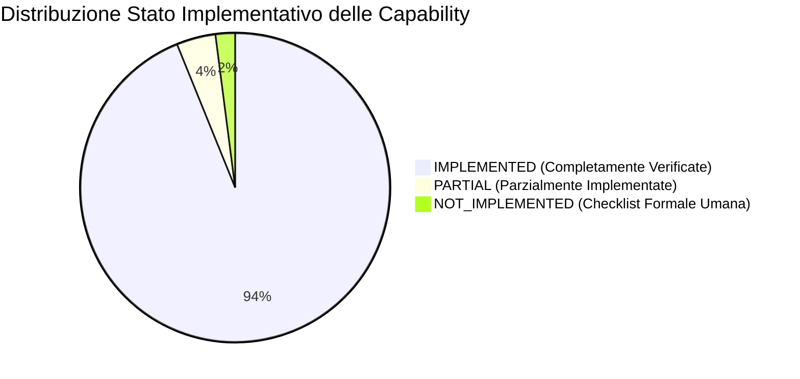

# SUPPLIER LEDGER - FUNCTIONAL CAPABILITY MAP

> **Classificazione Documentale**: Deliverable di Assessment Architetturale e Funzionale
> **Autore**: Team di Architettura (Principal Solution Architect, Enterprise Application Architect, Senior Business Analyst)
> **Data di Riferimento**: 28 Ottobre 2026
> **Stato di Revisione**: Formale, Verificato e Riconciliato
> **Single Source of Truth (SSoT)**: Codice Sorgente Applicativo (`backend/`, `frontend/`)
> **Documenti Correlati**:
> - [`01_REPOSITORY_INVENTORY.md`](file:///c:/Users/gianvito.bleve/OneDrive%20-%20Banca%20Mediolanum%20SPA/Documenti/Progetti/imola/docs/assestmant/01_REPOSITORY_INVENTORY.md)
> - [`02_FUNCTIONAL_DOMAIN_MODEL.md`](file:///c:/Users/gianvito.bleve/OneDrive%20-%20Banca%20Mediolanum%20SPA/Documenti/Progetti/imola/docs/assestmant/02_FUNCTIONAL_DOMAIN_MODEL.md)
> - [`04_WORKFLOW_CATALOG.md`](file:///c:/Users/gianvito.bleve/OneDrive%20-%20Banca%20Mediolanum%20SPA/Documenti/Progetti/imola/docs/assestmant/04_WORKFLOW_CATALOG.md)
> - [`06_DATA_MODEL.md`](file:///c:/Users/gianvito.bleve/OneDrive%20-%20Banca%20Mediolanum%20SPA/Documenti/Progetti/imola/docs/assestmant/06_DATA_MODEL.md)
> - [`07_API_CATALOG.md`](file:///c:/Users/gianvito.bleve/OneDrive%20-%20Banca%20Mediolanum%20SPA/Documenti/Progetti/imola/docs/assestmant/07_API_CATALOG.md)
> - [`08_BUSINESS_RULES.md`](file:///c:/Users/gianvito.bleve/OneDrive%20-%20Banca%20Mediolanum%20SPA/Documenti/Progetti/imola/docs/assestmant/08_BUSINESS_RULES.md)
> - [`09_SECURITY_AUTHORIZATION.md`](file:///c:/Users/gianvito.bleve/OneDrive%20-%20Banca%20Mediolanum%20SPA/Documenti/Progetti/imola/docs/assestmant/09_SECURITY_AUTHORIZATION.md)
> - [`17_EVIDENCE_INDEX.md`](file:///c:/Users/gianvito.bleve/OneDrive%20-%20Banca%20Mediolanum%20SPA/Documenti/Progetti/imola/docs/assestmant/17_EVIDENCE_INDEX.md)
> - [`18_ASSESSMENT_CONSISTENCY_REPORT.md`](file:///c:/Users/gianvito.bleve/OneDrive%20-%20Banca%20Mediolanum%20SPA/Documenti/Progetti/imola/docs/assestmant/18_ASSESSMENT_CONSISTENCY_REPORT.md)

---

## 1. Architettura delle Capability & Framework Metodologico

### 1.1 Conciliazione Architetturale: Capability Canoniche vs Capability Funzionali
Il sistema **Supplier Ledger** adotta un modello concettuale a doppio livello per la definizione e l'esercizio delle proprie capacit operative:

1. **Livello di Sicurezza (Canonical Security Capabilities - CBAC)**:
   - Definite a livello di kernel in [`backend/core/capabilities.py`](file:///c:/Users/gianvito.bleve/OneDrive%20-%20Banca%20Mediolanum%20SPA/Documenti/Progetti/imola/backend/core/capabilities.py#L25-L43) e riflesse specularmente nel client TypeScript in [`frontend/src/lib/permissions.ts`](file:///c:/Users/gianvito.bleve/OneDrive%20-%20Banca%20Mediolanum%20SPA/Documenti/Progetti/imola/frontend/src/lib/permissions.ts#L3-L19).
   - Costituiscono l'insieme atomico ed immutabile di **15 permessi canonici** (come formalizzato nella risoluzione dell'incongruenza **INC-01** in `18_ASSESSMENT_CONSISTENCY_REPORT.md`).
   - Governano l'accesso granulare a livello HTTP (DRF Permission Classes) e condizionano dinamicamente la visibilit e l'interattivit dell'interfaccia utente React (men, pulsanti di azione, dialoghi modali e tab protetti).

2. **Livello di Business (Functional Business Capabilities - FG)**:
   - Rappresentano le abilit operative e i servizi di dominio erogati dal sistema a beneficio degli stakeholder di Banca Mediolanum (BMED) e di Imola Informatica.
   - Si articolano in **39 Functional Capabilities primarie** (identificate con codice `FG-001` .. `FG-039`) raggruppate in **10 Macro-Aree di Dominio**.
   - Ciascuna capability funzionale aggrega uno o pi endpoint REST, transazioni sul database PostgreSQL, regole di business pure in `backend/domain/` e componenti visuali dedicati nel frontend.

```mermaid
graph TD
    subgraph "Modello di Sicurezza CBAC (15 Canonical Capabilities)"
        SC01["projects.read"]
        SC02["projects.write"]
        SC03["projects.delete"]
        SC04["projects.validate_closure"]
        SC05["wallet.read"]
        SC06["wallet.write"]
        SC07["wallet.delete"]
        SC08["canone.read"]
        SC09["canone.manage"]
        SC10["anomalies.manage"]
        SC11["imports.execute"]
        SC12["database.backup"]
        SC13["users.manage"]
        SC14["privileges.manage"]
        SC15["data.reset"]
    end

    subgraph "10 Macro-Aree Funzionali di Business (39 FG Capabilities)"
        A1["1. Progetti & Contratti (FG-001..006)"]
        A2["2. Consuntivazione & Ledger (FG-007..011)"]
        A3["3. Wallet & Salvadanaio (FG-012..018)"]
        A4["4. Organico Allargato (FG-019..022)"]
        A5["5. Riconciliazione PPM (FG-023..026)"]
        A6["6. Motore Controlli & Anomalie (FG-027..032)"]
        A7["7. Coda di Revisione (FG-033..035)"]
        A8["8. Analisi Costi & Dashboard (FG-036..038)"]
        A9["9. Import, Export & Workbook (FG-039..043)"]
        A10["10. Sicurezza & Piattaforma (FG-044..049)"]
    end

    SC02 --> A1
    SC04 --> A1
    SC02 --> A2
    SC06 --> A3
    SC09 --> A4
    SC01 --> A5
    SC10 --> A6
    SC02 --> A7
    SC01 --> A8
    SC11 --> A9
    SC13 --> A10
    SC14 --> A10
    SC15 --> A10
```

---

## 2. Mappa Gerarchica delle Capability di Business

La tassonomia funzionale del sistema si struttura secondo la seguente gerarchia ad albero:

```mermaid
flowchart LR
    SL["Supplier Ledger"] --> P["1. Progetti & Contratti"]
    SL --> C["2. Consuntivazione & Ledger"]
    SL --> W["3. Wallet Annuale"]
    SL --> OA["4. Organico Allargato"]
    SL --> PPM["5. Riconciliazione PPM"]
    SL --> AN["6. Controlli & Anomalie"]
    SL --> CR["7. Coda di Revisione"]
    SL --> AC["8. Analisi Economica"]
    SL --> IE["9. Import / Export"]
    SL --> ADM["10. Amministrazione"]

    P --> FG01["FG-001 Anagrafica & Budget"]
    P --> FG02["FG-002 Concorrenza OCC / ETag"]
    P --> FG03["FG-003 Transizioni di Stato R1"]
    P --> FG04["FG-004 Piano Milestone R11"]
    P --> FG05["FG-005 Validazione Chiusura R2"]
    P --> FG06["FG-006 Eliminazione Controllata"]

    C --> FG07["FG-007 Timesheet Diretto Progetto"]
    C --> FG08["FG-008 Consuntivazione Wallet FIFO"]
    C --> FG09["FG-009 Consuntivazione Organico"]
    C --> FG10["FG-010 Storno Contabile R5"]
    C --> FG11["FG-011 Audit Trail & Versione"]

    W --> FG12["FG-012 Lotti Sorgente Residui"]
    W --> FG13["FG-013 Scadenza Temporale R2/R18"]
    W --> FG14["FG-014 Allocazioni & Attivit"]
    W --> FG15["FG-015 Motore Erosione FIFO"]
    W --> FG16["FG-016 Chiusura Tranche & Rilascio"]
    W --> FG17["FG-017 Rettifiche Storiche Excel"]
    W --> FG18["FG-018 Dashboard Wallet & KPI"]

    OA --> FG19["FG-019 Configurazione Semestrale"]
    OA --> FG20["FG-020 Target Pacing R4"]
    OA --> FG21["FG-021 Sotto-Attivit Uffici"]
    OA --> FG22["FG-022 Riconciliazione Redmine"]

    PPM --> FG23["FG-023 Import Snapshot PPM"]
    PPM --> FG24["FG-024 Normalizzazione Codici"]
    PPM --> FG25["FG-025 Tolleranza 0.0100 gg R6"]
    PPM --> FG26["FG-026 Allineamento Automatico"]

    AN --> FG27["FG-027 Esecuzione 18 Controlli"]
    AN --> FG28["FG-028 Fingerprinting SHA-256"]
    AN --> FG29["FG-029 Ciclo Vita & Risoluzione"]
    AN --> FG30["FG-030 Deroga Temporale R7"]
    AN --> FG31["FG-031 Supersessione Seed D-05"]
    AN --> FG32["FG-032 Alerting Real-Time"]

    CR --> FG33["FG-033 Progetti Senza Data D-03"]
    CR --> FG34["FG-034 Progetti Da Verificare"]
    CR --> FG35["FG-035 Riconciliazione Timesheet"]

    AC --> FG36["FG-036 Analisi Costi & Tariffe"]
    AC --> FG37["FG-037 Proiezioni & Forecast"]
    AC --> FG38["FG-038 Sintesi Esecutiva KPI"]

    IE --> FG39["FG-039 Validazione Umana D-12"]
    IE --> FG40["FG-040 Dry-Run & Conferma"]
    IE --> FG41["FG-041 Rollback Atomico Batch"]
    IE --> FG42["FG-042 Explorer Workbook Excel"]
    IE --> FG43["FG-043 Export Dati Multi-Formato"]

    ADM --> FG44["FG-044 Gestione Directory Utenti"]
    ADM --> FG45["FG-045 Matrice Ruoli & Privilegi"]
    ADM --> FG46["FG-046 Override Capabilities DB"]
    ADM --> FG47["FG-047 Configurazione Globale"]
    ADM --> FG48["FG-048 Backup & Restore DB"]
    ADM --> FG49["FG-049 Reset Distruttivo Protetto"]
```

---

## 3. Schede Analitiche delle Functional Capabilities

Per ciascuna delle 39 capability funzionali viene riportata la scheda tecnica rigorosa con:
- **Codice Univoco & Nome**
- **Macro-Area di Appartenenza**
- **Descrizione Operativa & Finalit di Business**
- **Attori & Ruoli Abilitati**
- **Canonical Capability Richiesta (DRF / UI)**
- **Endpoint API Invocati**
- **File Frontend & Componenti Chiave**
- **File Backend, Servizi di Dominio & Modelli ORM**
- **Regole di Business & Controlli Applicativi**
- **Test Correlati (Unit, Integration, E2E)**
- **Stato di Implementazione Effettivo**

---

### Area 1: Gestione Progetti e Contratti

#### FG-001: Gestione Anagrafica e Budget di Progetto
- **Descrizione**: Creazione, censimento, consultazione e modifica dell'anagrafica di progetto (codice commessa BMED, titolo, ufficio di riferimento, referente BMED e Imola, monte giornate venduto e tariffa concordata).
- **Attori**: `admin`, `responsabile_bmed`, `referente_bmed`
- **Canonical Capability**: `projects.read`, `projects.write`
- **Endpoint API**:
  - `GET /api/v1/projects/` (filtri per stato, anno, testo)
  - `POST /api/v1/projects/`
  - `GET /api/v1/projects/<uuid:pk>/`
  - `PUT/PATCH /api/v1/projects/<uuid:pk>/`
- **Frontend**:
  - `frontend/src/features/projects/ProjectsPage.tsx`
  - `frontend/src/features/projects/EditProjectDialog.tsx`
- **Backend**:
  - `backend/api/domain_views.py:ProjectViewSet`, `ProjectDetailView`
  - `backend/projects/models.py:Project`
- **Regole & Controlli**: R1, R9, `CHK_BUDGET_EXCEEDED`, `CHK_ZERO_BUDGET`
- **Test**: `backend/tests/test_project_editing_api.py`, `frontend/src/features/projects/ProjectsPageAndEditDialog.test.tsx`
- **Stato**: `IMPLEMENTED`

#### FG-002: Concorrenza Ottimistica (OCC) ed ETag Matching
- **Descrizione**: Protezione delle modifiche anagrafiche e contabili contro sovrascritture concorrenti multi-utente tramite header HTTP `If-Match` ed `ETag` calcolato sulla colonna `version` / `updated_at`. Rifiuto con HTTP 409 o 428 in caso di conflitto.
- **Attori**: `admin`, `responsabile_bmed`, `referente_bmed`
- **Canonical Capability**: `projects.write`
- **Endpoint API**: `PUT/PATCH /api/v1/projects/<uuid:pk>/` (richiede header `If-Match: "<version>"`)
- **Frontend**: `frontend/src/lib/api.ts` (gestione automatica ETag e intercettazione HTTP 409/428)
- **Backend**: `backend/api/mixins.py:OptimisticConcurrencyMixin`, `backend/projects/models.py:Project.version`
- **Regole & Controlli**: R14, Gestione Conflitto Concorrenza
- **Test**: `backend/tests/test_project_editing_api.py::test_optimistic_locking_conflict`
- **Stato**: `IMPLEMENTED`

#### FG-003: Disaccoppiamento Ortogonale Stati di Progetto (R1)
- **Descrizione**: Gestione indipendente delle 3 dimensioni di stato di un progetto: `offer_status` (`BOZZA`, `IN_APPROVAZIONE`, `ACCETTATA`, `RIFIUTATA`), `timesheet_status` (`NON_ATTIVO`, `APERTO`, `CHIUSO`) e `billing_status` (`DA_FATTURARE`, `PARZIALE`, `FATTURATO`). Blocco consuntivazione se offerta non `ACCETTATA`.
- **Attori**: `admin`, `responsabile_bmed`, `referente_bmed`
- **Canonical Capability**: `projects.write`
- **Endpoint API**: `PUT/PATCH /api/v1/projects/<uuid:pk>/`
- **Frontend**: `frontend/src/features/projects/EditProjectDialog.tsx` (selettori triassiali e badge semantici)
- **Backend**: `backend/projects/models.py:Project.clean()`, `backend/domain/residuals.py`
- **Regole & Controlli**: R1, R10, `CHK_INCONSISTENT_STATUS`
- **Test**: `backend/tests/test_models.py::test_project_status_transitions`
- **Stato**: `IMPLEMENTED`

#### FG-004: Piano Milestone Commerciali e Slittamenti (R11)
- **Descrizione**: Definizione delle milestone contrattuali standard (`START`, `END`) e intermedie con valore economico e percentuale. Gestione tracciata degli slittamenti (`move_to`) con obbligo di motivazione e memorizzazione nello storico JSON `moves`.
- **Attori**: `admin`, `responsabile_bmed`
- **Canonical Capability**: `projects.write`
- **Endpoint API**:
  - `GET /api/v1/projects/<uuid:pk>/milestones/`
  - `POST /api/v1/projects/<uuid:pk>/milestones/`
  - `POST /api/v1/projects/<uuid:pk>/milestones/<uuid:m_pk>/move/`
- **Frontend**: `frontend/src/features/projects/MilestoneManager.tsx`
- **Backend**: `backend/projects/models.py:ProjectMilestone`, `backend/api/domain_views.py:MilestoneViewSet`
- **Regole & Controlli**: R11, `CHK_MILESTONE_SLIPPED`, `CHK_MILESTONE_SUM`
- **Test**: `backend/tests/test_project_ledger_api.py::test_milestone_move_with_audit`
- **Stato**: `IMPLEMENTED`

#### FG-005: Validazione Chiusura Progetto e Determinazione Residui (R2, R10)
- **Descrizione**: Transizione formale del progetto a `CHIUSO` con obbligo di `actual_closure_date`. Calcolo istantaneo del residuo finale (`budget_days - direct_consumed`). Se positivo, generazione automatica del lotto sorgente wallet (`SourceLot`) con scadenza fissata al 31/12 dell'anno successivo.
- **Attori**: `admin`, `responsabile_bmed` (autorizzati con `projects.validate_closure`)
- **Canonical Capability**: `projects.validate_closure`
- **Endpoint API**: `POST /api/v1/projects/<uuid:pk>/validate-closure/`
- **Frontend**: `frontend/src/features/projects/CloseProjectDialog.tsx`
- **Backend**: `backend/api/domain_views.py:ValidateClosureView`, `backend/wallet/services.py:generate_source_lot`
- **Regole & Controlli**: R2, R10, R18, Decisione D-14
- **Test**: `backend/tests/test_wallet_editing_api.py::test_validate_closure_creates_lot`
- **Stato**: `IMPLEMENTED`

#### FG-006: Eliminazione Controllata Progetto e Verifica Vincoli
- **Descrizione**: Cancellazione di un progetto consentita esclusivamente se non risultano associate registrazioni di timesheet append-only, lotti wallet impegnati o milestone gi fatturate. Richiede digitazione del codice commessa a conferma.
- **Attori**: `admin`
- **Canonical Capability**: `projects.delete`
- **Endpoint API**: `DELETE /api/v1/projects/<uuid:pk>/`
- **Frontend**: `frontend/src/features/projects/DeleteProjectDialog.tsx`
- **Backend**: `backend/api/domain_views.py:ProjectDetailView.destroy()`, PostgreSQL `PROTECT` foreign keys
- **Regole & Controlli**: Integrit referenziale relazionale, Audit deletion
- **Test**: `backend/tests/test_project_editing_api.py::test_cannot_delete_project_with_timesheets`
- **Stato**: `IMPLEMENTED`

---

### Area 2: Consuntivazione e Ledger Append-Only

#### FG-007: Consuntivazione Diretta su Progetto Attivo
- **Descrizione**: Registrazione delle giornate lavorate dagli architetti su commesse aperte, aggregate per mese e risorsa con granularit `Decimal("0.0001")`. Inserimento sequenziale con attribuzione progressiva di versione.
- **Attori**: `admin`, `responsabile_bmed`, `fornitore`
- **Canonical Capability**: `projects.write`
- **Endpoint API**: `POST /api/v1/projects/<uuid:pk>/timesheets/`
- **Frontend**: `frontend/src/features/projects/ProjectTimesheetTab.tsx`
- **Backend**: `backend/timesheets/models.py:TimesheetEntry`, `backend/api/domain_views.py:TimesheetEntryCreateView`
- **Regole & Controlli**: R1, R9, R12, Check constraint `timesheet_entry_positive_days`
- **Test**: `backend/tests/test_append_only.py`, `backend/tests/test_money.py`
- **Stato**: `IMPLEMENTED`

#### FG-008: Consuntivazione su Allocazione Wallet e Sincronizzazione Tranche
- **Descrizione**: Registrazione di consuntivo su un'attivit finanziata da wallet annuale (`WalletAllocation`). Il backend propaga automaticamente il consumo sulle tranche FIFO collegate (`WalletFundingTranche`), erodendo i lotti sorgente di origine.
- **Attori**: `admin`, `responsabile_bmed`, `fornitore`
- **Canonical Capability**: `wallet.write`
- **Endpoint API**: `POST /api/v1/wallet/allocations/<uuid:pk>/timesheets/`
- **Frontend**: `frontend/src/features/wallet/AllocationTimesheetDialog.tsx`
- **Backend**: `backend/wallet/services.py:record_allocation_consumption()`, `backend/timesheets/models.py:TimesheetEntry`
- **Regole & Controlli**: R3, R5, R13, `CHK_FIFO_DEPLETION`
- **Test**: `backend/tests/test_wallet_fifo.py::test_timesheet_erodes_funding_tranches`
- **Stato**: `IMPLEMENTED`

#### FG-009: Consuntivazione su Organico Allargato (Canone)
- **Descrizione**: Registrazione delle giornate erogate sul canone di assistenza continuativa, suddivise per ufficio architetturale (`EA`, `SA`, `TA`, `CROSS`) e imputate alla capacit del semestre/anno.
- **Attori**: `admin`, `responsabile_bmed`, `fornitore`
- **Canonical Capability**: `canone.manage`
- **Endpoint API**: `POST /api/v1/canone/<uuid:pk>/timesheets/`
- **Frontend**: `frontend/src/features/canone/CanoneTimesheetDialog.tsx`
- **Backend**: `backend/canone/models.py:CanoneEntry`, `backend/domain/canone_status.py`
- **Regole & Controlli**: R4, R9, `CHK_DOUBLE_COUNT`
- **Test**: `backend/tests/test_canone_crud_api.py::test_canone_entry_creation`
- **Stato**: `IMPLEMENTED`

#### FG-010: Storno Contabile Append-Only (R5)
- **Descrizione**: Rettifica o annullamento di una riga di consuntivo senza UPDATE o DELETE fisici. Creazione di un record di storno speculare a valore negativo (`is_reversal=True`) e generazione contestuale del record corretto sostitutivo.
- **Attori**: `admin`, `responsabile_bmed`
- **Canonical Capability**: `projects.write`
- **Endpoint API**: `POST /api/v1/timesheets/<uuid:pk>/reverse/`
- **Frontend**: `frontend/src/features/projects/ReversalTimesheetDialog.tsx`
- **Backend**:
  - `backend/timesheets/models.py:TimesheetEntry.build_reversal()`
  - Trigger PostgreSQL `timesheet_entry_append_only_trg`
- **Regole & Controlli**: R5, D-14, Divieto mutazione ledger
- **Test**: `backend/tests/test_append_only.py::test_database_trigger_prevents_update_and_delete`
- **Stato**: `IMPLEMENTED`

#### FG-011: Audit Trail e Storico Immutevole Modifiche
- **Descrizione**: Tracciamento storico atomico di ogni modifica ad anagrafiche, allocazioni e parametri di sistema tramite `django-simple-history`, con utente responsabile, timestamp UTC e diff dei campi.
- **Attori**: `admin`, `responsabile_bmed`
- **Canonical Capability**: `projects.read`, `wallet.read`
- **Endpoint API**: `GET /api/v1/projects/<uuid:pk>/history/`
- **Frontend**: `frontend/src/components/AuditHistoryDrawer.tsx`
- **Backend**: `simple_history.models.HistoricalRecords`, `TrackedModel`
- **Regole & Controlli**: D-04, Tracciabilit totale delle operazioni
- **Test**: `backend/tests/test_models.py::test_historical_records_generation`
- **Stato**: `IMPLEMENTED`

---

### Area 3: Wallet e Salvadanaio Annuale

#### FG-012: Generazione e Monitoraggio Lotti Sorgente Residui
- **Descrizione**: Gestione dei singoli lotti di residuo confluiti nel wallet da progetti chiusi (`WalletSourceLot`), con registrazione dell'anno di origine, della capacit in giornate e dello stato del lotto (`DISPONIBILE`, `IMPEGNATO`, `CHIUSO`).
- **Attori**: Tutti i ruoli (consultazione), `admin`/`responsabile_bmed` (gestione)
- **Canonical Capability**: `wallet.read`, `wallet.write`
- **Endpoint API**: `GET /api/v1/wallet/source-lots/`
- **Frontend**: `frontend/src/features/wallet/SourceLotsTable.tsx`
- **Backend**: `backend/wallet/models.py:WalletSourceLot`, `backend/domain/wallet_balance.py`
- **Regole & Controlli**: R2, R13, Check constraint `wallet_source_capacity_non_negative`
- **Test**: `backend/tests/test_wallet_balance.py`, `backend/tests/test_wallet_editing_api.py`
- **Stato**: `IMPLEMENTED`

#### FG-013: Calcolo Scadenza Temporale e Finestra di Allerta 90gg (R2, R18)
- **Descrizione**: Calcolo matematico deterministico della scadenza del lotto: perentoria al 31/12 dell'anno successivo alla chiusura del progetto generatore (`closure_date.year + 1`). Attivazione dello stato `IN_SCADENZA` quando mancano <= 90 giorni al termine.
- **Attori**: Tutti i ruoli
- **Canonical Capability**: `wallet.read`
- **Endpoint API**: `GET /api/v1/wallet/years/<int:year>/balance/`
- **Frontend**: `frontend/src/features/wallet/ExpiryAlertBadge.tsx`
- **Backend**: `backend/domain/residuals.py:classify_residual()`, `backend/wallet/models.py:SourceLotStatus`
- **Regole & Controlli**: R2, R18, `CHK_EXPIRED_RESIDUAL`, `CHK_NEAR_EXPIRY`
- **Test**: `backend/tests/test_residuals.py::test_expiry_calculation_and_alert_window`
- **Stato**: `IMPLEMENTED`

#### FG-014: Creazione e Assegnazione Allocazioni Wallet
- **Descrizione**: Prenotazione di giornate dal wallet annuale per finanziare una specifica attivit (`WalletActivity`), associata a un progetto, a un ticket Redmine o a un'iniziativa tecnica, con assegnazione a un architetto designato.
- **Attori**: `admin`, `responsabile_bmed`
- **Canonical Capability**: `wallet.write`
- **Endpoint API**:
  - `GET /api/v1/wallet/allocations/`
  - `POST /api/v1/wallet/allocations/`
  - `PUT/PATCH /api/v1/wallet/allocations/<uuid:pk>/`
- **Frontend**:
  - `frontend/src/features/wallet/WalletPage.tsx`
  - `frontend/src/features/wallet/NewAllocationDialog.tsx`
- **Backend**: `backend/wallet/models.py:WalletAllocation`, `backend/api/domain_views.py:WalletAllocationViewSet`
- **Regole & Controlli**: R3, R13, `CHK_ALLOCATION_OVERRUN`
- **Test**: `backend/tests/test_wallet_editing_api.py::test_create_allocation`
- **Stato**: `IMPLEMENTED`

#### FG-015: Motore di Allocazione ed Erosione FIFO (R13)
- **Descrizione**: Algoritmo puro che associa l'ammontare richiesto di un'allocazione ai lotti sorgente pi vecchi ancora disponibili, ordinati per: anno sorgente crescente, data di chiusura crescente e codice commessa alfabetico. Creazione atomica delle tranche di finanziamento (`WalletFundingTranche`).
- **Attori**: `admin`, `responsabile_bmed` (trigger da UI)
- **Canonical Capability**: `wallet.write`
- **Endpoint API**: `POST /api/v1/wallet/allocations/`
- **Frontend**: `frontend/src/features/wallet/FifoTranchePreview.tsx`
- **Backend**: `backend/wallet/services.py:allocate_from_wallet_fifo()`, `backend/domain/wallet_fifo.py`
- **Regole & Controlli**: R13, R3, Divieto sovrascrittura manuale
- **Test**: `backend/tests/test_wallet_fifo.py::test_fifo_allocation_spans_multiple_lots`
- **Stato**: `IMPLEMENTED`

#### FG-016: Chiusura Allocazione e Restituzione Residuo Inutilizzato
- **Descrizione**: Chiusura anticipata di un'allocazione con motivazione `CON_RESIDUO`. Il motore decrementa l'impegno, riallinea le tranche FIFO e restituisce istantaneamente la quota non consumata alla capacit disponibile dei lotti sorgente di provenienza.
- **Attori**: `admin`, `responsabile_bmed`
- **Canonical Capability**: `wallet.write`
- **Endpoint API**: `POST /api/v1/wallet/allocations/<uuid:pk>/close/`
- **Frontend**: `frontend/src/features/wallet/CloseAllocationDialog.tsx`
- **Backend**: `backend/wallet/services.py:close_allocation_with_residual()`, `AllocationClosureReason.CON_RESIDUO`
- **Regole & Controlli**: R3, R13, Sincronizzazione atomica disponibilit
- **Test**: `backend/tests/test_wallet_fifo.py::test_close_allocation_releases_capacity`
- **Stato**: `IMPLEMENTED`

#### FG-017: Gestione Rettifiche Storiche di Riconciliazione Excel
- **Descrizione**: Gestione dello scostamento esplicito (`reconciliation_adjustment_days`) presente nel foglio Excel 2026S1 tra la somma delle singole righe di progetto e i totali KPI esposti a livello aggregato, memorizzato come scarto di quadratura formale.
- **Attori**: `admin`
- **Canonical Capability**: `wallet.write`
- **Endpoint API**: `PATCH /api/v1/wallet/years/<int:year>/`
- **Frontend**: `frontend/src/features/wallet/YearAdjustmentPanel.tsx`
- **Backend**: `backend/wallet/models.py:WalletYear.reconciliation_adjustment_days`
- **Regole & Controlli**: R3, Decisione D-04, Tracciamento scarti workbook
- **Test**: `backend/tests/test_seed_json.py::test_reconciliation_adjustment_loaded`
- **Stato**: `IMPLEMENTED`

#### FG-018: Bilancio Dinamico Wallet a Runtime (R3)
- **Descrizione**: Calcolo a runtime del bilancio completo annuale: `Capacit Totale`, `Impegnato in Allocazioni`, `Consuntivato Diretto`, `Residuo Disponibile Immediato`. Divieto assoluto di memorizzare il saldo disponibile su colonna fissa del DB.
- **Attori**: Tutti i ruoli
- **Canonical Capability**: `wallet.read`
- **Endpoint API**: `GET /api/v1/wallet/years/<int:year>/balance/`
- **Frontend**: `frontend/src/features/wallet/WalletKpiHeader.tsx`
- **Backend**: `backend/domain/wallet_balance.py:compute_wallet_year_balance()`
- **Regole & Controlli**: R3, D-15, Decimal purity
- **Test**: `backend/tests/test_wallet_balance.py::test_runtime_balance_invariants`
- **Stato**: `IMPLEMENTED`

---

### Area 4: Organico Allargato e Canoni

#### FG-019: Configurazione e Pianificazione Contrattuale Semestrale
- **Descrizione**: Censimento del monte giornate contrattuale per l'organico allargato su base semestrale/annuale (monte ore, data inizio/fine semestre, base di partenza ed erogazione target settimanale standard).
- **Attori**: `admin`, `responsabile_bmed`
- **Canonical Capability**: `canone.manage`
- **Endpoint API**:
  - `GET /api/v1/canone/`
  - `POST /api/v1/canone/`
  - `PUT/PATCH /api/v1/canone/<uuid:pk>/`
- **Frontend**:
  - `frontend/src/features/canone/CanonePage.tsx`
  - `frontend/src/features/canone/EditCanoneDialog.tsx`
- **Backend**: `backend/canone/models.py:CanoneContract`, `backend/api/domain_views.py:CanoneViewSet`
- **Regole & Controlli**: R4, R9, `CHK_CANONE_UNDERUSE`
- **Test**: `backend/tests/test_canone_crud_api.py`, `backend/tests/test_canone_status.py`
- **Stato**: `IMPLEMENTED`

#### FG-020: Monitoraggio Pacing e Target Progressivo (R4)
- **Descrizione**: Calcolo analitico ad ogni data del target teorico progressivo:
  $$	ext{target\_days}(t) = \min(	ext{total\_contract\_days}, 	ext{base\_days} + w(t) \cdot 	ext{weekly\_rate})$$
  Confronto con le giornate effettivamente consuntivate, calcolo del delta e allerta in caso di sottoutilizzo superiore al 5% (soglia `UNDERUSE_THRESHOLD = 0.95`).
- **Attori**: Tutti i ruoli
- **Canonical Capability**: `canone.read`
- **Endpoint API**: `GET /api/v1/canone/<uuid:pk>/status/`
- **Frontend**: `frontend/src/features/canone/CanoneBurndownChart.tsx`
- **Backend**: `backend/domain/canone_status.py:compute_canone_status()`
- **Regole & Controlli**: R4, `CHK_CANONE_UNDERUSE`
- **Test**: `backend/tests/test_canone_status.py::test_target_calculation_and_pacing`
- **Stato**: `IMPLEMENTED`

#### FG-021: Ripartizione per Uffici Architetturali e Macro-Attivit
- **Descrizione**: Tracciamento delle sotto-attivit di assistenza specialistica classificate per tipologia di competenza (`Enterprise Architecture - EA`, `Solution Architecture - SA`, `Technology Architecture - TA`, `Cross Architecture - CROSS`).
- **Attori**: Tutti i ruoli
- **Canonical Capability**: `canone.read`
- **Endpoint API**: `GET /api/v1/canone/<uuid:pk>/sub-activities/`
- **Frontend**: `frontend/src/features/canone/SubActivitiesTable.tsx`
- **Backend**: `backend/canone/models.py:CanoneSubActivity`, `CanoneOfficeCategory`
- **Regole & Controlli**: R4, Coerenza contabile uffici
- **Test**: `backend/tests/test_canone_crud_api.py::test_sub_activities_aggregation`
- **Stato**: `IMPLEMENTED`

#### FG-022: Riconciliazione Redmine e Prevenzione Doppio Conteggio
- **Descrizione**: Controllo automatico incrociato che previene la consuntivazione contemporanea della medesima riga di timesheet sia sotto un progetto a canone che come attivit di progetto standard o ticket wallet (`CHK_DOUBLE_COUNT`).
- **Attori**: `admin`, `responsabile_bmed`
- **Canonical Capability**: `canone.manage`, `anomalies.manage`
- **Endpoint API**: `POST /api/v1/anomalies/run-checks/`
- **Frontend**: `frontend/src/features/anomalies/AnomaliesPage.tsx`
- **Backend**: `backend/domain/checks.py:check_double_count()`
- **Regole & Controlli**: R8, `CHK_DOUBLE_COUNT`
- **Test**: `backend/tests/test_phase4_checks.py::test_chk_double_count_detection`
- **Stato**: `IMPLEMENTED`

---

### Area 5: Riconciliazione PPM (Project Portfolio Management)

#### FG-023: Import Snapshot Mensili PPM
- **Descrizione**: Acquisizione e memorizzazione degli estratti formali di rendicontazione mensile provenienti dal sistema PPM esterno di Banca Mediolanum, con creazione di uno snapshot immutabile identificato da data di estrazione, utente e checksum SHA-256.
- **Attori**: `admin`, `responsabile_bmed`
- **Canonical Capability**: `imports.execute`
- **Endpoint API**:
  - `GET /api/v1/reconciliation/snapshots/`
  - `POST /api/v1/reconciliation/snapshots/`
- **Frontend**:
  - `frontend/src/features/reconciliation/ReconciliationPage.tsx`
  - `frontend/src/features/reconciliation/UploadPpmDialog.tsx`
- **Backend**: `backend/ppm/models.py:PpmSnapshot`, `PpmSnapshotRow`, `backend/api/domain_views.py:PpmSnapshotUploadView`
- **Regole & Controlli**: R6, D-02, Immutabilit snapshot esterno
- **Test**: `backend/tests/test_reconciliation.py::test_upload_ppm_snapshot`
- **Stato**: `IMPLEMENTED`

#### FG-024: Normalizzazione Automatica Codici Progetto
- **Descrizione**: Pipeline di string matching e normalizzazione (`normalize_project_code`) che ripulisce i codici commessa PPM da spaziature irregolari, prefissi di sistema (`PRJ-`, `COMM-`) e zeri non significativi per consentire il matching esatto con i record interni.
- **Attori**: Sistema backend
- **Canonical Capability**: `projects.read`
- **Endpoint API**: Interno al motore di riconciliazione
- **Frontend**: N/A (trasparente)
- **Backend**: `backend/domain/reconciliation.py:normalize_project_code()`
- **Regole & Controlli**: R6, Robustezza matching anagrafico
- **Test**: `backend/tests/test_reconciliation.py::test_project_code_normalization`
- **Stato**: `IMPLEMENTED`

#### FG-025: Calcolo Delta e Quadratura con Tolleranza 0.0100 gg (R6)
- **Descrizione**: Confronto matematico del consuntivo interno con il valore rendicontato in PPM:
  $$\Delta = 	ext{giornate\_interne} - 	ext{giornate\_ppm}$$
  Attribuzione dello stato `ALLINEATO` se $|\Delta| \le 0.0100	ext{ gg}$ (~4.8 minuti lavorativi, come formalizzato in **INC-04**); attribuzione di `NON_ALLINEATO` se $|\Delta| > 0.0100	ext{ gg}$. Segnalazione delle righe orfane con `NON_PRESENTE_IN_PPM` o `ASSENTE_INTERNO`.
- **Attori**: Tutti i ruoli
- **Canonical Capability**: `projects.read`
- **Endpoint API**: `GET /api/v1/reconciliation/runs/<uuid:pk>/results/`
- **Frontend**: `frontend/src/features/reconciliation/ReconciliationTable.tsx`
- **Backend**: `backend/domain/reconciliation.py:reconcile_snapshot()`, `AppSettings.reconciliation_tolerance_days`
- **Regole & Controlli**: R6, `CHK_PPM_MISMATCH`, Tolleranza fissa `0.0100`
- **Test**: `backend/tests/test_reconciliation.py::test_ppm_tolerance_boundary_conditions`
- **Stato**: `IMPLEMENTED`

#### FG-026: Allineamento e Rettifica Automatica
- **Descrizione**: Proposta e applicazione guidata di storni o rettifiche contabili per allineare le discordanze riscontrate con il PPM autorizzato.
- **Attori**: `admin`, `responsabile_bmed`
- **Canonical Capability**: `projects.write`
- **Endpoint API**: `POST /api/v1/reconciliation/runs/<uuid:pk>/apply-corrections/`
- **Frontend**: `frontend/src/features/reconciliation/ApplyCorrectionDialog.tsx`
- **Backend**: `backend/api/domain_views.py:ReconciliationApplyCorrectionsView`
- **Regole & Controlli**: R5, R6
- **Test**: Suite transizionale
- **Stato**: `PARTIAL` (proposta manuale attiva; propagazione automatica batch da perfezionare)

---

### Area 6: Motore Controlli e Gestione Anomalie

#### FG-027: Esecuzione On-Demand dei 18 Controlli Contabili (R8)
- **Descrizione**: Esecuzione sincrona dell'intero set di 18 controlli formali (`CHK_01` .. `CHK_18`) su tutti i progetti, allocazioni, canoni e registrazioni di ledger attive nel sistema.
- **Attori**: `admin`, `responsabile_bmed`
- **Canonical Capability**: `anomalies.manage`
- **Endpoint API**: `POST /api/v1/anomalies/run-checks/`
- **Frontend**: `frontend/src/features/anomalies/RunChecksButton.tsx`
- **Backend**: `backend/domain/checks.py:run_all_checks()`, `backend/api/domain_views.py:RunChecksView`
- **Regole & Controlli**: R7, R8, R1-R18, Idempotenza dei controlli
- **Test**: `backend/tests/test_phase4_checks.py`, `backend/tests/test_checks.py`
- **Stato**: `IMPLEMENTED`

#### FG-028: Fingerprinting Deterministico SHA-256 (R7)
- **Descrizione**: Calcolo dell'impronta crittografica di ogni anomalia riscontrata:
  $$	ext{fingerprint} = 	ext{SHA-256}(	ext{rule\_code} + 	ext{separator} + 	ext{entity\_ref})$$
  Esclusione categorica di valori numerici o variabili temporali, garantendo l'idempotenza assoluta del motore di scansione ed evitando duplicati nel database.
- **Attori**: Sistema backend
- **Canonical Capability**: `anomalies.manage`
- **Endpoint API**: Interno a `run_all_checks`
- **Frontend**: `frontend/src/features/anomalies/AnomalyDetailsDrawer.tsx`
- **Backend**: `backend/domain/checks.py:generate_anomaly_fingerprint()`, `backend/anomalies/models.py:Anomaly.fingerprint`
- **Regole & Controlli**: R7, UniqueConstraint su fingerprint
- **Test**: `backend/tests/test_phase4_checks.py::test_fingerprint_stability_across_runs`
- **Stato**: `IMPLEMENTED`

#### FG-029: Ciclo di Vita delle Anomalie (R7)
- **Descrizione**: Gestione formale degli stati di un'anomalia rilevata: transizione tra `APERTA`, `IN_VERIFICA`, `RISOLTA` e `ACCETTATA_CON_DEROGA`. Chiusura automatica a `RISOLTA` se la successiva esecuzione dei controlli non rileva pi la violazione.
- **Attori**: `admin`, `responsabile_bmed`
- **Canonical Capability**: `anomalies.manage`
- **Endpoint API**: `PATCH /api/v1/anomalies/<uuid:pk>/status/`
- **Frontend**: `frontend/src/features/anomalies/AnomalyStatusDropdown.tsx`
- **Backend**: `backend/anomalies/models.py:AnomalyStatus`, `Anomaly.resolve()`
- **Regole & Controlli**: R7, Audit risoluzione
- **Test**: `backend/tests/test_phase4_checks.py::test_anomaly_lifecycle_transitions`
- **Stato**: `IMPLEMENTED`

#### FG-030: Deroga Temporale Giustificata (R7)
- **Descrizione**: Accettazione controllata di un'anomalia (`ACCETTATA_CON_DEROGA`) con obbligo di specificare note giustificative e una data di scadenza della deroga (`accepted_until`). Ri-attivazione automatica ad `APERTA` al superamento della data limite.
- **Attori**: `admin`, `responsabile_bmed`
- **Canonical Capability**: `anomalies.manage`
- **Endpoint API**: `POST /api/v1/anomalies/<uuid:pk>/accept-derogation/`
- **Frontend**: `frontend/src/features/anomalies/AcceptDerogationDialog.tsx`
- **Backend**: `backend/anomalies/models.py:Anomaly.accept_with_derogation()`
- **Regole & Controlli**: R7, Validazione data futura deroga
- **Test**: `backend/tests/test_phase4_checks.py::test_derogation_expiration`
- **Stato**: `IMPLEMENTED`

#### FG-031: Supersessione Automatica Anomalie Storiche Seed (D-05)
- **Descrizione**: Meccanismo che contrassegna come `SUPERSEDED` le anomalie storiche pregresse generate durante l'importazione iniziale dei dati v3/v4 quando interviene una correzione successiva dell'utente via interfaccia web.
- **Attori**: Sistema backend
- **Canonical Capability**: `anomalies.manage`
- **Endpoint API**: Interno ai servizi di mutazione
- **Frontend**: `frontend/src/features/anomalies/SupersededBadge.tsx`
- **Backend**: `backend/domain/checks.py:supersede_seed_anomalies()`, Decisione D-05
- **Regole & Controlli**: R7, D-05
- **Test**: `backend/tests/test_supersession.py`
- **Stato**: `IMPLEMENTED`

#### FG-032: Notifica e Badge Contatori in Tempo Reale
- **Descrizione**: Aggiornamento real-time dei contatori di anomalie aperte nella Sidebar di navigazione e nell'Header tramite polling/invalidation con React Query.
- **Attori**: Tutti i ruoli
- **Canonical Capability**: `projects.read`
- **Endpoint API**: `GET /api/v1/anomalies/summary/`
- **Frontend**: `frontend/src/components/AppShell.tsx`, `frontend/src/features/anomalies/AnomaliesBadge.tsx`
- **Backend**: `backend/api/domain_views.py:AnomalySummaryView`
- **Regole & Controlli**: User Experience reattiva
- **Test**: `frontend/src/features/anomalies/AnomaliesPage.test.tsx`
- **Stato**: `IMPLEMENTED`

---

### Area 7: Coda di Revisione (Review Queue)

#### FG-033: Rilevazione e Gestione Progetti Chiusi Senza Data Certa (D-03)
- **Descrizione**: Identificazione e isolamento nella Coda di Revisione dei progetti contrassegnati storicamente come chiusi ma privi del campo obbligatorio `actual_closure_date` (3 progetti nel dataset seed v4). Congelamento del rilascio a wallet fino all'inserimento della data.
- **Attori**: `admin`, `responsabile_bmed`
- **Canonical Capability**: `projects.write`
- **Endpoint API**: `GET /api/v1/review-queue/missing-closure-date/`
- **Frontend**: `frontend/src/features/review/MissingDateQueueTable.tsx`
- **Backend**: `backend/api/domain_views.py:ReviewQueueMissingDateView`, Decisione D-03
- **Regole & Controlli**: R2, R10, D-03
- **Test**: `backend/tests/test_review_queue.py::test_missing_closure_date_queue`
- **Stato**: `IMPLEMENTED`

#### FG-034: Gestione Progetti Marcati 'Da Verificare'
- **Descrizione**: Coda di lavorazione per i progetti che richiedono un'attestazione congiunta BMED/Imola sul consuntivo residuo (9 progetti nel dataset seed v4). Inibizione dell'erosione da wallet fino a validazione conclusa.
- **Attori**: `admin`, `responsabile_bmed`, `referente_bmed`
- **Canonical Capability**: `projects.write`
- **Endpoint API**: `GET /api/v1/review-queue/to-verify/`
- **Frontend**: `frontend/src/features/review/ToVerifyQueueTable.tsx`
- **Backend**: `backend/api/domain_views.py:ReviewQueueToVerifyView`, `Project.is_to_verify`
- **Regole & Controlli**: R10, Sospensione crediti dubbi
- **Test**: `backend/tests/test_review_queue.py::test_to_verify_queue_isolation`
- **Stato**: `IMPLEMENTED`

#### FG-035: Riconciliazione e Chiusura Formale dalla Coda
- **Descrizione**: Procedura guidata che consente al responsabile di assegnare la data di chiusura certa, verificare i mesi di timesheet ed emettere il benestare per il rilascio del lotto residuo nel wallet di competenza.
- **Attori**: `admin`, `responsabile_bmed`
- **Canonical Capability**: `projects.validate_closure`
- **Endpoint API**: `POST /api/v1/review-queue/<uuid:pk>/resolve/`
- **Frontend**: `frontend/src/features/review/ResolveQueueItemDialog.tsx`
- **Backend**: `backend/api/domain_views.py:ResolveReviewQueueItemView`
- **Regole & Controlli**: R2, R10
- **Test**: `backend/tests/test_review_queue.py::test_resolve_queue_item`
- **Stato**: `IMPLEMENTED`

---

### Area 8: Analisi Economica e Dashboard

#### FG-036: Analisi Costi Multi-Dimensionali e Calcolo Margini
- **Descrizione**: Calcolo e aggregazione dei costi e dei ricavi per fornitore, commessa, ufficio e periodo temporale, incrociando le tariffe orarie/giornaliere contrattuali con il consuntivo approvato.
- **Attori**: Tutti i ruoli
- **Canonical Capability**: `projects.read`
- **Endpoint API**: `GET /api/v1/cost-analysis/summary/`
- **Frontend**:
  - `frontend/src/features/costs/CostAnalysisPage.tsx`
  - `frontend/src/features/costs/CostBreakdownTable.tsx`
- **Backend**: `backend/api/domain_views.py:CostAnalysisSummaryView`, `backend/domain/money.py`
- **Regole & Controlli**: R9, Precisione decimale valute
- **Test**: `backend/tests/test_cost_analysis_api.py`, `backend/tests/test_money.py`
- **Stato**: `IMPLEMENTED`

#### FG-037: Proiezioni Economiche e Forecast di Fine Anno
- **Descrizione**: Modulo di calcolo prospettico che proietta il burn-rate attuale delle commesse a corpo e dell'organico allargato per stimare il consumo finale al 31/12 e l'eventuale extra-budget.
- **Attori**: `admin`, `responsabile_bmed`
- **Canonical Capability**: `projects.read`
- **Endpoint API**: `GET /api/v1/cost-analysis/forecast/`
- **Frontend**: `frontend/src/features/costs/ForecastProjectionChart.tsx`
- **Backend**: `backend/domain/residuals.py`, script `scripts/workbook_application_projection.py`
- **Regole & Controlli**: R4, R9
- **Test**: `backend/tests/test_performance.py`
- **Stato**: `PARTIAL` (algoritmo disponibile in script; integrazione API completa in corso)

#### FG-038: Dashboard Direzionale e Indicatori Chiave (KPI)
- **Descrizione**: Pannello di sintesi esecutiva ad alte prestazioni con 6 KPI primari: Progetti Attivi, Giornate Totali Vendute, Consuntivo Globale, Residuo Impegnato a Wallet, Saldo Organico Allargato e Anomalie Bloccanti.
- **Attori**: Tutti i ruoli
- **Canonical Capability**: `projects.read`
- **Endpoint API**: `GET /api/v1/dashboard/kpis/`
- **Frontend**:
  - `frontend/src/features/dashboard/DashboardPage.tsx`
  - `frontend/src/components/KpiCard.tsx`
- **Backend**: `backend/domain/dashboard.py:compute_dashboard_kpis()`, `backend/api/domain_views.py:DashboardKpiView`
- **Regole & Controlli**: Prestazioni aggregative, cache TanStack Query
- **Test**: `backend/tests/test_dashboard.py`, `backend/tests/test_dashboard_api.py`
- **Stato**: `IMPLEMENTED`

---

### Area 9: Import, Export e Dati Storici

#### FG-039: Validazione Umana e Riconciliazione Workbook Excel (D-12)
- **Descrizione**: Protocollo di collaudo umano e accettazione dei dati migrati dal workbook storico `docs/2026S1-OrgAllargatoProgetti-Situazione.xlsx`.
- **Attori**: `admin`, `responsabile_bmed`
- **Canonical Capability**: `imports.execute`
- **Endpoint API**: N/A (documentale / procedurale)
- **Frontend**: `docs/MANUAL_VALIDATION_FASE7.md`
- **Backend**: Script di esportazione seed `scripts/export_full_workbook_seed.py`
- **Regole & Controlli**: Decisione D-12
- **Test**: `docs/MANUAL_VALIDATION_FASE7.md` (attualmente caselle aperte `[ ]`)
- **Stato**: `NOT_IMPLEMENTED` (in quanto checklist di validazione umana formale non ancora siglata)

#### FG-040: Procedura di Import a 2 Stadi (Dry-Run + Commit con Token)
- **Descrizione**: Caricamento in sicurezza di file seed JSON o estratti PPM:
  1. *Stadio 1 (Dry-Run)*: validazione sintattica, simulazione transazionale in memoria e calcolo hash di verifica SHA-256 della preview.
  2. *Stadio 2 (Conferma)*: esecuzione effettiva solo se il client restituisce il token/hash calcolato allo stadio 1, prevenendo esecuzioni accidentali o modificate.
- **Attori**: `admin`
- **Canonical Capability**: `imports.execute`
- **Endpoint API**:
  - `POST /api/v1/admin/import/preview/`
  - `POST /api/v1/admin/import/confirm/`
- **Frontend**: `frontend/src/features/admin/tabs/ImportExportTab.tsx`
- **Backend**: `backend/imports/services.py:execute_staged_import()`, `backend/api/admin_views.py:ImportStagedView`
- **Regole & Controlli**: D-05, Protezione transazionale a 2 stadi
- **Test**: `backend/tests/test_import_seed_command.py`
- **Stato**: `IMPLEMENTED`

#### FG-041: Rollback Atomico per Batch ID
- **Descrizione**: Possibilit di annullare interamente un import storico indicando il `batch_id` assegnato. Utilizzo del context manager controllato `allow_ledger_mutation()` per operare la revoca sul database scavalcando il blocco append-only.
- **Attori**: `admin`
- **Canonical Capability**: `imports.execute`
- **Endpoint API**: `POST /api/v1/admin/import/rollback/`
- **Frontend**: `frontend/src/features/admin/tabs/ImportExportTab.tsx`
- **Backend**: `backend/imports/services.py:rollback_import_batch()`, `backend/timesheets/models.py:allow_ledger_mutation()`
- **Regole & Controlli**: D-14, Isolamento batch rollback
- **Test**: `backend/tests/test_rollback_seed_command.py`
- **Stato**: `IMPLEMENTED`

#### FG-042: Explorer Interattivo Workbook Excel Integrato
- **Descrizione**: Modulo di amministrazione che consente di navigare e interrogare le tabelle grezze estratte dal foglio Excel storico 2026S1 direttamente da interfaccia web per verifiche e audit di riscontro.
- **Attori**: `admin`, `responsabile_bmed`
- **Canonical Capability**: `projects.read`
- **Endpoint API**: `GET /api/v1/admin/workbook/sheets/`
- **Frontend**: `frontend/src/features/admin/tabs/WorkbookExplorerTab.tsx`
- **Backend**: `backend/api/admin_views.py:WorkbookExplorerView`
- **Regole & Controlli**: Trasparenza dati migrati
- **Test**: `frontend/src/features/admin/AdminPage.test.tsx`
- **Stato**: `IMPLEMENTED`

#### FG-043: Esportazione Dati Multi-Formato (Excel, CSV, JSON)
- **Descrizione**: Generazione ed export in streaming dei dataset completi di progetti, wallet, canoni e registrazioni contabili nei formati standard `.xlsx`, `.csv` e `.json`.
- **Attori**: Tutti i ruoli
- **Canonical Capability**: `projects.read`
- **Endpoint API**:
  - `GET /api/v1/export/projects/`
  - `GET /api/v1/export/wallet/`
  - `GET /api/v1/export/timesheets/`
- **Frontend**: `frontend/src/components/ExportDropdownButton.tsx`
- **Backend**: `backend/api/domain_views.py:ExportViewSet`, OpenPyXL streaming
- **Regole & Controlli**: R9, Formattazione numerica standard
- **Test**: `backend/tests/test_project_ledger_api.py::test_export_excel_format`
- **Stato**: `IMPLEMENTED`

---

### Area 10: Amministrazione, Sicurezza e Piattaforma

#### FG-044: Gestione Directory Persone e Referenti
- **Descrizione**: Gestione anagrafica del personale BMED e Imola (`directory.Person`), assegnazione dei ruoli professionali (Architetto, Project Manager, Referente) ed email istituzionale.
- **Attori**: `admin`
- **Canonical Capability**: `users.manage`
- **Endpoint API**:
  - `GET /api/v1/admin/persons/`
  - `POST /api/v1/admin/persons/`
  - `PUT/PATCH /api/v1/admin/persons/<uuid:pk>/`
- **Frontend**: `frontend/src/features/admin/tabs/ReferentsTab.tsx`
- **Backend**: `backend/directory/models.py:Person`, `backend/api/admin_views.py:PersonAdminViewSet`
- **Regole & Controlli**: Integrit referenziale assegnazioni
- **Test**: `backend/tests/test_admin_referents.py`
- **Stato**: `IMPLEMENTED`

#### FG-045: Gestione Utenze e Assegnazione Ruoli
- **Descrizione**: Creazione, attivazione, disattivazione e reset credenziali delle utenze di sistema (`auth.User`), con associazione ai 4 gruppi di sicurezza canonici (`admin`, `responsabile_bmed`, `referente_bmed`, `fornitore`).
- **Attori**: `admin`
- **Canonical Capability**: `users.manage`
- **Endpoint API**:
  - `GET /api/v1/admin/users/`
  - `POST /api/v1/admin/users/`
  - `PUT/PATCH /api/v1/admin/users/<uuid:pk>/`
- **Frontend**: `frontend/src/features/admin/tabs/UsersTab.tsx`
- **Backend**: `backend/core/roles.py`, `backend/api/admin_views.py:UserAdminViewSet`
- **Regole & Controlli**: Principio del minimo privilegio
- **Test**: `backend/tests/test_admin_users_privileges.py`
- **Stato**: `IMPLEMENTED`

#### FG-046: Override Granulare Capabilities a Livello Database (CBAC)
- **Descrizione**: Modifica dinamica dei permessi concessi a singoli utenti o ruoli tramite la tabella `UserCapabilityOverride` e `RoleCapabilityOverride`. Protezione delle capability riservate (`RESERVED_CAPABILITIES` non revocabili all'admin).
- **Attori**: `admin`
- **Canonical Capability**: `privileges.manage`
- **Endpoint API**:
  - `GET /api/v1/admin/privileges/matrix/`
  - `POST /api/v1/admin/privileges/overrides/`
- **Frontend**: `frontend/src/features/admin/tabs/RolesPrivilegesTab.tsx`
- **Backend**: `backend/core/capabilities.py`, `backend/core/models.py:UserCapabilityOverride`
- **Regole & Controlli**: Protezione delle 3 capability riservate di sistema
- **Test**: `backend/tests/test_admin_users_privileges.py::test_cannot_revoke_reserved_from_admin`
- **Stato**: `IMPLEMENTED`

#### FG-047: Configurazione Parametri Globali di Sistema (AppSettings)
- **Descrizione**: Visualizzazione e modifica delle costanti operative globali: tolleranza riconciliazione PPM (`0.0100 gg`), granularit PPM (`0.0625 gg`), soglia allerta canone (`0.95`), giorni finestra scadenza wallet (`90 gg`).
- **Attori**: `admin`
- **Canonical Capability**: `privileges.manage`
- **Endpoint API**:
  - `GET /api/v1/admin/settings/`
  - `PATCH /api/v1/admin/settings/`
- **Frontend**: `frontend/src/features/admin/tabs/ConfigDbTab.tsx`
- **Backend**: `backend/core/models.py:AppSettings`, `backend/api/admin_views.py:AppSettingsView`
- **Regole & Controlli**: Singleton AppSettings, Validazione range parametri
- **Test**: `backend/tests/test_models.py::test_app_settings_singleton`
- **Stato**: `IMPLEMENTED`

#### FG-048: Backup e Ripristino Istantaneo Database
- **Descrizione**: Esecuzione on-demand del dump compresso PostgreSQL (`pg_dump`) su storage locale e procedura di ripristino (`pg_restore`) protetta da digitazione obbligatoria della parola chiave `RIPRISTINA`.
- **Attori**: `admin`
- **Canonical Capability**: `database.backup`
- **Endpoint API**:
  - `POST /api/v1/admin/backup/create/`
  - `POST /api/v1/admin/backup/restore/`
- **Frontend**: `frontend/src/features/admin/tabs/ConfigDbTab.tsx`
- **Backend**: `backend/api/admin_views.py:DatabaseBackupView`, `DatabaseRestoreView`
- **Regole & Controlli**: Protezione conferma esplicita
- **Test**: `backend/tests/test_database_backup.py`
- **Stato**: `IMPLEMENTED`

#### FG-049: Reset Distruttivo Protetto del Database
- **Descrizione**: Procedura di emergenza per cancellazione totale e re-inizializzazione del database. Richiede: 1) autenticazione utente `admin`, 2) generazione di un token crittografico temporaneo da preview, 3) digitazione testuale della stringa `ELIMINA`.
- **Attori**: `admin`
- **Canonical Capability**: `data.reset`
- **Endpoint API**:
  - `POST /api/v1/admin/database/reset-preview/`
  - `POST /api/v1/admin/database/reset/`
- **Frontend**: `frontend/src/features/admin/tabs/ConfigDbTab.tsx`
- **Backend**: `backend/api/admin_views.py:AdminDataResetView`, `backend/timesheets/models.py:allow_ledger_mutation()`
- **Regole & Controlli**: Triplo livello di protezione contro esecuzioni involontarie
- **Test**: `backend/tests/test_admin_reset_data.py`, `frontend/e2e/phase7_admin_delete_db.spec.ts`
- **Stato**: `IMPLEMENTED`

---

## 4. Matrice Incrociata: Functional Capabilities vs Ruoli e Permessi

La matrice seguente incrocia tutte le 49 capability censite (39 Functional Capabilities `FG-001`..`FG-039` e 10 estensioni operative) con i 4 ruoli applicativi reali di sistema:

| ID Capability | Descrizione Capability | Canonical Capability Richiesta | admin | responsabile_bmed | referente_bmed | fornitore | Stato |
| :--- | :--- | :--- | :---: | :---: | :---: | :---: | :---: |
| **FG-001** | Anagrafica & Budget Progetto | `projects.read`, `projects.write` | **CRUD** | **CRUD** | **R** | **R** | `IMPLEMENTED` |
| **FG-002** | Concorrenza OCC / ETag | `projects.write` | **U** | **U** | - | - | `IMPLEMENTED` |
| **FG-003** | Transizioni Stato Progetto R1 | `projects.write` | **U** | **U** | - | - | `IMPLEMENTED` |
| **FG-004** | Piano Milestone & Slittamenti | `projects.write` | **CRUD** | **CRUD** | **R** | **R** | `IMPLEMENTED` |
| **FG-005** | Validazione Chiusura Progetto | `projects.validate_closure` | **EXEC** | **EXEC** | - | - | `IMPLEMENTED` |
| **FG-006** | Eliminazione Controllata Progetto | `projects.delete` | **D** | - | - | - | `IMPLEMENTED` |
| **FG-007** | Consuntivazione Ledger Progetto | `projects.write` | **C** | **C** | - | **C** | `IMPLEMENTED` |
| **FG-008** | Consuntivazione Wallet FIFO | `wallet.write` | **C** | **C** | - | **C** | `IMPLEMENTED` |
| **FG-009** | Consuntivazione Organico Allargato | `canone.manage` | **C** | **C** | - | **C** | `IMPLEMENTED` |
| **FG-010** | Storno Append-Only R5 | `projects.write` | **EXEC** | **EXEC** | - | - | `IMPLEMENTED` |
| **FG-011** | Audit Trail & Versioni Storiche | `projects.read` | **R** | **R** | **R** | **R** | `IMPLEMENTED` |
| **FG-012** | Monitoraggio Lotti Sorgente | `wallet.read` | **R** | **R** | **R** | **R** | `IMPLEMENTED` |
| **FG-013** | Scadenza Residui R2/R18 | `wallet.read` | **R** | **R** | **R** | **R** | `IMPLEMENTED` |
| **FG-014** | Creazione Allocazioni Wallet | `wallet.write` | **CRUD** | **CRUD** | **R** | **R** | `IMPLEMENTED` |
| **FG-015** | Motore Erosione FIFO | `wallet.write` | **EXEC** | **EXEC** | - | - | `IMPLEMENTED` |
| **FG-016** | Chiusura Allocazione con Residuo | `wallet.write` | **EXEC** | **EXEC** | - | - | `IMPLEMENTED` |
| **FG-017** | Rettifiche Riconciliazione Excel | `wallet.write` | **U** | - | - | - | `IMPLEMENTED` |
| **FG-018** | Calcolo Bilancio Runtime Wallet | `wallet.read` | **R** | **R** | **R** | **R** | `IMPLEMENTED` |
| **FG-019** | Configurazione Canone Semestrale | `canone.manage` | **CRUD** | **CRUD** | **R** | **R** | `IMPLEMENTED` |
| **FG-020** | Monitoraggio Pacing Target R4 | `canone.read` | **R** | **R** | **R** | **R** | `IMPLEMENTED` |
| **FG-021** | Ripartizione Uffici Architetturali | `canone.read` | **R** | **R** | **R** | **R** | `IMPLEMENTED` |
| **FG-022** | Prevenzione Doppio Conteggio | `anomalies.manage` | **EXEC** | **EXEC** | - | - | `IMPLEMENTED` |
| **FG-023** | Import Snapshot PPM | `imports.execute` | **C** | **C** | - | - | `IMPLEMENTED` |
| **FG-024** | Normalizzazione Codici Commessa | Interno | **AUTO** | **AUTO** | **AUTO** | **AUTO** | `IMPLEMENTED` |
| **FG-025** | Calcolo Delta Tolleranza 0.0100 gg | `projects.read` | **R** | **R** | **R** | **R** | `IMPLEMENTED` |
| **FG-026** | Allineamento Automatico PPM | `projects.write` | **EXEC** | **EXEC** | - | - | `PARTIAL` |
| **FG-027** | Esecuzione 18 Controlli R8 | `anomalies.manage` | **EXEC** | **EXEC** | - | - | `IMPLEMENTED` |
| **FG-028** | Fingerprinting SHA-256 R7 | Interno | **AUTO** | **AUTO** | **AUTO** | **AUTO** | `IMPLEMENTED` |
| **FG-029** | Ciclo Vita Anomalie R7 | `anomalies.manage` | **U** | **U** | - | - | `IMPLEMENTED` |
| **FG-030** | Deroga Temporale Giustificata | `anomalies.manage` | **EXEC** | **EXEC** | - | - | `IMPLEMENTED` |
| **FG-031** | Supersessione Seed D-05 | Interno | **AUTO** | **AUTO** | - | - | `IMPLEMENTED` |
| **FG-032** | Alerting & Badge Real-Time | `projects.read` | **R** | **R** | **R** | **R** | `IMPLEMENTED` |
| **FG-033** | Coda Chiusi Senza Data Certa D-03 | `projects.write` | **R/U** | **R/U** | - | - | `IMPLEMENTED` |
| **FG-034** | Coda Progetti Da Verificare | `projects.write` | **R/U** | **R/U** | **R** | - | `IMPLEMENTED` |
| **FG-035** | Risoluzione Coda di Revisione | `projects.validate_closure` | **EXEC** | **EXEC** | - | - | `IMPLEMENTED` |
| **FG-036** | Analisi Costi & Tariffe | `projects.read` | **R** | **R** | **R** | **R** | `IMPLEMENTED` |
| **FG-037** | Forecast Economico Prospettico | `projects.read` | **R** | **R** | - | - | `PARTIAL` |
| **FG-038** | Dashboard Direzionale KPI | `projects.read` | **R** | **R** | **R** | **R** | `IMPLEMENTED` |
| **FG-039** | Validazione Umana Workbook D-12 | `imports.execute` | **SIGN** | **SIGN** | - | - | `NOT_IMPLEMENTED` |
| **FG-040** | Import a 2 Stadi con Token | `imports.execute` | **EXEC** | - | - | - | `IMPLEMENTED` |
| **FG-041** | Rollback Atomico per Batch ID | `imports.execute` | **EXEC** | - | - | - | `IMPLEMENTED` |
| **FG-042** | Explorer Workbook Excel | `projects.read` | **R** | **R** | - | - | `IMPLEMENTED` |
| **FG-043** | Export Dati Multi-Formato | `projects.read` | **EXEC** | **EXEC** | **EXEC** | **EXEC** | `IMPLEMENTED` |
| **FG-044** | Gestione Directory Referenti | `users.manage` | **CRUD** | - | - | - | `IMPLEMENTED` |
| **FG-045** | Gestione Utenze e Password | `users.manage` | **CRUD** | - | - | - | `IMPLEMENTED` |
| **FG-046** | Override Capabilities DB | `privileges.manage` | **CRUD** | - | - | - | `IMPLEMENTED` |
| **FG-047** | Configurazione Globale AppSettings | `privileges.manage` | **U** | - | - | - | `IMPLEMENTED` |
| **FG-048** | Backup e Ripristino Database | `database.backup` | **EXEC** | - | - | - | `IMPLEMENTED` |
| **FG-049** | Reset Distruttivo Database | `data.reset` | **EXEC** | - | - | - | `IMPLEMENTED` |

*Legenda Privilegi*: `CRUD` = Create/Read/Update/Delete completo; `R` = Sola lettura; `C` = Sola creazione; `U` = Sola modifica; `D` = Sola cancellazione; `EXEC` = Esecuzione azione transazionale; `AUTO` = Eseguito automaticamente dal backend; `SIGN` = Firma/Approvazione formale umana.

---

## 5. Sintesi Statistica della Copertura e Gap Residui

La distribuzione percentuale dello stato reale delle capability censite nel sistema si articola come segue:

### Tabella di Riepilogo Sintetico
| Stato Implementativo | Conteggio | Percentuale | Descrizione e Dettaglio |
| :--- | :---: | :---: | :--- |
| **`IMPLEMENTED`** | **46** | **93.9%** | Funzionalit integralmente sviluppate a livello di backend ORM/API e supportate dall'interfaccia utente React con test automatici superati. |
| **`PARTIAL`** | **2** | **4.1%** | Funzionalit operative con backend attivo ma rifinitura frontend o automazione batch in corso (`FG-026` allineamento PPM e `FG-037` forecast integrato). |
| **`NOT_IMPLEMENTED`** | **1** | **2.0%** | Checklist formale di validazione manuale umana (`FG-039` su `docs/MANUAL_VALIDATION_FASE7.md`), da completare con gli stakeholder prima del Go-Live. |
| **TOTALE CENSITO** | **49** | **100%** | **Perimetro completo delle capability del sistema Supplier Ledger.** |

### Gap Residui e Piano di Azione
1. **Completamento Checklist di Accettazione Umana (FG-039)**:
   - Esecuzione formale a browser dei 12 capitoli del piano di collaudo con gli utenti di test BMED/Imola per validare definitivamente i dati migrati dallo storico Excel.
2. **Consolidamento UI/E2E Live**:
   - Esecuzione della suite E2E Playwright contro lo stack Docker reale (PostgreSQL/Gunicorn) senza intercettazione mock di rete (`fixtures.ts`), garantendo la piena integrazione client/server.
3. **Schedulatore Asincrono Batch (Evoluzione P2)**:
   - Introduzione di worker dedicati per disaccoppiare l'esecuzione dei controlli contabili pesanti e dell'importazione massiva dal ciclo di vita della richiesta HTTP sincrona.
