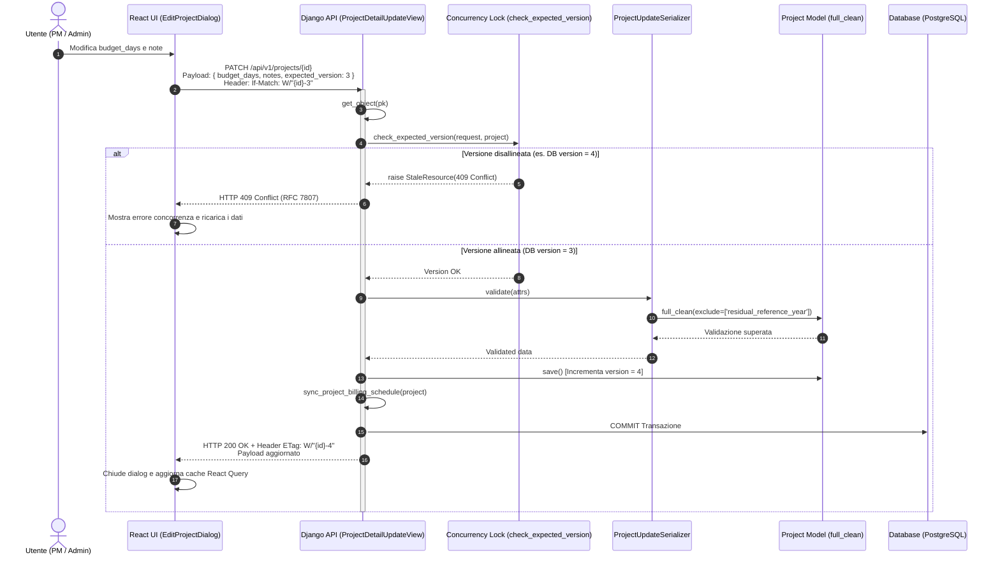
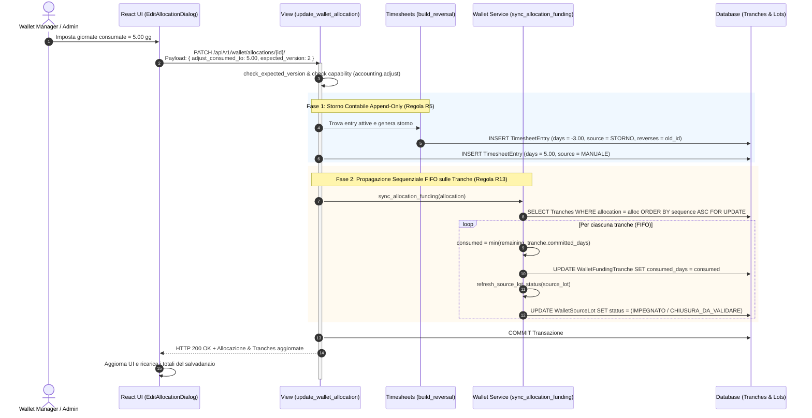
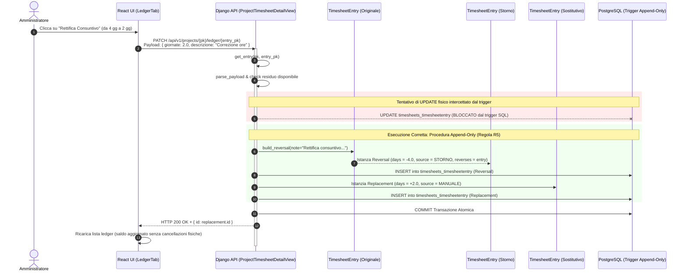
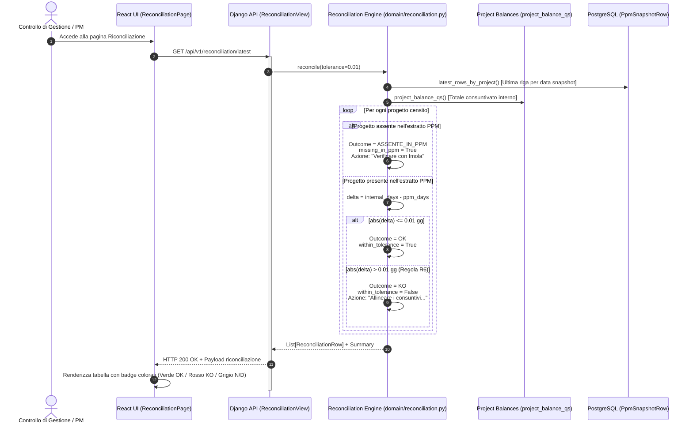
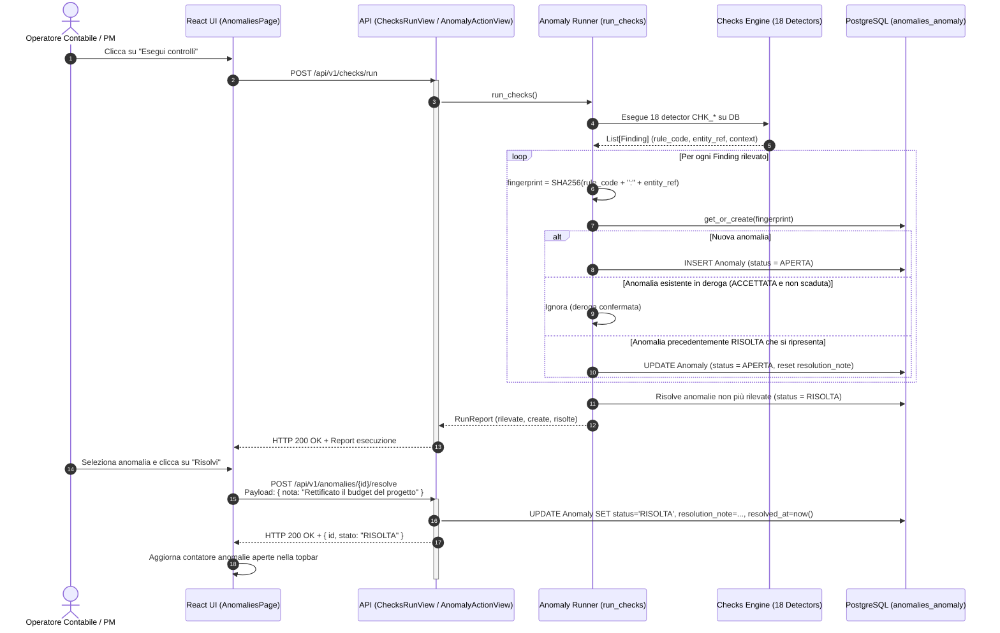
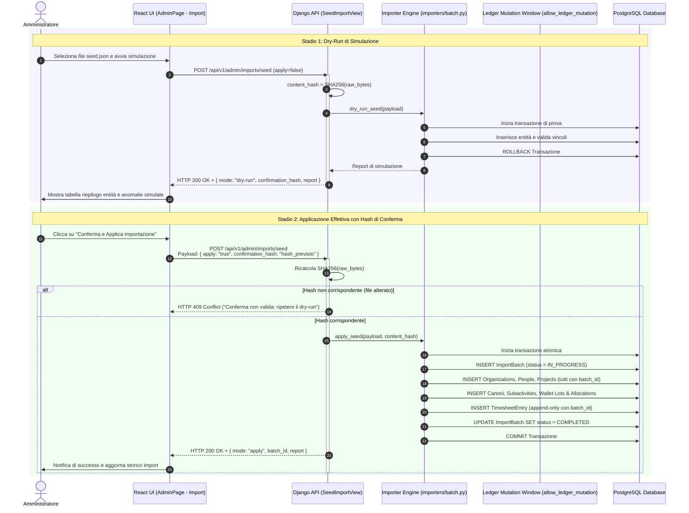

# 04 - Catalogo dei Workflow End-to-End (Supplier Ledger)

## 1. Introduzione e Obiettivi del Catalogo

Il presente documento costituisce il **Catalogo Completo ed Esaustivo dei Workflow End-to-End** del sistema **Supplier Ledger**. Il catalogo mappa tutti i flussi di business e operativi implementati nella piattaforma, coprendo l'intero ciclo di vita delle commesse: dalla pianificazione anagrafica e gestione del budget, alla consuntivazione append-only e alimentazione del salvadanaio ("Wallet"), fino al monitoraggio del canone semestrale Organico Allargato, alla quadratura con i sistemi del fornitore (PPM), alla rilevazione automatica delle anomalie contabili e alle operazioni amministrative di sicurezza e continuità operativa.

Tutti i workflow censiti sono stati analizzati mediante ispezione statica diretta del codice sorgente backend (`backend/api/`, `backend/domain/`, `backend/projects/`, `backend/timesheets/`, `backend/wallet/`, `backend/canone/`, `backend/ppm/`, `backend/anomalies/`, `backend/imports/`, `backend/core/`) e del frontend React TypeScript (`frontend/src/features/`, `frontend/src/lib/`, `frontend/src/components/`).

### Riferimenti Incrociati nell'Assessment
- [01_REPOSITORY_INVENTORY.md](01_REPOSITORY_INVENTORY.md): Censimento componenti e inventario repository
- [02_FUNCTIONAL_DOMAIN_MODEL.md](02_FUNCTIONAL_DOMAIN_MODEL.md): Modello concettuale delle entità di dominio
- [03_FUNCTIONAL_CAPABILITY_MAP.md](03_FUNCTIONAL_CAPABILITY_MAP.md): Mappa delle capacità applicative
- [05_TECHNICAL_ARCHITECTURE.md](05_TECHNICAL_ARCHITECTURE.md): Architettura tecnica e infrastruttura di sistema
- [06_DATA_MODEL.md](06_DATA_MODEL.md): Modello relazionale, vincoli DB e migrazioni ORM
- [07_API_CATALOG.md](07_API_CATALOG.md): Catalogo completo degli endpoint RESTful v1
- [08_BUSINESS_RULES.md](08_BUSINESS_RULES.md): Catalogo delle 18 regole di business (R1–R18)
- [09_SECURITY_AUTHORIZATION.md](09_SECURITY_AUTHORIZATION.md): Modello RBAC, matrice capability e permessi ad oggetto

### Tassonomia degli Stati Implementativi
- **IMPLEMENTED**: Il workflow è integralmente supportato dal database, dalla logica applicativa backend e dall'interfaccia utente frontend, corredato da test automatizzati.
- **PARTIAL**: Il workflow è parzialmente implementato (es. backend attivo ma UI incompleta, oppure logica priva di alcune validazioni).
- **NOT_IMPLEMENTED**: Il workflow è pianificato o teorico ma non esiste riscontro nel codice.
- **NOT_VERIFIED**: Il workflow presenta componenti esterne non ispezionabili staticamente nell'ambiente corrente.

---

## 2. Matrice Generale dei Workflow End-to-End

| ID | Nome Workflow | Ambito / Modulo | Endpoint API Principale | Attore Principale | Capability / Permesso | Stato Implementativo |
|:---|:---|:---|:---|:---|:---|:---:|
| **WF-01** | Creazione nuovo progetto | Progetti | `POST /api/v1/projects` | PM / Admin | `projects.create` | **IMPLEMENTED** |
| **WF-02** | Modifica anagrafica e budget progetto | Progetti | `PATCH /api/v1/projects/{id}` | PM / Admin | `projects.edit` | **IMPLEMENTED** |
| **WF-03** | Annotazione progetto da Referente BMED | Progetti | `PATCH /api/v1/projects/{id}` | Referente Cliente | `ReferentCanAnnotate` | **IMPLEMENTED** |
| **WF-04** | Transizione di stato progetto | Progetti | `PATCH /api/v1/projects/{id}` | PM / Admin | `projects.edit` | **IMPLEMENTED** |
| **WF-05** | Pianificazione e slittamento milestone fatturazione | Fatturazione | `PATCH /api/v1/projects/{id}` | PM / Admin | `projects.edit` | **IMPLEMENTED** |
| **WF-06** | Validazione chiusura progetto con quote wallet | Progetti / Wallet | `POST /api/v1/projects/{id}/validate-closure` | PM / Admin | `project.validate_closure` | **IMPLEMENTED** |
| **WF-07** | Inserimento consuntivo diretto su progetto | Ledger / Timesheet | `POST /api/v1/projects/{id}/ledger` | Ledger Writer / PM | `timesheets.create` | **IMPLEMENTED** |
| **WF-08** | Inserimento consuntivo su sotto-attività canone | Canone / Timesheet | `POST /api/v1/canoni/{id}/subactivities/{subId}/timesheets` | Ledger Writer / PM | `timesheets.create` | **IMPLEMENTED** |
| **WF-09** | Inserimento consuntivo su allocazione wallet con propagazione FIFO | Wallet / Timesheet | `PATCH /api/v1/wallet/allocations/{id}/` | Wallet Manager / Admin | `accounting.adjust` | **IMPLEMENTED** |
| **WF-10** | Storno contabile append-only | Ledger / Timesheet | `PATCH`/`DELETE /api/v1/projects/{id}/ledger/{entry_id}` | Admin | `IsAdmin` | **IMPLEMENTED** |
| **WF-11** | Creazione lotto sorgente da chiusura progetto | Wallet / Salvadanaio | `POST /api/v1/projects/{id}/validate-closure` | Sistema / Admin | `project.validate_closure` | **IMPLEMENTED** |
| **WF-12** | Creazione nuova allocazione wallet con associazione FIFO | Wallet / Salvadanaio | `POST /api/v1/allocations` | Wallet Manager / Admin | `wallet.edit` | **IMPLEMENTED** |
| **WF-13** | Rettifica allocazione wallet | Wallet / Salvadanaio | `PATCH /api/v1/wallet/allocations/{id}/` | Wallet Manager / Admin | `wallet.edit` | **IMPLEMENTED** |
| **WF-14** | Chiusura allocazione con svincolo residuo non consumato | Wallet / Salvadanaio | `PATCH /api/v1/wallet/allocations/{id}/` | Wallet Manager / Admin | `wallet.edit` | **IMPLEMENTED** |
| **WF-15** | Monitoraggio saturazione per architetto | Wallet / Reportistica | `GET /api/v1/wallet/{year}/assignees` | Qualsiasi autenticato | `IsAuthenticated` | **IMPLEMENTED** |
| **WF-16** | Creazione e configurazione canone semestrale | Canoni | `POST /api/v1/canoni` | PM / Admin | `canone.manage` | **IMPLEMENTED** |
| **WF-17** | Censimento sotto-attività architetturali per ufficio | Canoni | `POST /api/v1/canoni/{id}/subactivities` | PM / Admin | `canone.manage` | **IMPLEMENTED** |
| **WF-18** | Monitoraggio avanzamento, burn-down e forecast | Canoni | `GET /api/v1/canoni/{id}/status` | Qualsiasi autenticato | `IsAuthenticated` | **IMPLEMENTED** |
| **WF-19** | Caricamento estratto PPM dal fornitore | Riconciliazione | `POST /api/v1/imports/ppm` | PM / Admin | `imports.upload` | **IMPLEMENTED** |
| **WF-20** | Riconciliazione automatica con tolleranza 0.01 gg | Riconciliazione | `GET /api/v1/reconciliation/latest` | Qualsiasi autenticato | `IsAuthenticated` | **IMPLEMENTED** |
| **WF-21** | Esecuzione on-demand dei 18 controlli contabili | Controlli & Anomalie | `POST /api/v1/checks/run` | Ledger Writer / Admin | `accounting.write` | **IMPLEMENTED** |
| **WF-22** | Presa in carico anomalia | Controlli & Anomalie | `POST /api/v1/anomalies/{id}/take` | PM / Admin | `anomalies.resolve` | **IMPLEMENTED** |
| **WF-23** | Risoluzione anomalia con nota motivata | Controlli & Anomalie | `POST /api/v1/anomalies/{id}/resolve` | PM / Admin | `anomalies.resolve` | **IMPLEMENTED** |
| **WF-24** | Accettazione anomalia in deroga | Controlli & Anomalie | `POST /api/v1/anomalies/{id}/accept` | PM / Admin | `anomalies.resolve` | **IMPLEMENTED** |
| **WF-25** | Supersessione automatica anomalie storiche da seed | Controlli & Anomalie | `POST /api/v1/checks/run` (interno) | Sistema / Engine | Interno | **IMPLEMENTED** |
| **WF-26** | Gestione progetti in revisione | Coda di Revisione | `POST /api/v1/projects/{id}/confirm-review` | Ledger Writer / PM | `accounting.write` | **IMPLEMENTED** |
| **WF-27** | Import seed JSON a 2 stadi | Import / Export | `POST /api/v1/admin/imports/seed` | Admin | `IsAdmin` | **IMPLEMENTED** |
| **WF-28** | Rollback batch import | Import / Export | Servizio CLI / Management | Admin | `IsAdmin` | **IMPLEMENTED** |
| **WF-29** | Export dati applicativi (JSON, Excel, CSV) | Import / Export | `GET /api/v1/export/{format}` | Qualsiasi autenticato | `data.export` | **IMPLEMENTED** |
| **WF-30** | Login e gestione sessione trasparente | Amministrazione | `POST /api/v1/auth/login` | Qualsiasi utente | `AllowAny` | **IMPLEMENTED** |
| **WF-31** | Gestione utenze e password | Amministrazione | `POST`/`PATCH /api/v1/admin/users` | Admin | `users.manage` | **IMPLEMENTED** |
| **WF-32** | Override capability per ruolo a runtime | Amministrazione | `PUT /api/v1/admin/roles/capabilities` | Admin | `privileges.manage` | **IMPLEMENTED** |
| **WF-33** | Backup & Restore database | Amministrazione | `GET`/`POST /api/v1/admin/database/*` | Admin | `AdministratorOnly` | **IMPLEMENTED** |
| **WF-34** | Reset dati operativi | Amministrazione | `POST /api/v1/admin/reset-data` | Admin | `data.reset` | **IMPLEMENTED** |

---

## 3. Workflow Progetti (WF-01 – WF-06)

### WF-01: Creazione Nuovo Progetto
- **Trigger**: Click dell'utente sul pulsante `"Nuovo progetto"` nell'intestazione di [`ProjectsPage.tsx`](../../frontend/src/features/projects/ProjectsPage.tsx#L45-L52).
- **Attore**: Project Manager, Amministratore o Responsabile UO.
- **Precondizioni**: Utente autenticato con capability `projects.create` (ruoli `ADMIN`, `PROJECT_MANAGER`, `UO`).
- **Input UI**: Dialog guidato a 3 passi implementato in [`NewProjectDialog.tsx`](../../frontend/src/features/projects/NewProjectDialog.tsx#L18-L171):
  - *Passo 1*: Codice identificativo (`code`), Tipo contratto (`contract_type` con scelte: `AQL`, `CORPO`, `PPM`, `ATTIVITA`), Titolo sintetico (`title`), Budget in giornate (`budget_days`).
  - *Passo 2*: Data inizio prevista (`start_date`), Data fine prevista (`planned_end_date`).
  - *Passo 3*: Schermata di riepilogo dati e pulsante di conferma definitiva `"Crea progetto"`.
- **Validazioni Client/Server**:
  - *Client*: Form validation con `react-hook-form`: `code` e `title` obbligatori; `budget_days` validato con regex `/^\d+(?:[.,]\d{1,4})?$/` per ammettere numeri decimali fino a 4 cifre; navigazione fra i passi subordinata alla validità dei campi correnti.
  - *Server*: [`ProjectListCreateView.post`](../../backend/api/domain_views.py#L222-L253) filtra il payload con `allowed_fields` e invoca `project.full_clean()`. A livello di modello [`Project.clean()`](../../backend/projects/models.py#L197-L228) e vincoli DB [`Meta.constraints`](../../backend/projects/models.py#L159-L179):
    - `budget_days >= 0` (`project_budget_non_negative`)
    - `planned_end_date >= start_date` (`project_end_after_start`)
    - Codice univoco a livello DB.
- **API Invocata**: `POST /api/v1/projects`
- **Logica Service Backend**:
  1. Istanziazione del modello [`Project`](../../backend/projects/models.py#L90-L154).
  2. Esecuzione di `project.full_clean()` e persistenza iniziale `project.save()`.
  3. Invocazione del servizio [`sync_project_billing_schedule(project, user=request.user)`](../../backend/projects/billing.py#L19-L67): se le date `start_date` e `planned_end_date` sono valorizzate, il sistema genera o allinea automaticamente le due milestone di fatturazione convenzionali (slot `START` a fine mese di avvio, slot `END` a fine mese di chiusura prevista).
- **Transazione DB / Persistenza**: `transaction.atomic` in [`domain_views.py#L223`](../../backend/api/domain_views.py#L223). Inserimento record in `projects_project`, generazione record in `projects_billingmilestone` e salvataggio audit iniziale in `projects_historicalproject`.
- **Output / Eventi**: Status `201 Created` con payload `{"id": project.id, "codice": project.code, "version": project.version}`. Il client esegue `queryClient.invalidateQueries({ queryKey: ["projects"] })` e chiude il modale.
- **Error Handling & Casi Limite**: Errore di unicità codice o vincoli di data ritornano `400 Bad Request` con mappa degli errori di campo iniettata nei singoli input tramite `setError`.
- **Permessi Richiesti**: [`ReadOnlyOrCanCreateProjects`](../../backend/core/permissions.py#L52-L65) -> Capability `projects.create`.
- **Test Correlati**: [`test_phase3_api.py`](../../backend/tests/test_phase3_api.py), [`test_project_editing_api.py`](../../backend/tests/test_project_editing_api.py).
- **Stato Implementativo**: **IMPLEMENTED**

---

### WF-02: Modifica Anagrafica e Budget Progetto con Concorrenza Ottimistica
- **Trigger**: Click su un progetto nella tabella progetti o sul pulsante "Modifica" nella scheda di dettaglio.
- **Attore**: Project Manager o Amministratore.
- **Precondizioni**: Progetto esistente; utente titolare della capability `projects.edit`.
- **Input UI**: Form modale [`EditProjectDialog.tsx`](../../frontend/src/features/projects/EditProjectDialog.tsx#L79-L200) con tutti i campi anagrafici e contabili editabili: `title`, `contract_type`, `aro_code`, `rda_code`, `deliverable`, `client_owner` (referente BMED), `supplier_owner` (referente Imola), `budget_days`, `start_date`, `planned_end_date`, `actual_closure_date`, `offer_status`, `timesheet_status`, `billing_status`, `notes`, `reliability`.
- **Validazioni Client/Server**:
  - *Client*: Validazione formati data e valori decimali; blocco modifica del codice progetto (`code`), che rimane immutabile perché funge da ancora contabile; inclusione nel payload di `expected_version = project.version`.
  - *Server*:
    1. [`check_expected_version`](../../backend/api/domain_views.py#L42-L54): confronta l'header `If-Match` o il campo payload `expected_version` con `project.version`. Se assenti solleva [`PreconditionRequired`](../../backend/core/exceptions.py#L38-L44) (`428`); se non corrispondono solleva [`StaleResource`](../../backend/core/exceptions.py#L29-L36) (`409 Conflict`).
    2. [`ProjectUpdateSerializer`](../../backend/api/project_serializers.py#L34-L77): verifica che `client_owner` appartenga a un'organizzazione di tipo `CLIENT` (`BMED`) e che `supplier_owner` appartenga a `SUPPLIER` (`Imola`).
    3. Esecuzione di `candidate.full_clean(exclude=["residual_reference_year"])` che valida le transizioni di stato e i vincoli contabili (Regola R10).
- **API Invocata**: `PATCH /api/v1/projects/{id}` con header `If-Match: W/"{id}-{version}"` o payload `expected_version`.
- **Logica Service Backend**:
  1. [`ProjectDetailUpdateView.patch`](../../backend/api/domain_views.py#L1633-L1657) acquisisce l'istanza.
  2. Verifica whitelist campi: se l'utente ha `projects.edit`, i campi ammessi sono `PROJECT_EDITABLE_FIELDS`.
  3. Deserializzazione parziale con `ProjectUpdateSerializer(project, data=request.data, partial=True)`.
  4. Salvataggio del modello `project.save()` con incremento atomico del campo `version`.
  5. Sincronizzazione automatica del piano milestone [`sync_project_billing_schedule`](../../backend/projects/billing.py#L19-L67).
- **Transazione DB / Persistenza**: Blocco atomico `transaction.atomic`. Update della riga in `projects_project`, inserimento record di audit con snapshot in `projects_historicalproject`.
- **Output / Eventi**: Status `200 OK` con il payload completo [`project_detail_payload`](../../backend/api/domain_views.py#L1567-L1606) e nuovo header `ETag: W/"{id}-{new_version}"`. Il client frontend invalida le query `["projects"]`, `["project", id]` e `["audit", "project", id]`.
- **Error Handling & Casi Limite**:
  - In caso di `409 Conflict`, il client intercetta l'errore, mostra un alert all'utente ("La risorsa è stata modificata da un altro utente. Ricarica la scheda per riprovare") ed esegue automaticamente `detailQuery.refetch()` senza distruggere i dati digitati.
- **Permessi Richiesti**: Capability `projects.edit` ([`CanEditProjects`](../../backend/core/permissions.py#L68-L76)).
- **Test Correlati**: [`test_project_editing_api.py::test_optimistic_locking_conflict`](../../backend/tests/test_project_editing_api.py), [`test_project_editing_api.py::test_full_project_edit_success`](../../backend/tests/test_project_editing_api.py).
- **Stato Implementativo**: **IMPLEMENTED**



---

### WF-03: Annotazione Progetto da Referente BMED
- **Trigger**: Il referente cliente (BMED) apre la scheda di un progetto a lui assegnato e desidera aggiornare note di avanzamento o la data di fine prevista.
- **Attore**: Referente Cliente BMED (`user.person.organization.kind == "CLIENT"`).
- **Precondizioni**: L'utente è associato a un'anagrafica `Person` cliente ed è designato come `client_owner` del progetto; l'utente NON possiede la capability globale `projects.edit`.
- **Input UI**: Form [`EditProjectDialog.tsx`](../../frontend/src/features/projects/EditProjectDialog.tsx#L116-L180) in modalità ristretta (`isFullEdit === false`):
  - Tutti i campi strutturali, contrattuali e di budget (`budget_days`, `contract_type`, `offer_status`, `timesheet_status`, `billing_status`, referenti) sono disabilitati o nascosti.
  - Risultano editabili esclusivamente: `notes` e `planned_end_date` (e i punti di verifica).
- **Validazioni Client/Server**:
  - *Client*: Il payload inviato dalla form contiene unicamente `{ notes, planned_end_date, expected_version }`.
  - *Server*: In [`ProjectDetailUpdateView.patch`](../../backend/api/domain_views.py#L1638-L1649):
    ```python
    allowed_fields = (
        PROJECT_EDITABLE_FIELDS
        if capabilities.has_capability(request.user, capabilities.EDIT_PROJECTS)
        else PROJECT_ANNOTATION_FIELDS
    )
    forbidden = supplied_fields - allowed_fields
    if forbidden:
        raise serializers.ValidationError(
            dict.fromkeys(forbidden, "Campo non modificabile per il ruolo corrente.")
        )
    ```
- **API Invocata**: `PATCH /api/v1/projects/{id}` con `expected_version`.
- **Logica Service Backend**:
  1. Permesso ad oggetto [`ReferentCanAnnotate`](../../backend/core/permissions.py#L131-L157): verifica che l'utente sia un referente cliente e che corrisponda a `project.client_owner`.
  2. Aggiornamento limitato ai soli campi di annotazione: `notes`, `planned_end_date`, `verification_points`.
  3. Il budget e gli stati restano inalterati; `sync_project_billing_schedule` aggiorna la milestone `END` se la data prevista è slittata.
- **Transazione DB / Persistenza**: `transaction.atomic`, update su `projects_project`, generazione audit record con i soli campi variati in `projects_historicalproject`.
- **Output / Eventi**: Status `200 OK` con payload aggiornato ed ETag.
- **Error Handling & Casi Limite**: Se un referente tenta di alterare campi non autorizzati (es. iniettando `budget_days` nella chiamata HTTP), riceve `400 Bad Request` con dettaglio del campo vietato. Se tenta di modificare un progetto di cui non è referente, riceve `403 Forbidden`.
- **Permessi Richiesti**: Permesso a livello di oggetto [`ReferentCanAnnotate`](../../backend/core/permissions.py#L131-L157).
- **Test Correlati**: [`test_roles_object_permissions.py::test_referent_can_only_annotate`](../../backend/tests/test_roles_object_permissions.py), [`test_project_editing_api.py::test_referent_annotation_restrictions`](../../backend/tests/test_project_editing_api.py).
- **Stato Implementativo**: **IMPLEMENTED**

---

### WF-04: Transizione di Stato Progetto
- **Trigger**: Modifica dello stato di consuntivazione (`timesheet_status`) o dell'offerta (`offer_status`) in [`EditProjectDialog.tsx`](../../frontend/src/features/projects/EditProjectDialog.tsx#L171-L174).
- **Attore**: Project Manager o Amministratore.
- **Precondizioni**: Progetto esistente con versione nota.
- **Input UI**: Dropdown di selezione stato:
  - `offer_status`: `DA_EMETTERE`, `EMESSA`, `INVIATA`, `ACCETTATA`, `RIFIUTATA`.
  - `timesheet_status`: `NON_AVVIATO`, `ATTIVO`, `SOSPESO`, `CHIUSO`, `DA_VERIFICARE`.
  - Data di chiusura effettiva (`actual_closure_date`): obbligatoria se lo stato selezionato è `CHIUSO`.
- **Validazioni Client/Server**:
  - *Client*: Se l'utente seleziona `timesheet_status === "CHIUSO"`, l'interfaccia evidenzia come obbligatorio l'input `actual_closure_date`.
  - *Server*:
    - **Regola R10** ([`Project.clean`](../../backend/projects/models.py#L199-L204)): Un progetto non può transitare nello stato `ATTIVO` se `offer_status != OfferStatus.ACCETTATA`. Violazione genera: `ValidationError({"timesheet_status": "Il progetto non può passare ad ATTIVO se l'offerta non è ACCETTATA."})`.
    - **Regole R18, D-03, D-14** ([`Project.clean`](../../backend/projects/models.py#L205-L219)): Un progetto `CHIUSO` richiede obbligatoriamente `actual_closure_date`. L'unica eccezione ammessa è riservata ai record caricati tramite batch `SEED_JSON` / `WORKBOOK_JSON`.
    - **Coerenza Temporale** ([`Project.clean`](../../backend/projects/models.py#L220-L225)): `actual_closure_date >= start_date` ("La chiusura non può precedere l'inizio").
    - **Check Constraint DB** ([`project_closed_requires_date`](../../backend/projects/models.py#L173-L178)): Vincolo a livello PostgreSQL che impedisce righe chiuse senza data al di fuori dei batch seed.
- **API Invocata**: `PATCH /api/v1/projects/{id}` con `expected_version`.
- **Logica Service Backend**: Modifica atomica dell'anagrafica, validazione con `full_clean()`, ricalcolo immediato dello stato di validità del residuo tramite [`residual_validity()`](../../backend/domain/residuals.py#L48-L110).
- **Transazione DB / Persistenza**: `transaction.atomic`, update su `projects_project`, incremento `version`, registrazione in `projects_historicalproject`.
- **Output / Eventi**: Status `200 OK` con il nuovo stato operativo e validità del residuo calcolata.
- **Error Handling & Casi Limite**: Violazione di R10 o D-03/D-14 ritorna `400 Bad Request` con i messaggi di validazione specifici per ciascun campo.
- **Permessi Richiesti**: Capability `projects.edit`.
- **Test Correlati**: [`test_models.py::test_project_closed_requires_date`](../../backend/tests/test_models.py), [`test_d14_seed_exceptions.py`](../../backend/tests/test_d14_seed_exceptions.py).
- **Stato Implementativo**: **IMPLEMENTED**

---

### WF-05: Pianificazione e Slittamento Milestone di Fatturazione
- **Trigger**: Modifica della data prevista di una milestone di fatturazione o riallineamento del piano di progetto.
- **Attore**: Project Manager o Amministratore.
- **Precondizioni**: Milestone di fatturazione associata al progetto.
- **Input UI**: Nuova data prevista (`planned_date`) e campo testuale obbligatorio "Motivazione dello spostamento" (`reason`).
- **Validazioni Client/Server**:
  - *Server*: Metodo [`BillingMilestone.move_to(new_date, reason, user)`](../../backend/projects/models.py#L272-L291) (Regola R11): la motivazione è tassativamente obbligatoria e non può essere vuota (`if not reason or not reason.strip(): raise ValidationError(...)`).
- **API Invocata**: `PATCH /api/v1/projects/{id}` (che aziona `sync_project_billing_schedule`) o endpoint di modifica milestone.
- **Logica Service Backend**:
  1. [`BillingMilestone.move_to`](../../backend/projects/models.py#L272-L291) appende allo storico JSON `moves` un record completo:
     ```python
     self.moves = [
         *(self.moves or []),
         {
             "da": self.planned_date.isoformat() if self.planned_date else None,
             "a": new_date.isoformat() if new_date else None,
             "motivazione": reason.strip(),
             "spostata_da": getattr(user, "username", None),
             "spostata_il": timezone.now().isoformat(),
         },
     ]
     self.planned_date = new_date
     self.move_count = (self.move_count or 0) + 1
     self.status = MilestoneStatus.SPOSTATA
     ```
- **Transazione DB / Persistenza**: Update in `projects_billingmilestone` (colonne `moves` JSONField e `move_count`) e tracciamento in `projects_historicalbillingmilestone`.
- **Output / Eventi**: Aggiornamento milestone con conservazione di tutto lo storico dei rinvii.
- **Error Handling & Casi Limite**: Rinvio senza motivazione solleva `ValidationError({"reason": "La motivazione dello spostamento è obbligatoria."})`.
- **Permessi Richiesti**: Capability `projects.edit`.
- **Test Correlati**: [`test_models.py::test_billing_milestone_move_to_requires_reason`](../../backend/tests/test_models.py).
- **Stato Implementativo**: **IMPLEMENTED**

---

### WF-06: Validazione Chiusura Progetto con Quote Wallet Esaurite/Chiuse
- **Trigger**: Click sul pulsante `"Valida Chiusura"` nella vista bilanci ([`ProjectBalancesView`](../../backend/api/domain_views.py#L256-L329)) o nel dettaglio progetto.
- **Attore**: Project Manager o Amministratore titolare della capability `project.validate_closure`.
- **Precondizioni**: La funzione di dominio [`project_closure_ready(project)`](../../backend/domain/residuals.py#L24-L38) restituisce `True`: il progetto possiede almeno una quota allocata a wallet (`project.wallet_allocations.exists()`) e tutte le relative allocazioni risultano in stato `CHIUSA`. Il progetto non deve essere già chiuso.
- **Input UI**: Modale di conferma operazione ("Confermi la validazione della chiusura del progetto?").
- **Validazioni Client/Server**:
  - *Client*: Il pulsante "Valida Chiusura" è reso visibile e abilitato solo se `permissions.validate_closure === true`.
  - *Server*: [`ProjectValidateClosureView.post`](../../backend/api/domain_views.py#L1767-L1823):
    1. Lock concorrente `select_for_update()` sul progetto prefetchando le allocazioni e i lotti sorgente.
    2. Validazione versione ottimistica `check_expected_version(request, project)`.
    3. Verifica `if not project_closure_ready(project): raise serializers.ValidationError(...)`.
- **API Invocata**: `POST /api/v1/projects/{id}/validate-closure` con `expected_version`.
- **Logica Service Backend**:
  1. Impostazione di `project.timesheet_status = TimesheetStatus.CHIUSO`.
  2. Impostazione automatica di `project.actual_closure_date = timezone.localdate()`.
  3. Transizione di stato dei lotti sorgente associati: i lotti in stato `CHIUSURA_DA_VALIDARE` passano a `CHIUSO`.
  4. Scrittura dell'evento di audit `project.closure.validate` in `AdminAuditEvent`.
- **Transazione DB / Persistenza**: `transaction.atomic` globale. Update di `projects_project`, incremento versione, update di `wallet_walletsourcelot`.
- **Output / Eventi**: Status `200 OK` con payload `{"id": project.id, "version": project.version, "stato_operativo": "CHIUSO", "timesheet_status": "CHIUSO", "actual_closure_date": "AAAA-MM-GG"}`.
- **Error Handling & Casi Limite**: Se esistono ancora allocazioni wallet aperte, ritorna `400 Bad Request` con messaggio esplicativo; se un altro utente ha variato il progetto nel frattempo, ritorna `409 Conflict`.
- **Permessi Richiesti**: [`CanValidateProjectClosure`](../../backend/core/permissions.py#L89-L97) -> Capability `project.validate_closure`.
- **Test Correlati**: [`test_wallet_editing_api.py::test_validate_project_closure`](../../backend/tests/test_wallet_editing_api.py).
- **Stato Implementativo**: **IMPLEMENTED**

---

## 4. Workflow Consuntivazione & Ledger (WF-07 – WF-10)

### WF-07: Inserimento Consuntivo Diretto su Progetto
- **Trigger**: Inserimento di una nuova riga nel tab "Consuntivi" della pagina di dettaglio progetto ([`ProjectDetailPage.tsx`](../../frontend/src/features/projects/ProjectDetailPage.tsx)).
- **Attore**: Ledger Writer, Project Manager o Amministratore.
- **Precondizioni**: Progetto non chiuso (`timesheet_status != CHIUSO`); disponibilità di residuo diretto sul progetto.
- **Input UI**: Form di registrazione consuntivo diretto:
  - `giornate` (input numerico con decimali > 0)
  - `data` / `periodo` (selettore mese/giorno)
  - `descrizione` (testo obbligatorio max 300 caratteri)
- **Validazioni Client/Server**:
  - *Client*: Validazione campi obbligatori e valore giornate positivo.
  - *Server* ([`ProjectLedgerView.post`](../../backend/api/domain_views.py#L401-L459)):
    - Verifica che il progetto non sia chiuso: se `timesheet_status == CHIUSO`, rifiuta con `409 Conflict` ("Il progetto è chiuso: non è possibile aggiungere consuntivi diretti").
    - Parsing e quantizzazione giornate: `days > 0`.
    - Descrizione obbligatoria e lunghezza <= 300 caratteri.
    - **Controllo Capienza Residuo Diretto**:
      ```python
      direct_consumed = TimesheetEntry.objects.filter(project=project).aggregate(total=Sum("days"))["total"] or 0
      allocated_to_wallet = project.wallet_allocations.aggregate(total=Sum("allocated_days"))["total"] or 0
      if days > project.budget_days - direct_consumed - allocated_to_wallet:
          return Response({"giornate": ["Le giornate superano il residuo diretto del progetto."]}, status=400)
      ```
- **API Invocata**: `POST /api/v1/projects/{id}/ledger`
- **Logica Service Backend**:
  1. Istanziazione del modello [`TimesheetEntry`](../../backend/timesheets/models.py#L42-L170) con bersaglio `project=project`, `days=days`, `period=period`, `source=TimesheetSource.MANUALE`, `note=description`, `created_by=request.user`.
  2. Esecuzione di `entry.full_clean()` (verifica vincolo bersaglio esclusivo `timesheet_exactly_one_target` e `days != 0`).
  3. Salvataggio della nuova riga contabile append-only.
- **Transazione DB / Persistenza**: `transaction.atomic`. Inserimento riga in `timesheets_timesheetentry`. Nessun record esistente viene aggiornato.
- **Output / Eventi**: Status `201 Created` con payload `{"id": entry.id}`. Invalida cache React Query del ledger.
- **Error Handling & Casi Limite**: Progetto chiuso (`409 Conflict`), sforamento residuo (`400 Bad Request`), data non valida (`400 Bad Request`).
- **Permessi Richiesti**: [`CanCreateTimesheets`](../../backend/core/permissions.py#L100-L108) -> Capability `timesheets.create`.
- **Test Correlati**: [`test_project_ledger_api.py::test_add_direct_timesheet_success`](../../backend/tests/test_project_ledger_api.py), [`test_project_ledger_api.py::test_add_direct_timesheet_exceeds_residual`](../../backend/tests/test_project_ledger_api.py).
- **Stato Implementativo**: **IMPLEMENTED**

---

### WF-08: Inserimento Consuntivo su Sotto-Attività Canone
- **Trigger**: Click su "Registra Consuntivo" su una specifica sotto-attività in [`CanonePage.tsx`](../../frontend/src/features/canone/CanonePage.tsx).
- **Attore**: Ledger Writer, Project Manager o Amministratore.
- **Precondizioni**: Sotto-attività canone attiva con monte `reserved_days` capiente.
- **Input UI**: Form modale con `giornate` (> 0), `data` consuntivazione, `descrizione`.
- **Validazioni Client/Server**:
  - *Client*: Validazione campi obbligatori.
  - *Server* ([`CanoneSubactivityTimesheetListView.post`](../../backend/api/domain_views.py#L1297-L1339)):
    - Lock concorrente `CanoneSubactivity.objects.select_for_update().get(...)`.
    - Validazione congruenza data: `entry_date` deve ricadere nell'intervallo `[start_date, end_date]` della sotto-attività se definiti.
    - Controllo capienza riservata: `consumed + days <= row.reserved_days`. Se superata, solleva errore `400 Bad Request` ("Il consuntivo supera le giornate riservate all'attività").
- **API Invocata**: `POST /api/v1/canoni/{id}/subactivities/{subId}/timesheets`
- **Logica Service Backend**:
  1. Istanziazione di `TimesheetEntry(canone_subactivity=row, period=entry_date, days=days, source=MANUALE, note=description, created_by=request.user)`.
  2. Salvataggio della nuova riga contabile.
  3. Calcolo e restituzione del dettaglio aggiornato del canone tramite [`_canone_detail(row.canone)`](../../backend/api/domain_views.py#L1120-L1190).
- **Transazione DB / Persistenza**: `transaction.atomic`. Inserimento riga append-only in `timesheets_timesheetentry`.
- **Output / Eventi**: Status `201 Created` con payload contenente il dettaglio complessivo del canone e lo stato di avanzamento ricalcolato.
- **Error Handling & Casi Limite**: Sforamento ore riservate (`400 Bad Request`), data fuori semestre/attività (`400 Bad Request`).
- **Permessi Richiesti**: Capability `timesheets.create`.
- **Test Correlati**: [`test_canone_crud_api.py::test_add_subactivity_timesheet`](../../backend/tests/test_canone_crud_api.py).
- **Stato Implementativo**: **IMPLEMENTED**

---

### WF-09: Inserimento Consuntivo su Allocazione Wallet con Propagazione FIFO
- **Trigger**: Rettifica dei consuntivi o registrazione consumo su allocazione wallet da [`EditAllocationDialog.tsx`](../../frontend/src/features/wallet/EditAllocationDialog.tsx).
- **Attore**: Wallet Manager o Amministratore (con capability `accounting.adjust`).
- **Precondizioni**: Allocazione wallet aperta; esistenza di tranche di finanziamento FIFO collegate ai lotti sorgente.
- **Input UI**: Form di rettifica in `EditAllocationDialog.tsx`: indicazione del nuovo totale consumato (`adjust_consumed_to` / `timesheet_days`) o specificazione della nuova riga consuntivo con eventuale ID di storno.
- **Validazioni Client/Server**:
  - *Client*: Validazione valori non negativi e non superiori al totale allocato.
  - *Server* ([`update_wallet_allocation`](../../backend/api/domain_views.py#L1825-L2110)):
    - Verifica di concorrenza `check_expected_version(request, alloc)`.
    - Capability check: la modifica dei consuntivi richiede tassativamente `capabilities.ADJUST_ACCOUNTING` (altrimenti `PermissionDenied` -> `403 Forbidden`).
    - Controllo limite superiore: `synthetic_target <= alloc.allocated_days` ("Le giornate consumate non possono superare quelle allocate").
- **API Invocata**: `PATCH /api/v1/wallet/allocations/{id}/`
- **Logica Service Backend**:
  1. **Storno Contabile delle Righe Pregresse**: per tutte le entry attive collegate all'allocazione, viene generata e salvata una riga di storno tramite `entry.build_reversal()`.
  2. **Emissione Nuova Riga Consuntivo**: creazione della riga `TimesheetEntry(wallet_allocation=alloc, days=synthetic_target, period=month_start(...), source=MANUALE)`.
  3. **Propagazione FIFO sulle Tranche** ([`sync_allocation_funding`](../../backend/wallet/services.py#L116-L135)):
     - Scorre le [`WalletFundingTranche`](../../backend/wallet/models.py#L270-L319) in ordine crescente di `sequence` (ordinamento FIFO per data/anno dei lotti sorgente).
     - Ripartisce il totale consumato: `consumed = min(remaining, tranche.committed_days)`.
     - Aggiorna `tranche.consumed_days = consumed`.
     - Sottrae la quota: `remaining -= consumed`.
     - Invia il segnale di ricalcolo stato al lotto sorgente tramite [`refresh_source_lot_status(tranche.source_lot)`](../../backend/wallet/services.py#L30-L41) (stato: `DISPONIBILE`, `IMPEGNATO` o `CHIUSURA_DA_VALIDARE`).
- **Transazione DB / Persistenza**: `transaction.atomic` globale. Inserimento record di storno e nuova riga in `timesheets_timesheetentry`, update colonne `consumed_days` in `wallet_walletfundingtranche`, update colonne `status` in `wallet_walletsourcelot`.
- **Output / Eventi**: Status `200 OK` con il payload completo dell'allocazione e riepilogo del finanziamento aggiornato.
- **Error Handling & Casi Limite**: Mancanza di `accounting.adjust` ritorna `403 Forbidden`; collisione ottimistica versione ritorna `409 Conflict`.
- **Permessi Richiesti**: `CanEditWallet` + `capabilities.ADJUST_ACCOUNTING`.
- **Test Correlati**: [`test_wallet_fifo.py`](../../backend/tests/domain/test_wallet_fifo.py), [`test_wallet_editing_api.py::test_adjust_consumed_propagates_to_tranches`](../../backend/tests/test_wallet_editing_api.py).
- **Stato Implementativo**: **IMPLEMENTED**



---

### WF-10: Storno Contabile Append-Only (Regola R5)
- **Trigger**: Click su "Rettifica" o "Elimina" su una riga consuntivo manuale nel tab Ledger ([`ProjectTimesheetDetailView`](../../backend/api/domain_views.py#L461-L549)).
- **Attore**: Amministratore (operazione riservata ad Admin).
- **Precondizioni**: Consuntivo esistente con `source == TimesheetSource.MANUALE` e non già stornato (`reversals__isnull=True`).
- **Input UI**: Dialog di rettifica consuntivo con nuovi valori (`data`, `giornate`, `descrizione`) oppure click su icona cestino per annullamento.
- **Validazioni Client/Server**:
  - *Database & ORM Guard* ([`TimesheetEntry`](../../backend/timesheets/models.py#L146-L157)):
    - `save()`: se `not self._state.adding` solleva tassativamente `ValidationError("I consuntivi sono append-only: per correggere, registrare uno storno.")`.
    - `delete()`: solleva tassativamente `ValidationError("I consuntivi non si cancellano: registrare una riga di storno (reverses).")`.
    - Trigger PostgreSQL `timesheets_append_only`: intercetta ed emette errore SQL a livello di motore relazionale su qualunque comando `UPDATE` o `DELETE` non autorizzato.
- **API Invocata**: `PATCH /api/v1/projects/{pk}/ledger/{entry_pk}` o `DELETE /api/v1/projects/{pk}/ledger/{entry_pk}`
- **Logica Service Backend**:
  - In caso di **Eliminazione** (`DELETE`):
    1. Recupera l'entry bersaglio.
    2. Invoca [`entry.build_reversal(note=f"Eliminazione amministrativa del consuntivo {entry.id}")`](../../backend/timesheets/models.py#L158-L170).
    3. Il reversal viene generato con: `project = entry.project`, `period = entry.period`, `days = -entry.days`, `source = TimesheetSource.STORNO`, `reverses = entry`.
    4. Persistenza della riga di storno tramite `reversal.save()`.
    5. Risposta `204 No Content` (la riga originale rimane presente a database, non viene toccata).
  - In caso di **Rettifica** (`PATCH`):
    1. Calcolo del nuovo consuntivo e verifica capienza residuo.
    2. Creazione e salvataggio del record di storno `reversal = entry.build_reversal(...)`.
    3. Creazione e salvataggio della nuova riga sostitutiva `replacement = TimesheetEntry(days=new_days, period=new_date, note=new_note, source=MANUALE, ...)`.
    4. Risposta `200 OK` con ID della riga sostitutiva.
- **Transazione DB / Persistenza**: `transaction.atomic`. Inserimento puro (append-only) di 1 record (in delete) o 2 record (in patch) in `timesheets_timesheetentry`. Integrità storica assoluta.
- **Output / Eventi**: La riga originale risulta stornata per via della relazione inversa `reversals`; le viste di calcolo escludono automaticamente le righe stornate calcolando la somma algebrica esatta.
- **Error Handling & Casi Limite**: Tentativo di stornare una riga già stornata ritorna `404 Not Found`; tentativo di violare i vincoli di bilancio ritorna `400 Bad Request`.
- **Permessi Richiesti**: [`IsAdmin`](../../backend/core/permissions.py#L35-L40).
- **Test Correlati**: [`test_append_only.py`](../../backend/tests/test_append_only.py), [`test_project_ledger_api.py::test_rectify_and_delete_timesheet_creates_reversal`](../../backend/tests/test_project_ledger_api.py).
- **Stato Implementativo**: **IMPLEMENTED**



---

## 5. Workflow Wallet & Salvadanaio (WF-11 – WF-15)

### WF-11: Creazione Lotto Sorgente da Chiusura Progetto
- **Trigger**: Transizione a `CHIUSO` di un progetto con residuo positivo (`residual_days > 0`) confermato con data effettiva, oppure esecuzione di `validate-closure`.
- **Attore**: Sistema (workflow automatico) o Amministratore.
- **Precondizioni**: Progetto chiuso con `actual_closure_date` valida; calcolo del residuo `residual_days = budget_days - direct_consumed - allocated_to_wallet > 0` (Regole R2 e R3).
- **Input UI**: Schermata di chiusura progetto o validazione chiusura.
- **Validazioni Client/Server**:
  - *Server*: Unicità della coppia `(wallet_year, source_project)` definita nel vincolo DB [`wallet_source_project_per_year`](../../backend/wallet/models.py#L154-L157); `capacity_days >= 0` ([`wallet_source_capacity_non_negative`](../../backend/wallet/models.py#L151-L153)). L'endpoint legacy `/projects/{id}/release-to-wallet` è disabilitato e risponde `409 Conflict` ([`ReleaseProjectToWalletView`](../../backend/api/domain_views.py#L682-L698)).
- **API Invocata**: `POST /api/v1/projects/{id}/validate-closure`
- **Logica Service Backend**:
  1. Istanziazione o recupero di [`WalletSourceLot`](../../backend/wallet/models.py#L121-L161).
  2. Assegnazione: `wallet_year` dell'anno di chiusura, `source_project = project`, `source_year = project.actual_closure_date.year`, `capacity_days = project.residual_days`, `status = SourceLotStatus.DISPONIBILE`.
  3. Il lotto entra immediatamente nel calcolo della capienza del salvadanaio eseguito da [`wallet_year_balance()`](../../backend/domain/wallet_balance.py#L157-L289).
- **Transazione DB / Persistenza**: Inserimento riga in `wallet_walletsourcelot`.
- **Output / Eventi**: Il monte giornate del wallet annuale risulta incrementato della capacità del lotto conferito.
- **Error Handling & Casi Limite**: Progetto senza data effettiva non genera credito wallet; tentativo di creare due lotti per lo stesso progetto nello stesso anno solleva violazione di unicità.
- **Permessi Richiesti**: Capability `project.validate_closure`.
- **Test Correlati**: [`test_wallet_balance.py`](../../backend/tests/domain/test_wallet_balance.py).
- **Stato Implementativo**: **IMPLEMENTED**

---

### WF-12: Creazione Nuova Allocazione Wallet con Associazione FIFO
- **Trigger**: Click su `"Nuova allocazione"` nella barra degli strumenti di [`WalletPage.tsx`](../../frontend/src/features/wallet/WalletPage.tsx).
- **Attore**: Wallet Manager o Amministratore.
- **Precondizioni**: Saldo capiente nel salvadanaio dell'anno richiesto (`unallocated_capacity >= requested_days`).
- **Input UI**: Form modale [`NewAllocationDialog.tsx`](../../frontend/src/features/wallet/NewAllocationDialog.tsx):
  - Anno wallet (`year`)
  - Architetto assegnatario (`assignee` - obbligatorio da UI)
  - Attività di destinazione (selezione esistente o inserimento `new_activity_title`)
  - Giornate allocate (`allocated_days` > 0)
  - Note opzionali e riferimento esterno
- **Validazioni Client/Server**:
  - *Client*: Assegnatario obbligatorio, titolo o attività selezionata obbligatoria, giornate > 0.
  - *Server* ([`WalletAllocationCreateView.post`](../../backend/api/domain_views.py#L714-L855)):
    - Divieto di selezione manuale del progetto sorgente: `if request.data.get("source_project"): raise ValidationError("La fonte non è selezionabile manualmente: il prelievo segue sempre il FIFO dei lotti wallet.")`.
    - **Verifica Capienza Wallet**: calcolo di `balance = wallet_year_balance(...)`. Se `allocated_days > balance.unallocated_capacity`, la richiesta viene respinta con errore `400 Bad Request`.
- **API Invocata**: `POST /api/v1/allocations` (o `POST /api/v1/wallet/allocations`)
- **Logica Service Backend**:
  1. Risoluzione o creazione automatica di [`WalletActivity`](../../backend/wallet/models.py#L62-L119).
  2. Creazione dell'allocazione [`WalletAllocation`](../../backend/wallet/models.py#L163-L268) con `source_project = None` e `requires_source_attribution = False`.
  3. **Algoritmo di Prelievo FIFO** ([`reserve_fifo`](../../backend/wallet/services.py#L43-L88)):
     - Estrae i lotti `WalletSourceLot` con lock `select_for_update()`, ordinandoli per `source_year`, `effective_date`, `source_project__code`, `pk`.
     - Per ciascun lotto capiente, genera una [`WalletFundingTranche`](../../backend/wallet/models.py#L270-L319) con la quota impegnata (`committed_days`), assegnando `sequence` progressivo (1, 2, ...).
     - Aggiorna lo stato del lotto sorgente tramite `refresh_source_lot_status(lot)` (da `DISPONIBILE` a `IMPEGNATO`).
  4. Scrittura audit trail `wallet_allocation.create` in `AdminAuditEvent`.
- **Transazione DB / Persistenza**: `transaction.atomic` globale. Insert su `wallet_walletallocation`, bulk insert su `wallet_walletfundingtranche`, update su `wallet_walletsourcelot`.
- **Output / Eventi**: Status `201 Created` con payload contenente i dati dell'allocazione e l'elenco delle quote/progetti sorgente associati per tranche.
- **Error Handling & Casi Limite**: Capienza insufficiente ritorna `400 Bad Request` indicando esattamente le giornate massime disponibili.
- **Permessi Richiesti**: [`CanEditWallet`](../../backend/core/permissions.py#L79-L86) -> Capability `wallet.edit`.
- **Test Correlati**: [`test_wallet_fifo.py::test_reserve_fifo_multiple_lots`](../../backend/tests/domain/test_wallet_fifo.py), [`test_wallet_editing_api.py::test_create_allocation_fifo_success`](../../backend/tests/test_wallet_editing_api.py).
- **Stato Implementativo**: **IMPLEMENTED**

---

### WF-13: Rettifica Allocazione Wallet (Riduzione / Aumento Budget)
- **Trigger**: Modifica delle giornate allocate (`allocated_days`) o dell'assegnatario da [`EditAllocationDialog.tsx`](../../frontend/src/features/wallet/EditAllocationDialog.tsx).
- **Attore**: Wallet Manager o Amministratore.
- **Precondizioni**: Allocazione esistente; lock ottimistico valido.
- **Input UI**: Campo `allocated_days` modificato nel form di edit.
- **Validazioni Client/Server**:
  - *Server* ([`update_wallet_allocation`](../../backend/api/domain_views.py#L1825-L2110)):
    - Verifica versione `check_expected_version`.
    - Se l'allocazione viene ridotta, il nuovo valore non può scendere al di sotto del totale già consumato (`current_consumed`): se `new_allocated < current_consumed`, solleva `ValidationError` a meno che non sia contestualmente associata una richiesta di rettifica consuntivi autorizzata.
- **API Invocata**: `PATCH /api/v1/wallet/allocations/{id}/`
- **Logica Service Backend**:
  1. Invocazione di [`resize_allocation(allocation, new_days)`](../../backend/wallet/services.py#L90-L114):
     - **In caso di incremento**: calcola `delta = target - current` e invoca `reserve_fifo(allocation, delta)`, impegnando quote aggiuntive dai lotti secondo l'ordinamento temporale.
     - **In caso di riduzione**: calcola `to_release = current - target` e scorre le tranche in ordine inverso (`order_by("-sequence")`, LIFO di rilascio), riducendo `committed_days` fino a concorrenza del delta e ripristinando la disponibilità sui lotti sorgente tramite `refresh_source_lot_status`.
- **Transazione DB / Persistenza**: `transaction.atomic`. Update su `wallet_walletallocation`, `wallet_walletfundingtranche` e `wallet_walletsourcelot`.
- **Output / Eventi**: Status `200 OK` con il nuovo monte allocato e le quote tranche riallineate.
- **Error Handling & Casi Limite**: Riduzione al di sotto del consumato solleva `ValueError("La riduzione richiesta intacca giornate già consumate.")` mappato a `400 Bad Request`.
- **Permessi Richiesti**: Capability `wallet.edit`.
- **Test Correlati**: [`test_wallet_editing_api.py::test_resize_allocation_up_and_down`](../../backend/tests/test_wallet_editing_api.py).
- **Stato Implementativo**: **IMPLEMENTED**

---

### WF-14: Chiusura Allocazione con Svincolo Residuo Non Consumato
- **Trigger**: Modifica dello stato dell'allocazione a `CHIUSA` in [`EditAllocationDialog.tsx`](../../frontend/src/features/wallet/EditAllocationDialog.tsx).
- **Attore**: Wallet Manager o Amministratore.
- **Precondizioni**: Allocazione attiva in stato `APERTA`.
- **Input UI**: Switch o dropdown di selezione stato `status = "CHIUSA"`.
- **Validazioni Client/Server**: Verifica versione ottimistica; sincronizzazione obbligatoria consuntivi prima della chiusura.
- **API Invocata**: `PATCH /api/v1/wallet/allocations/{id}/` con payload `{ status: "CHIUSA", expected_version: v }`.
- **Logica Service Backend**:
  1. In [`update_wallet_allocation`](../../backend/api/domain_views.py#L2051-L2077), rileva la condizione `closing_now = True`.
  2. Invocazione di [`close_allocation(allocation)`](../../backend/wallet/services.py#L137-L157):
     - Esegue `sync_allocation_funding(allocation)` per allineare l'erosione reale.
     - Per ciascuna tranche, se `committed_days > consumed_days`, calcola l'eccedenza non utilizzata, la svincola impostando `committed_days = consumed_days`, e invoca `refresh_source_lot_status(tranche.source_lot)`, restituendo immediatamente le giornate alla capienza disponibile del salvadanaio.
     - Imposta `allocation.status = AllocationStatus.CHIUSA`.
     - Determina la causale:
       - `closure_reason = AllocationClosureReason.ESAURITA` se `consumed >= initial_allocated_days`.
       - `closure_reason = AllocationClosureReason.CON_RESIDUO` se il consumato è inferiore all'assegnazione iniziale.
     - Imposta `allocation.allocated_days = consumed` e marca `closed_at = timezone.now()`.
- **Transazione DB / Persistenza**: `transaction.atomic`. Update su `wallet_walletallocation` e su tutte le tranche e lotti collegati.
- **Output / Eventi**: Status `200 OK` con attributo `released_days` che certifica il quantitativo esatto di giornate restituite al wallet.
- **Error Handling & Casi Limite**: Collisione concorrenza (409); tentativo di chiudere allocazione già chiusa gestito in modo idempotente.
- **Permessi Richiesti**: Capability `wallet.edit`.
- **Test Correlati**: [`test_wallet_fifo.py::test_close_allocation_releases_surplus`](../../backend/tests/domain/test_wallet_fifo.py), [`test_wallet_editing_api.py::test_close_allocation_sets_closure_reason`](../../backend/tests/test_wallet_editing_api.py).
- **Stato Implementativo**: **IMPLEMENTED**

---

### WF-15: Monitoraggio Saturazione per Architetto
- **Trigger**: Accesso alla sezione "Architetti" o alla dashboard Wallet in [`WalletPage.tsx`](../../frontend/src/features/wallet/WalletPage.tsx).
- **Attore**: Qualsiasi utente autenticato (Project Manager, Architetto, Amministratore, Viewer).
- **Precondizioni**: Utente autenticato; anno di riferimento specificato.
- **Input UI**: Selettore anno wallet (es. `2025`, `2026`).
- **Validazioni Client/Server**: Parametro `year` convertibile a intero positivo a 4 cifre.
- **API Invocata**: `GET /api/v1/wallet/{year}/assignees`
- **Logica Service Backend**:
  1. [`WalletAssigneeSummaryView.get`](../../backend/api/domain_views.py#L707-L712) invoca [`wallet_by_assignee(year)`](../../backend/domain/wallet_balance.py#L320-L380).
  2. Aggrega per ciascun architetto (`Person`):
     - Giornate totali allocate (`allocated_days`)
     - Giornate effettivamente consuntivate (`consumed_days`)
     - Giornate residue disponibili (`remaining_days`)
     - Percentuale di consumo / saturazione
     - Elenco attività assegnate con relativo stato (`APERTA` / `CHIUSA`)
- **Transazione DB / Persistenza**: Read-only, query aggregata SQL con annotazioni `Sum` e `Count`.
- **Output / Eventi**: Status `200 OK` con elenco ordinato degli architetti e rispettivi indicatori di carico.
- **Error Handling & Casi Limite**: Se per l'anno specificato non esistono allocazioni, restituisce lista vuota senza generare errori.
- **Permessi Richiesti**: `IsAuthenticated`.
- **Test Correlati**: [`test_wallet_balance.py::test_wallet_by_assignee`](../../backend/tests/domain/test_wallet_balance.py).
- **Stato Implementativo**: **IMPLEMENTED**

---

## 6. Workflow Organico Allargato (Canoni) (WF-16 – WF-18)

### WF-16: Creazione e Configurazione Canone Semestrale
- **Trigger**: Click su "Nuovo Canone" in [`CanonePage.tsx`](../../frontend/src/features/canone/CanonePage.tsx).
- **Attore**: Project Manager o Amministratore (capability `canone.manage`).
- **Precondizioni**: Utente autenticato e autorizzato.
- **Input UI**: Form di configurazione canone:
  - `name`: Nome identificativo (es. "Canone Architetture 2026")
  - `semester`: Periodo codificato conforme al formato convenzionale (es. `2026-S1`, `2026-S2`, `2026-Q1`, `2026-Q2`)
  - `periodicity`: `SEMESTRALE` o `TRIMESTRALE`
  - `total_days`: Monte complessivo giornate concordate (> 0)
  - `target_base_days`: Giornate base di franchigia/avvio del target progressivo (default `2.00`)
  - `target_days_per_week`: Consumo teorico target per settimana lavorativa
  - Date inizio e fine convenzionali opzionali
- **Validazioni Client/Server**:
  - *Client*: Validazione regex periodo `^\d{4}-(?:S[12]|Q[1-4])$`.
  - *Server* ([`Canone.clean`](../../backend/canone/models.py#L101-L113)):
    - Controllo corrispondenza fra `periodicity` e formato del codice semestre.
    - Se `start_date` e `end_date` sono fornite, validazione `end_date >= start_date`.
    - Se le date non sono specificate, [`Canone.semester_bounds(semester)`](../../backend/canone/models.py#L114-L128) calcola automaticamente i limiti di calendario:
      - `S1`: 01/01 -> 30/06; `S2`: 01/07 -> 31/12
      - `Q1`: 01/01 -> 31/03; `Q2`: 01/04 -> 30/06; `Q3`: 01/07 -> 30/09; `Q4`: 01/10 -> 31/12.
    - Unicità della coppia `(name, semester)` ([`canone_unique_name_period`](../../backend/canone/models.py#L86)).
- **API Invocata**: `POST /api/v1/canoni`
- **Logica Service Backend**: In [`CanoneListView.post`](../../backend/api/domain_views.py#L1080-L1118), valida i dati tramite [`CanoneWriteSerializer`](../../backend/api/canone_serializers.py#L11-L60), precompila le date convenzionali se omesse, persiste l'istanza e traccia l'audit log.
- **Transazione DB / Persistenza**: Inserimento riga in `canone_canone`.
- **Output / Eventi**: Status `201 Created` con il payload completo del canone inizializzato.
- **Error Handling & Casi Limite**: Violazione unicità periodo (400), formato periodo non valido (400), monte non positivo (400).
- **Permessi Richiesti**: [`ReadOnlyOrCanManageCanone`](../../backend/core/permissions.py#L111-L119) -> Capability `canone.manage`.
- **Test Correlati**: [`test_canone_crud_api.py::test_create_canone_success`](../../backend/tests/test_canone_crud_api.py).
- **Stato Implementativo**: **IMPLEMENTED**

---

### WF-17: Censimento e Gestione Sotto-Attività Architetturali per Ufficio
- **Trigger**: Click su "Nuova Sotto-Attività" nel dettaglio di un canone in [`CanonePage.tsx`](../../frontend/src/features/canone/CanonePage.tsx).
- **Attore**: Project Manager o Amministratore.
- **Precondizioni**: Canone esistente.
- **Input UI**: Titolo attività (`title`), Ufficio competente (`office` a scelta fra: `EA` Enterprise Architecture, `SA` Solution Architecture, `TA` Technology Architecture, `CROSS`), Giornate riservate (`reserved_days`), Date inizio/fine opzionali, Riferimento Redmine opzionale, Note.
- **Validazioni Client/Server**:
  - *Client*: Titolo e ufficio obbligatori, `reserved_days >= 0`.
  - *Server*:
    - In [`CanoneSubactivity.save()`](../../backend/canone/models.py#L190-L194): se in fase di creazione il campo `redmine_ref` non è valorizzato, il sistema invoca [`extract_redmine_ref(title)`](../../backend/canone/models.py#L25-L35) estraendo automaticamente ticket dal pattern `#\d{4,}` o da numeri nudi iniziali (es. `#300228`).
    - Validazione `reserved_days >= 0` ([`canone_subactivity_reserved_nonnegative`](../../backend/canone/models.py#L177-L181)).
- **API Invocata**: `POST /api/v1/canoni/{id}/subactivities`
- **Logica Service Backend**: In [`CanoneSubactivityListView.post`](../../backend/api/domain_views.py#L1230-L1260), valida il serializer [`CanoneSubactivityWriteSerializer`](../../backend/api/canone_serializers.py#L63-L115), salva la riga collegata al canone e restituisce il dettaglio aggiornato del canone raggruppato per ufficio.
- **Transazione DB / Persistenza**: Inserimento in `canone_canonesubactivity`.
- **Output / Eventi**: Status `201 Created` con payload contenente la sotto-attività censita e i totali di ufficio ricalcolati.
- **Error Handling & Casi Limite**: Date incoerenti (`400 Bad Request`), reserved_days negativo (`400 Bad Request`).
- **Permessi Richiesti**: Capability `canone.manage`.
- **Test Correlati**: [`test_canone_crud_api.py::test_create_subactivity_extracts_redmine`](../../backend/tests/test_canone_crud_api.py).
- **Stato Implementativo**: **IMPLEMENTED**

---

### WF-18: Monitoraggio Avanzamento, Burn-Down Settimanale e Proiezioni Forecast
- **Trigger**: Apertura della scheda Canone o visualizzazione grafici di burn-down in [`CanonePage.tsx`](../../frontend/src/features/canone/CanonePage.tsx).
- **Attore**: Qualsiasi utente autenticato.
- **Precondizioni**: Canone esistente.
- **Input UI**: Selezione canone attivo e tab "Avanzamento & Grafici".
- **Validazioni Client/Server**: Esecuzione del calcolo dinamico di dominio conforme alla **Regola R4**.
- **API Invocata**: `GET /api/v1/canoni/{id}/status`
- **Logica Service Backend**:
  1. [`CanoneStatusView.get`](../../backend/api/domain_views.py#L1435-L1445) invoca [`canone_status(canone)`](../../backend/domain/canone_status.py#L27-L125) e [`canone_burndown(canone)`](../../backend/domain/canone_status.py#L128-L216).
  2. **Regola R4**: Calcola le settimane solari trascorse dall'avvio del periodo alla data odierna (`settimane_trascorse`).
  3. Determina il target progressivo lineare:
     $$\text{target} = \min(\text{total\_days}, \text{target\_base\_days} + \text{settimane\_trascorse} \times \text{target\_days\_per\_week})$$
  4. Aggrega i consuntivi effettivi dalle sotto-attività (`consumed_days`).
  5. Calcola il `delta = consumed_days - target` (positivo = sovra-consumo, negativo = sotto-consumo).
  6. Costruisce la serie settimanale del burn-down (settimana per settimana: target teorico, consuntivato reale cumulato, proiezione lineare a fine semestre).
- **Transazione DB / Persistenza**: Calcolo read-only interamente a runtime; nessun valore intermedio viene salvato a database.
- **Output / Eventi**: Status `200 OK` con JSON contenente: `{ target, consuntivato, delta, stato, burndown: [ ... ] }`.
- **Error Handling & Casi Limite**: Se il canone ha zero consuntivi, la serie riporta valori pari a zero preservando l'integrità del grafico.
- **Permessi Richiesti**: `IsAuthenticated`.
- **Test Correlati**: [`test_canone_status.py`](../../backend/tests/domain/test_canone_status.py).
- **Stato Implementativo**: **IMPLEMENTED**

---

## 7. Workflow Riconciliazione PPM (WF-19 – WF-20)

### WF-19: Caricamento Estratto PPM dal Fornitore
- **Trigger**: Caricamento di un nuovo estratto PPM (.xlsx o .pdf) da [`ReconciliationPage.tsx`](../../frontend/src/features/reconciliation/ReconciliationPage.tsx) o dall'area import amministrativa.
- **Attore**: Project Manager o Amministratore (capability `imports.upload`).
- **Precondizioni**: File fornitore conforme al formato standard Imola; dimensione non superiore a 10 MB.
- **Input UI**: Area di upload con drag & drop o pulsante "Carica estratto PPM".
- **Validazioni Client/Server**:
  - *Client*: Controllo estensione file (`.xlsx`, `.pdf`) e limite dimensione 10 MB.
  - *Server* ([`PpmImportUploadView`](../../backend/api/domain_views.py#L2298-L2335) / [`PpmImportView`](../../backend/api/admin_views.py#L93-L131)):
    - Calcolo dell'hash `SHA-256` del file binario.
    - Parsing e validazione quadratura contabile dell'estratto: confronto tra la somma delle singole righe estratte e il totale dichiarato a piè di pagina nel documento del fornitore.
- **API Invocata**: `POST /api/v1/imports/ppm` (o `POST /api/v1/admin/imports/ppm`)
- **Logica Service Backend**:
  1. Invocazione di [`importers.ppm.apply_ppm`](../../backend/importers/ppm.py):
     - Estrazione delle righe per progetto e per risorsa.
     - Creazione del record intestazione [`PpmSnapshot`](../../backend/ppm/models.py#L25-L65) con `kind`, `extracted_at`, `source_filename`, `content_hash`.
     - Creazione bulk di [`PpmSnapshotRow`](../../backend/ppm/models.py#L68-L135) associando ciascuna riga al rispettivo codice progetto censito.
     - Verifica flag di quadratura `balanced`.
- **Transazione DB / Persistenza**: `transaction.atomic`. Inserimento record in `ppm_ppmsnapshot` e `ppm_ppmsnapshotrow`.
- **Output / Eventi**: Status `200 OK` con report dettagliato: righe riconosciute, righe non abbinate, totale giornate, esito quadratura (`balanced: true/false`).
- **Error Handling & Casi Limite**: Formato file errato o non supportato ritorna `400 Bad Request`; mancata quadratura viene segnalata nel report senza bloccare l'acquisizione dello snapshot storico.
- **Permessi Richiesti**: Capability `imports.upload` / `IsAdmin`.
- **Test Correlati**: [`test_seedfile_acceptance.py`](../../backend/tests/test_seedfile_acceptance.py).
- **Stato Implementativo**: **IMPLEMENTED**

---

### WF-20: Riconciliazione Automatica con Tolleranza 0.01 gg (Regola R6)
- **Trigger**: Apertura della pagina Riconciliazione o richiesta di aggiornamento report in [`ReconciliationPage.tsx`](../../frontend/src/features/reconciliation/ReconciliationPage.tsx).
- **Attore**: Qualsiasi utente autenticato (PM, Controllo di Gestione, Admin, Viewer).
- **Precondizioni**: Presenza a sistema di almeno uno snapshot PPM caricato e di progetti consuntivati.
- **Input UI**: Visualizzazione griglia di confronto con filtri di stato: `TUTTI`, `OK` (Allineati), `KO` (Disallineati), `ASSENTE_IN_PPM`.
- **Validazioni Client/Server**: La tolleranza ammessa è configurata globalmente in `AppSettings.reconciliation_tolerance_days` (default **0.01 gg**).
- **API Invocata**: `GET /api/v1/reconciliation/latest`
- **Logica Service Backend**:
  1. [`ReconciliationView.get`](../../backend/api/domain_views.py#L1448-L1485) invoca [`domain.reconciliation.reconcile()`](../../backend/domain/reconciliation.py#L97-L156).
  2. **Regola R6**:
     - Recupera l'ultima riga PPM valida per ciascun progetto tramite `latest_rows_by_project()`.
     - Calcola il consuntivo interno totale del progetto: `internal_days = quantize_days(project.total_consumed_days)` (consuntivi diretti + attività wallet).
     - Se il progetto non compare nell'ultimo snapshot: esito `ASSENTE_IN_PPM`, `missing_in_ppm = True`, azione suggerita: "Verificare con Imola: il progetto non compare nell'estratto PPM."
     - Se il progetto è presente:
       $$\text{delta} = \text{quantize\_days}(\text{internal\_days} - \text{ppm\_days})$$
       $$\text{within\_tolerance} = |\text{delta}| \le 0.01$$
     - Esito `OK` se entro la tolleranza; esito `KO` se fuori tolleranza con quantificazione esatta dello scostamento e azione suggerita per l'allineamento contabile.
- **Transazione DB / Persistenza**: Procedura read-only calcolata istantaneamente in memoria.
- **Output / Eventi**: Status `200 OK` con oggetto di sintesi (`totale_progetti`, `allineati`, `disallineati`, `mancanti_in_ppm`) e lista dettagliata riga per riga per la tabella frontend.
- **Error Handling & Casi Limite**: In assenza totale di snapshot PPM, l'API restituisce tutti i progetti con esito `ASSENTE_IN_PPM` senza sollevare eccezioni.
- **Permessi Richiesti**: `IsAuthenticated`.
- **Test Correlati**: [`test_reconciliation.py::test_reconciliation_tolerance`](../../backend/tests/domain/test_reconciliation.py).
- **Stato Implementativo**: **IMPLEMENTED**



---

## 8. Workflow Controlli & Anomalie (WF-21 – WF-25)

### WF-21: Esecuzione On-Demand dei 18 Controlli Contabili (Regole R7 & R8)
- **Trigger**: Click su `"Esegui controlli"` nella pagina anomalie ([`AnomaliesPage.tsx`](../../frontend/src/features/anomalies/AnomaliesPage.tsx)) o invocazione automatica post-import.
- **Attore**: Ledger Writer, PM o Amministratore (capability `accounting.write`).
- **Precondizioni**: Dati presenti a sistema; data di riferimento opzionale (`as_of`).
- **Input UI**: Pulsante di avvio con filtro opzionale sulle sole regole desiderate.
- **Validazioni Client/Server**: Codici regola verificati contro il dizionario globale [`RULES`](../../backend/domain/checks.py#L58-L82).
- **API Invocata**: `POST /api/v1/checks/run` con payload opzionale `{ "regole": [...], "as_of": "AAAA-MM-GG" }`.
- **Logica Service Backend**:
  1. [`ChecksRunView.post`](../../backend/api/domain_views.py#L624-L644) invoca [`anomalies.runner.run_checks()`](../../backend/anomalies/runner.py#L91-L147).
  2. Esecuzione dei 18 detector contabili implementati in [`domain/checks.py`](../../backend/domain/checks.py):
     - `CHK_OVERBUDGET_PROJECT`, `CHK_OVERBUDGET_ACTIVITY`, `CHK_OVERALLOCATED_WALLET`
     - `CHK_EXPIRING_RESIDUAL`, `CHK_EXPIRED_ACTIVE_TIMESHEETS`
     - `CHK_CANONE_PROGRESS_DEFICIT`, `CHK_CLOSED_NO_DATE`, `CHK_UNVERIFIED_STATUS`
     - `CHK_PPM_INTERNAL_MISMATCH`, `CHK_UNMATCHED_PPM_CODE`, `CHK_ROUNDING_DISCREPANCY`
     - `CHK_ACTIVE_NO_OFFER`, `CHK_BILLING_BEFORE_TIMESHEET`, `CHK_MOVED_MILESTONES`
     - `CHK_UNREFERENCED_PERSON`, `CHK_DUPLICATE_NAME`, `CHK_ORPHAN_TIMESHEETS`, `CHK_MISSING_EXPENSE_TYPE`
  3. **Deduplica mediante Impronta Crittografica SHA-256** (Regola R7):
     $$\text{fingerprint} = \text{SHA256}(\text{rule\_code} + \text{":"} + \text{entity\_ref})$$
  4. Upsert dell'anomalia su [`Anomaly`](../../backend/anomalies/models.py#L43-L310):
     - Se inesistente: creazione con stato `APERTA`.
     - Se esistente e in deroga valida (`ACCETTATA` con `accepted_until >= today`): preservata senza modifiche.
     - Se precedentemente `RISOLTA` ma il problema si ripresenta: riapertura automatica con reset note e impostazione a `APERTA`.
  5. Risoluzione automatica delle anomalie non più rilevate (`anomaly.resolve("Risolta automaticamente...")`).
  6. Invocazione della procedura di supersessione dei seed storici [`_supersede_seed`](../../backend/anomalies/runner.py#L55-L89).
- **Transazione DB / Persistenza**: `transaction.atomic` globale. Bulk upsert su `anomalies_anomaly`.
- **Output / Eventi**: Status `200 OK` con report dettagliato: `{ rilevate, create, aggiornate, risolte, seed_sostituite, per_regola }`.
- **Error Handling & Casi Limite**: Regole inesistenti generano `400 Bad Request` con l'elenco dei codici sconosciuti.
- **Permessi Richiesti**: [`ReadOnlyOrLedgerWriter`](../../backend/core/permissions.py#L43-L49) -> Capability `accounting.write`.
- **Test Correlati**: [`test_phase4_checks.py`](../../backend/tests/test_phase4_checks.py).
- **Stato Implementativo**: **IMPLEMENTED**



---

### WF-22: Presa in Carico Anomalia
- **Trigger**: Click su "Prendi in carico" su una riga anomalia in [`AnomaliesPage.tsx`](../../frontend/src/features/anomalies/AnomaliesPage.tsx).
- **Attore**: Project Manager o Amministratore (capability `anomalies.resolve`).
- **Precondizioni**: Anomalia in stato `APERTA`.
- **Input UI**: Click su azione di riga.
- **Validazioni Client/Server**: Verifica capability autorizzativa dell'utente.
- **API Invocata**: `POST /api/v1/anomalies/{id}/take`
- **Logica Service Backend**: In [`AnomalyActionView.post`](../../backend/api/domain_views.py#L645-L667), imposta `anomaly.status = AnomalyStatus.IN_VERIFICA`, associa `anomaly.assigned_to = request.user` e persiste.
- **Transazione DB / Persistenza**: Update riga in `anomalies_anomaly`.
- **Output / Eventi**: Status `200 OK` con `{ "id": anomaly.id, "stato": "IN_VERIFICA" }`.
- **Error Handling & Casi Limite**: Anomalia non trovata ritorna `404 Not Found`.
- **Permessi Richiesti**: [`CanResolveAnomalies`](../../backend/core/permissions.py#L89-L97).
- **Test Correlati**: [`test_phase4_checks.py`](../../backend/tests/test_phase4_checks.py).
- **Stato Implementativo**: **IMPLEMENTED**

---

### WF-23: Risoluzione Anomalia con Nota Motivata (Regola R7)
- **Trigger**: Click su "Risolvi" e conferma modale in [`AnomaliesPage.tsx`](../../frontend/src/features/anomalies/AnomaliesPage.tsx).
- **Attore**: Project Manager o Amministratore.
- **Precondizioni**: Anomalia in stato `APERTA` o `IN_VERIFICA`.
- **Input UI**: Dialog modale con campo textarea obbligatorio per la `nota` esplicativa.
- **Validazioni Client/Server**:
  - *Server* ([`Anomaly.resolve`](../../backend/anomalies/models.py#L190-L200)): La nota di risoluzione è obbligatoria e non può essere vuota (`if not note or not note.strip(): raise ValidationError({"resolution_note": "La nota di risoluzione è obbligatoria."})`).
- **API Invocata**: `POST /api/v1/anomalies/{id}/resolve` con payload `{ "nota": string }`.
- **Logica Service Backend**: Imposta `status = AnomalyStatus.RISOLTA`, `resolution_note = note.strip()`, `resolved_at = timezone.now()`, `assigned_to = request.user`.
- **Transazione DB / Persistenza**: Update riga in `anomalies_anomaly`.
- **Output / Eventi**: Status `200 OK` con stato `RISOLTA`.
- **Error Handling & Casi Limite**: Nota assente o costituita da soli spazi ritorna `400 Bad Request`.
- **Permessi Richiesti**: Capability `anomalies.resolve`.
- **Test Correlati**: [`test_phase4_checks.py::test_resolve_anomaly_requires_note`](../../backend/tests/test_phase4_checks.py).
- **Stato Implementativo**: **IMPLEMENTED**

---

### WF-24: Accettazione Anomalia in Deroga
- **Trigger**: Click su "Accetta in deroga" per una discrepanza contabile nota e autorizzata.
- **Attore**: Project Manager o Amministratore.
- **Precondizioni**: Anomalia aperta o in verifica.
- **Input UI**: Modale con campo obbligatorio per la motivazione della deroga (`nota`) e selettore di data scadenza deroga (`fino_al`).
- **Validazioni Client/Server**: Motivazione obbligatoria; se `fino_al` è specificata, deve essere una data valida.
- **API Invocata**: `POST /api/v1/anomalies/{id}/accept` con payload `{ "nota": string, "fino_al": "AAAA-MM-GG" }`.
- **Logica Service Backend**:
  1. [`Anomaly.accept(note, until, user)`](../../backend/anomalies/models.py#L201-L214) imposta `status = AnomalyStatus.ACCETTATA`, `resolution_note = note.strip()`, `accepted_until = parse_date(fino_al)`, `resolved_at = timezone.now()`.
  2. Nei successivi run dei detector ([`run_checks`](../../backend/anomalies/runner.py#L121-L124)), l'anomalia viene preservata nello stato `ACCETTATA` finché `accepted_until >= today`. Alla scadenza della data, se la discrepanza persiste, il detector la riapre automaticamente.
- **Transazione DB / Persistenza**: Update in `anomalies_anomaly`.
- **Output / Eventi**: Status `200 OK` con stato `ACCETTATA`.
- **Error Handling & Casi Limite**: Mancanza di motivazione ritorna `400 Bad Request`.
- **Permessi Richiesti**: Capability `anomalies.resolve`.
- **Test Correlati**: [`test_phase4_checks.py::test_accept_anomaly_with_expiration`](../../backend/tests/test_phase4_checks.py).
- **Stato Implementativo**: **IMPLEMENTED**

---

### WF-25: Supersessione Automatica Anomalie Storiche da Seed (Regola D-05)
- **Trigger**: Fase finale dell'esecuzione di `run_checks()` o conclusione di un'importazione batch.
- **Attore**: Sistema (procedura interna orchestrata).
- **Precondizioni**: Presenza di anomalie importate dal foglio Excel seed aventi `rule_code = "CHK_SEED_IMPORT"` e censite in [`SEED_SUPERSESSION_MAP`](../../backend/importers/seed_json.py#L15-L45).
- **Input UI**: Nessuno (flusso non presidiato).
- **Validazioni Client/Server**:
  - **Vincolo di Copertura Entità D-05** ([`Anomaly.mark_superseded`](../../backend/anomalies/models.py#L243-L310)): L'anomalia seed può essere chiusa per supersessione **esclusivamente se tutte** le entità attese (`expected_entities`, es. codici progetto o riferimenti riga) risultano effettivamente coperte dall'insieme delle nuove anomalie automatiche salvate a sistema:
    ```python
    if expected_entities:
        covered = set()
        for rep in replacements:
            covered.update(rep.extract_covered_entities())
        missing = set(expected_entities) - covered
        if missing:
            raise ValidationError({"superseded_by": f"Copertura incompleta: mancano le entità {sorted(missing)}."})
    ```
- **API Invocata**: Invocata internamente da `ChecksRunView` tramite `_supersede_seed(report)`.
- **Logica Service Backend**:
  1. Verifica l'esistenza di anomalie automatiche attive per la regola bersaglio.
  2. Valida la copertura delle entità specificate.
  3. Imposta l'anomalia seed a `status = AnomalyStatus.RISOLTA`, associa la foreign key `superseded_by` all'anomalia automatica generata, valorizza la nota esplicativa ("Sostituita dal controllo automatico CHK_*...") e memorizza la traccia in `context["superseded_by_ids"]`.
- **Transazione DB / Persistenza**: `transaction.atomic`. Update su `anomalies_anomaly`.
- **Output / Eventi**: Incremento del contatore `report.seed_sostituite` nel report di esecuzione controlli.
- **Error Handling & Casi Limite**: Se la copertura delle entità è parziale o incompleta, la supersessione viene abortita per preservare l'anomalia seed aperta ed evidente all'utente.
- **Permessi Richiesti**: Processo interno di sistema.
- **Test Correlati**: [`test_supersession.py`](../../backend/tests/importers/test_supersession.py).
- **Stato Implementativo**: **IMPLEMENTED**

---

## 9. Workflow Coda di Revisione (WF-26)

### WF-26: Gestione Progetti in Revisione (Regole R18, D-03)
- **Trigger**: Apertura della pagina Coda di Revisione ([`ReviewQueuePage.tsx`](../../frontend/src/features/review/ReviewQueuePage.tsx)).
- **Attore**: Ledger Writer, Project Manager o Amministratore.
- **Precondizioni**: Presenza a database di progetti aventi anomalie anagrafiche ereditarie da Excel (3 progetti `CHIUSO` senza data effettiva e 9 progetti in stato `DA_VERIFICARE`).
- **Input UI**: Griglia operativa in `ReviewQueuePage.tsx`: per ogni commessa da revisionare, il sistema espone il motivo della revisione, il budget, i consuntivi registrati e precompila automaticamente una **data di chiusura proposta** (derivata dalla data dell'ultimo consuntivo o dalla fine prevista). L'utente può confermare la data proposta o rettificarla con un datepicker, cliccando su `"Conferma revisione"`.
- **Validazioni Client/Server**:
  - *Server* ([`ProjectConfirmReviewView.post`](../../backend/api/domain_views.py#L1733-L1765)):
    - Verifica formato data chiusura: `actual_closure_date >= start_date`.
    - Esecuzione di `project.full_clean()` e persistenza.
- **API Invocata**: `POST /api/v1/projects/{id}/confirm-review` con payload `{ "actual_closure_date": "AAAA-MM-GG", "timesheet_status": "CHIUSO" }`.
- **Logica Service Backend**:
  1. Aggiornamento dell'anagrafica progetto con la data effettiva confermata.
  2. **Risoluzione Automatica Anomalia**: cerca l'anomalia `CHK_CLOSED_NO_DATE` aperta sul progetto e invoca:
     ```python
     for a in Anomaly.objects.filter(project=project, rule_code="CHK_CLOSED_NO_DATE", status=AnomalyStatus.APERTA):
         a.resolve("Data di chiusura confermata dalla coda di revisione.", request.user)
         a.save()
     ```
  3. Il progetto esce automaticamente dalla coda di revisione e il suo residuo acquisisce una scadenza determinata calcolata secondo la Regola R2.
- **Transazione DB / Persistenza**: `transaction.atomic`. Update riga in `projects_project` e update riga in `anomalies_anomaly`.
- **Output / Eventi**: Status `200 OK` con `{ id, timesheet_status, actual_closure_date }`. Il client ricarica la lista della coda di revisione.
- **Error Handling & Casi Limite**: Data antecedente alla data di inizio progetto respinta con `400 Bad Request`.
- **Permessi Richiesti**: Capability `accounting.write` ([`ReadOnlyOrLedgerWriter`](../../backend/core/permissions.py#L43-L49)).
- **Test Correlati**: [`test_review_queue.py`](../../backend/tests/test_review_queue.py).
- **Stato Implementativo**: **IMPLEMENTED**

---

## 10. Workflow Import & Export (WF-27 – WF-29)

### WF-27: Import Seed JSON a 2 Stadi con Hash di Conferma (Regola R12)
- **Trigger**: Caricamento di un file JSON (o workbook strutturato) nella sezione "Import Dati" dell'area amministrativa ([`AdminPage.tsx`](../../frontend/src/features/admin/AdminPage.tsx)).
- **Attore**: Amministratore (capability `IsAdmin` / `imports.upload`).
- **Precondizioni**: File JSON conforme a JSON Schema (validazione [`validate_seed_auto`](../../backend/importers/schema.py)); dimensione file <= 10 MB.
- **Input UI**: Form di upload multipart:
  - *Stadio 1*: Selezione file e click su "Esegui Dry-run".
  - *Stadio 2*: Esame del report di simulazione (entità conteggiate, eventuali warning) e click su "Applica Importazione" con trasmissione automatica dell'hash di conferma.
- **Validazioni Client/Server**:
  - *Server* ([`SeedImportView.post`](../../backend/api/admin_views.py#L55-L91)):
    - Calcolo dell'hash crittografico del file ricevuto: `content_hash = SHA256(raw_bytes)`.
    - **Stadio 1 (Dry-run)**: Esegue l'import all'interno di una transazione atomica che esegue volutamente il rollback alla fine. Restituisce il report e `confirmation_hash = content_hash`.
    - **Stadio 2 (Apply)**: Se `apply == "true"`, il server esige che `request.data["confirmation_hash"] == content_hash`. Se l'hash non corrisponde o il file è stato alterato nel frattempo, la richiesta viene respinta con `409 Conflict` ("Conferma non valida: ripetere il dry-run sullo stesso file.").
- **API Invocata**: `POST /api/v1/admin/imports/seed`
- **Logica Service Backend**:
  1. Invocazione di [`importers.batch.apply_seed`](../../backend/importers/batch.py):
     - Creazione del record batch [`ImportBatch(kind=ImportKind.SEED_JSON, status=IN_PROGRESS, hash=content_hash)`](../../backend/imports/models.py#L31-L110).
     - Caricamento entità di anagrafica (`Organization`, `Person`).
     - Caricamento commesse [`Project`](../../backend/projects/models.py) e milestone di fatturazione.
     - Caricamento consuntivi contabili [`TimesheetEntry`](../../backend/timesheets/models.py).
     - Caricamento Canoni e sotto-attività.
     - Caricamento Wallet, lotti sorgente, allocazioni e tranche FIFO.
     - Tutti i record persistiti ereditano automaticamente il campo `import_batch = batch` (grazie a [`ImportedRecordMixin`](../../backend/imports/models.py#L113-L135)).
     - Aggiornamento stato finale: `batch.status = ImportStatus.COMPLETED`.
- **Transazione DB / Persistenza**: `transaction.atomic` globale. Se una qualunque riga fallisce la validazione contabile o di modello, l'intera transazione fallisce e il DB rimane inalterato.
- **Output / Eventi**: Status `200 OK` con `{ mode: "apply", batch_id: uuid, confirmation_hash, report }`.
- **Error Handling & Casi Limite**: Discrepanza hash (`409 Conflict`), schema JSON non conforme (`400 Bad Request`), file superiore a 10 MB (`400 Bad Request`).
- **Permessi Richiesti**: `IsAdmin`.
- **Test Correlati**: [`test_import_seed_command.py`](../../backend/tests/importers/test_import_seed_command.py), [`test_seed_json.py`](../../backend/tests/importers/test_seed_json.py).
- **Stato Implementativo**: **IMPLEMENTED**



---

### WF-28: Rollback Batch Import (Regole R12, D-14)
- **Trigger**: Invocazione del comando di ripristino/annullamento batch (`rollback_seed` o procedura di emergenza amministrativa).
- **Attore**: Amministratore di sistema.
- **Precondizioni**: Esistenza di un batch registrato in stato `COMPLETED`.
- **Input UI**: Selezione ID batch dallo storico importazioni (`ImportHistoryView`).
- **Validazioni Client/Server**:
  - **Regola D-14** ([`allow_ledger_mutation`](../../backend/timesheets/mutations.py#L27-L55)): La cancellazione diretta dei consuntivi contabili è consentita **esclusivamente** se il batch associato è di tipo `SEED_JSON` o `WORKBOOK_JSON`. Per batch PPM o altre tipologie, la cancellazione è severamente vietata con `PermissionError` (i consuntivi PPM possono essere annullati solo tramite storni contabili append-only).
- **API Invocata**: Comando gestionale [`management/commands/rollback_seed.py`](../../backend/imports/management/commands) / Servizio di rollback.
- **Logica Service Backend**:
  1. Avvio di un blocco transazionale `transaction.atomic()`.
  2. Apertura della finestra di modifica autorizzata:
     ```python
     with allow_ledger_mutation(reason=f"Rollback batch {batch.id}", batch=batch):
         # SET LOCAL "supplier_ledger.allow_ledger_mutation" = 'on'
     ```
  3. Eliminazione controllata a ritroso di tutti i record generati dal batch, rispettando l'ordine gerarchico dei vincoli foreign key:
     - Anomalie collegate (`Anomaly`)
     - Consuntivi (`TimesheetEntry`)
     - Tranche di finanziamento wallet (`WalletFundingTranche`)
     - Allocazioni wallet (`WalletAllocation`) e Lotti sorgente (`WalletSourceLot`)
     - Sotto-attività canone (`CanoneSubactivity`) e Canoni (`Canone`)
     - Milestone (`BillingMilestone`) e Progetti (`Project`)
     - Dataset workbook e fogli importati
     - Marcatura `batch.status = ImportStatus.ROLLED_BACK` o eliminazione del batch.
  4. Alla chiusura del context manager (o in caso di errore), il flag di sessione viene riportato a `'off'`, ripristinando immediatamente l'inviolabilità del trigger append-only.
- **Transazione DB / Persistenza**: `transaction.atomic` globale. Ripristino integrale dello stato pre-import.
- **Output / Eventi**: Registrazione audit dell'operazione di rollback; notifica di esito positivo.
- **Error Handling & Casi Limite**: Errore di foreign key dipendente esterna non legata al batch solleva eccezione e manda in rollback l'operazione senza corrompere i dati.
- **Permessi Richiesti**: Amministratore di sistema (`IsAdmin`).
- **Test Correlati**: [`test_rollback_seed_command.py`](../../backend/tests/importers/test_rollback_seed_command.py).
- **Stato Implementativo**: **IMPLEMENTED**

---

### WF-29: Export Dati Applicativi (JSON, Excel, CSV)
- **Trigger**: Click su uno dei pulsanti di esportazione disponibili nelle pagine di riepilogo o nella barra di navigazione ("Esporta JSON", "Esporta Excel", "Esporta CSV").
- **Attore**: Qualsiasi utente autenticato titolare della capability `data.export`.
- **Precondizioni**: Utente autenticato.
- **Input UI**: Selezione del formato desiderato ed eventuale entità specifica per il CSV.
- **Validazioni Client/Server**: Capability check `CanExport`.
- **API Invocata**:
  - `GET /api/v1/export/json`: esportazione dump JSON di tutte le tabelle applicative ([`ExportJsonView`](../../backend/api/domain_views.py#L1390-L1410)).
  - `GET /api/v1/export/excel`: esportazione workbook Excel openpyxl contenente 5 fogli dedicati (`Progetti`, `Consuntivi`, `Wallet`, `Canone`, `Riconciliazione`) con colonne formattate numericamente e date ISO ([`ExportExcelView`](../../backend/api/domain_views.py#L1412-L1432)).
  - `GET /api/v1/export/csv/{entity}`: esportazione CSV dell'entità specificata (`projects`, `timesheets`, `wallet`, `canone`), con **BOM UTF-8 (`\ufeff`)** inserito in testa per garantire l'apertura immediata in Microsoft Excel con resa corretta dei caratteri accentati italiani ([`ExportCsvView`](../../backend/api/domain_views.py#L1400-L1411)).
- **Logica Service Backend**: Query con `select_related`/`prefetch_related`, quantizzazione decimali e streaming della risposta HTTP con corretti header `Content-Type` e `Content-Disposition: attachment; filename=...`.
- **Transazione DB / Persistenza**: Read-only.
- **Output / Eventi**: Download del file generato.
- **Error Handling & Casi Limite**: Entità non riconosciuta per CSV ritorna `400 Bad Request`.
- **Permessi Richiesti**: [`CanExport`](../../backend/core/permissions.py#L122-L128) -> Capability `data.export`.
- **Test Correlati**: [`test_phase5.py`](../../backend/tests/test_phase5.py).
- **Stato Implementativo**: **IMPLEMENTED**

---

## 11. Workflow Amministrazione & Sicurezza (WF-30 – WF-34)

### WF-30: Login e Gestione Sessione Trasparente con Intercettore 401
- **Trigger**: Accesso utente in [`LoginPage.tsx`](../../frontend/src/features/auth/LoginPage.tsx) oppure scadenza temporale della sessione (8 ore) durante la compilazione di form o l'esame di dati.
- **Attore**: Qualsiasi utente di sistema.
- **Precondizioni**: Utenza attiva censita nel database.
- **Input UI**: Username e Password.
- **Validazioni Client/Server**:
  - *Server*: Rate limiting con [`LoginRateThrottle`](../../backend/core/throttles.py#L1-L20) (massimo 10 tentativi al minuto); autenticazione password tramite backend Django; verifica flag `is_active`.
- **API Invocata**: `POST /api/v1/auth/login` (login) / `POST /api/v1/auth/logout` (logout) / `GET /api/v1/auth/session` (verifica stato).
- **Logica Service Backend**:
  1. [`LoginView.post`](../../backend/api/auth_views.py#L50-L77) autentica l'utente, avvia la sessione con `login(request, user)` e genera il cookie HTTP-only `sl_session` (`SameSite=Lax`, durata 8h) e il cookie CSRF `sl_csrftoken`.
  2. Restituisce il payload di sessione con ruoli e capabilities attive ([`session_payload`](../../backend/api/auth_views.py#L37-L48)).
  3. **Gestione Sessione Scaduta Trasparente (Zero Data Loss)**:
     - Quando una chiamata API riceve `401 Unauthorized` con codice `session_expired` (o token decaduto), l'intercettore client [`frontend/src/lib/api.ts`](../../frontend/src/lib/api.ts) intercetta la risposta.
     - Anziché forzare il reindirizzamento con perdita del lavoro, apre in overlay non chiudibile [`SessionExpiredDialog.tsx`](../../frontend/src/features/auth/SessionExpiredDialog.tsx#L15-L88).
     - L'utente immette nuovamente le proprie credenziali: il modale invoca `signIn(username, password)`.
     - A ri-autenticazione avvenuta con successo, la sessione viene rigenerata, il modale scompare e la richiesta API pendente viene automaticamente ritentata dal client, preservando filtri, form e bozze aperte.
- **Transazione DB / Persistenza**: Creazione/aggiornamento sessione in `django_session`.
- **Output / Eventi**: Cookie di sessione impostati, stato di autenticazione sincronizzato nel client React.
- **Error Handling & Casi Limite**: Credenziali non valide ritornano `401 Unauthorized` conforme a RFC 7807 (`application/problem+json`).
- **Permessi Richiesti**: `AllowAny` per login; `IsAuthenticated` per sessione e logout.
- **Test Correlati**: [`test_api_auth.py`](../../backend/tests/test_api_auth.py), [`role_permissions_ui.test.tsx`](../../frontend/src/features/auth/__tests__/role_permissions_ui.test.tsx).
- **Stato Implementativo**: **IMPLEMENTED**

---

### WF-31: Gestione Utenze e Protezione Anti Self-Lockout
- **Trigger**: Creazione nuovo account, modifica ruoli, cambio password o disattivazione in [`AdminPage.tsx`](../../frontend/src/features/admin/AdminPage.tsx).
- **Attore**: Amministratore (capability `users.manage`).
- **Precondizioni**: Amministratore autenticato.
- **Input UI**: Form di gestione utente: username, nome, cognome, email, ruoli assegnati (selezione multipla tra gli 8 ruoli: `ADMIN`, `PROJECT_MANAGER`, `WALLET_MANAGER`, `CANONE_MANAGER`, `LEDGER_WRITER`, `CONTROLLO_GESTIONE`, `REFERENTE_BMED`, `VIEWER`), switch stato attivo, form cambio password.
- **Validazioni Client/Server**:
  - *Server* ([`backend/api/admin_views.py`](../../backend/api/admin_views.py#L275-L398)):
    - Validazione complessità password con i validatori standard di Django.
    - **Protezione Anti Self-Lockout**:
      - Un utente non può disattivare il proprio account: `if user.pk == request.user.pk and not new_active: return Response({"detail": "Non puoi disattivare il tuo account."}, status=409)`.
      - Un utente non può eliminare il proprio account: `status=409`.
    - **Protezione Ultimo Amministratore** ([`_would_remove_last_admin`](../../backend/api/admin_views.py#L284-L288)): il sistema conta gli amministratori attivi residui; se l'operazione priverebbe il sistema dell'ultimo admin attivo, la richiesta viene bloccata con `409 Conflict` ("L'ultimo amministratore attivo non può perdere i privilegi").
    - **Protezione Integrità Storica** ([`_has_domain_references`](../../backend/api/admin_views.py#L290-L300)): se l'utente ha firmato record storici, progetti, consuntivi o audit, l'eliminazione fisica è vietata e viene imposta la disattivazione logica (`is_active = False`).
- **API Invocata**: `POST`/`PATCH`/`DELETE /api/v1/admin/users/{id}`, `POST /api/v1/admin/users/{id}/password`.
- **Logica Service Backend**: Gestione dei gruppi auth Django, sincronizzazione ruoli, hashing password con PBKDF2/Argon2, emissione evento in `AdminAuditEvent`.
- **Transazione DB / Persistenza**: `transaction.atomic`. Update su `auth_user`, `auth_user_groups` e insert su `core_adminauditevent`.
- **Output / Eventi**: Status `200/201` con payload utente aggiornato.
- **Error Handling & Casi Limite**: Violazione ultimo admin (`409 Conflict`), auto-disattivazione (`409 Conflict`), password debole (`400 Bad Request`).
- **Permessi Richiesti**: [`CanManageUsers`](../../backend/core/permissions.py#L35-L40) -> Capability `users.manage`.
- **Test Correlati**: [`test_admin_users_privileges.py`](../../backend/tests/test_admin_users_privileges.py).
- **Stato Implementativo**: **IMPLEMENTED**

---

### WF-32: Override Capability per Ruolo a Runtime
- **Trigger**: Modifica della matrice dei permessi ruoli nella scheda "Privilegi" in [`AdminPage.tsx`](../../frontend/src/features/admin/AdminPage.tsx).
- **Attore**: Amministratore (capability `privileges.manage`).
- **Precondizioni**: Amministratore autenticato; ruolo target non-Admin.
- **Input UI**: Matrice di caselle di spunta (checkbox) che incrocia gli 8 ruoli con le 14 capabilities applicative.
- **Validazioni Client/Server**:
  - *Server* ([`RoleCapabilitiesView.put`](../../backend/api/admin_views.py#L555-L588)):
    - **Inviolabilità Privilegi Admin**: `if role == roles.ADMIN: return Response({"detail": "I privilegi Admin non sono riducibili."}, status=409)`.
    - **Riservatezza Capabilities di Sistema**: `RESERVED_CAPABILITIES` (`privileges.manage`, `users.manage`, `data.reset`, `settings.edit`) non possono essere delegate a ruoli non-amministrativi (`status=400`).
- **API Invocata**: `PUT /api/v1/admin/roles/capabilities` con payload `{ "role": string, "capabilities": string[] }`.
- **Logica Service Backend**:
  1. Rimozione dei precedenti record di override per il ruolo specificato.
  2. Inserimento dei delta rispetto ai default cablati nel modello [`RoleCapabilityOverride`](../../backend/core/models.py): vengono persistiti solo gli scostamenti (`enabled = True/False`).
  3. La funzione di autorizzazione [`capabilities_for_role(role)`](../../backend/core/capabilities.py) valuta all'istante la combinazione dei default con la tabella degli override: il nuovo set di permessi diventa **immediatamente operativo a runtime** per tutte le sessioni attive associate a quel ruolo, senza richiedere riavvii del backend.
  4. Scrittura evento di audit in `AdminAuditEvent`.
- **Transazione DB / Persistenza**: `transaction.atomic`. Eliminazione e bulk insert in `core_rolecapabilityoverride`.
- **Output / Eventi**: Status `200 OK` con il ruolo e la lista ordinata delle capabilities risultanti.
- **Error Handling & Casi Limite**: Tentativo di ridurre i privilegi Admin ritorna `409 Conflict`; assegnazione capability riservata ritorna `400 Bad Request`.
- **Permessi Richiesti**: [`CanManagePrivileges`](../../backend/core/permissions.py#L35-L40) -> Capability `privileges.manage`.
- **Test Correlati**: [`test_admin_users_privileges.py::test_role_capability_override`](../../backend/tests/test_admin_users_privileges.py).
- **Stato Implementativo**: **IMPLEMENTED**

---

### WF-33: Backup & Restore Database
- **Trigger**: Click su "Scarica Backup Database" oppure caricamento file di dump per ripristino in [`AdminPage.tsx`](../../frontend/src/features/admin/AdminPage.tsx).
- **Attore**: Solo Amministratore (`AdministratorOnly`).
- **Precondizioni**: Motore PostgreSQL attivo con utilità client `pg_dump`, `pg_restore` e `psql` disponibili nell'ambiente host.
- **Input UI**:
  - *Backup*: Click sul pulsante di download.
  - *Restore*: File picker per dump compresso (max 28 MB) + digitazione obbligatoria della parola chiave `"RIPRISTINA"`.
- **Validazioni Client/Server**:
  - *Server* ([`backend/api/database_backup.py`](../../backend/api/database_backup.py#L87-L150)):
    - Verifica conferma esatta: `request.data.get("confirm") == "RIPRISTINA"`.
    - Limite dimensione file: massimo 28 MB.
    - Validazione preliminare di integrità del file dump caricato tramite esecuzione di `pg_restore --list {dump_file}`: se il file è corrotto o incompleto, l'operazione fallisce prima di toccare il database.
- **API Invocata**: `GET /api/v1/admin/database/backup` / `POST /api/v1/admin/database/restore`
- **Logica Service Backend**:
  - **Backup** ([`DatabaseBackupView.get`](../../backend/api/database_backup.py#L87-L111)):
    - Esecuzione subprocess di `pg_dump` con parametri `--format=custom --no-owner --no-privileges`.
    - Streaming binario del dump come attachment `imola-database.dump`.
  - **Restore** ([`DatabaseRestoreView.post`](../../backend/api/database_backup.py#L113-L150)):
    1. Salvataggio temporaneo del file caricato e validazione con `validate_dump`.
    2. **Generazione Automatica Copia Preventiva**: prima di eseguire il ripristino, il sistema genera un dump completo dello stato attuale del database salvandolo sul filesystem del server con nome `backups/pre-restore-{uuid}.dump`, garantendo il rollback anche in caso di disastro.
    3. Esecuzione del ripristino atomico tramite pipeline: `pg_restore --clean --if-exists --file /dev/stdout` in pipe con `psql --single-transaction --set ON_ERROR_STOP=1`, ricreando lo schema `public`.
- **Transazione DB / Persistenza**: Esecuzione in transazione unica PostgreSQL: se un qualunque comando DDL/DML fallisce durante il restore, l'intera operazione viene annullata e il database ritorna allo stato iniziale.
- **Output / Eventi**: Status `200 OK` con il nome della copia preventiva archiviata sul server.
- **Error Handling & Casi Limite**: Mancata digitazione di `"RIPRISTINA"` ritorna `400 Bad Request`; dump non integro ritorna `400 Bad Request` senza modificare lo stato del DB.
- **Permessi Richiesti**: [`AdministratorOnly`](../../backend/api/database_backup.py#L19-L22).
- **Test Correlati**: [`test_database_backup.py`](../../backend/tests/test_database_backup.py).
- **Stato Implementativo**: **IMPLEMENTED**

---

### WF-34: Reset Dati Operativi con Token Crittografico HMAC (Tranche 6)
- **Trigger**: Click su "Elimina dati operativi" nella sezione manutenzione avanzata di [`AdminPage.tsx`](../../frontend/src/features/admin/AdminPage.tsx).
- **Attore**: Amministratore (capability `data.reset`).
- **Precondizioni**: Amministratore autenticato; intenzione esplicita di azzerare i dati contabili preservando le utenze e la configurazione.
- **Input UI**: Dialog modale a due stadi [`DeleteDatabaseDialog.tsx`](../../frontend/src/features/admin/DeleteDatabaseDialog.tsx):
  - *Stadio 1*: Richiesta della preview dei record operativi presenti; la UI mostra il conteggio esatto delle righe suddivise per le 17 tabelle operative coinvolte.
  - *Stadio 2*: L'utente deve digitare obbligatoriamente la parola chiave `"ELIMINA"` in un campo di conferma e inviare la richiesta entro 300 secondi.
- **Validazioni Client/Server**:
  - *Server* ([`AdminDataResetView`](../../backend/api/admin_views.py#L590-L753)):
    - **GET**: Genera un token firmato con HMAC SHA-256 tramite [`django.core.signing.TimestampSigner`](../../backend/api/admin_views.py#L619-L620) contenente `f"{request.user.id}:data.reset"`.
    - **POST**:
      - Verifica parola chiave esatta: `confirmation == "ELIMINA"`. Se errata -> `400 Bad Request`.
      - Verifica token con scadenza: `signer.unsign(token, max_age=300)`. Se il token è scaduto (> 5 minuti), solleva `SignatureExpired` (`400 Bad Request`); se la firma è manomessa o il token appartiene a un altro utente, solleva `BadSignature` (`400 Bad Request`).
- **API Invocata**: `GET /api/v1/admin/reset-data` (anteprima e token) / `POST /api/v1/admin/reset-data` (esecuzione).
- **Logica Service Backend**:
  1. Apertura blocco atomico `transaction.atomic()` e finestra `allow_ledger_mutation(reason="Reset operativo totale...")`.
  2. Cancellazione a ritroso rispettando l'albero delle foreign key:
     - `Anomaly.objects.all().delete()`
     - `PpmSnapshotRow` e `PpmSnapshot`
     - `TimesheetEntry` (storni e consuntivi diretti)
     - `WalletFundingTranche`, `WalletAllocation`, `WalletSourceLot`, `WalletActivity`, `WalletYear`
     - `CanoneSubactivity`, `Canone`
     - `BillingMilestone`, `Project`
     - `WorkbookDatasetSnapshot`, `WorkbookSheetSnapshot`, `ImportIssue`, `ImportBatch`
  3. **Preservazione Assoluta dei Dati di Sistema**:
     - Utenze Django (`auth_user`), password e profili
     - Gruppi e ruoli (`auth_group`)
     - Matrice override delle capabilities (`RoleCapabilityOverride`)
     - Parametri di configurazione globale (`AppSettings`)
     - Registro storico degli eventi di audit (`AdminAuditEvent`)
  4. Registrazione dell'evento di audit `data.reset` con il riepilogo dettagliato dei record cancellati.
- **Transazione DB / Persistenza**: Transazione atomica singola; se si verifica un errore durante l'azzeramento di qualunque tabella, viene eseguito il rollback totale.
- **Output / Eventi**: Status `200 OK` con dizionario conteggio record eliminati. Il frontend invalida tutte le query React Query e reindirizza alla dashboard azzerata.
- **Error Handling & Casi Limite**: Token scaduto o manomesso (`400 Bad Request`), parola chiave non coincidente (`400 Bad Request`).
- **Permessi Richiesti**: [`CanResetData`](../../backend/core/permissions.py#L35-L40) -> Capability `data.reset`.
- **Test Correlati**: [`test_admin_reset_data.py`](../../backend/tests/test_admin_reset_data.py).
- **Stato Implementativo**: **IMPLEMENTED**

---

## 12. Matrice di Tracciabilità: Regole di Business vs Workflow

La seguente tabella incrocia le 18 regole di business censite in [08_BUSINESS_RULES.md](08_BUSINESS_RULES.md) con i rispettivi workflow end-to-end che ne costituiscono il punto di applicazione primaria:

| Regola | Descrizione Sintetica | Workflow di Applicazione Primaria | Detector di Controllo / Garanzia |
|:---|:---|:---|:---|
| **R1** | Indipendenza stati consuntivazione e fatturazione | [WF-02](#wf-02-modifica-anagrafica-e-budget-progetto-con-concorrenza-ottimistica), [WF-04](#wf-04-transizione-di-stato-progetto) | `CHK_BILLING_BEFORE_TIMESHEET` |
| **R2** | Anno di riferimento e scadenza del residuo | [WF-04](#wf-04-transizione-di-stato-progetto), [WF-11](#wf-11-creazione-lotto-sorgente-da-chiusura-progetto), [WF-26](#wf-26-gestione-progetti-in-revisione-regole-r18-d-03) | `CHK_EXPIRING_RESIDUAL` |
| **R3** | Calcolo dinamico disponibilità Wallet | [WF-11](#wf-11-creazione-lotto-sorgente-da-chiusura-progetto), [WF-12](#wf-12-creazione-nuova-allocazione-wallet-con-associazione-fifo) | `CHK_OVERALLOCATED_WALLET` |
| **R4** | Target progressivo canone semestrale | [WF-16](#wf-16-creazione-e-configurazione-canone-semestrale), [WF-18](#wf-18-monitoraggio-avanzamento-burn-down-settimanale-e-proiezioni-forecast) | `CHK_CANONE_PROGRESS_DEFICIT` |
| **R5** | Consuntivi immutabili append-only e storni | [WF-07](#wf-07-inserimento-consuntivo-diretto-su-progetto), [WF-09](#wf-09-inserimento-consuntivo-su-allocazione-wallet-con-propagazione-fifo), [WF-10](#wf-10-storno-contabile-append-only-regola-r5) | Trigger DB `timesheets_append_only` |
| **R6** | Riconciliazione consuntivi con PPM (0.01 gg) | [WF-19](#wf-19-caricamento-estratto-ppm-dal-fornitore), [WF-20](#wf-20-riconciliazione-automatica-con-tolleranza-001-gg-regola-r6) | `CHK_PPM_INTERNAL_MISMATCH` |
| **R7** | Deduplica e ciclo di vita anomalie | [WF-21](#wf-21-esecuzione-on-demand-dei-18-controlli-contabili-regole-r7--r8), [WF-23](#wf-23-risoluzione-anomalia-con-nota-motivata-regola-r7) | Fingerprint SHA-256 su `Anomaly` |
| **R8** | Motore dei 18 controlli di consistenza | [WF-21](#wf-21-esecuzione-on-demand-dei-18-controlli-contabili-regole-r7--r8) | `anomalies.runner.run_checks` |
| **R9** | Quantizzazione 4 decimali e aritmetica esatta | [WF-01](#wf-01-creazione-nuovo-progetto), [WF-07](#wf-07-inserimento-consuntivo-diretto-su-progetto), [WF-12](#wf-12-creazione-nuova-allocazione-wallet-con-associazione-fifo) | `domain.money.quantize_days` |
| **R10** | Validazione transizioni stato progetto | [WF-01](#wf-01-creazione-nuovo-progetto), [WF-04](#wf-04-transizione-di-stato-progetto) | `CHK_ACTIVE_NO_OFFER` |
| **R11** | Storico e tracciamento slittamento milestone | [WF-01](#wf-01-creazione-nuovo-progetto), [WF-05](#wf-05-pianificazione-e-slittamento-milestone-di-fatturazione) | `CHK_MOVED_MILESTONES` |
| **R12** | Ciclo transazionale import e rollback atomico | [WF-27](#wf-27-import-seed-json-a-2-stadi-con-hash-di-conferma-regola-r12), [WF-28](#wf-28-rollback-batch-import-regole-r12-d-14) | `ImportBatch.status` |
| **R13** | Erogazione e funding FIFO delle quote Wallet | [WF-09](#wf-09-inserimento-consuntivo-su-allocazione-wallet-con-propagazione-fifo), [WF-12](#wf-12-creazione-nuova-allocazione-wallet-con-associazione-fifo), [WF-13](#wf-13-rettifica-allocazione-wallet-riduzione--aumento-budget) | `WalletFundingTranche.sequence` |
| **R14** | Normalizzazione anagrafica e persone | [WF-02](#wf-02-modifica-anagrafica-e-budget-progetto-con-concorrenza-ottimistica), [WF-31](#wf-31-gestione-utenze-e-protezione-anti-self-lockout) | `CHK_DUPLICATE_NAME`, `CHK_UNREFERENCED_PERSON` |
| **R15** | Analisi economica read-only dei costi | Vista calcolata Cost Analysis | `CostAnalysisView` |
| **R16** | Aggregazioni real-time per Dashboard KPI | Dashboard globale | `DashboardView` |
| **R17** | Concorrenza ottimistica e blocco collisioni | [WF-02](#wf-02-modifica-anagrafica-e-budget-progetto-con-concorrenza-ottimistica), [WF-06](#wf-06-validazione-chiusura-progetto-con-quote-wallet-esauritechiuse), [WF-13](#wf-13-rettifica-allocazione-wallet-riduzione--aumento-budget) | `check_expected_version` (ETag / If-Match) |
| **R18** | Coda di revisione e scadenze potenziali | [WF-04](#wf-04-transizione-di-stato-progetto), [WF-26](#wf-26-gestione-progetti-in-revisione-regole-r18-d-03) | `CHK_CLOSED_NO_DATE`, `CHK_UNVERIFIED_STATUS` |
