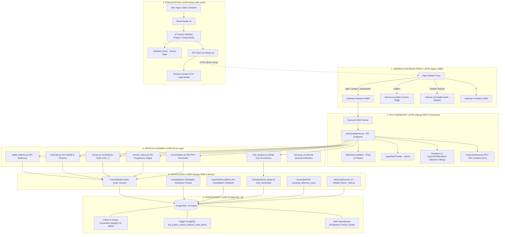
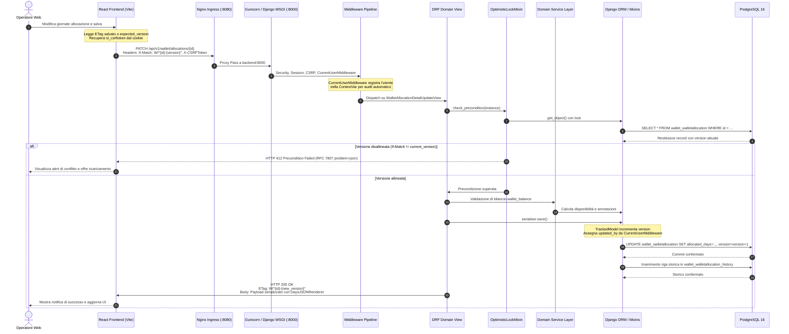
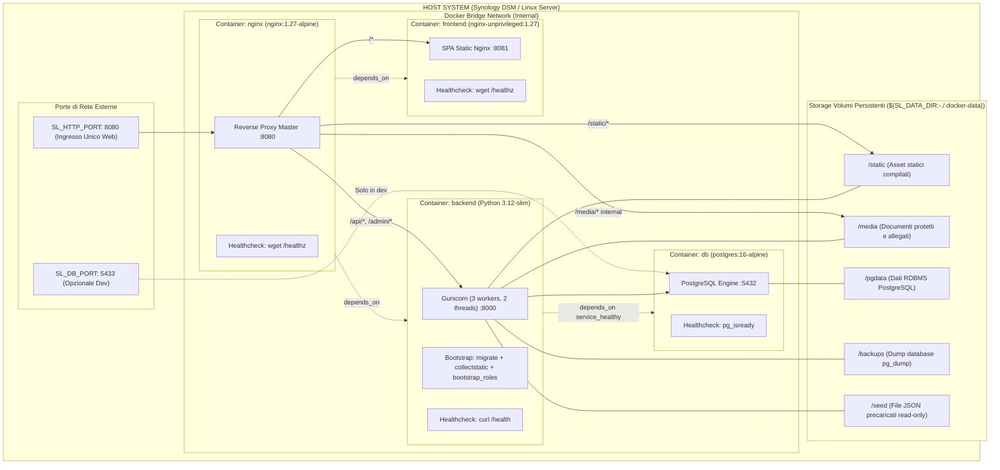

# ARCHITETTURA TECNICA - SUPPLIER LEDGER

> **Documento**: `docs/assestmant/05_TECHNICAL_ARCHITECTURE.md`  
> **Stato Implementativo**: IMPLEMENTED / STABILE  
> **Versione Architettura**: 1.0.0  
> **Data Analisi**: 2026-10-28  
> **Metodo**: Analisi statica completa del codice sorgente, dei descrittori di deployment e dei vincoli di persistenza.

---

## 1. INTRODUZIONE E SCOPO DEL DOCUMENTO

Il presente documento descrive l'architettura tecnica del sistema **Supplier Ledger**, una piattaforma web concepita per il monitoraggio contabile, la riconciliazione e la gestione dei residui/wallet relativi ai contratti di fornitura (con specifico riferimento al fornitore *Imola Informatica* per conto di *Banca Mediolanum*).

L'architettura è stata progettata secondo i principi di **isolamento dei domini**, **massima integrità contabile** (aritmetica a precisione fissa, tracciamento append-only dei consuntivi e audit immutabile) e **compatibilità operativa** con l'ambiente target di deployment (Synology Container Manager / Docker Compose, assenza di porte privilegiate e assenza di dipendenze asincrone complesse come broker di messaggi o worker esterni).

### Riferimenti nell'Assessment
- [01_REPOSITORY_INVENTORY.md](./01_REPOSITORY_INVENTORY.md): Censimento completo dei componenti software e dei file sorgente.
- [02_FUNCTIONAL_DOMAIN_MODEL.md](./02_FUNCTIONAL_DOMAIN_MODEL.md): Modello concettuale di dominio (Progetti, Wallet, Canone, PPM).
- [06_DATA_MODEL.md](./06_DATA_MODEL.md): Specifiche dettagliate delle entità, ERD e vincoli di integrità relazionale.
- [07_API_CATALOG.md](./07_API_CATALOG.md): Catalogo esaustivo degli endpoint RESTful esposti dal backend.
- [08_BUSINESS_RULES.md](./08_BUSINESS_RULES.md): Regole di business (R1-R6) e catalogo dei 18 controlli di qualità (`CHK_*`).
- [09_SECURITY_AUTHORIZATION.md](./09_SECURITY_AUTHORIZATION.md): Modello RBAC, granularità capability e sicurezza HTTP.
- [12_DEPLOYMENT_OPERATIONS.md](./12_DEPLOYMENT_OPERATIONS.md): Procedure di configurazione, backup, restore e monitoraggio dei container.

---

## 2. STACK TECNOLOGICO

La selezione tecnologica privilegia la stabilità, la rigidità dei tipi sia sul backend che sul frontend e la conformità ai moderni standard web (RFC 7807, OpenAPI 3.0, ETag HTTP).

| Livello | Tecnologia / Libreria | Versione Rilevata | Scopo Architetturale | Evidenza Sorgente |
| :--- | :--- | :--- | :--- | :--- |
| **Backend Runtime** | Python | 3.12-slim | Runtime di esecuzione backend | [deploy/Dockerfile.backend:2](file:///c:/Users/gianvito.bleve/OneDrive%20-%20Banca%20Mediolanum%20SPA/Documenti/Progetti/imola/deploy/Dockerfile.backend#L2) |
| **Backend Framework** | Django | >=5.1, <6.0 | Framework applicativo web, ORM e migrazioni | [backend/requirements.txt:1](file:///c:/Users/gianvito.bleve/OneDrive%20-%20Banca%20Mediolanum%20SPA/Documenti/Progetti/imola/backend/requirements.txt#L1) |
| **API Framework** | Django REST Framework | >=3.15 | Layer RESTful, serializzazione, parsing, auth | [backend/requirements.txt:2](file:///c:/Users/gianvito.bleve/OneDrive%20-%20Banca%20Mediolanum%20SPA/Documenti/Progetti/imola/backend/requirements.txt#L2) |
| **Database Engine** | PostgreSQL | 16-alpine | RDBMS transazionale ACID, trigger plpgsql | [docker-compose.yml:5](file:///c:/Users/gianvito.bleve/OneDrive%20-%20Banca%20Mediolanum%20SPA/Documenti/Progetti/imola/docker-compose.yml#L5) |
| **DB Driver** | psycopg (v3) | >=3.2 | Driver nativo PostgreSQL asincrono/sincrono | [backend/requirements.txt:7](file:///c:/Users/gianvito.bleve/OneDrive%20-%20Banca%20Mediolanum%20SPA/Documenti/Progetti/imola/backend/requirements.txt#L7) |
| **WSGI Server** | Gunicorn | >=23.0 | Server HTTP WSGI pre-fork per Django | [backend/requirements.txt:8](file:///c:/Users/gianvito.bleve/OneDrive%20-%20Banca%20Mediolanum%20SPA/Documenti/Progetti/imola/backend/requirements.txt#L8) |
| **Storicizzazione** | django-simple-history | >=3.7 | Versionamento tabelle storiche (`_history`) | [backend/requirements.txt:5](file:///c:/Users/gianvito.bleve/OneDrive%20-%20Banca%20Mediolanum%20SPA/Documenti/Progetti/imola/backend/requirements.txt#L5) |
| **OpenAPI / Schema** | drf-spectacular | >=0.27 | Generazione schema OpenAPI 3 e Swagger UI | [backend/requirements.txt:6](file:///c:/Users/gianvito.bleve/OneDrive%20-%20Banca%20Mediolanum%20SPA/Documenti/Progetti/imola/backend/requirements.txt#L6) |
| **Elaborazione Dati** | openpyxl, pandas | 3.1+, 2.2+ | Parsing e generazione workbook XLSX e PPM | [backend/requirements.txt:9-10](file:///c:/Users/gianvito.bleve/OneDrive%20-%20Banca%20Mediolanum%20SPA/Documenti/Progetti/imola/backend/requirements.txt#L9-L10) |
| **Validazione Seed** | jsonschema | >=4.23 | Validazione rigida schemi JSON v1..v4 | [backend/requirements.txt:11](file:///c:/Users/gianvito.bleve/OneDrive%20-%20Banca%20Mediolanum%20SPA/Documenti/Progetti/imola/backend/requirements.txt#L11) |
| **Frontend Runtime** | Node.js | 22-alpine | Ambiente di build frontend | [deploy/Dockerfile.frontend:2](file:///c:/Users/gianvito.bleve/OneDrive%20-%20Banca%20Mediolanum%20SPA/Documenti/Progetti/imola/deploy/Dockerfile.frontend#L2) |
| **Linguaggio UI** | TypeScript | 5.6.3 | Tipizzazione statica per il client SPA | [frontend/package.json:65](file:///c:/Users/gianvito.bleve/OneDrive%20-%20Banca%20Mediolanum%20SPA/Documenti/Progetti/imola/frontend/package.json#L65) |
| **Frontend Library** | React | 18.3.1 | Core UI e rendering dichiarativo | [frontend/package.json:34](file:///c:/Users/gianvito.bleve/OneDrive%20-%20Banca%20Mediolanum%20SPA/Documenti/Progetti/imola/frontend/package.json#L34) |
| **Build Tool** | Vite | 5.4.10 | Bundler ES module ad alte prestazioni | [frontend/package.json:67](file:///c:/Users/gianvito.bleve/OneDrive%20-%20Banca%20Mediolanum%20SPA/Documenti/Progetti/imola/frontend/package.json#L67) |
| **Server State** | TanStack Query | 5.59.16 | Caching, deduplicazione e re-fetch asincrono | [frontend/package.json:25](file:///c:/Users/gianvito.bleve/OneDrive%20-%20Banca%20Mediolanum%20SPA/Documenti/Progetti/imola/frontend/package.json#L25) |
| **Data Tables** | TanStack Table | 8.20.5 | Griglie dati headless con ordinamento e filtri | [frontend/package.json:26](file:///c:/Users/gianvito.bleve/OneDrive%20-%20Banca%20Mediolanum%20SPA/Documenti/Progetti/imola/frontend/package.json#L26) |
| **UI Components** | Radix UI primitives | varie (1.1..2.1) | Componenti accessibili WAI-ARIA headless | [frontend/package.json:17-24](file:///c:/Users/gianvito.bleve/OneDrive%20-%20Banca%20Mediolanum%20SPA/Documenti/Progetti/imola/frontend/package.json#L17-L24) |
| **Styling** | Tailwind CSS | 3.4.14 | Design system utility-first con transizioni | [frontend/package.json:64](file:///c:/Users/gianvito.bleve/OneDrive%20-%20Banca%20Mediolanum%20SPA/Documenti/Progetti/imola/frontend/package.json#L64) |
| **Visualizzazione Dati** | Recharts | 2.13.3 | Grafici SVG interattivi (trend e wallet) | [frontend/package.json:39](file:///c:/Users/gianvito.bleve/OneDrive%20-%20Banca%20Mediolanum%20SPA/Documenti/Progetti/imola/frontend/package.json#L39) |
| **Test Client** | Playwright, Vitest | 1.48+, 2.1+ | Collaudo E2E e unit test componenti | [frontend/package.json:47,68](file:///c:/Users/gianvito.bleve/OneDrive%20-%20Banca%20Mediolanum%20SPA/Documenti/Progetti/imola/frontend/package.json#L47) |
| **Ingress Proxy** | Nginx | 1.27-alpine | Ingress reverse proxy, routing e static serving | [deploy/Dockerfile.nginx:1](file:///c:/Users/gianvito.bleve/OneDrive%20-%20Banca%20Mediolanum%20SPA/Documenti/Progetti/imola/deploy/Dockerfile.nginx#L1) |

---

## 3. ARCHITETTURA DEI LAYER

Il sistema adotta una **Clean Architecture a Layer Confluenti**, con un rigoroso isolamento del codice di dominio dalle strutture di visualizzazione e di trasporto HTTP.

---

## 4. DETTAGLIO ARCHITETTURALE DEI SINGOLI LAYER

### 4.1 Layer 1: Ingress & Reverse Proxy (Nginx)
L'ingresso univoco al sistema avviene attraverso un proxy Nginx compilato su base `nginx:1.27-alpine`, configurato su una porta non privilegiata (8080) per garantire la piena compatibilità con ambienti appliance (es. Synology DSM Container Manager) e contesti enterprise con divieto di bind su porte `< 1024`.

- **File di configurazione**: [deploy/nginx.conf](file:///c:/Users/gianvito.bleve/OneDrive%20-%20Banca%20Mediolanum%20SPA/Documenti/Progetti/imola/deploy/nginx.conf).
- **Direttive di Routing**:
  - `location = /healthz`: Restituisce direttamente `200 "ok\n"` senza toccare i container applicativi (utilizzato per l'healthcheck del proxy).
  - `location /health`: Inoltro verso `http://backend/health` per verificare la disponibilità del runtime Python e della connessione al database.
  - `location /api/`: Inoltro verso `http://backend:8000/api/` con `proxy_read_timeout 300s` (necessario per supportare import ed elaborazioni di dataset complessi).
  - `location /admin/`: Inoltro all'interfaccia di amministrazione di Django su backend:8000.
  - `location /download/`: Inoltro controllato a `http://backend/api/v1/download/`.
  - `location /static/`: Servito direttamente dal file system locale di Nginx montato su `/srv/static/` con header `Cache-Control "public"` ed `expires 30d`.
  - `location /media/`: Marcato con la direttiva `internal;`: impedisce l'accesso diretto ai file caricati da parte di client esterni. Il download è consentito esclusivamente tramite il backend previa autenticazione e autorizzazione (X-Accel-Redirect).
  - `location /`: Inoltro verso il server del frontend `http://frontend:8081`.
- **Politiche di Trasporto e Dimensioni**:
  - `client_max_body_size 30m;`: Consente l'upload di file JSON, estratti PPM ed export fino a 30 MB (coerente con il limite applicativo di 25-26 MB).
  - Propagazione rigorosa degli header TLS e proxy: `Host`, `X-Real-IP`, `X-Forwarded-For`, `X-Forwarded-Proto`, `X-Forwarded-Host`.

### 4.2 Layer 2: Frontend Single Page Application (React + Vite)
Il frontend è strutturato come Single Page Application (SPA) modulare, fortemente tipizzata in TypeScript e priva di dipendenze da framework monolitici.

- **Entry Point**: [frontend/src/main.tsx](file:///c:/Users/gianvito.bleve/OneDrive%20-%20Banca%20Mediolanum%20SPA/Documenti/Progetti/imola/frontend/src/main.tsx) inizializza l'albero React all'interno del nodo `#root`, agganciando il `QueryClientProvider` di TanStack Query, il `BrowserRouter` e il provider custom `SessionProvider`.
- **Configurazione Caching (TanStack Query)**:
  - `staleTime: 30_000` (i dati rimangono validi in cache per 30 secondi evitando sovraccarico di query).
  - `refetchOnWindowFocus: false` (previene ricaricamenti indesiderati durante l'interazione con altre finestre).
  - `retry: (failureCount, error) => failureCount < 2 && !(error instanceof Error && error.name === "ApiError")`: le sessioni scadute o gli errori applicativi non attivano loop di tentativi automatici a vuoto.
- **Routing e Code-Splitting**: In [frontend/src/App.tsx](file:///c:/Users/gianvito.bleve/OneDrive%20-%20Banca%20Mediolanum%20SPA/Documenti/Progetti/imola/frontend/src/App.tsx), ogni pagina di primo livello è caricata in modo asincrono tramite `React.lazy()` e racchiusa in `<Suspense fallback={<LoadingState />}>`:
  - `/`: `DashboardPage` (Indicatori sintetici, stato progetti, avvisi imminenti).
  - `/progetti`: `ProjectsPage` (Elenco progetti, filtri contabili, budget, residui).
  - `/progetti/:projectId`: `ProjectDetailPage` (Ledger consuntivi, milestone fatturazione, dettagli).
  - `/wallet`: `WalletPage` (Stato monte ore, allocazioni annuali, flussi e residui).
  - `/canone`: `CanonePage` (Organico Allargato, target progressivo, rendicontazione settimanale).
  - `/analisi-costi`: `CostAnalysisPage` (Aggregazioni economiche a costo standard).
  - `/riconciliazione`: `ReconciliationPage` (Confronto bidirezionale Ledger interno vs snapshot PPM).
  - `/anomalie`: `AnomaliesPage` (Centro notifiche anomalie contabili e regole `CHK_*`).
  - `/revisione`: `ReviewQueuePage` (Coda di revisione progetti `DA_VERIFICARE` e anagrafiche persone).
  - `/amministrazione`: `AdminPage` (Import batch seed/PPM, gestione ruoli/capability, backup/restore DB, reset protetto).
- **Gestione della Sessione e Re-Login Trasparente**:
  - Invece del comune interceptor che distrugge lo stato utente e reindirizza alla login al primo errore HTTP 401, [frontend/src/lib/api.ts](file:///c:/Users/gianvito.bleve/OneDrive%20-%20Banca%20Mediolanum%20SPA/Documenti/Progetti/imola/frontend/src/lib/api.ts) implementa il pattern di notifica `onSessionExpired()`.
  - Quando il backend restituisce HTTP 401 con codice di errore `session_expired`, scatta l'apertura del componente `<SessionExpiredDialog />` ([frontend/src/features/auth/SessionExpiredDialog.tsx](file:///c:/Users/gianvito.bleve/OneDrive%20-%20Banca%20Mediolanum%20SPA/Documenti/Progetti/imola/frontend/src/features/auth/SessionExpiredDialog.tsx)). L'utente può ri-autenticarsi direttamente dal modale senza perdere lo stato del form in corso di compilazione o i filtri di pagina.
- **Client HTTP e Sicurezza CSRF**:
  - Wrapper nativo su `fetch` configurato con `credentials: "same-origin"`.
  - Estrazione automatica del token CSRF dal cookie `sl_csrftoken` per tutte le mutazioni HTTP non sicure (`POST`, `PUT`, `PATCH`, `DELETE`).
  - Supporto nativo per locking ottimistico: parametro facoltativo `ifMatch` convertito nell'header HTTP `If-Match`.
- **Componenti Condivisi Riusabili**:
  - `AppShell`: Layout master con navigazione laterale, header utente, scorciatoie globali e switch lingua.
  - `DataTable`: Griglia standard basata su TanStack Table con supporto a ordinamento colonne e paginazione.
  - `KpiCard`: Widget standardizzato per indicatori con delta e stato di variazione.
  - `StatusBadge`: Visualizzazione coerente degli stati di dominio (`TimesheetStatus`, `BillingStatus`, `ResidualState`, `Severity`).
  - `CommandPalette`: Barra di ricerca rapida universale azionabile con la combinazione da tastiera `Ctrl+K` / `Cmd+K`.
  - `DaysValue`: Formattazione unificata delle giornate con precisione visuale a 2 decimali e tooltips.
  - `InfoTooltip`: Aiuto contestuale per le metriche complesse (regole di calcolo R2, R3, R4).

### 4.3 Layer 3: Backend API & Presentation Layer (Django REST Framework)
Il livello di esposizione HTTP implementa un'interfaccia RESTful uniforme, documentata e fortemente difensiva contro le corruzioni concorrenti.

- **Routing e Modularità**: [backend/api/urls.py](file:///c:/Users/gianvito.bleve/OneDrive%20-%20Banca%20Mediolanum%20SPA/Documenti/Progetti/imola/backend/api/urls.py) mappa oltre 60 percorsi organizzati su prefissi logici (`auth/`, `settings`, `projects/`, `wallet/`, `canoni/`, `anomalies/`, `reconciliation/`, `admin/`, `export/`).
- **Autenticazione e Protezione Brute-Force**:
  - `backend/api/auth_views.py` gestisce `LoginView`, `LogoutView` e `SessionView`.
  - Classe di throttle dedicata: `LoginRateThrottle` ([backend/core/throttles.py](file:///c:/Users/gianvito.bleve/OneDrive%20-%20Banca%20Mediolanum%20SPA/Documenti/Progetti/imola/backend/core/throttles.py)) limitata da impostazione a 10 richieste al minuto per IP (`LOGIN_THROTTLE_RATE="10/min"`).
- **Viste di Dominio vs Viste Amministrative**:
  - [backend/api/domain_views.py](file:///c:/Users/gianvito.bleve/OneDrive%20-%20Banca%20Mediolanum%20SPA/Documenti/Progetti/imola/backend/api/domain_views.py) (94 KB) implementa 38 classi View specializzate, che traducono le richieste HTTP nei corrispondenti contratti con i moduli di dominio, gestendo autorizzazioni, proiezioni e risposte.
  - [backend/api/admin_views.py](file:///c:/Users/gianvito.bleve/OneDrive%20-%20Banca%20Mediolanum%20SPA/Documenti/Progetti/imola/backend/api/admin_views.py) (30 KB) raggruppa le funzioni ad alto privilegio (seed import, import PPM, ripristino snapshot, gestione capability e reset dati).
- **Concorrenza Ottimistica (Optimistic Locking)**:
  - Implementato in [backend/api/concurrency.py](file:///c:/Users/gianvito.bleve/OneDrive%20-%20Banca%20Mediolanum%20SPA/Documenti/Progetti/imola/backend/api/concurrency.py) tramite la classe `OptimisticLockMixin`.
  - La lettura `GET` calcola ed espone l'header `ETag: W/"<pk>-<version>"`.
  - Le mutazioni `PUT`, `PATCH`, `DELETE` richiedono obbligatoriamente l'invio dell'header `If-Match` oppure del campo `expected_version` nel body JSON.
  - In assenza di precondizione viene sollevata l'eccezione `PreconditionRequired` (HTTP 428). In caso di mancata corrispondenza della versione (la risorsa è stata modificata nel frattempo da un altro operatore) viene sollevata `StaleResource` (HTTP 412/409), impedendo sovrascritture cieche (lost update).
- **Paginazione Stabile a Cursore**:
  - [backend/api/pagination.py](file:///c:/Users/gianvito.bleve/OneDrive%20-%20Banca%20Mediolanum%20SPA/Documenti/Progetti/imola/backend/api/pagination.py) definisce `StandardCursorPagination` (ordinamento su `-created_at`) e `CodeCursorPagination` (ordinamento su `code`).
  - La paginazione a cursore garantisce stabilità assoluta dell'elenco durante inserimenti concorrenti, prevenendo elementi duplicati o saltati durante lo scorrimento.
- **Serializzazione Decimal String-Safe**:
  - [backend/api/renderers.py](file:///c:/Users/gianvito.bleve/OneDrive%20-%20Banca%20Mediolanum%20SPA/Documenti/Progetti/imola/backend/api/renderers.py) introduce `DaysJSONRenderer` e `DaysJSONEncoder`.
  - Di norma, DRF converte i numeri `Decimal` in float nativi quando non passano attraverso un campo di un `Serializer`. L'encoder personalizzato forza la conversione di **ogni** istanza `Decimal` in stringa testuale esatta prima della trasmissione di rete, azzerando qualsiasi rischio di errore di troncamento o arrotondamento binario IEEE 754 nel client.
- **Gestione Errori Standardizzata (RFC 7807)**:
  - Centralizzata in [backend/core/exceptions.py](file:///c:/Users/gianvito.bleve/OneDrive%20-%20Banca%20Mediolanum%20SPA/Documenti/Progetti/imola/backend/core/exceptions.py) tramite `problem_detail_handler`.
  - Ogni risposta di errore ha `Content-Type: application/problem+json` e contiene i campi formali `type`, `title`, `status`, `code`, `detail` ed `errors` (array di errori analitici di campo per form). I messaggi di errore sono localizzati in lingua italiana.

### 4.4 Layer 4: Service & Domain Layer (Pure Domain Logic)
Il cuore logico del sistema è completamente disaccoppiato da Django REST Framework e non contiene riferimenti a richieste HTTP o serializer. I calcoli possono essere invocati indifferentemente da API, comandi batch, script CLI o suite di test.

- **[backend/domain/money.py](file:///c:/Users/gianvito.bleve/OneDrive%20-%20Banca%20Mediolanum%20SPA/Documenti/Progetti/imola/backend/domain/money.py)**:
  - Gestione rigorosa dell'aritmetica di giornate e costi con tipo nativo `Decimal`.
  - Costanti di precisione: `DAYS_QUANT = Decimal("0.0001")` (4 cifre decimali contabili), `DISPLAY_QUANT = Decimal("0.01")` (2 cifre di resa a video), `MONEY_QUANT = Decimal("0.01")` (centesimi di euro), `PPM_GRANULARITY = Decimal("0.0625")` (mezz'ora = 1/16 di giornata da 8 ore).
  - Funzione `to_days()`: converte input numerici o testuali preservando la virgola italiana (`1,5` -> `1.5`) e applicando la quantizzazione con `ROUND_HALF_UP`.
- **[backend/domain/wallet_balance.py](file:///c:/Users/gianvito.bleve/OneDrive%20-%20Banca%20Mediolanum%20SPA/Documenti/Progetti/imola/backend/domain/wallet_balance.py) (Regola R3)**:
  - Calcola la disponibilità effettiva del wallet annuale:
    $$\text{Disponibile Anno} = \sum(\text{Allocati} - \text{Consumati})_{\text{Aperte}} + \sum(\text{Residui Validi non Allocati})_{\text{R2}}$$
  - Funzione `allocation_balance_qs()`: annota dinamicamente le allocazioni tramite subquery sui consuntivi (`TimesheetEntry`) azzerando le query N+1.
  - Separa rigorosamente i residui certi dai residui di progetti in stato `DA_VERIFICARE`, che confluiscono in un indicatore informativo separato denominato *Residui Potenziali*.
- **[backend/domain/residuals.py](file:///c:/Users/gianvito.bleve/OneDrive%20-%20Banca%20Mediolanum%20SPA/Documenti/Progetti/imola/backend/domain/residuals.py) (Regola R2)**:
  - Determina la validità temporale del credito residuo dei progetti chiusi.
  - Un progetto genera residuo spendibile solo se `timesheet_status == "CHIUSO"` e provvisto di data effettiva di chiusura (`actual_closure_date`).
  - La scadenza del residuo è fissata rigidamente al 31 dicembre dell'anno solare successivo alla chiusura:
    $$\text{Data Scadenza} = \text{Date}(\text{AnnoChiusura} + 1, 12, 31)$$
  - Calcola gli stati di validità: `VALIDO`, `IN_SCADENZA` (entro 90 giorni dal termine), `SCADUTO`, `DA_VERIFICARE`, `NON_DISPONIBILE`.
- **[backend/domain/checks.py](file:///c:/Users/gianvito.bleve/OneDrive%20-%20Banca%20Mediolanum%20SPA/Documenti/Progetti/imola/backend/domain/checks.py) (Motore dei 18 Controlli)**:
  - Registro puro di 18 funzioni detector indipendenti (`RULES: dict[str, Detector]`).
  - Ciascun detector genera istanze immutabili `Finding(rule_code, entity_ref, severity, scope, description, ...)`.
  - Il runner applicativo riceve i `Finding` e ne gestisce l'upsert nella tabella `anomalies_anomaly` calcolando un fingerprint SHA-256 univoco (`rule_code + entity_ref`), assicurando che riesecuzioni successive aggiornino lo stato senza creare record duplicati.
- **[backend/domain/canone_status.py](file:///c:/Users/gianvito.bleve/OneDrive%20-%20Banca%20Mediolanum%20SPA/Documenti/Progetti/imola/backend/domain/canone_status.py) (Regola R4)**:
  - Monitora l'andamento del canone semestrale continuativo ("Organico Allargato").
  - Calcola il target lineare progressivo alla data:
    $$\text{Target}(w) = \min(\text{MonteOreTotale}, \text{Base} + w \times \text{GiornateSettimana})$$
  - Rileva tempestivamente situazioni di sotto-utilizzo (`underuse`) o sovra-utilizzo (`overuse`) rispetto al corridoio di tolleranza pattuito.
- **[backend/domain/reconciliation.py](file:///c:/Users/gianvito.bleve/OneDrive%20-%20Banca%20Mediolanum%20SPA/Documenti/Progetti/imola/backend/domain/reconciliation.py) (Regola R6)**:
  - Confronta il consuntivo interno aggregato (consuntivazione diretta + consumi imputati a wallet) con il valore `gg_totali` importato dall'ultimo snapshot ufficiale PPM.
  - Classifica l'allineamento di ogni iniziativa in `ALLINEATO` (delta entro la tolleranza di 0,01 gg), `NON_ALLINEATO`, `PARZIALE`, `NON_VERIFICABILE`.
- **[backend/domain/cost_analysis.py](file:///c:/Users/gianvito.bleve/OneDrive%20-%20Banca%20Mediolanum%20SPA/Documenti/Progetti/imola/backend/domain/cost_analysis.py)**:
  - Motore di aggregazione analitica a sola lettura. Raggruppa i consuntivi per fornitore, progetto e mese solare moltiplicando le giornate nette per il costo giornaliero standard globale definito in `AppSettings`.
- **[backend/domain/dashboard.py](file:///c:/Users/gianvito.bleve/OneDrive%20-%20Banca%20Mediolanum%20SPA/Documenti/Progetti/imola/backend/domain/dashboard.py)**:
  - Produce in un'unica invocazione ottimizzata l'aggregato KPI per la home page (conteggi progetti per stato, saldi wallet anno corrente, milestone di fatturazione in arrivo).

### 4.5 Layer 5: Data Access Layer (Django ORM & Mixins)
L'accesso alla persistenza sfrutta il paradigma Object-Relational Mapping (ORM) di Django, arricchito da mixin astratti e comportamenti specializzati.

- **Ripartizione delle Django Apps**:
  1. `core`: Modelli trasversali, audit amministrativo, impostazioni globali e capability override.
  2. `directory`: Anagrafiche entità (`Organization`, `Person`) con gestione ruoli BMED vs Fornitore.
  3. `projects`: Gestione anagrafica progetti, stati consuntivo/fatturazione, milestone e crediti rilasciati.
  4. `canone`: Gestione canoni semestrali continuativi e relative sotto-attività.
  5. `wallet`: Esercizi wallet, macro-attività, lotti origine, allocazioni e tranche di finanziamento.
  6. `timesheets`: Registrazioni contabili di consuntivazione append-only e storni.
  7. `ppm`: Snapshot estratti e righe di consuntivazione importate dal sistema PPM.
  8. `anomalies`: Registro persistente delle anomalie e incongruenze contabili rilevate.
  9. `imports`: Tracciamento dei batch di importazione, stati di esecuzione e storico dataset.
  10. `api`: Layer di trasporto, serializer e controller REST.
- **`TrackedModel` (Base di tutte le entità)**:
  - Definita in [backend/core/models.py:67](file:///c:/Users/gianvito.bleve/OneDrive%20-%20Banca%20Mediolanum%20SPA/Documenti/Progetti/imola/backend/core/models.py#L67).
  - Campi: `id` (UUIDv4 non modificabile), `created_at` (indicizzato), `updated_at`, `created_by` (FK su auth.User), `updated_by` (FK su auth.User), `version` (intero positivo per lock ottimistico incrementato automaticamente nel metodo `save()`).
  - Audit contestuale automatico: il metodo `save()` estrae l'utente della richiesta corrente dal thread-local gestito da `CurrentUserMiddleware` e assegna in modo trasparente `created_by` e `updated_by`.
- **`VerifiableMixin` (Qualità e revisione del dato)**:
  - Definita in [backend/core/models.py:182](file:///c:/Users/gianvito.bleve/OneDrive%20-%20Banca%20Mediolanum%20SPA/Documenti/Progetti/imola/backend/core/models.py#L182).
  - Gestisce l'affidabilità con il campo `reliability` (`CERTO`, `DA_VERIFICARE`).
  - Campo JSON `verification_points`: lista strutturata di punti aperti importati. Il metodo `mark_verification_point(index, note, user)` consente agli utenti autorizzati di smarcare singolarmente ogni incongruenza allegando una motivazione obbligatoria, commutando automaticamente l'affidabilità su `CERTO` all'esaurimento dei punti aperti.
- **`ImportedRecordMixin` (Tracciamento e Rollback)**:
  - Definita in [backend/imports/models.py:97](file:///c:/Users/gianvito.bleve/OneDrive%20-%20Banca%20Mediolanum%20SPA/Documenti/Progetti/imola/backend/imports/models.py#L97).
  - Collega ciascun record generato da un flusso di importazione alla chiave esterna `import_batch`. Ciò rende possibile il rollback atomico selettivo di un intero lotto senza rischiare delezioni accidentali a cascata su record preesistenti.
- **Storicizzazione Globale (`django-simple-history`)**:
  - Attivata su 17 modelli fondamentali (`Project`, `BillingMilestone`, `WalletAllocation`, `WalletSourceLot`, `WalletFundingTranche`, `TimesheetEntry`, `Canone`, `CanoneSubactivity`, `Anomaly`, `PpmSnapshotRow`, `AppSettings`, `Person`, ecc.).
  - Ogni operazione di inserimento, modifica o cancellazione genera una riga immutabile nella tabella ombra `*_history`, corredata di snapshot dei campi, timestamp, utente autore e motivo della variazione.
- **Modello Contabile Append-Only (`TimesheetEntry`)**:
  - Implementato in [backend/timesheets/models.py:34](file:///c:/Users/gianvito.bleve/OneDrive%20-%20Banca%20Mediolanum%20SPA/Documenti/Progetti/imola/backend/timesheets/models.py#L34).
  - Vincolo rigido di integrità: il metodo `save()` solleva `ValidationError` se invocato in update (`not self._state.adding`). Il metodo `delete()` solleva parimenti `ValidationError`.
  - La rettifica contabile di una consuntivazione errata può avvenire **esclusivamente** tramite la registrazione di una nuova riga di storno (`source="STORNO"`, `days` di segno opposto), collegata alla riga originale tramite la FK `reverses`.
- **Campi Generati dal Database (`GeneratedField`)**:
  - In [backend/projects/models.py:128](file:///c:/Users/gianvito.bleve/OneDrive%20-%20Banca%20Mediolanum%20SPA/Documenti/Progetti/imola/backend/projects/models.py#L128), il campo `residual_reference_year` è definito come `models.GeneratedField(expression=ExtractYear("actual_closure_date"), db_persist=True)`.
  - Il valore è calcolato direttamente dall'engine PostgreSQL ed è materializzato su disco, escludendo ogni possibilità di disallineamento applicativo tra la data effettiva di chiusura e l'anno fiscale di riferimento del residuo.

### 4.6 Layer 6: Persistence Layer (PostgreSQL 16)
La persistenza poggia su un'istanza PostgreSQL 16 standard containerizzata (`postgres:16-alpine`), ottimizzata per la coerenza dei dati finanziari e la sicurezza relazionale.

- **Impostazioni di Inizializzazione Locale**:
  - `POSTGRES_INITDB_ARGS: "--encoding=UTF8 --locale=it_IT.UTF-8 --lc-collate=C"` ([docker-compose.yml:11](file:///c:/Users/gianvito.bleve/OneDrive%20-%20Banca%20Mediolanum%20SPA/Documenti/Progetti/imola/docker-compose.yml#L11)).
  - L'impiego della collation `C` sui campi testuali garantisce massime performance negli ordinamenti di codici progetto e previene comportamenti imprevedibili dovuti alle tabelle di ordinamento del sistema operativo host.
- **Check Constraints a Livello Database**:
  - `project_budget_non_negative`: `budget_days >= 0` impedisce stanziamenti negativi.
  - `project_end_after_start`: `planned_end_date >= start_date` garantisce la coerenza dell'intervallo temporale.
  - `timesheet_exactly_one_target`: vincolo polimorfico che impone l'imputazione di ogni consuntivo a uno e un solo bersaglio tra Progetto, Canone o Allocazione Wallet (tutti gli altri devono essere `NULL`).
  - `timesheet_days_not_zero`: vieta la registrazione di righe consuntivo pari a 0 giornate.
  - `allocation_days_non_negative`: `allocated_days >= 0` impedisce allocazioni a saldo negativo.
- **Trigger PL/pgSQL per Eccezioni di Dominio (Decisione D-14 / D-03)**:
  - In `backend/projects/migrations/0002_project_closed_seed_only_trigger.py` e `0004_project_closed_workbook_seed_trigger.py`, è definito il trigger `trg_project_closed_requires_seed_batch` associato alla funzione `check_project_closed_requires_seed_batch()`.
  - La regola generale stabilisce che un progetto `CHIUSO` debba avere obbligatoriamente `actual_closure_date`. Per supportare i dati storici pregressi privi di data, il trigger intercetta gli inserimenti e **rifiuta l'operazione sollevando un'eccezione SQL (SQLSTATE 23514)** a meno che il progetto non sia associato a un batch di importazione verificato di tipo `SEED_JSON` o `WORKBOOK_JSON`.

### 4.7 Layer 7: Import & Ingestion Layer
Il sottosistema di importazione gestisce l'acquisizione massiva di dati da file JSON complessi (v1..v4) ed estratti operativi PPM in formato Excel.

- **Esecuzione Transazionale a Due Fasi (Batch Engine)**:
  - Implementato in [backend/importers/batch.py](file:///c:/Users/gianvito.bleve/OneDrive%20-%20Banca%20Mediolanum%20SPA/Documenti/Progetti/imola/backend/importers/batch.py).
  - Fase 1 (`DRY_RUN`): il file caricato viene validato sintatticamente contro il relativo JSON Schema (`seed_schema_v1.json`, `seed_workbook_schema_v2..v4.json`). Viene aperta una transazione database (`transaction.atomic`) e simulata l'intera creazione dei record. Al termine dell'elaborazione, viene forzata un'eccezione interna `_DryRunRollback` che annulla qualsiasi scrittura su DB. Viene generato e restituito all'operatore un report di impatto analitico (`ImportReport`).
  - Fase 2 (`APPLIED`): se l'operatore conferma l'importazione, la transazione viene completata con commit definitivo, lo stato del batch diventa `APPLIED` e tutti i record generati memorizzano la foreign key al batch.
- **Motore di Rollback Topologico Inverso**:
  - Implementato in [backend/importers/rollback.py](file:///c:/Users/gianvito.bleve/OneDrive%20-%20Banca%20Mediolanum%20SPA/Documenti/Progetti/imola/backend/importers/rollback.py).
  - Annulla integralmente un batch precedentemente applicato eliminando le entità secondo una rigida sequenza topologica inversa definita nella tupla `ROLLBACK_ORDER`:
    $$1.\text{Anomalie} \rightarrow 2.\text{Consuntivi} \rightarrow 3.\text{Righe PPM} \rightarrow 4.\text{Milestone} \rightarrow 5.\text{Allocazioni} \rightarrow \dots \rightarrow \text{Progetti} \rightarrow \text{Batch}$$
  - Questa strategia impedisce cancellazioni accidentali a cascata su record creati manualmente al di fuori del batch.
- **Ingestion PPM Excel**:
  - [backend/importers/ppm.py](file:///c:/Users/gianvito.bleve/OneDrive%20-%20Banca%20Mediolanum%20SPA/Documenti/Progetti/imola/backend/importers/ppm.py) effettua il parsing di fogli di calcolo `.xlsx`, validando la conformità della granularità delle ore (multipli di 0,5 ore = 0,0625 giornate) e normalizzando i codici commessa prima del confronto con il Ledger.
- **Export Multi-Formato**:
  - [backend/exporters.py](file:///c:/Users/gianvito.bleve/OneDrive%20-%20Banca%20Mediolanum%20SPA/Documenti/Progetti/imola/backend/exporters.py) genera export versionati (`SCHEMA_VERSION = "1.0.0"`) in JSON, cartelle di lavoro Excel con formattazione e totali calcolati (`openpyxl`) e file CSV conformi RFC 4180 codificati in UTF-8 con BOM.

### 4.8 Layer 8: Security & Authorization Architecture
La sicurezza applicativa integra autenticazione a sessione, protezione contro il Session Fixation/CSRF e un modello di autorizzazione Role-Based Access Control (RBAC) basato su capability granulari.

- **Pattern Provider di Autenticazione**:
  - [backend/core/auth/providers.py](file:///c:/Users/gianvito.bleve/OneDrive%20-%20Banca%20Mediolanum%20SPA/Documenti/Progetti/imola/backend/core/auth/providers.py) implementa il protocollo `AuthProvider`.
  - In v1 è attivo `LocalSessionProvider` (credenziali locali memorizzate con hash PBKDF2/argon2, sessioni Django in database e cookie `sl_session`).
  - È predisposto il provider `EntraIdOidcProvider` per la futura federazione dell'identità tramite Microsoft Entra ID (OIDC / OAuth2), attivabile mediante la variabile d'ambiente `AUTH_PROVIDER="entra_id"` al completamento degli accordi organizzativi.
- **Ruoli Applicativi e Gruppi Django**:
  - Definiti in [backend/core/roles.py](file:///c:/Users/gianvito.bleve/OneDrive%20-%20Banca%20Mediolanum%20SPA/Documenti/Progetti/imola/backend/core/roles.py):
    1. `admin`: Amministratore di sistema (accesso totale, backup, gestione utenti).
    2. `responsabile_bmed`: Responsabile contrattuale Banca Mediolanum (approvazione wallet, chiusura progetti, gestione canone).
    3. `referente_bmed`: Referente operativo/tecnico di progetto (visualizzazione, annotazione dei propri progetti).
    4. `fornitore`: Personale autorizzato del fornitore Imola Informatica (consuntivazione, inserimento progetti, caricamento bozze).
- **Matrice delle 15 Capability Granulari**:
  - Gestite in [backend/core/capabilities.py](file:///c:/Users/gianvito.bleve/OneDrive%20-%20Banca%20Mediolanum%20SPA/Documenti/Progetti/imola/backend/core/capabilities.py). Ciascun ruolo possiede un set predefinito di permessi:
    - `data.reset`, `users.manage`, `privileges.manage` (riservate ad `admin`).
    - `projects.create`, `projects.edit`, `projects.validate_closure`, `projects.annotate_own`.
    - `timesheets.create`, `wallet.edit`, `canone.manage`, `accounting.adjust`.
    - `imports.upload`, `imports.apply`, `exports.run`, `anomalies.resolve`.
  - **Override a Runtime**: tramite il modello `RoleCapabilityOverride` ([backend/core/models.py:17](file:///c:/Users/gianvito.bleve/OneDrive%20-%20Banca%20Mediolanum%20SPA/Documenti/Progetti/imola/backend/core/models.py#L17)), l'amministratore può modificare l'abilitazione di ciascuna capability per qualsiasi ruolo direttamente da interfaccia web senza riavviare l'applicazione.
- **Protezione API DRF Server-Side**:
  - [backend/core/permissions.py](file:///c:/Users/gianvito.bleve/OneDrive%20-%20Banca%20Mediolanum%20SPA/Documenti/Progetti/imola/backend/core/permissions.py) traduce ogni capability in una classe di permesso DRF (`CanEditProjects`, `CanEditWallet`, `CanValidateProjectClosure`, `CanResetData`).
  - La classe `ReferentCanAnnotate` applica controlli a livello di singolo oggetto (`has_object_permission`), verificando che il referente BMED stia modificando esclusivamente le note di progetti di cui è formalmente proprietario (`client_owner`).
- **Audit Log Amministrativo**:
  - Ogni operazione ad alto impatto (reset, ripristino database, concessione ruoli, cambio password) è registrata nella tabella immutabile `AdminAuditEvent` ([backend/core/models.py:37](file:///c:/Users/gianvito.bleve/OneDrive%20-%20Banca%20Mediolanum%20SPA/Documenti/Progetti/imola/backend/core/models.py#L37)), registrando timestamp, utente autore, tipologia e target.

### 4.9 Layer 9: Background Processing & Concurrency Strategy
- **Decisione Architetturale D-06 (Assenza di Broker Asincroni)**:
  - Per contenere la complessità operativa sul NAS Synology ed eliminare punti di vulnerabilità, in v1 è stata presa la deliberata decisione di **non** utilizzare Celery, Redis o cron daemon interni.
  - Tutte le operazioni di importazione, ricalcolo saldi ed esportazione avvengono in modo **sincrono** all'interno del ciclo di vita della richiesta HTTP.
  - La fattibilità è garantita dai timeout ampi configurati a livello di reverse proxy (`proxy_read_timeout 300s` in Nginx e `--timeout 120` in Gunicorn) e dal vincolo sulle dimensioni massime dei file in upload (cap a 26 MB).
- **Esecuzione On-Demand dei Controlli**:
  - I 18 controlli di qualità e rilevazione anomalie contabili non girano in polling continuo, bensì su richiesta esplicita via API `POST /api/v1/checks/run` o al termine di ogni operazione di import batch applicato.

### 4.10 Layer 10: Configuration & Environment Management
- **Gerarchia delle Configurazioni Django**:
  - [backend/config/settings/base.py](file:///c:/Users/gianvito.bleve/OneDrive%20-%20Banca%20Mediolanum%20SPA/Documenti/Progetti/imola/backend/config/settings/base.py): Definizioni comuni (applicazioni, middleware, template, internazionalizzazione `Europe/Rome`, formattazione log JSON).
  - [backend/config/settings/dev.py](file:///c:/Users/gianvito.bleve/OneDrive%20-%20Banca%20Mediolanum%20SPA/Documenti/Progetti/imola/backend/config/settings/dev.py): Modalità debug attiva, CORS permissivo su localhost:5173/8080, rate limit login rilassato (1000/min).
  - [backend/config/settings/prod.py](file:///c:/Users/gianvito.bleve/OneDrive%20-%20Banca%20Mediolanum%20SPA/Documenti/Progetti/imola/backend/config/settings/prod.py): `DEBUG = False`, `SECRET_KEY` obbligatoria da ambiente, header proxy TLS sicuri (`SECURE_PROXY_SSL_HEADER`, `USE_X_FORWARDED_HOST`), flag cookie sicuri (`COOKIE_SECURE=True`), protezione HSTS precaricata (`SECURE_HSTS_SECONDS=31536000`), `X_FRAME_OPTIONS = "DENY"`.
- **Parametri di Dominio Configurabili a Runtime (`AppSettings`)**:
  - Implementato come tabella singleton nel DB ([backend/core/models.py:108](file:///c:/Users/gianvito.bleve/OneDrive%20-%20Banca%20Mediolanum%20SPA/Documenti/Progetti/imola/backend/core/models.py#L108)) con accesso tramite il metodo `AppSettings.get_solo()`.
  - Permette di modificare a caldo senza riavvii del server:
    - Ore lavorative per giornata standard (default `8.00`).
    - Granularità temporale PPM (default `0.0625` gg).
    - Tolleranza di riconciliazione Ledger vs PPM (default `0.0100` gg).
    - Costo standard per giornata uomo (utilizzato da `cost_analysis.py`).
    - Anni di validità residuo post-chiusura (default `1` anno = regola R2).
    - Finestra di preavviso scadenza residui (default `90` giorni).

---

## 5. DIAGRAMMA DEL FLUSSO DI UNA RICHIESTA HTTP

Il seguente diagramma di sequenza illustra l'interazione end-to-end durante una modifica protetta da concorrenza ottimistica (es. aggiornamento di un'allocazione wallet).

---

## 6. DIAGRAMMA DI DEPLOYMENT DOCKER

L'architettura di deployment è completamente autosufficiente e racchiusa nel file `docker-compose.yml`, ottimizzata per ambienti Synology NAS (Container Manager) o host Linux generici.

### Specifiche Tecniche dei Servizi Docker
1. **Servizio `db` (`postgres:16-alpine`)**:
   - Volume: `${SL_DATA_DIR}/pgdata:/var/lib/postgresql/data`.
   - Healthcheck: `pg_isready -U supplier_ledger -d supplier_ledger` (intervallo 10s, timeout 5s, 10 tentativi).
2. **Servizio `backend` (Build multi-stage `deploy/Dockerfile.backend`, target `prod`)**:
   - Esecuzione come utente non privilegiato (`app`, UID 10001).
   - Sequenza di bootstrap all'avvio ([docker-compose.yml:49-53](file:///c:/Users/gianvito.bleve/OneDrive%20-%20Banca%20Mediolanum%20SPA/Documenti/Progetti/imola/docker-compose.yml#L49-L53)):
     `python manage.py migrate --noinput && python manage.py collectstatic --noinput && python manage.py bootstrap_roles && gunicorn config.wsgi:application --bind 0.0.0.0:8000 --workers 3 --threads 2 --timeout 120`
   - Healthcheck nativo: `curl -fsS http://localhost:8000/health || exit 1`.
3. **Servizio `frontend` (Build multi-stage `deploy/Dockerfile.frontend`, target `prod`)**:
   - Esecuzione basata su `nginxinc/nginx-unprivileged:1.27-alpine` (porta interna 8081).
   - Routing con fallback su `index.html` per le route del client (`try_files $uri $uri/ /index.html;`).
   - Caching immutabile su file hash: `location /assets/ { expires 1y; add_header Cache-Control "public, immutable"; }`.
4. **Servizio `nginx` (`nginx:1.27-alpine`)**:
   - Porta esposta sull'host: `${SL_HTTP_PORT:-8080}:8080`.
   - Raggruppa i volumi read-only di `/srv/static` e `/srv/media`.

---

## 7. DIAGRAMMA DEL PROCESSO DI IMPORT

Il caricamento e l'applicazione di dataset storici o flussi operativi adotta una macchina a stati finiti rigidamente transazionale.

```mermaid
stateDiagram-v2
    [*] --> CaricamentoFile: Upload File (JSON / XLSX PPM)
    CaricamentoFile --> ValidazioneSintattica: Verifica Estensione e Dimensione (<= 25MB)
    
    state ValidazioneSintattica {
        [*] --> ControlloSchema
        ControlloSchema --> SchemaOk: Conformità jsonschema (v1..v4)
        ControlloSchema --> ErroreSchema: Mancata corrispondenza proprietà o tipi
    }
    
    ErroreSchema --> ImportRifiutato: Risposta HTTP 400 (RFC 7807 problem+json)
    ImportRifiutato --> [*]

    SchemaOk --> TransazioneDryRun: Apertura Transazione DB (transaction.atomic)
    
    state TransazioneDryRun {
        [*] --> CreazioneBatchDry: Inserimento ImportBatch (Stato: DRY_RUN)
        CreazioneBatchDry --> ParsingRighe: Inserimento temporaneo entità e consuntivi
        ParsingRighe --> CalcoloIncongruenze: Esecuzione detector CHK_* e report
        CalcoloIncongruenze --> GenerazioneReport: Creazione ImportReport con statistiche
        GenerazioneReport --> RollbackSimulazione: Lancio eccezione interna _DryRunRollback
    }

    RollbackSimulazione --> VisualizzazioneReport: Risposta HTTP 200 con anteprima impatto
    VisualizzazioneReport --> DecisioneOperatore: L'operatore analizza il report
    
    DecisioneOperatore --> Annullato: Scarta l'operazione
    Annullato --> [*]

    DecisioneOperatore --> ApplicazioneDefinitiva: Conferma applicazione (POST /imports/apply)
    
    state ApplicazioneDefinitiva {
        [*] --> TransazioneCommit: Nuova transazione DB atomica
        TransazioneCommit --> PersistenzaRecord: Inserimento entità con FK a ImportBatch
        PersistenzaRecord --> StatoApplied: ImportBatch impostato a APPLIED
        StatoApplied --> TriggerRiconciliazione: Esecuzione controlli e salvataggio anomalie
    }

    TriggerRiconciliazione --> ImportCompletato: Successo (HTTP 201)
    ImportCompletato --> [*]

    state RollbackOperativo {
        [*] --> RichiestaRollback: POST /admin/imports/{id}/rollback
        RichiestaRollback --> OrdineInverso: Esecuzione ROLLBACK_ORDER inverso
        OrdineInverso --> StatoRolledBack: ImportBatch impostato a ROLLED_BACK
    }
    
    ImportCompletato --> RollbackOperativo: Annullamento futuro opzionale
    RollbackOperativo --> [*]
```

---

## 8. PATTERN ARCHITETTURALI APPLICATI

Il software concretizza una combinazione di pattern architetturali noti, tarati specificamente sulla gestione contabile.

| Pattern Architetturale | Descrizione dell'Implementazione nel Progetto | Beneficio Concreto | Evidenza Codice |
| :--- | :--- | :--- | :--- |
| **Domain-Driven Design (DDD) Leggero** | Il dominio ([backend/domain/](file:///c:/Users/gianvito.bleve/OneDrive%20-%20Banca%20Mediolanum%20SPA/Documenti/Progetti/imola/backend/domain/)) è costituito da moduli Python puri contenenti funzioni deterministiche prive di riferimenti a DRF, HTTP o GUI. | I calcoli finanziari sono isolati, testabili con test unitari velocissimi e riutilizzabili da qualsiasi interfaccia (API, comandi management, export). | [backend/domain/wallet_balance.py](file:///c:/Users/gianvito.bleve/OneDrive%20-%20Banca%20Mediolanum%20SPA/Documenti/Progetti/imola/backend/domain/wallet_balance.py), [backend/domain/residuals.py](file:///c:/Users/gianvito.bleve/OneDrive%20-%20Banca%20Mediolanum%20SPA/Documenti/Progetti/imola/backend/domain/residuals.py) |
| **Partial CQRS (Command Query Responsibility Segregation)** | Separazione netta tra flussi di mutazione (gestiti dalle View con serializer) e viste calcolate di sola lettura (`cost_analysis`, `wallet_year_balance`, `dashboard_summary`) ottimizzate via subquery ORM. | Eliminazione di conflitti di lock sulle letture massive e scalabilità delle aggregazioni contabili senza impattare le scritture. | [backend/domain/cost_analysis.py](file:///c:/Users/gianvito.bleve/OneDrive%20-%20Banca%20Mediolanum%20SPA/Documenti/Progetti/imola/backend/domain/cost_analysis.py), [backend/domain/dashboard.py](file:///c:/Users/gianvito.bleve/OneDrive%20-%20Banca%20Mediolanum%20SPA/Documenti/Progetti/imola/backend/domain/dashboard.py) |
| **Partial Event Sourcing / Append-Only Ledger** | La tabella `TimesheetEntry` è rigorosamente append-only: vieta aggiornamenti e delezioni fisiche. Gli errori si correggono emettendo un nuovo evento di storno (`reverses`). | Immutabilità del registro storico, tracciabilità forense e perfetta corrispondenza con i principi contabili bancari. | [backend/timesheets/models.py:146-156](file:///c:/Users/gianvito.bleve/OneDrive%20-%20Banca%20Mediolanum%20SPA/Documenti/Progetti/imola/backend/timesheets/models.py#L146-L156) |
| **Optimistic Concurrency Control (OCC)** | Utilizzo del campo intero `version` sulle entità mutabili combinato con l'header HTTP standard `If-Match` ed `ETag`. | Prevenzione del problema dell'aggiornamento perso (*lost update*) in scenari multi-utente concorrenti senza ricorrere a lock pesanti sul database. | [backend/api/concurrency.py](file:///c:/Users/gianvito.bleve/OneDrive%20-%20Banca%20Mediolanum%20SPA/Documenti/Progetti/imola/backend/api/concurrency.py) |
| **Singleton Configuration** | Il modello `AppSettings` vincola una singola riga su DB (`singleton=True`, `unique=True`) accessibile tramite `get_solo()`. | Parametri aziendali centralizzati e modificabili a caldo dagli amministratori senza alterare variabili d'ambiente o riavviare i container. | [backend/core/models.py:108-164](file:///c:/Users/gianvito.bleve/OneDrive%20-%20Banca%20Mediolanum%20SPA/Documenti/Progetti/imola/backend/core/models.py#L108-L164) |
| **Database-Enforced Invariants** | Regole di integrità critiche delegate direttamente a trigger PL/pgSQL e check constraints del motore relazionale PostgreSQL. | Garanzia che nessun bug nel codice Python o script manuale possa violare i vincoli istituzionali concordati (es. chiusura progetti retroattiva D-14). | [backend/projects/migrations/0002_project_closed_seed_only_trigger.py](file:///c:/Users/gianvito.bleve/OneDrive%20-%20Banca%20Mediolanum%20SPA/Documenti/Progetti/imola/backend/projects/migrations/0002_project_closed_seed_only_trigger.py) |
| **Contextual Thread-Local Audit** | Il middleware `CurrentUserMiddleware` sfrutta `contextvars.ContextVar` per conservare l'utente autenticato durante il ciclo di vita della richiesta. | Audit trail trasparente: i modelli valorizzano in modo automatico `created_by` e `updated_by` senza dover passare l'utente attraverso tutti i livelli di chiamata. | [backend/core/middleware.py](file:///c:/Users/gianvito.bleve/OneDrive%20-%20Banca%20Mediolanum%20SPA/Documenti/Progetti/imola/backend/core/middleware.py), [backend/core/current_user.py](file:///c:/Users/gianvito.bleve/OneDrive%20-%20Banca%20Mediolanum%20SPA/Documenti/Progetti/imola/backend/core/current_user.py) |

---

## 9. MATRICE DEI COMPONENTI E STATO DI IMPLEMENTAZIONE

La seguente tabella riepiloga lo stato di realizzazione di tutti i componenti architetturali del sistema.

| Sottosistema | Componente Tecnico | Percorso File Sorgente | Stato | Note di Valutazione Architetturale |
| :--- | :--- | :--- | :---: | :--- |
| **Ingress** | Nginx Reverse Proxy | [deploy/nginx.conf](file:///c:/Users/gianvito.bleve/OneDrive%20-%20Banca%20Mediolanum%20SPA/Documenti/Progetti/imola/deploy/nginx.conf) | **IMPLEMENTED** | Configurato su porta 8080 con routing statici, internal media e healthcheck. |
| **Frontend** | Entry & Providers | [frontend/src/main.tsx](file:///c:/Users/gianvito.bleve/OneDrive%20-%20Banca%20Mediolanum%20SPA/Documenti/Progetti/imola/frontend/src/main.tsx) | **IMPLEMENTED** | Configurazione QueryClient, BrowserRouter e SessionProvider. |
| **Frontend** | Router & AppShell | [frontend/src/App.tsx](file:///c:/Users/gianvito.bleve/OneDrive%20-%20Banca%20Mediolanum%20SPA/Documenti/Progetti/imola/frontend/src/App.tsx) | **IMPLEMENTED** | Lazy loading completo su 10 viste con Suspense e CommandPalette (Ctrl+K). |
| **Frontend** | Client HTTP RFC 7807 | [frontend/src/lib/api.ts](file:///c:/Users/gianvito.bleve/OneDrive%20-%20Banca%20Mediolanum%20SPA/Documenti/Progetti/imola/frontend/src/lib/api.ts) | **IMPLEMENTED** | Fetch client con gestione token CSRF, ETag If-Match e listener modale sessione scaduta. |
| **Frontend** | Permessi & Capability | [frontend/src/lib/permissions.ts](file:///c:/Users/gianvito.bleve/OneDrive%20-%20Banca%20Mediolanum%20SPA/Documenti/Progetti/imola/frontend/src/lib/permissions.ts) | **IMPLEMENTED** | Helper di controllo `hasCapability()` e fallback per compatibilità rollout. |
| **API** | Routing API v1 | [backend/api/urls.py](file:///c:/Users/gianvito.bleve/OneDrive%20-%20Banca%20Mediolanum%20SPA/Documenti/Progetti/imola/backend/api/urls.py) | **IMPLEMENTED** | Oltre 60 endpoint RESTful operativi. |
| **API** | Concorrenza Ottimistica | [backend/api/concurrency.py](file:///c:/Users/gianvito.bleve/OneDrive%20-%20Banca%20Mediolanum%20SPA/Documenti/Progetti/imola/backend/api/concurrency.py) | **IMPLEMENTED** | ETag deboli, verifica If-Match, gestione errori 412 e 428. |
| **API** | Precision Renderer | [backend/api/renderers.py](file:///c:/Users/gianvito.bleve/OneDrive%20-%20Banca%20Mediolanum%20SPA/Documenti/Progetti/imola/backend/api/renderers.py) | **IMPLEMENTED** | `DaysJSONRenderer` forza Decimal a stringa per preservare la precisione dei conti. |
| **API** | Problem Details (RFC 7807) | [backend/core/exceptions.py](file:///c:/Users/gianvito.bleve/OneDrive%20-%20Banca%20Mediolanum%20SPA/Documenti/Progetti/imola/backend/core/exceptions.py) | **IMPLEMENTED** | Error handler custom con messaggi in italiano e titoli tipizzati. |
| **Domain** | Aritmetica Contabile | [backend/domain/money.py](file:///c:/Users/gianvito.bleve/OneDrive%20-%20Banca%20Mediolanum%20SPA/Documenti/Progetti/imola/backend/domain/money.py) | **IMPLEMENTED** | Decimal a 4 cifre, ROUND_HALF_UP, parsing float-safe da stringa. |
| **Domain** | Saldo Wallet (R3) | [backend/domain/wallet_balance.py](file:///c:/Users/gianvito.bleve/OneDrive%20-%20Banca%20Mediolanum%20SPA/Documenti/Progetti/imola/backend/domain/wallet_balance.py) | **IMPLEMENTED** | Bilancio annuale, aggregazione allocazioni e bucket di validità. |
| **Domain** | Validità Residui (R2) | [backend/domain/residuals.py](file:///c:/Users/gianvito.bleve/OneDrive%20-%20Banca%20Mediolanum%20SPA/Documenti/Progetti/imola/backend/domain/residuals.py) | **IMPLEMENTED** | Calcolo scadenza a fine anno solare + 1, stati di usabilità e saldi progetto. |
| **Domain** | Motore 18 Controlli | [backend/domain/checks.py](file:///c:/Users/gianvito.bleve/OneDrive%20-%20Banca%20Mediolanum%20SPA/Documenti/Progetti/imola/backend/domain/checks.py) | **IMPLEMENTED** | Catalogo completo dei 18 detector `CHK_*` per anomalie contabili. |
| **Domain** | Target Canone (R4) | [backend/domain/canone_status.py](file:///c:/Users/gianvito.bleve/OneDrive%20-%20Banca%20Mediolanum%20SPA/Documenti/Progetti/imola/backend/domain/canone_status.py) | **IMPLEMENTED** | Target progressivo settimanale e rilevazione scostamenti underuse/overuse. |
| **Domain** | Riconciliazione PPM (R6) | [backend/domain/reconciliation.py](file:///c:/Users/gianvito.bleve/OneDrive%20-%20Banca%20Mediolanum%20SPA/Documenti/Progetti/imola/backend/domain/reconciliation.py) | **IMPLEMENTED** | Motore di raffronto Ledger interno vs snapshot PPM con tolleranza parametrica. |
| **Domain** | Analisi Economica | [backend/domain/cost_analysis.py](file:///c:/Users/gianvito.bleve/OneDrive%20-%20Banca%20Mediolanum%20SPA/Documenti/Progetti/imola/backend/domain/cost_analysis.py) | **IMPLEMENTED** | Aggregazione read-only a costo standard per fornitore/mese/progetto. |
| **Security** | Auth Provider Locale | [backend/core/auth/providers.py](file:///c:/Users/gianvito.bleve/OneDrive%20-%20Banca%20Mediolanum%20SPA/Documenti/Progetti/imola/backend/core/auth/providers.py) | **IMPLEMENTED** | Sessione Django, credenziali locali, cookie HTTP-only con SameSite Lax. |
| **Security** | Auth Provider Entra ID | [backend/core/auth/providers.py](file:///c:/Users/gianvito.bleve/OneDrive%20-%20Banca%20Mediolanum%20SPA/Documenti/Progetti/imola/backend/core/auth/providers.py) | **NOT_IMPLEMENTED** | Predisposto come interfaccia architetturale (`EntraIdOidcProvider`), non attivo in v1. |
| **Security** | Modello Capability & Overrides | [backend/core/capabilities.py](file:///c:/Users/gianvito.bleve/OneDrive%20-%20Banca%20Mediolanum%20SPA/Documenti/Progetti/imola/backend/core/capabilities.py) | **IMPLEMENTED** | 15 capability atomiche, mapping su 4 ruoli e override persistenti in DB. |
| **Persistence** | Modello Append-Only | [backend/timesheets/models.py](file:///c:/Users/gianvito.bleve/OneDrive%20-%20Banca%20Mediolanum%20SPA/Documenti/Progetti/imola/backend/timesheets/models.py) | **IMPLEMENTED** | Consuntivi con blocco a livello di modello di save() e delete(), solo storni. |
| **Persistence** | Generated Fields DB | [backend/projects/models.py](file:///c:/Users/gianvito.bleve/OneDrive%20-%20Banca%20Mediolanum%20SPA/Documenti/Progetti/imola/backend/projects/models.py) | **IMPLEMENTED** | `residual_reference_year` derivato in DB da `actual_closure_date` con `db_persist=True`. |
| **Persistence** | Trigger Integrità D-14 | `projects/migrations/0002...` | **IMPLEMENTED** | Trigger PL/pgSQL che rifiuta progetti chiusi senza data se non da batch seed. |
| **Ingestion** | Import Batch a Due Fasi | [backend/importers/batch.py](file:///c:/Users/gianvito.bleve/OneDrive%20-%20Banca%20Mediolanum%20SPA/Documenti/Progetti/imola/backend/importers/batch.py) | **IMPLEMENTED** | Ciclo DRY_RUN con simulazione e rollback controllato prima del commit definitivo. |
| **Ingestion** | Rollback Topologico Inverso | [backend/importers/rollback.py](file:///c:/Users/gianvito.bleve/OneDrive%20-%20Banca%20Mediolanum%20SPA/Documenti/Progetti/imola/backend/importers/rollback.py) | **IMPLEMENTED** | Deconnessione sicura dei record importati secondo la tupla `ROLLBACK_ORDER`. |
| **Infra** | Docker Orchestration | [docker-compose.yml](file:///c:/Users/gianvito.bleve/OneDrive%20-%20Banca%20Mediolanum%20SPA/Documenti/Progetti/imola/docker-compose.yml) | **IMPLEMENTED** | 4 container (nginx, frontend, backend, db) con bind mount, env file e healthcheck. |

---

## 10. CONCLUSIONI E VALUTAZIONE ARCHITETTURALE

L'architettura tecnica del Supplier Ledger si presenta come un'architettura **matura, pragmatica e ad altissima coerenza interna**. Le scelte ingegneristiche effettuate dimostrano:
1. **Consapevolezza dell'Ambiente Operativo**: l'assoluta assenza di code di messaggi o worker esterni (D-06) e l'adozione di porte non privilegiate (8080) garantiscono che la soluzione possa essere manutenuta con il minimo footprint e zero overhead operativo su appliance Synology o cluster container leggeri.
2. **Difesa dell'Integrità Contabile**: l'abbinamento tra aritmetica `Decimal` (4 cifre), serializzazione forzata a stringa (`DaysJSONRenderer`), immutabilità del consuntivo (`TimesheetEntry` append-only), tracciamento storico universale (`simple_history`) e concorrenza ottimistica (`If-Match` / `ETag`) rende il sistema intrinsecamente immune alle più diffuse classi di corruzione dei dati finanziari.
3. **Flessibilità di Evoluzione**: il disaccoppiamento totale della logica di calcolo nel package `domain/` garantisce che il motore di calcolo possa essere esposto tramite nuove interfacce o connesso in futuro a sistemi esterni (es. SSO tramite Microsoft Entra ID) senza alcun impatto sulle regole di business già consolidate.
