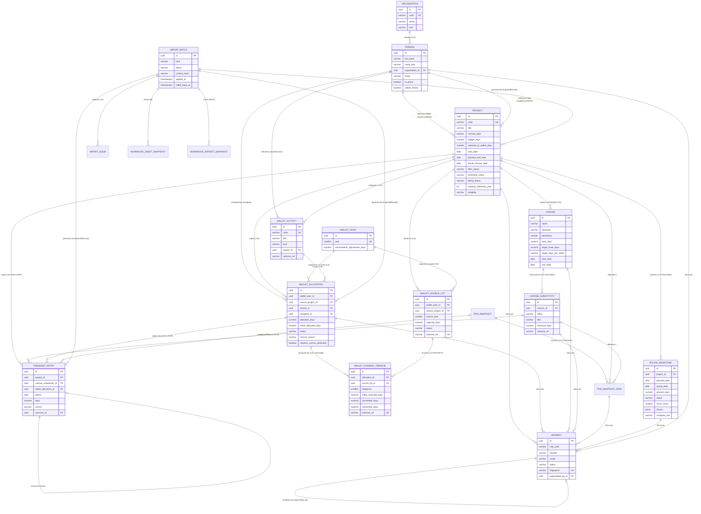
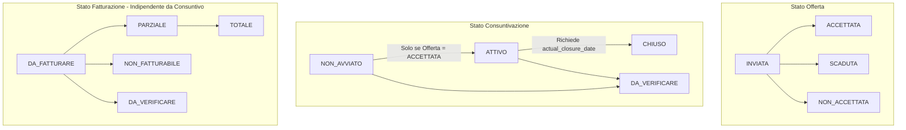
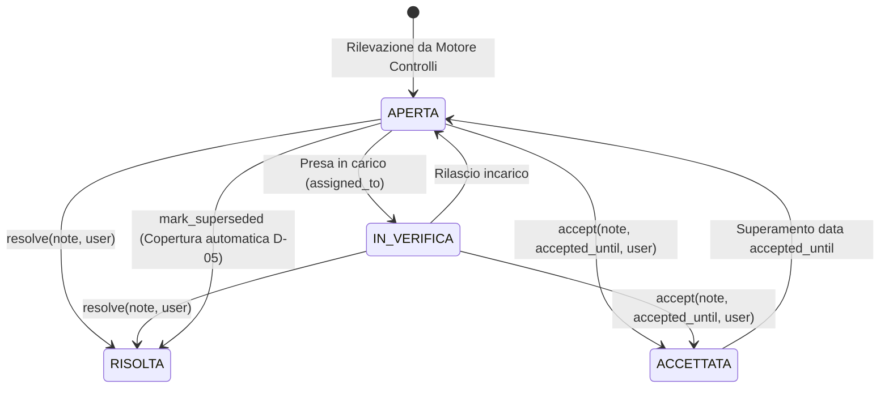

# 06 - Data Model Assessment - Supplier Ledger

> **Stato del Documento**: IMPLEMENTED  
> **Data di Generazione**: 2026-10-28  
> **Ambito**: Modello dati relazionale, schemi ORM Django, vincoli di integrità referenziale, trigger DB, gestione contabile append-only e audit trail.  
> **Baseline Progetto**: `backend/` (`core`, `directory`, `projects`, `wallet`, `canone`, `ppm`, `timesheets`, `anomalies`, `imports`).  
> **Riferimenti Incrociati**:
> - [01_REPOSITORY_INVENTORY.md](./01_REPOSITORY_INVENTORY.md)
> - [02_FUNCTIONAL_DOMAIN_MODEL.md](./02_FUNCTIONAL_DOMAIN_MODEL.md)
> - [03_FUNCTIONAL_CAPABILITY_MAP.md](./03_FUNCTIONAL_CAPABILITY_MAP.md)
> - [04_WORKFLOW_CATALOG.md](./04_WORKFLOW_CATALOG.md)
> - [05_TECHNICAL_ARCHITECTURE.md](./05_TECHNICAL_ARCHITECTURE.md)
> - [07_API_CATALOG.md](./07_API_CATALOG.md)
> - [08_BUSINESS_RULES.md](./08_BUSINESS_RULES.md)

---

## 1. Panoramica del Modello Dati

Il data model di **Supplier Ledger** è stato progettato per garantire il tracciamento rigoroso, deterministico e certificabile delle giornate/uomo erogate dal fornitore (Imola Informatica) a favore dell'istituto committente (Banca Mediolanum).

L'architettura dei dati si fonda su cinque pilastri concettuali:
1. **Separazione Ortogonale di Consuntivazione e Fatturazione (Regola R1)**: Lo stato di avanzamento operativo delle giornate (`timesheet_status`) e lo stato economico di liquidazione contabile (`billing_status`) sono disaccoppiati a livello strutturale (`backend/projects/models.py#L114-L125`).
2. **Ledger Contabile Append-Only**: I movimenti di consuntivazione (`TimesheetEntry`) non possono subire mutazioni dirette (`UPDATE`) né cancellazioni (`DELETE`). Qualsiasi rettifica operativa è rappresentata da un nuovo record di compensazione (storno contabile via `reverses`), con enforcing vincolante sia a livello applicativo sia tramite trigger nativo a livello PostgreSQL (`backend/timesheets/migrations/0002_append_only_trigger.py#L18-L41`).
3. **Rigorosa Precisione Decimale Fissa (`DaysField`)**: Qualsiasi entità che esprima grandezze temporali/economiche utilizza campi a virgola fissa a 4 cifre decimali (`Decimal(8,4)`), escludendo categoricamente i tipi `float` per scongiurare derive di arrotondamento contabile (`backend/core/fields.py#L15-L28`).
4. **Conservazione Lossless della Fonte e Immutabilità degli Import**: I flussi informativi originati da fogli di calcolo o estratti PPM vengono acquisiti come snapshot immutabili (`backend/ppm/models.py#L36-L67`, `backend/imports/models.py#L113-L151`), preservando le righe native e consentendo il rollback atomico mediante `ImportedRecordMixin`.
5. **Deduplica delle Anomalie Basata su Fingerprint Stabile**: Il monitoraggio continuo dei disallineamenti produce anomalie la cui identità univoca è calcolata tramite hash SHA-256 della regola e delle entità collegate, prescindendo dai valori numerici contingenti (`backend/anomalies/models.py#L43-L47`).

### Matrice di Implementazione Moduli Dati

| Modulo Backend | Modelli Principali | Ruolo Architetturale | Stato |
| :--- | :--- | :--- | :--- |
| [`core`](../../backend/core/models.py) | `TrackedModel`, `AppSettings`, `RoleCapabilityOverride`, `AdminAuditEvent`, `VerifiableMixin` | Base infrastrutturale di auditing, parametri contabili globali, autorizzazioni e affidabilità | **IMPLEMENTED** |
| [`directory`](../../backend/directory/models.py) | `Organization`, `Person` | Anagrafica persone e strutture con normalizzazione fonetica/lessicale e collision key | **IMPLEMENTED** |
| [`projects`](../../backend/projects/models.py) | `Project`, `BillingMilestone` | Contratti di progetto, budget in gg, scadenze, stato offerta/consuntivo/fattura e milestone | **IMPLEMENTED** |
| [`wallet`](../../backend/wallet/models.py) | `WalletYear`, `WalletActivity`, `WalletSourceLot`, `WalletAllocation`, `WalletFundingTranche` | Gestione capienza residua per anno, alimentazione lotti, allocazioni e catena FIFO di tranches | **IMPLEMENTED** |
| [`canone`](../../backend/canone/models.py) | `Canone`, `CanoneSubactivity` | Gestione organico allargato semestrale/trimestrale, uffici (EA, SA, TA, CROSS), target settimanale | **IMPLEMENTED** |
| [`ppm`](../../backend/ppm/models.py) | `PpmSnapshot`, `PpmSnapshotRow`, `ImportProfile` | Archiviazione snapshot estratti PPM, profili di mappatura dinamica e quadratura | **IMPLEMENTED** |
| [`timesheets`](../../backend/timesheets/models.py) | `TimesheetEntry` | Libro mastro append-only delle consuntivazioni con target esclusivo e meccanismo di storno | **IMPLEMENTED** |
| [`anomalies`](../../backend/anomalies/models.py) | `Anomaly` | Registro discrepanze e violazioni di business con ciclo di vita (aperta, verifica, risolta, accettata) | **IMPLEMENTED** |
| [`imports`](../../backend/imports/models.py) | `ImportBatch`, `ImportIssue`, `WorkbookSheetSnapshot`, `WorkbookDatasetSnapshot` | Gestione transazionale dei batch di caricamento, logging degli scarti e tracciatura lossless Excel | **IMPLEMENTED** |

---

## 2. Pattern Architetturali Fondamentali del Data Layer

### 2.1 TrackedModel: Identità, Temporizzazione, Auditing e Concorrenza Ottimistica
Tutte le entità di dominio concrete ereditano dalla classe astratta [`TrackedModel`](../../backend/core/models.py#L67-L106):

```python
# backend/core/models.py
class TrackedModel(models.Model):
    id = models.UUIDField(primary_key=True, editable=False, default=uuid.uuid4)
    created_at = models.DateTimeField(auto_now_add=True, db_index=True)
    updated_at = models.DateTimeField(auto_now=True)
    created_by = models.ForeignKey(settings.AUTH_USER_MODEL, null=True, blank=True, on_delete=models.SET_NULL, related_name="+")
    updated_by = models.ForeignKey(settings.AUTH_USER_MODEL, null=True, blank=True, on_delete=models.SET_NULL, related_name="+")
    version = models.PositiveIntegerField(default=1, editable=False)
```

- **Identificatore Immutabile**: Utilizzo esclusivo di UUIDv4 come chiave primaria, eliminando enumerazioni prevedibili e collisioni in fase di merge.
- **Tracciamento Autore**: I campi `created_by` e `updated_by` vengono valorizzati automaticamente all'interno del metodo `save()` estraendo l'identità dell'utente autenticato dalla variabile di contesto (`get_current_user()`, [`backend/core/current_user.py#L19-L20`](../../backend/core/current_user.py#L19-L20)).
- **Concorrenza Ottimistica**: Il campo intero `version` parte da `1` e si incrementa di un'unità a ogni mutazione di record esistente (`self.version = (self.version or 0) + 1`). Questo garantisce la rilevazione immediata di conflitti di scrittura (lost updates) in scenari ad alta concorrenza.

### 2.2 VerifiableMixin: Tracciamento Granulare dell'Incertezza del Dato
Implementato in [`VerifiableMixin`](../../backend/core/models.py#L182-L233) ed ereditato da `Project` e `WalletAllocation`:

- **Affidabilità Formale (`reliability`)**: Assume i valori dell'enum `Reliability` (`CERTO`, `DA_VERIFICARE`).
- **Punti di Verifica Strutturati (`verification_points`)**: Array JSON di dizionari generati con schema standard:
  ```json
  {
    "testo": "Verificare scostamento residuo con RDA originaria",
    "stato": "APERTO",
    "nota": "",
    "verificato_da": null,
    "verificato_il": null
  }
  ```
- **Risoluzione Vincolata (`mark_verification_point`)**: Per chiudere un punto di verifica è obbligatorio specificare una nota di commento non vuota. Quando l'ultimo punto aperto passa a `VERIFICATO`, il mixin promuove automaticamente lo stato `reliability` a `CERTO` (`backend/core/models.py#L229-L232`).

### 2.3 ImportedRecordMixin: Provenienza e Supporto al Rollback Atomico
Implementato in [`backend/imports/models.py#L97-L111`](../../backend/imports/models.py#L97-L111):
- Aggiunge a ogni modello collegato la foreign key facoltativa `import_batch` verso [`ImportBatch`](../../backend/imports/models.py#L31-L76).
- Consente al motore di import di tracciare la precisa transazione di caricamento che ha originato o aggiornato il record.
- In caso di rollback del batch, il motore può identificare e cancellare o ripristinare esattamente le righe afferenti allo specifico lotto di importazione.

### 2.4 Ledger Append-Only: Immutabilità Assoluta e Storni Contabili
La gestione contabile dei consuntivi in [`TimesheetEntry`](../../backend/timesheets/models.py#L34-L170) adotta un'architettura rigorosamente append-only:

1. **Blocco Applicativo**: L'override di `save()` intercetta modifiche a istanze non-nuove sollevando `ValidationError("I consuntivi sono append-only...")` (`backend/timesheets/models.py#L147-L151`). Il metodo `delete()` blocca la cancellazione incondizionatamente (`backend/timesheets/models.py#L153-L156`).
2. **Blocco Database Invalicabile (PostgreSQL Trigger)**:
   La migrazione [`backend/timesheets/migrations/0002_append_only_trigger.py`](../../backend/timesheets/migrations/0002_append_only_trigger.py) installa la procedura PL/pgSQL `timesheets_append_only()` associata ai trigger `timesheet_entry_no_update` e `timesheet_entry_no_delete`. Qualsiasi operazione `UPDATE` o `DELETE` su `timesheets_timesheetentry` fallisce con errore `42501`.
3. **Eccezione Transazionale Controllata per i Rollback (`allow_ledger_mutation`)**:
   L'unica deroga ammessa è l'impostazione della variabile di sessione transazionale PostgreSQL:
   ```sql
   SET LOCAL "supplier_ledger.allow_ledger_mutation" = 'on'
   ```
   Tale eccezione è gestita tramite il context manager [`allow_ledger_mutation`](../../backend/timesheets/mutations.py#L27-L72), che limita strettamente l'operatività ai batch di tipo `SEED_JSON` o `WORKBOOK_JSON` durante una transazione attiva `transaction.atomic()`. Per batch di tipo PPM la mutazione diretta è esplicitamente proibita (decisione D-14), richiedendo esclusivamente storni contabili.
4. **Meccanismo di Storno (`build_reversal`)**: Per correggere o rettificare un movimento, l'applicazione invoca `build_reversal()`, creando un nuovo movimento avente le medesime coordinate, giornate con segno opposto (`days = -self.days`), causale `source = TimesheetSource.STORNO` e puntatore referenziale `reverses` impostato al record originario (`backend/timesheets/models.py#L158-L170`).

---

## 3. Campi Economici e Rappresentazione delle Giornate/Uomo (`DaysField`)

Tutte le grandezze quantitative del dominio (budget, giornate erogate, consuntivi, capacità di wallet, quote di tranche) utilizzano la classe custom [`DaysField`](../../backend/core/fields.py#L15-L28).

```python
# backend/core/fields.py
DAYS_MAX_DIGITS = 8
DAYS_DECIMAL_PLACES = 4
ZERO_DAYS = Decimal("0.0000")

class DaysField(models.DecimalField):
    def __init__(self, **kwargs: Any) -> None:
        kwargs.setdefault("max_digits", DAYS_MAX_DIGITS)
        kwargs.setdefault("decimal_places", DAYS_DECIMAL_PLACES)
        super().__init__(**kwargs)
```

### Specifiche e Razionale
- **Rappresentazione DB**: `DECIMAL(8,4)` (capienza massima: 9999.9999 giornate, con risoluzione al diecimilensimo di giornata).
- **Esclusione dei Float**: I numeri in virgola mobile (`float`) introducono artefatti di approssimazione binaria inaccettabili in una contabilità bancaria. Ogni valore in memoria è istanza di `decimal.Decimal`.
- **Granularità PPM**: Configurata in [`AppSettings.ppm_granularity_days`](../../backend/core/models.py#L118-L123) al valore predefinito `Decimal("0.0625")`. Poiché la giornata lavorativa convenzionale è pari a 8 ore (`hours_per_day = 8.00`), `0.0625 gg * 8 h = 0.5 ore` (30 minuti). Tutti i consuntivi provenienti da PPM sono multipli esatti di mezz'ora.
- **Tolleranza di Riconciliazione**: Definita in [`AppSettings.reconciliation_tolerance_days`](../../backend/core/models.py#L124-L129) a `Decimal("0.0100")` (pari a 0.08 ore, ovvero 4.8 minuti). Differenze di quadratura inferiori a tale soglia sono considerate scarti fisiologici di arrotondamento e compensate tramite `WalletYear.reconciliation_adjustment_days`.

---

## 4. Catalogo Dettagliato delle Entità

### 4.1 Modulo `core`

#### 4.1.1 `AppSettings`
*Definizione*: [`backend/core/models.py#L108-L164`](../../backend/core/models.py#L108-L164)  
*Ereditarietà*: `TrackedModel`  
*Descrizione*: Parametri di configurazione contabile e finanziaria globali dell'applicazione, implementato come singleton (un solo record nel DB).

| Campo | Tipo Django | Tipo DB | Null/Blank | Default | Descrizione / Vincoli |
| :--- | :--- | :--- | :--- | :--- | :--- |
| `id` | `UUIDField` | `uuid` | No / No | `uuid.uuid4` | PK (`TrackedModel`) |
| `singleton` | `BooleanField` | `boolean` | No / No | `True` | `unique=True`, garantisce la singolarità del record |
| `hours_per_day` | `DecimalField(4,2)` | `numeric(4,2)` | No / No | `8.00` | Numero di ore lavorative per giornata/uomo |
| `ppm_granularity_days` | `DecimalField(6,4)` | `numeric(6,4)` | No / No | `0.0625` | Minima unità temporale PPM (0.5 ore) |
| `reconciliation_tolerance_days` | `DecimalField(6,4)` | `numeric(6,4)` | No / No | `0.0100` | Soglia massima di tolleranza per quadratura |
| `daily_person_cost` | `DecimalField(12,2)`| `numeric(12,2)`| No / No | `0.00` | Costo medio globale per giornata uomo |
| `residual_years_after_closure` | `PositiveSmallIntegerField` | `smallint` | No / No | `1` | Anni di validità del residuo post-chiusura |
| `residual_expiring_window_days` | `PositiveSmallIntegerField` | `smallint` | No / No | `90` | Giorni di anticipo per notifica residui in scadenza |
| `history` | `HistoricalRecords` | shadow table | - | - | Tabelle storiche `historicalcore_appsettings` |

*Metodi e Proprietà*:
- `clean()`: Verifica che `hours_per_day > 0` e `daily_person_cost >= 0`.
- `get_solo()` (classmethod): Restituisce l'unica istanza o la crea se mancante.

#### 4.1.2 `RoleCapabilityOverride`
*Definizione*: [`backend/core/models.py#L17-L35`](../../backend/core/models.py#L17-L35)  
*Ereditarietà*: `models.Model` (con PK standard intera autonoma)  
*Descrizione*: Tabella per sovrascrivere o definire puntualmente le autorizzazioni (capability) per ruolo applicativo.

| Campo | Tipo Django | Tipo DB | Null/Blank | Default | Descrizione / Vincoli |
| :--- | :--- | :--- | :--- | :--- | :--- |
| `id` | `BigAutoField` | `bigint` | No / No | auto | PK |
| `role` | `CharField(64)` | `varchar(64)` | No / No | - | Ruolo applicativo (es. PM, COMMERCIALE) |
| `capability` | `CharField(64)` | `varchar(64)` | No / No | - | Identificativo capability (es. `can_export_ppm`) |
| `enabled` | `BooleanField` | `boolean` | No / No | `False` | Flag di abilitazione capability |
| `updated_at` | `DateTimeField` | `timestamptz` | No / No | auto | Timestamp ultima variazione |

*Vincoli*: `UniqueConstraint(fields=("role", "capability"), name="core_unique_role_capability")`.

#### 4.1.3 `AdminAuditEvent`
*Definizione*: [`backend/core/models.py#L37-L60`](../../backend/core/models.py#L37-L60)  
*Ereditarietà*: `models.Model`  
*Descrizione*: Registro append-only delle operazioni di amministrazione e configurazione del sistema.

| Campo | Tipo Django | Tipo DB | Null/Blank | Default | Descrizione / Vincoli |
| :--- | :--- | :--- | :--- | :--- | :--- |
| `id` | `BigAutoField` | `bigint` | No / No | auto | PK |
| `actor` | `ForeignKey(User)` | `integer/uuid` | Sì / Sì | `null` | `on_delete=SET_NULL`, utente esecutore |
| `actor_username` | `CharField(150)` | `varchar(150)` | No / Sì | `""` | Username congelato dell'operatore |
| `action` | `CharField(64)` | `varchar(64)` | No / No | - | Azione eseguita (es. `settings_update`) |
| `target_type` | `CharField(32)` | `varchar(32)` | No / No | - | Tipologia oggetto (es. `AppSettings`) |
| `target_id` | `CharField(128)` | `varchar(128)` | No / Sì | `""` | ID oggetto impattato |
| `target_label` | `CharField(150)` | `varchar(150)` | No / Sì | `""` | Etichetta descrittiva del target |
| `details` | `JSONField` | `jsonb` | No / Sì | `dict` | Dettagli dell'operazione e diff campi |
| `created_at` | `DateTimeField` | `timestamptz` | No / No | auto_now_add | Timestamp evento, indicizzato (`db_index=True`) |

---

### 4.2 Modulo `directory`

#### 4.2.1 `Organization`
*Definizione*: [`backend/directory/models.py#L18-L31`](../../backend/directory/models.py#L18-L31)  
*Ereditarietà*: `TrackedModel`, `ImportedRecordMixin`  
*Descrizione*: Struttura organizzativa / azienda (Committente o Fornitore).

| Campo | Tipo Django | Tipo DB | Null/Blank | Default | Descrizione / Vincoli |
| :--- | :--- | :--- | :--- | :--- | :--- |
| `id` | `UUIDField` | `uuid` | No / No | `uuid.uuid4` | PK (`TrackedModel`) |
| `code` | `CharField(20)` | `varchar(20)` | No / No | - | Codice univoco (es. `BMED`, `IMOLA`), `unique=True` |
| `name` | `CharField(200)` | `varchar(200)` | No / No | - | Denominazione sociale estesa |
| `kind` | `CharField(10)` | `varchar(10)` | No / No | - | `choices=OrganizationKind` (`CLIENT`, `SUPPLIER`) |
| `import_batch` | `ForeignKey(ImportBatch)` | `uuid` | Sì / Sì | `null` | Da `ImportedRecordMixin`, `SET_NULL` |
| `history` | `HistoricalRecords` | shadow table | - | - | Tabelle storiche `historicaldirectory_organization` |

#### 4.2.2 `Person`
*Definizione*: [`backend/directory/models.py#L41-L85`](../../backend/directory/models.py#L41-L85)  
*Ereditarietà*: `TrackedModel`, `ImportedRecordMixin`  
*Descrizione*: Persona fisica associata a un'organizzazione (referenti cliente, PM fornitore, architetti).

| Campo | Tipo Django | Tipo DB | Null/Blank | Default | Descrizione / Vincoli |
| :--- | :--- | :--- | :--- | :--- | :--- |
| `id` | `UUIDField` | `uuid` | No / No | `uuid.uuid4` | PK (`TrackedModel`) |
| `full_name` | `CharField(200)` | `varchar(200)` | No / No | - | Nome e cognome normalizzato |
| `name_key` | `CharField(200)` | `varchar(200)` | No / No | - | Chiave di confronto fonetica/tokenizzata (`db_index=True`) |
| `organization` | `ForeignKey(Organization)` | `uuid` | No / No | - | `on_delete=PROTECT`, `related_name="people"` |
| `email` | `EmailField` | `varchar(254)` | Sì / Sì | `null` | Email (null distintivo se mai fornita nel seed) |
| `is_active` | `BooleanField` | `boolean` | No / No | `True` | Flag operatività persona |
| `needs_review` | `BooleanField` | `boolean` | No / No | `False` | Necessita validazione umana da coda revisione |
| `review_note` | `TextField` | `text` | No / Sì | `""` | Motivazione richiesta di revisione |
| `import_batch` | `ForeignKey(ImportBatch)` | `uuid` | Sì / Sì | `null` | Da `ImportedRecordMixin`, `SET_NULL` |
| `history` | `HistoricalRecords` | shadow table | - | - | Tabelle storiche `historicaldirectory_person` |

*Vincoli e Logiche*:
- `UniqueConstraint(fields=("full_name", "organization"), name="person_unique_name_per_org")`
- `UniqueConstraint(fields=("name_key", "organization"), name="person_unique_key_per_org")`
- `save()`: calcola automaticamente `candidate = normalize_person_name(self.full_name)`, aggiornando `full_name` e `name_key` (token riordinati alfabeticamente senza accenti, es. "Andrea Ravagli" e "Ravagli Andrea" producono la medesima chiave).

---

### 4.3 Modulo `projects`

#### 4.3.1 `Project`
*Definizione*: [`backend/projects/models.py#L64-L228`](../../backend/projects/models.py#L64-L228)  
*Ereditarietà*: `TrackedModel`, `VerifiableMixin`, `ImportedRecordMixin`  
*Descrizione*: Entità centrale rappresentante un'iniziativa contrattualizzata, con budget, date, stati e tracking economico.

| Campo | Tipo Django | Tipo DB | Null/Blank | Default | Descrizione / Vincoli |
| :--- | :--- | :--- | :--- | :--- | :--- |
| `id` | `UUIDField` | `uuid` | No / No | `uuid.uuid4` | PK (`TrackedModel`) |
| `code` | `CharField(120)` | `varchar(120)` | No / No | - | Codice identificativo univoco (`unique=True`) |
| `title` | `CharField(300)` | `varchar(300)` | No / No | - | Titolo o descrizione contrattuale estesa |
| `contract_type` | `CharField(10)` | `varchar(10)` | No / No | - | `choices=ContractType` (`CANONE`, `AQL`, `CORPO`, `PPM`, `ATTIVITA`) |
| `aro_code` | `CharField(50)` | `varchar(50)` | No / Sì | `""` | Codice ARO cliente |
| `rda_code` | `CharField(50)` | `varchar(50)` | No / Sì | `""` | Codice RDA cliente |
| `deliverable` | `CharField(100)` | `varchar(100)` | No / Sì | `""` | Denominazione deliverable contrattuale |
| `client_owner` | `ForeignKey(Person)` | `uuid` | Sì / Sì | `null` | Referente BMED (`on_delete=SET_NULL`, `related_name="owned_projects"`) |
| `supplier_owner` | `ForeignKey(Person)` | `uuid` | Sì / Sì | `null` | Referente Imola (`on_delete=SET_NULL`, `related_name="supplied_projects"`) |
| `budget_days` | `DaysField` | `numeric(8,4)` | No / No | - | Budget contrattualizzato in giornate/uomo |
| `released_to_wallet_days` | `DaysField` | `numeric(8,4)` | No / No | `0` | Quota residuo rilasciata anticipatamente al wallet |
| `start_date` | `DateField` | `date` | Sì / Sì | `null` | Data inizio convenzionale o effettiva |
| `planned_end_date` | `DateField` | `date` | Sì / Sì | `null` | Data stimata di completamento |
| `actual_closure_date` | `DateField` | `date` | Sì / Sì | `null` | Data di chiusura consuntivazione effettiva |
| `offer_status` | `CharField(15)` | `varchar(15)` | No / No | `INVIATA` | `choices=OfferStatus` (`INVIATA`, `ACCETTATA`, `SCADUTA`, `NON_ACCETTATA`) |
| `timesheet_status` | `CharField(15)` | `varchar(15)` | No / No | `NON_AVVIATO`| `choices=TimesheetStatus` (`NON_AVVIATO`, `ATTIVO`, `CHIUSO`, `DA_VERIFICARE`) |
| `billing_status` | `CharField(20)` | `varchar(20)` | No / No | `DA_FATTURARE`| `choices=BillingStatus` (`DA_FATTURARE`, `PARZIALE`, `TOTALE`, `NON_FATTURABILE`, `DA_VERIFICARE`) |
| `residual_reference_year` | `GeneratedField` | `integer` | Sì / Sì | DB-calc | `ExtractYear('actual_closure_date')`, persistito nel DB (`db_persist=True`) |
| `declared_residual_year` | `IntegerField` | `integer` | Sì / Sì | `null` | Anno residuo dichiarato nel seed (informativo) |
| `notes` | `TextField` | `text` | No / Sì | `""` | Note gestionali |
| `legacy_excel_status` | `CharField(50)` | `varchar(50)` | No / Sì | `""` | Valore originario della colonna di stato Excel |
| `external_ref` | `CharField(100)` | `varchar(100)` | No / Sì | `""` | Riferimento identificativo di importazione (`db_index=True`) |
| `reliability` | `CharField(15)` | `varchar(15)` | No / No | `CERTO` | Da `VerifiableMixin` (`CERTO`, `DA_VERIFICARE`) |
| `verification_points` | `JSONField` | `jsonb` | No / Sì | `list` | Da `VerifiableMixin` (punti aperti di verifica) |
| `import_batch` | `ForeignKey(ImportBatch)` | `uuid` | Sì / Sì | `null` | Da `ImportedRecordMixin`, `SET_NULL` |
| `history` | `HistoricalRecords` | shadow table | - | - | Tabelle storiche `historicalprojects_project` |

*Vincoli DB (CheckConstraint & Indexes)*:
- `project_budget_non_negative`: `budget_days >= 0`
- `project_end_after_start`: `planned_end_date IS NULL OR start_date IS NULL OR planned_end_date >= start_date`
- `project_closed_requires_date`: `timesheet_status != 'CHIUSO' OR actual_closure_date IS NOT NULL OR import_batch_id IS NOT NULL`
- Indici su: `timesheet_status`, `billing_status`, `contract_type`.
- Trigger DB PostgreSQL: `trg_project_closed_requires_seed_batch` ([`backend/projects/migrations/0004_project_closed_workbook_seed_trigger.py`](../../backend/projects/migrations/0004_project_closed_workbook_seed_trigger.py)).

*Validazioni di Dominio (`clean`)*:
- Se `timesheet_status == ATTIVO`, `offer_status` deve essere `ACCETTATA`.
- Se `timesheet_status == CHIUSO`, `actual_closure_date` è obbligatoria (derogata esclusivamente per import di tipo `SEED_JSON` o `WORKBOOK_JSON`).
- `actual_closure_date` non può essere anteriore a `start_date`.

#### 4.3.2 `BillingMilestone`
*Definizione*: [`backend/projects/models.py#L230-L291`](../../backend/projects/models.py#L230-L291)  
*Ereditarietà*: `TrackedModel`, `ImportedRecordMixin`  
*Descrizione*: Milestone del piano di fatturazione associata a un progetto.

| Campo | Tipo Django | Tipo DB | Null/Blank | Default | Descrizione / Vincoli |
| :--- | :--- | :--- | :--- | :--- | :--- |
| `id` | `UUIDField` | `uuid` | No / No | `uuid.uuid4` | PK (`TrackedModel`) |
| `project` | `ForeignKey(Project)` | `uuid` | No / No | - | `on_delete=CASCADE`, `related_name="milestones"` |
| `planned_date` | `DateField` | `date` | Sì / Sì | `null` | Data di fatturazione concordata |
| `actual_date` | `DateField` | `date` | Sì / Sì | `null` | Data di emissione effettiva |
| `amount_days` | `DaysField` | `numeric(8,4)` | Sì / Sì | `null` | Giornate di competenza della tranche |
| `status` | `CharField(15)` | `varchar(15)` | No / No | `PIANIFICATA` | `choices=MilestoneStatus` (`PIANIFICATA`, `FATTURATA`, `SPOSTATA`, `ANNULLATA`, `DA_VERIFICARE`) |
| `move_count` | `PositiveSmallIntegerField` | `smallint` | No / No | `0` | Numero complessivo di riprogrammazioni |
| `moves` | `JSONField` | `jsonb` | No / Sì | `list` | Storico riprogrammazioni (date, utente, motivazione) |
| `schedule_slot` | `CharField(10)` | `varchar(10)` | No / Sì | `""` | `choices=BillingScheduleSlot` (`START`, `END`) |
| `import_batch` | `ForeignKey(ImportBatch)` | `uuid` | Sì / Sì | `null` | Da `ImportedRecordMixin`, `SET_NULL` |
| `history` | `HistoricalRecords` | shadow table | - | - | Tabelle storiche `historicalprojects_billingmilestone` |

*Vincoli e Metodi*:
- `UniqueConstraint(fields=("project", "schedule_slot"), condition=~Q(schedule_slot=""), name="unique_project_billing_schedule_slot")`
- `move_to(new_date, reason, user)`: valida motivazione obbligatoria, accoda il movimento a `moves`, incrementa `move_count`, assegna `new_date` e imposta `status = MilestoneStatus.SPOSTATA`.

---

### 4.4 Modulo `wallet`

#### 4.4.1 `WalletYear`
*Definizione*: [`backend/wallet/models.py#L43-L60`](../../backend/wallet/models.py#L43-L60)  
*Ereditarietà*: `TrackedModel`, `ImportedRecordMixin`  
*Descrizione*: Contenitore contabile annuale delle disponibilità di giornate non consuntivate dei progetti chiusi o rilasciate.

| Campo | Tipo Django | Tipo DB | Null/Blank | Default | Descrizione / Vincoli |
| :--- | :--- | :--- | :--- | :--- | :--- |
| `id` | `UUIDField` | `uuid` | No / No | `uuid.uuid4` | PK (`TrackedModel`) |
| `year` | `PositiveSmallIntegerField` | `smallint` | No / No | - | Anno di competenza del wallet, `unique=True` |
| `notes` | `TextField` | `text` | No / Sì | `""` | Note sul wallet annuale |
| `reconciliation_adjustment_days` | `DaysField` | `numeric(8,4)` | No / No | `0` | Rettifica esplicita per scostamenti storici Excel |
| `import_batch` | `ForeignKey(ImportBatch)` | `uuid` | Sì / Sì | `null` | Da `ImportedRecordMixin`, `SET_NULL` |
| `history` | `HistoricalRecords` | shadow table | - | - | Tabelle storiche `historicalwallet_walletyear` |

#### 4.4.2 `WalletActivity`
*Definizione*: [`backend/wallet/models.py#L62-L119`](../../backend/wallet/models.py#L62-L119)  
*Ereditarietà*: `TrackedModel`, `ImportedRecordMixin`  
*Descrizione*: Attività o iniziativa bersaglio a cui possono essere allocate giornate attinte dal wallet.

| Campo | Tipo Django | Tipo DB | Null/Blank | Default | Descrizione / Vincoli |
| :--- | :--- | :--- | :--- | :--- | :--- |
| `id` | `UUIDField` | `uuid` | No / No | `uuid.uuid4` | PK (`TrackedModel`) |
| `code` | `CharField(120)` | `varchar(120)` | No / No | - | Codice attività, `unique=True` |
| `title` | `CharField(300)` | `varchar(300)` | No / No | - | Descrizione attività |
| `kind` | `CharField(10)` | `varchar(10)` | No / No | - | `choices=ActivityKind` (`PROGETTO`, `ATTIVITA`, `REDMINE`) |
| `project` | `ForeignKey(Project)` | `uuid` | Sì / Sì | `null` | `on_delete=PROTECT`, `related_name="wallet_activities"` |
| `redmine_ref` | `CharField(20)` | `varchar(20)` | No / Sì | `""` | Riferimento ticket Redmine (`db_index=True`) |
| `client_owner` | `ForeignKey(Person)` | `uuid` | Sì / Sì | `null` | Referente BMED (`on_delete=SET_NULL`, `related_name="owned_activities"`) |
| `supplier_owner` | `ForeignKey(Person)` | `uuid` | Sì / Sì | `null` | Referente Imola (`on_delete=SET_NULL`, `related_name="supplied_activities"`) |
| `notes` | `TextField` | `text` | No / Sì | `""` | Note descrittive |
| `is_technical` | `BooleanField` | `boolean` | No / No | `False` | Creata da import per tracciare giornate storiche (D-04) |
| `import_batch` | `ForeignKey(ImportBatch)` | `uuid` | Sì / Sì | `null` | Da `ImportedRecordMixin`, `SET_NULL` |
| `history` | `HistoricalRecords` | shadow table | - | - | Tabelle storiche `historicalwallet_walletactivity` |

*Validazioni (`clean`)*: Se `kind == ActivityKind.PROGETTO`, il campo `project` deve essere obbligatoriamente valorizzato.

#### 4.4.3 `WalletSourceLot`
*Definizione*: [`backend/wallet/models.py#L121-L161`](../../backend/wallet/models.py#L121-L161)  
*Ereditarietà*: `TrackedModel`, `ImportedRecordMixin`  
*Descrizione*: Lotto di alimentazione del wallet generato dal residuo non consuntivato di un progetto chiuso (o rilasciato).

| Campo | Tipo Django | Tipo DB | Null/Blank | Default | Descrizione / Vincoli |
| :--- | :--- | :--- | :--- | :--- | :--- |
| `id` | `UUIDField` | `uuid` | No / No | `uuid.uuid4` | PK (`TrackedModel`) |
| `wallet_year` | `ForeignKey(WalletYear)` | `uuid` | No / No | - | `on_delete=PROTECT`, `related_name="source_lots"` |
| `source_project` | `ForeignKey(Project)` | `uuid` | No / No | - | `on_delete=PROTECT`, `related_name="wallet_source_lots"` |
| `source_year` | `PositiveSmallIntegerField` | `smallint` | No / No | - | Anno solare di chiusura originaria del progetto |
| `capacity_days` | `DaysField` | `numeric(8,4)` | No / No | - | Giornate conferite al wallet |
| `effective_date` | `DateField` | `date` | Sì / Sì | `null` | Data formale di conferimento |
| `status` | `CharField(24)` | `varchar(24)` | No / No | `DISPONIBILE` | `choices=SourceLotStatus` (`DISPONIBILE`, `IMPEGNATO`, `CHIUSURA_DA_VALIDARE`, `CHIUSO`) |
| `external_ref` | `CharField(100)` | `varchar(100)` | No / No | - | Riferimento univoco import, `unique=True` |
| `notes` | `TextField` | `text` | No / Sì | `""` | Note |
| `import_batch` | `ForeignKey(ImportBatch)` | `uuid` | Sì / Sì | `null` | Da `ImportedRecordMixin`, `SET_NULL` |
| `history` | `HistoricalRecords` | shadow table | - | - | Tabelle storiche `historicalwallet_walletsourcelot` |

*Vincoli DB*:
- `wallet_source_capacity_non_negative`: `capacity_days >= 0`
- `wallet_source_project_per_year`: `UniqueConstraint(fields=("wallet_year", "source_project"))`

#### 4.4.4 `WalletAllocation`
*Definizione*: [`backend/wallet/models.py#L163-L268`](../../backend/wallet/models.py#L163-L268)  
*Ereditarietà*: `TrackedModel`, `VerifiableMixin`, `ImportedRecordMixin`  
*Descrizione*: Impegno formale di giornate dal wallet a favore di un'attività/progetto bersaglio.

| Campo | Tipo Django | Tipo DB | Null/Blank | Default | Descrizione / Vincoli |
| :--- | :--- | :--- | :--- | :--- | :--- |
| `id` | `UUIDField` | `uuid` | No / No | `uuid.uuid4` | PK (`TrackedModel`) |
| `wallet_year` | `ForeignKey(WalletYear)` | `uuid` | No / No | - | `on_delete=PROTECT`, `related_name="allocations"` |
| `source_project` | `ForeignKey(Project)` | `uuid` | Sì / Sì | `null` | `on_delete=PROTECT`, `related_name="wallet_allocations"` |
| `activity` | `ForeignKey(WalletActivity)` | `uuid` | No / No | - | `on_delete=PROTECT`, `related_name="allocations"` |
| `assignee` | `ForeignKey(Person)` | `uuid` | Sì / Sì | `null` | Architetto incaricato (`on_delete=PROTECT`) |
| `allocated_days` | `DaysField` | `numeric(8,4)` | No / No | - | Giornate correntemente allocate |
| `initial_allocated_days` | `DaysField` | `numeric(8,4)` | No / No | `0` | Giornate originariamente impegnate |
| `status` | `CharField(10)` | `varchar(10)` | No / No | `APERTA` | `choices=AllocationStatus` (`APERTA`, `CHIUSA`) |
| `closure_reason` | `CharField(20)` | `varchar(20)` | Sì / Sì | `null` | `choices=AllocationClosureReason` (`ESAURITA`, `CON_RESIDUO`) |
| `closed_at` | `DateTimeField` | `timestamptz` | Sì / Sì | `null` | Data/ora chiusura allocazione |
| `notes` | `TextField` | `text` | No / Sì | `""` | Note operative |
| `external_ref` | `CharField(100)` | `varchar(100)` | No / Sì | `""` | Riferimento import (`db_index=True`) |
| `requires_source_attribution` | `BooleanField` | `boolean` | No / No | `False` | Attinge da wallet generico e richiede abbinamento a lotto |
| `override_reason` | `TextField` | `text` | No / Sì | `""` | Giustificazione formale in caso di sforamento autorizzato |
| `override_by` | `ForeignKey(User)` | `integer/uuid` | Sì / Sì | `null` | `on_delete=SET_NULL`, utente che ha autorizzato lo sforamento |
| `is_technical` | `BooleanField` | `boolean` | No / No | `False` | Allocazione tecnica generata da import |
| `reliability` | `CharField(15)` | `varchar(15)` | No / No | `CERTO` | Da `VerifiableMixin` |
| `verification_points` | `JSONField` | `jsonb` | No / Sì | `list` | Da `VerifiableMixin` |
| `import_batch` | `ForeignKey(ImportBatch)` | `uuid` | Sì / Sì | `null` | Da `ImportedRecordMixin`, `SET_NULL` |
| `history` | `HistoricalRecords` | shadow table | - | - | Tabelle storiche `historicalwallet_walletallocation` |

*Vincoli e Indici*:
- `allocation_days_non_negative`: `allocated_days >= 0`
- `allocation_unique_external_ref`: `UniqueConstraint(fields=("external_ref",), condition=~Q(external_ref=""))`
- Indici su `(wallet_year, status)` e `(source_project)`.
- `save()`: auto-popola `initial_allocated_days` al primo salvataggio e valorizza `requires_source_attribution` se `source_project` è assente e non vi sono tranche.

#### 4.4.5 `WalletFundingTranche`
*Definizione*: [`backend/wallet/models.py#L270-L319`](../../backend/wallet/models.py#L270-L319)  
*Ereditarietà*: `TrackedModel`, `ImportedRecordMixin`  
*Descrizione*: Quota atomica di allocazione collegata a uno specifico lotto sorgente secondo la sequenza contabile FIFO.

| Campo | Tipo Django | Tipo DB | Null/Blank | Default | Descrizione / Vincoli |
| :--- | :--- | :--- | :--- | :--- | :--- |
| `id` | `UUIDField` | `uuid` | No / No | `uuid.uuid4` | PK (`TrackedModel`) |
| `allocation` | `ForeignKey(WalletAllocation)` | `uuid` | No / No | - | `on_delete=CASCADE`, `related_name="funding_tranches"` |
| `source_lot` | `ForeignKey(WalletSourceLot)` | `uuid` | No / No | - | `on_delete=PROTECT`, `related_name="funding_tranches"` |
| `sequence` | `PositiveSmallIntegerField` | `smallint` | No / No | - | Ordine progressivo di consumo FIFO (1, 2, 3...) |
| `initial_reserved_days` | `DaysField` | `numeric(8,4)` | No / No | - | Giornate inizialmente riservate |
| `committed_days` | `DaysField` | `numeric(8,4)` | No / No | - | Giornate attualmente impegnate |
| `consumed_days` | `DaysField` | `numeric(8,4)` | No / No | `0` | Giornate effettivamente consuntivate ed erose |
| `external_ref` | `CharField(100)` | `varchar(100)` | No / No | - | Riferimento univoco import, `unique=True` |
| `import_batch` | `ForeignKey(ImportBatch)` | `uuid` | Sì / Sì | `null` | Da `ImportedRecordMixin`, `SET_NULL` |
| `history` | `HistoricalRecords` | shadow table | - | - | Tabelle storiche `historicalwallet_walletfundingtranche` |

*Vincoli DB e Validazioni*:
- `wallet_funding_sequence_unique`: `UniqueConstraint(fields=("allocation", "sequence"))`
- `wallet_funding_initial_non_negative`: `initial_reserved_days >= 0`
- `wallet_funding_committed_non_negative`: `committed_days >= 0`
- `wallet_funding_consumed_non_negative`: `consumed_days >= 0`
- `clean()`: verifica invarianti `committed_days <= initial_reserved_days` e `consumed_days <= committed_days`.

---

### 4.5 Modulo `canone`

#### 4.5.1 `Canone`
*Definizione*: [`backend/canone/models.py#L49-L128`](../../backend/canone/models.py#L49-L128)  
*Ereditarietà*: `TrackedModel`, `ImportedRecordMixin`  
*Descrizione*: Contratto quadro periodico (tipicamente semestrale o trimestrale) per organico allargato.

| Campo | Tipo Django | Tipo DB | Null/Blank | Default | Descrizione / Vincoli |
| :--- | :--- | :--- | :--- | :--- | :--- |
| `id` | `UUIDField` | `uuid` | No / No | `uuid.uuid4` | PK (`TrackedModel`) |
| `name` | `CharField(200)` | `varchar(200)` | No / Sì | `""` | Denominazione del canone |
| `project` | `ForeignKey(Project)` | `uuid` | Sì / Sì | `null` | `on_delete=SET_NULL`, `related_name="canoni"` |
| `semester` | `CharField(7)` | `varchar(7)` | No / No | - | Periodo nel formato `AAAA-S1/S2` o `AAAA-Q1..Q4` |
| `periodicity` | `CharField(12)` | `varchar(12)` | No / No | `SEMESTRALE` | `choices=CanonePeriodicity` (`TRIMESTRALE`, `SEMESTRALE`) |
| `total_days` | `DaysField` | `numeric(8,4)` | No / No | - | Monte complessivo contrattuale di giornate |
| `target_base_days` | `DaysField` | `numeric(8,4)` | No / No | `2` | Giornate di base iniziale per la curva di target |
| `target_days_per_week` | `DaysField` | `numeric(8,4)` | No / No | `0` | Giornate target per settimana trascorsa |
| `weeks_elapsed_at_import` | `PositiveSmallIntegerField` | `smallint` | Sì / Sì | `null` | Settimane trascorse dichiarate nell'estratto |
| `cap_at_total` | `BooleanField` | `boolean` | No / No | `True` | Se True, il target progressivo non può superare `total_days` |
| `start_date` | `DateField` | `date` | Sì / Sì | `null` | Data inizio convenzionale semestre |
| `end_date` | `DateField` | `date` | Sì / Sì | `null` | Data fine convenzionale semestre |
| `extracted_at` | `DateField` | `date` | Sì / Sì | `null` | Data di estrazione del report PPM |
| `import_batch` | `ForeignKey(ImportBatch)` | `uuid` | Sì / Sì | `null` | Da `ImportedRecordMixin`, `SET_NULL` |
| `history` | `HistoricalRecords` | shadow table | - | - | Tabelle storiche `historicalcanone_canone` |

*Vincoli e Metodi*:
- `UniqueConstraint(fields=("name", "semester"), name="canone_unique_name_period")`
- `CheckConstraint(condition=Q(total_days__gt=0), name="canone_total_days_positive")`
- `clean()`: verifica conformità Regex di `semester` (`^\d{4}-(?:S[12]|Q[1-4])$`), coerenza con `periodicity`, e `end_date >= start_date`.
- `semester_bounds(semester)`: metodo statico che restituisce le date limite convenzionali (es. `2026-S1` -> `2026-01-01` / `2026-06-30`).

#### 4.5.2 `CanoneSubactivity`
*Definizione*: [`backend/canone/models.py#L130-L194`](../../backend/canone/models.py#L130-L194)  
*Ereditarietà*: `TrackedModel`, `ImportedRecordMixin`  
*Descrizione*: Sotto-attività operativa nell'ambito dell'organico allargato, clusterizzata per ufficio di architettura.

| Campo | Tipo Django | Tipo DB | Null/Blank | Default | Descrizione / Vincoli |
| :--- | :--- | :--- | :--- | :--- | :--- |
| `id` | `UUIDField` | `uuid` | No / No | `uuid.uuid4` | PK (`TrackedModel`) |
| `canone` | `ForeignKey(Canone)` | `uuid` | No / No | - | `on_delete=CASCADE`, `related_name="subactivities"` |
| `office` | `CharField(5)` | `varchar(5)` | No / Sì | `""` | `choices=Office` (`EA`, `SA`, `TA`, `CROSS`) |
| `title` | `CharField(400)` | `varchar(400)` | No / No | - | Denominazione sotto-attività |
| `reserved_days` | `DaysField` | `numeric(8,4)` | No / No | `0` | Giornate riservate nel budget del canone |
| `start_date` | `DateField` | `date` | Sì / Sì | `null` | Data inizio attività |
| `end_date` | `DateField` | `date` | Sì / Sì | `null` | Data completamento attività |
| `redmine_ref` | `CharField(20)` | `varchar(20)` | No / Sì | `""` | Ticket Redmine estratto (`db_index=True`) |
| `quarter_estimate_days` | `DaysField` | `numeric(8,4)` | Sì / Sì | `null` | Stima del trimestre corrente |
| `forecast_remaining_days`| `DaysField` | `numeric(8,4)` | Sì / Sì | `null` | Previsione residua a completamento |
| `notes` | `TextField` | `text` | No / Sì | `""` | Note |
| `needs_review` | `BooleanField` | `boolean` | No / No | `False` | Necessita revisione ufficio post-import |
| `import_batch` | `ForeignKey(ImportBatch)` | `uuid` | Sì / Sì | `null` | Da `ImportedRecordMixin`, `SET_NULL` |
| `history` | `HistoricalRecords` | shadow table | - | - | Tabelle storiche `historicalcanone_canonesubactivity` |

*Vincoli e Logiche*:
- `canone_subactivity_reserved_nonnegative`: `reserved_days >= 0`
- Indice composito `(canone, office)`.
- `save()`: auto-estrazione di `redmine_ref` dal titolo se presente prefisso numerico o pattern `#(\d+)`.

---

### 4.6 Modulo `ppm`

#### 4.6.1 `PpmSnapshot`
*Definizione*: [`backend/ppm/models.py#L36-L67`](../../backend/ppm/models.py#L36-L67)  
*Ereditarietà*: `TrackedModel`, `ImportedRecordMixin`  
*Descrizione*: Snapshot persistito e immutabile di un file estratto dal sistema PPM aziendale.

| Campo | Tipo Django | Tipo DB | Null/Blank | Default | Descrizione / Vincoli |
| :--- | :--- | :--- | :--- | :--- | :--- |
| `id` | `UUIDField` | `uuid` | No / No | `uuid.uuid4` | PK (`TrackedModel`) |
| `kind` | `CharField(15)` | `varchar(15)` | No / No | - | `choices=SnapshotKind` (`PPM_WALLET`, `PPM_CANONE`, `PPM_PROGETTI`) |
| `title` | `CharField(300)` | `varchar(300)` | No / Sì | `""` | Descrizione o etichetta dell'estratto |
| `extracted_at` | `DateTimeField` | `timestamptz` | No / No | - | Data e ora di generazione dichiarata dell'estratto |
| `source_filename` | `CharField(255)` | `varchar(255)` | No / Sì | `""` | Nome del file originale caricato |
| `file` | `FileField` | `varchar(100)` | Sì / Sì | `null` | File conservato su filesystem (`ppm/%Y/%m/`) |
| `imported_by` | `ForeignKey(User)` | `integer/uuid` | Sì / Sì | `null` | `on_delete=SET_NULL`, operatore che ha eseguito il caricamento |
| `row_count` | `PositiveIntegerField` | `integer` | No / No | `0` | Conteggio righe valide estratte |
| `totals` | `JSONField` | `jsonb` | No / Sì | `dict` | Totali dichiarati nell'intestazione/piede del file |
| `balanced` | `BooleanField` | `boolean` | No / No | `True` | Flag quadratura (scostamento con totali <= 0.01 gg) |
| `import_batch` | `ForeignKey(ImportBatch)` | `uuid` | Sì / Sì | `null` | Da `ImportedRecordMixin`, `SET_NULL` |
| `history` | `HistoricalRecords` | shadow table | - | - | Tabelle storiche `historicalppm_ppmsnapshot` |

*Indici*: `(kind, -extracted_at)`.

#### 4.6.2 `PpmSnapshotRow`
*Definizione*: [`backend/ppm/models.py#L69-L127`](../../backend/ppm/models.py#L69-L127)  
*Ereditarietà*: `TrackedModel`, `ImportedRecordMixin`  
*Descrizione*: Singola riga analitica appartenente a uno snapshot PPM.

| Campo | Tipo Django | Tipo DB | Null/Blank | Default | Descrizione / Vincoli |
| :--- | :--- | :--- | :--- | :--- | :--- |
| `id` | `UUIDField` | `uuid` | No / No | `uuid.uuid4` | PK (`TrackedModel`) |
| `snapshot` | `ForeignKey(PpmSnapshot)` | `uuid` | No / No | - | `on_delete=CASCADE`, `related_name="rows"` |
| `project_code` | `CharField(200)` | `varchar(200)` | No / No | - | Codice progetto grezzo letto nel report |
| `normalized_code` | `CharField(200)` | `varchar(200)` | No / No | - | Codice normalizzato senza prefissi (`db_index=True`) |
| `project` | `ForeignKey(Project)` | `uuid` | Sì / Sì | `null` | Progetto abbinato (`on_delete=SET_NULL`, `related_name="ppm_rows"`) |
| `canone_subactivity`| `ForeignKey(CanoneSubactivity)`| `uuid` | Sì / Sì | `null` | Sotto-attività abbinata (`on_delete=SET_NULL`, `related_name="ppm_rows"`) |
| `supplier_owner_name`| `CharField(200)` | `varchar(200)` | No / Sì | `""` | Nominativo responsabile Imola |
| `ppm_status` | `CharField(50)` | `varchar(50)` | No / Sì | `""` | Stringa di stato estratta |
| `planned_days` | `DaysField` | `numeric(8,4)` | Sì / Sì | `null` | Giornate pianificate nella riga |
| `residual_days` | `DaysField` | `numeric(8,4)` | Sì / Sì | `null` | Giornate residue nella riga |
| `total_days` | `DaysField` | `numeric(8,4)` | Sì / Sì | `null` | Giornate complessive nella riga |
| `raw` | `JSONField` | `jsonb` | No / Sì | `dict` | Dizionario JSON completo di tutte le celle grezze |
| `unmatched_reason` | `CharField(200)` | `varchar(200)` | No / Sì | `""` | Motivazione dell'eventuale mancato match automatico |
| `import_batch` | `ForeignKey(ImportBatch)` | `uuid` | Sì / Sì | `null` | Da `ImportedRecordMixin`, `SET_NULL` |

*Logiche*: `save()` popola automaticamente `normalized_code = normalize_project_code(self.project_code)` eliminando spazi, underscore e prefissi `BMED-`.

#### 4.6.3 `ImportProfile`
*Definizione*: [`backend/ppm/models.py#L129-L157`](../../backend/ppm/models.py#L129-L157)  
*Ereditarietà*: `TrackedModel`  
*Descrizione*: Profilo di mappatura delle colonne PPM configurabile da interfaccia per gestire variazioni di layout nel file Excel del fornitore.

| Campo | Tipo Django | Tipo DB | Null/Blank | Default | Descrizione / Vincoli |
| :--- | :--- | :--- | :--- | :--- | :--- |
| `id` | `UUIDField` | `uuid` | No / No | `uuid.uuid4` | PK (`TrackedModel`) |
| `name` | `CharField(100)` | `varchar(100)` | No / No | - | Nome del profilo, `unique=True` |
| `kind` | `CharField(15)` | `varchar(15)` | No / No | - | `choices=SnapshotKind` |
| `column_map` | `JSONField` | `jsonb` | No / No | `dict` | Dizionario di mapping colonne (es. `{"progetto": "Progetto"}`) |
| `header_hints` | `JSONField` | `jsonb` | No / Sì | `list` | Token distintivi per identificare la riga di intestazione |
| `is_default` | `BooleanField` | `boolean` | No / No | `False` | Profilo predefinito per il tipo indicato |
| `history` | `HistoricalRecords` | shadow table | - | - | Tabelle storiche `historicalppm_importprofile` |

---

### 4.7 Modulo `timesheets`

#### 4.7.1 `TimesheetEntry`
*Definizione*: [`backend/timesheets/models.py#L34-L170`](../../backend/timesheets/models.py#L34-L170)  
*Ereditarietà*: `TrackedModel`, `ImportedRecordMixin`  
*Descrizione*: Riga contabile elementare append-only di consuntivo (giornate erogate).

| Campo | Tipo Django | Tipo DB | Null/Blank | Default | Descrizione / Vincoli |
| :--- | :--- | :--- | :--- | :--- | :--- |
| `id` | `UUIDField` | `uuid` | No / No | `uuid.uuid4` | PK (`TrackedModel`) |
| `project` | `ForeignKey(Project)` | `uuid` | Sì / Sì | `null` | Target progetto (`on_delete=PROTECT`, `related_name="timesheet_entries"`) |
| `canone_subactivity`| `ForeignKey(CanoneSubactivity)`| `uuid` | Sì / Sì | `null` | Target sotto-attività (`on_delete=PROTECT`, `related_name="timesheet_entries"`) |
| `wallet_allocation`| `ForeignKey(WalletAllocation)`| `uuid` | Sì / Sì | `null` | Target allocazione (`on_delete=PROTECT`, `related_name="timesheet_entries"`) |
| `period` | `DateField` | `date` | No / No | - | Mese/giorno di competenza contabile |
| `days` | `DaysField` | `numeric(8,4)` | No / No | - | Quantità di giornate/uomo (positiva o negativa per storno) |
| `source` | `CharField(15)` | `varchar(15)` | No / No | - | `choices=TimesheetSource` (`PPM_IMPORT`, `MANUALE`, `SEED_INIZIALE`, `STORNO`) |
| `ppm_snapshot` | `ForeignKey(PpmSnapshot)` | `uuid` | Sì / Sì | `null` | Eventuale snapshot sorgente (`on_delete=SET_NULL`) |
| `reverses` | `ForeignKey(self)` | `uuid` | Sì / Sì | `null` | Movimento annullato da questo storno (`on_delete=PROTECT`, `related_name="reversals"`) |
| `note` | `CharField(300)` | `varchar(300)` | No / Sì | `""` | Nota descrittiva o motivazione |
| `import_batch` | `ForeignKey(ImportBatch)` | `uuid` | Sì / Sì | `null` | Da `ImportedRecordMixin`, `SET_NULL` |
| `history` | `HistoricalRecords` | shadow table | - | - | Tabelle storiche `historicaltimesheets_timesheetentry` |

*Vincoli DB*:
- `timesheet_exactly_one_target`: `CheckConstraint` che garantisce che sia valorizzato esattamente uno e uno solo fra `project`, `canone_subactivity`, `wallet_allocation`.
- `timesheet_days_not_zero`: `CheckConstraint` `days != 0`.
- Indici: `(period)`, `(project, period)`, `(wallet_allocation, period)`, `(canone_subactivity, period)`.
- Trigger DB PostgreSQL: `timesheet_entry_no_update` e `timesheet_entry_no_delete` bloccano `UPDATE` e `DELETE`.

---

### 4.8 Modulo `anomalies`

#### 4.8.1 `Anomaly`
*Definizione*: [`backend/anomalies/models.py#L49-L310`](../../backend/anomalies/models.py#L49-L310)  
*Ereditarietà*: `TrackedModel`, `ImportedRecordMixin`  
*Descrizione*: Violazione di business rule, incoerenza contabile o disallineamento rilevato automaticamente dai controlli.

| Campo | Tipo Django | Tipo DB | Null/Blank | Default | Descrizione / Vincoli |
| :--- | :--- | :--- | :--- | :--- | :--- |
| `id` | `UUIDField` | `uuid` | No / No | `uuid.uuid4` | PK (`TrackedModel`) |
| `external_ref` | `CharField(100)` | `varchar(100)` | No / Sì | `""` | Riferimento import (`db_index=True`) |
| `entity_ref` | `CharField(150)` | `varchar(150)` | No / Sì | `""` | Codice dell'entità principale coinvolta (`db_index=True`) |
| `rule_code` | `CharField(40)` | `varchar(40)` | No / No | - | Codice identificativo della regola violata (`db_index=True`) |
| `severity` | `CharField(6)` | `varchar(6)` | No / No | - | `choices=Severity` (`ALTA`, `MEDIA`, `BASSA`) |
| `scope` | `CharField(20)` | `varchar(20)` | No / No | - | `choices=Scope` (`WALLET`, `PROGETTO`, `CANONE`, `RICONCILIAZIONE`, `DOPPIO_CONTEGGIO`, `ANAGRAFICA`) |
| `description` | `TextField` | `text` | No / No | - | Spiegazione testuale dell'incoerenza |
| `suggested_action`| `TextField` | `text` | No / Sì | `""` | Azione correttiva consigliata |
| `context` | `JSONField` | `jsonb` | No / Sì | `dict` | Dati e parametri del calcolo all'atto del rilievo |
| `project` | `ForeignKey(Project)` | `uuid` | Sì / Sì | `null` | `on_delete=CASCADE`, `related_name="anomalies"` |
| `allocation` | `ForeignKey(WalletAllocation)` | `uuid` | Sì / Sì | `null` | `on_delete=CASCADE`, `related_name="anomalies"` |
| `subactivity` | `ForeignKey(CanoneSubactivity)` | `uuid` | Sì / Sì | `null` | `on_delete=CASCADE`, `related_name="anomalies"` |
| `canone` | `ForeignKey(Canone)` | `uuid` | Sì / Sì | `null` | `on_delete=CASCADE`, `related_name="anomalies"` |
| `snapshot_row` | `ForeignKey(PpmSnapshotRow)` | `uuid` | Sì / Sì | `null` | `on_delete=CASCADE`, `related_name="anomalies"` |
| `person` | `ForeignKey(Person)` | `uuid` | Sì / Sì | `null` | `on_delete=CASCADE`, `related_name="anomalies"` |
| `milestone` | `ForeignKey(BillingMilestone)` | `uuid` | Sì / Sì | `null` | `on_delete=CASCADE`, `related_name="anomalies"` |
| `status` | `CharField(12)` | `varchar(12)` | No / No | `APERTA` | `choices=AnomalyStatus` (`APERTA`, `IN_VERIFICA`, `RISOLTA`, `ACCETTATA`) |
| `resolution_note`| `TextField` | `text` | No / Sì | `""` | Motivazione della risoluzione o deroga |
| `accepted_until` | `DateField` | `date` | Sì / Sì | `null` | Scadenza temporale della deroga accettata |
| `assigned_to` | `ForeignKey(User)` | `integer/uuid` | Sì / Sì | `null` | Utente incaricato della risoluzione (`on_delete=SET_NULL`) |
| `detected_at` | `DateTimeField` | `timestamptz` | No / No | auto_now_add | Data e ora primo rilievo |
| `last_seen_at` | `DateTimeField` | `timestamptz` | Sì / Sì | `null` | Data e ora ultima conferma nei run periodici |
| `resolved_at` | `DateTimeField` | `timestamptz` | Sì / Sì | `null` | Data e ora chiusura anomalia |
| `fingerprint` | `CharField(64)` | `varchar(64)` | No / No | - | SHA-256 stabile di `rule_code + refs`, `unique=True` |
| `superseded_by` | `ForeignKey(self)` | `uuid` | Sì / Sì | `null` | Regola automatica sostitutiva (D-05), `on_delete=SET_NULL` |
| `import_batch` | `ForeignKey(ImportBatch)` | `uuid` | Sì / Sì | `null` | Da `ImportedRecordMixin`, `SET_NULL` |
| `history` | `HistoricalRecords` | shadow table | - | - | Tabelle storiche `historicalanomalies_anomaly` |

*Indici*: `(status, severity)`, `(scope, status)`.

*Metodi Principali*:
- `resolve(note, user)`: Imposta stato `RISOLTA`, traccia timestamp e utente.
- `accept(note, until, user)`: Imposta stato `ACCETTATA` registrando la finestra di deroga.
- `mark_superseded(replacement, expected_entities)`: Chiude un'anomalia manuale del seed se sostituita da regole automatiche che coprono tutte le entità previste.

---

### 4.9 Modulo `imports`

#### 4.9.1 `ImportBatch`
*Definizione*: [`backend/imports/models.py#L31-L76`](../../backend/imports/models.py#L31-L76)  
*Ereditarietà*: `TrackedModel`  
*Descrizione*: Registro transazionale del caricamento di un file o sorgente dati esterna.

| Campo | Tipo Django | Tipo DB | Null/Blank | Default | Descrizione / Vincoli |
| :--- | :--- | :--- | :--- | :--- | :--- |
| `id` | `UUIDField` | `uuid` | No / No | `uuid.uuid4` | PK (`TrackedModel`) |
| `kind` | `CharField(20)` | `varchar(20)` | No / No | - | `choices=ImportKind` (`SEED_JSON`, `WORKBOOK_JSON`, `PPM_XLSX`, `PPM_PDF`, `EXCEL_LEGACY`) |
| `status` | `CharField(20)` | `varchar(20)` | No / No | `DRY_RUN` | `choices=ImportStatus` (`DRY_RUN`, `APPLIED`, `ROLLED_BACK`, `FAILED`) |
| `file` | `FileField` | `varchar(100)` | Sì / Sì | `null` | File caricato (`imports/%Y/%m/`) |
| `source_filename` | `CharField(255)` | `varchar(255)` | No / Sì | `""` | Nome file originario |
| `content_hash` | `CharField(64)` | `varchar(64)` | No / Sì | `""` | Hash SHA-256 del contenuto (`db_index=True`) |
| `report` | `JSONField` | `jsonb` | No / Sì | `dict` | Report statistico del caricamento (righe lette, create, scartate) |
| `applied_by` | `ForeignKey(User)` | `integer/uuid` | Sì / Sì | `null` | Utente applicatore (`on_delete=SET_NULL`) |
| `applied_at` | `DateTimeField` | `timestamptz` | Sì / Sì | `null` | Timestamp applicazione |
| `rolled_back_at`| `DateTimeField` | `timestamptz` | Sì / Sì | `null` | Timestamp eventuale rollback |
| `error` | `TextField` | `text` | No / Sì | `""` | Traceback errore in caso di fallimento |
| `history` | `HistoricalRecords` | shadow table | - | - | Tabelle storiche `historicalimports_importbatch` |

*Proprietà*:
- `can_apply`: True solo se `status == DRY_RUN`.
- `can_rollback`: True solo se `status == APPLIED`.

#### 4.9.2 `ImportIssue`
*Definizione*: [`backend/imports/models.py#L78-L95`](../../backend/imports/models.py#L78-L95)  
*Ereditarietà*: `TrackedModel`  
*Descrizione*: Notifica o anomalia di parsing riscontrata durante l'elaborazione di un batch.

| Campo | Tipo Django | Tipo DB | Null/Blank | Default | Descrizione / Vincoli |
| :--- | :--- | :--- | :--- | :--- | :--- |
| `id` | `UUIDField` | `uuid` | No / No | `uuid.uuid4` | PK (`TrackedModel`) |
| `batch` | `ForeignKey(ImportBatch)` | `uuid` | No / No | - | `on_delete=CASCADE`, `related_name="issues"` |
| `level` | `CharField(10)` | `varchar(10)` | No / No | - | `choices=ImportIssueLevel` (`WARNING`, `ERROR`) |
| `entity` | `CharField(100)` | `varchar(100)` | No / Sì | `""` | Tipologia entità impattata |
| `key` | `CharField(255)` | `varchar(255)` | No / Sì | `""` | Chiave identificativa della riga sorgente |
| `message` | `TextField` | `text` | No / No | - | Descrizione del problema |

#### 4.9.3 `WorkbookSheetSnapshot` e `WorkbookDatasetSnapshot`
*Definizione*: [`backend/imports/models.py#L113-L151`](../../backend/imports/models.py#L113-L151)  
*Ereditarietà*: `TrackedModel`  
*Descrizione*: Copia raw, non decurtata e interrogabile, dei singoli fogli e dataset tabellari contenuti nel file Excel caricato.

- **`WorkbookSheetSnapshot`**: archivia metadata (`batch`, `name`, `position`, `state`, `dimensions`) e il dump JSON completo del foglio (`payload`). Vincolo: `UniqueConstraint(fields=("batch", "name"))`.
- **`WorkbookDatasetSnapshot`**: archivia dataset estratti (`batch`, `dataset_id`, `sheet_name`, `source_range`, `row_count`, `column_count`, `columns` in JSON, `rows` in JSON). Vincolo: `UniqueConstraint(fields=("batch", "dataset_id"))`.

---

## 5. Relazioni e Integrità Referenziale

### 5.1 Matrice Completa delle Chiavi Esterne

| Modello Origine | Campo FK | Modello Bersaglio | Cardinalità | Politica `on_delete` | Related Name | Motivazione Architetturale |
| :--- | :--- | :--- | :--- | :--- | :--- | :--- |
| `Person` | `organization` | `Organization` | N:1 | `PROTECT` | `people` | Impedisce la cancellazione di un'azienda se vi sono persone collegate |
| `Project` | `client_owner` | `Person` | N:1 | `SET_NULL` | `owned_projects` | Consente disattivazione o pulizia persone senza distruggere i progetti |
| `Project` | `supplier_owner` | `Person` | N:1 | `SET_NULL` | `supplied_projects` | Idem per referenti del fornitore |
| `BillingMilestone` | `project` | `Project` | N:1 | `CASCADE` | `milestones` | Ciclo di vita composito: la milestone esiste solo nel contesto del progetto |
| `WalletActivity` | `project` | `Project` | N:1 | `PROTECT` | `wallet_activities` | Non cancellare un progetto attivo se utilizzato come causale wallet |
| `WalletActivity` | `client_owner` | `Person` | N:1 | `SET_NULL` | `owned_activities` | Preserva l'attività in caso di uscita del referente |
| `WalletActivity` | `supplier_owner` | `Person` | N:1 | `SET_NULL` | `supplied_activities`| Idem per referente fornitore |
| `WalletSourceLot` | `wallet_year` | `WalletYear` | N:1 | `PROTECT` | `source_lots` | Un wallet annuale non può essere cancellato se contiene lotti |
| `WalletSourceLot` | `source_project` | `Project` | N:1 | `PROTECT` | `wallet_source_lots` | Il progetto che alimenta il wallet non può essere eliminato |
| `WalletAllocation` | `wallet_year` | `WalletYear` | N:1 | `PROTECT` | `allocations` | L'anno wallet non si cancella se ha allocazioni collegate |
| `WalletAllocation` | `source_project` | `Project` | N:1 | `PROTECT` | `wallet_allocations` | Preserva il progetto originario di provenienza |
| `WalletAllocation` | `activity` | `WalletActivity` | N:1 | `PROTECT` | `allocations` | L'attività bersaglio non può essere rimossa se ha fondi allocati |
| `WalletAllocation` | `assignee` | `Person` | N:1 | `PROTECT` | `wallet_allocations` | L'architetto incaricato dell'allocazione è protetto |
| `WalletAllocation` | `override_by` | `User` | N:1 | `SET_NULL` | `+` | Traccia l'utente che ha autorizzato lo sforamento |
| `WalletFundingTranche` | `allocation` | `WalletAllocation` | N:1 | `CASCADE` | `funding_tranches` | La tranche è un elemento interno di composizione dell'allocazione |
| `WalletFundingTranche` | `source_lot` | `WalletSourceLot` | N:1 | `PROTECT` | `funding_tranches` | Il lotto sorgente non può essere eliminato se ha tranche attive |
| `Canone` | `project` | `Project` | N:1 | `SET_NULL` | `canoni` | Il canone resta valido anche se disaccoppiato dal codice progetto contrattuale |
| `CanoneSubactivity` | `canone` | `Canone` | N:1 | `CASCADE` | `subactivities` | Le sotto-attività fanno parte del canone padre |
| `PpmSnapshot` | `imported_by` | `User` | N:1 | `SET_NULL` | `+` | Preserva gli estratti storici anche se l'utente viene rimosso |
| `PpmSnapshotRow` | `snapshot` | `PpmSnapshot` | N:1 | `CASCADE` | `rows` | Le righe vivono solo nel contesto del loro snapshot |
| `PpmSnapshotRow` | `project` | `Project` | N:1 | `SET_NULL` | `ppm_rows` | L'associazione al progetto può essere ricalcolata o azzerata |
| `PpmSnapshotRow` | `canone_subactivity`| `CanoneSubactivity`| N:1 | `SET_NULL` | `ppm_rows` | Idem per il puntamento alla sotto-attività |
| `TimesheetEntry` | `project` | `Project` | N:1 | `PROTECT` | `timesheet_entries` | **Critico**: I consuntivi impediscono l'eliminazione del progetto |
| `TimesheetEntry` | `canone_subactivity`| `CanoneSubactivity`| N:1 | `PROTECT` | `timesheet_entries` | **Critico**: Impedisce cancellazione della sotto-attività canone |
| `TimesheetEntry` | `wallet_allocation`| `WalletAllocation` | N:1 | `PROTECT` | `timesheet_entries` | **Critico**: Impedisce cancellazione dell'allocazione wallet |
| `TimesheetEntry` | `ppm_snapshot` | `PpmSnapshot` | N:1 | `SET_NULL` | `timesheet_entries` | Il legame con lo snapshot PPM informativo può diventare nullo |
| `TimesheetEntry` | `reverses` | `TimesheetEntry` | 1:1 | `PROTECT` | `reversals` | Autoreferenzialità: il movimento originario stornato non può essere perso |
| `Anomaly` | `project` | `Project` | N:1 | `CASCADE` | `anomalies` | Se il progetto viene cancellato, le anomalie associate decadono |
| `Anomaly` | `allocation` | `WalletAllocation` | N:1 | `CASCADE` | `anomalies` | Idem per allocazione wallet |
| `Anomaly` | `subactivity` | `CanoneSubactivity` | N:1 | `CASCADE` | `anomalies` | Idem per sotto-attività canone |
| `Anomaly` | `canone` | `Canone` | N:1 | `CASCADE` | `anomalies` | Idem per canone |
| `Anomaly` | `snapshot_row` | `PpmSnapshotRow` | N:1 | `CASCADE` | `anomalies` | Idem per riga snapshot |
| `Anomaly` | `person` | `Person` | N:1 | `CASCADE` | `anomalies` | Idem per anagrafica persona |
| `Anomaly` | `milestone` | `BillingMilestone` | N:1 | `CASCADE` | `anomalies` | Idem per milestone |
| `Anomaly` | `assigned_to` | `User` | N:1 | `SET_NULL` | `+` | Incarico all'utente ripristinabile a null |
| `Anomaly` | `superseded_by` | `Anomaly` | N:1 | `SET_NULL` | `supersedes` | Autoreferenzialità: anomalia automatica che supera anomalia seed |
| `ImportIssue` | `batch` | `ImportBatch` | N:1 | `CASCADE` | `issues` | Gli issue appartengono al batch di caricamento |
| `WorkbookSheetSnapshot` | `batch` | `ImportBatch` | N:1 | `CASCADE` | `workbook_sheets` | I fogli raw appartengono al batch |
| `WorkbookDatasetSnapshot` | `batch` | `ImportBatch` | N:1 | `CASCADE` | `workbook_datasets` | I dataset raw appartengono al batch |

---

## 6. Diagramma Entità-Relazione Completo (Mermaid ERD)



---

## 7. Stati Applicativi e Macchine a Stati (State Transitions)

### 7.1 Stati Progetto e Disaccoppiamento Ortogonale (Regola R1)
Il modello [`Project`](../../backend/projects/models.py#L64-L228) implementa tre dimensioni di stato tra loro indipendenti:



- **Vincolo Formale di Transizione**: Il metodo `clean()` di `Project` impedisce tassativamente il passaggio di `timesheet_status` ad `ATTIVO` se l'offerta contrattuale (`offer_status`) non si trova nello stato `ACCETTATA`.
- **Chiusura Consuntivo**: Il passaggio a `CHIUSO` scatena l'obbligo di valorizzare `actual_closure_date`. Dal valore di tale data, il database estrae e memorizza automaticamente `residual_reference_year` (Regola R2: anno di residuo vincolato alla data di consuntivazione finale e non a decisioni arbitrarie).

### 7.2 Ciclo di Vita delle Milestone di Fatturazione
- **Stati Ammessi**: `PIANIFICATA`, `FATTURATA`, `SPOSTATA`, `ANNULLATA`, `DA_VERIFICARE`.
- **Riprogrammazione Controllata**: Quando una milestone viene posticipata o anticipata tramite il metodo `move_to(new_date, reason, user)`:
  1. Si verifica che la motivazione testuale sia presente e significativa (`len(reason.strip()) > 0`).
  2. Viene accodato un evento allo storico immutabile `moves`: `{"da": prev_date, "a": new_date, "motivazione": reason, "spostata_da": username, "spostata_il": timestamp}`.
  3. Il contatore `move_count` viene incrementato di 1.
  4. Lo stato viene forzato a `MilestoneStatus.SPOSTATA`.

### 7.3 Ciclo di Vita delle Allocazioni Wallet e Tranche FIFO
Le allocazioni seguono la transizione `APERTA` -> `CHIUSA`:
- Alla chiusura, `closed_at` viene marcato e deve essere specificato `closure_reason` tra:
  - `ESAURITA`: Le giornate allocate sono state interamente consumate dai consuntivi (`consumed_days == allocated_days`).
  - `CON_RESIDUO`: L'allocazione è stata completata prima dell'esaurimento; la capienza residua (`allocated_days - consumed_days`) viene sbloccata e riaccreditata al monte disponibile del wallet dell'anno corrente.
- Le tranche (`WalletFundingTranche`) ordinano l'assorbimento secondo la priorità `sequence`: i consuntivi imputati all'allocazione incrementano `consumed_days` della tranche 1 fino a saturare `committed_days`, passando solo successivamente alla tranche 2.

### 7.4 Ciclo di Vita delle Anomalie e Risoluzione Deroghe
Gli stati dell'anomalia sono: `APERTA`, `IN_VERIFICA`, `RISOLTA`, `ACCETTATA`.



- **Risoluzione Operativa (`resolve`)**: Richiede nota descrittiva obbligatoria e congela `resolved_at`.
- **Accettazione in Deroga (`accept`)**: Utilizzata per tollerare transitoriamente uno scostamento (es. RDA cliente in ritardo). Permette di impostare una scadenza `accepted_until`. Se il motore di controllo rileva nuovamente l'anomalia dopo tale data, essa viene riaperta.
- **Sostituzione Automatica (`mark_superseded`)**: Risolve anomalie ereditate dal seed originale se e solo se i controlli automatici generati garantiscono la copertura di tutti gli elementi attesi (`expected_entities`).

### 7.5 Macchina a Stati dei Batch di Import
- `DRY_RUN`: Simulazione preliminare (nessun dato scritto sul ledger reale; generazione di `report` e rilevazione `ImportIssue`).
- `APPLIED`: Il batch è stato consolidato transazionalmente nel database.
- `FAILED`: Il caricamento è fallito con rollback automatico e tracciamento dell'errore nel campo `error`.
- `ROLLED_BACK`: L'amministratore ha revocato un batch precedentemente applicato, invocando il ripristino dei record originari e l'annullamento delle modifiche collegate.

---

## 8. Audit Trail, Storico e Concorrenza

L'integrità temporale e la tracciabilità delle modifiche si articolano su tre livelli complementari:

### 8.1 Tracciamento Storico Completo (`HistoricalRecords`)
Quasi tutti i modelli contabili e anagrafici (`AppSettings`, `Project`, `BillingMilestone`, `WalletYear`, `WalletActivity`, `WalletSourceLot`, `WalletAllocation`, `WalletFundingTranche`, `Canone`, `CanoneSubactivity`, `PpmSnapshot`, `ImportProfile`, `TimesheetEntry`, `Anomaly`, `ImportBatch`, `Organization`, `Person`) istanziano:
```python
history = HistoricalRecords()
```
Questo genera tabelle parallele nel database (es. `historicalprojects_project`), gestite da `django-simple-history`, in cui ogni `INSERT`, `UPDATE` o `DELETE` registra:
- Copia integrale di tutti i campi al momento della modifica.
- Tipo di operazione (`+` creazione, `~` modifica, `-` cancellazione).
- Utente esecutore (catturato tramite il context middleware).
- Timestamp dell'evento e motivo storico (`history_change_reason`).

### 8.2 Audit delle Operazioni Amministrative (`AdminAuditEvent`)
Registra gli eventi ad alto impatto (modifica configurazioni `AppSettings`, variazioni di capability dei ruoli in `RoleCapabilityOverride`, applicazione o rollback di batch di import) in [`AdminAuditEvent`](../../backend/core/models.py#L37-L60).
I record sono immutabili e non includono dati segreti, ma descrivono in formato JSON `details` il diff tra stato precedente e nuovo stato.

### 8.3 Iniezione dell'Utente Corrente via `ContextVar`
Il file [`backend/core/current_user.py`](../../backend/core/current_user.py) garantisce l'isolamento asincrono e thread-safe dell'identità dell'utente autenticato:
- Utilizza `_current_user: ContextVar[Any | None] = ContextVar("current_user", default=None)`.
- Un middleware HTTP popola tale variabile all'inizio della richiesta via `set_current_user(request.user)`.
- Il context manager `acting_as(user)` consente di eseguire comandi batch o di management da terminale mantenendo la corretta attribuzione nei log di audit.

---

## 9. Decisioni Architetturali Rilevanti (Decision Log D-XX)

Il design del modello dati risponde a precise decisioni architetturali concordate ed evidenziate nel codice:

1. **D-03 / D-14: Eccezione Data di Chiusura Progetti Seed**:
   Normalmente un progetto con `timesheet_status == 'CHIUSO'` deve obbligatoriamente indicare `actual_closure_date`. Tuttavia, nei dati storici importati dall'Excel legacy (batch `SEED_JSON` o `WORKBOOK_JSON`), alcuni progetti risultavano chiusi senza data formale. Il vincolo di integrità del modello (`Project.clean()`) e il trigger PostgreSQL `trg_project_closed_requires_seed_batch` ammettono record senza data **esclusivamente** se marcati con `import_batch.kind in ('SEED_JSON', 'WORKBOOK_JSON')`. Per qualsiasi inserimento manuale o da PPM, la violazione è intercettata e bloccata a livello DB.
2. **D-04: Attività Tecniche per Giornate Storiche**:
   Nei vecchi fogli Excel erano presenti consuntivi attribuiti genericamente a "Wallet 2024" senza progetto destinatario. Nel modello relazionale, ogni allocazione deve puntare a una `WalletActivity`: per preservare i consuntivi storici senza inventare dati contabili fittizi, l'import crea record con `is_technical = True` identificati dal prefisso `STORICO-`.
3. **D-05: Deduplica e Superamento Anomalie Seed**:
   Le discrepanze storiche importate manualmente dal seed assumono `rule_code = 'SEED_MANUALE'`. Quando il motore analitico implementa controlli automatici che verificano le medesime entità, il metodo `mark_superseded` permette di archiviare l'anomalia manuale collegandola alle nuove anomalie automatiche via `superseded_by`.
4. **D-07: Nullability dell'Email nelle Persone**:
   Il campo `email` in `Person` è configurato con `null=True, blank=True` anziché default stringa vuota `""`. Questa distinzione consente di differenziare un'email "non presente nel seed storico" da un'email "esplicitamente vuota o rimossa".
5. **D-14: Confinamento Transazionale della Mutazione del Ledger**:
   Il divieto di mutazione dei consuntivi (append-only) ammette eccezioni solo durante il rollback di batch `SEED_JSON` o `WORKBOOK_JSON` tramite `allow_ledger_mutation`. I batch operativi periodici (PPM) non possono mai alterare o eliminare le righe del ledger, ma devono emettere storni contabili.

---

## 10. Considerazioni Prestazionali e Indici di Database

Per garantire query veloci e scalabili su dataset pluriennali con migliaia di righe contabili, il modello definisce indici specifici sulle colonne più frequentemente filtrate:

1. **Partizionamento Temporale e Lookup Consuntivi**:
   Su `timesheets_timesheetentry`, oltre all'indice singolo su `period`, sono stati definiti indici compositi per target:
   - `(project, period)`: accelerazione della scorecard di progetto e calcolo del consuntivato totale.
   - `(wallet_allocation, period)`: ricalcolo rapido dell'erosione dell'allocazione.
   - `(canone_subactivity, period)`: monitoraggio dello scostamento rispetto al target settimanale.
2. **Risoluzione Anomalie e Monitoraggio Operativo**:
   Su `anomalies_anomaly`:
   - `(status, severity)`: visualizzazione dashboard anomalie aperte ad alta criticità.
   - `(scope, status)`: raggruppamento per ambito (Wallet, Canone, Progetti).
   - `fingerprint`: indice di unicità per lookup e deduplica istantanea durante i cicli di scansione.
3. **Normalizzazione e Ricerca Persone**:
   In `directory_person`, la ricerca non avviene su `full_name` con operatori `LIKE %...%` (che provocherebbero table scan completi), bensì tramite match esatto su `name_key` indicizzato (`db_index=True`), popolato automaticamente al salvataggio con i token ordinati del nome.
4. **Lookup PPM su Codici Eterogenei**:
   In `ppm_ppmsnapshotrow`, il campo `normalized_code` indicizzato (`db_index=True`) memorizza il codice depurato da spazi, maiuscole e prefisso `BMED-`, consentendo il join immediato con la tabella `projects_project`.

---

## 11. Conclusioni e Valutazione di Conformità

Il modello dati di **Supplier Ledger** risulta:
- **Completo**: Copre tutte le aree funzionali richieste dalle specifiche di business (anagrafiche, commesse, milestone, wallet FIFO, canoni a organico allargato, snapshot PPM, libro mastro consuntivi, audit e anomalie).
- **Robusto**: Utilizza controlli incrociati a livello applicativo (`clean`), vincoli di controllo relazionali (`CheckConstraint`, `UniqueConstraint`), colonne calcolate native (`GeneratedField`) e trigger database PostgreSQL per garantire la correttezza contabile.
- **Auditable**: Combina tracciamento puntuale dell'autore via `ContextVar`, locking ottimistico via `version`, storico completo di tutte le entità via `HistoricalRecords`, e divieto invalicabile di modifica del ledger tramite append-only con storni di compensazione.

> [!NOTE]
> Il documento `06_DATA_MODEL.md` rappresenta la fonte tecnica ufficiale per l'implementazione delle API e la scrittura dei test di regressione del backend.
