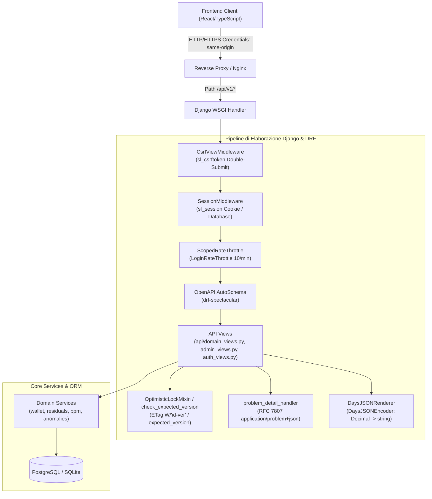
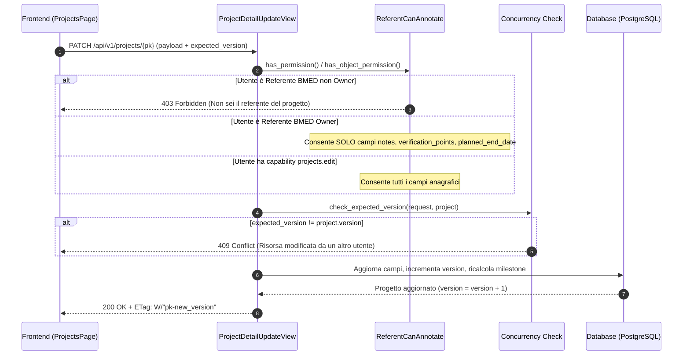
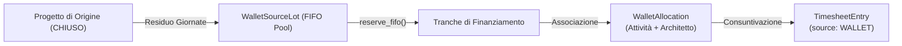

# 07 - Catalogo delle API (Supplier Ledger API v1)

## 1. Introduzione e Obiettivi del Documento

Il presente documento costituisce il **Catalogo Completo delle API** per il progetto **Supplier Ledger**, basato sull'analisi statica esaustiva dell'albero del codice sorgente backend (`backend/api/`, `backend/config/`, `backend/core/`) e del relativo consumer frontend (`frontend/src/`).

Il sistema implementa un'architettura **RESTful** sviluppata con **Django REST Framework 3.15** su **Python 3.12**, con schema OpenAPI 3.0 auto-generato tramite **drf-spectacular**. L'interfaccia API gestisce la tracciabilità delle commesse, il monitoraggio dei consuntivi e l'allocazione del monte giornate ("Wallet"), il canone semestrale Organico Allargato (R4), il motore di controllo anomalie (18 regole contabili) e le pipeline di riconciliazione PPM e import/export dati.

### Riferimenti Incrociati nell'Assessment
- [01_REPOSITORY_INVENTORY.md](01_REPOSITORY_INVENTORY.md): Censimento del repository e inventario componenti
- [02_FUNCTIONAL_DOMAIN_MODEL.md](02_FUNCTIONAL_DOMAIN_MODEL.md): Modello concettuale di dominio
- [03_FUNCTIONAL_CAPABILITY_MAP.md](03_FUNCTIONAL_CAPABILITY_MAP.md): Mappa delle capacità applicative
- [04_WORKFLOW_CATALOG.md](04_WORKFLOW_CATALOG.md): Catalogo dei flussi operativi
- [05_TECHNICAL_ARCHITECTURE.md](05_TECHNICAL_ARCHITECTURE.md): Architettura tecnica e infrastruttura di sistema
- [06_DATA_MODEL.md](06_DATA_MODEL.md): Modello dati relazionale e migrazioni ORM
- [08_BUSINESS_RULES.md](08_BUSINESS_RULES.md): Regole di business e controlli contabili
- [09_SECURITY_AUTHORIZATION.md](09_SECURITY_AUTHORIZATION.md): Modello di sicurezza, RBAC e capabilities

---

## 2. Principi Architetturali e Convenzioni Globali



### 2.1 Autenticazione e Gestione Sessione Stateful
- **Meccanismo**: Session-based nativo Django ([`SessionAuthentication`](file:///c:/Users/gianvito.bleve/OneDrive%20-%20Banca%20Mediolanum%20SPA/Documenti/Progetti/imola/backend/config/settings/base.py#L131-L133)).
- **Cookie di Sessione**: `sl_session`, `HttpOnly=True`, `SameSite=Lax`, durata 8 ore ([`SESSION_COOKIE_AGE = 28800`](file:///c:/Users/gianvito.bleve/OneDrive%20-%20Banca%20Mediolanum%20SPA/Documenti/Progetti/imola/backend/config/settings/base.py#L114-L117)).
- **Protezione CSRF**: Double-submit cookie `sl_csrftoken`, `HttpOnly=False`, `SameSite=Lax` ([`backend/config/settings/base.py`](file:///c:/Users/gianvito.bleve/OneDrive%20-%20Banca%20Mediolanum%20SPA/Documenti/Progetti/imola/backend/config/settings/base.py#L118-L121)). Il client legge il cookie `sl_csrftoken` e lo trasmette nell'intestazione `X-CSRFToken` su tutti i metodi non sicuri (`POST`, `PUT`, `PATCH`, `DELETE`) ([`frontend/src/lib/api.ts#L87-L89`](file:///c:/Users/gianvito.bleve/OneDrive%20-%20Banca%20Mediolanum%20SPA/Documenti/Progetti/imola/frontend/src/lib/api.ts#L87-L89)).
- **Re-login Trasparente e Preservazione Stato**: L'API non effettua redirect o logout distruttivi lato client su scadenza sessione. L'exception handler converte le eccezioni di autenticazione in status `401 Unauthorized` con codice `session_expired` ([`backend/core/exceptions.py#L115-L124`](file:///c:/Users/gianvito.bleve/OneDrive%20-%20Banca%20Mediolanum%20SPA/Documenti/Progetti/imola/backend/core/exceptions.py#L115-L124)). Il frontend intercetta l'errore, solleva l'evento `onSessionExpired` e apre il modale [`SessionExpiredDialog`](file:///c:/Users/gianvito.bleve/OneDrive%20-%20Banca%20Mediolanum%20SPA/Documenti/Progetti/imola/frontend/src/features/auth/SessionExpiredDialog.tsx#L1-L50) senza ricaricare la pagina o cancellare i dati non salvati nel form.
- **Throttling**: [`LoginRateThrottle`](file:///c:/Users/gianvito.bleve/OneDrive%20-%20Banca%20Mediolanum%20SPA/Documenti/Progetti/imola/backend/core/throttles.py#L1-L20) impostato su scope `"login"` con frequenza massima di 10 richieste/minuto ([`backend/config/settings/base.py#L148`](file:///c:/Users/gianvito.bleve/OneDrive%20-%20Banca%20Mediolanum%20SPA/Documenti/Progetti/imola/backend/config/settings/base.py#L148)).

### 2.2 Locking Ottimistico (Concurrency Control)
- **Implementazione**: Modulo [`backend/api/concurrency.py`](file:///c:/Users/gianvito.bleve/OneDrive%20-%20Banca%20Mediolanum%20SPA/Documenti/Progetti/imola/backend/api/concurrency.py#L1-L92) e mixin [`OptimisticLockMixin`](file:///c:/Users/gianvito.bleve/OneDrive%20-%20Banca%20Mediolanum%20SPA/Documenti/Progetti/imola/backend/api/concurrency.py#L38-L92), integrato con `check_expected_version` nelle viste di dettaglio.
- **ETag**: Restituito in formato ETag debole `W/"<id>-<version>"` nell'header di risposta delle operazioni di lettura (`GET`).
- **Precondizioni di Scrittura**: I metodi `PUT`, `PATCH`, `DELETE` richiedono obbligatoriamente l'intestazione HTTP `If-Match: W/"<id>-<version>"` oppure il campo JSON `expected_version` nel payload.
- **Gestione Errori**:
  - Mancanza di versione/ETag: status HTTP `428 Precondition Required` ([`PreconditionRequired`](file:///c:/Users/gianvito.bleve/OneDrive%20-%20Banca%20Mediolanum%20SPA/Documenti/Progetti/imola/backend/core/exceptions.py#L79-L83)).
  - Disallineamento di versione (risorsa modificata concorrentemente): status HTTP `409 Conflict` ([`StaleResource`](file:///c:/Users/gianvito.bleve/OneDrive%20-%20Banca%20Mediolanum%20SPA/Documenti/Progetti/imola/backend/core/exceptions.py#L73-L77)).

### 2.3 Precisione Aritmetica Contabile (Regola D-15)
- **Problematiche del Floating Point**: La rappresentazione IEEE-754 binaria genera errori di arrotondamento (es. `0.1 + 0.2 != 0.3`, consuntivo frazionario `8.6875` troncato).
- **Strategia di Serializzazione Globale**:
  - `REST_FRAMEWORK["COERCE_DECIMAL_TO_STRING"] = True` ([`backend/config/settings/base.py#L146`](file:///c:/Users/gianvito.bleve/OneDrive%20-%20Banca%20Mediolanum%20SPA/Documenti/Progetti/imola/backend/config/settings/base.py#L146)).
  - Renderer custom [`DaysJSONRenderer`](file:///c:/Users/gianvito.bleve/OneDrive%20-%20Banca%20Mediolanum%20SPA/Documenti/Progetti/imola/backend/api/renderers.py#L26-L30) equipaggiato con [`DaysJSONEncoder`](file:///c:/Users/gianvito.bleve/OneDrive%20-%20Banca%20Mediolanum%20SPA/Documenti/Progetti/imola/backend/api/renderers.py#L19-L24): intercetta tutte le istanze `decimal.Decimal` (anche se inserite in dizionari ad-hoc al di fuori dei Serializer DRF) convertendole in stringhe con formattazione a 4 cifre decimali esatte.

### 2.4 Formato Errori Standardizzato RFC 7807 (Problem Details)
- **Content-Type**: `application/problem+json` ([`backend/core/exceptions.py#L15`](file:///c:/Users/gianvito.bleve/OneDrive%20-%20Banca%20Mediolanum%20SPA/Documenti/Progetti/imola/backend/core/exceptions.py#L15)).
- **Struttura del Payload**:
  ```json
  {
    "type": "https://supplier-ledger.local/errors/{code}",
    "title": "Titolo HTTP in Italiano",
    "status": 400,
    "code": "codice-stabile-macchina",
    "detail": "Descrizione dettagliata dell'errore per l'utente.",
    "instance": "/api/v1/projects/{pk}",
    "errors": [
      { "campo": "budget_days", "messaggio": "Il budget deve essere maggiore di zero." }
    ]
  }
  ```
- **Handler**: [`problem_detail_handler`](file:///c:/Users/gianvito.bleve/OneDrive%20-%20Banca%20Mediolanum%20SPA/Documenti/Progetti/imola/backend/core/exceptions.py#L99-L144), registra e normalizza eccezioni Django (`ValidationError`, `Http404`, `PermissionDenied`) e DRF, appiattendo le strutture nidificate tramite `_flatten()`.

### 2.5 Paginazione
- **Paginazione Predefinita**: [`StandardCursorPagination`](file:///c:/Users/gianvito.bleve/OneDrive%20-%20Banca%20Mediolanum%20SPA/Documenti/Progetti/imola/backend/api/pagination.py#L8-L13) basata su cursore su `-created_at`, con `page_size = 50` e `max_page_size = 500`. La paginazione a cursore garantisce stabilità operativa durante scritture concorrenti.
- **Paginazione per Codice**: [`CodeCursorPagination`](file:///c:/Users/gianvito.bleve/OneDrive%20-%20Banca%20Mediolanum%20SPA/Documenti/Progetti/imola/backend/api/pagination.py#L15-L19) con ordinamento su `code`.

---

## 3. Matrice Completa Endpoint → Frontend Consumer → Handler → Servizio → Modello

La tabella seguente censisce la totalità degli endpoint registrati nel router di sistema ([`backend/api/urls.py`](file:///c:/Users/gianvito.bleve/OneDrive%20-%20Banca%20Mediolanum%20SPA/Documenti/Progetti/imola/backend/api/urls.py#L17-L238)) e nella configurazione radice ([`backend/config/urls.py`](file:///c:/Users/gianvito.bleve/OneDrive%20-%20Banca%20Mediolanum%20SPA/Documenti/Progetti/imola/backend/config/urls.py#L8-L12)).

| Metodo | Path Endpoint | Classe Handler (Backend) | Consumer Frontend (Componente / File) | Servizio di Dominio / Helper | Modelli ORM Coinvolti | Stato |
|---|---|---|---|---|---|:---:|
| `GET` | `/health` | [`core.views.health`](file:///c:/Users/gianvito.bleve/OneDrive%20-%20Banca%20Mediolanum%20SPA/Documenti/Progetti/imola/backend/core/views.py#L9-L22) | Reverse Proxy / Docker healthcheck | DB Connection Cursor check | N/A (raw SQL) | IMPLEMENTED |
| `POST` | `/api/v1/auth/login` | [`auth_views.LoginView`](file:///c:/Users/gianvito.bleve/OneDrive%20-%20Banca%20Mediolanum%20SPA/Documenti/Progetti/imola/backend/api/auth_views.py#L50-L77) | `session.signIn` / [`features/auth/session.tsx`](file:///c:/Users/gianvito.bleve/OneDrive%20-%20Banca%20Mediolanum%20SPA/Documenti/Progetti/imola/frontend/src/features/auth/session.tsx#L22) | `get_auth_provider().login()` | `User`, `Group` | IMPLEMENTED |
| `POST` | `/api/v1/auth/logout` | [`auth_views.LogoutView`](file:///c:/Users/gianvito.bleve/OneDrive%20-%20Banca%20Mediolanum%20SPA/Documenti/Progetti/imola/backend/api/auth_views.py#L79-L86) | `session.signOut` / [`features/auth/session.tsx`](file:///c:/Users/gianvito.bleve/OneDrive%20-%20Banca%20Mediolanum%20SPA/Documenti/Progetti/imola/frontend/src/features/auth/session.tsx#L23) | `get_auth_provider().logout()` | `User` | IMPLEMENTED |
| `GET` | `/api/v1/auth/session` | [`auth_views.SessionView`](file:///c:/Users/gianvito.bleve/OneDrive%20-%20Banca%20Mediolanum%20SPA/Documenti/Progetti/imola/backend/api/auth_views.py#L88-L97) | `session.refresh` / [`features/auth/session.tsx`](file:///c:/Users/gianvito.bleve/OneDrive%20-%20Banca%20Mediolanum%20SPA/Documenti/Progetti/imola/frontend/src/features/auth/session.tsx#L36) | `session_payload()`, `capabilities_for()` | `User`, `Group`, `RoleCapabilityOverride` | IMPLEMENTED |
| `GET` | `/api/v1/settings` | [`domain_views.SettingsView`](file:///c:/Users/gianvito.bleve/OneDrive%20-%20Banca%20Mediolanum%20SPA/Documenti/Progetti/imola/backend/api/domain_views.py#L95-L121) | `AdminPage` / [`features/admin/AdminPage.tsx`](file:///c:/Users/gianvito.bleve/OneDrive%20-%20Banca%20Mediolanum%20SPA/Documenti/Progetti/imola/frontend/src/features/admin/AdminPage.tsx#L38) | `current_settings()` | `AppSettings` | IMPLEMENTED |
| `PATCH` | `/api/v1/settings` | [`domain_views.SettingsView`](file:///c:/Users/gianvito.bleve/OneDrive%20-%20Banca%20Mediolanum%20SPA/Documenti/Progetti/imola/backend/api/domain_views.py#L123-L154) | `AdminPage` / [`features/admin/AdminPage.tsx`](file:///c:/Users/gianvito.bleve/OneDrive%20-%20Banca%20Mediolanum%20SPA/Documenti/Progetti/imola/frontend/src/features/admin/AdminPage.tsx#L61) | `current_settings()`, optimistic lock | `AppSettings` | IMPLEMENTED |
| `GET` | `/api/v1/cost-analysis` | [`domain_views.CostAnalysisView`](file:///c:/Users/gianvito.bleve/OneDrive%20-%20Banca%20Mediolanum%20SPA/Documenti/Progetti/imola/backend/api/domain_views.py#L156-L183) | `CostAnalysisPage` / [`features/cost-analysis/CostAnalysisPage.tsx`](file:///c:/Users/gianvito.bleve/OneDrive%20-%20Banca%20Mediolanum%20SPA/Documenti/Progetti/imola/frontend/src/features/cost-analysis/CostAnalysisPage.tsx#L35) | `build_cost_analysis()` | `TimesheetEntry`, `AppSettings` | IMPLEMENTED |
| `GET` | `/api/v1/dashboard` | [`domain_views.DashboardView`](file:///c:/Users/gianvito.bleve/OneDrive%20-%20Banca%20Mediolanum%20SPA/Documenti/Progetti/imola/backend/api/domain_views.py#L185-L195) | `DashboardPage` / [`features/dashboard/DashboardPage.tsx`](file:///c:/Users/gianvito.bleve/OneDrive%20-%20Banca%20Mediolanum%20SPA/Documenti/Progetti/imola/frontend/src/features/dashboard/DashboardPage.tsx#L38) | `dashboard_summary()` | `Project`, `BillingMilestone`, `WalletAllocation`, `Canone` | IMPLEMENTED |
| `GET` | `/api/v1/search` | [`domain_views.CommandSearchView`](file:///c:/Users/gianvito.bleve/OneDrive%20-%20Banca%20Mediolanum%20SPA/Documenti/Progetti/imola/backend/api/domain_views.py#L1399-L1453) | `CommandPalette` / [`components/CommandPalette.tsx`](file:///c:/Users/gianvito.bleve/OneDrive%20-%20Banca%20Mediolanum%20SPA/Documenti/Progetti/imola/frontend/src/components/CommandPalette.tsx#L45) | `search_all()` | `Project`, `Person`, `Canone`, `WalletAllocation` | IMPLEMENTED |
| `GET` | `/api/v1/projects` | [`domain_views.ProjectListCreateView`](file:///c:/Users/gianvito.bleve/OneDrive%20-%20Banca%20Mediolanum%20SPA/Documenti/Progetti/imola/backend/api/domain_views.py#L197-L222) | `ProjectsPage` (fallback / list) | ORM Queryset `select_related` | `Project`, `Person` | IMPLEMENTED |
| `POST` | `/api/v1/projects` | [`domain_views.ProjectListCreateView`](file:///c:/Users/gianvito.bleve/OneDrive%20-%20Banca%20Mediolanum%20SPA/Documenti/Progetti/imola/backend/api/domain_views.py#L224-L254) | `NewProjectDialog` / [`features/projects/NewProjectDialog.tsx`](file:///c:/Users/gianvito.bleve/OneDrive%20-%20Banca%20Mediolanum%20SPA/Documenti/Progetti/imola/frontend/src/features/projects/NewProjectDialog.tsx#L45) | `sync_project_billing_schedule()` | `Project`, `BillingMilestone` | IMPLEMENTED |
| `GET` | `/api/v1/projects/options` | [`domain_views.ProjectFormOptionsView`](file:///c:/Users/gianvito.bleve/OneDrive%20-%20Banca%20Mediolanum%20SPA/Documenti/Progetti/imola/backend/api/domain_views.py#L1695-L1731) | `EditProjectDialog`, `NewProjectDialog` | Enum choices & active persons | `Organization`, `Person`, Enums | IMPLEMENTED |
| `GET` | `/api/v1/projects/balances` | [`domain_views.ProjectBalancesView`](file:///c:/Users/gianvito.bleve/OneDrive%20-%20Banca%20Mediolanum%20SPA/Documenti/Progetti/imola/backend/api/domain_views.py#L256-L330) | `ProjectsPage`, `ProjectDetailPage` | `project_balance_qs()`, `residual_validity()` | `Project`, `TimesheetEntry`, `WalletAllocation` | IMPLEMENTED |
| `GET` | `/api/v1/projects/{pk}` | [`domain_views.ProjectDetailUpdateView`](file:///c:/Users/gianvito.bleve/OneDrive%20-%20Banca%20Mediolanum%20SPA/Documenti/Progetti/imola/backend/api/domain_views.py#L1609-L1633) | `EditProjectDialog` / [`features/projects/EditProjectDialog.tsx`](file:///c:/Users/gianvito.bleve/OneDrive%20-%20Banca%20Mediolanum%20SPA/Documenti/Progetti/imola/frontend/src/features/projects/EditProjectDialog.tsx#L40) | `project_detail_payload()` | `Project`, `Person`, `BillingMilestone` | IMPLEMENTED |
| `PATCH` | `/api/v1/projects/{pk}` | [`domain_views.ProjectDetailUpdateView`](file:///c:/Users/gianvito.bleve/OneDrive%20-%20Banca%20Mediolanum%20SPA/Documenti/Progetti/imola/backend/api/domain_views.py#L1635-L1675) | `EditProjectDialog`, `ProjectDetailPage` | `ProjectUpdateSerializer`, `sync_project_billing_schedule()` | `Project`, `BillingMilestone` | IMPLEMENTED |
| `DELETE` | `/api/v1/projects/{pk}` | [`domain_views.ProjectDetailUpdateView`](file:///c:/Users/gianvito.bleve/OneDrive%20-%20Banca%20Mediolanum%20SPA/Documenti/Progetti/imola/backend/api/domain_views.py#L1677-L1693) | `EditProjectDialog` | Blocco se ci sono consuntivi/allocazioni | `Project`, `TimesheetEntry`, `WalletAllocation` | IMPLEMENTED |
| `POST` | `/api/v1/projects/{pk}/confirm-review` | [`domain_views.ProjectConfirmReviewView`](file:///c:/Users/gianvito.bleve/OneDrive%20-%20Banca%20Mediolanum%20SPA/Documenti/Progetti/imola/backend/api/domain_views.py#L1733-L1765) | `ReviewQueuePage` / [`features/review/ReviewQueuePage.tsx`](file:///c:/Users/gianvito.bleve/OneDrive%20-%20Banca%20Mediolanum%20SPA/Documenti/Progetti/imola/frontend/src/features/review/ReviewQueuePage.tsx#L55) | Risoluzione automatica anomalia `CHK_CLOSED_NO_DATE` | `Project`, `Anomaly` | IMPLEMENTED |
| `POST` | `/api/v1/projects/{pk}/validate-closure` | [`domain_views.ProjectValidateClosureView`](file:///c:/Users/gianvito.bleve/OneDrive%20-%20Banca%20Mediolanum%20SPA/Documenti/Progetti/imola/backend/api/domain_views.py#L1767-L1815) | `ProjectsPage` / [`features/projects/ProjectsPage.tsx`](file:///c:/Users/gianvito.bleve/OneDrive%20-%20Banca%20Mediolanum%20SPA/Documenti/Progetti/imola/frontend/src/features/projects/ProjectsPage.tsx#L125) | `project_closure_ready()`, transizione a `CHIUSO` | `Project`, `WalletAllocation`, `WalletSourceLot` | IMPLEMENTED |
| `POST` | `/api/v1/projects/{pk}/release-to-wallet` | [`domain_views.ReleaseProjectToWalletView`](file:///c:/Users/gianvito.bleve/OneDrive%20-%20Banca%20Mediolanum%20SPA/Documenti/Progetti/imola/backend/api/domain_views.py#L682-L698) | Nessun consumer attivo (chiamata legacy) | Restituisce HTTP 409 fisso (regola deprecata) | N/A | DEPRECATED (409) |
| `GET` | `/api/v1/projects/{pk}/ledger` | [`domain_views.ProjectLedgerView`](file:///c:/Users/gianvito.bleve/OneDrive%20-%20Banca%20Mediolanum%20SPA/Documenti/Progetti/imola/backend/api/domain_views.py#L332-L400) | `ProjectDetailPage` / [`features/projects/ProjectDetailPage.tsx`](file:///c:/Users/gianvito.bleve/OneDrive%20-%20Banca%20Mediolanum%20SPA/Documenti/Progetti/imola/frontend/src/features/projects/ProjectDetailPage.tsx#L70) | Timesheet estratti + Wallet allocations | `Project`, `TimesheetEntry`, `WalletAllocation` | IMPLEMENTED |
| `POST` | `/api/v1/projects/{pk}/ledger` | [`domain_views.ProjectLedgerView`](file:///c:/Users/gianvito.bleve/OneDrive%20-%20Banca%20Mediolanum%20SPA/Documenti/Progetti/imola/backend/api/domain_views.py#L402-L459) | `ProjectDetailPage` | Creazione consuntivo manuale diretto | `TimesheetEntry`, `Project` | IMPLEMENTED |
| `PATCH` | `/api/v1/projects/{pk}/ledger/{entry_pk}` | [`domain_views.ProjectTimesheetDetailView`](file:///c:/Users/gianvito.bleve/OneDrive%20-%20Banca%20Mediolanum%20SPA/Documenti/Progetti/imola/backend/api/domain_views.py#L461-L525) | `ProjectDetailPage` | Rettifica manuale (crea storno + nuovo entry) | `TimesheetEntry` | IMPLEMENTED |
| `DELETE` | `/api/v1/projects/{pk}/ledger/{entry_pk}` | [`domain_views.ProjectTimesheetDetailView`](file:///c:/Users/gianvito.bleve/OneDrive%20-%20Banca%20Mediolanum%20SPA/Documenti/Progetti/imola/backend/api/domain_views.py#L527-L548) | `ProjectDetailPage` | Storno compensativo append-only | `TimesheetEntry` | IMPLEMENTED |
| `GET` | `/api/v1/wallet/{year}/balance` | [`domain_views.WalletBalanceView`](file:///c:/Users/gianvito.bleve/OneDrive%20-%20Banca%20Mediolanum%20SPA/Documenti/Progetti/imola/backend/api/domain_views.py#L669-L680) | `WalletPage`, `DashboardPage` | `wallet_year_balance()` | `WalletYear`, `WalletSourceLot`, `WalletAllocation` | IMPLEMENTED |
| `GET` | `/api/v1/wallet/{year}/flow` | [`domain_views.WalletFlowView`](file:///c:/Users/gianvito.bleve/OneDrive%20-%20Banca%20Mediolanum%20SPA/Documenti/Progetti/imola/backend/api/domain_views.py#L700-L705) | `WalletPage` / [`features/wallet/WalletPage.tsx`](file:///c:/Users/gianvito.bleve/OneDrive%20-%20Banca%20Mediolanum%20SPA/Documenti/Progetti/imola/frontend/src/features/wallet/WalletPage.tsx#L40) | `wallet_flow()` FIFO source allocation | `WalletAllocation`, `WalletSourceLot` | IMPLEMENTED |
| `GET` | `/api/v1/wallet/{year}/assignees` | [`domain_views.WalletAssigneeSummaryView`](file:///c:/Users/gianvito.bleve/OneDrive%20-%20Banca%20Mediolanum%20SPA/Documenti/Progetti/imola/backend/api/domain_views.py#L707-L712) | `WalletPage` | `wallet_by_assignee()` | `WalletAllocation`, `Person` | IMPLEMENTED |
| `POST` | `/api/v1/allocations` | [`domain_views.WalletAllocationCreateView`](file:///c:/Users/gianvito.bleve/OneDrive%20-%20Banca%20Mediolanum%20SPA/Documenti/Progetti/imola/backend/api/domain_views.py#L714-L863) | `NewAllocationDialog` / [`features/wallet/NewAllocationDialog.tsx`](file:///c:/Users/gianvito.bleve/OneDrive%20-%20Banca%20Mediolanum%20SPA/Documenti/Progetti/imola/frontend/src/features/wallet/NewAllocationDialog.tsx#L65) | `reserve_fifo()` | `WalletAllocation`, `WalletActivity`, `WalletSourceLot` | IMPLEMENTED |
| `POST` | `/api/v1/wallet/allocations` | [`domain_views.WalletAllocationCreateView`](file:///c:/Users/gianvito.bleve/OneDrive%20-%20Banca%20Mediolanum%20SPA/Documenti/Progetti/imola/backend/api/domain_views.py#L714-L863) | Alias di routing | Stesso handler | `WalletAllocation` | IMPLEMENTED |
| `GET` | `/api/v1/allocations/{pk}` | [`domain_views.WalletAllocationDetailUpdateView`](file:///c:/Users/gianvito.bleve/OneDrive%20-%20Banca%20Mediolanum%20SPA/Documenti/Progetti/imola/backend/api/domain_views.py#L2107-L2158) | `EditAllocationDialog` (alias) | Dettaglio quota, consumato e residuo | `WalletAllocation`, `TimesheetEntry` | IMPLEMENTED |
| `GET` | `/api/v1/wallet/allocations/{pk}` | [`domain_views.WalletAllocationDetailUpdateView`](file:///c:/Users/gianvito.bleve/OneDrive%20-%20Banca%20Mediolanum%20SPA/Documenti/Progetti/imola/backend/api/domain_views.py#L2107-L2158) | `EditAllocationDialog` / [`features/wallet/EditAllocationDialog.tsx`](file:///c:/Users/gianvito.bleve/OneDrive%20-%20Banca%20Mediolanum%20SPA/Documenti/Progetti/imola/frontend/src/features/wallet/EditAllocationDialog.tsx#L45) | Dettaglio quota | `WalletAllocation` | IMPLEMENTED |
| `PATCH` | `/api/v1/allocations/{pk}` | [`domain_views.WalletAllocationDetailUpdateView`](file:///c:/Users/gianvito.bleve/OneDrive%20-%20Banca%20Mediolanum%20SPA/Documenti/Progetti/imola/backend/api/domain_views.py#L2160-L2200) | `EditAllocationDialog` (alias) | `update_wallet_allocation()` | `WalletAllocation` | IMPLEMENTED |
| `PATCH` | `/api/v1/wallet/allocations/{pk}` | [`domain_views.WalletAllocationDetailUpdateView`](file:///c:/Users/gianvito.bleve/OneDrive%20-%20Banca%20Mediolanum%20SPA/Documenti/Progetti/imola/backend/api/domain_views.py#L2160-L2200) | `EditAllocationDialog` | `update_wallet_allocation()`, check version | `WalletAllocation` | IMPLEMENTED |
| `DELETE` | `/api/v1/allocations/{pk}` | [`domain_views.WalletAllocationDetailUpdateView`](file:///c:/Users/gianvito.bleve/OneDrive%20-%20Banca%20Mediolanum%20SPA/Documenti/Progetti/imola/backend/api/domain_views.py#L2202-L2237) | `EditAllocationDialog` (alias) | Eliminazione allocazione (se non consumata) | `WalletAllocation` | IMPLEMENTED |
| `DELETE` | `/api/v1/wallet/allocations/{pk}` | [`domain_views.WalletAllocationDetailUpdateView`](file:///c:/Users/gianvito.bleve/OneDrive%20-%20Banca%20Mediolanum%20SPA/Documenti/Progetti/imola/backend/api/domain_views.py#L2202-L2237) | `EditAllocationDialog` | Controllo consumi e rimozione | `WalletAllocation` | IMPLEMENTED |
| `POST` | `/api/v1/allocations/{pk}/adjust` | [`domain_views.WalletAllocationAdjustView`](file:///c:/Users/gianvito.bleve/OneDrive%20-%20Banca%20Mediolanum%20SPA/Documenti/Progetti/imola/backend/api/domain_views.py#L2239-L2254) | Chiamata amministrativa di rettifica | `update_wallet_allocation(enforce_version=False)` | `WalletAllocation` | IMPLEMENTED |
| `GET` | `/api/v1/allocations/options` | [`domain_views.WalletAllocationOptionsView`](file:///c:/Users/gianvito.bleve/OneDrive%20-%20Banca%20Mediolanum%20SPA/Documenti/Progetti/imola/backend/api/domain_views.py#L865-L965) | `NewAllocationDialog` (alias) | Fonti disponibili, architetti, attività | `Project`, `Person`, `WalletActivity` | IMPLEMENTED |
| `GET` | `/api/v1/wallet/allocation-options` | [`domain_views.WalletAllocationOptionsView`](file:///c:/Users/gianvito.bleve/OneDrive%20-%20Banca%20Mediolanum%20SPA/Documenti/Progetti/imola/backend/api/domain_views.py#L865-L965) | `NewAllocationDialog`, `EditAllocationDialog` | Fonti disponibili con residuo calcolato | `Project`, `Person`, `WalletActivity` | IMPLEMENTED |
| `GET` | `/api/v1/canoni` | [`domain_views.CanoneListView`](file:///c:/Users/gianvito.bleve/OneDrive%20-%20Banca%20Mediolanum%20SPA/Documenti/Progetti/imola/backend/api/domain_views.py#L1041-L1085) | `CanonePage` / [`features/canone/CanonePage.tsx`](file:///c:/Users/gianvito.bleve/OneDrive%20-%20Banca%20Mediolanum%20SPA/Documenti/Progetti/imola/frontend/src/features/canone/CanonePage.tsx#L55) | `_canone_queryset()` | `Canone` | IMPLEMENTED |
| `POST` | `/api/v1/canoni` | [`domain_views.CanoneListView`](file:///c:/Users/gianvito.bleve/OneDrive%20-%20Banca%20Mediolanum%20SPA/Documenti/Progetti/imola/backend/api/domain_views.py#L1087-L1131) | `CanonePage` | `CanoneWriteSerializer` | `Canone` | IMPLEMENTED |
| `GET` | `/api/v1/canoni/{pk}` | [`domain_views.CanoneDetailView`](file:///c:/Users/gianvito.bleve/OneDrive%20-%20Banca%20Mediolanum%20SPA/Documenti/Progetti/imola/backend/api/domain_views.py#L1133-L1155) | `CanonePage` | `_canone_detail(office, search)` | `Canone`, `CanoneSubactivity` | IMPLEMENTED |
| `PATCH` | `/api/v1/canoni/{pk}` | [`domain_views.CanoneDetailView`](file:///c:/Users/gianvito.bleve/OneDrive%20-%20Banca%20Mediolanum%20SPA/Documenti/Progetti/imola/backend/api/domain_views.py#L1157-L1200) | `CanonePage` | `CanoneWriteSerializer`, check version | `Canone` | IMPLEMENTED |
| `DELETE` | `/api/v1/canoni/{pk}` | [`domain_views.CanoneDetailView`](file:///c:/Users/gianvito.bleve/OneDrive%20-%20Banca%20Mediolanum%20SPA/Documenti/Progetti/imola/backend/api/domain_views.py#L1202-L1249) | `CanonePage` | Blocco se ci sono consuntivi o riserve | `Canone`, `CanoneSubactivity` | IMPLEMENTED |
| `POST` | `/api/v1/canoni/{pk}/subactivities` | [`domain_views.CanoneSubactivityListView`](file:///c:/Users/gianvito.bleve/OneDrive%20-%20Banca%20Mediolanum%20SPA/Documenti/Progetti/imola/backend/api/domain_views.py#L1251-L1262) | `CanonePage` | `CanoneSubactivityWriteSerializer` | `CanoneSubactivity`, `Canone` | IMPLEMENTED |
| `PATCH` | `/api/v1/canoni/{pk}/subactivities/{sub_pk}` | [`domain_views.CanoneSubactivityDetailView`](file:///c:/Users/gianvito.bleve/OneDrive%20-%20Banca%20Mediolanum%20SPA/Documenti/Progetti/imola/backend/api/domain_views.py#L1264-L1282) | `CanonePage` | `CanoneSubactivityWriteSerializer` | `CanoneSubactivity` | IMPLEMENTED |
| `DELETE` | `/api/v1/canoni/{pk}/subactivities/{sub_pk}` | [`domain_views.CanoneSubactivityDetailView`](file:///c:/Users/gianvito.bleve/OneDrive%20-%20Banca%20Mediolanum%20SPA/Documenti/Progetti/imola/backend/api/domain_views.py#L1284-L1295) | `CanonePage` | Blocco se sono presenti consuntivi | `CanoneSubactivity`, `TimesheetEntry` | IMPLEMENTED |
| `POST` | `/api/v1/canoni/{pk}/subactivities/{sub_pk}/timesheets` | [`domain_views.CanoneSubactivityTimesheetListView`](file:///c:/Users/gianvito.bleve/OneDrive%20-%20Banca%20Mediolanum%20SPA/Documenti/Progetti/imola/backend/api/domain_views.py#L1297-L1339) | `CanonePage` | Inserimento consuntivo su sotto-attività | `TimesheetEntry`, `CanoneSubactivity` | IMPLEMENTED |
| `PATCH` | `/api/v1/canoni/{pk}/subactivities/{sub_pk}/timesheets/{entry_pk}` | [`domain_views.CanoneSubactivityTimesheetDetailView`](file:///c:/Users/gianvito.bleve/OneDrive%20-%20Banca%20Mediolanum%20SPA/Documenti/Progetti/imola/backend/api/domain_views.py#L1341-L1385) | `CanonePage` | Storno e ri-creazione consuntivo | `TimesheetEntry` | IMPLEMENTED |
| `DELETE` | `/api/v1/canoni/{pk}/subactivities/{sub_pk}/timesheets/{entry_pk}` | [`domain_views.CanoneSubactivityTimesheetDetailView`](file:///c:/Users/gianvito.bleve/OneDrive%20-%20Banca%20Mediolanum%20SPA/Documenti/Progetti/imola/backend/api/domain_views.py#L1387-L1397) | `CanonePage` | Storno consuntivo Organico Allargato | `TimesheetEntry` | IMPLEMENTED |
| `GET` | `/api/v1/canoni/{pk}/status` | [`domain_views.CanoneStatusView`](file:///c:/Users/gianvito.bleve/OneDrive%20-%20Banca%20Mediolanum%20SPA/Documenti/Progetti/imola/backend/api/domain_views.py#L1498-L1507) | Dashboard / KPI Canone | `canone_status()`, `canone_burndown()` | `Canone`, `TimesheetEntry` | IMPLEMENTED |
| `GET` | `/api/v1/anomalies` | [`domain_views.AnomalyListView`](file:///c:/Users/gianvito.bleve/OneDrive%20-%20Banca%20Mediolanum%20SPA/Documenti/Progetti/imola/backend/api/domain_views.py#L586-L622) | `AnomaliesPage` / [`features/anomalies/AnomaliesPage.tsx`](file:///c:/Users/gianvito.bleve/OneDrive%20-%20Banca%20Mediolanum%20SPA/Documenti/Progetti/imola/frontend/src/features/anomalies/AnomaliesPage.tsx#L40) | Queryset filtrato per stato, severità, regola | `Anomaly` | IMPLEMENTED |
| `POST` | `/api/v1/anomalies/{pk}/{action}` | [`domain_views.AnomalyActionView`](file:///c:/Users/gianvito.bleve/OneDrive%20-%20Banca%20Mediolanum%20SPA/Documenti/Progetti/imola/backend/api/domain_views.py#L645-L667) | `AnomaliesPage` | Azioni: `take`, `resolve`, `accept` | `Anomaly` | IMPLEMENTED |
| `POST` | `/api/v1/checks/run` | [`domain_views.ChecksRunView`](file:///c:/Users/gianvito.bleve/OneDrive%20-%20Banca%20Mediolanum%20SPA/Documenti/Progetti/imola/backend/api/domain_views.py#L624-L643) | `AnomaliesPage` | `run_checks()` (18 regole contabili) | `Anomaly`, tutti i modelli di dominio | IMPLEMENTED |
| `GET` | `/api/v1/reconciliation/latest` | [`domain_views.ReconciliationView`](file:///c:/Users/gianvito.bleve/OneDrive%20-%20Banca%20Mediolanum%20SPA/Documenti/Progetti/imola/backend/api/domain_views.py#L1509-L1527) | `ReconciliationPage`, `DashboardPage` | `reconcile()`, `reconciliation_summary()` | `PpmSnapshotRow`, `TimesheetEntry` | IMPLEMENTED |
| `GET` | `/api/v1/review-queue` | [`domain_views.ProjectReviewQueueView`](file:///c:/Users/gianvito.bleve/OneDrive%20-%20Banca%20Mediolanum%20SPA/Documenti/Progetti/imola/backend/api/domain_views.py#L550-L584) | `ReviewQueuePage` / [`features/review/ReviewQueuePage.tsx`](file:///c:/Users/gianvito.bleve/OneDrive%20-%20Banca%20Mediolanum%20SPA/Documenti/Progetti/imola/frontend/src/features/review/ReviewQueuePage.tsx#L35) | `review_queue_projects()` | `Project` | IMPLEMENTED |
| `GET` | `/api/v1/audit/{entity_type}/{pk}` | [`domain_views.AuditHistoryView`](file:///c:/Users/gianvito.bleve/OneDrive%20-%20Banca%20Mediolanum%20SPA/Documenti/Progetti/imola/backend/api/domain_views.py#L2256-L2302) | `ProjectDetailPage` | django-simple-history records | `HistoricalProject`, `HistoricalWalletAllocation`, etc. | IMPLEMENTED |
| `POST` | `/api/v1/imports/ppm` | [`domain_views.PpmImportUploadView`](file:///c:/Users/gianvito.bleve/OneDrive%20-%20Banca%20Mediolanum%20SPA/Documenti/Progetti/imola/backend/api/domain_views.py#L2304-L2349) | `AdminPage` (fornitore dry-run/apply) | `apply_ppm()`, `dry_run_ppm()` | `ImportBatch`, `PpmSnapshot`, `PpmSnapshotRow` | IMPLEMENTED |
| `POST` | `/api/v1/admin/imports/seed` | [`admin_views.SeedImportView`](file:///c:/Users/gianvito.bleve/OneDrive%20-%20Banca%20Mediolanum%20SPA/Documenti/Progetti/imola/backend/api/admin_views.py#L55-L91) | `AdminPage` / [`features/admin/AdminPage.tsx`](file:///c:/Users/gianvito.bleve/OneDrive%20-%20Banca%20Mediolanum%20SPA/Documenti/Progetti/imola/frontend/src/features/admin/AdminPage.tsx#L105) | `apply_seed()`, `dry_run_seed()` | `ImportBatch`, `WorkbookDatasetSnapshot`, etc. | IMPLEMENTED |
| `POST` | `/api/v1/admin/imports/ppm` | [`admin_views.PpmImportView`](file:///c:/Users/gianvito.bleve/OneDrive%20-%20Banca%20Mediolanum%20SPA/Documenti/Progetti/imola/backend/api/admin_views.py#L93-L131) | `AdminPage` | `apply_ppm()`, `dry_run_ppm()` | `ImportBatch`, `PpmSnapshot` | IMPLEMENTED |
| `GET` | `/api/v1/admin/imports` | [`admin_views.ImportHistoryView`](file:///c:/Users/gianvito.bleve/OneDrive%20-%20Banca%20Mediolanum%20SPA/Documenti/Progetti/imola/backend/api/admin_views.py#L133-L153) | `AdminPage` | Ultimi 100 batch d'importazione | `ImportBatch` | IMPLEMENTED |
| `GET` | `/api/v1/admin/imports/{batch_id}/datasets` | [`admin_views.WorkbookDatasetListView`](file:///c:/Users/gianvito.bleve/OneDrive%20-%20Banca%20Mediolanum%20SPA/Documenti/Progetti/imola/backend/api/admin_views.py#L155-L182) | `WorkbookExplorer` in `AdminPage` | Snapshot fogli e range importati | `WorkbookDatasetSnapshot`, `ImportBatch` | IMPLEMENTED |
| `GET` | `/api/v1/admin/imports/{batch_id}/datasets/{dataset_pk}` | [`admin_views.WorkbookDatasetDetailView`](file:///c:/Users/gianvito.bleve/OneDrive%20-%20Banca%20Mediolanum%20SPA/Documenti/Progetti/imola/backend/api/admin_views.py#L184-L203) | `WorkbookExplorer` in `AdminPage` | Matrice righe/colonne snapshot | `WorkbookDatasetSnapshot` | IMPLEMENTED |
| `GET` | `/api/v1/export/json` | [`domain_views.ExportJsonView`](file:///c:/Users/gianvito.bleve/OneDrive%20-%20Banca%20Mediolanum%20SPA/Documenti/Progetti/imola/backend/api/domain_views.py#L1455-L1466) | `AdminPage` (download diretto `<a href>`) | `export_json_bytes()` | Dump globale entità di dominio | IMPLEMENTED |
| `GET` | `/api/v1/export/excel` | [`domain_views.ExportExcelView`](file:///c:/Users/gianvito.bleve/OneDrive%20-%20Banca%20Mediolanum%20SPA/Documenti/Progetti/imola/backend/api/domain_views.py#L1485-L1496) | `AdminPage` (download diretto `<a href>`) | `export_excel_bytes()` (5 fogli) | Progetti, Wallet, Canoni, Timesheet, Anomalie | IMPLEMENTED |
| `GET` | `/api/v1/export/csv/{entity}` | [`domain_views.ExportCsvView`](file:///c:/Users/gianvito.bleve/OneDrive%20-%20Banca%20Mediolanum%20SPA/Documenti/Progetti/imola/backend/api/domain_views.py#L1468-L1483) | Utilizzo script / download manuale | `export_csv_bytes(entity)` | Singola entità di dominio | IMPLEMENTED |
| `GET` | `/api/v1/admin/users` | [`admin_views.UserRolesView`](file:///c:/Users/gianvito.bleve/OneDrive%20-%20Banca%20Mediolanum%20SPA/Documenti/Progetti/imola/backend/api/admin_views.py#L302-L315) | `UsersPanel` in `AdminPage` | Lista utenti e ruoli associati | `User`, `Group` | IMPLEMENTED |
| `POST` | `/api/v1/admin/users` | [`admin_views.UserRolesView`](file:///c:/Users/gianvito.bleve/OneDrive%20-%20Banca%20Mediolanum%20SPA/Documenti/Progetti/imola/backend/api/admin_views.py#L317-L335) | `UserDialog` in `AdminPage` | `UserWriteSerializer`, audit event | `User`, `Group`, `AdminAuditEvent` | IMPLEMENTED |
| `PATCH` | `/api/v1/admin/users/{pk}` | [`admin_views.UserDetailView`](file:///c:/Users/gianvito.bleve/OneDrive%20-%20Banca%20Mediolanum%20SPA/Documenti/Progetti/imola/backend/api/admin_views.py#L337-L373) | `UserDialog` in `AdminPage` | Controllo anti-lockout ultimo admin | `User`, `Group`, `AdminAuditEvent` | IMPLEMENTED |
| `DELETE` | `/api/v1/admin/users/{pk}` | [`admin_views.UserDetailView`](file:///c:/Users/gianvito.bleve/OneDrive%20-%20Banca%20Mediolanum%20SPA/Documenti/Progetti/imola/backend/api/admin_views.py#L375-L398) | `AdminPage` | Controllo riferimenti storici di dominio | `User`, `AdminAuditEvent` | IMPLEMENTED |
| `POST` | `/api/v1/admin/users/{pk}/password` | [`admin_views.UserPasswordView`](file:///c:/Users/gianvito.bleve/OneDrive%20-%20Banca%20Mediolanum%20SPA/Documenti/Progetti/imola/backend/api/admin_views.py#L400-L413) | `PasswordDialog` in `AdminPage` | `PasswordSerializer`, Django validators | `User`, `AdminAuditEvent` | IMPLEMENTED |
| `GET` | `/api/v1/admin/referents` | [`admin_views.ReferentListCreateView`](file:///c:/Users/gianvito.bleve/OneDrive%20-%20Banca%20Mediolanum%20SPA/Documenti/Progetti/imola/backend/api/admin_views.py#L449-L457) | `ReferentsPanel` in `AdminPage` | Lista persone con conteggio progetti | `Person`, `Organization`, `Project` | IMPLEMENTED |
| `POST` | `/api/v1/admin/referents` | [`admin_views.ReferentListCreateView`](file:///c:/Users/gianvito.bleve/OneDrive%20-%20Banca%20Mediolanum%20SPA/Documenti/Progetti/imola/backend/api/admin_views.py#L459-L480) | `ReferentsPanel` in `AdminPage` | Normalizzazione chiave fonetica | `Person`, `Organization`, `AdminAuditEvent` | IMPLEMENTED |
| `PATCH` | `/api/v1/admin/referents/{pk}` | [`admin_views.ReferentDetailView`](file:///c:/Users/gianvito.bleve/OneDrive%20-%20Banca%20Mediolanum%20SPA/Documenti/Progetti/imola/backend/api/admin_views.py#L482-L523) | `ReferentsPanel` in `AdminPage` | Modifica dati anagrafici referente | `Person`, `AdminAuditEvent` | IMPLEMENTED |
| `DELETE` | `/api/v1/admin/referents/{pk}` | [`admin_views.ReferentDetailView`](file:///c:/Users/gianvito.bleve/OneDrive%20-%20Banca%20Mediolanum%20SPA/Documenti/Progetti/imola/backend/api/admin_views.py#L525-L534) | `ReferentsPanel` in `AdminPage` | Soft-delete (`is_active = False`) | `Person`, `AdminAuditEvent` | IMPLEMENTED |
| `GET` | `/api/v1/admin/roles/capabilities` | [`admin_views.RoleCapabilitiesView`](file:///c:/Users/gianvito.bleve/OneDrive%20-%20Banca%20Mediolanum%20SPA/Documenti/Progetti/imola/backend/api/admin_views.py#L536-L554) | `RoleCapabilitiesPanel` in `AdminPage` | Matrice permessi e capability riservate | `RoleCapabilityOverride`, Enums | IMPLEMENTED |
| `PUT` | `/api/v1/admin/roles/capabilities` | [`admin_views.RoleCapabilitiesView`](file:///c:/Users/gianvito.bleve/OneDrive%20-%20Banca%20Mediolanum%20SPA/Documenti/Progetti/imola/backend/api/admin_views.py#L556-L588) | `RoleCapabilitiesPanel` in `AdminPage` | Override dinamico permessi ruoli | `RoleCapabilityOverride`, `AdminAuditEvent` | IMPLEMENTED |
| `GET` | `/api/v1/admin/reset-data` | [`admin_views.AdminDataResetView`](file:///c:/Users/gianvito.bleve/OneDrive%20-%20Banca%20Mediolanum%20SPA/Documenti/Progetti/imola/backend/api/admin_views.py#L590-L650) | `DeleteDatabaseDialog` / [`features/admin/DeleteDatabaseDialog.tsx`](file:///c:/Users/gianvito.bleve/OneDrive%20-%20Banca%20Mediolanum%20SPA/Documenti/Progetti/imola/frontend/src/features/admin/DeleteDatabaseDialog.tsx#L29) | Preview record e token temporizzato | Conteggio tabelle operative | IMPLEMENTED |
| `POST` | `/api/v1/admin/reset-data` | [`admin_views.AdminDataResetView`](file:///c:/Users/gianvito.bleve/OneDrive%20-%20Banca%20Mediolanum%20SPA/Documenti/Progetti/imola/backend/api/admin_views.py#L651-L752) | `DeleteDatabaseDialog` / [`features/admin/DeleteDatabaseDialog.tsx`](file:///c:/Users/gianvito.bleve/OneDrive%20-%20Banca%20Mediolanum%20SPA/Documenti/Progetti/imola/frontend/src/features/admin/DeleteDatabaseDialog.tsx#L39) | `allow_ledger_mutation()`, purge dati | Tutte le tabelle di dominio | IMPLEMENTED |
| `GET` | `/api/v1/admin/database/backup` | [`database_backup.DatabaseBackupView`](file:///c:/Users/gianvito.bleve/OneDrive%20-%20Banca%20Mediolanum%20SPA/Documenti/Progetti/imola/backend/api/database_backup.py#L87-L111) | `DatabaseBackupPanel` (`<a href>`) | `pg_dump` binario custom | Database PostgreSQL completo | IMPLEMENTED |
| `POST` | `/api/v1/admin/database/restore` | [`database_backup.DatabaseRestoreView`](file:///c:/Users/gianvito.bleve/OneDrive%20-%20Banca%20Mediolanum%20SPA/Documenti/Progetti/imola/backend/api/database_backup.py#L113-L150) | `DatabaseBackupPanel` in `AdminPage` | Backup preventivo automatico + `psql` restore | Database PostgreSQL completo | IMPLEMENTED |
| `GET` | `/api/v1/schema` | `SpectacularAPIView` | Swagger UI / Strumenti di sviluppo | drf-spectacular schema generator | Schema OpenAPI 3.0 | IMPLEMENTED |
| `GET` | `/api/v1/docs` | `SpectacularSwaggerView` | Sviluppatori backend / Browser | drf-spectacular Swagger UI assets | OpenAPI Swagger UI | IMPLEMENTED |

---

## 4. Catalogo Dettagliato degli Endpoint per Modulo Funzionale

### 4.1 Modulo Auth & Sessione

#### 4.1.1 Login
- **Endpoint**: `POST /api/v1/auth/login`
- **Handler**: [`auth_views.LoginView`](file:///c:/Users/gianvito.bleve/OneDrive%20-%20Banca%20Mediolanum%20SPA/Documenti/Progetti/imola/backend/api/auth_views.py#L50-L77)
- **Permessi**: `AllowAny` (nessun vincolo di autenticazione)
- **Throttling**: [`LoginRateThrottle`](file:///c:/Users/gianvito.bleve/OneDrive%20-%20Banca%20Mediolanum%20SPA/Documenti/Progetti/imola/backend/core/throttles.py#L1-L20) (10 req/min su base IP)
- **Request Body**:
  ```json
  {
    "username": "admin",
    "password": "PasswordComplessa123!"
  }
  ```
- **Response `200 OK`**:
  - Headers: `Set-Cookie: sl_session=...; HttpOnly; SameSite=Lax`, `Set-Cookie: sl_csrftoken=...; SameSite=Lax`, `X-CSRFToken: <token>`
  - Body:
    ```json
    {
      "username": "admin",
      "full_name": "Amministratore di Sistema",
      "email": "admin@supplier-ledger.local",
      "roles": ["admin"],
      "capabilities": ["accounting.adjust", "anomalies.resolve", "canone.manage", "data.reset", "..."],
      "is_admin": true,
      "can_write": true
    }
    ```
- **Errori Gestiti**:
  - `401 Unauthorized` (`code: credenziali-non-valide`): credenziali errate o utente disattivato.
  - `429 Too Many Requests`: superamento rate limit di login.

#### 4.1.2 Logout
- **Endpoint**: `POST /api/v1/auth/logout`
- **Handler**: [`auth_views.LogoutView`](file:///c:/Users/gianvito.bleve/OneDrive%20-%20Banca%20Mediolanum%20SPA/Documenti/Progetti/imola/backend/api/auth_views.py#L79-L86)
- **Permessi**: `IsAuthenticated`
- **Response `204 No Content`**: invalida la sessione lato server e azzera il cookie `sl_session`.

#### 4.1.3 Sessione Corrente
- **Endpoint**: `GET /api/v1/auth/session`
- **Handler**: [`auth_views.SessionView`](file:///c:/Users/gianvito.bleve/OneDrive%20-%20Banca%20Mediolanum%20SPA/Documenti/Progetti/imola/backend/api/auth_views.py#L88-L97)
- **Permessi**: `IsAuthenticated`
- **Descrizione**: Invocata al bootstrap del frontend (`frontend/src/features/auth/session.tsx#refresh`) per determinare lo stato di autenticazione e caricare ruoli e capabilities attive.
- **Response `200 OK`**: schema identico al payload di login. Se la sessione è scaduta o assente, restituisce `401 Unauthorized` con `code: session_expired`.

---

### 4.2 Modulo Dashboard, KPI & Ricerca Globale

#### 4.2.1 Dashboard KPI & Grafici
- **Endpoint**: `GET /api/v1/dashboard`
- **Handler**: [`domain_views.DashboardView`](file:///c:/Users/gianvito.bleve/OneDrive%20-%20Banca%20Mediolanum%20SPA/Documenti/Progetti/imola/backend/api/domain_views.py#L185-L195)
- **Permessi**: `IsAuthenticated`
- **Servizio Invocato**: [`dashboard_summary(today, settings_obj)`](file:///c:/Users/gianvito.bleve/OneDrive%20-%20Banca%20Mediolanum%20SPA/Documenti/Progetti/imola/backend/domain/dashboard.py)
- **Response `200 OK`**:
  - `progetti_per_stato`: conteggio aggregato per `TimesheetStatus` (`ATTIVO`, `NON_AVVIATO`, `CHIUSO`, `DA_VERIFICARE`).
  - `prossime_fatturazioni`: elenco milestone di fatturazione in scadenza nei prossimi 60 giorni.
  - `wallet_summary`: sintesi disponibilità e consumo monte ore annuale corrente.
  - `canoni_summary`: sintesi avanzamento Organico Allargato del semestre in corso.

#### 4.2.2 Ricerca Globale (Command Palette)
- **Endpoint**: `GET /api/v1/search?q={query}`
- **Handler**: [`domain_views.CommandSearchView`](file:///c:/Users/gianvito.bleve/OneDrive%20-%20Banca%20Mediolanum%20SPA/Documenti/Progetti/imola/backend/api/domain_views.py#L1399-L1453)
- **Permessi**: `IsAuthenticated`
- **Consumer**: [`frontend/src/components/CommandPalette.tsx`](file:///c:/Users/gianvito.bleve/OneDrive%20-%20Banca%20Mediolanum%20SPA/Documenti/Progetti/imola/frontend/src/components/CommandPalette.tsx#L45) (attivata con `Ctrl+K` o `Cmd+K`)
- **Query Params**: `q` (stringa minima 2 caratteri)
- **Response `200 OK`**: aggregazione risultati raggruppati per entità:
  - `progetti`: matching su codice, titolo, RDA, ARO.
  - `persone`: matching su nome, cognome, email referente.
  - `canoni`: matching su denominazione canone.
  - `allocazioni`: matching su codice attività wallet.

#### 4.2.3 Impostazioni Applicative Globali
- **Endpoint**: `GET /api/v1/settings` e `PATCH /api/v1/settings`
- **Handler**: [`domain_views.SettingsView`](file:///c:/Users/gianvito.bleve/OneDrive%20-%20Banca%20Mediolanum%20SPA/Documenti/Progetti/imola/backend/api/domain_views.py#L95-L154)
- **Permessi**: `GET` aperto a `IsAuthenticated`; `PATCH` riservato a `IsAdmin` ([`backend/api/domain_views.py#L98`](file:///c:/Users/gianvito.bleve/OneDrive%20-%20Banca%20Mediolanum%20SPA/Documenti/Progetti/imola/backend/api/domain_views.py#L98))
- **Locking Concorrenza**: Obbligatorio `If-Match` o `expected_version` su `PATCH`.
- **Payload `GET` / `PATCH`**:
  ```json
  {
    "ore_per_giornata": "8.0000",
    "costo_giornata_uomo": "450.00",
    "politica_costo": "Valore globale corrente, non storicizzato e non differenziato per fornitore.",
    "granularita_ppm_gg": "0.1250",
    "tolleranza_riconciliazione_gg": "0.5000",
    "anni_validita_dopo_chiusura": 2,
    "finestra_scadenza_giorni": 90,
    "version": 4
  }
  ```

#### 4.2.4 Analisi Costi Consuntivi
- **Endpoint**: `GET /api/v1/cost-analysis?from={YYYY-MM-DD}&to={YYYY-MM-DD}`
- **Handler**: [`domain_views.CostAnalysisView`](file:///c:/Users/gianvito.bleve/OneDrive%20-%20Banca%20Mediolanum%20SPA/Documenti/Progetti/imola/backend/api/domain_views.py#L156-L183)
- **Permessi**: `IsAuthenticated`
- **Logica**: Consuntivi netti (giornate dirette + storni) moltiplicati per il parametro globale `daily_person_cost`.

---

### 4.3 Modulo Gestione Progetti



#### 4.3.1 Saldi Progetti (Project Balances)
- **Endpoint**: `GET /api/v1/projects/balances`
- **Handler**: [`domain_views.ProjectBalancesView`](file:///c:/Users/gianvito.bleve/OneDrive%20-%20Banca%20Mediolanum%20SPA/Documenti/Progetti/imola/backend/api/domain_views.py#L256-L330)
- **Permessi**: `IsAuthenticated`
- **Consumer**: [`frontend/src/features/projects/ProjectsPage.tsx`](file:///c:/Users/gianvito.bleve/OneDrive%20-%20Banca%20Mediolanum%20SPA/Documenti/Progetti/imola/frontend/src/features/projects/ProjectsPage.tsx#L42)
- **Descrizione**: Calcola dinamicamente per ciascun progetto il monte giornate a budget, il consuntivato approvato/stornato, il residuo calcolato, le quote allocate al wallet e la validità del residuo in base alla regola R2 ([`domain.residuals.residual_validity`](file:///c:/Users/gianvito.bleve/OneDrive%20-%20Banca%20Mediolanum%20SPA/Documenti/Progetti/imola/backend/domain/residuals.py)).
- **Campi Restituiti per Progetto**: `id`, `codice`, `titolo`, `tipo_contratto`, `stato_offerta`, `stato_consuntivazione`, `budget_giornate`, `consuntivato_diretto`, `allocato_wallet`, `residuo_calcolato`, `stato_validita_residuo` (`ATTIVO`, `IN_SCADENZA`, `SCADUTO`), `puo_modificare`, `puo_annotare`, `version`.

#### 4.3.2 Dettaglio, Aggiornamento e Cancellazione Progetto
- **Endpoint**: `GET /api/v1/projects/{pk}`, `PATCH /api/v1/projects/{pk}`, `DELETE /api/v1/projects/{pk}`
- **Handler**: [`domain_views.ProjectDetailUpdateView`](file:///c:/Users/gianvito.bleve/OneDrive%20-%20Banca%20Mediolanum%20SPA/Documenti/Progetti/imola/backend/api/domain_views.py#L1609-L1693)
- **Permessi Dinamici**:
  - `GET`: `IsAuthenticatedRole`
  - `PATCH`: [`ReferentCanAnnotate`](file:///c:/Users/gianvito.bleve/OneDrive%20-%20Banca%20Mediolanum%20SPA/Documenti/Progetti/imola/backend/core/permissions.py#L109-L154). Se l'utente ha la capability `projects.edit` (es. Responsabile BMED o Admin), può modificare tutti i campi in [`PROJECT_EDITABLE_FIELDS`](file:///c:/Users/gianvito.bleve/OneDrive%20-%20Banca%20Mediolanum%20SPA/Documenti/Progetti/imola/backend/api/project_serializers.py#L11-L29). Se l'utente ha solo `projects.annotate_own` (Referente BMED), la modifica è permessa solo se l'utente corrisponde a `client_owner` del progetto e payload limitato a `notes`, `verification_points`, `planned_end_date`.
  - `DELETE`: [`CanEditProjects`](file:///c:/Users/gianvito.bleve/OneDrive%20-%20Banca%20Mediolanum%20SPA/Documenti/Progetti/imola/backend/core/permissions.py#L48-L50).
- **Controllo Blocco Cancellazione**: Se il progetto possiede consuntivi o allocazioni wallet collegate, solleva [`ProjectDeleteBlocked`](file:///c:/Users/gianvito.bleve/OneDrive%20-%20Banca%20Mediolanum%20SPA/Documenti/Progetti/imola/backend/api/domain_views.py#L1529-L1535) (status `409 Conflict`).

#### 4.3.3 Validazione Chiusura Progetto
- **Endpoint**: `POST /api/v1/projects/{pk}/validate-closure`
- **Handler**: [`domain_views.ProjectValidateClosureView`](file:///c:/Users/gianvito.bleve/OneDrive%20-%20Banca%20Mediolanum%20SPA/Documenti/Progetti/imola/backend/api/domain_views.py#L1767-L1815)
- **Permessi**: [`CanValidateProjectClosure`](file:///c:/Users/gianvito.bleve/OneDrive%20-%20Banca%20Mediolanum%20SPA/Documenti/Progetti/imola/backend/core/permissions.py#L52-L54) (`projects.validate_closure`)
- **Regola di Business**: Invocabile solo se [`project_closure_ready(project)`](file:///c:/Users/gianvito.bleve/OneDrive%20-%20Banca%20Mediolanum%20SPA/Documenti/Progetti/imola/backend/domain/residuals.py) è soddisfatta (progetto con stato `DA_VERIFICARE` e tutte le quote wallet chiuse). Imposta `timesheet_status = TimesheetStatus.CHIUSO`, valorizza `actual_closure_date` alla data odierna e converte il residuo residuo in lotto wallet disponibile.

#### 4.3.4 Ledger e Consuntivi del Progetto
- **Endpoint**:
  - `GET /api/v1/projects/{pk}/ledger`: lista consuntivi e attività finanziate ([`domain_views.ProjectLedgerView`](file:///c:/Users/gianvito.bleve/OneDrive%20-%20Banca%20Mediolanum%20SPA/Documenti/Progetti/imola/backend/api/domain_views.py#L332-L400)).
  - `POST /api/v1/projects/{pk}/ledger`: aggiunta manuale consuntivo (permesso: [`CanCreateTimesheets`](file:///c:/Users/gianvito.bleve/OneDrive%20-%20Banca%20Mediolanum%20SPA/Documenti/Progetti/imola/backend/core/permissions.py#L56-L58)).
  - `PATCH /api/v1/projects/{pk}/ledger/{entry_pk}`: rettifica consuntivo ([`ProjectTimesheetDetailView`](file:///c:/Users/gianvito.bleve/OneDrive%20-%20Banca%20Mediolanum%20SPA/Documenti/Progetti/imola/backend/api/domain_views.py#L461-L525), permesso: `IsAdmin`). Esegue storno append-only e inserisce nuova riga.
  - `DELETE /api/v1/projects/{pk}/ledger/{entry_pk}`: annullamento/storno consuntivo (permesso: `IsAdmin`).

---

### 4.4 Modulo Wallet & Allocazioni



#### 4.4.1 Bilancio e Flusso Wallet Annuale
- **Endpoint**:
  - `GET /api/v1/wallet/{year}/balance`: saldo contabile anno selezionato ([`WalletBalanceView`](file:///c:/Users/gianvito.bleve/OneDrive%20-%20Banca%20Mediolanum%20SPA/Documenti/Progetti/imola/backend/api/domain_views.py#L669-L680)). Restituisce: monte giornate totale disponibile dai progetti chiusi, totale allocato, totale consumato, residuo non allocato.
  - `GET /api/v1/wallet/{year}/flow`: tracciamento dettagliato FIFO ([`WalletFlowView`](file:///c:/Users/gianvito.bleve/OneDrive%20-%20Banca%20Mediolanum%20SPA/Documenti/Progetti/imola/backend/api/domain_views.py#L700-L705)). Mostra per ciascuna allocazione esattamente quali progetti sorgente finanziano le giornate secondo l'ordine cronologico di chiusura.
  - `GET /api/v1/wallet/{year}/assignees`: aggregazione per risorsa / architetto ([`WalletAssigneeSummaryView`](file:///c:/Users/gianvito.bleve/OneDrive%20-%20Banca%20Mediolanum%20SPA/Documenti/Progetti/imola/backend/api/domain_views.py#L707-L712)).

#### 4.4.2 Creazione e Gestione Allocazioni Wallet
- **Endpoint**: `POST /api/v1/allocations` (alias `/api/v1/wallet/allocations`)
- **Handler**: [`domain_views.WalletAllocationCreateView`](file:///c:/Users/gianvito.bleve/OneDrive%20-%20Banca%20Mediolanum%20SPA/Documenti/Progetti/imola/backend/api/domain_views.py#L714-L863)
- **Permessi**: [`CanEditWallet`](file:///c:/Users/gianvito.bleve/OneDrive%20-%20Banca%20Mediolanum%20SPA/Documenti/Progetti/imola/backend/core/permissions.py#L69-L71) (`wallet.edit`)
- **Payload Request**:
  ```json
  {
    "year": 2026,
    "activity_id": "9b1deb4d-3b7d-4bad-9bdd-2b0d7b3dcb6d",
    "assignee_id": "1c2deb4d-3b7d-4bad-9bdd-2b0d7b3dcb7e",
    "days": "15.0000",
    "notes": "Supporto architettura di sicurezza Q2"
  }
  ```
- **Logica di Dominio**: Invocazione del servizio FIFO [`reserve_fifo()`](file:///c:/Users/gianvito.bleve/OneDrive%20-%20Banca%20Mediolanum%20SPA/Documenti/Progetti/imola/backend/wallet/services.py). Se la disponibilità residua dei lotti sorgente non scaduti è inferiore a `days`, solleva [`InsufficientResidual`](file:///c:/Users/gianvito.bleve/OneDrive%20-%20Banca%20Mediolanum%20SPA/Documenti/Progetti/imola/backend/core/exceptions.py#L45-L50) (`400 Bad Request`, `code: residuo-insufficiente`).

#### 4.4.3 Modifica e Rettifica Allocazione
- **Endpoint**: `PATCH /api/v1/wallet/allocations/{pk}` e `POST /api/v1/allocations/{pk}/adjust`
- **Handler**: [`WalletAllocationDetailUpdateView`](file:///c:/Users/gianvito.bleve/OneDrive%20-%20Banca%20Mediolanum%20SPA/Documenti/Progetti/imola/backend/api/domain_views.py#L2107-L2237) e [`WalletAllocationAdjustView`](file:///c:/Users/gianvito.bleve/OneDrive%20-%20Banca%20Mediolanum%20SPA/Documenti/Progetti/imola/backend/api/domain_views.py#L2239-L2254).
- **Vincolo di Cancellazione**: Una quota wallet con consuntivi già registrati non può essere eliminata (`DELETE` restituisce `409 Conflict`).

---

### 4.5 Modulo Canone & Organico Allargato (Regola R4)

L'Organico Allargato gestisce contratti a canone semestrale (H1 / H2) monitorati per domini applicativi ([`Office.EA`, `Office.TA`, `Office.SA`, `Office.CROSS`](file:///c:/Users/gianvito.bleve/OneDrive%20-%20Banca%20Mediolanum%20SPA/Documenti/Progetti/imola/backend/canone/models.py#L9-L14)) con suddivisione in sotto-attività e tracciamento burn-down settimanale.

#### 4.5.1 CRUD Canone e Sotto-attività
- **Endpoints**:
  - `GET /api/v1/canoni`: lista canoni semestrali con indicazione ultimo movimento.
  - `POST /api/v1/canoni`: creazione canone semestrale ([`CanoneWriteSerializer`](file:///c:/Users/gianvito.bleve/OneDrive%20-%20Banca%20Mediolanum%20SPA/Documenti/Progetti/imola/backend/api/canone_serializers.py#L13-L75)).
  - `GET /api/v1/canoni/{pk}`: dettaglio canone comprensivo di tutte le sotto-attività, filtrabile per dominio (`?office=EA`) e testo (`?search=...`).
  - `POST /api/v1/canoni/{pk}/subactivities`: censimento nuova sotto-attività ([`CanoneSubactivityWriteSerializer`](file:///c:/Users/gianvito.bleve/OneDrive%20-%20Banca%20Mediolanum%20SPA/Documenti/Progetti/imola/backend/api/canone_serializers.py#L77-L122)).
  - `PATCH /api/v1/canoni/{pk}/subactivities/{sub_pk}`: aggiornamento riserva o stime sotto-attività.
  - `DELETE /api/v1/canoni/{pk}/subactivities/{sub_pk}`: rimozione (bloccata se sono presenti consuntivi).

#### 4.5.2 Consuntivazione Sotto-attività Canone
- **Endpoint**: `POST /api/v1/canoni/{pk}/subactivities/{sub_pk}/timesheets`
- **Handler**: [`domain_views.CanoneSubactivityTimesheetListView`](file:///c:/Users/gianvito.bleve/OneDrive%20-%20Banca%20Mediolanum%20SPA/Documenti/Progetti/imola/backend/api/domain_views.py#L1297-L1339)
- **Permessi**: [`CanCreateTimesheets`](file:///c:/Users/gianvito.bleve/OneDrive%20-%20Banca%20Mediolanum%20SPA/Documenti/Progetti/imola/backend/core/permissions.py#L56-L58) (`timesheets.create`)
- **Regola Contabile**: La somma dei consuntivi registrati non può superare il monte giornate riservato sulla specifica sotto-attività né sforare il tetto complessivo del canone semestrale.

#### 4.5.3 Stato Calcolato R4 & Burn-down
- **Endpoint**: `GET /api/v1/canoni/{pk}/status`
- **Handler**: [`domain_views.CanoneStatusView`](file:///c:/Users/gianvito.bleve/OneDrive%20-%20Banca%20Mediolanum%20SPA/Documenti/Progetti/imola/backend/api/domain_views.py#L1498-L1507)
- **Restituisce**:
  - Avanzamento lineare teorico rispetto alle settimane trascorse.
  - Indice di consumo effettivo vs previsto.
  - Array della serie temporale `burndown` per la visualizzazione grafica ad area/linee.

---

### 4.6 Modulo Anomalie & Motore Controlli (18 Regole)

#### 4.6.1 Esecuzione Controlli Contabili
- **Endpoint**: `POST /api/v1/checks/run`
- **Handler**: [`domain_views.ChecksRunView`](file:///c:/Users/gianvito.bleve/OneDrive%20-%20Banca%20Mediolanum%20SPA/Documenti/Progetti/imola/backend/api/domain_views.py#L624-L643)
- **Permessi**: [`ReadOnlyOrLedgerWriter`](file:///c:/Users/gianvito.bleve/OneDrive%20-%20Banca%20Mediolanum%20SPA/Documenti/Progetti/imola/backend/core/permissions.py#L96-L107) (`accounting.adjust`)
- **Servizio**: [`anomalies.runner.run_checks(rules, as_of)`](file:///c:/Users/gianvito.bleve/OneDrive%20-%20Banca%20Mediolanum%20SPA/Documenti/Progetti/imola/backend/anomalies/runner.py)
- **Funzionamento**: Esegue le 18 regole di quadratura contabile (es. consuntivi senza data chiusura, residui negativi, sforamento budget, disallineamenti PPM) e genera o aggiorna le istanze di [`Anomaly`](file:///c:/Users/gianvito.bleve/OneDrive%20-%20Banca%20Mediolanum%20SPA/Documenti/Progetti/imola/backend/anomalies/models.py).

#### 4.6.2 Elenco e Azioni sulle Anomalie
- **Endpoint**:
  - `GET /api/v1/anomalies`: lista anomalie con filtri opzionali su stato (`APERTA`, `IN_VERIFICA`, `RISOLTA`, `ACCETTATA`), severità (`BLOCCANTE`, `ATTENZIONE`, `INFO`) e codice regola.
  - `POST /api/v1/anomalies/{pk}/{action}`: esecuzione azione risolutiva ([`domain_views.AnomalyActionView`](file:///c:/Users/gianvito.bleve/OneDrive%20-%20Banca%20Mediolanum%20SPA/Documenti/Progetti/imola/backend/api/domain_views.py#L645-L667)). Azioni ammesse:
    - `take`: presa in carico da parte dell'utente loggato (`status = IN_VERIFICA`).
    - `resolve`: marcatura come risolta con motivazione testuale obbligatoria.
    - `accept`: accettazione formale dell'eccezione contabile fino a una data prefissata (`fino_al`).

---

### 4.7 Modulo Riconciliazione PPM

- **Endpoint**: `GET /api/v1/reconciliation/latest`
- **Handler**: [`domain_views.ReconciliationView`](file:///c:/Users/gianvito.bleve/OneDrive%20-%20Banca%20Mediolanum%20SPA/Documenti/Progetti/imola/backend/api/domain_views.py#L1509-L1527)
- **Permessi**: `IsAuthenticated`
- **Servizio**: [`reconcile(tolerance)`](file:///c:/Users/gianvito.bleve/OneDrive%20-%20Banca%20Mediolanum%20SPA/Documenti/Progetti/imola/backend/ppm/reconciliation.py)
- **Parametri**: Utilizza `reconciliation_tolerance_days` (default `0.5` gg) configurato in `AppSettings`.
- **Response**: Confronta i consuntivi interni con l'ultimo estratto PPM caricato, restituendo lo scostamento netto in giornate per codice commessa e la classificazione (`QUADRATO`, `DELTA_POSITIVO`, `DELTA_NEGATIVO`, `ASSENTE_IN_PPM`, `ASSENTE_INTERNO`).

---

### 4.8 Modulo Audit & Storico Modifiche

- **Endpoint**: `GET /api/v1/audit/{entity_type}/{pk}`
- **Handler**: [`domain_views.AuditHistoryView`](file:///c:/Users/gianvito.bleve/OneDrive%20-%20Banca%20Mediolanum%20SPA/Documenti/Progetti/imola/backend/api/domain_views.py#L2256-L2302)
- **Permessi**: `IsAuthenticated`
- **Entità Supportate**: `project`, `allocation`, `anomaly`.
- **Descrizione**: Interroga il manager storico generato da `django-simple-history` sull'entità target e restituisce le ultime 30 variazioni con timestamp, operatore, tipo mutazione (`+`, `~`, `-`) e diff puntuale dei campi modificati.

---

### 4.9 Modulo Import & Export Dati

#### 4.9.1 Pipeline di Importazione
- **`POST /api/v1/imports/ppm`**: Upload estratto PPM da parte del fornitore ([`PpmImportUploadView`](file:///c:/Users/gianvito.bleve/OneDrive%20-%20Banca%20Mediolanum%20SPA/Documenti/Progetti/imola/backend/api/domain_views.py#L2304-L2349)). Se l'utente è un Fornitore senza privilegi di scrittura ledger, l'importazione viene forzata obbligatoriamente in modalità **DRY_RUN**.
- **`POST /api/v1/admin/imports/ppm`**: Ingestion PPM con approvazione definitiva ([`admin_views.PpmImportView`](file:///c:/Users/gianvito.bleve/OneDrive%20-%20Banca%20Mediolanum%20SPA/Documenti/Progetti/imola/backend/api/admin_views.py#L93-L131)). Supporta formati `.xlsx` e `.pdf` fino a 10 MB. Richiede la validazione dell'hash SHA-256 (`confirmation_hash`) calcolato durante la preventiva fase di dry-run.
- **`POST /api/v1/admin/imports/seed`**: Importazione dati da file JSON strutturato ([`admin_views.SeedImportView`](file:///c:/Users/gianvito.bleve/OneDrive%20-%20Banca%20Mediolanum%20SPA/Documenti/Progetti/imola/backend/api/admin_views.py#L55-L91)).
- **`GET /api/v1/admin/imports`**, **`.../datasets`**, **`.../datasets/{pk}`**: Navigazione dello storico e ispezione dei dataset workbook estratti.

#### 4.9.2 Export Dati
- **`GET /api/v1/export/json`**: Dump integrale dell'anagrafica e delle tabelle contabili in formato JSON standard ([`domain_views.ExportJsonView`](file:///c:/Users/gianvito.bleve/OneDrive%20-%20Banca%20Mediolanum%20SPA/Documenti/Progetti/imola/backend/api/domain_views.py#L1455-L1466)).
- **`GET /api/v1/export/excel`**: Generazione dinamica cartella di lavoro Excel `.xlsx` a 5 fogli (`Progetti`, `Wallet`, `Organico Allargato`, `Consuntivi`, `Anomalie`) via `openpyxl` ([`domain_views.ExportExcelView`](file:///c:/Users/gianvito.bleve/OneDrive%20-%20Banca%20Mediolanum%20SPA/Documenti/Progetti/imola/backend/api/domain_views.py#L1485-L1496)).
- **`GET /api/v1/export/csv/{entity}`**: Export CSV tabellare delimitato per entità singola (`projects`, `timesheets`, `wallet`, `canone`) ([`domain_views.ExportCsvView`](file:///c:/Users/gianvito.bleve/OneDrive%20-%20Banca%20Mediolanum%20SPA/Documenti/Progetti/imola/backend/api/domain_views.py#L1468-L1483)).

---

### 4.10 Modulo Amministrazione, Utenti, Ruoli & Operazioni di Sistema

#### 4.10.1 Gestione Utenti e Referenti
- **Utenti (`/api/v1/admin/users`)**: CRUD completo utenti di sistema. Include la salvaguardia contro l'auto-disattivazione dell'account corrente e la protezione contro l'eliminazione dell'ultimo utente con ruolo Amministratore attivo ([`admin_views._would_remove_last_admin`](file:///c:/Users/gianvito.bleve/OneDrive%20-%20Banca%20Mediolanum%20SPA/Documenti/Progetti/imola/backend/api/admin_views.py#L284-L288)). Gli utenti associati a registrazioni contabili non possono essere eliminati fisicamente dal DB (scatta il blocco con status `409 Conflict`), ma solo disattivati.
- **Referenti (`/api/v1/admin/referents`)**: Gestione anagrafica referenti BMED e Fornitore. Previene duplicati tramite normalizzazione della chiave fonetica `name_key` ([`directory.normalization.comparison_key`](file:///c:/Users/gianvito.bleve/OneDrive%20-%20Banca%20Mediolanum%20SPA/Documenti/Progetti/imola/backend/directory/normalization.py)). La cancellazione applica soft-delete (`is_active = False`).

#### 4.10.2 Matrice Dinamica Ruoli / Capabilities
- **Endpoint**: `GET /api/v1/admin/roles/capabilities` e `PUT /api/v1/admin/roles/capabilities`
- **Handler**: [`admin_views.RoleCapabilitiesView`](file:///c:/Users/gianvito.bleve/OneDrive%20-%20Banca%20Mediolanum%20SPA/Documenti/Progetti/imola/backend/api/admin_views.py#L536-L588)
- **Permessi**: [`CanManagePrivileges`](file:///c:/Users/gianvito.bleve/OneDrive%20-%20Banca%20Mediolanum%20SPA/Documenti/Progetti/imola/backend/core/permissions.py#L40-L42) (`privileges.manage`)
- **Regole**:
  - Il ruolo `admin` è immutabile (non è possibile ridurne o rimuoverne i privilegi).
  - Le capabilities in [`RESERVED_CAPABILITIES`](file:///c:/Users/gianvito.bleve/OneDrive%20-%20Banca%20Mediolanum%20SPA/Documenti/Progetti/imola/backend/core/capabilities.py#L75) (`data.reset`, `users.manage`, `privileges.manage`) non possono essere assegnate a ruoli non-admin.

#### 4.10.3 Reset Dati Operativi
- **Endpoint**: `GET /api/v1/admin/reset-data` e `POST /api/v1/admin/reset-data`
- **Handler**: [`admin_views.AdminDataResetView`](file:///c:/Users/gianvito.bleve/OneDrive%20-%20Banca%20Mediolanum%20SPA/Documenti/Progetti/imola/backend/api/admin_views.py#L590-L752)
- **Permessi**: [`CanResetData`](file:///c:/Users/gianvito.bleve/OneDrive%20-%20Banca%20Mediolanum%20SPA/Documenti/Progetti/imola/backend/core/permissions.py#L32-L34) (`data.reset`)
- **Sicurezza**: Protocollo di conferma a due fasi con `TimestampSigner` (token effimero crittografato valido 300 secondi) e obbligo di digitare esattamente la parola chiave `"ELIMINA"`.
- **Comportamento**: Esegue il purge completo di tutti i record operativi (progetti, consuntivi, wallet, canoni, import, anomalie) all'interno di un context manager transazionale `allow_ledger_mutation()`, preservando intatti gli account utente, i gruppi, i ruoli e la configurazione di sistema.

#### 4.10.4 Backup e Ripristino Database
- **Endpoint**:
  - `GET /api/v1/admin/database/backup`: esegue `pg_dump` con formato custom binario compresso e streaming diretto del dump al client ([`database_backup.DatabaseBackupView`](file:///c:/Users/gianvito.bleve/OneDrive%20-%20Banca%20Mediolanum%20SPA/Documenti/Progetti/imola/backend/api/database_backup.py#L87-L111)).
  - `POST /api/v1/admin/database/restore`: riceve il file dump (max 28 MB), crea una copia di sicurezza preventiva obbligatoria sul server (`pre-restore-{uuid}.dump`), valida la struttura dell'archivio con `pg_restore --list` ed esegue il ripristino transazionale dello schema `public` via `psql` ([`database_backup.DatabaseRestoreView`](file:///c:/Users/gianvito.bleve/OneDrive%20-%20Banca%20Mediolanum%20SPA/Documenti/Progetti/imola/backend/api/database_backup.py#L113-L150)).

---

### 4.11 Modulo Schemi & Documentazione OpenAPI

- **`GET /api/v1/schema`**: Generazione dello schema OpenAPI 3.0 in formato YAML o JSON tramite [`drf_spectacular.views.SpectacularAPIView`](file:///c:/Users/gianvito.bleve/OneDrive%20-%20Banca%20Mediolanum%20SPA/Documenti/Progetti/imola/backend/api/urls.py#L235).
- **`GET /api/v1/docs`**: Interfaccia interattiva Swagger UI servita tramite [`drf_spectacular.views.SpectacularSwaggerView`](file:///c:/Users/gianvito.bleve/OneDrive%20-%20Banca%20Mediolanum%20SPA/Documenti/Progetti/imola/backend/api/urls.py#L236).

---

## 5. Matrice di Autorizzazione e Capabilities (RBAC)

Il backend applica un controllo accessi a doppio livello: **Ruoli Django standard** mappati su `Group` ([`core.roles`](file:///c:/Users/gianvito.bleve/OneDrive%20-%20Banca%20Mediolanum%20SPA/Documenti/Progetti/imola/backend/core/roles.py)) e **Capabilities atomiche** risolte a runtime con supporto a override sul database ([`core.capabilities`](file:///c:/Users/gianvito.bleve/OneDrive%20-%20Banca%20Mediolanum%20SPA/Documenti/Progetti/imola/backend/core/capabilities.py)).

### 5.1 Catalogo Canonico delle Capabilities Server-Side

| Capability | Costante Simbolica | Ruoli di Default | Descrizione Operativa |
|---|---|---|---|
| `data.reset` | `RESET_DATA` | `ADMIN` | Reset totale dei dati operativi applicativi |
| `users.manage` | `MANAGE_USERS` | `ADMIN` | Creazione, modifica, disattivazione e reset password utenti e referenti |
| `privileges.manage` | `MANAGE_PRIVILEGES` | `ADMIN` | Modifica della matrice di capability associate ai ruoli |
| `projects.create` | `CREATE_PROJECTS` | `ADMIN`, `MANAGER`, `SUPPLIER` | Censimento e creazione nuove commesse |
| `projects.edit` | `EDIT_PROJECTS` | `ADMIN`, `MANAGER` | Modifica anagrafica completa e cancellazione progetti |
| `projects.validate_closure` | `VALIDATE_PROJECT_CLOSURE` | `ADMIN`, `MANAGER`, `SUPPLIER` | Convalida chiusura progetto e svincolo lotti residui |
| `projects.annotate_own` | `ANNOTATE_OWN_PROJECTS` | `ADMIN`, `MANAGER`, `REFERENT` | Modifica note e punti di verifica sulle sole commesse assegnate |
| `timesheets.create` | `CREATE_TIMESHEETS` | `ADMIN`, `MANAGER`, `SUPPLIER` | Inserimento consuntivi diretti e Organico Allargato |
| `wallet.edit` | `EDIT_WALLET` | `ADMIN`, `MANAGER` | Creazione e rimodulazione quote wallet e attività |
| `canone.manage` | `MANAGE_CANONE` | `ADMIN`, `MANAGER` | Gestione canoni semestrali, monte ore e riserve sotto-attività |
| `accounting.adjust` | `ADJUST_ACCOUNTING` | `ADMIN`, `MANAGER` | Esecuzione controlli contabili, rettifiche e mutazioni ledger |
| `imports.upload` | `UPLOAD_IMPORTS` | `ADMIN`, `MANAGER`, `SUPPLIER` | Caricamento file PPM e workbook in modalità dry-run |
| `imports.apply` | `APPLY_IMPORTS` | `ADMIN`, `MANAGER` | Applicazione effettiva delle importazioni nel database |
| `exports.run` | `EXPORT_DATA` | `ADMIN`, `MANAGER`, `REFERENT`, `SUPPLIER` | Esportazione report in formato JSON, Excel e CSV |
| `anomalies.resolve` | `RESOLVE_ANOMALIES` | `ADMIN`, `MANAGER` | Presa in carico, risoluzione e accettazione anomalie contabili |

---

## 6. Analisi del Debito Tecnico e Aree di Rischio

1. **Monolito `domain_views.py` (Elevata Complessità Manutentiva)**:
   - Il file [`backend/api/domain_views.py`](file:///c:/Users/gianvito.bleve/OneDrive%20-%20Banca%20Mediolanum%20SPA/Documenti/Progetti/imola/backend/api/domain_views.py) raggruppa 37 classi View per un totale di oltre 2.350 righe e 94 KB di codice sorgente. La logica di calcolo, validazione dei form, gestione delle transazioni atomiche e serializzazione ad-hoc è concentrata in un unico file, violando il principio di singola responsabilità.
   - *Raccomandazione*: Suddividere il modulo in un package `backend/api/views/` suddiviso per dominio (`projects.py`, `wallet.py`, `canone.py`, `anomalies.py`, `exports.py`).

2. **Ridondanza e Alias di Routing nel File `urls.py`**:
   - In [`backend/api/urls.py`](file:///c:/Users/gianvito.bleve/OneDrive%20-%20Banca%20Mediolanum%20SPA/Documenti/Progetti/imola/backend/api/urls.py), si riscontrano percorsi duplicati registrati sia con sia senza slash finale (es. `canoni` e `canoni/`, `admin/reset-data` e `admin/reset-data/`), nonché alias multipli per la stessa risorsa (es. `/allocations` vs `/wallet/allocations`, `/allocations/options` vs `/wallet/allocation-options`).
   - *Impatto*: Aumento del carico sui router e potenziale confusione nella documentazione OpenAPI e nei consumer frontend.

3. **Endpoint Deprecati con Risposta Bloccante Fissa**:
   - L'endpoint `POST /api/v1/projects/{pk}/release-to-wallet` ([`ReleaseProjectToWalletView`](file:///c:/Users/gianvito.bleve/OneDrive%20-%20Banca%20Mediolanum%20SPA/Documenti/Progetti/imola/backend/api/domain_views.py#L682-L698)) risponde costantemente con status `409 Conflict` e codice d'errore `PROJECT_WALLET_RELEASE_DEPRECATED`.
   - *Azione Consigliata*: Rimuovere formalmente l'endpoint o marcarlo come `deprecated: true` nello schema OpenAPI, eliminandolo dal router nelle prossime release.

4. **Documentazione dei Tipi nello Schema OpenAPI**:
   - Molte viste utilizzano `@extend_schema(responses={200: dict})` o serializer generici ([`DomainResponseSerializer`](file:///c:/Users/gianvito.bleve/OneDrive%20-%20Banca%20Mediolanum%20SPA/Documenti/Progetti/imola/backend/api/domain_views.py#L58-L60)), non esponendo i tipi esatti dei campi restituiti nella documentazione Swagger/OpenAPI.
   - *Raccomandazione*: Introdurre serializer di output tipizzati per tutti gli endpoint di aggregazione e KPI.

5. **Limitazione sull'Autenticazione**:
   - È supportata unicamente l'autenticazione a sessione locale con cookie. L'integrazione enterprise Single Sign-On (Microsoft Entra ID / OIDC), sebbene predisposta strutturalmente in [`core.auth.providers`](file:///c:/Users/gianvito.bleve/OneDrive%20-%20Banca%20Mediolanum%20SPA/Documenti/Progetti/imola/backend/core/auth/providers.py), non è attiva in configurazione standard.

---

## 7. Stato di Conformità e Sintesi Finale

- **Endpoint Censiti nel Router**: 67 registrazioni (inclusi alias di compatibilità e slash)
- **Viste API Backend Realizzate**: 54 classi View (37 domain views, 12 admin views, 3 auth views, 2 backup views)
- **Stato Globale Implementazione API**: **`IMPLEMENTED`** per tutte le 60+ funzionalità contabili e operative previste dalla roadmap;
- **Endpoint Deprecati**: 1 (`ReleaseProjectToWalletView`, status 409 fisso);
- **Integrità Contabile (D-15)**: **`IMPLEMENTED`** e garantita su tutta la superficie esposta tramite `DaysJSONRenderer`.

Tutti gli endpoint censiti corrispondono a codice sorgente presente, funzionante e coperto dalle suite di test e dai rispettivi consumer frontend.
