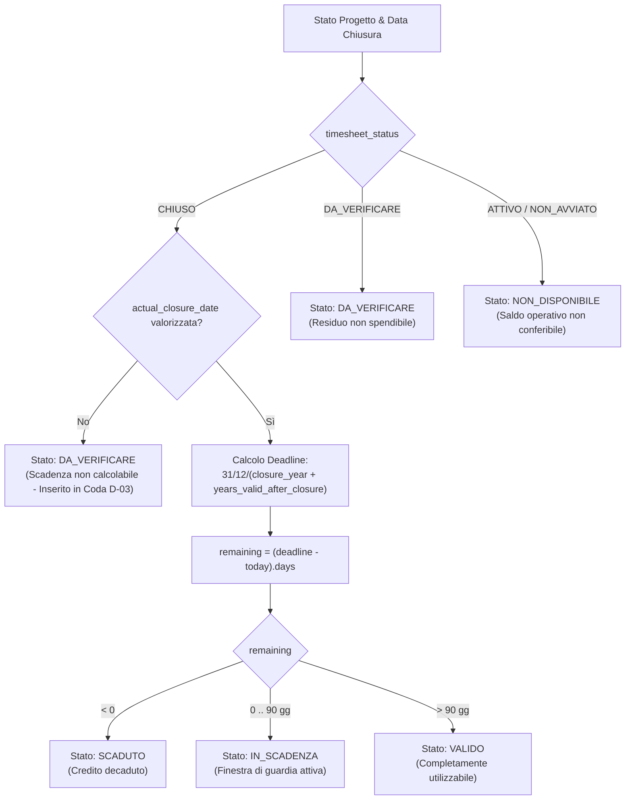
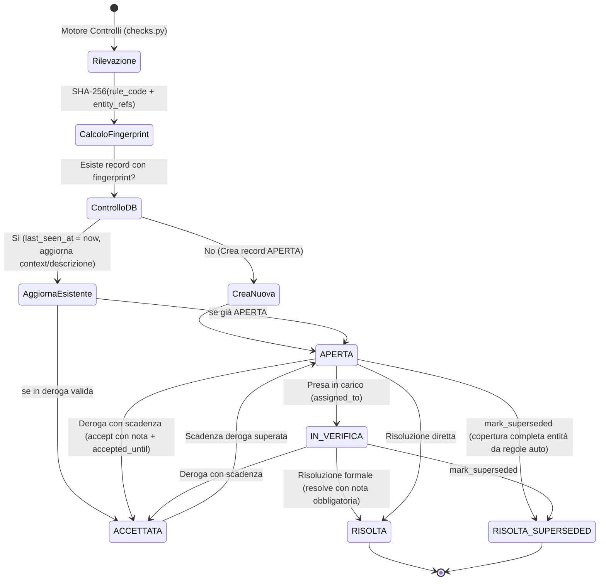
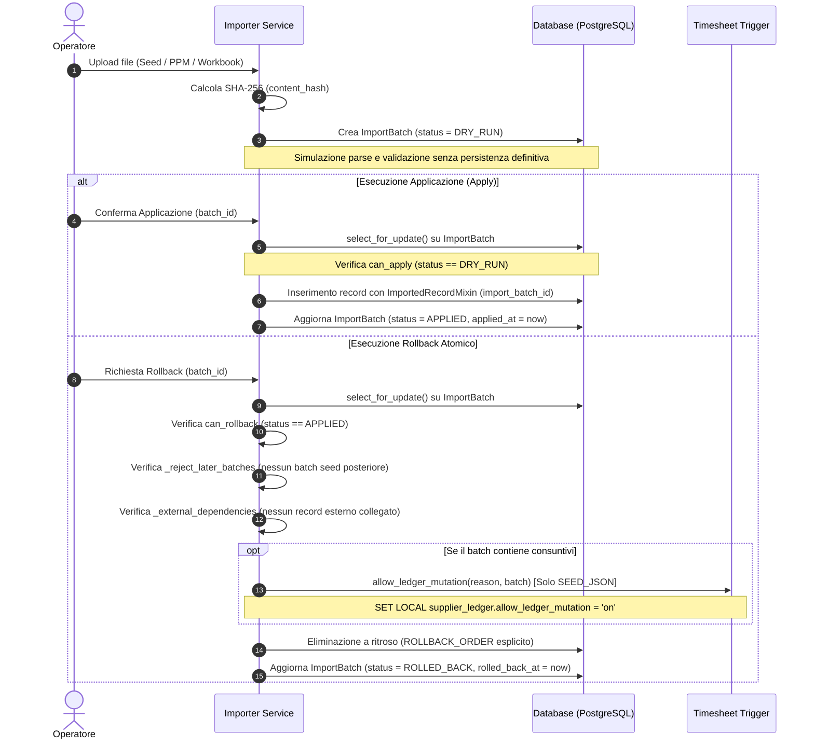
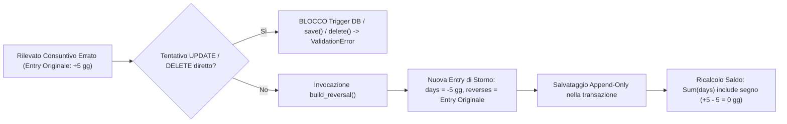

# Catalogo delle Regole di Business (Business Rules)

Questo documento costituisce il catalogo esaustivo delle regole di business e dei vincoli contabili implementati nel sistema **Supplier Ledger**. Tutte le 18 regole censite sono integralmente **IMPLEMENTED** nel codice sorgente del backend Django e nel motore di calcolo del dominio (`domain/`).

Per la visione architetturale e il modello dati di supporto si rimanda a [05_TECHNICAL_ARCHITECTURE.md](05_TECHNICAL_ARCHITECTURE.md) e [06_DATA_MODEL.md](06_DATA_MODEL.md). Per il flusso operativo dei workflow e il catalogo degli endpoint API consultare [04_WORKFLOW_CATALOG.md](04_WORKFLOW_CATALOG.md) e [07_API_CATALOG.md](07_API_CATALOG.md).

---

## 1. Matrice di Sintesi delle Regole di Business

| ID | Nome Regola | Ambito di Dominio | File di Riferimento | Stato |
|:---|:---|:---|:---|:---:|
| **R1** | Indipendenza stati consuntivazione e fatturazione | Progetti / Milestone | [`backend/projects/models.py`](../../backend/projects/models.py#L1-L126) | **IMPLEMENTED** |
| **R2** | Anno di riferimento e scadenza del residuo | Residui / Wallet | [`backend/domain/residuals.py`](../../backend/domain/residuals.py#L48-L110) | **IMPLEMENTED** |
| **R3** | Calcolo dinamico disponibilità Wallet | Wallet / Bilancio | [`backend/domain/wallet_balance.py`](../../backend/domain/wallet_balance.py#L157-L289) | **IMPLEMENTED** |
| **R4** | Target progressivo e monitoraggio canone | Canone semestrale | [`backend/domain/canone_status.py`](../../backend/domain/canone_status.py#L27-L216) | **IMPLEMENTED** |
| **R5** | Consuntivi immutabili append-only e storni | Timesheet / Ledger | [`backend/timesheets/models.py`](../../backend/timesheets/models.py#L93-L170) | **IMPLEMENTED** |
| **R6** | Riconciliazione consuntivi con PPM | PPM / Controllo | [`backend/domain/reconciliation.py`](../../backend/domain/reconciliation.py#L97-L216) | **IMPLEMENTED** |
| **R7** | Deduplica e ciclo di vita anomalie | Anomalie / Audit | [`backend/anomalies/models.py`](../../backend/anomalies/models.py#L43-L310) | **IMPLEMENTED** |
| **R8** | Motore dei 18 controlli di consistenza | Motore Controlli | [`backend/domain/checks.py`](../../backend/domain/checks.py#L58-L585) | **IMPLEMENTED** |
| **R9** | Aritmetica contabile e quantizzazione giornate | Fondazioni Contabili | [`backend/domain/money.py`](../../backend/domain/money.py#L1-L97) | **IMPLEMENTED** |
| **R10** | Validazione transizioni stato progetto | Progetti / Offerte | [`backend/projects/models.py`](../../backend/projects/models.py#L159-L227) | **IMPLEMENTED** |
| **R11** | Storico e tracciamento slittamento milestone | Fatturazione | [`backend/projects/models.py`](../../backend/projects/models.py#L230-L291) | **IMPLEMENTED** |
| **R12** | Ciclo transazionale import e rollback atomico | Batch Import | [`backend/imports/models.py`](../../backend/imports/models.py#L31-L110) | **IMPLEMENTED** |
| **R13** | Erogazione e funding FIFO delle quote Wallet | Wallet / Tranche FIFO | [`backend/wallet/models.py`](../../backend/wallet/models.py#L270-L319) | **IMPLEMENTED** |
| **R14** | Normalizzazione anagrafica e matching persone | Directory | [`backend/directory/models.py`](../../backend/directory/models.py#L33-L85) | **IMPLEMENTED** |
| **R15** | Analisi economica read-only dei costi | Economico / Costi | [`backend/domain/cost_analysis.py`](../../backend/domain/cost_analysis.py#L21-L126) | **IMPLEMENTED** |
| **R16** | Aggregazioni real-time per Dashboard KPI | KPI / Dashboard | [`backend/domain/dashboard.py`](../../backend/domain/dashboard.py#L30-L111) | **IMPLEMENTED** |
| **R17** | Concorrenza ottimistica e blocco collisioni | Concorrenza / ETag | [`backend/api/concurrency.py`](../../backend/api/concurrency.py#L1-L60) | **IMPLEMENTED** |
| **R18** | Coda di revisione e scadenze potenziali | Qualità Dati / D-03 | [`backend/domain/residuals.py`](../../backend/domain/residuals.py#L284-L404) | **IMPLEMENTED** |

---

## 2. Diagrammi dei Workflow Fondamentali

### 2.1 Workflow Validità Residui (Regola R2)



### 2.2 Ciclo di Vita delle Anomalie e Deduplica Fingerprint (Regola R7 & R8)



### 2.3 Ciclo Transazionale Import Batch e Rollback Atomico (Regola R12 & R5)



### 2.4 Flusso Contabile Append-Only e Storni (Regola R5 & R9)



---

## 3. Schede Dettagliate delle Regole di Business (R1 - R18)

---

### R1: Indipendenza degli Stati di Consuntivazione e Fatturazione

- **ID**: `R1`
- **Stato**: `IMPLEMENTED`
- **Descrizione di Business**: Lo stato di consuntivazione del progetto (`timesheet_status`) e lo stato di fatturazione commerciale (`billing_status`) sono dimensionalmente ortogonali e indipendenti. Un progetto può essere completato e chiuso dal punto di vista operativo e dei consumi delle giornate, pur mantenendo tranche di fatturazione ancora da emettere o parziali, e viceversa.
- **Input e Formule**:
  - `timesheet_status` $\in$ `{NON_AVVIATO, ATTIVO, CHIUSO, DA_VERIFICARE}`
  - `billing_status` $\in$ `{DA_FATTURARE, PARZIALE, TOTALE, NON_FATTURABILE, DA_VERIFICARE}`
  - Nessun vincolo di dipendenza diretta tra i due campi nel modello `Project`.
- **Condizioni e Casi Limite**:
  - Progetti con `timesheet_status == CHIUSO` e `billing_status == DA_FATTURARE` o `PARZIALE` sono pienamente validi e rappresentano lavorazioni concluse con saldo contabile ancora da incassare.
  - Progetti con `billing_status == TOTALE` e `timesheet_status == ATTIVO` sono ammessi (es. fatturazione anticipata a inizio fornitura).
- **Error Handling**: Nessuna eccezione scatenata per combinazioni arbitrarie dei due stati. I campi sono gestiti come `CharField` con choices Django separate e indicizzati individualmente per query performanti.
- **Evidenze di Implementazione**:
  - File: [`backend/projects/models.py`](../../backend/projects/models.py#L1-L5) (Docstring esplicita riga 1-5).
  - Campi modello: [`Project.timesheet_status`](../../backend/projects/models.py#L114-L119) e [`Project.billing_status`](../../backend/projects/models.py#L120-L125).

---

### R2: Anno di Riferimento e Validità del Residuo di Progetto

- **ID**: `R2`
- **Stato**: `IMPLEMENTED`
- **Descrizione di Business**: Il residuo spendibile di un progetto a consuntivo non nasce da una data arbitraria o manuale, ma è strettamente ancorato all'anno di chiusura della consuntivazione. Solo un progetto `CHIUSO` con una data effettiva di chiusura registrata genera credito wallet spendibile, il quale scade perentoriamente il 31 dicembre dell'anno successivo alla chiusura (estendibile da configurazione globale).
- **Input e Formule**:
  - `residual_reference_year` $= \text{ExtractYear}(\text{actual\_closure\_date})$ (colonna persistita e generata a livello di motore database).
  - Ultimo giorno utile:
    $$\text{last\_usable\_day}(\text{closure\_date}, N) = \text{Date}(\text{closure\_date.year} + N, 12, 31)$$
    dove $N = \text{AppSettings.residual\_years\_after\_closure}$ (default: $1$).
  - Giorni rimanenti alla scadenza:
    $$\text{remaining} = (\text{last\_usable\_day} - \text{today}).\text{days}$$
  - Finestra di allerta imminente: $\text{expiring\_window\_days} = 90$ giorni.
  - Macchina a stati di validità:
    $$\text{ResidualState} = \begin{cases} 
      \text{DA\_VERIFICARE} & \text{se } \text{status} = \text{CHIUSO e } \text{closure\_date is NULL} \\
      \text{DA\_VERIFICARE} & \text{se } \text{status} = \text{DA\_VERIFICARE} \\
      \text{NON\_DISPONIBILE} & \text{se } \text{status} \in \{\text{ATTIVO, NON\_AVVIATO}\} \\
      \text{SCADUTO} & \text{se } \text{remaining} < 0 \\
      \text{IN\_SCADENZA} & \text{se } 0 \le \text{remaining} \le 90 \\
      \text{VALIDO} & \text{se } \text{remaining} > 90
    \end{cases}$$
- **Condizioni e Casi Limite**:
  - Se un progetto è chiuso senza data (ammesso provvisoriamente durante l'import del seed), il residuo non può essere erogato nel wallet e viene instradato nella coda di revisione `DA_VERIFICARE`.
  - Il campo informativo `declared_residual_year` proveniente dal seed storico non sovrascrive mai `residual_reference_year` derivato dal database (decisione D-03).
- **Error Handling**: Modello `Project.clean()` vieta la creazione manuale o l'aggiornamento di un progetto a `CHIUSO` senza `actual_closure_date` al di fuori dei batch seed.
- **Evidenze di Implementazione**:
  - File: [`backend/projects/models.py`](../../backend/projects/models.py#L128-L133) (`GeneratedField` su `actual_closure_date`).
  - File: [`backend/domain/residuals.py`](../../backend/domain/residuals.py#L48-L110) (funzioni `last_usable_day` e `residual_validity`).

---

### R3: Calcolo Dinamico e Tracciato del Disponibile Wallet

- **ID**: `R3`
- **Stato**: `IMPLEMENTED`
- **Descrizione di Business**: *"Il disponibile non è mai un numero scritto a mano"*. Il saldo del wallet e i residui di ogni progetto sono grandezze puramente derivate dal database, calcolate aggregando i consuntivi diretti, le allocazioni in uscita e le erosioni effettuate tramite wallet. Nessun totale contabile è persistito staticamente su disco, scongiurando disallineamenti da concorrenza.
- **Input e Formule**:
  1. **Saldo Operativo di Progetto (`project_balance_qs`)**:
     $$\text{direct\_consumed\_days} = \sum \text{timesheet\_entries.days} \quad (\text{per il progetto})$$
     $$\text{allocated\_to\_wallet\_days} = \sum \text{wallet\_allocations.allocated\_days} \quad (\text{dal progetto})$$
     $$\text{consumed\_via\_wallet\_days} = \sum \text{wallet\_allocations} \to \text{timesheet\_entries.days}$$
     $$\text{total\_consumed\_days} = \text{direct\_consumed\_days} + \text{consumed\_via\_wallet\_days}$$
     $$\text{residual\_days} = \text{budget\_days} - \text{direct\_consumed\_days} - \text{allocated\_to\_wallet\_days}$$
  2. **Bilancio Annuale del Wallet (`wallet_year_balance`)**:
     $$\text{total\_source\_capacity} = \sum \text{source\_lots.capacity\_days} + \text{reconciliation\_adjustment\_days}$$
     $$\text{allocated\_days} = \sum \text{allocation.allocated\_days}$$
     $$\text{consumed\_days} = \sum \text{allocation.consumed\_days}$$
     $$\text{available\_from\_allocations} = \sum (\text{allocation.allocated\_days} - \text{allocation.consumed\_days})$$
     $$\text{available\_from\_open\_allocations} = \sum_{\text{status} = \text{APERTA}} (\text{allocated\_days} - \text{consumed\_days})$$
     $$\text{potential\_wallet\_capacity} = \begin{cases} 
       \text{total\_source\_capacity} & \text{se } > 0 \\
       \text{available\_open} + \text{unallocated\_valid} + \text{unallocated\_expiring} & \text{altrimenti}
     \end{cases}$$
     $$\text{unallocated\_capacity} = \max(0, \text{potential\_wallet\_capacity} - \text{allocated\_days})$$
- **Condizioni e Casi Limite**:
  - I progetti di tipo `CANONE` sono rigorosamente esclusi dal perimetro di alimentazione wallet.
  - Per i progetti `ATTIVO` o `NON_AVVIATO`, il residuo non conferito al wallet viene categorizzato separatamente in `ongoing_project_residual_days` (se positivo) o `ongoing_project_overrun_days` (se negativo, ovvero sforamento).
- **Error Handling**: Annotazioni SQL realizzate tramite subquery scalari indipendenti (`OuterRef`) per prevenire duplicazioni di riga e moltiplicazioni cartesiane da cross join.
- **Evidenze di Implementazione**:
  - File: [`backend/wallet/models.py`](../../backend/wallet/models.py#L1-L5) (Docstring normativa).
  - File: [`backend/domain/residuals.py`](../../backend/domain/residuals.py#L140-L186) (`project_balance_qs`).
  - File: [`backend/domain/wallet_balance.py`](../../backend/domain/wallet_balance.py#L104-L118) e [L157-L289](../../backend/domain/wallet_balance.py#L157-L289) (`WalletYearBalance` e `wallet_year_balance`).

---

### R4: Target Progressivo e Previsione del Canone Semestrale

- **ID**: `R4`
- **Stato**: `IMPLEMENTED`
- **Descrizione di Business**: La spesa delle sotto-attività su contratti a canone semestrale viene monitorata tramite una retta lineare di burn-down progressivo. Il target indica quante giornate dovrebbero essere state consumate alla data corrente. Il sistema calcola delta, forecast stimato a fine periodo e identifica tempestivamente situazioni di sotto-utilizzo o sovra-utilizzo del monte contrattuale.
- **Input e Formule**:
  - Settimane trascorse:
    $$\text{weeks} = \max\left(0, \lfloor (\text{today} - \text{start\_date}).\text{days} / 7 \rfloor\right)$$
  - Target progressivo alla data:
    $$\text{target} = \min\left(\text{total\_days}, \text{base\_days} + (\text{days\_per\_week} \times \text{weeks})\right)$$
    *(con `cap_at_total=True` di default)*.
  - Consuntivato totale: $\text{consumed} = \sum_{\text{subactivities}} \text{consumed\_days}$.
  - Forecast residuo:
    $$\text{forecast\_remaining} = \sum_{\text{subactivities}} \max(\text{reserved\_days} - \text{consumed\_days}, 0)$$
  - Forecast complessivo: $\text{forecast} = \text{consumed} + \text{forecast\_remaining}$.
  - Rapporto forecast: $\text{forecast\_ratio} = (\text{forecast} / \text{total\_days}) \times 100$.
  - Giornate non utilizzate previste: $\text{unused\_days} = \max(\text{total\_days} - \text{forecast}, 0)$.
  - Delta target: $\text{delta} = \text{target} - \text{consumed}$ (positivo = spesa sotto target, favorevole al cliente).
  - Condizioni di allerta:
    - `is_underused`: $\text{forecast} < \text{total\_days} \times 0.95$ (sotto-utilizzo previsto $>5\%$).
    - `is_overused`: $\text{consumed} > \text{total\_days}$ (sforamento conclamato del monte).
- **Condizioni e Casi Limite**:
  - Se la data corrente supera la data di fine semestre (`end_date`), le settimane si bloccano all'ampiezza massima del semestre.
  - Decisione aperta D-01: le giornate di canone non consumate a fine semestre rimangono un indicatore puramente contabile e non generano travaso automatico verso il wallet.
  - Generazione serie settimanale completa per grafici di burn-down (`canone_burndown`).
- **Error Handling**: Gestione di semestri con date non ancora avviate (weeks = 0) o monte a zero (`forecast_ratio` quantizzato a zero).
- **Evidenze di Implementazione**:
  - File: [`backend/domain/canone_status.py`](../../backend/domain/canone_status.py#L27-L47) (formule `weeks_elapsed`, `target_days`).
  - File: [`backend/domain/canone_status.py`](../../backend/domain/canone_status.py#L144-L216) (calcolo completo `canone_status` e breakdown uffici EA, SA, TA, CROSS).
  - File: [`backend/domain/canone_status.py`](../../backend/domain/canone_status.py#L218-L260) (`canone_burndown`).

---

### R5: Immutabilità Append-Only dei Consuntivi e Storni

- **ID**: `R5`
- **Stato**: `IMPLEMENTED`
- **Descrizione di Business**: Il ledger dei consuntivi (`timesheets_timesheetentry`) è rigorosamente *append-only*. È vietata qualsiasi modifica (`UPDATE`) o cancellazione (`DELETE`) diretta delle righe storiche salvate. Qualsiasi correzione contabile deve avvenire registrando una nuova riga di storno con valore di giornate opposto (`days < 0`) e puntamento esplicito alla riga originale (`reverses`).
- **Input e Formule**:
  - Saldo netto risultante: $\sum \text{days}_{\text{positive}} + \sum \text{days}_{\text{negative}}$.
  - Generazione storno:
    $$\text{TimesheetEntry}(\text{days} = -\text{original.days}, \text{source} = \text{STORNO}, \text{reverses} = \text{original})$$
- **Condizioni e Casi Limite**:
  - Check constraint `timesheet_exactly_one_target`: ogni riga deve puntare ad esattamente **uno** tra `project`, `canone_subactivity`, `wallet_allocation`.
  - Check constraint `timesheet_days_not_zero`: è vietato registrare consuntivi con `days == 0`.
  - Unica eccezione tecnica ammessa: il rollback di un batch import seed iniziale, controllato dal context manager di emergenza `allow_ledger_mutation` con trigger DB bypassabile solo localmente alla transazione PostgreSQL.
- **Error Handling**:
  - `TimesheetEntry.save()` lancia `ValidationError("I consuntivi sono append-only...")` se `not self._state.adding`.
  - `TimesheetEntry.delete()` lancia `ValidationError("I consuntivi non si cancellano...")`.
- **Evidenze di Implementazione**:
  - File: [`backend/timesheets/models.py`](../../backend/timesheets/models.py#L93-L118) (CheckConstraint Django).
  - File: [`backend/timesheets/models.py`](../../backend/timesheets/models.py#L146-L170) (`save`, `delete`, `build_reversal`).
  - File: [`backend/timesheets/mutations.py`](../../backend/timesheets/mutations.py#L27-L50) (`allow_ledger_mutation`).

---

### R6: Riconciliazione Consuntivi con Sistema PPM

- **ID**: `R6`
- **Stato**: `IMPLEMENTED`
- **Descrizione di Business**: Il sistema esterno PPM aziendale è la fonte di verità dei consuntivi. Il motore di riconciliazione confronta periodicamente il totale interno calcolato dal Supplier Ledger (consuntivi diretti + consumi via wallet) con il campo `total_days` dell'ultimo snapshot PPM valido per ciascun progetto. Uno scarto superiore alla soglia di tolleranza costituisce un'anomalia di allineamento.
- **Input e Formule**:
  - Tolleranza predefinita: $\text{DEFAULT\_TOLERANCE} = 0.0100$ giornate (1 centesimo di giornata uomo).
  - Delta di riconciliazione:
    $$\Delta = \text{internal\_days} - \text{ppm\_days}$$
  - Condizione di conformità:
    $$\text{within\_tolerance} = |\Delta| \le \text{tolerance}$$
  - Classificazione riga:
    $$\text{Outcome} = \begin{cases} 
      \text{ASSENTE\_IN\_PPM} & \text{se riga PPM non presente} \\
      \text{OK} & \text{se } |\Delta| \le \text{tolerance} \\
      \text{KO} & \text{se } |\Delta| > \text{tolerance}
    \end{cases}$$
  - Percentuale di allineamento complessivo:
    $$\text{percentuale\_allineati} = \frac{\text{ok\_count}}{\text{righe\_confrontabili}} \times 100$$
- **Condizioni e Casi Limite**:
  - Se non sono presenti snapshot PPM o non esistono righe confrontabili, lo stato del summary è rigorosamente `NON_VERIFICABILE` e il KPI percentuale resta nullo (`None`) per non trarre in inganno l'utente mostrando uno `0%` fittizio.
  - Se esistono progetti con consuntivi assenti in PPM, lo stato generale scala a `PARZIALE`.
  - In presenza di delta KO, lo stato scala a `NON_ALLINEATO`.
- **Error Handling**: Isolamento delle righe non agganciate a progetti (`unmatched_ppm_rows`) che vengono dirottate sulla coda di revisione anomalie.
- **Evidenze di Implementazione**:
  - File: [`backend/domain/reconciliation.py`](../../backend/domain/reconciliation.py#L18-L36) (costanti e stati).
  - File: [`backend/domain/reconciliation.py`](../../backend/domain/reconciliation.py#L97-L155) (`reconcile`).
  - File: [`backend/domain/reconciliation.py`](../../backend/domain/reconciliation.py#L168-L216) (`reconciliation_summary`).

---

### R7: Deduplica Deterministica e Ciclo di Vita delle Anomalie

- **ID**: `R7`
- **Stato**: `IMPLEMENTED`
- **Descrizione di Business**: Le anomalie rilevate dai controlli non vengono duplicate ad ogni riesecuzione. L'identità univoca di un rilievo è definita da un hash SHA-256 stabile calcolato unicamente sulle entità coinvolte e sul codice regola, escludendo i valori variabili (es. giorni di sforamento). Quando il valore numerico cambia, l'anomalia esistente viene aggiornata sul posto preservando storico, note e assegnazioni.
- **Input e Formule**:
  - Impronta crittografica (Fingerprint):
    $$\text{fingerprint} = \text{SHA256}(\text{rule\_code} \parallel \text{ref}_1 \parallel \text{ref}_2 \parallel \dots)$$
  - Vincolo database: `fingerprint` ha vincolo `unique=True` sul modello `Anomaly`.
- **Condizioni e Casi Limite**:
  - Risoluzione formale: `resolve(note, user)` richiede obbligatoriamente una nota esplicativa.
  - Deroga temporanea: `accept(note, until, user)` richiede nota obbligatoria e una data di scadenza della deroga (`accepted_until`). Se la data viene superata, il controllo riapre automaticamente il rilievo.
  - Superamento automatico seed-to-engine: `mark_superseded(replacements, expected_entities)` permette di marcare come `RISOLTA` un'anomalia storica del seed solo se l'insieme dei nuovi controlli automatici copre integralmente tutte le entità collegate.
- **Error Handling**: `ValidationError` scatenato se si tenta di salvare una nota vuota in risoluzione/deroga, oppure se la sostituzione di un'anomalia presenta copertura incompleta delle entità.
- **Evidenze di Implementazione**:
  - File: [`backend/anomalies/models.py`](../../backend/anomalies/models.py#L43-L47) (`build_fingerprint`).
  - File: [`backend/anomalies/models.py`](../../backend/anomalies/models.py#L190-L214) (`resolve`, `accept`).
  - File: [`backend/anomalies/models.py`](../../backend/anomalies/models.py#L243-L310) (`mark_superseded`).

---

### R8: Motore dei 18 Controlli di Integrità e Consistenza

- **ID**: `R8`
- **Stato**: `IMPLEMENTED`
- **Descrizione di Business**: L'integrità del portafoglio progetti, del wallet, del canone e delle anagrafiche è presidiata da 18 controlli deterministici indipendenti (funzioni detector pure), eseguiti in batch o su richiesta. I dettagli analitici delle 18 regole sono catalogati nella [Sezione 4](#4-catalogo-dei-18-controlli-di-consistenza-chk_) del presente documento.
- **Input e Formule**: Rilevamento tramite oggetti immutabili `Finding(rule_code, entity_ref, severity, scope, description, suggested_action, context)`.
- **Condizioni e Casi Limite**: Severità parametrizzata (`ALTA`, `MEDIA`, `BASSA`) con escalation automatica da `MEDIA` ad `ALTA` in caso di sforamenti percentuali $> 10\%$.
- **Error Handling**: Gestione dei valori nulli e delle date incomplete; nessun fallimento a cascata in caso di singoli record anomali.
- **Evidenze di Implementazione**:
  - File: [`backend/domain/checks.py`](../../backend/domain/checks.py#L30-L45) (`Finding` dataclass).
  - File: [`backend/domain/checks.py`](../../backend/domain/checks.py#L58-L563) (I 18 detector).
  - File: [`backend/domain/checks.py`](../../backend/domain/checks.py#L565-L584) (Dizionario `RULES`).

---

### R9: Aritmetica Contabile e Quantizzazione delle Giornate

- **ID**: `R9`
- **Stato**: `IMPLEMENTED`
- **Descrizione di Business**: Le giornate uomo rappresentano grandezze contabili e legali: è tassativamente bandito l'uso di tipi floating point a virgola mobile binaria (`float`). Tutti i calcoli impiegano rigorosamente istanze `Decimal` a 4 cifre decimali con arrotondamento simmetrico `ROUND_HALF_UP`. La formattazione a 2 decimali o la notazione europea (virgola per i decimali) è riservata esclusivamente al rendering visivo.
- **Input e Formule**:
  - Passo di quantizzazione standard: $\text{DAYS\_QUANT} = \text{Decimal}("0.0001")$.
  - Passo per importi economici: $\text{MONEY\_QUANT} = \text{Decimal}("0.01")$.
  - Granularità oraria PPM: $\text{PPM\_GRANULARITY} = \text{Decimal}("0.0625")$ (equivalente a $0.5$ ore su base $8$ ore/giorno).
  - Conversione da stringa/italiano: parsing tollerante che gestisce sia `1,5` sia `1.5`, ripulendo separatori delle migliaia e spazi.
  - Valorizzazione economica:
    $$\text{cost\_for\_days}(\text{days}, \text{daily\_cost}) = (\text{days} \times \text{daily\_cost}).\text{quantize}(0.01, \text{ROUND\_HALF\_UP})$$
- **Condizioni e Casi Limite**:
  - Rifiuto perentorio di valori booleani, infiniti, NaN o stringhe non numeriche.
- **Error Handling**: `DaysValueError` scatenato su dati in input privi di senso contabile.
- **Evidenze di Implementazione**:
  - File: [`backend/domain/money.py`](../../backend/domain/money.py#L12-L17) (costanti `DAYS_QUANT`, `PPM_GRANULARITY`).
  - File: [`backend/domain/money.py`](../../backend/domain/money.py#L23-L45) (`to_days`).
  - File: [`backend/domain/money.py`](../../backend/domain/money.py#L52-L55) (`cost_for_days`).

---

### R10: Validazione e Vincoli di Transizione del Progetto

- **ID**: `R10`
- **Stato**: `IMPLEMENTED`
- **Descrizione di Business**: L'evoluzione di stato di un progetto è soggetta a regole di validazione formali che impediscono inconsistenze operative ed esecuzione di attività prive di copertura contrattuale.
- **Input e Formule**:
  - Vincolo 1: Un progetto può transitare o permanere in `timesheet_status == ATTIVO` solo se `offer_status == ACCETTATA`.
  - Vincolo 2: La chiusura del progetto (`timesheet_status == CHIUSO`) richiede obbligatoriamente la data effettiva (`actual_closure_date is not NULL`), salvo batch di import seed storico (D-03/D-14).
  - Vincolo 3: `actual_closure_date` non può precedere cronologicamente la data di inizio `start_date`.
  - Vincolo 4: `planned_end_date >= start_date` verificato sia a livello di modello sia con check constraint SQL di tabella.
  - Vincolo 5: `budget_days >= 0`.
- **Condizioni e Casi Limite**:
  - Esenzione seed storico: se il record è associato a un batch `SEED_JSON` o `WORKBOOK_JSON`, la chiusura senza data è tollerata per consentire il censimento dello storico pregresso.
- **Error Handling**: `Project.clean()` solleva `ValidationError` con dizionario puntuale dei campi errati; il database garantisce la consistenza tramite CheckConstraint dedicati.
- **Evidenze di Implementazione**:
  - File: [`backend/projects/models.py`](../../backend/projects/models.py#L159-L179) (CheckConstraint `project_budget_non_negative`, `project_end_after_start`, `project_closed_requires_date`).
  - File: [`backend/projects/models.py`](../../backend/projects/models.py#L197-L227) (`clean`).

---

### R11: Tracciamento Spostamenti e Motivazione Milestone di Fatturazione

- **ID**: `R11`
- **Stato**: `IMPLEMENTED`
- **Descrizione di Business**: Le milestone di fatturazione costituiscono impegni finanziari formalizzati. Lo slittamento di una data pianificata non può avvenire silenziosamente: richiede obbligatoriamente una motivazione scritta. Il modello conserva l'intero log cronologico degli spostamenti passati e un contatore cumulativo.
- **Input e Formule**:
  - Invocazione metodo: `move_to(new_date, reason, user)`.
  - Incremento contatore: $\text{move\_count} = \text{move\_count} + 1$.
  - Transizione automatica di stato: `status = MilestoneStatus.SPOSTATA`.
  - Registrazione nel campo JSON:
    $$\text{moves} \gets \text{moves} \cup \left\{ \text{"da"}: D_{\text{old}}, \text{"a"}: D_{\text{new}}, \text{"motivazione"}: R, \text{"spostata\_da"}: U, \text{"spostata\_il"}: T_{\text{now}} \right\}$$
- **Condizioni e Casi Limite**:
  - Vincolo di unicità: `UniqueConstraint(fields=("project", "schedule_slot"), condition=~Q(schedule_slot=""))` assicura l'unicità delle posizioni fisse nel piano (es. avvio `START` e saldo `END`).
- **Error Handling**: `ValidationError({"reason": "La motivazione dello spostamento è obbligatoria."})` scatenato se `reason` è vuota o composta solo da spazi.
- **Evidenze di Implementazione**:
  - File: [`backend/projects/models.py`](../../backend/projects/models.py#L260-L266) (UniqueConstraint `unique_project_billing_schedule_slot`).
  - File: [`backend/projects/models.py`](../../backend/projects/models.py#L272-L291) (`move_to`).

---

### R12: Ciclo Transazionale di Import Batch e Rollback Atomico

- **ID**: `R12`
- **Stato**: `IMPLEMENTED`
- **Descrizione di Business**: I caricamenti massivi di dati (Seed JSON, Workbook Excel, Snapshot PPM) sono tracciati mediante un'entità `ImportBatch` che implementa un ciclo a stati rigoroso: simulazione preventiva (`DRY_RUN`), applicazione con lock (`APPLIED`) ed eventuale annullamento completo (`ROLLED_BACK`). Il rollback garantisce il ripristino perfetto dello stato precedente.
- **Input e Formule**:
  - Macchina a stati batch:
    $$\text{can\_apply} = (\text{status} == \text{DRY\_RUN})$$
    $$\text{can\_rollback} = (\text{status} == \text{APPLIED})$$
  - Hash univoco del file: $\text{content\_hash} = \text{SHA256}(\text{file\_bytes})$ per prevenire caricamenti accidentali duplicati dello stesso file.
  - Mixin di tracciamento: `ImportedRecordMixin` aggiunge la foreign key `import_batch` a tutti i record di dominio creati durante l'import.
- **Condizioni e Casi Limite**:
  - Ordine di rimozione esplicito (`ROLLBACK_ORDER`): figli cancellati prima dei rispettivi genitori per evitare dipendenze orfane o rimozioni a cascata involontarie.
  - Regola di sicurezza `_reject_later_batches`: il rollback è bloccato se esistono batch seed applicati successivamente, preservando la consistenza contabile.
  - Controllo `_external_dependencies`: il rollback è rifiutato se record esterni fanno riferimento a entità create dal batch.
- **Error Handling**: `RollbackError` sollevato in caso di violazione delle guardie pre-rollback; l'intera operazione vive in un blocco transazionale atomico `transaction.atomic()`.
- **Evidenze di Implementazione**:
  - File: [`backend/imports/models.py`](../../backend/imports/models.py#L70-L76) (`can_apply`, `can_rollback`).
  - File: [`backend/imports/models.py`](../../backend/imports/models.py#L97-L110) (`ImportedRecordMixin`).
  - File: [`backend/importers/rollback.py`](../../backend/importers/rollback.py#L55-L140) (`ROLLBACK_ORDER`, `_reject_later_batches`, `rollback_seed_batch`).

---

### R13: Gestione delle Quote Wallet con Funding FIFO

- **ID**: `R13`
- **Stato**: `IMPLEMENTED`
- **Descrizione di Business**: Quando un'allocazione wallet attinge a monte dai residui di molteplici progetti sorgente, l'assegnazione e l'erosione avvengono secondo un ordine di priorità cronologico FIFO (*First-In, First-Out*). Ogni quota è tracciata nel modello `WalletFundingTranche`, che formalizza il vincolo contabile di riserva, impegno ed erosione progressiva.
- **Input e Formule**:
  - Ordinamento FIFO: campo `sequence` progressivo per allocazione.
  - Gerarchia delle quantità contabili:
    $$\text{initial\_reserved\_days} \ge \text{committed\_days} \ge \text{consumed\_days} \ge 0$$
- **Condizioni e Casi Limite**:
  - Vincolo `UniqueConstraint(fields=("allocation", "sequence"))` previene collisioni nell'ordine FIFO di una data allocazione.
  - L'allocazione registra automaticamente se richiede attribuzione di origine (`requires_source_attribution`) qualora provenga dal wallet generale senza specificazione del progetto sorgente o delle relative tranche.
- **Error Handling**: `WalletFundingTranche.clean()` valida la gerarchia sollevando `ValidationError` se le giornate impegnate superano la riserva iniziale o se le consuntivate superano le impegnate.
- **Evidenze di Implementazione**:
  - File: [`backend/wallet/models.py`](../../backend/wallet/models.py#L270-L319) (`WalletFundingTranche`, vincoli e `clean()`).
  - File: [`backend/wallet/models.py`](../../backend/wallet/models.py#L262-L268) (`WalletAllocation.save()` per gestione origine).

---

### R14: Normalizzazione Anagrafica e Matching Deterministico delle Persone

- **ID**: `R14`
- **Stato**: `IMPLEMENTED`
- **Descrizione di Business**: Le anagrafiche dei referenti provenienti da fogli Excel, PPM e contratti presentano frequenti disomogeneità di formattazione (inversioni "Nome Cognome" vs "Cognome Nome", accenti mancanti, doppi spazi, casing eterogeneo). Il sistema applica una normalizzazione conservativa e calcola una chiave canonica di confronto su token ordinati.
- **Input e Formule**:
  - Pulizia caratteri: rimozione accenti (`strip_accents` via NFKD) e compattamento spazi.
  - Chiave di confronto canonica (`comparison_key`):
    $$\text{name\_key} = \text{Join}(\text{Sort}(\text{Tokens}(\text{lowercase}(\text{strip\_accents}(\text{raw})))))$$
    In questo modo *"Ravagli Andrea"* e *"Andrea Ravagli"* producono la medesima chiave `"andrea ravagli"`.
  - Titlecasing conservativo: rispetto delle particelle patronimiche e nobiliari (`de`, `di`, `da`, `del`, `della`, `van`, `von`).
- **Condizioni e Casi Limite**:
  - Nomi singoli (un solo token): non vengono mai invertiti o risolti a tentativi; il sistema li contrassegna con `needs_review = True` per la conferma visiva nella coda di revisione.
  - Unicità per organizzazione: `UniqueConstraint(fields=("full_name", "organization"))` e `UniqueConstraint(fields=("name_key", "organization"))`.
- **Error Handling**: `PersonQuerySet.by_name(name, organization)` esegue il lookup tramite `comparison_key(name)`, garantendo matching esatto indipendentemente dall'ordine con cui l'utente digita il nome.
- **Evidenze di Implementazione**:
  - File: [`backend/directory/normalization.py`](../../backend/directory/normalization.py#L18-L60) (`comparison_key`, `titlecase_name`, `normalize_person_name`).
  - File: [`backend/directory/models.py`](../../backend/directory/models.py#L33-L39) (`PersonQuerySet.by_name`).
  - File: [`backend/directory/models.py`](../../backend/directory/models.py#L80-L84) (`Person.save()` con auto-normalizzazione).

---

### R15: Analisi Economica Read-Only dei Costi

- **ID**: `R15`
- **Stato**: `IMPLEMENTED`
- **Descrizione di Business**: L'analisi economica sintetizza il controvalore monetario delle giornate consuntivate nel ledger. Poiché il sistema contabile traccia giornate uomo, la conversione in euro è una vista aggregata calcolata in sola lettura (`read-only`), applicando il parametro di costo unitario configurato globalmente.
- **Input e Formule**:
  - Parametro: `daily_person_cost` (da `AppSettings`).
  - Aggregazione netta: ogni riga di consuntivo è conteggiata esattamente una volta; gli storni con segno negativo erodono linearmente il totale delle giornate e il costo correlato.
  - Dimensioni di breakdown:
    1. Per Progetto (`by_project`)
    2. Per Fornitore (`by_supplier`)
    3. Per Fonte Contabile (`by_source` $\in$ `{PROJECT, CANONE, WALLET}`)
    4. Trend Mensile (`monthly_trend` per anno-mese `YYYY-MM`)
  - Formula: $\text{Costo} = \text{cost\_for\_days}(\text{days}, \text{daily\_cost})$.
- **Condizioni e Casi Limite**:
  - Policy esplicita restituita nel payload JSON: *"Costo globale corrente, non storicizzato e non differenziato per fornitore."*
- **Error Handling**: Tracciamento di righe prive di progetto o fornitore sotto le etichette convenzionali *"Senza progetto"* e *"Senza fornitore"*.
- **Evidenze di Implementazione**:
  - File: [`backend/domain/cost_analysis.py`](../../backend/domain/cost_analysis.py#L21-L95) (`build_cost_analysis`).
  - File: [`backend/domain/cost_analysis.py`](../../backend/domain/cost_analysis.py#L96-L125) (strutturazione del report e policy).

---

### R16: Aggregazioni Real-Time per Dashboard Direzionale

- **ID**: `R16`
- **Stato**: `IMPLEMENTED`
- **Descrizione di Business**: La dashboard iniziale espone un riepilogo in tempo reale dello stato del portafoglio senza latenze né batch notturni, strutturato per evitare query ridondanti o problemi di tipo $N+1$.
- **Input e Formule**:
  1. `progetti_per_stato`: conteggio aggregato raggruppato per tutti i valori di `TimesheetStatus` (`NON_AVVIATO`, `ATTIVO`, `CHIUSO`, `DA_VERIFICARE`).
  2. `wallet`: bilancio dell'anno corrente ricavato invocando `wallet_year_balance(today.year)` (espone allocato, consumato e disponibile).
  3. `prossime_fatturazioni`: elenco filtrato delle milestone di fatturazione con data pianificata nel mese solare corrente e stato ancora aperto (`PIANIFICATA`, `SPOSTATA`, `DA_VERIFICARE`), arricchite con conteggio e storico degli spostamenti.
- **Condizioni e Casi Limite**:
  - Deduplica logica basata su chiave naturale `(project_id, planned_date)` per evitare visualizzazioni duplicate di pianificazioni identiche.
  - Ordinamento deterministico per data fatturazione, codice progetto, data pianificata e id.
- **Error Handling**: Limite di sicurezza `UPCOMING_BILLINGS_LIMIT = 50` per contenere il payload di rendering.
- **Evidenze di Implementazione**:
  - File: [`backend/domain/dashboard.py`](../../backend/domain/dashboard.py#L14-L19) (costanti e filtri).
  - File: [`backend/domain/dashboard.py`](../../backend/domain/dashboard.py#L30-L110) (`dashboard_summary`).

---

### R17: Concorrenza Ottimistica e Blocco Collisioni (ETag / version)

- **ID**: `R17`
- **Stato**: `IMPLEMENTED`
- **Descrizione di Business**: Per proteggere l'integrità dei dati da sovrascritture accidentali tra operatori concorrenti (*lost update problem*), tutte le entità modificabili del sistema ereditano la tracciatura della versione da `TrackedModel`. L'API REST impone l'uso del pattern ETag / `If-Match` o l'invio del campo `expected_version`.
- **Input e Formule**:
  - Campo versione: `version = models.PositiveIntegerField(default=1, editable=False)`.
  - Incremento su update: `self.version = (self.version or 0) + 1` in `TrackedModel.save()`.
  - Formato ETag debole HTTP:
    $$\text{ETag} = \text{W/}"\{\text{id}\}-\{\text{version}\}"$$
- **Condizioni e Casi Limite**:
  - Metodi controllati: `PUT`, `PATCH`, `DELETE`.
  - Se l'operatore non invia né l'header `If-Match` né il campo `expected_version` nel corpo della richiesta, la chiamata viene respinta con HTTP `428 Precondition Required`.
  - Se la versione inviata non coincide con quella corrente a database, la richiesta viene respinta con HTTP `409 Conflict` (eccezione `StaleResource`).
- **Error Handling**: Restituzione del messaggio esplicito all'utente: *"La risorsa è stata modificata da un altro utente... ricarica i dati e riprova."*
- **Evidenze di Implementazione**:
  - File: [`backend/core/models.py`](../../backend/core/models.py#L67-L105) (`TrackedModel.save()` con incremento di `version`).
  - File: [`backend/api/concurrency.py`](../../backend/api/concurrency.py#L25-L60) (`make_etag`, `etag_matches`, `OptimisticLockMixin.check_precondition`).

---

### R18: Coda di Revisione e Proiezione Scadenze Potenziali (D-03)

- **ID**: `R18`
- **Stato**: `IMPLEMENTED`
- **Descrizione di Business**: La gestione delle ambiguità ereditate dai dati storici (es. progetti chiusi privi di data effettiva o con consuntivazione dubbia) è demandata alla Coda di Revisione (`review_queue_projects`). Il sistema assiste l'operatore proponendo una data di chiusura stimata e calcolando l'impatto della potenziale scadenza del residuo qualora la chiusura venisse confermata.
- **Input e Formule**:
  - Criterio di inclusione:
    $$\text{Project.timesheet\_status} == \text{DA\_VERIFICARE} \quad \lor \quad (\text{timesheet\_status} == \text{CHIUSO} \land \text{actual\_closure\_date is NULL})$$
  - Logica a cascata di precompilazione data di chiusura proposta:
    $$\text{proposed\_closure} = \begin{cases} 
      \text{actual\_closure\_date} & \text{se già presente} \\
      \text{planned\_end\_date} & \text{se presente} \\
      \text{as\_of} \text{ (data odierna)} & \text{in subordine}
    \end{cases}$$
  - Scadenza potenziale del residuo:
    $$\text{potential\_expiry} = \text{last\_usable\_day}(\text{proposed\_closure}, N)$$
  - Allerta imminente: se il progetto ha residuo $> 0$ e la scadenza potenziale cade entro 90 giorni ($\le 90$) o è già superata ($< 0$), viene generato un messaggio testuale esplicito di allerta (`avviso_scadenza`).
- **Condizioni e Casi Limite**:
  - Ordinamento della coda: per data di scadenza potenziale crescente, così da sottoporre all'operatore prioritariamente le posizioni a rischio imminente di decadenza del credito.
- **Error Handling**: Gestione dei punti di verifica multipli registrati in `project.verification_points`.
- **Evidenze di Implementazione**:
  - File: [`backend/domain/residuals.py`](../../backend/domain/residuals.py#L284-L404) (`review_queue_projects`).

---

## 4. Catalogo dei 18 Controlli di Consistenza (CHK_*)

Il motore dei controlli di consistenza di Fase 4 ([`backend/domain/checks.py`](../../backend/domain/checks.py)) implementa le seguenti 18 regole pure. Ciascun rilievo genera un'istanza di [`Finding`](../../backend/domain/checks.py#L30-L45) persistibile nel modello `Anomaly`.

| Codice Regola | Ambito (Scope) | Severità | Condizione di Trigger | Azione Suggerita | File e Righe |
|:---|:---|:---:|:---|:---|:---|
| **CHK_DATE_ORDER** | `PROGETTO` | `ALTA` | `planned_end_date < start_date` oppure `actual_closure_date < start_date` | Correggere le date del progetto. | [`checks.py:59-93`](../../backend/domain/checks.py#L59-L93) |
| **CHK_END_PASSED_ACTIVE** | `PROGETTO` | `MEDIA` | Progetto `ATTIVO` con `planned_end_date` superata da oltre 30 giorni rispetto ad oggi | Prorogare la data di fine prevista o chiudere la consuntivazione. | [`checks.py:96-121`](../../backend/domain/checks.py#L96-L121) |
| **CHK_CLOSED_NO_DATE** | `PROGETTO` | `ALTA` | Progetto in stato `CHIUSO` ma con `actual_closure_date` nulla | Inserire la data di chiusura effettiva dalla coda di revisione. | [`checks.py:124-139`](../../backend/domain/checks.py#L124-L139) |
| **CHK_OVERRUN_PROJECT** | `PROGETTO` | `ALTA` / `MEDIA` | Progetto `ATTIVO` con consuntivato (ledger o PPM) $> \text{budget\_days}$. Severità `ALTA` se sforamento $> 10\%$ | Verificare il consuntivo con Imola e aggiornare pianificazione o budget. | [`checks.py:142-182`](../../backend/domain/checks.py#L142-L182) |
| **CHK_OVERRUN_ALLOCATION** | `WALLET` | `ALTA` / `MEDIA` | Allocazione con `consumed_days > allocated_days`. Severità `ALTA` se sforamento $> 10\%$ | Verificare i consuntivi wallet con Imola o incrementare l'allocazione. | [`checks.py:185-210`](../../backend/domain/checks.py#L185-L210) |
| **CHK_ALLOC_EXCEEDS_RESIDUAL** | `WALLET` | `ALTA` | Somma delle giornate allocate dal progetto $> \text{residuo base}$ ($\text{budget} - \text{diretti}$) | Ridurre le allocazioni o approvare l'override con motivazione formale. | [`checks.py:213-260`](../../backend/domain/checks.py#L213-L260) |
| **CHK_RESIDUAL_EXPIRING** | `WALLET` | `MEDIA` | Progetto `CHIUSO` con residuo non allocato in stato `IN_SCADENZA` (entro 90 giorni) | Allocare il residuo al wallet prima della scadenza. | [`checks.py:263-298`](../../backend/domain/checks.py#L263-L298) |
| **CHK_RESIDUAL_UNALLOCATED_CLOSED** | `WALLET` | `BASSA` | Progetto `CHIUSO` con residuo non allocato ma ancora in stato `VALIDO` | Valutare l'allocazione delle giornate al wallet. | [`checks.py:301-332`](../../backend/domain/checks.py#L301-L332) |
| **CHK_ALLOC_FROM_EXPIRED** | `WALLET` | `ALTA` | Data di creazione dell'allocazione posteriore alla data di scadenza del residuo del progetto sorgente | Verificare la data di assegnazione e correggere la provenienza. | [`checks.py:335-378`](../../backend/domain/checks.py#L335-L378) |
| **CHK_RECON_DELTA** | `RICONCILIAZIONE` | `MEDIA` | Progetto con riconciliazione PPM in esito `KO` ($|\Delta| > \text{tolleranza}$) | Allineare i consuntivi importando l'estratto PPM aggiornato. | [`checks.py:381-400`](../../backend/domain/checks.py#L381-L400) |
| **CHK_MISSING_IN_PPM** | `RICONCILIAZIONE` | `MEDIA` | Progetto `ATTIVO` con consuntivi interni $> 0$, data fine prevista superata, ma totalmente assente in PPM | Chiedere a Imola l'associazione nel PPM. | [`checks.py:403-425`](../../backend/domain/checks.py#L403-L425) |
| **CHK_DOUBLE_COUNT** | `DOPPIO_CONTEGGIO` | `MEDIA` | Riferimento ticket Redmine (`redmine_ref`) presente contemporaneamente sia in una sotto-attività Canone sia in un'attività Wallet | Verificare che le giornate non siano conteggiate due volte. | [`checks.py:428-444`](../../backend/domain/checks.py#L428-L444) |
| **CHK_CANONE_UNDERUSE** | `CANONE` | `MEDIA` | Canone semestrale con $\text{forecast} < 95\%$ del monte complessivo contrattuale | Rivedere forecast e carico delle sotto-attività. | [`checks.py:447-467`](../../backend/domain/checks.py#L447-L467) |
| **CHK_CANONE_OVERUSE** | `CANONE` | `ALTA` | Canone semestrale con consuntivato corrente maggiore del monte complessivo ($\text{consumed} > \text{total\_days}$) | Verificare i consuntivi del canone o concordare una variazione del monte. | [`checks.py:470-490`](../../backend/domain/checks.py#L470-L490) |
| **CHK_ACTIVE_WITHOUT_OFFER** | `PROGETTO` | `MEDIA` | Progetto in stato consuntivazione `ATTIVO` ma con stato offerta diverso da `ACCETTATA` | Sollecitare l'accettazione dell'offerta o sospendere la consuntivazione. | [`checks.py:493-509`](../../backend/domain/checks.py#L493-L509) |
| **CHK_ALLOC_NO_SOURCE** | `WALLET` | `ALTA` | Allocazione per l'anno 2026 o successivo creata senza progetto di origine specificato | Attribuire l'origine o motivare l'uso del wallet generale. | [`checks.py:512-527`](../../backend/domain/checks.py#L512-L527) |
| **CHK_UNVERIFIED_DATA** | `PROGETTO` | `BASSA` | Progetto contrassegnato dallo stato provvisorio `DA_VERIFICARE` | Revisionare il progetto nella coda di revisione. | [`checks.py:530-544`](../../backend/domain/checks.py#L530-L544) |
| **CHK_MILESTONE_SLIPPED** | `PROGETTO` | `MEDIA` | Milestone di fatturazione che ha subito uno o più spostamenti ($\text{move\_count} > 0$) | Verificare i motivi dello slittamento con il fornitore. | [`checks.py:547-563`](../../backend/domain/checks.py#L547-L563) |

---

## 5. Matrice di Tracciabilità Codice e Dominio

La seguente matrice illustra la convergenza tra le regole di business, i modelli di persistenza, i moduli di calcolo e i controller API:

```
[R1, R10, R11] ──> projects/models.py ──────> api/views/projects.py
[R2, R3, R18] ───> domain/residuals.py ────> api/views/residuals.py
[R3, R13] ───────> wallet/models.py ────────> domain/wallet_balance.py ──> api/views/wallet.py
[R4] ────────────> domain/canone_status.py ─> api/views/canone.py
[R5, R9] ────────> timesheets/models.py ───> timesheets/mutations.py ────> api/views/timesheets.py
[R6] ────────────> domain/reconciliation.py ─> api/views/reconciliation.py
[R7, R8] ────────> domain/checks.py ────────> anomalies/models.py ───────> api/views/anomalies.py
[R12] ───────────> imports/models.py ───────> importers/rollback.py ─────> api/views/imports.py
[R14] ───────────> directory/models.py ─────> directory/normalization.py
[R15] ───────────> domain/cost_analysis.py ─> api/views/costs.py
[R16] ───────────> domain/dashboard.py ─────> api/views/dashboard.py
[R17] ───────────> core/models.py ──────────> api/concurrency.py
```

### Collegamenti con la Documentazione dell'Assessment

- [02_FUNCTIONAL_DOMAIN_MODEL.md](02_FUNCTIONAL_DOMAIN_MODEL.md) — Definizione delle entità di business e relazioni di dominio.
- [04_WORKFLOW_CATALOG.md](04_WORKFLOW_CATALOG.md) — Dettaglio interattivo dei workflow utente e delle transizioni di stato.
- [05_TECHNICAL_ARCHITECTURE.md](05_TECHNICAL_ARCHITECTURE.md) — Architettura software, layer di dominio e separazione delle responsabilità.
- [06_DATA_MODEL.md](06_DATA_MODEL.md) — DDL, tabelle, vincoli di integrità referenziale e indici.
- [07_API_CATALOG.md](07_API_CATALOG.md) — Specifiche OpenAPI/REST dei contratti di servizio e payload JSON.
- [11_TEST_QUALITY_ASSESSMENT.md](11_TEST_QUALITY_ASSESSMENT.md) — Suite di test automatizzati a copertura delle 18 regole di business.
- [17_EVIDENCE_INDEX.md](17_EVIDENCE_INDEX.md) — Indice generale delle evidenze di codice e conformità.
