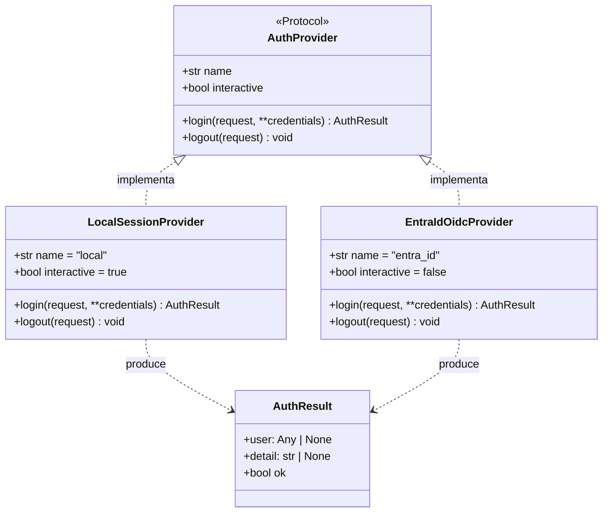
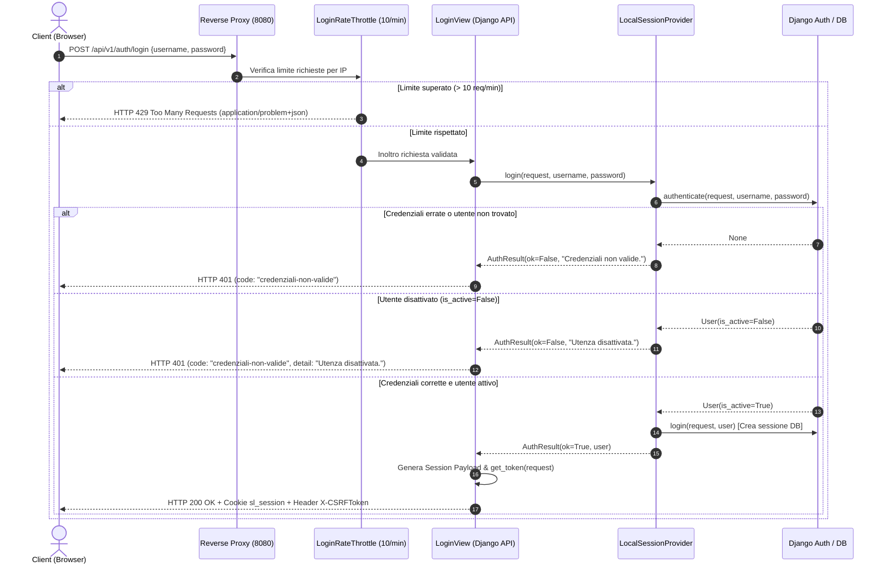
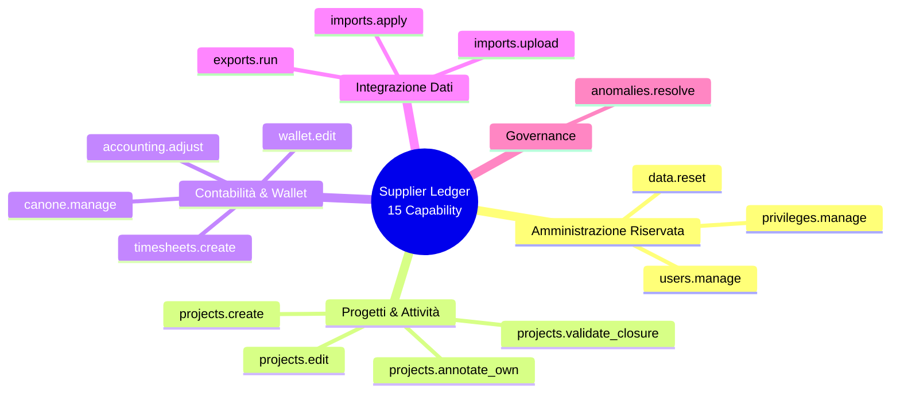
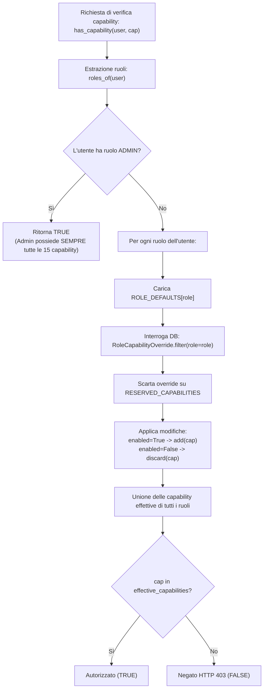
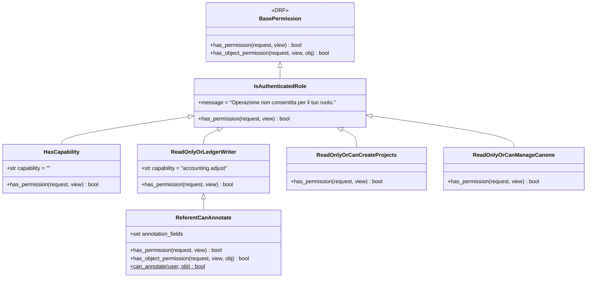

# Modello di Sicurezza e Autorizzazione (Security & Authorization)

Questo documento descrive in dettaglio il modello architetturale di autenticazione, autorizzazione, controllo degli accessi e audit implementato nel sistema **Supplier Ledger**. L'infrastruttura di sicurezza adotta un approccio **Defense in Depth** a triplo strato:
1. **Perimetro di Rete e Reverse Proxy** (Nginx TLS, internal media routing, rate limiting);
2. **Server-Side Authorization** (Django Session, RBAC basato su Django Groups, CBAC con 15 capability granulari e DRF permission classes);
3. **Client-Side Authorization** (React Context, SessionProvider, Route Guards e rendering condizionale dell'interfaccia).

Per i riferimenti al modello dati generale consultare [06_DATA_MODEL.md](06_DATA_MODEL.md). Per il catalogo degli endpoint e dei workflow operativi consultare [07_API_CATALOG.md](07_API_CATALOG.md), [04_WORKFLOW_CATALOG.md](04_WORKFLOW_CATALOG.md) e [08_BUSINESS_RULES.md](08_BUSINESS_RULES.md).

---

## 1. Matrice di Sintesi dei Componenti di Sicurezza

| Componente | Ambito | Implementazione | File di Riferimento | Stato |
|:---|:---|:---|:---|:---:|
| **Provider Pattern Autenticazione** | Autenticazione | `LocalSessionProvider` attivo, `EntraIdOidcProvider` predisposto | [`backend/core/auth/providers.py`](file:///c:/Users/gianvito.bleve/OneDrive%20-%20Banca%20Mediolanum%20SPA/Documenti/Progetti/imola/backend/core/auth/providers.py#L1-L87) | **IMPLEMENTED** (Locale) / **NOT_IMPLEMENTED** (Entra ID) |
| **Flusso di Login e Throttling** | API Autenticazione | `LoginView` con `LoginRateThrottle` (10/min), CSRF token in header | [`backend/api/auth_views.py`](file:///c:/Users/gianvito.bleve/OneDrive%20-%20Banca%20Mediolanum%20SPA/Documenti/Progetti/imola/backend/api/auth_views.py#L50-L77) | **IMPLEMENTED** |
| **Session Management Trasparente** | Gestione Sessione | Cookie `sl_session` (8h), intercettazione 401 e `SessionExpiredDialog` | [`frontend/src/features/auth/SessionExpiredDialog.tsx`](file:///c:/Users/gianvito.bleve/OneDrive%20-%20Banca%20Mediolanum%20SPA/Documenti/Progetti/imola/frontend/src/features/auth/SessionExpiredDialog.tsx#L15-L87) | **IMPLEMENTED** |
| **Ruoli Applicativi (RBAC)** | Ruoli e Gruppi | 4 ruoli mappati su gruppi Django (`admin`, `responsabile_bmed`, `referente_bmed`, `fornitore`) | [`backend/core/roles.py`](file:///c:/Users/gianvito.bleve/OneDrive%20-%20Banca%20Mediolanum%20SPA/Documenti/Progetti/imola/backend/core/roles.py#L1-L49) | **IMPLEMENTED** |
| **Catalogo Capability (CBAC)** | Autorizzazioni | 15 capability canoniche, 3 riservate ad Admin, default per ruolo | [`backend/core/capabilities.py`](file:///c:/Users/gianvito.bleve/OneDrive%20-%20Banca%20Mediolanum%20SPA/Documenti/Progetti/imola/backend/core/capabilities.py#L1-L108) | **IMPLEMENTED** |
| **Override Dinamico Privilegi** | Autorizzazioni DB | Modello `RoleCapabilityOverride`, risoluzione dinamica a runtime | [`backend/core/models.py`](file:///c:/Users/gianvito.bleve/OneDrive%20-%20Banca%20Mediolanum%20SPA/Documenti/Progetti/imola/backend/core/models.py#L17-L35) | **IMPLEMENTED** |
| **Permission Classes DRF** | Autorizzazione API | 14 classi puntuali, permessi compositi (`ReferentCanAnnotate`, `ReadOnlyOrCanManageCanone`) | [`backend/core/permissions.py`](file:///c:/Users/gianvito.bleve/OneDrive%20-%20Banca%20Mediolanum%20SPA/Documenti/Progetti/imola/backend/core/permissions.py#L1-L164) | **IMPLEMENTED** |
| **Frontend Permissions & Guards** | Autorizzazione UI | Modulo `permissions.ts`, hook `useSession()`, route guard in `App.tsx` | [`frontend/src/lib/permissions.ts`](file:///c:/Users/gianvito.bleve/OneDrive%20-%20Banca%20Mediolanum%20SPA/Documenti/Progetti/imola/frontend/src/lib/permissions.ts#L1-L104) | **IMPLEMENTED** |
| **Contesto Utente e Middleware** | Tracciabilità | `CurrentUserMiddleware` con `ContextVar`, helper `acting_as` | [`backend/core/middleware.py`](file:///c:/Users/gianvito.bleve/OneDrive%20-%20Banca%20Mediolanum%20SPA/Documenti/Progetti/imola/backend/core/middleware.py#L1-L22) | **IMPLEMENTED** |
| **Audit Log Amministrativo** | Tracciabilità & Audit | Modello `AdminAuditEvent` per modifiche a utenti, ruoli, referenti e reset | [`backend/core/models.py`](file:///c:/Users/gianvito.bleve/OneDrive%20-%20Banca%20Mediolanum%20SPA/Documenti/Progetti/imola/backend/core/models.py#L37-L60) | **IMPLEMENTED** |
| **Storicizzazione Modelli** | Tracciabilità & Audit | `TrackedModel` (UUID, autore, versione) + `HistoricalRecords` su 17 modelli | [`backend/core/models.py`](file:///c:/Users/gianvito.bleve/OneDrive%20-%20Banca%20Mediolanum%20SPA/Documenti/Progetti/imola/backend/core/models.py#L67-L106) | **IMPLEMENTED** |
| **Problem Details RFC 7807** | Error Handling | Eccezioni tipizzate in italiano (`DomainError`, `SessionExpired`, `StaleResource`) | [`backend/core/exceptions.py`](file:///c:/Users/gianvito.bleve/OneDrive%20-%20Banca%20Mediolanum%20SPA/Documenti/Progetti/imola/backend/core/exceptions.py#L1-L145) | **IMPLEMENTED** |
| **Operazioni Sensibili Protette** | Sicurezza Operativa | Token crittografico 300s + parola "ELIMINA", backup con preventiva | [`backend/api/admin_views.py`](file:///c:/Users/gianvito.bleve/OneDrive%20-%20Banca%20Mediolanum%20SPA/Documenti/Progetti/imola/backend/api/admin_views.py#L590-L752) | **IMPLEMENTED** |
| **Internal Media Protection** | Protezione Risorse | Direttiva `internal;` in Nginx per i file in `/srv/media/` | [`deploy/nginx.conf`](file:///c:/Users/gianvito.bleve/OneDrive%20-%20Banca%20Mediolanum%20SPA/Documenti/Progetti/imola/deploy/nginx.conf#L50-L53) | **IMPLEMENTED** |

---

## 2. Autenticazione (Authentication Engine)

### 2.1 Pattern Architetturale Provider

L'infrastruttura di autenticazione è disaccoppiata tramite un pattern **Provider** definito in [`backend/core/auth/providers.py`](file:///c:/Users/gianvito.bleve/OneDrive%20-%20Banca%20Mediolanum%20SPA/Documenti/Progetti/imola/backend/core/auth/providers.py#L1-L87). L'astrazione consente di commutare o affiancare molteplici fonti di identità senza impattare i controller o le logiche di dominio.



#### Descrizione dei Provider
1. **`LocalSessionProvider`** (**IMPLEMENTED** - Attivo in v1):
   - Configurato come default via `settings.AUTH_PROVIDER = "local"` ([`backend/config/settings/base.py:112`](file:///c:/Users/gianvito.bleve/OneDrive%20-%20Banca%20Mediolanum%20SPA/Documenti/Progetti/imola/backend/config/settings/base.py#L112)).
   - Riceve `username` e `password`, effettua la verifica tramite `django.contrib.auth.authenticate()` e stabilisce la sessione server-side con `django.contrib.auth.login()`.
   - Verifica lo stato di attivazione dell'account: se `user.is_active` è `False`, l'accesso viene respinto restituendo `AuthResult(None, "Utenza disattivata.")`.
2. **`EntraIdOidcProvider`** (**NOT_IMPLEMENTED** - Predisposto per v2):
   - Segnaposto per federazione identità aziendale Microsoft Entra ID tramite protocollo OpenID Connect (OIDC).
   - Invocare il login solleva `NotImplementedError("Il provider Microsoft Entra ID non è attivo in questa versione.")`.
   - L'attivazione richiede l'inclusione del modulo OIDC e l'impostazione della variabile d'ambiente `AUTH_PROVIDER=entra_id`.

La risoluzione a runtime avviene mediante la funzione factory `get_auth_provider()`, che interroga il dizionario `_PROVIDERS`:
```python
# backend/core/auth/providers.py:81-86
def get_auth_provider() -> AuthProvider:
    name = getattr(settings, "AUTH_PROVIDER", "local")
    provider_cls = _PROVIDERS.get(name)
    if provider_cls is None:
        raise RuntimeError(f"Provider di autenticazione sconosciuto: {name}")
    return provider_cls()
```

---

### 2.2 Flusso di Login (Login Flow & Throttling)

Il login viene gestito dall'endpoint `POST /api/v1/auth/login` tramite la classe `LoginView` ([`backend/api/auth_views.py:50-77`](file:///c:/Users/gianvito.bleve/OneDrive%20-%20Banca%20Mediolanum%20SPA/Documenti/Progetti/imola/backend/api/auth_views.py#L50-L77)):



#### Dettagli Tecnici dell'Endpoint di Login
- **Permessi**: `permission_classes = [AllowAny]` ([`backend/api/auth_views.py:51`](file:///c:/Users/gianvito.bleve/OneDrive%20-%20Banca%20Mediolanum%20SPA/Documenti/Progetti/imola/backend/api/auth_views.py#L51)).
- **Throttling**: `throttle_classes = [LoginRateThrottle]`, con `scope = "login"`. La frequenza è configurabile mediante la variabile `LOGIN_THROTTLE_RATE` (default `10/min`, definita in [`backend/config/settings/base.py:148`](file:///c:/Users/gianvito.bleve/OneDrive%20-%20Banca%20Mediolanum%20SPA/Documenti/Progetti/imola/backend/config/settings/base.py#L148)).
- **Serializzazione Input**: `LoginSerializer` valida che `username` e `password` siano presenti, disabilitando esplicitamente il trimming per la password (`trim_whitespace=False`).
- **Risposta di Successo**: HTTP 200 OK contenente il payload della sessione. Nei response header viene iniettato `X-CSRFToken` generato da `django.middleware.csrf.get_token(request)`.

---

### 2.3 Session Management e Riconnessione Trasparente

Il ciclo di vita della sessione è governato dal motore standard di Django basato su cookie e persistenza su PostgreSQL (`django.contrib.sessions`):

| Parametro Impostazione | Valore Base / Sviluppo | Valore Produzione (`prod.py`) | Descrizione |
|:---|:---|:---|:---|
| `SESSION_COOKIE_NAME` | `"sl_session"` | `"sl_session"` | Nome del cookie identificativo di sessione |
| `SESSION_COOKIE_AGE` | `28800` secondi (8 ore) | `28800` (configurabile via `.env`) | Durata massima della sessione senza rinnovo |
| `SESSION_COOKIE_HTTPONLY` | `True` | `True` | Impedisce l'accesso al cookie via script JavaScript |
| `SESSION_COOKIE_SAMESITE` | `"Lax"` | `"Lax"` | Protezione da attacchi CSRF cross-site |
| `SESSION_COOKIE_SECURE` | `False` | `True` (`COOKIE_SECURE=True`) | Vincola la trasmissione del cookie unicamente su HTTPS |
| `CSRF_COOKIE_NAME` | `"sl_csrftoken"` | `"sl_csrftoken"` | Nome del cookie contenente il token CSRF |
| `CSRF_COOKIE_HTTPONLY` | `False` | `False` | Permette al client frontend di leggere il token per le chiamate API |
| `CSRF_COOKIE_SECURE` | `False` | `True` (`COOKIE_SECURE=True`) | Cookie CSRF trasmesso solo su canale sicuro HTTPS |
| `CSRF_TRUSTED_ORIGINS` | `http://localhost:8080` | Da variabile d'ambiente | Origini ammesse per la validazione CSRF |

#### Gestione della Sessione Scaduta (Seamless Re-Login)
Se una richiesta API autenticata viene inviata con sessione scaduta o mancante:
1. Il custom exception handler `problem_detail_handler` ([`backend/core/exceptions.py:119-121`](file:///c:/Users/gianvito.bleve/OneDrive%20-%20Banca%20Mediolanum%20SPA/Documenti/Progetti/imola/backend/core/exceptions.py#L119-L121)) intercetta l'errore DRF `NotAuthenticated` e forza lo status `401 Unauthorized` impostando la problem detail RFC 7807:
   ```json
   {
     "type": "https://supplier-ledger.local/errors/session_expired",
     "title": "Autenticazione necessaria",
     "status": 401,
     "code": "session_expired",
     "detail": "Sessione scaduta: effettua di nuovo l'accesso."
   }
   ```
2. Il client frontend intercetta l'evento tramite `onSessionExpired` registrato in [`frontend/src/features/auth/session.tsx:71`](file:///c:/Users/gianvito.bleve/OneDrive%20-%20Banca%20Mediolanum%20SPA/Documenti/Progetti/imola/frontend/src/features/auth/session.tsx#L71).
3. Viene visualizzato il dialogo modale non dismissibile [`SessionExpiredDialog`](file:///c:/Users/gianvito.bleve/OneDrive%20-%20Banca%20Mediolanum%20SPA/Documenti/Progetti/imola/frontend/src/features/auth/SessionExpiredDialog.tsx#L15-L87). L'utente inserisce le credenziali e rieffettua l'autenticazione **senza ricaricare la pagina** (`location.reload()` non viene invocato), preservando moduli aperti, filtri selezionati e bozze in corso.

#### Endpoint Informativo di Sessione (`/api/v1/auth/session`)
L'endpoint `GET /api/v1/auth/session` ([`backend/api/auth_views.py:88-97`](file:///c:/Users/gianvito.bleve/OneDrive%20-%20Banca%20Mediolanum%20SPA/Documenti/Progetti/imola/backend/api/auth_views.py#L88-L97)) è protetto da `IsAuthenticated` ed è utilizzato all'inizializzazione del client React. Restituisce il payload generato dalla funzione `session_payload()`:
```json
{
  "username": "demo_responsabile",
  "full_name": "Mario Rossi",
  "email": "responsabile@demo.local",
  "roles": ["responsabile_bmed"],
  "capabilities": [
    "accounting.adjust", "anomalies.resolve", "canone.manage", "exports.run",
    "imports.apply", "imports.upload", "projects.annotate_own", "projects.create",
    "projects.edit", "projects.validate_closure", "timesheets.create", "wallet.edit"
  ],
  "is_admin": false,
  "can_write": true
}
```

---

## 3. Ruoli Applicativi (RBAC)

Il sistema adotta un modello RBAC canonico con **4 ruoli applicativi**, implementati in [`backend/core/roles.py`](file:///c:/Users/gianvito.bleve/OneDrive%20-%20Banca%20Mediolanum%20SPA/Documenti/Progetti/imola/backend/core/roles.py#L1-L49) e mappati direttamente sui gruppi nativi di Django (`django.contrib.auth.models.Group`):

| Costante Ruolo | Nome Gruppo DB | Label Interfaccia | Descrizione Funzionale |
|:---|:---|:---|:---|
| `ADMIN` | `"admin"` | Amministratore | Gestione globale di sistema, utenti, configurazioni, privilegi, reset dati e backup. |
| `MANAGER` | `"responsabile_bmed"` | Responsabile BMED | Supervisione strategica, gestione contratti a canone, approvazione import, allocazione wallet e riconciliazione. |
| `REFERENT` | `"referente_bmed"` | Referente BMED | Referente operativo/tecnico di specifici progetti; annotazione note e chiusura punti di verifica assegnati. |
| `SUPPLIER` | `"fornitore"` | Fornitore (Imola) | Compilazione consuntivi/timesheet, proposta nuovi progetti, validazione chiusura tecnica e caricamento estratti PPM in DRY_RUN. |

### Risoluzione Ruoli ed Eredità Superuser
La funzione `roles_of(user)` calcola l'insieme dei ruoli effettivi dell'utente:
```python
# backend/core/roles.py:27-33
def roles_of(user) -> set[str]:
    if user is None or not user.is_authenticated:
        return set()
    roles = set(user.groups.values_list("name", flat=True)) & set(ALL_ROLES)
    if user.is_superuser:
        roles.add(ADMIN)
    return roles
```
- **Superuser Injection**: se un account ha `is_superuser = True`, il ruolo `admin` viene aggiunto d'ufficio ai suoi ruoli effettivi, anche in assenza di appartenenza formale al gruppo.
- **Idempotenza Gruppi**: il comando CLI `bootstrap_roles` ([`backend/core/management/commands/bootstrap_roles.py`](file:///c:/Users/gianvito.bleve/OneDrive%20-%20Banca%20Mediolanum%20SPA/Documenti/Progetti/imola/backend/core/management/commands/bootstrap_roles.py#L1-L27)), eseguito all'avvio del container Docker, assicura la creazione di tutti i 4 gruppi mediante `roles.ensure_groups()`.

---

## 4. Capability Granulari (CBAC)

Per superare la rigidità del solo RBAC e consentire una delega puntuale dei privilegi, il sistema definisce un livello di **Capability-Based Access Control (CBAC)** in [`backend/core/capabilities.py`](file:///c:/Users/gianvito.bleve/OneDrive%20-%20Banca%20Mediolanum%20SPA/Documenti/Progetti/imola/backend/core/capabilities.py#L1-L108).

### 4.1 Catalogo delle 15 Capability Canoniche



| ID Capability | Costante Simbolica | Riservata Admin? | Descrizione Funzionale |
|:---|:---|:---:|:---|
| `data.reset` | `RESET_DATA` | **SÌ** | Cancellazione atomica totale dei dati operativi dell'applicazione. |
| `users.manage` | `MANAGE_USERS` | **SÌ** | Creazione, aggiornamento, disattivazione utenze e reset password. |
| `privileges.manage` | `MANAGE_PRIVILEGES`| **SÌ** | Configurazione e override delle capability associate ai ruoli. |
| `projects.create` | `CREATE_PROJECTS` | No | Apertura e censimento di nuove schede progetto a mastro. |
| `projects.edit` | `EDIT_PROJECTS` | No | Modifica di anagrafica, contratti, date e tariffe di qualsiasi progetto. |
| `projects.validate_closure`| `VALIDATE_PROJECT_CLOSURE`| No | Assegnazione stato chiusura tecnica/consuntiva del progetto. |
| `projects.annotate_own` | `ANNOTATE_OWN_PROJECTS`| No | Annotazione note e punti di verifica sui progetti di cui si è referenti. |
| `timesheets.create` | `CREATE_TIMESHEETS` | No | Registrazione a registro di consuntivi e rendicontazioni orarie. |
| `wallet.edit` | `EDIT_WALLET` | No | Creazione anni wallet, tranche di funding e movimentazioni allocative. |
| `canone.manage` | `MANAGE_CANONE` | No | Amministrazione schede canone semestrale e organico allargato. |
| `accounting.adjust` | `ADJUST_ACCOUNTING` | No | Rettifiche contabili a libro mastro e registrazione storni. |
| `imports.upload` | `UPLOAD_IMPORTS` | No | Caricamento file grezzi e avvio simulazione DRY_RUN import. |
| `imports.apply` | `APPLY_IMPORTS` | No | Scrittura persistente e definitiva dei dati estratti da batch import. |
| `exports.run` | `EXPORT_DATA` | No | Generazione ed estrazione dei report analitici Excel/CSV. |
| `anomalies.resolve` | `RESOLVE_ANOMALIES` | No | Presa in carico, giustificazione o risoluzione anomalie del mastro. |

---

### 4.2 Matrice Predefinita Ruoli / Capability (`ROLE_DEFAULTS`)

La configurazione iniziale di fabbrica associa le capability ai ruoli come segue:

| Capability | Admin (`admin`) | Responsabile BMED (`responsabile_bmed`) | Referente BMED (`referente_bmed`) | Fornitore (`fornitore`) |
|:---|:---:|:---:|:---:|:---:|
| `data.reset` | ✅ | ❌ | ❌ | ❌ |
| `users.manage` | ✅ | ❌ | ❌ | ❌ |
| `privileges.manage` | ✅ | ❌ | ❌ | ❌ |
| `projects.create` | ✅ | ✅ | ❌ | ✅ |
| `projects.edit` | ✅ | ✅ | ❌ | ❌ |
| `projects.validate_closure`| ✅ | ✅ | ❌ | ✅ |
| `projects.annotate_own` | ✅ | ✅ | ✅ | ❌ |
| `timesheets.create` | ✅ | ✅ | ❌ | ✅ |
| `wallet.edit` | ✅ | ✅ | ❌ | ❌ |
| `canone.manage` | ✅ | ✅ | ❌ | ❌ |
| `accounting.adjust` | ✅ | ✅ | ❌ | ❌ |
| `imports.upload` | ✅ | ✅ | ❌ | ✅ |
| `imports.apply` | ✅ | ✅ | ❌ | ❌ |
| `exports.run` | ✅ | ✅ | ✅ | ✅ |
| `anomalies.resolve` | ✅ | ✅ | ❌ | ❌ |
| **Totale Capability Attive**| **15 / 15** | **12 / 15** | **2 / 15** | **5 / 15** |

---

### 4.3 Override Dinamico e Risoluzione dei Privilegi

Il sistema supporta la personalizzazione dinamica dei privilegi assegnati ai singoli ruoli tramite il modello `RoleCapabilityOverride` ([`backend/core/models.py:17-35`](file:///c:/Users/gianvito.bleve/OneDrive%20-%20Banca%20Mediolanum%20SPA/Documenti/Progetti/imola/backend/core/models.py#L17-L35)):



#### Regole di Sicurezza sugli Override
1. **Inviolabilità di Admin**: l'Amministratore non può essere depotenziato. La funzione `capabilities_for_role(role)` restituisce `set(ALL_CAPABILITIES)` immediatamente se `role == roles.ADMIN` ([`backend/core/capabilities.py:80-81`](file:///c:/Users/gianvito.bleve/OneDrive%20-%20Banca%20Mediolanum%20SPA/Documenti/Progetti/imola/backend/core/capabilities.py#L80-L81)). Qualsiasi tentativo di modifica via API restituisce `HTTP 409 Conflict` ("I privilegi Admin non sono riducibili.").
2. **Isolamento delle Capability Riservate (`RESERVED_CAPABILITIES`)**:
   `RESERVED_CAPABILITIES = frozenset({RESET_DATA, MANAGE_USERS, MANAGE_PRIVILEGES})`.
   Nessun ruolo non-admin può ricevere queste capability, neanche tramite record su DB: la logica scarta esplicitamente tali record sia in fase di scrittura su `PUT /api/v1/admin/roles/capabilities` (`HTTP 400 Bad Request`), sia in fase di valutazione in `capabilities_for_role()`.

---

## 5. Server-Side Enforcement: Permission Classes DRF

L'autorizzazione applicativa è rigidamente applicata su ciascuna View REST di Django REST Framework (DRF) tramite la gerarchia di permission classes definita in [`backend/core/permissions.py`](file:///c:/Users/gianvito.bleve/OneDrive%20-%20Banca%20Mediolanum%20SPA/Documenti/Progetti/imola/backend/core/permissions.py#L1-L164):



### 5.1 Catalogo delle Permission Classes DRF

| Permission Class | Classe Base | Capability Verificata | Metodi Controllati |
|:---|:---|:---|:---|
| **`IsAuthenticatedRole`** | `BasePermission` | Nessuna (solo autenticazione) | Tutti i verbi HTTP |
| **`HasCapability`** | `IsAuthenticatedRole` | Specifica della sottoclasse | Tutti i verbi HTTP |
| **`IsAdmin`** | `HasCapability` | `privileges.manage` | Tutti i verbi HTTP |
| **`CanResetData`** | `HasCapability` | `data.reset` | Tutti i verbi HTTP |
| **`CanManageUsers`** | `HasCapability` | `users.manage` | Tutti i verbi HTTP |
| **`CanManagePrivileges`** | `HasCapability` | `privileges.manage` | Tutti i verbi HTTP |
| **`CanCreateProjects`** | `HasCapability` | `projects.create` | Tutti i verbi HTTP |
| **`CanEditProjects`** | `HasCapability` | `projects.edit` | Tutti i verbi HTTP |
| **`CanValidateProjectClosure`** | `HasCapability` | `projects.validate_closure` | Tutti i verbi HTTP |
| **`CanCreateTimesheets`** | `HasCapability` | `timesheets.create` | Tutti i verbi HTTP |
| **`CanEditWallet`** | `HasCapability` | `wallet.edit` | Tutti i verbi HTTP |
| **`CanAdjustAccounting`** | `HasCapability` | `accounting.adjust` | Tutti i verbi HTTP |
| **`CanResolveAnomalies`** | `HasCapability` | `anomalies.resolve` | Tutti i verbi HTTP |
| **`CanExport`** | `HasCapability` | `exports.run` | Tutti i verbi HTTP |
| **`CanUploadImports`** | `HasCapability` | `imports.upload` | POST / Upload batch |
| **`CanApplyImports`** | `HasCapability` | `imports.apply` | POST / Applicazione a mastro |
| **`AdministratorOnly`** | `BasePermission` | `is_admin(request.user)` | Backup e ripristino DB fisici |

---

### 5.2 Pattern Compositi e Object-Level Permissions

Per gli endpoint di dominio che offrono consultazione aperta agli utenti autenticati ma mutazioni riservate, sono implementate classi composite:

#### 1. `ReadOnlyOrCanCreateProjects` ([`backend/core/permissions.py:60-67`](file:///c:/Users/gianvito.bleve/OneDrive%20-%20Banca%20Mediolanum%20SPA/Documenti/Progetti/imola/backend/core/permissions.py#L60-L67))
- Metodi `SAFE_METHODS` (`GET`, `HEAD`, `OPTIONS`): ammessi a qualunque utente autenticato.
- Metodo `POST`: consentito esclusivamente in possesso della capability `projects.create`.

#### 2. `ReadOnlyOrCanManageCanone` ([`backend/core/permissions.py:73-82`](file:///c:/Users/gianvito.bleve/OneDrive%20-%20Banca%20Mediolanum%20SPA/Documenti/Progetti/imola/backend/core/permissions.py#L73-L82))
- Metodi di lettura: ammessi a tutti gli autenticati per consultazione KPI e schede canone.
- Mutazioni (`POST`, `PUT`, `PATCH`, `DELETE`): riservate agli utenti con capability `canone.manage`.

#### 3. `ReferentCanAnnotate` ([`backend/core/permissions.py:109-154`](file:///c:/Users/gianvito.bleve/OneDrive%20-%20Banca%20Mediolanum%20SPA/Documenti/Progetti/imola/backend/core/permissions.py#L109-L154))
Questa permission modella la segregazione operativa sui progetti assegnati al Referente BMED:
- **Lettura (`SAFE_METHODS`)**: consentita a tutti gli utenti autenticati.
- **Modifica Completa**: consentita se l'utente possiede la capability `projects.edit` (es. Responsabile BMED o Admin).
- **Annotazione Parziale (Referente)**: se l'utente possiede `projects.annotate_own`:
  1. È ammesso **solo** il verbo HTTP `PATCH`.
  2. I campi inviati nel payload devono essere un sottoinsieme stretto di `{"notes", "verification_points", "planned_end_date", "expected_version"}` ([`linea 116`](file:///c:/Users/gianvito.bleve/OneDrive%20-%20Banca%20Mediolanum%20SPA/Documenti/Progetti/imola/backend/core/permissions.py#L116)).
  3. **Verifica di Oggetto (`has_object_permission`)**: il metodo statico `can_annotate(user, obj)` verifica che l'utente sia l'effettivo proprietario/referente del progetto. Il controllo verifica la corrispondenza dell'email (`owner.email == user.email`) o la combinazione di nome e cognome (`user.username in f"{owner.first_name}{owner.last_name}"`).

#### 4. Segregazione degli Import (`CanUploadImports` vs `CanApplyImports`)
Il Fornitore possiede la capability `imports.upload` ma **NON** `imports.apply`.
- L'endpoint `POST /api/v1/imports/preview` o l'upload del file PPM consente al fornitore di caricare l'estratto ed eseguire la simulazione (`DRY_RUN`), verificando discrepanze e anomalie.
- L'applicazione effettiva a libro mastro (`status = APPLIED`) richiede l'endpoint protetto da `CanApplyImports`, riservato al Responsabile BMED o all'Amministratore.

---

## 6. Client-Side Authorization (Frontend)

L'autorizzazione nel frontend React riflette esattamente le regole server-side per garantire un'esperienza d'uso coerente, disabilitando elementi o nascondendo percorsi inaccessibili:

### 6.1 Contesto di Sessione (`SessionProvider` & `useSession`)
Definito in [`frontend/src/features/auth/session.tsx`](file:///c:/Users/gianvito.bleve/OneDrive%20-%20Banca%20Mediolanum%20SPA/Documenti/Progetti/imola/frontend/src/features/auth/session.tsx#L1-L107), il contesto interroga l'endpoint `/api/v1/auth/session` all'avvio. L'interfaccia TypeScript `Session` espone:
```typescript
// frontend/src/features/auth/session.tsx:6-15
export interface Session {
  username: string;
  full_name: string;
  email: string;
  roles: string[];
  capabilities?: string[];
  is_admin: boolean;
  can_write: boolean;
}
```

### 6.2 Libreria di Verifica Capability (`permissions.ts`)
Il modulo [`frontend/src/lib/permissions.ts`](file:///c:/Users/gianvito.bleve/OneDrive%20-%20Banca%20Mediolanum%20SPA/Documenti/Progetti/imola/frontend/src/lib/permissions.ts#L1-L104) dichiara l'oggetto canonico `CAPABILITIES` ed esporta la funzione di test `hasCapability`:
```typescript
// frontend/src/lib/permissions.ts:27-35
export function hasCapability(
  session: Session | null,
  capability: Capability,
  legacyFallback: (session: Session) => boolean = () => false,
): boolean {
  if (!session) return false;
  if (Array.isArray(session.capabilities)) return session.capabilities.includes(capability);
  return legacyFallback(session);
}
```

#### Helper Esportati per Componenti UI
- `canManageCanone(session)`: abilita i pulsanti di modifica sul modulo canone.
- `canWriteLedger(session)` / `canAdjustAccounting(session)`: abilita storni e variazioni di bilancio.
- `canCreateTimesheets(session)`: abilita l'inserimento di consuntivi orari.
- `canAdminister(session)`: abilita la visibilità della voce di navigazione e della pagina **Amministrazione**.
- `canResetData(session)`: abilita il pulsante di apertura del dialogo distruttivo di reset database.
- `canCreateProjects(session)` / `canEditProjects(session)`: governa form e modali sui progetti.
- `canValidateProjectClosure(session)`: governa il drawer di validazione tecnica chiusura.
- `canAnnotateOwnProjects(session)`: abilita la modifica in-place di note e chiusura punti di verifica per i referenti.
- `canUploadPpmDryRun(session)`: abilita l'area di drag-and-drop degli estratti PPM.

### 6.3 Route Guards e Rendering Condizionale
1. **Route Guard Globale** ([`frontend/src/App.tsx:63-74`](file:///c:/Users/gianvito.bleve/OneDrive%20-%20Banca%20Mediolanum%20SPA/Documenti/Progetti/imola/frontend/src/App.tsx#L63-L74)):
   - Se `status === "loading"`: renderizza lo stato `LoadingState`.
   - Se `status === "anonymous"`: renderizza la pagina `<LoginPage />`.
   - Se `status === "authenticated"`: apre la shell principale `<AppShell />` contenente le rotte applicative.
2. **Navigazione Laterale Protetta** ([`frontend/src/components/AppShell.tsx:111-128`](file:///c:/Users/gianvito.bleve/OneDrive%20-%20Banca%20Mediolanum%20SPA/Documenti/Progetti/imola/frontend/src/components/AppShell.tsx#L111-L128)):
   Il link alla route `/amministrazione` è racchiuso nella guardia condizionale `{canAdminister(session) && <NavLink to="/amministrazione".../>}`.
3. **Pannelli di Amministrazione Granulari** ([`frontend/src/features/admin/AdminPage.tsx`](file:///c:/Users/gianvito.bleve/OneDrive%20-%20Banca%20Mediolanum%20SPA/Documenti/Progetti/imola/frontend/src/features/admin/AdminPage.tsx)):
   I singoli tab (Utenti, Referenti, Ruoli, Configurazione, Reset Database) verificano le capability correlate prima di renderizzare comandi di mutazione.

---

## 7. Middleware, Tracciamento e Audit

### 7.1 `CurrentUserMiddleware` e Thread-Local Context
Per consentire ai modelli Django di tracciare l'autore delle modifiche senza passare esplicitamente l'oggetto `request` attraverso tutti i layer di servizio, è attivo il middleware custom `CurrentUserMiddleware` ([`backend/core/middleware.py`](file:///c:/Users/gianvito.bleve/OneDrive%20-%20Banca%20Mediolanum%20SPA/Documenti/Progetti/imola/backend/core/middleware.py#L1-L22)):
- All'inizio della richiesta HTTP, invoca `set_current_user(request.user)`, memorizzando l'utente autenticato all'interno di una variabile asincrona sicura `ContextVar` (`_current_user` in [`backend/core/current_user.py`](file:///c:/Users/gianvito.bleve/OneDrive%20-%20Banca%20Mediolanum%20SPA/Documenti/Progetti/imola/backend/core/current_user.py#L1-L31)).
- Nel blocco `finally`, azzera il contesto con `set_current_user(None)` prevenendo memory leak o contaminazione cross-request nei thread pool.
- Per script di manutenzione e test unitari è fornito il context manager `acting_as(user)`.

---

### 7.2 Modello Astratto `TrackedModel` e Concorrenza Ottimistica
Tutte le entità persistite nel sistema ereditano dalla classe astratta `TrackedModel` ([`backend/core/models.py:67-106`](file:///c:/Users/gianvito.bleve/OneDrive%20-%20Banca%20Mediolanum%20SPA/Documenti/Progetti/imola/backend/core/models.py#L67-L106)):
- **Chiave Primaria**: identificativo UUIDv4 (`id = models.UUIDField(primary_key=True, default=uuid.uuid4)`).
- **Tracciamento Autore**: `created_by` e `updated_by` collegati a `settings.AUTH_USER_MODEL`, popolati in automatico nel metodo `save()` leggendo `get_current_user()`.
- **Timestamping**: `created_at` (`auto_now_add=True`) e `updated_at` (`auto_now=True`).
- **Locking Ottimistico**: campo `version = models.PositiveIntegerField(default=1)`. Ogni operazione di update incrementa la versione. Gli endpoint REST impongono l'intestazione HTTP `If-Match` verificando la corrispondenza con la versione corrente ed emettendo `HTTP 409 Conflict` (`StaleResource`) in caso di collisione.

---

### 7.3 Log delle Operazioni Amministrative (`AdminAuditEvent`)
Gli eventi a elevato impatto di sicurezza sono registrati nella tabella immutabile `AdminAuditEvent` ([`backend/core/models.py:37-60`](file:///c:/Users/gianvito.bleve/OneDrive%20-%20Banca%20Mediolanum%20SPA/Documenti/Progetti/imola/backend/core/models.py#L37-L60)):
```python
class AdminAuditEvent(models.Model):
    actor = models.ForeignKey(settings.AUTH_USER_MODEL, null=True, blank=True, on_delete=models.SET_NULL)
    actor_username = models.CharField(max_length=150, blank=True)
    action = models.CharField(max_length=64)
    target_type = models.CharField(max_length=32)
    target_id = models.CharField(max_length=128, blank=True)
    target_label = models.CharField(max_length=150, blank=True)
    details = models.JSONField(default=dict, blank=True)
    created_at = models.DateTimeField(auto_now_add=True, db_index=True)
```

#### Eventi Amministrativi Tracciati
- `data.reset`: cancellazione totale dati operativi (include dettaglio record cancellati per entità).
- `user.created` / `user.updated` / `user.deleted`: creazione, aggiornamento ruoli, eliminazione account.
- `user.password_set`: reimpostazione password da parte dell'amministratore (nessun segreto memorizzato).
- `referent.created` / `referent.updated` / `referent.deactivated`: gestione anagrafica referenti.
- `role.capabilities_updated`: aggiornamento matrice delle capability per un ruolo.

---

### 7.4 Storicizzazione Completa con `HistoricalRecords`
Oltre all'audit log amministrativo, 17 modelli di dominio integrano la libreria `django-simple-history` tramite il campo `history = HistoricalRecords()`. Ciascuna modifica genera una riga di audit storico immutabile contenente snapshot dei campi, data/ora, autore della richiesta e tipo di mutazione (`+` inserimento, `~` modifica, `-` cancellazione):

1. `AppSettings` ([`backend/core/models.py:145`](file:///c:/Users/gianvito.bleve/OneDrive%20-%20Banca%20Mediolanum%20SPA/Documenti/Progetti/imola/backend/core/models.py#L145))
2. `Project` ([`backend/projects/models.py:153`](file:///c:/Users/gianvito.bleve/OneDrive%20-%20Banca%20Mediolanum%20SPA/Documenti/Progetti/imola/backend/projects/models.py#L153))
3. `ProjectClosure` ([`backend/projects/models.py:254`](file:///c:/Users/gianvito.bleve/OneDrive%20-%20Banca%20Mediolanum%20SPA/Documenti/Progetti/imola/backend/projects/models.py#L254))
4. `TimesheetEntry` ([`backend/timesheets/models.py:87`](file:///c:/Users/gianvito.bleve/OneDrive%20-%20Banca%20Mediolanum%20SPA/Documenti/Progetti/imola/backend/timesheets/models.py#L87))
5. `WalletYear` ([`backend/wallet/models.py:51`](file:///c:/Users/gianvito.bleve/OneDrive%20-%20Banca%20Mediolanum%20SPA/Documenti/Progetti/imola/backend/wallet/models.py#L51))
6. `WalletActivation` ([`backend/wallet/models.py:104`](file:///c:/Users/gianvito.bleve/OneDrive%20-%20Banca%20Mediolanum%20SPA/Documenti/Progetti/imola/backend/wallet/models.py#L104))
7. `WalletTransfer` ([`backend/wallet/models.py:144`](file:///c:/Users/gianvito.bleve/OneDrive%20-%20Banca%20Mediolanum%20SPA/Documenti/Progetti/imola/backend/wallet/models.py#L144))
8. `WalletAllocation` ([`backend/wallet/models.py:236`](file:///c:/Users/gianvito.bleve/OneDrive%20-%20Banca%20Mediolanum%20SPA/Documenti/Progetti/imola/backend/wallet/models.py#L236))
9. `WalletFundingTranche` ([`backend/wallet/models.py:290`](file:///c:/Users/gianvito.bleve/OneDrive%20-%20Banca%20Mediolanum%20SPA/Documenti/Progetti/imola/backend/wallet/models.py#L290))
10. `MonthlyFee` ([`backend/canone/models.py:79`](file:///c:/Users/gianvito.bleve/OneDrive%20-%20Banca%20Mediolanum%20SPA/Documenti/Progetti/imola/backend/canone/models.py#L79))
11. `OrganicoAllargato` ([`backend/canone/models.py:169`](file:///c:/Users/gianvito.bleve/OneDrive%20-%20Banca%20Mediolanum%20SPA/Documenti/Progetti/imola/backend/canone/models.py#L169))
12. `PPMProject` ([`backend/ppm/models.py:57`](file:///c:/Users/gianvito.bleve/OneDrive%20-%20Banca%20Mediolanum%20SPA/Documenti/Progetti/imola/backend/ppm/models.py#L57))
13. `PPMWorkOrder` ([`backend/ppm/models.py:148`](file:///c:/Users/gianvito.bleve/OneDrive%20-%20Banca%20Mediolanum%20SPA/Documenti/Progetti/imola/backend/ppm/models.py#L148))
14. `ClientOwner` ([`backend/directory/models.py:22`](file:///c:/Users/gianvito.bleve/OneDrive%20-%20Banca%20Mediolanum%20SPA/Documenti/Progetti/imola/backend/directory/models.py#L22))
15. `SupplierContact` ([`backend/directory/models.py:60`](file:///c:/Users/gianvito.bleve/OneDrive%20-%20Banca%20Mediolanum%20SPA/Documenti/Progetti/imola/backend/directory/models.py#L60))
16. `ImportBatch` ([`backend/imports/models.py:59`](file:///c:/Users/gianvito.bleve/OneDrive%20-%20Banca%20Mediolanum%20SPA/Documenti/Progetti/imola/backend/imports/models.py#L59))
17. `ProjectAnomaly` ([`backend/anomalies/models.py:168`](file:///c:/Users/gianvito.bleve/OneDrive%20-%20Banca%20Mediolanum%20SPA/Documenti/Progetti/imola/backend/anomalies/models.py#L168))

---

## 8. Formato Risposte di Errore (RFC 7807 Problem Details)

Tutti gli errori HTTP restituiti dalle API del backend sono conformi allo standard **RFC 7807** (`application/problem+json`), implementato centralmente in [`backend/core/exceptions.py`](file:///c:/Users/gianvito.bleve/OneDrive%20-%20Banca%20Mediolanum%20SPA/Documenti/Progetti/imola/backend/core/exceptions.py#L1-L145).

### Struttura Standard del Payload di Errore
```json
{
  "type": "https://supplier-ledger.local/errors/residuo-insufficiente",
  "title": "Richiesta non valida",
  "status": 400,
  "code": "residuo-insufficiente",
  "detail": "Le giornate richieste superano il residuo disponibile del progetto di origine.",
  "instance": "/api/v1/wallet/allocations"
}
```

### Principali Errori Tipizzati
- **`DomainError`** (`code="errore-di-dominio"`, status 400): classe base per errori di business.
- **`InsufficientResidual`** (`code="residuo-insufficiente"`, status 400): richiesta allocativa superiore alla capienza.
- **`ExpiredResidual`** (`code="residuo-scaduto"`, status 400): tentativo di spesa di un residuo oltre la finestra di validità.
- **`OfferNotAccepted`** (`code="offerta-non-accettata"`, status 400): attivazione progetto senza offerta approvata.
- **`ClosureDateRequired`** (`code="data-chiusura-obbligatoria"`, status 400): chiusura consuntiva priva di data.
- **`SessionExpired`** (`code="session_expired"`, status 401): sessione non valida o scaduta.
- **`StaleResource`** (`code="risorsa-obsoleta"`, status 409): collisione di versione nel locking ottimistico.
- **`PreconditionRequired`** (`code="precondizione-richiesta"`, status 428): mancata intestazione `If-Match`.

Tutti i titoli e i messaggi utente sono rigorosamente formulati in **lingua italiana**.

---

## 9. Procedure di Sicurezza per Operazioni Sensibili

Il sistema prevede rigorosi protocolli operativi a protezione delle operazioni critiche che possono comportare perdita di dati, disservizi o escalation di privilegi:

### 9.1 Reset Totale dei Dati Operativi (`/api/v1/admin/data-reset`)
Implementato in [`backend/api/admin_views.py:590-752`](file:///c:/Users/gianvito.bleve/OneDrive%20-%20Banca%20Mediolanum%20SPA/Documenti/Progetti/imola/backend/api/admin_views.py#L590-L752):
- **Autorizzazione**: protetto da `CanResetData` (capability `data.reset`, esclusiva di Admin).
- **Protocollo Two-Step**:
  1. **Fase 1 (GET)**: calcola la preview del numero di record che verrebbero cancellati su 17 tabelle operative (progetti, milestone, consuntivi, wallet, canoni, snapshot PPM, batch import) e genera un token crittografico effimero:
     ```python
     signer = TimestampSigner()
     token = signer.sign(f"{request.user.id}:data.reset")
     ```
  2. **Fase 2 (POST)**: l'utente deve inviare sia il token firmato sia la stringa di conferma `"confirmation": "ELIMINA"`.
  3. **Verifica Crittografica**: il backend convalida la firma del token con TTL massimo di 300 secondi (5 minuti) tramite `signer.unsign(token, max_age=300)` e controlla che l'ID utente nel token corrisponda alla sessione corrente.
  4. **Esecuzione Transazionale**: all'interno di un blocco `with transaction.atomic():` e del context manager `with allow_ledger_mutation(...)`, esegue il truncate logico dei dati preservando account utente, gruppi, configurazioni e audit event.
  5. **Audit**: registrazione immediata in `AdminAuditEvent` con il conteggio dettagliato degli oggetti eliminati.

---

### 9.2 Backup e Ripristino del Database
Implementato in [`backend/api/database_backup.py:87-150`](file:///c:/Users/gianvito.bleve/OneDrive%20-%20Banca%20Mediolanum%20SPA/Documenti/Progetti/imola/backend/api/database_backup.py#L87-L150):
- **Autorizzazione**: protetto da `AdministratorOnly` (riservato al ruolo `admin`).
- **Backup (`GET /api/v1/admin/database/backup`)**:
  - Esegue `pg_dump` con formato custom (`--format=custom --no-owner --no-privileges`), escludendo privilegi di sistema e vincoli proprietari.
  - Trasmette il dump in streaming via HTTP come file `imola-database.dump`.
- **Ripristino (`POST /api/v1/admin/database/restore`)**:
  - Limite upload imposto a 28 MB.
  - Richiede obbligatoriamente il campo `"confirm": "RIPRISTINA"`.
  - **Ispezione Preliminare**: valida l'integrità del dump tramite `pg_restore --list`.
  - **Copia di Sicurezza Automatica**: prima di eseguire il restore, genera un backup preventivo sul filesystem del server (`pre-restore-{uuid4().hex}.dump`).
  - **Ripristino Atomico**: ricrea lo schema `public` ed esegue il caricamento dei dati con l'opzione `ON_ERROR_STOP=1`. In caso di errore il dump preventivo rimane intatto sul server.

---

### 9.3 Gestione Utenze e Safeguard Anti-Lockout
Implementato in [`backend/api/admin_views.py:343-413`](file:///c:/Users/gianvito.bleve/OneDrive%20-%20Banca%20Mediolanum%20SPA/Documenti/Progetti/imola/backend/api/admin_views.py#L343-L413):
- **Autorizzazione**: protetto da `CanManageUsers` (capability `users.manage`).
- **Safeguard Anti-Lockout**:
  - Un amministratore **non può eliminare il proprio account** (`HTTP 409 Conflict`: "Non puoi eliminare il tuo account; usa la disattivazione.").
  - È vietata l'eliminazione dell'**ultimo amministratore attivo** (`HTTP 409 Conflict`: "L'ultimo amministratore attivo non può essere eliminato.").
  - È vietata l'eliminazione di un utente che possiede referenze storiche nel dominio (`TrackedModel`, chiusure, consuntivi): in tal caso l'API impone la sola disattivazione logica (`is_active = False`).
- **Reset Password**: l'amministratore imposta la password senza visualizzare l'hash e senza che la password in chiaro sia mai registrata nei log di audit.

---

### 9.4 Override Privilegi Ruoli
Implementato in [`backend/api/admin_views.py:536-588`](file:///c:/Users/gianvito.bleve/OneDrive%20-%20Banca%20Mediolanum%20SPA/Documenti/Progetti/imola/backend/api/admin_views.py#L536-L588):
- **Autorizzazione**: protetto da `CanManagePrivileges`.
- Rigetto immediato di tentativi di rimozione capability dal ruolo Admin (`HTTP 409`).
- Rigetto di tentativi di assegnazione delle 3 capability riservate a ruoli ordinari (`HTTP 400`).
- Registrazione transazionale delle differenze nel modello `RoleCapabilityOverride` e notifica in `AdminAuditEvent`.

---

## 10. Valutazione Rischi di Sicurezza e Mitigazioni

Dall'ispezione approfondita del codice e della configurazione emergono le seguenti evidenze sulla postura di sicurezza del sistema:

| ID | Aspetto / Superficie di Rischio | Livello Rischio | Evidenza nel Codice | Descrizione e Mitigazione Esistente | Raccomandazione Evolutiva |
|:---|:---|:---:|:---|:---|:---|
| **SEC-01** | **Assenza Autenticazione OIDC Entra ID** | **MEDIO** | [`backend/core/auth/providers.py:62-73`](file:///c:/Users/gianvito.bleve/OneDrive%20-%20Banca%20Mediolanum%20SPA/Documenti/Progetti/imola/backend/core/auth/providers.py#L62-L73) | In v1 è attivo solo il provider locale. `EntraIdOidcProvider` è un segnaposto che solleva `NotImplementedError`. | Completare l'integrazione OIDC per sfruttare SSO aziendale e policy di accesso condizionale Mediolanum. |
| **SEC-02** | **Assenza Multi-Factor Authentication (MFA)** | **MEDIO** | [`backend/api/auth_views.py:50-77`](file:///c:/Users/gianvito.bleve/OneDrive%20-%20Banca%20Mediolanum%20SPA/Documenti/Progetti/imola/backend/api/auth_views.py#L50-L77) | Il login locale richiede esclusivamente username e password statiche. | Introdurre TOTP per utenze con capability riservate o delegare MFA a Entra ID in v2. |
| **SEC-03** | **Configurazione Cookie Secure in Sviluppo** | **BASSO** | [`backend/config/settings/base.py:115`](file:///c:/Users/gianvito.bleve/OneDrive%20-%20Banca%20Mediolanum%20SPA/Documenti/Progetti/imola/backend/config/settings/base.py#L115), [`prod.py:12-13`](file:///c:/Users/gianvito.bleve/OneDrive%20-%20Banca%20Mediolanum%20SPA/Documenti/Progetti/imola/backend/config/settings/prod.py#L12-L13) | `SESSION_COOKIE_SECURE` e `CSRF_COOKIE_SECURE` sono False di default in base.py; in prod.py dipendono da `COOKIE_SECURE=True`. | Garantire che in ambienti di test/produzione la variabile `COOKIE_SECURE=True` sia sempre valorizzata. |
| **SEC-04** | **Reindirizzamento SSL e Reverse Proxy** | **BASSO** | [`backend/config/settings/prod.py:14`](file:///c:/Users/gianvito.bleve/OneDrive%20-%20Banca%20Mediolanum%20SPA/Documenti/Progetti/imola/backend/config/settings/prod.py#L14), [`deploy/nginx.conf:1-23`](file:///c:/Users/gianvito.bleve/OneDrive%20-%20Banca%20Mediolanum%20SPA/Documenti/Progetti/imola/deploy/nginx.conf#L1-L23) | `SECURE_SSL_REDIRECT = True` in prod.py. Nginx ascolta su porta 8080 delegando la terminazione TLS al Synology NAS / LB. | Verificare che il reverse proxy a monte inoltri sempre gli header `X-Forwarded-Proto: https`. |
| **SEC-05** | **ALLOWED_HOSTS con Host Interno Docker** | **INFO** | [`backend/config/settings/base.py:16`](file:///c:/Users/gianvito.bleve/OneDrive%20-%20Banca%20Mediolanum%20SPA/Documenti/Progetti/imola/backend/config/settings/base.py#L16) | `ALLOWED_HOSTS` include "backend" per permettere le chiamate interne proxy Nginx -> Gunicorn. | Configurazione appropriata per architetture a container Docker su bridge network privata. |
| **SEC-06** | **Throttling Limitato al Solo Login** | **BASSO** | [`backend/config/settings/base.py:147-149`](file:///c:/Users/gianvito.bleve/OneDrive%20-%20Banca%20Mediolanum%20SPA/Documenti/Progetti/imola/backend/config/settings/base.py#L147-L149) | Solo `LoginView` implementa `LoginRateThrottle` (10/min). Esportazioni e import massivi non hanno rate limit dedicato. | Aggiungere throttle specifici su endpoint ad alto consumo CPU/RAM (`/api/v1/exports/`, `/imports/`). |
| **SEC-07** | **Protezione Directory Media con Direttiva Internal** | **OTTIMA** | [`deploy/nginx.conf:50-53`](file:///c:/Users/gianvito.bleve/OneDrive%20-%20Banca%20Mediolanum%20SPA/Documenti/Progetti/imola/deploy/nginx.conf#L50-L53) | Nginx definisce `location /media/ { internal; alias /srv/media/; }`. Nessun file allegato è accessibile direttamente via web. | Best practice implementata: i file sono serviti solo dopo autorizzazione del backend tramite download controllato. |

---

## 11. Copertura Test di Sicurezza

La correttezza e la robustezza del modello di sicurezza sono verificate tramite una suite automatizzata di test backend e frontend:

### 11.1 Test Suite Backend
1. **Autenticazione e Sessioni** ([`backend/tests/test_api_auth.py`](file:///c:/Users/gianvito.bleve/OneDrive%20-%20Banca%20Mediolanum%20SPA/Documenti/Progetti/imola/backend/tests/test_api_auth.py)):
   - Verifica credenziali valide, errate e utenza disattivata (HTTP 401).
   - Generazione e persistenza del cookie `sl_session` e dell'header `X-CSRFToken`.
   - Verifica del rate limiting (blocco dopo 10 tentativi falliti entro il minuto).
   - Logout e invalidazione server-side della sessione (HTTP 204).
2. **Permessi di Ruolo e Object-Level Permissions** ([`backend/tests/test_roles_object_permissions.py`](file:///c:/Users/gianvito.bleve/OneDrive%20-%20Banca%20Mediolanum%20SPA/Documenti/Progetti/imola/backend/tests/test_roles_object_permissions.py)):
   - Esecuzione delle chiamate API con matrice dei 4 ruoli.
   - Verifica che `ReferentCanAnnotate` consenta solo modifiche sui propri progetti e solo sui 4 campi ammessi.
   - Verifica del divieto di scrittura a mastro per il ruolo Fornitore.
3. **Gestione Utenti e Privilegi** ([`backend/tests/test_admin_users_privileges.py`](file:///c:/Users/gianvito.bleve/OneDrive%20-%20Banca%20Mediolanum%20SPA/Documenti/Progetti/imola/backend/tests/test_admin_users_privileges.py)):
   - Verifica blocco eliminazione auto-account e ultimo admin.
   - Test override capability per ruolo e verifica dell'inviolabilità di Admin.
   - Verifica del rigetto di capability riservate assegnate a ruoli non-admin.
4. **Procedura di Data Reset** ([`backend/tests/test_admin_reset_data.py`](file:///c:/Users/gianvito.bleve/OneDrive%20-%20Banca%20Mediolanum%20SPA/Documenti/Progetti/imola/backend/tests/test_admin_reset_data.py)):
   - Verifica generazione token firmato e validità temporale (scadenza a 300s).
   - Verifica fallimento in caso di parola d'ordine errata (diversa da "ELIMINA").
   - Verifica atomicità della transazione ed emissione del log in `AdminAuditEvent`.
5. **Backup e Ripristino Database** ([`backend/tests/test_database_backup.py`](file:///c:/Users/gianvito.bleve/OneDrive%20-%20Banca%20Mediolanum%20SPA/Documenti/Progetti/imola/backend/tests/test_database_backup.py)):
   - Convalida permessi `AdministratorOnly`.
   - Verifica generazione backup preventivo pre-ripristino.

### 11.2 Test Suite Frontend
- **Verifica Permessi UI** ([`frontend/src/features/auth/__tests__/role_permissions_ui.test.tsx`](file:///c:/Users/gianvito.bleve/OneDrive%20-%20Banca%20Mediolanum%20SPA/Documenti/Progetti/imola/frontend/src/features/auth/__tests__/role_permissions_ui.test.tsx)):
  Verifica il rendering condizionale di pulsanti di modifica, cancellazione e menu laterale a seconda delle capability iniettate nel contesto di sessione.
- **Logica Libreria Capability** ([`frontend/src/lib/__tests__/permissions.test.ts`](file:///c:/Users/gianvito.bleve/OneDrive%20-%20Banca%20Mediolanum%20SPA/Documenti/Progetti/imola/frontend/src/lib/__tests__/permissions.test.ts)):
  Test unitari per tutte le funzioni helper (`canManageCanone`, `canWriteLedger`, `canAdminister`, `canResetData`).

### 11.3 Account Demo Preconfigurati per Collaudo Locale ed E2E
Il management command `load_demo_data` ([`backend/core/management/commands/load_demo_data.py:67-108`](file:///c:/Users/gianvito.bleve/OneDrive%20-%20Banca%20Mediolanum%20SPA/Documenti/Progetti/imola/backend/core/management/commands/load_demo_data.py#L67-L108)) configura deterministiche utenze dimostrative:

| Username | Password Predefinita | Ruolo Assegnato | Email | Note Operative |
|:---|:---|:---|:---|:---|
| `demo_admin` | `Demo-Local-2026!` | `admin` | `admin@demo.local` | Superuser con accesso a tutte le 15 capability |
| `demo_responsabile` | `Demo-Local-2026!` | `responsabile_bmed` | `responsabile@demo.local` | Staff BMED, 12 capability operative |
| `demo_referente` | `Demo-Local-2026!` | `referente_bmed` | `referente@demo.local` | Referente di progetto, 2 capability |
| `demo_fornitore` | `Demo-Local-2026!` | `fornitore` | `fornitore@demo.local` | Fornitore Imola, 5 capability |
