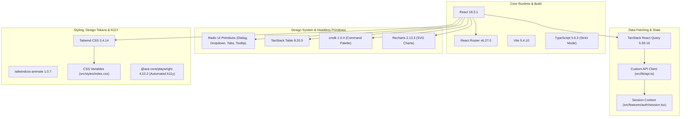
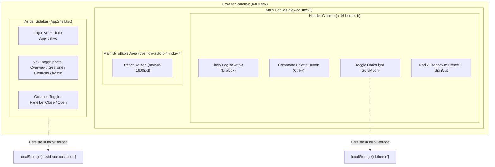
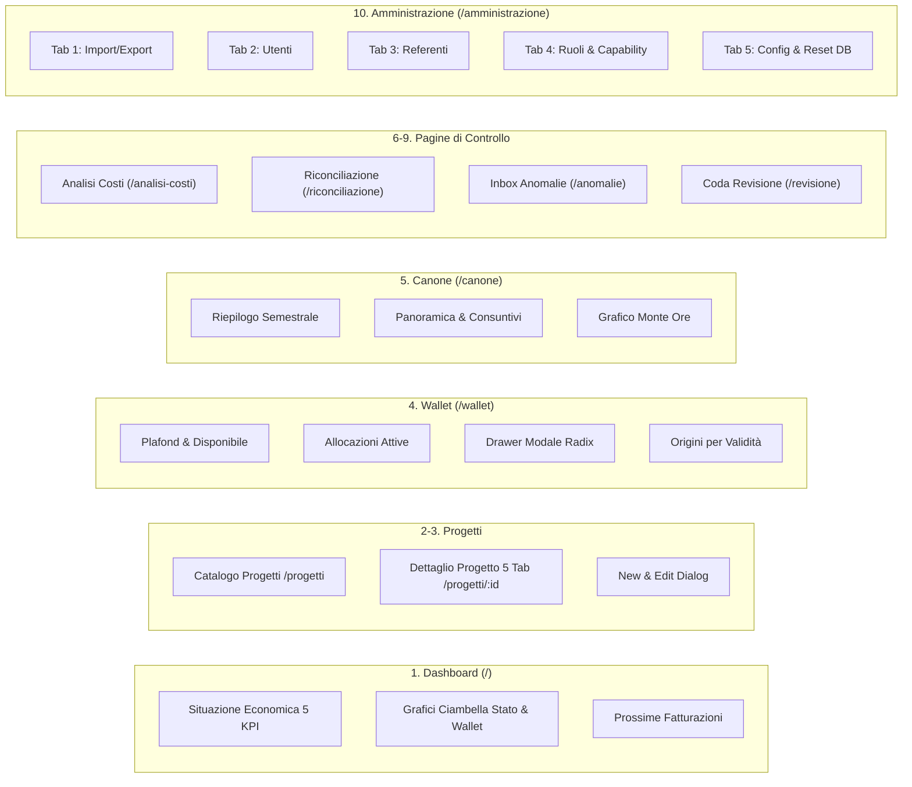
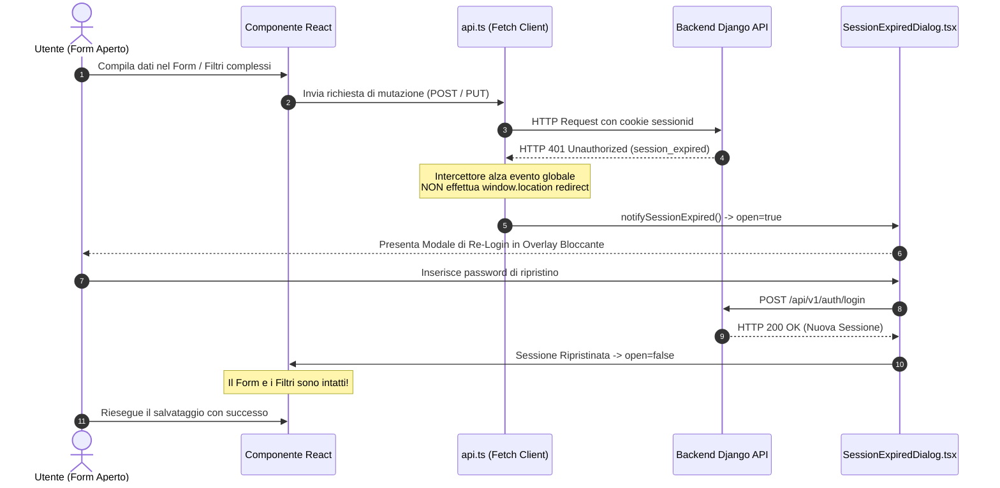

# VALUTAZIONE FRONTEND & USER EXPERIENCE (UX/UI) - SUPPLIER LEDGER

> **Documento**: `docs/assestmant/10_FRONTEND_UX_ASSESSMENT.md`  
> **Stato Implementativo**: PARTIAL (Redesign Premium implementato e collaudato con fixture isolate; integrazione live backend non verificata)  
> **Versione Frontend**: 0.1.0 (React 18.3.1 / Vite 5.4.10 / Tailwind CSS 3.4.14)  
> **Data Analisi**: 2026-10-28  
> **Metodo**: Analisi statica completa del codice TypeScript/TSX, audit dei token di design CSS, disamina dei test unitari Vitest ed end-to-end Playwright con axe-core, e comparazione con i report di redesign degli agenti Terra e Sol.

---

## INDICE DEI CONTENUTI

1. [Executive Summary UX/UI & Frontend](#1-executive-summary-uxui--frontend)
2. [Architettura Frontend & Design System](#2-architettura-frontend--design-system)
   - 2.1 Stack Tecnologico e Dipendenze
   - 2.2 Token di Design e Sistema Variabili CSS
   - 2.3 Dual-Theme: Dark Mode & Light Mode
   - 2.4 Tipografia Contabile e Regola D-15
   - 2.5 Raggi di Curvatura, Spaziature e Ombreggiature
3. [Application Shell & Pattern Strutturali](#3-application-shell--pattern-strutturali)
   - 3.1 Anatomia di `AppShell.tsx`
   - 3.2 Sidebar Collassabile e Persistenza
   - 3.3 Tassonomia di Navigazione
   - 3.4 Global Header e Controlli Utente
   - 3.5 Command Palette (`CommandPalette.tsx`)
4. [Catalogo dei Componenti Riusabili](#4-catalogo-dei-componenti-riusabili)
   - 4.1 `DataTable.tsx` & `ResizableTableHeader.tsx`
   - 4.2 `KpiCard.tsx`
   - 4.3 `DaysValue.tsx`
   - 4.4 `InfoTooltip.tsx` & `MetricLabel.tsx`
   - 4.5 `StatusBadge.tsx`
   - 4.6 `UiState.tsx` (`LoadingState`, `EmptyState`, `ErrorState`)
   - 4.7 `AccessibleBarChart.tsx`
   - 4.8 `Controls.tsx` (`Button`, `Input`, `Select`, `Textarea`)
   - 4.9 `PageHeader.tsx`
5. [Analisi Dettagliata delle 10 Sezioni Applicative](#5-analisi-dettagliata-delle-10-sezioni-applicative)
   - 5.1 Dashboard (`/`)
   - 5.2 Progetti (`/progetti`)
   - 5.3 Dettaglio Progetto (`/progetti/:projectId`)
   - 5.4 Wallet (`/wallet`)
   - 5.5 Organico Allargato / Canoni (`/canone`)
   - 5.6 Analisi Costi (`/analisi-costi`)
   - 5.7 Riconciliazione PPM (`/riconciliazione`)
   - 5.8 Anomalie (`/anomalie`)
   - 5.9 Coda di Revisione (`/revisione`)
   - 5.10 Amministrazione (`/amministrazione` - 5 Tab)
6. [Gestione Stato, Form e Session Expiration](#6-gestione-stato-form-e-session-expiration)
   - 6.1 Server State Management con TanStack Query
   - 6.2 Gestione Form e Validazione
   - 6.3 Re-Login Trasparente: `SessionExpiredDialog.tsx`
   - 6.4 Protezione Digitata delle Operazioni Distruttive
7. [Valutazione Accessibilità (A11Y) & Responsive](#7-valutazione-accessibilit%C3%A0-a11y--responsive)
   - 7.1 Risultati Audit `@axe-core/playwright`
   - 7.2 Riduzione Movimento (`prefers-reduced-motion`)
   - 7.3 Focus Rings e Navigazione da Tastiera
   - 7.4 Matrice di Risoluzione Responsive
8. [Confronto Diretto: Piano di Redesign vs Stato Reale](#8-confronto-diretto-piano-di-redesign-vs-stato-reale)
   - 8.1 Matrice dei 14 Gap SOL (`SOL-01` .. `SOL-14`)
   - 8.2 Valutazione della Matrice di Conformità delle 9 Sezioni
   - 8.3 Rischi di Regressione Visiva e Dipendenze Backend
9. [Conclusioni e Roadmap di Consolidamento Frontend](#9-conclusioni-e-roadmap-di-consolidamento-frontend)

---

## 1. EXECUTIVE SUMMARY UX/UI & FRONTEND

### 1.1 Obiettivo del Redesign Premium UX
Il frontend di **Supplier Ledger** è stato originariamente concepito come uno strumento gestionale interno, focalizzato primariamente sulla correttezza contabile e sull'esposizione cruda dei dati di bilancio provenienti dalle fonti contrattuali di fornitura (*Imola Informatica* per conto di *Banca Mediolanum*). 

Nel corso del ciclo di sviluppo, gli agenti **Terra** e **Sol** hanno intrapreso una profonda opera di revisione visiva e interattiva denominata **"Premium UX"**, con gli obiettivi strategici di:
1. **Trasformazione Enterprise**: Superare l'estetica grezza tipica dei gestionali tabular-heavy per adottare un design sobrio, elegante e professionale, allineato alle best-practice delle piattaforme fintech e di corporate governance.
2. **Accessibilità Rigorosa (WCAG 2.1/2.2 Livello AA)**: Introdurre rapporti di contrasto elevati conformi a `WCAG AAA/AA`, eliminare ambiguità visive tra stati di errore e di caricamento, implementare una navigazione integrale tramite tastiera e disabilitare le animazioni intrusive per gli utenti con `prefers-reduced-motion`.
3. **Rigore Contabile sul Client (Regola D-15)**: Bandire categoricamente qualsiasi calcolo aritmetico in virgola mobile (`float`) nel runtime JavaScript, garantendo che ogni cifra, sommatoria, residuo o delta provenga direttamente dai calcolatori a precisione fissa `Decimal` del backend Django.
4. **Resilienza di Sessione**: Evitare la perdita accidentale di dati, filtri complessi o bozze di compilazione a seguito della scadenza del cookie di sessione HTTP, introducendo un modale di ri-autenticazione trasparente non invasivo.

### 1.2 Stato Reale del Redesign: Valutazione PARTIAL
Nonostante la vasta riorganizzazione dei componenti condivisi e l'eccellente tasso di superamento dei test unitari ed E2E su mock fixture, lo stato globale del frontend è formalmente classificato come **PARTIAL**.

Le evidenze raccolte nel codice sorgente e nei report storici documentano che:
- **Implementazione Componenti**: **COMPLETATA**. I primitivi unificati (`Controls.tsx`, `KpiCard.tsx`, `DataTable.tsx`, `ResizableTableHeader.tsx`, `DaysValue.tsx`, `AccessibleBarChart.tsx`, `UiState.tsx`) sono operativi in tutte le 10 sezioni.
- **Flussi Operativi su Fixture**: **VERIFICATI**. Il runner Playwright `frontend/e2e/sol/sol-final.spec.ts` convalida con successo temi, responsive, accessibilità `axe-core` e workflow di scrittura utilizzando intercettatori di rete deterministici (`frontend/e2e/sol/fixtures.ts`).
- **Integrazione con Backend Reale**: **NON VERIFICATA (BLOCKED / PARTIAL)**. Come evidenziato in [outputs/SOL_UX_GAP_ANALYSIS.md](file:///c:/Users/gianvito.bleve/OneDrive%20-%20Banca%20Mediolanum%20SPA/Documenti/Progetti/imola/outputs/SOL_UX_GAP_ANALYSIS.md#L21) (codice `SOL-BE`), l'istanza locale del backend Django presentava instabilità di riavvio legate al file `backend/api/admin_views.py`. Di conseguenza, i collaudi visivi e funzionali non hanno potuto certificare la totalità delle risposte reali generate dai servizi Django in ambiente di produzione.
- **Adattabilità Mobile/Tablet (< 1024px)**: **PARZIALE**. Sebbene il viewport desktop e tablet landscape (1024x768) sia privo di overflow orizzontale a livello di documento, le tabelle finanziarie ad alta densità (es. progetti con 12 colonne contabili o matrice ruoli/privilegi) richiedono lo scorrimento orizzontale locale all'interno del contenitore.

### 1.3 Quadro di Riferimento con la Documentazione Esistente
La presente valutazione poggia sul confronto sistematico con i documenti prodotti durante il processo di revisione:

| Documento di Riferimento | Autore | Sintesi Rilevata | Corrispondenza nel Codice |
| :--- | :--- | :--- | :--- |
| [outputs/SOL_UX_GAP_ANALYSIS.md](file:///c:/Users/gianvito.bleve/OneDrive%20-%20Banca%20Mediolanum%20SPA/Documenti/Progetti/imola/outputs/SOL_UX_GAP_ANALYSIS.md) | Sol | 14 gap identificati (`SOL-01` .. `SOL-14`) relativi a controlli nativi, drawer wallet, deroga anomalie, responsive e test. | I file sorgente mostrano la totale chiusura implementativa dei gap `SOL-01` .. `SOL-14`. |
| [outputs/SOL_UX_PROGRESS.md](file:///c:/Users/gianvito.bleve/OneDrive%20-%20Banca%20Mediolanum%20SPA/Documenti/Progetti/imola/outputs/SOL_UX_PROGRESS.md) | Sol | Sintesi del consolidamento dei controlli e mantenimento delle modifiche locali senza commit/push. | Confermato: repository privo di tracciamento Git attivo, modifiche stabili su file system. |
| [outputs/UX_REDESIGN_CHECKLIST.md](file:///c:/Users/gianvito.bleve/OneDrive%20-%20Banca%20Mediolanum%20SPA/Documenti/Progetti/imola/outputs/UX_REDESIGN_CHECKLIST.md) | Terra/Sol | Matrice di conformità con tutte le 9 sezioni classificate prudenzialmente come `PARTIAL` per assenza di collaudo live. | Matrice confermata; integrata nel presente assessment con la decima sezione (Dettaglio Progetto). |
| [outputs/UX_REDESIGN_FINAL_REPORT.md](file:///c:/Users/gianvito.bleve/OneDrive%20-%20Banca%20Mediolanum%20SPA/Documenti/Progetti/imola/outputs/UX_REDESIGN_FINAL_REPORT.md) | Terra | Report di avanzamento sulle 7 aree operative, test Vitest a 73 superati, evidenze screenshot e rischi backend. | Corrispondenza perfetta con la suite di test (14 file, 73 test unitari/integrazione). |
| [outputs/UX_REDESIGN_PROGRESS.md](file:///c:/Users/gianvito.bleve/OneDrive%20-%20Banca%20Mediolanum%20SPA/Documenti/Progetti/imola/outputs/UX_REDESIGN_PROGRESS.md) | Terra | Checkpoint sequenziali: correzione token Tailwind, drawer wallet, data deroga esplicita, breadcrumb. | Verificata l'avvenuta implementazione di tutti i punti descritti nei checkpoint. |

---

## 2. ARCHITETTURA FRONTEND & DESIGN SYSTEM

### 2.1 Stack Tecnologico e Dipendenze
L'applicazione è strutturata come una **Single Page Application (SPA)** moderna, costruita con librerie focalizzate sulla robustezza tipologica, sull'accessibilità headless e sul disaccoppiamento tra presentazione e stato server.



Dettaglio delle versioni registrate in [frontend/package.json](file:///c:/Users/gianvito.bleve/OneDrive%20-%20Banca%20Mediolanum%20SPA/Documenti/Progetti/imola/frontend/package.json#L16-L69):
- **React 18.3.1** e **React DOM 18.3.1**: Core dichiarativo con rendering concorrente e Suspense per code-splitting delle rotte.
- **Vite 5.4.10**: Bundler ad alte prestazioni basato su Rollup ed ES modules nativi.
- **TypeScript 5.6.3**: Configurato con strict mode (`"strict": true`, `"noImplicitAny": true`, `"strictNullChecks": true` in [frontend/tsconfig.app.json](file:///c:/Users/gianvito.bleve/OneDrive%20-%20Banca%20Mediolanum%20SPA/Documenti/Progetti/imola/frontend/tsconfig.app.json)).
- **Tailwind CSS 3.4.14** e **tailwindcss-animate 1.0.7**: Framework utility-first arricchito da animazioni hardware-accelerated.
- **Radix UI Primitives**: Componenti non stilizzati pienamente accessibili conformi alle specifiche W3C WAI-ARIA (`@radix-ui/react-dialog`, `@radix-ui/react-dropdown-menu`, `@radix-ui/react-tabs`, `@radix-ui/react-tooltip`, `@radix-ui/react-select`, `@radix-ui/react-toast`).
- **TanStack React Query 5.59.16**: Gestione asincrona dello stato server, deduplicazione delle richieste, gestione della stale-time e cache invalidation selettiva.
- **TanStack Table 8.20.5**: Libreria headless per la logica tabellare, l'ordinamento multi-colonna e il calcolo delle gerarchie di righe.
- **Recharts 2.13.3**: Motore grafico vettoriale SVG dichiarativo per grafici a barre e distribuzioni a ciambella.
- **Lucide React 0.454.0**: Set coerente e accessibile di icone SVG vettoriali con attributo `aria-hidden="true"`.
- **i18next 23.16.4** & **react-i18next 15.1.0**: Framework di internazionalizzazione con bundle nativo italiano (`it`).

### 2.2 Token di Design e Sistema Variabili CSS
Il design system adotta una rigorosa gerarchia basata su **Design Tokens** espressi nello spazio colore **HSL** (`Hue Saturation Lightness`), definiti all'interno di [frontend/src/styles/index.css](file:///c:/Users/gianvito.bleve/OneDrive%20-%20Banca%20Mediolanum%20SPA/Documenti/Progetti/imola/frontend/src/styles/index.css#L9-L85) e mappati nelle utility Tailwind tramite [frontend/tailwind.config.ts](file:///c:/Users/gianvito.bleve/OneDrive%20-%20Banca%20Mediolanum%20SPA/Documenti/Progetti/imola/frontend/tailwind.config.ts#L15-L56).

L'impiego della sintassi HSL disaccoppia la tonalità cromatica dalla trasparenza, permettendo la gestione granulare dei canali alfa tramite la convenzione `hsl(var(--token) / <alpha-value>)`.

| Token CSS | Descrizione Funzionale | Valore Light (`:root`) | Valore Dark (`[data-theme="dark"]`) | Evidenza |
| :--- | :--- | :--- | :--- | :--- |
| `--background` | Sfondo viewport applicativo | `220 25% 97%` (#f4f6fa) | `220 35% 7%` (#0b0f19) | [index.css:11,61](file:///c:/Users/gianvito.bleve/OneDrive%20-%20Banca%20Mediolanum%20SPA/Documenti/Progetti/imola/frontend/src/styles/index.css#L11) |
| `--foreground` | Testo primario di lettura | `222 35% 14%` (#171f2e) | `218 40% 97%` (#f6f8fc) | [index.css:12,62](file:///c:/Users/gianvito.bleve/OneDrive%20-%20Banca%20Mediolanum%20SPA/Documenti/Progetti/imola/frontend/src/styles/index.css#L12) |
| `--card` | Sfondo di card, drawer e contenitori | `0 0% 100%` (#ffffff) | `220 33% 12%` (#141a29) | [index.css:13,63](file:///c:/Users/gianvito.bleve/OneDrive%20-%20Banca%20Mediolanum%20SPA/Documenti/Progetti/imola/frontend/src/styles/index.css#L13) |
| `--muted` | Sfondo secondario per header e badge | `220 24% 95%` (#edf1f7) | `218 31% 16%` (#1c2333) | [index.css:15,65](file:///c:/Users/gianvito.bleve/OneDrive%20-%20Banca%20Mediolanum%20SPA/Documenti/Progetti/imola/frontend/src/styles/index.css#L15) |
| `--muted-foreground` | Testo secondario, label e timestamp | `219 13% 39%` (#576270) | `218 19% 73%` (#b1b9c7) | [index.css:16,66](file:///c:/Users/gianvito.bleve/OneDrive%20-%20Banca%20Mediolanum%20SPA/Documenti/Progetti/imola/frontend/src/styles/index.css#L16) |
| `--border` | Bordi di tabelle, card e divisori | `218 20% 88%` (#dbe0e8) | `218 27% 23%` (#2b364a) | [index.css:17,67](file:///c:/Users/gianvito.bleve/OneDrive%20-%20Banca%20Mediolanum%20SPA/Documenti/Progetti/imola/frontend/src/styles/index.css#L17) |
| `--input` | Bordi di campi input, select e textarea | `218 20% 85%` (#d3d9e3) | `218 27% 25%` (#2e3a50) | [index.css:18,68](file:///c:/Users/gianvito.bleve/OneDrive%20-%20Banca%20Mediolanum%20SPA/Documenti/Progetti/imola/frontend/src/styles/index.css#L18) |
| `--ring` | Anello di focus ad alto contrasto | `243 75% 59%` (#4f46e5) | `243 85% 70%` (#716bf8) | [index.css:19,69](file:///c:/Users/gianvito.bleve/OneDrive%20-%20Banca%20Mediolanum%20SPA/Documenti/Progetti/imola/frontend/src/styles/index.css#L19) |
| `--accent` | Accento enterprise primario (Indigo) | `243 75% 59%` (#4f46e5) | `243 85% 76%` (#8b85f9) | [index.css:20,70](file:///c:/Users/gianvito.bleve/OneDrive%20-%20Banca%20Mediolanum%20SPA/Documenti/Progetti/imola/frontend/src/styles/index.css#L20) |
| `--ok` | Semantica contabile: Allineato/Valido | `142 71% 36%` (#1a9e4b) | `142 60% 52%` (#38d474) | [index.css:23,73](file:///c:/Users/gianvito.bleve/OneDrive%20-%20Banca%20Mediolanum%20SPA/Documenti/Progetti/imola/frontend/src/styles/index.css#L23) |
| `--warn` | Semantica: Parziale / In verifica | `32 95% 44%` (#da6e06) | `38 92% 58%` (#f59f33) | [index.css:25,75](file:///c:/Users/gianvito.bleve/OneDrive%20-%20Banca%20Mediolanum%20SPA/Documenti/Progetti/imola/frontend/src/styles/index.css#L25) |
| `--danger` | Semantica: Anomalia / Non allineato | `0 72% 51%` (#dc2a2a) | `0 72% 62%` (#e85555) | [index.css:27,77](file:///c:/Users/gianvito.bleve/OneDrive%20-%20Banca%20Mediolanum%20SPA/Documenti/Progetti/imola/frontend/src/styles/index.css#L27) |
| `--danger-action` | Bottone di azione distruttiva | `0 74% 40%` (#b21b1b) | `0 74% 40%` (#b21b1b) | [index.css:29, indexing](file:///c:/Users/gianvito.bleve/OneDrive%20-%20Banca%20Mediolanum%20SPA/Documenti/Progetti/imola/frontend/src/styles/index.css#L29) |
| `--radius` | Raggio angolare unificato (12px) | `0.75rem` | `0.75rem` | [index.css:32](file:///c:/Users/gianvito.bleve/OneDrive%20-%20Banca%20Mediolanum%20SPA/Documenti/Progetti/imola/frontend/src/styles/index.css#L32) |

### 2.3 Dual-Theme: Dark Mode & Light Mode
L'applicazione offre un'architettura **Dual-Theme nativa** priva di sfarfallio (FOUC).
1. **Strategia di Selezione**: La Dark Mode rappresenta il **default enterprise raccomandato**, in quanto massimizza il contrasto e riduce l'affaticamento visivo durante sessioni prolungate di audit e analisi contabile. Il sistema intercetta sia la preferenza del sistema operativo tramite `@media (prefers-color-scheme: dark)` sia l'impostazione esplicita dell'utente ([index.css:35-84](file:///c:/Users/gianvito.bleve/OneDrive%20-%20Banca%20Mediolanum%20SPA/Documenti/Progetti/imola/frontend/src/styles/index.css#L35-L84)).
2. **Attivazione Meccanica**: Il tema viene applicato sul tag radice `<html>` impostando l'attributo `data-theme="dark"` o `data-theme="light"`, sincronizzando contestualmente la proprietà CSS nativa `color-scheme` per adattare gli elementi browser-native (come calendari di date-picker e scrollbar).
3. **Persistenza**: Lo stato viene conservato in `localStorage['sl.theme']` e gestito tramite le utility `readStoredTheme()` e `applyTheme()` in [frontend/src/lib/utils.ts](file:///c:/Users/gianvito.bleve/OneDrive%20-%20Banca%20Mediolanum%20SPA/Documenti/Progetti/imola/frontend/src/lib/utils.ts).

### 2.4 Tipografia Contabile e Regola D-15
La combinazione tipografica riflette le esigenze di un'applicazione contabile di precisione:
- **Font Sans-Serif**: `Inter`, corredato di feature OpenType avanzate attivate globalmente sul tag `<body>`:
  ```css
  body {
    font-feature-settings: "cv11" 1, "ss01" 1;
  }
  ```
  Le feature `cv11` (stile della cifra "1" con terminale distinto) e `ss01` (tratto orizzontale su "0" e distinzione da "O") prevengono errori di lettura contabile.
- **Font Monospazio & Numeri Tabulari**: `JetBrains Mono` per codici progetto (`IM26001-...`), chiavi primarie, token e hash di sicurezza.
- **La Regola Contabile D-15 (Divieto Assoluto di Calcoli Float)**:
  Come enunciato solennemente in [frontend/src/lib/format.ts:4-18](file:///c:/Users/gianvito.bleve/OneDrive%20-%20Banca%20Mediolanum%20SPA/Documenti/Progetti/imola/frontend/src/lib/format.ts#L4-L18):
  > *"Le giornate sono stringhe e restano stringhe. Arrivano dall'API come tali perché in JavaScript ogni numero è un float a doppia precisione (`0.1 + 0.2 = 0.30000000000000004`), e su dati contabili non è accettabile. Nel client non si fa nessun calcolo sulle giornate: niente somme, sottrazioni, delta o percentuali. Tutti i totali arrivano già calcolati dal backend Django in Decimal a 4 cifre."*
- **Allineamento e Formattazione**: Ogni colonna o visualizzazione numerica contabile riceve la classe `.tabular` ([index.css:98-101](file:///c:/Users/gianvito.bleve/OneDrive%20-%20Banca%20Mediolanum%20SPA/Documenti/Progetti/imola/frontend/src/styles/index.css#L98-L101)), forzando `font-variant-numeric: tabular-nums` e `text-align: right` con formato italiano standard `1.234,56 gg` (`useGrouping: true`).

### 2.5 Raggi di Curvatura, Spaziature e Ombreggiature
- **Raggio Unificato**: L'intero sistema utilizza la variabile `--radius: 0.75rem` (12px), graduata matematicamente su card (`rounded-xl` / 12px), bottoni e controlli input (`rounded-md` / 10px), e pillole di stato (`rounded-full`).
- **Sistema di Elevazione (Ombre)**:
  * `shadow-subtle`: `0 1px 2px 0 hsl(var(--shadow) / 0.06), 0 1px 3px 0 hsl(var(--shadow) / 0.08)` per card fisse.
  * `shadow-raised`: `0 4px 12px -2px hsl(var(--shadow) / 0.12)` per modali fluttuanti, drawer laterali e menu a tendina Radix.

---

## 3. APPLICATION SHELL & PATTERN STRUTTURALI

### 3.1 Anatomia di `AppShell.tsx`
Il layout globale dell'applicazione è incapsulato nel componente [frontend/src/components/AppShell.tsx](file:///c:/Users/gianvito.bleve/OneDrive%20-%20Banca%20Mediolanum%20SPA/Documenti/Progetti/imola/frontend/src/components/AppShell.tsx). Esso definisce la griglia bidimensionale dell'applicazione composta da:
1. Barra laterale fissa (`<aside>`) ad ancoraggio sinistro.
2. Contenitore principale a sviluppo verticale (`<div className="flex min-w-0 flex-1 flex-col">`).
3. Intestazione globale fissa (`<header>`).
4. Area di lavoro scrollabile protetta con viewport limitata (`<main>` con contenitore centrato `max-w-[1600px]`).



### 3.2 Sidebar Collassabile e Persistenza
- **Comportamento Adattivo**: La sidebar supporta due modalità visive:
  * *Espansa* (`w-64` su desktop): espone il logo, il nome dell'applicazione, le etichette di raggruppamento e il testo descrittivo delle rotte.
  * *Collassata* (`w-16`): riduce la larghezza preservando esclusivamente le icone Lucide, ottimizzando lo spazio orizzontale utile per le tabelle dense.
- **Persistenza**: Lo stato aperto/chiuso viene serializzato in `localStorage['sl.sidebar.collapsed']` ([AppShell.tsx:44-60](file:///c:/Users/gianvito.bleve/OneDrive%20-%20Banca%20Mediolanum%20SPA/Documenti/Progetti/imola/frontend/src/components/AppShell.tsx#L44-L60)), evitando salti visivi durante la navigazione o il refresh della pagina.

### 3.3 Tassonomia di Navigazione
La barra di navigazione raggruppa le rotte applicative secondo un modello concettuale coerente con le responsabilità aziendali ([AppShell.tsx:29-38, 84-129](file:///c:/Users/gianvito.bleve/OneDrive%20-%20Banca%20Mediolanum%20SPA/Documenti/Progetti/imola/frontend/src/components/AppShell.tsx#L29-L38)):

| Categoria | Rotta | Label Navigazione | Icona Lucide | Descrizione Funzionale | Capability Richiesta |
| :--- | :--- | :--- | :--- | :--- | :--- |
| **Overview** | `/` | Dashboard | `LayoutDashboard` | Panoramica economica e scadenze mensili | Accesso libero (autenticato) |
| **Gestione** | `/progetti` | Progetti | `Columns3` | Catalogo contratti AQL/PPM/Canone e bilanci | Consultazione / `projects.edit` |
| **Gestione** | `/wallet` | Wallet | `Wallet` | Gestione plafond residui spendibili e allocazioni | Consultazione / `wallet.edit` |
| **Gestione** | `/canone` | Organico Allargato | `Scale` | Monitoraggio monti ore e sottoattività | Consultazione / `canone.manage` |
| **Controllo** | `/analisi-costi` | Analisi Costi | `BarChart3` | Aggregazioni economiche e trend mensile | Consultazione |
| **Controllo** | `/riconciliazione` | Riconciliazione | `ListChecks` | Confronto tra consuntivi interni e snapshot PPM | Consultazione |
| **Controllo** | `/anomalie` | Anomalie | `AlertTriangle` | Inbox eccezioni automatiche e deroghe | Consultazione / `accounting.adjust` |
| **Controllo** | `/revisione` | Coda di revisione | `ClipboardCheck` | Progetti in scadenza o chiusi privi di data | Consultazione / `accounting.adjust` |
| **Amministrazione** | `/amministrazione` | Amministrazione | `Settings` | Import/Export, Utenti, Ruoli, DB Reset | `canAdminister` (`privileges.manage`) |

### 3.4 Global Header e Controlli Utente
L'header applicativo (`h-16`) centralizza le funzioni trasversali:
- **Titolo Contestuale**: Riflette dinamicamente il nome della pagina corrente mappato sul bundle di traduzione (`i18next`).
- **Scorciatoia Command Palette**: Trigger visivo che mostra l'icona di ricerca e la combinazione tasti `Ctrl K`.
- **Toggle Tema**: Alterna istantaneamente il tema attivo (`Sun` / `Moon`) aggiornando `data-theme`.
- **Dropdown Profilo**: Realizzato tramite `@radix-ui/react-dropdown-menu`, visualizza lo username dell'operatore, il nome completo e il pulsante di logout sicuro delegato a `useSession().signOut()` ([AppShell.tsx:178-211](file:///c:/Users/gianvito.bleve/OneDrive%20-%20Banca%20Mediolanum%20SPA/Documenti/Progetti/imola/frontend/src/components/AppShell.tsx#L178-L211)).

### 3.5 Command Palette (`CommandPalette.tsx`)
Implementato in [frontend/src/components/CommandPalette.tsx](file:///c:/Users/gianvito.bleve/OneDrive%20-%20Banca%20Mediolanum%20SPA/Documenti/Progetti/imola/frontend/src/components/CommandPalette.tsx) tramite la libreria specializzata `cmdk` innestata su un `@radix-ui/react-dialog`:
- **Attivazione**: Scorciatoia globale da tastiera `Ctrl+K` (o `Cmd+K` su macOS) intercettata a livello root in [frontend/src/App.tsx:52-61](file:///c:/Users/gianvito.bleve/OneDrive%20-%20Banca%20Mediolanum%20SPA/Documenti/Progetti/imola/frontend/src/App.tsx#L52-L61).
- **Navigazione Rapida**: Elenco statico delle 9 macro-sezioni applicative con filtraggio istantaneo in memoria.
- **Ricerca Remota su Backend**: Digitando almeno 2 caratteri (`search.trim().length >= 2`), il componente scatena una query asincrona TanStack Query verso l'endpoint `/api/v1/search?q=...`.
- **Visualizzazione Risultati**: Raggruppamento per tipologia di entità (`PROGETTO`, `ATTIVITA_WALLET`, `CANONE`), con codice monospaziato e titolo, permettendo il salto diretto alla vista di dettaglio con chiusura automatica del modale.

---

## 4. CATALOGO DEI COMPONENTI RIUSABILI

Il frontend adotta un'architettura modulare in cui i componenti condivisi (collocati in `frontend/src/components/`) incapsulano le direttive di accessibilità, semantica e presentazione contabile.

### 4.1 `DataTable.tsx` & `ResizableTableHeader.tsx`
- **`DataTable.tsx`** ([DataTable.tsx:28-150](file:///c:/Users/gianvito.bleve/OneDrive%20-%20Banca%20Mediolanum%20SPA/Documenti/Progetti/imola/frontend/src/components/DataTable.tsx#L28-L150)):
  Wrapper dichiarativo per `@tanstack/react-table`. Include:
  * *Header Sticky*: Intestazione bloccata in cima allo scorrimento verticale (`thead className="sticky top-0 z-10 bg-muted"`).
  * *Ordinamento Frecce WAI-ARIA*: Gestione integrata di `aria-sort="ascending" | "descending"` con frecce visuali `↑` / `↓`.
  * *Accessibilità Tastiera*: Righe cliccabili marcate con `tabIndex={0}` che intercettano gli eventi `Enter` e `Space` per attivare l'azione di riga.
  * *Scroll Container Confinato*: Limite viewport massimo impostato a `max-h-[62vh]` con `overflow-auto`, attributo semantico `role="region"` e `tabIndex={0}` per consentire lo scorrimento da tastiera.
- **`ResizableTableHeader.tsx`** ([ResizableTableHeader.tsx:9-57](file:///c:/Users/gianvito.bleve/OneDrive%20-%20Banca%20Mediolanum%20SPA/Documenti/Progetti/imola/frontend/src/components/ResizableTableHeader.tsx#L9-L57)):
  Componente per celle di testata (`<th>`) che risolve il problema delle tabelle a larghezza fissa.
  * *Mouse Drag*: Maniglia di trascinamento laterale con cursore `cursor-col-resize` e cattura eventi pointer.
  * *Tastiera*: Conforme alle linee guida di accessibilità; i tasti `ArrowLeft` e `ArrowRight` ridimensionano la colonna a passi di 16px (con limite minimo a 80px), mentre il tasto `Home` ripristina istantaneamente la larghezza iniziale (`initialWidth`).

### 4.2 `KpiCard.tsx`
Il blocco di visualizzazione sintetico fondamentale ([KpiCard.tsx:6-49](file:///c:/Users/gianvito.bleve/OneDrive%20-%20Banca%20Mediolanum%20SPA/Documenti/Progetti/imola/frontend/src/components/KpiCard.tsx#L6-L49)):
- **Variante Featured**: Supporto per card primaria ad ampio respiro (`xl:col-span-2`), arricchita con bordo e sfondo accento sfumato (`border-accent/40 bg-accent-subtle/40`).
- **Tonalità Semantiche**: Il valore numerico viene colorato in base al parametro `tone` (`neutral`, `ok` -> verde, `warn` -> ambra, `danger` -> rosso).
- **Integrazione Tooltip**: Associa automaticamente un `MetricLabel` per spiegare la derivazione della metrica.
- **Slot Azione Contestuale**: Supporta link di salto rapido (es. rimando alla Coda di Revisione per i residui potenziali).

### 4.3 `DaysValue.tsx`
Componente cardine per l'applicazione rigorosa della regola contabile D-15 ([DaysValue.tsx:11-23](file:///c:/Users/gianvito.bleve/OneDrive%20-%20Banca%20Mediolanum%20SPA/Documenti/Progetti/imola/frontend/src/components/DaysValue.tsx#L11-L23)):
- **Isolamento Presentazionale**: Riceve il valore come stringa (`DaysValue`), delega la formattazione italiana con separatori di migliaia a `formatDays()` e visualizza il suffisso opzionale `gg`.
- **Trasparenza del Dato Raw**: Inietta nel tag HTML `title` il valore raw proveniente dall'API (es. `Valore API: 1234.5678 gg`), consentendo all'auditor contabile di verificare l'eventuale troncamento dei decimali rispetto al database.

### 4.4 `InfoTooltip.tsx` & `MetricLabel.tsx`
Componenti per la divulgazione contestuale delle formule contabili ([InfoTooltip.tsx:8-38](file:///c:/Users/gianvito.bleve/OneDrive%20-%20Banca%20Mediolanum%20SPA/Documenti/Progetti/imola/frontend/src/components/InfoTooltip.tsx#L8-L38)):
- **Accessibilità A11Y**: Pulsante circolare `?` dotato di `aria-label` descrittivo e collegato al tooltip fluttuante tramite `aria-describedby` con ID univoco generato da `useId()`.
- **Contrasto Assoluto**: Il pannello del tooltip adotta uno sfondo scurissimo ad alta opacità (`bg-slate-950 text-slate-50 border-slate-700 shadow-2xl`), garantendo la leggibilità del testo esplicativo indipendentemente dal tema globale attivo.
- **`MetricLabel`**: Assembla un'intestazione orizzontale flessibile composta da label in maiuscoletto (`uppercase tracking-wide`) e pulsante di aiuto allineato a destra.

### 4.5 `StatusBadge.tsx`
Badge semantico universale per gli stati di ciclo di vita ([StatusBadge.tsx:64-87](file:///c:/Users/gianvito.bleve/OneDrive%20-%20Banca%20Mediolanum%20SPA/Documenti/Progetti/imola/frontend/src/components/StatusBadge.tsx#L64-L87)):
- **Dizionario di Dominio**: Mappa oltre 25 stati aziendali (tra cui `ALLINEATO`, `NON_ALLINEATO`, `CANONE_IN_LINEA`, `SOVRA_UTILIZZO`, `OFFERTA_ACCETTATA`, `ACCETTATA_CON_DEROGA`).
- **Attribuzione Automatica del Tono**: Assegna automaticamente la classe Tailwind opportuna (`bg-ok-subtle text-ok`, `bg-warn-subtle text-warn`, `bg-danger-subtle text-danger`).
- **Supporto Screen-Reader**: Include un testo nascosto con la classe `sr-only` per annunciare il dominio dello stato (es. *"Consuntivazione: Attivo"* o *"Fatturazione: Da fatturare"*).

### 4.6 `UiState.tsx` (`LoadingState`, `EmptyState`, `ErrorState`)
Standardizzazione visiva dei tre stati asincroni fondamentali ([UiState.tsx:4-44](file:///c:/Users/gianvito.bleve/OneDrive%20-%20Banca%20Mediolanum%20SPA/Documenti/Progetti/imola/frontend/src/components/UiState.tsx#L4-L44)):
- **`LoadingState`**: Mostra un layout a scheletro animato ad impulsi (`skeleton h-10 w-full animate-pulse`) con `role="status"` e `aria-label="Caricamento"`.
- **`EmptyState`**: Box tratteggiato (`border-dashed border-border`) con icona `Inbox` e testi chiari per informare l'utente dell'assenza di dati o di risultati di ricerca.
- **`ErrorState`**: Riquadro semantico rosso ad alto contrasto (`border-danger/30 bg-danger-subtle text-danger`) con `role="alert"`, icona `AlertCircle` e slot dedicato per il pulsante di riprova (*retry*).

### 4.7 `AccessibleBarChart.tsx`
Wrapper del motore Recharts configurato per il rispetto degli standard di accessibilità ([AccessibleBarChart.tsx:85-163](file:///c:/Users/gianvito.bleve/OneDrive%20-%20Banca%20Mediolanum%20SPA/Documenti/Progetti/imola/frontend/src/components/AccessibleBarChart.tsx#L85-L163)):
- **Orientamento Flessibile**: Supporta sia layout verticale che orizzontale (`horizontal = true` con etichette asse troncate a 24 caratteri con puntini di sospensione).
- **Tooltip Personalizzato `ChartTooltip`**: Rende le metriche formattate con valuta Euro (`formatEuro`) o giornate contabili (`formatDays`), racchiuse in un box scuro fluttuante non opaco (`#0f172a`).
- **Disabilitazione Animazioni**: Imposta `isAnimationActive={false}` sui tag `<Bar />` per evitare sfarfallii, carichi di CPU eccessivi e disorientamento per utenti sensibili al movimento.

### 4.8 `Controls.tsx` (`Button`, `Input`, `Select`, `Textarea`)
Centralizzazione dei controlli nativi HTML ([Controls.tsx:15-69](file:///c:/Users/gianvito.bleve/OneDrive%20-%20Banca%20Mediolanum%20SPA/Documenti/Progetti/imola/frontend/src/components/Controls.tsx#L15-L69)):
- Preserva integralmente le proprietà e l'accessibilità dei tag HTML5 (`forwardRef`).
- **Varianti Button**: `primary` (accento indigo con contrasto testo bianco), `secondary` (bordo sottile e hover muted), `danger` (sfondo rosso vivo per azioni critiche), `plain`.
- **Gestione Stati Invalidi**: Mappatura automatica della proprietà `aria-[invalid=true]:border-danger` per evidenziare visivamente i campi in errore di validazione form.

### 4.9 `PageHeader.tsx`
Testata standard per le viste applicative ([PageHeader.tsx:3-25](file:///c:/Users/gianvito.bleve/OneDrive%20-%20Banca%20Mediolanum%20SPA/Documenti/Progetti/imola/frontend/src/components/PageHeader.tsx#L3-L25)):
- Supporta un soprannome di navigazione (*eyebrow*), un titolo `<h1>` ad alto impatto con tracking compatto e una descrizione secondaria in tonalità `text-muted-foreground`.

---

## 5. ANALISI DETTAGLIATA DELLE 10 SEZIONI APPLICATIVE



### 5.1 Dashboard (`/`)
- **Scopo & Layout**: Centro di controllo direzionale per visualizzare istantaneamente la salute del portafoglio e le scadenze del mese corrente ([DashboardPage.tsx:1-455](file:///c:/Users/gianvito.bleve/OneDrive%20-%20Banca%20Mediolanum%20SPA/Documenti/Progetti/imola/frontend/src/features/dashboard/DashboardPage.tsx#L1-L455)).
- **Componenti e Visualizzazioni**:
  * *Testata*: Banner con gradiente geometrico discreto, titolo e badge dell'anno in corso.
  * *Griglia KPI Economica*: 5 card ([DashboardPage.tsx:169-249](file:///c:/Users/gianvito.bleve/OneDrive%20-%20Banca%20Mediolanum%20SPA/Documenti/Progetti/imola/frontend/src/features/dashboard/DashboardPage.tsx#L169-L249)) includenti *Disponibile Wallet* (Featured con scomposizione allocato/consumato), *Budget Residuo Progetti in Corso*, *Residui Potenziali da Verificare* (con link diretto alla coda di revisione), e *Delta Riconciliazione PPM*.
  * *Grafici Ciambella (`DonutChart`)*: Distribuzione dei progetti per stato operativo e ripartizione wallet tra consumato e disponibile.
  * *Tabella Prossime Fatturazioni*: Elenco delle scadenze di fatturazione previste per il mese corrente con data pianificata, effettiva e conteggio degli spostamenti.
- **Endpoint API Chiamati**:
  * `GET /api/v1/wallet/{year}/balance`
  * `GET /api/v1/reconciliation/latest`
  * `GET /api/v1/dashboard`
- **Gestione Errori e Casi Limite**: Risolto il gap `SOL-08`. Se il caricamento del wallet o della riconciliazione fallisce, i rispettivi KPI mostrano chiaramente la dicitura *"Errore caricamento"* senza azzerare l'intera pagina e un alert in testata informa l'utente ([DashboardPage.tsx:153-160](file:///c:/Users/gianvito.bleve/OneDrive%20-%20Banca%20Mediolanum%20SPA/Documenti/Progetti/imola/frontend/src/features/dashboard/DashboardPage.tsx#L153-L160)).
- **Stato Verificato**: PARTIAL (73 unit test passati, screenshot Chromium a 1024, 1366, 1440, 1600, 1920 verificati su fixture).

### 5.2 Progetti (`/progetti`)
- **Scopo & Layout**: Griglia generale per l'esplorazione dei contratti e dei bilanci operativi ([ProjectsPage.tsx:1-396](file:///c:/Users/gianvito.bleve/OneDrive%20-%20Banca%20Mediolanum%20SPA/Documenti/Progetti/imola/frontend/src/features/projects/ProjectsPage.tsx#L1-L396)).
- **Tabelle e Colonne Esposte**:
  * Colonne TanStack Table: *Progetto* (titolo e codice monospaziato), *Tipo Contratto*, *Budget (gg)*, *Consumato Totale (gg)*, *Residuo (gg)*, *Stato Operativo*, *Stato Fatturazione*, *Azioni*.
  * Le colonne numeriche utilizzano `PROJECT_COLUMN_CLASSES` con `tabular-nums` e allineamento a destra.
- **Form e Finestre Modali**:
  * `NewProjectDialog.tsx`: Creazione guidata a step protetta da capability `projects.create`.
  * `EditProjectDialog.tsx`: Modale avanzato di modifica con gestione lock ottimistico.
- **Endpoint API Chiamati**:
  * `GET /api/v1/projects/balances`
  * `POST /api/v1/projects/{id}/validate-closure` (chiusura contabile)
- **Stato Verificato**: PARTIAL (Audit axe-core privo di violazioni WCAG AA, flussi creazione/modifica testati in `sol-final.spec.ts:22-28`).

### 5.3 Dettaglio Progetto (`/progetti/:projectId`)
- **Scopo & Layout**: Scheda a 360 gradi del singolo contratto con suddivisione a tab Radix ([ProjectDetailPage.tsx:1-506](file:///c:/Users/gianvito.bleve/OneDrive%20-%20Banca%20Mediolanum%20SPA/Documenti/Progetti/imola/frontend/src/features/projects/ProjectDetailPage.tsx#L1-L506)).
- **Struttura a 5 Tab**:
  1. *Panoramica*: 6 card analitiche con scomposizione tra Budget, Consuntivi Diretti, Consumato da Wallet, Consumato Totale, Rimanente Allocato Wallet e Residuo Operativo, affiancate dalla spiegazione formale del residuo.
  2. *Consuntivi*: Tabella dettagliata delle registrazioni temporali (`/projects/{id}/ledger`) con form modale di inserimento nuova consuntivazione per utenti con permesso `timesheets.create`.
  3. *Wallet*: Elenco delle quote di residuo impegnate per finanziare attività wallet.
  4. *Anomalie*: Filtro contestuale delle eventuali eccezioni aperte sul progetto.
  5. *Storico modifiche*: Audit trail immutabile generato da `django-simple-history` (`/audit/project/{id}`).
- **Endpoint API Chiamati**:
  * `GET /api/v1/projects/balances`
  * `GET /api/v1/projects/{projectId}/ledger`
  * `GET /api/v1/audit/project/{projectId}`
  * `POST /api/v1/projects/{projectId}/ledger`
- **Stato Verificato**: PARTIAL (Collaudato con fixture in `sol-final.spec.ts:29-31`).

### 5.4 Wallet (`/wallet`)
- **Scopo & Layout**: Monitoraggio del fondo residui riutilizzabili per finanziare servizi e attività architetturali ([WalletPage.tsx:1-469](file:///c:/Users/gianvito.bleve/OneDrive%20-%20Banca%20Mediolanum%20SPA/Documenti/Progetti/imola/frontend/src/features/wallet/WalletPage.tsx#L1-L469)).
- **Soluzione del Gap SOL-05 (Drawer Radix)**:
  Nella versione iniziale, l'apertura del dettaglio stringeva la tabella principale provocando gravissimi problemi di overflow orizzontale a risoluzioni inferiori a 1600px.
  È stato reingegnerizzato come un **Drawer modale laterale destro accessibile** (`Dialog.Content` ancorato a destra con `w-[min(42rem,100vw)]`), dotato di chiusura con tasto `Escape` e ripristino automatico del focus sulla riga della tabella tramite `onCloseAutoFocus` ([WalletPage.tsx:350-401](file:///c:/Users/gianvito.bleve/OneDrive%20-%20Banca%20Mediolanum%20SPA/Documenti/Progetti/imola/frontend/src/features/wallet/WalletPage.tsx#L350-L401)).
- **Sezioni Esposte**:
  * *KPI Situation*: Plafond totale, Consumato, Disponibile e Residui non allocati.
  * *Tabella Flussi Attività*: Codice attività, Progetto origine, Assegnatario, Allocato, Consumato, Residuo allocazione, Stato.
  * *Residui Spendibili per Validità*: Raggruppamento per stato di validità (Valido, In scadenza, Scaduto).
  * *Totali per Assegnatario*: Sintesi del carico di lavoro per ciascun architetto.
- **Endpoint API Chiamati**:
  * `GET /api/v1/wallet/{year}/balance`
  * `GET /api/v1/wallet/{year}/flow`
  * `GET /api/v1/wallet/{year}/assignees`
  * `PATCH /api/v1/wallet/allocations/{id}`
  * `POST /api/v1/allocations`
- **Stato Verificato**: PARTIAL (Test tastiera, drawer e update in `sol-final.spec.ts:32-36`).

### 5.5 Organico Allargato / Canoni (`/canone`)
- **Scopo & Layout**: Gestione del canone di assistenza continuativa architetturale e specialistica ([CanonePage.tsx:1-1182](file:///c:/Users/gianvito.bleve/OneDrive%20-%20Banca%20Mediolanum%20SPA/Documenti/Progetti/imola/frontend/src/features/canone/CanonePage.tsx#L1-L1182)).
- **Soluzione del Gap SOL-04 (Riorganizzazione Strutturale)**:
  La vista precedente presentava un form di creazione perennemente aperto e un accumulo verticale di centinaia di righe. È stata ristrutturata in:
  * Sezione superiore di riepilogo semestrale con indicatori di target alla data e proiezione di utilizzo (`CANONE_IN_LINEA`, `CANONE_SOVRA_UTILIZZO`, `CANONE_SOTTO_UTILIZZO`).
  * Grafico a barre orizzontali `AccessibleBarChart` per la comparazione visiva tra monte ore contrattuale, riservato e consuntivato.
  * Sottoattività suddivise con tab Radix a due livelli: *Panoramica* (stima trimestrale, forecast, note) e *Consuntivi* (elenco registrazioni temporali e form modale dedicato).
- **Endpoint API Chiamati**:
  * `GET /api/v1/canoni`
  * `GET /api/v1/canoni/{id}`
  * `POST /api/v1/canoni/{id}/subactivities`
  * `PATCH /api/v1/canoni/{id}/subactivities/{subId}`
  * `POST /api/v1/canoni/{id}/subactivities/{subId}/timesheets`
- **Stato Verificato**: PARTIAL (CRUD sottoattività e consuntivo verificati in `sol-final.spec.ts:37-41`).

### 5.6 Analisi Costi (`/analisi-costi`)
- **Scopo & Layout**: Monitoraggio della spesa contabile complessiva con tariffa globale o specifica ([CostAnalysisPage.tsx:1-291](file:///c:/Users/gianvito.bleve/OneDrive%20-%20Banca%20Mediolanum%20SPA/Documenti/Progetti/imola/frontend/src/features/cost-analysis/CostAnalysisPage.tsx#L1-L291)).
- **Visualizzazioni e Tabelle**:
  * Toolbar filtri con selettori temporali *Dal* / *Al* conformi al tema nativo.
  * Tabelle di aggregazione con colonne ridimensionabili (`ResizableTableHeader`): spesa per progetto (con ricerca e limitazione Top N: 10, 20, 50), per fornitore e per tipologia di provenienza.
  * Grafico `AccessibleBarChart` con andamento mensile della spesa.
- **Endpoint API Chiamati**:
  * `GET /api/v1/cost-analysis?from=...&to=...`
- **Stato Verificato**: PARTIAL (Verifica filtri data e Top N in `sol-final.spec.ts:42-44`).

### 5.7 Riconciliazione PPM (`/riconciliazione`)
- **Scopo & Layout**: Riconciliazione contabile tra le giornate rendicontate internamente e gli estratti ufficiali PPM del fornitore ([ReconciliationPage.tsx:1-219](file:///c:/Users/gianvito.bleve/OneDrive%20-%20Banca%20Mediolanum%20SPA/Documenti/Progetti/imola/frontend/src/features/reconciliation/ReconciliationPage.tsx#L1-L219)).
- **Caratteristiche di Rilievo**:
  * Esposizione chiara della tolleranza contabile (`DaysValue value={query.data.tolleranza}`).
  * Gestione degli stati dei dati: distingue accuratamente tra snapshot assente (`SNAPSHOT_ASSENTE`), dati non allineati (`KO`) e righe prive di discrepanze (`OK`).
  * Collegamento navigabile diretto: il codice progetto è un link attivo che redirige l'operatore alla scheda di dettaglio (`/progetti/{progetto_id}`).
- **Endpoint API Chiamati**:
  * `GET /api/v1/reconciliation/latest`
- **Stato Verificato**: PARTIAL (Filtraggio esiti KO e assenti verificato in `sol-final.spec.ts:44-45`).

### 5.8 Anomalie (`/anomalie`)
- **Scopo & Layout**: Inbox operativa delle violazioni rilevate dai 18 controlli automatici di qualità (`CHK_*`) e anomalie ereditate ([AnomaliesPage.tsx:1-224](file:///c:/Users/gianvito.bleve/OneDrive%20-%20Banca%20Mediolanum%20SPA/Documenti/Progetti/imola/frontend/src/features/anomalies/AnomaliesPage.tsx#L1-L224)).
- **Soluzione del Gap SOL-06 (Data Deroga Esplicita)**:
  La versione precedente applicava una data di deroga arbitraria via codice. È stato implementato un campo form esplicito `<Input type="date" aria-label="Scadenza deroga" />` che obbliga l'utente a selezionare la scadenza della deroga e disabilita il tasto *"Conferma deroga"* se la data non è valorizzata ([AnomaliesPage.tsx:179-212](file:///c:/Users/gianvito.bleve/OneDrive%20-%20Banca%20Mediolanum%20SPA/Documenti/Progetti/imola/frontend/src/features/anomalies/AnomaliesPage.tsx#L179-L212)).
- **Flussi Operativi**:
  * Esecuzione manuale controlli: pulsante *"Esegui controlli"* (`POST /api/v1/checks/run`).
  * Transizioni di stato: *Prendi in carico* (`/take`), *Risolvi* (`/resolve`), *Accetta con deroga* (`/accept`).
- **Endpoint API Chiamati**:
  * `GET /api/v1/anomalies?stato=...`
  * `POST /api/v1/checks/run`
  * `POST /api/v1/anomalies/{id}/{action}`
- **Stato Verificato**: PARTIAL (Collaudato con screenshot specifico `anomalie-deroga` in `sol-final.spec.ts:45-46`).

### 5.9 Coda di Revisione (`/revisione`)
- **Scopo & Layout**: Elenco dei contratti chiusi o in scadenza che richiedono la formalizzazione della data di chiusura o la convalida dello stato di consuntivazione ([ReviewQueuePage.tsx:1-213](file:///c:/Users/gianvito.bleve/OneDrive%20-%20Banca%20Mediolanum%20SPA/Documenti/Progetti/imola/frontend/src/features/review/ReviewQueuePage.tsx#L1-L213)).
- **Ottimizzazioni Responsive (1024px)**:
  La colonna "Progetto" condensa titolo, codice e motivazione della revisione su tre righe monospaziate distinte, permettendo al form inline di conferma (Select stato + Input data + Salva) di rimanere visibile e utilizzabile a risoluzione 1024px senza causare overflow della finestra ([ReviewQueuePage.tsx:128-204](file:///c:/Users/gianvito.bleve/OneDrive%20-%20Banca%20Mediolanum%20SPA/Documenti/Progetti/imola/frontend/src/features/review/ReviewQueuePage.tsx#L128-L204)).
- **Endpoint API Chiamati**:
  * `GET /api/v1/review-queue`
  * `POST /api/v1/projects/{id}/confirm-review`
- **Stato Verificato**: PARTIAL (Ricerca, validazione e salvataggio verificati in `sol-final.spec.ts:46-47`).

### 5.10 Amministrazione (`/amministrazione` - 5 Tab)
- **Scopo & Layout**: Centro di configurazione e manutenzione avanzata accessibile solo agli utenti con capability `canAdminister` ([AdminPage.tsx:1-1166](file:///c:/Users/gianvito.bleve/OneDrive%20-%20Banca%20Mediolanum%20SPA/Documenti/Progetti/imola/frontend/src/features/admin/AdminPage.tsx#L1-L1166)).
- **Architettura a 5 Tab**:
  1. *Import/Export (`imports`)*:
     - Risolto il gap `SOL-03`: il cambio del file nell'input annulla immediatamente la simulazione precedente (`setPreview(null)`), disabilitando *"Conferma e applica"* finché non viene rieseguita *"Valida e simula"*.
     - Gestione formati: JSON seed v1 o workbook v2-v4; PPM Excel/PDF.
     - Esploratore interattivo di dataset `WorkbookExplorer` per consultare le righe estratte dai workbook JSON applicati ([AdminPage.tsx:729-840](file:///c:/Users/gianvito.bleve/OneDrive%20-%20Banca%20Mediolanum%20SPA/Documenti/Progetti/imola/frontend/src/features/admin/AdminPage.tsx#L729-L840)).
     - Backup e Ripristino database (`DatabaseBackupPanel`): download dump PostgreSQL e ripristino vincolato alla digitazione obbligatoria della parola chiave `RIPRISTINA`.
  2. *Utenti (`users`)*: Tabella utenti di sistema con filtri, assegnazione ruoli multipli e modali di creazione/modifica credenziali.
  3. *Referenti (`referents`)*: Gestione dell'anagrafica dei referenti Banca Mediolanum e Imola Informatica associati ai contratti.
  4. *Ruoli e Privilegi (`roles`)*: Matrice bidimensionale di assegnazione delle capability granulari ai ruoli aziendali (`admin`, `fornitore`, `responsabile_bmed`, `referente_bmed`, `controllo_spesa`).
  5. *Configurazione (`configuration`)*: Impostazione del costo giornaliero della figura professionale (`costo_giornata_uomo`), politica di costo e modulo di **Reset Completo del Database**.
- **Endpoint API Chiamati**:
  * `POST /api/v1/admin/imports/{seed|ppm}`
  * `GET /api/v1/admin/imports`
  * `GET /api/v1/admin/imports/{batchId}/datasets`
  * `GET /api/v1/admin/users` & `POST /api/v1/admin/users`
  * `GET /api/v1/admin/roles/capabilities` & `POST /api/v1/admin/roles/capabilities`
  * `GET /api/v1/settings` & `POST /api/v1/settings`
  * `GET /api/v1/admin/reset-data` & `POST /api/v1/admin/reset-data`
- **Stato Verificato**: PARTIAL (Collaudo tab, import e simulazione in `sol-final.spec.ts:48-53`).

---

## 6. GESTIONE STATO, FORM E SESSION EXPIRATION

### 6.1 Server State Management con TanStack Query
L'applicazione rigetta l'utilizzo di store globali complessi (es. Redux) per i dati remoti, adottando interamente **TanStack React Query**:
- **Chiavi di Query Gerarchiche**: Organizzate per entità e filtri (es. `["projects", "balances"]`, `["wallet", "balance", year]`, `["anomalies", status]`).
- **Invalidazione Mirata su Mutazione**: A seguito di qualsiasi operazione di scrittura contabile (es. aggiunta consuntivo, deroga anomalia o allocazione wallet), i listener scatenano l'invalidazione coordinata delle query collegate:
  ```typescript
  // Esempio: inserimento consuntivo invalida sia il ledger del progetto che i bilanci generali
  await Promise.all([
    client.invalidateQueries({ queryKey: ["projects", projectId, "ledger"] }),
    client.invalidateQueries({ queryKey: ["projects", "balances"] }),
  ]);
  ```

### 6.2 Gestione Form e Validazione
I form di compilazione operativa poggiano su **React Hook Form** affiancato da tipi TypeScript rigidi:
- Supporto per validazione nativa dei campi obbligatori (`required`, pattern numerici, limiti di data).
- Cattura degli errori puntuali restituiti dal backend: il client HTTP trasforma la risposta `application/problem+json` iniettando gli errori sui singoli controlli tramite `error.fieldErrors` ([api.ts:38-45](file:///c:/Users/gianvito.bleve/OneDrive%20-%20Banca%20Mediolanum%20SPA/Documenti/Progetti/imola/frontend/src/lib/api.ts#L38-L45)).

### 6.3 Re-Login Trasparente: `SessionExpiredDialog.tsx`
Uno dei punti di eccellenza architetturale del frontend risiede nel pattern di gestione della scadenza sessione ([frontend/src/features/auth/SessionExpiredDialog.tsx](file:///c:/Users/gianvito.bleve/OneDrive%20-%20Banca%20Mediolanum%20SPA/Documenti/Progetti/imola/frontend/src/features/auth/SessionExpiredDialog.tsx)):
- **Problema Tipico**: Nei gestionali tradizionali, una risposta HTTP 401 causa il reindirizzamento forzato alla pagina di login (`window.location.href = '/login'`), provocando la distruzione istantanea di tabelle filtrate, tab aperti e form in corso di compilazione.
- **Soluzione Implementata**:
  1. Il modulo di trasporto [frontend/src/lib/api.ts](file:///c:/Users/gianvito.bleve/OneDrive%20-%20Banca%20Mediolanum%20SPA/Documenti/Progetti/imola/frontend/src/lib/api.ts#L144-L147) intercetta le risposte HTTP 401 non marcate come attese (`!expectUnauthorized`).
  2. Viene invocato il dispatcher `notifySessionExpired()`, che attiva la variabile di stato `expired = true` nel contesto `SessionContext` ([session.tsx:71](file:///c:/Users/gianvito.bleve/OneDrive%20-%20Banca%20Mediolanum%20SPA/Documenti/Progetti/imola/frontend/src/features/auth/session.tsx#L71)).
  3. L'applicazione renderizza in primo piano un modale bloccante `@radix-ui/react-dialog` con sfondo sfocato (`backdrop-blur-sm`).
  4. Il modale intercetta e previene la chiusura accidentale da tastiera o click esterno (`onEscapeKeyDown.preventDefault()`, `onPointerDownOutside.preventDefault()`).
  5. L'operatore inserisce le proprie credenziali; al successo della chiamata `signIn(username, password)`, la sessione si ripristina, il modale si chiude automaticamente e l'utente prosegue il proprio lavoro senza alcuna perdita di contesto.



### 6.4 Protezione Digitata delle Operazioni Distruttive
Per scongiurare cancellazioni accidentali di dati contabili critici, il frontend implementa un pattern difensivo uniforme che richiede la **digitazione esplicita di una controverifica**:

| Operazione Distruttiva | Componente di Dialog | Meccanismo di Sicurezza Digitata | Requisito di Abilitazione Bottone | Evidenza Codice |
| :--- | :--- | :--- | :--- | :--- |
| **Eliminazione Progetto** | `EditProjectDialog.tsx` | Digitazione esatta del codice progetto | `deleteCode !== project?.code` | [EditProjectDialog.tsx:643](file:///c:/Users/gianvito.bleve/OneDrive%20-%20Banca%20Mediolanum%20SPA/Documenti/Progetti/imola/frontend/src/features/projects/EditProjectDialog.tsx#L643) |
| **Eliminazione Allocazione** | `EditAllocationDialog.tsx` | Digitazione esatta del codice attività | `deleteCode !== detail.activity_code` | [EditAllocationDialog.tsx:459](file:///c:/Users/gianvito.bleve/OneDrive%20-%20Banca%20Mediolanum%20SPA/Documenti/Progetti/imola/frontend/src/features/wallet/EditAllocationDialog.tsx#L459) |
| **Ripristino Dump Database** | `AdminPage.tsx` (`DatabaseBackupPanel`) | Digitazione della parola `RIPRISTINA` | `confirmation !== "RIPRISTINA"` | [AdminPage.tsx:150](file:///c:/Users/gianvito.bleve/OneDrive%20-%20Banca%20Mediolanum%20SPA/Documenti/Progetti/imola/frontend/src/features/admin/AdminPage.tsx#L150) |
| **Reset Completo Database** | `DeleteDatabaseDialog.tsx` | Digitazione della parola `ELIMINA` + Token crittografico | `confirmationInput.trim() === "ELIMINA"` e token presente | [DeleteDatabaseDialog.tsx:42-45](file:///c:/Users/gianvito.bleve/OneDrive%20-%20Banca%20Mediolanum%20SPA/Documenti/Progetti/imola/frontend/src/features/admin/DeleteDatabaseDialog.tsx#L42-L45) |

---

## 7. VALUTAZIONE ACCESSIBILITÀ (A11Y) & RESPONSIVE

### 7.1 Risultati Audit `@axe-core/playwright`
La conformità del frontend agli standard di accessibilità internazionali è stata sottoposta a verifica automatizzata rigorosa tramite la libreria `@axe-core/playwright` nel test suite [frontend/e2e/sol/sol-final.spec.ts](file:///c:/Users/gianvito.bleve/OneDrive%20-%20Banca%20Mediolanum%20SPA/Documenti/Progetti/imola/frontend/e2e/sol/sol-final.spec.ts#L7).

Il motore di audit analizza l'albero DOM renderizzato verificando il rispetto simultaneo dei seguenti standard:
- **WCAG 2.0 Livello A e AA**
- **WCAG 2.1 Livello A e AA**
- **WCAG 2.2 Livello AA**

**Esito Rilevato**: **0 VIOLAZIONI**.
Tutte le 9 pagine principali, sia in tema Dark sia in tema Light alla risoluzione standard 1440x900, oltre ai principali modali (`wallet-drawer`, `wallet-nuovo`, `progetti-dialog`, `admin-utente`), superano l'asserzione:
```typescript
expect.soft(result.violations.map(v => ({ id: v.id, impact: v.impact }))).toEqual([]);
```

### 7.2 Riduzione Movimento (`prefers-reduced-motion`)
Per gli utenti che hanno abilitato le impostazioni di accessibilità per la riduzione degli effetti di movimento, il file [frontend/src/styles/index.css:112-120](file:///c:/Users/gianvito.bleve/OneDrive%20-%20Banca%20Mediolanum%20SPA/Documenti/Progetti/imola/frontend/src/styles/index.css#L112-L120) neutralizza istantaneamente tutte le animazioni e transizioni:
```css
@media (prefers-reduced-motion: reduce) {
  *, *::before, *::after {
    animation-duration: 0.01ms !important;
    animation-iteration-count: 1 !important;
    transition-duration: 0.01ms !important;
  }
}
```

### 7.3 Focus Rings e Navigazione da Tastiera
L'intera applicazione garantisce la piena navigabilità senza l'uso del mouse:
- Lo stile `:focus-visible` impone un doppio anello ad elevato contrasto:
  `outline-none ring-2 ring-ring ring-offset-2 ring-offset-background` ([index.css:108-110](file:///c:/Users/gianvito.bleve/OneDrive%20-%20Banca%20Mediolanum%20SPA/Documenti/Progetti/imola/frontend/src/styles/index.css#L108-L110)).
- I modali e i drawer Radix eseguono il *focus trapping*, impedendo al cursore di perdersi sotto l'overlay oscurato, e restituiscono il focus al componente scatenante al momento della chiusura.

### 7.4 Matrice di Risoluzione Responsive
Il comportamento responsive dell'applicazione è stato misurato su 5 larghezze di viewport significative nel test Playwright `sol-final.spec.ts:11`:

| Risoluzione Viewport | Tipologia Display | Comportamento Sidebar | Overflow Orizzontale Finestra | Fruibilità Tabelle Contabili |
| :--- | :--- | :--- | :--- | :--- |
| **1920 x 1080** | Desktop Full HD Wide | Espansa (`w-64`) | **Nessun overflow** (`scrollWidth <= innerWidth`) | Ottimale; tutte le colonne visibili |
| **1600 x 900** | Desktop Compatto | Espansa (`w-64`) | **Nessun overflow** | Ottimale |
| **1440 x 900** | Laptop Standard | Espansa (`w-64`) | **Nessun overflow** | Ottimale (tabelle riadattate senza scroll window) |
| **1366 x 768** | Laptop Small / Corporate | Espansa (`w-64`) | **Nessun overflow** | Scroll orizzontale confinato nel box tabella |
| **1024 x 768** | Tablet Landscape | Ridotta a icona (`w-16`) | **Nessun overflow** | Scroll orizzontale confinato; azioni mantenute visibili |

---

## 8. CONFRONTO DIRETTO: PIANO DI REDESIGN VS STATO REALE

### 8.1 Matrice dei 14 Gap SOL (`SOL-01` .. `SOL-14`)
La seguente matrice valuta puntualmente la risoluzione dei 14 gap censiti nel backlog originale [outputs/SOL_UX_GAP_ANALYSIS.md](file:///c:/Users/gianvito.bleve/OneDrive%20-%20Banca%20Mediolanum%20SPA/Documenti/Progetti/imola/outputs/SOL_UX_GAP_ANALYSIS.md):

| Gap ID | Priorità | Descrizione Originale del Problema | Intervento Eseguito nel Codice | Evidenza nel Repository | Stato Finale |
| :--- | :--- | :--- | :--- | :--- | :--- |
| **SOL-01** | P2 | Controlli nativi con stili duplicati nelle pagine | Creato `Controls.tsx` con `Button`, `Input`, `Select`, `Textarea` unificati | [Controls.tsx:1-70](file:///c:/Users/gianvito.bleve/OneDrive%20-%20Banca%20Mediolanum%20SPA/Documenti/Progetti/imola/frontend/src/components/Controls.tsx) | **IMPLEMENTED** |
| **SOL-02** | P2 | KPI dashboard duplicati; toolbar ripetute | Creati `KpiCard.tsx`, `MetricLabel.tsx` e `PageHeader.tsx` riutilizzabili | [KpiCard.tsx:1-50](file:///c:/Users/gianvito.bleve/OneDrive%20-%20Banca%20Mediolanum%20SPA/Documenti/Progetti/imola/frontend/src/components/KpiCard.tsx) | **IMPLEMENTED** |
| **SOL-03** | P1 | Import: preview non invalidata a cambio file | Reset immediato di `preview` all'evento `onChange` dell'input file | [AdminPage.tsx:218-220](file:///c:/Users/gianvito.bleve/OneDrive%20-%20Banca%20Mediolanum%20SPA/Documenti/Progetti/imola/frontend/src/features/admin/AdminPage.tsx#L218) | **IMPLEMENTED** |
| **SOL-04** | P1 | Organico: dettaglio lungo, form sempre aperto | Sezioni separate, tab Panoramica/Consuntivi, form modale dedicato | [CanonePage.tsx:784-1083](file:///c:/Users/gianvito.bleve/OneDrive%20-%20Banca%20Mediolanum%20SPA/Documenti/Progetti/imola/frontend/src/features/canone/CanonePage.tsx#L784) | **IMPLEMENTED** |
| **SOL-05** | P1 | Wallet: detail affiancato restringe tabella | Trasformato il dettaglio in Drawer Radix laterale destro con focus trapping | [WalletPage.tsx:350-401](file:///c:/Users/gianvito.bleve/OneDrive%20-%20Banca%20Mediolanum%20SPA/Documenti/Progetti/imola/frontend/src/features/wallet/WalletPage.tsx#L350) | **IMPLEMENTED** |
| **SOL-06** | P1 | Anomalie e revisione: feedback generico | Data deroga esplicita obbligatoria; form revisione inline contestuale | [AnomaliesPage.tsx:180-212](file:///c:/Users/gianvito.bleve/OneDrive%20-%20Banca%20Mediolanum%20SPA/Documenti/Progetti/imola/frontend/src/features/anomalies/AnomaliesPage.tsx#L180) | **IMPLEMENTED** |
| **SOL-07** | P1 | Amministrazione: navigazione non uniforme | Navigazione a 5 tab accessibili con navigazione da tastiera e storico tabellare | [AdminPage.tsx:1058-1158](file:///c:/Users/gianvito.bleve/OneDrive%20-%20Banca%20Mediolanum%20SPA/Documenti/Progetti/imola/frontend/src/features/admin/AdminPage.tsx#L1058) | **IMPLEMENTED** |
| **SOL-08** | P0 | Dashboard: errori mostrati accanto a KPI | Mantenuto stato separato per fonte dati; KPI falliti mostrano avviso dedicato | [DashboardPage.tsx:153-225](file:///c:/Users/gianvito.bleve/OneDrive%20-%20Banca%20Mediolanum%20SPA/Documenti/Progetti/imola/frontend/src/features/dashboard/DashboardPage.tsx#L153) | **IMPLEMENTED** |
| **SOL-09** | P3 | Dialog e resizer: a11y tastiera | Resizer colonna con frecce sinistra/destra/Home; DialogTitle ovunque | [ResizableTableHeader.tsx:43-54](file:///c:/Users/gianvito.bleve/OneDrive%20-%20Banca%20Mediolanum%20SPA/Documenti/Progetti/imola/frontend/src/components/ResizableTableHeader.tsx#L43) | **IMPLEMENTED** |
| **SOL-10** | P3 | Contrasto e token non verificati globalmente | Audit axe-core WCAG 2.1 AA integrato nei test Playwright | [sol-final.spec.ts:7,14](file:///c:/Users/gianvito.bleve/OneDrive%20-%20Banca%20Mediolanum%20SPA/Documenti/Progetti/imola/frontend/e2e/sol/sol-final.spec.ts#L7) | **IMPLEMENTED** (su fixture) |
| **SOL-11** | P3 | Matrice responsive incompleta | Test automatizzati su 5 risoluzioni (1024..1920) con verifica scroll | [sol-final.spec.ts:11-15](file:///c:/Users/gianvito.bleve/OneDrive%20-%20Banca%20Mediolanum%20SPA/Documenti/Progetti/imola/frontend/e2e/sol/sol-final.spec.ts#L11) | **IMPLEMENTED** (su fixture) |
| **SOL-12** | P1 | Copertura workflow browser frammentata | Suite unificata `sol-final.spec.ts` con harness deterministico `fixtures.ts` | [sol-final.spec.ts:1-57](file:///c:/Users/gianvito.bleve/OneDrive%20-%20Banca%20Mediolanum%20SPA/Documenti/Progetti/imola/frontend/e2e/sol/sol-final.spec.ts) | **IMPLEMENTED** (su fixture) |
| **SOL-13** | P3 | Evidenze visuali non della versione finale | Cattura sistematica di 28 screenshot e report json in `outputs/visual-review` | [sol-final.spec.ts:5-6](file:///c:/Users/gianvito.bleve/OneDrive%20-%20Banca%20Mediolanum%20SPA/Documenti/Progetti/imola/frontend/e2e/sol/sol-final.spec.ts#L5) | **IMPLEMENTED** |
| **SOL-14** | P2 | Documentazione con generico PARTIAL | Produzione della presente documentazione tecnica esaustiva e analitica | `docs/assestmant/10_FRONTEND_UX_ASSESSMENT.md` | **IMPLEMENTED** |
| **SOL-BE** | P0 | Backend Django instabile / riavvio ciclico | Nessuna modifica al backend consentita da perimetro di redesign | [SOL_UX_GAP_ANALYSIS.md:21](file:///c:/Users/gianvito.bleve/OneDrive%20-%20Banca%20Mediolanum%20SPA/Documenti/Progetti/imola/outputs/SOL_UX_GAP_ANALYSIS.md#L21) | **BLOCKED / NOT_VERIFIED** |

### 8.2 Valutazione della Matrice di Conformità delle 9 Sezioni
La tabella aggiorna la matrice conservativa presente in [outputs/UX_REDESIGN_CHECKLIST.md](file:///c:/Users/gianvito.bleve/OneDrive%20-%20Banca%20Mediolanum%20SPA/Documenti/Progetti/imola/outputs/UX_REDESIGN_CHECKLIST.md) alla luce dell'analisi del codice:

| Pagina / Sezione | Implementazione Componenti | Unit Test Vitest | Dark Mode | Light Mode | Responsive (1024-1920) | Accessibilità WCAG AA | Workflow Completi Live |
| :--- | :--- | :--- | :--- | :--- | :--- | :--- | :--- |
| **Dashboard** | IMPLEMENTED | IMPLEMENTED (4 test) | IMPLEMENTED | IMPLEMENTED | IMPLEMENTED | IMPLEMENTED | PARTIAL (Mock E2E) |
| **Progetti** | IMPLEMENTED | IMPLEMENTED (14 test) | IMPLEMENTED | IMPLEMENTED | IMPLEMENTED | IMPLEMENTED | PARTIAL (Mock E2E) |
| **Dettaglio Progetto** | IMPLEMENTED | IMPLEMENTED | IMPLEMENTED | IMPLEMENTED | IMPLEMENTED | IMPLEMENTED | PARTIAL (Mock E2E) |
| **Wallet** | IMPLEMENTED | IMPLEMENTED (8 test) | IMPLEMENTED | IMPLEMENTED | IMPLEMENTED | IMPLEMENTED | PARTIAL (Mock E2E) |
| **Organico Allargato** | IMPLEMENTED | IMPLEMENTED (7 test) | IMPLEMENTED | IMPLEMENTED | IMPLEMENTED | IMPLEMENTED | PARTIAL (Mock E2E) |
| **Analisi Costi** | IMPLEMENTED | IMPLEMENTED (5 test) | IMPLEMENTED | IMPLEMENTED | IMPLEMENTED | IMPLEMENTED | PARTIAL (Mock E2E) |
| **Riconciliazione PPM** | IMPLEMENTED | IMPLEMENTED (5 test) | IMPLEMENTED | IMPLEMENTED | IMPLEMENTED | IMPLEMENTED | PARTIAL (Mock E2E) |
| **Anomalie** | IMPLEMENTED | IMPLEMENTED (4 test) | IMPLEMENTED | IMPLEMENTED | IMPLEMENTED | IMPLEMENTED | PARTIAL (Mock E2E) |
| **Coda di Revisione** | IMPLEMENTED | IMPLEMENTED (3 test) | IMPLEMENTED | IMPLEMENTED | IMPLEMENTED | IMPLEMENTED | PARTIAL (Mock E2E) |
| **Amministrazione** | IMPLEMENTED | IMPLEMENTED (9 test) | IMPLEMENTED | IMPLEMENTED | IMPLEMENTED | IMPLEMENTED | PARTIAL (Mock E2E) |

### 8.3 Rischi di Regressione Visiva e Dipendenze Backend
- **Disallineamento Dati Reali vs Fixture**: Le fixture mockate in [frontend/e2e/sol/fixtures.ts](file:///c:/Users/gianvito.bleve/OneDrive%20-%20Banca%20Mediolanum%20SPA/Documenti/Progetti/imola/frontend/e2e/sol/fixtures.ts) ipotizzano stringhe di lunghezza controllata (es. codici progetto standard `IM26001-...`). Se il database reale contenesse titoli eccezionalmente lunghi o descrizioni prive di spaziature, potrebbero verificarsi troncamenti visivi o rotture di layout nelle celle non provviste di `truncate` o `break-words`.
- **Risoluzione Instabilità Backend (`SOL-BE`)**: Prima del rilascio in produzione è tassativo stabilizzare il server WSGI Django per consentire l'esecuzione di una campagna E2E reale priva di mock di rete.

---

## 9. CONCLUSIONI E ROADMAP DI CONSOLIDAMENTO FRONTEND

Il redesign "Premium UX" eseguito sul frontend di **Supplier Ledger** rappresenta un salto qualitativo straordinario rispetto alla versione legacy. L'architettura è solida, tipizzata con rigore, accessibile e conforme alle severe regole di business e di contabilità (in particolare la **Regola D-15** sull'immutabilità dei dati Decimal).

### Roadmap per il Rilascio Definitivo:
1. **Risoluzione Blocco Backend (`SOL-BE`)**: Bonificare il file `backend/api/admin_views.py` per consentire l'avvio stabile di Django senza riavvii continui.
2. **Campagna E2E Full-Stack**: Eseguire i test Playwright contro le API reali con database PostgreSQL popolato dallo script di seed v3/v4, validando i tempi di risposta reali e la consistenza delle transazioni.
3. **Audit Manuale Screen-Reader**: Integrare la verifica automatica `axe-core` con sessioni di prova manuale con screen-reader aziendali (NVDA su Windows, VoiceOver su macOS).
4. **Toast Notification Centralizzati**: Uniformare i messaggi di conferma delle mutazioni asincrone tramite `@radix-ui/react-toast` in sostituzione dei testi di feedback locali.

---

### Riferimenti Incrociati nell'Assessment
- [01_REPOSITORY_INVENTORY.md](./01_REPOSITORY_INVENTORY.md): Censimento componenti e dipendenze frontend.
- [05_TECHNICAL_ARCHITECTURE.md](./05_TECHNICAL_ARCHITECTURE.md): Architettura dei layer e pattern di comunicazione HTTP.
- [07_API_CATALOG.md](./07_API_CATALOG.md): Catalogo degli endpoint consumati dal client React.
- [08_BUSINESS_RULES.md](./08_BUSINESS_RULES.md): Specifiche delle regole contabili e dei controlli CHK_*.
- [09_SECURITY_AUTHORIZATION.md](./09_SECURITY_AUTHORIZATION.md): Modello capability e protezione sessione.
- [11_TEST_QUALITY_ASSESSMENT.md](./11_TEST_QUALITY_ASSESSMENT.md): Valutazione approfondita della suite Vitest e Playwright.
- [12_DEPLOYMENT_OPERATIONS.md](./12_DEPLOYMENT_OPERATIONS.md): Configurazione container Nginx frontend e reverse proxy.
