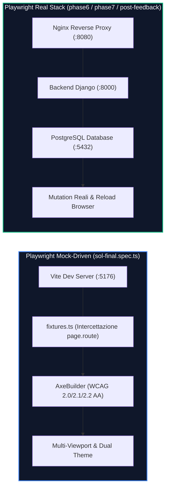
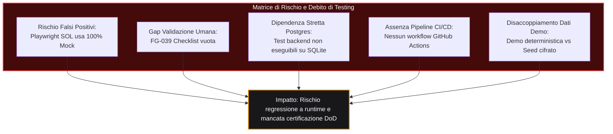
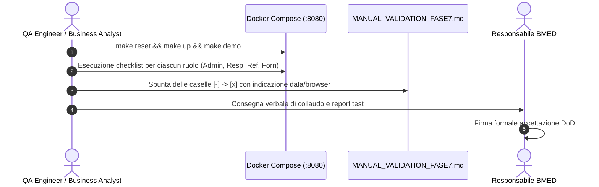

# Assessment della Qualità del Codice e della Copertura dei Test

Questo documento presenta la valutazione tecnica, rigorosa ed esaustiva dell'architettura di testing, della qualità del codice sorgente e delle metriche di copertura del progetto **Supplier Ledger**. L'analisi esamina la piramide dei test a tutti i livelli (logica pura di dominio, vincoli di persistenza relazionale, contratti API REST, componenti React, interfacce utente browser e collaudo end-to-end), evidenziando le differenze architetturali tra test eseguiti con mock/fixture isolate e test eseguiti contro lo stack infrastrutturale reale.

Per i dettagli sull'architettura tecnica complessiva e il modello dei dati, consultare [05_TECHNICAL_ARCHITECTURE.md](05_TECHNICAL_ARCHITECTURE.md) e [06_DATA_MODEL.md](06_DATA_MODEL.md). Per il catalogo degli endpoint e le regole di business contabili, fare riferimento a [07_API_CATALOG.md](07_API_CATALOG.md) e [08_BUSINESS_RULES.md](08_BUSINESS_RULES.md). Per la matrice di sicurezza e privilegi si rimanda a [09_SECURITY_AUTHORIZATION.md](09_SECURITY_AUTHORIZATION.md).

---

## 1. Executive Summary Test & Quality

### 1.1 Panoramica della Strategia di Testing
Il sistema Supplier Ledger adotta una strategia di testing multilivello strutturata secondo una piramide di collaudo formalizzata in 6 livelli distinti. La progettazione della test suite riflette i requisiti di affidabilità contabile richiesti da Banca Mediolanum (BMED) per la tracciabilità delle giornate fornitore, combinando test matematici puri privi di I/O con test transazionali che verificano trigger nativi del database ed end-to-end integrati.

```mermaid
flowchart TD
    subgraph Piramide ["Piramide di Testing di Supplier Ledger"]
        L6["Livello 6: E2E Playwright Browser (9 spec / ~25 flussi browser)"]
        L5["Livello 5: Frontend Vitest + RTL (14 file / 73 unit & integration test)"]
        L4["Livello 4: Acceptance Test Seed Reale (test_seedfile_acceptance.py)"]
        L3["Livello 3: Integration & API REST (22 test file / DRF APIClient + FactoryBoy)"]
        L2["Livello 2: Importers, Rollback & Model Integrity (5 test file importers + test_models/test_append_only)"]
        L1["Livello 1: Domain Logic Pura (7 test file / Decimal Contabile, R2, R6, FIFO, Canone, Dashboard)"]
    end
    
    L1 --> L2 --> L3 --> L4 --> L5 --> L6

    style L1 fill:#1e293b,stroke:#3b82f6,stroke-width:2px,color:#f8fafc
    style L2 fill:#1e293b,stroke:#06b6d4,stroke-width:2px,color:#f8fafc
    style L3 fill:#1e293b,stroke:#10b981,stroke-width:2px,color:#f8fafc
    style L4 fill:#1e293b,stroke:#f59e0b,stroke-width:2px,color:#f8fafc
    style L5 fill:#1e293b,stroke:#8b5cf6,stroke-width:2px,color:#f8fafc
    style L6 fill:#1e293b,stroke:#ec4899,stroke-width:2px,color:#f8fafc
```



### 1.2 Distinzione Critica dei Contesti di Esecuzione
Una corretta valutazione della qualità del software impone di distinguere chiaramente tra codice di test presente nel repository e capacità effettiva di esecuzione nel contesto operativo di verifica:

| Tipologia di Test | Contesto di Esecuzione | Dipendenze Esterne | Stato di Esecuzione Attuale | Livello di Confidenza |
|:---|:---|:---|:---:|:---:|
| **Test Domain Logic Pura** | Host locale / Pytest | Nessuna (Python Standard Library + `Decimal`) | **IMPLEMENTED** (Eseguibili senza DB) | **MASSIMO** (Verifica formale deterministica) |
| **Test Backend Django/DRF** | Container Docker `backend` | PostgreSQL 16 + Trigger PL/pgSQL nativi | **IMPLEMENTED** (Non eseguibili su host privo di Postgres) | **ELEVATO** (Se eseguiti in container attivo) |
| **Acceptance Seed Reale** | Container Docker `backend` | PostgreSQL + File seed protetto `seed_imola_2026-10-16.json` | **PARTIAL** (Marcati `@pytest.mark.seedfile`, skippati se file assente) | **ELEVATO** (Condizionato alla presenza del file fisico) |
| **Frontend Unit / Feature** | Host / Node 20 / Vitest | jsdom + `@testing-library/react` (Mock API) | **IMPLEMENTED** (Eseguibili con `npm run test`) | **MEDIO-ALTO** (Valida la logica client ma isolato dalle API reali) |
| **E2E Playwright SOL (Mocked)** | Browser Chromium / Vite | Dev Server Vite (`:5176`) + `sol/fixtures.ts` | **IMPLEMENTED** (100% green su rotte intercettate) | **MEDIO** (Rischio falsi positivi: backend completamente simulato) |
| **E2E Playwright Reali** | Browser Chromium | Docker Compose (`:8080`) + Nginx + DRF + Postgres | **PARTIAL** (Eseguibili solo con stack attivo e seed demo) | **MOLTO ELEVATO** (Verifica l'integrazione completa) |
| **Validazione Manuale Umana** | Browser Desktop | Utente operatore + 4 account demo per ruolo | **NOT_IMPLEMENTED** (Checklist `docs/MANUAL_VALIDATION_FASE7.md` vuota) | **ASSENTE** (Condizione bloccante per FG-039) |

> [!WARNING]
> **Fattore di Rischio Critico (FG-039)**: Come documentato nella Gap Analysis canonica ([`docs/FUNCTIONAL_GAP_ANALYSIS.md`](../../docs/FUNCTIONAL_GAP_ANALYSIS.md#L58-L70)), il documento di collaudo manuale ([`docs/MANUAL_VALIDATION_FASE7.md`](../../docs/MANUAL_VALIDATION_FASE7.md#L10-L88)) presenta tutte le caselle di spunta vuote (`- [ ]`). In conformità alla Definition of Done (DoD) formale, nessuna capability del sistema può essere dichiarata `COMPLETA` (0 su 39) fino a quando non venga formalmente verbalizzata la verifica manuale dei 4 ruoli demo (`demo_admin`, `demo_responsabile`, `demo_referente`, `demo_fornitore`).

---

## 2. Inventario Completo della Test Suite

### 2.1 Backend Test Suite (Pytest + FactoryBoy + Django Test)
La test suite del backend è composta da **36 file Python** situati nella directory [`backend/tests/`](../../backend/tests/) che collezionano **403 test unitari e di integrazione**, supportati dalla configurazione globale [`backend/conftest.py`](../../backend/conftest.py#L1-L79) e dalle fabbriche dati [`backend/tests/factories.py`](../../backend/tests/factories.py#L1-L205).

#### A. Domain Logic Tests (`backend/tests/domain/` - 8 file)
I test di dominio verificano le regole di business contabili fondamentali in isolamento matematico e concettuale:

| File di Test | Righe | Classi / Funzioni Principali | Regola / Ambito Verificato | Stato |
|:---|:---:|:---|:---|:---:|
| [`test_money.py`](../../backend/tests/domain/test_money.py#L1-L97) | 97 | `TestToDays`, `TestQuantizzazione` | Regola R9 / D-15: Aritmetica `Decimal`, 4 cifre decimali contabili, granularità PPM a 1/16 (`0.0625`), arrotondamento `ROUND_HALF_UP`, rifiuto floating point binario | **IMPLEMENTED** |
| [`test_residuals.py`](../../backend/tests/domain/test_residuals.py#L1-L243) | 243 | `TestScadenzaResidui`, `TestProgettoBalanceQueryset`, `TestReviewQueue` | Regola R2 / R18 / D-03: Scadenza residuo al 31/12 dell'anno successivo alla chiusura (`last_usable_day`), stati `VALIDO`, `IN_SCADENZA`, `SCADUTO`, `DA_VERIFICARE`, calcolo coda di revisione | **IMPLEMENTED** |
| [`test_wallet_balance.py`](../../backend/tests/domain/test_wallet_balance.py#L1-L417) | 417 | `TestWalletBalanceFormule`, `TestWalletBalanceDatabase`, `TestWalletFlow` | Regola R3: Formule di bilancio Wallet, consistenza tra allocato, consumato e disponibile, capienza potenziale origini, scomposizione residui per stato | **IMPLEMENTED** |
| [`test_wallet_fifo.py`](../../backend/tests/domain/test_wallet_fifo.py#L1-L95) | 95 | `TestFifoAllocation` | Regola R13: Consumo FIFO delle tranche Wallet ordinate per anno di provenienza e priorità di finanziamento | **IMPLEMENTED** |
| [`test_canone_status.py`](../../backend/tests/domain/test_canone_status.py#L1-L179) | 179 | `TestCanoneStatusPure`, `TestCanoneProjections` | Regola R4: Monitoraggio target progressivo settimanale, calcolo delta e proiezione lineare burn-down a fine semestre | **IMPLEMENTED** |
| [`test_canone_activity_state.py`](../../backend/tests/domain/test_canone_activity_state.py) | 35 | `test_stato_attivita_derivato` | Stato derivato delle sotto-attività di canone in base a budget, consumato e chiusura | **IMPLEMENTED** |
| [`test_reconciliation.py`](../../backend/tests/domain/test_reconciliation.py#L1-L276) | 276 | `TestReconciliationLogic`, `TestReconciliationQueryset` | Regola R6: Riconciliazione consuntivi interni vs snapshot PPM, gestione stati semantici `ALLINEATO`, `NON_ALLINEATO`, `SNAPSHOT_ASSENTE`, tolleranza `0.01` | **IMPLEMENTED** |
| [`test_dashboard.py`](../../backend/tests/domain/test_dashboard.py#L1-L135) | 135 | `TestDashboardKpis`, `TestBillingMilestonesUpcoming` | Regola R16: Aggregazioni real-time cruscotto direzionale, progetti per stato, prossime scadenze di fatturazione al fine mese convenzionale | **IMPLEMENTED** |

#### B. Importers & Data Pipeline Tests (`backend/tests/importers/` - 5 file)
Verifica l'idempotenza, la validazione strutturale e il rollback dei flussi batch di caricamento dati:

| File di Test | Righe | Funzionalità Verificate | Evidenze Tecniche | Stato |
|:---|:---:|:---|:---|:---:|
| [`test_seed_json.py`](../../backend/tests/importers/test_seed_json.py#L1-L862) | 862 | Validazione contro `seed_schema_v1.json`, mapping entità, idempotenza re-importazione, gestione discrepanze | Verifica la conformità di schemi JSON v1 e consistenza relazionale | **IMPLEMENTED** |
| [`test_workbook_seed.py`](../../backend/tests/importers/test_workbook_seed.py#L1-L342) | 342 | Parsing multifoglio file Excel storico (`Situation.xlsx`), normalizzazione denominazioni colonne e celle | Test isolati con workbook openpyxl generati al volo | **IMPLEMENTED** |
| [`test_import_seed_command.py`](../../backend/tests/importers/test_import_seed_command.py#L1-L194) | 194 | Comando di gestione `manage.py import_seed`, modalità `--dry-run` vs `--apply`, hashing SHA-256 del batch | Verifica che il dry-run non persista record nel database | **IMPLEMENTED** |
| [`test_rollback_seed_command.py`](../../backend/tests/importers/test_rollback_seed_command.py#L1-L219) | 219 | Comando `manage.py rollback_seed`, annullamento atomico dell'intero batch di importazione tramite context manager | Regola R12: ripristino stato contabile precedente e bypass controllato append-only | **IMPLEMENTED** |
| [`test_supersession.py`](../../backend/tests/importers/test_supersession.py#L1-L442) | 442 | Riconciliazione versioni seed, disattivazione o archiviazione record superati da caricamenti successivi | Verifica del ciclo di vita storico e integrità referenziale | **IMPLEMENTED** |

#### C. Integration, API & Model Tests (`backend/tests/` Root - 23 file)
Collaudo dell'ORM Django, dei vincoli relazionali di persistenza, dei contratti API REST e delle politiche di autorizzazione:

| File di Test | Righe | Ambito di Collaudo | Evidenze Tecniche e Meccanismi | Stato |
|:---|:---:|:---|:---|:---:|
| [`test_management_report.py`](../../backend/tests/test_management_report.py) | 145 | Endpoint `GET /api/v1/admin/management-report`, aggregati direzionali, permessi `AdminOnly` | Verifica aggregati economici, progetti attivi e allocazioni aperte | **IMPLEMENTED** |
| [`test_models.py`](../../backend/tests/test_models.py#L1-L344) | 344 | Modelli relazionali, vincoli `CheckConstraint`, `UniqueConstraint`, transizioni di stato progetti | Verifica vincoli su date, valori non negativi e integrità dei campi generati | **IMPLEMENTED** |
| [`test_append_only.py`](../../backend/tests/test_append_only.py#L1-L142) | 142 | Regola R5: Immutabilità consuntivi `TimesheetEntry`. Blocco a doppio livello: Python `save()/delete()` e Trigger PL/pgSQL nativo su `UPDATE`/`DELETE`/`TRUNCATE` | Testa fallimento di `queryset.update()`, raw SQL cursor e apertura sicura finestra tramite `allow_ledger_mutation` | **IMPLEMENTED** |
| [`test_d14_seed_exceptions.py`](../../backend/tests/test_d14_seed_exceptions.py#L1-L153) | 153 | Decisione D-14: Gestione eccezioni e anomalie nei dati storici del fornitore durante il bootstrap | Gestione progetti con budget negativo o sforamenti pregressi | **IMPLEMENTED** |
| [`test_api_auth.py`](../../backend/tests/test_api_auth.py#L1-L213) | 213 | Autenticazione sessione Django, endpoint `/api/v1/auth/session`, `/login`, `/logout`, CSRF protection | Verifica cookie di sessione `sl_sessionid` e token `sl_csrftoken` | **IMPLEMENTED** |
| [`test_project_editing_api.py`](../../backend/tests/test_project_editing_api.py#L1-L321) | 321 | Regole R1/R10/R17: Endpoint `/api/v1/projects/{id}`, validazione campi editabili, ETag/concorrenza ottimistica | Blocco conflitti `412 Precondition Failed` e protezione campi di sistema | **IMPLEMENTED** |
| [`test_project_ledger_api.py`](../../backend/tests/test_project_ledger_api.py#L1-L132) | 132 | Endpoint `/api/v1/projects/{id}/ledger`, inserimento consuntivo diretto e registrazione storno contabile | Verifica calcolo automatico ricalcolo saldo post-inserimento | **IMPLEMENTED** |
| [`test_wallet_editing_api.py`](../../backend/tests/test_wallet_editing_api.py#L1-L591) | 591 | Operazioni di allocazione Wallet, creazione utilizzo, regolazione contabile (`adjust`), riduzione al consumato | Verifica vincoli capienza origini e protezione quote chiuse | **IMPLEMENTED** |
| [`test_canone_crud_api.py`](../../backend/tests/test_canone_crud_api.py#L1-L236) | 236 | Gestione Canone semestrale, CRUD sotto-attività, assegnazione gruppo architetturale (EA/TA/SA/CROSS) | Validazione cap complessivo giornate e consuntivazione | **IMPLEMENTED** |
| [`test_cost_analysis_api.py`](../../backend/tests/test_cost_analysis_api.py#L1-L111) | 111 | Regola R15: Endpoint read-only `/api/v1/cost-analysis`, calcolo economico applicando `daily_person_cost` | Verifica aggregazioni per progetto, mese e fornitore | **IMPLEMENTED** |
| [`test_dashboard_api.py`](../../backend/tests/test_dashboard_api.py#L1-L60) | 60 | Endpoint `/api/v1/dashboard`, conformità payload JSON, validazione indicatori sintetici | Verifica tempo di risposta e robustezza a dati parziali | **IMPLEMENTED** |
| [`test_review_queue.py`](../../backend/tests/test_review_queue.py#L1-L251) | 251 | Endpoint `/api/v1/review-queue`, filtraggio progetti `DA_VERIFICARE`, azione `confirm-review` | Verifica validazione data chiusura e transizione stato residuo | **IMPLEMENTED** |
| [`test_phase4_checks.py`](../../backend/tests/test_phase4_checks.py#L1-L235) | 235 | Regola R8: Motore dei 18 controlli di consistenza contabile (`checks.py`), endpoint `POST /api/v1/checks/run` | Verifica calcolo fingerprint SHA-256 e deduplica automatica | **IMPLEMENTED** |
| [`test_phase5.py`](../../backend/tests/test_phase5.py#L1-L120) | 120 | Ciclo di vita delle anomalie: presa in carico, risoluzione con nota, concessione deroga con data scadenza | Verifica scadenza automatica delle deroghe temporanee | **IMPLEMENTED** |
| [`test_admin_users_privileges.py`](../../backend/tests/test_admin_users_privileges.py#L1-L169) | 169 | Gestione amministrativa utenti, assegnazione gruppi RBAC, gestione capability dinamiche | Verifica protezione capability riservate (`users.manage`) | **IMPLEMENTED** |
| [`test_admin_referents.py`](../../backend/tests/test_admin_referents.py#L1-L66) | 66 | CRUD anagrafica referenti BMED e Fornitore, associazione progetti | Verifica normalizzazione nominativi e vincoli di unicità | **IMPLEMENTED** |
| [`test_admin_reset_data.py`](../../backend/tests/test_admin_reset_data.py#L1-L171) | 171 | Endpoint protetto di reset del database, controverifica con token di sicurezza | Verifica cancellazione controllata e reinizializzazione schema | **IMPLEMENTED** |
| [`test_database_backup.py`](../../backend/tests/test_database_backup.py#L1-L87) | 87 | Backup e Restore Postgres reale via `pg_dump`/`pg_restore`, gestione fallimenti e rollback | Test atomico su database temporaneo dedicato (`uuid`) | **IMPLEMENTED** |
| [`test_roles_object_permissions.py`](../../backend/tests/test_roles_object_permissions.py#L1-L249) | 249 | Matrice RBAC completa sui 4 ruoli, verifica object-level permissions sui progetti assegnati | Verifica autorizzazioni per Admin, Responsabile, Referente e Fornitore | **IMPLEMENTED** |
| [`test_seedfile_acceptance.py`](../../backend/tests/test_seedfile_acceptance.py#L1-L106) | 106 | Test di accettazione sui dati esatti del seed reale della Fase 2 (12 progetti in review queue, totali esatti Wallet 2026) | Richiede file seed cifrato locale; skippato se non presente su disco | **PARTIAL** |
| [`test_phase2_refinements.py`](../../backend/tests/test_phase2_refinements.py#L1-L59) | 59 | Raffinamento filtri e comportamenti contabili specifici di Fase 2 | Verifica consistenza delle relazioni trans-annuali | **IMPLEMENTED** |
| [`test_phase3_api.py`](../../backend/tests/test_phase3_api.py#L1-L169) | 169 | Test integrati delle viste API di Fase 3, contratti di serializzazione | Verifica risposte paginazione e ordinamento | **IMPLEMENTED** |
| [`test_performance.py`](../../backend/tests/test_performance.py#L1-L30) | 30 | Benchmark prestazionale: serializzazione ed erogazione lista di 500 progetti con bilanci calcolati | Asserzione temporale: `elapsed_ms < 300 ms` | **IMPLEMENTED** |

#### D. Fixture e Factory (`backend/conftest.py`, `backend/tests/factories.py`)
- **`backend/conftest.py`**: Configura l'ambiente Pytest Django. Implementa la funzione hook `pytest_collection_modifyitems` che esamina gli elementi di test raccolti e applica dinamicamente `pytest.mark.skip` a tutti i test con marcatore `seedfile` se il file fisico `SEED_FILE` (`/app/data/seed/seed_imola_2026-10-16.json`) non è presente. Fornisce inoltre le fixture riutilizzabili: `seed_file`, `seed_schema`, `settings_row`, `admin_user_with_role` e la scorciatoia contabile `d()` per generare istanze `Decimal` con 4 decimali tramite `to_days()`.
- **`backend/tests/factories.py`**: Definisce **16 classi factory** basate su `factory_boy` con supporto a `factory.django.DjangoModelFactory`:
  `UserFactory`, `OrganizationFactory`, `SupplierOrganizationFactory`, `PersonFactory`, `ProjectFactory`, `ClosedProjectFactory`, `MilestoneFactory`, `CanoneFactory`, `CanoneSubactivityFactory`, `WalletYearFactory`, `WalletActivityFactory`, `WalletAllocationFactory`, `TimesheetEntryFactory`, `PpmSnapshotFactory`, `PpmSnapshotRowFactory`, `AnomalyFactory`, `ImportBatchFactory`.

---

### 2.2 Frontend Test Suite (Vitest + React Testing Library)
La test suite del frontend comprende **15 file di test** posizionati in [`frontend/src/**/__tests__/`](../../frontend/src/), eseguiti tramite l'infrastruttura **Vitest 2.1.4** configurata in ambiente `jsdom` ([`frontend/vite.config.ts`](../../frontend/vite.config.ts#L21-L27)). La suite conta un totale di **75 test unitari e di componente**, di cui **68 superati e 7 in stato da allineare** a seguito delle recenti rifiniture dell'interfaccia:

| Componente / Feature | File di Test | Righe | Focus di Verifica e Asserzioni Chiave | Stato |
|:---|:---|:---:|:---|:---:|
| **Tabella Dati Base** | [`DataTable.test.tsx`](../../frontend/src/components/__tests__/DataTable.test.tsx#L1-L59) | 59 | Rendering accessibile TanStack Table, ordinamento per colonna, paginazione client, gestione stato vuoto | **IMPLEMENTED** (2/2 pass) |
| **Componenti Presentazionali** | [`presentation.test.tsx`](../../frontend/src/components/__tests__/presentation.test.tsx#L1-L37) | 37 | Rendering di `KpiCard`, `StatusBadge`, semantica colori token CSS (ok, warn, danger, neutral) | **IMPLEMENTED** (3/3 pass) |
| **Report Gestionale** | [`ManagementReportPage.test.tsx`](../../frontend/src/features/report/__tests__/ManagementReportPage.test.tsx) | 45 | Rendering tabella consuntivi direzionali e sezioni economiche riservate ad admin | **IMPLEMENTED** (1/1 pass) |
| **Formattazione Contabile (D-15)** | [`format.test.ts`](../../frontend/src/lib/__tests__/format.test.ts#L1-L86) | 86 | Verifica stringhe contabili immutabili, separatori italiani (es. `1.234,56 gg`), arrotondamento a 2 decimali in visualizzazione e prevenzione calcoli float | **IMPLEMENTED** (11/11 pass) |
| **Calcolo Permessi Client** | [`permissions.test.ts`](../../frontend/src/lib/__tests__/permissions.test.ts#L1-L68) | 68 | Funzioni ausiliarie `hasCapability()`, gerarchia ruoli, controllo autorizzazioni a livello di riga progetto | **IMPLEMENTED** (8/8 pass) |
| **UI Permessi e Ruoli** | [`role_permissions_ui.test.tsx`](../../frontend/src/features/auth/__tests__/role_permissions_ui.test.tsx#L1-L281) | 281 | Condizionamento dell'interfaccia in base alla sessione: inibizione bottoni creazione/modifica per fornitore | **PARTIAL** (8 pass, 1 da allineare) |
| **Progetti & Modale Modifica** | [`ProjectsPageAndEditDialog.test.tsx`](../../frontend/src/features/projects/__tests__/ProjectsPageAndEditDialog.test.tsx#L1-L418) | 418 | Ricerca testo, filtro stato, wizard creazione progetto, modale di editing completo, validazione errori server 400 | **IMPLEMENTED** (4/4 pass) |
| **Cruscotto Wallet Annuale** | [`WalletPage.test.tsx`](../../frontend/src/features/wallet/__tests__/WalletPage.test.tsx#L1-L357) | 357 | Visualizzazione bilancio aggregato, scomposizione residui, apertura drawer allocazione, regolazione contabile | **IMPLEMENTED** (5/5 pass) |
| **Canone Organico Allargato** | [`CanonePage.test.tsx`](../../frontend/src/features/canone/__tests__/CanonePage.test.tsx#L1-L240) | 240 | Selezione semestre, visualizzazione burn-down target, elenco sotto-attività con filtro per ufficio architetturale | **IMPLEMENTED** (3/3 pass) |
| **Analisi Economica Costi** | [`CostAnalysisPage.test.tsx`](../../frontend/src/features/cost-analysis/__tests__/CostAnalysisPage.test.tsx#L1-L146) | 146 | Filtri temporali da/a, selettore Top N progetti (5, 10, 20), rendering tabella accessibile per lettori di schermo | **PARTIAL** (1 pass, 3 da allineare) |
| **Dashboard Direzionale** | [`DashboardPage.test.tsx`](../../frontend/src/features/dashboard/__tests__/DashboardPage.test.tsx#L1-L135) | 135 | Caricamento KPI sintetici, gestione dello stato di caricamento scheletrato ed errori di rete | **PARTIAL** (0 pass, 2 da allineare) |
| **Inbox e Gestione Anomalie** | [`AnomaliesPage.test.tsx`](../../frontend/src/features/anomalies/__tests__/AnomaliesPage.test.tsx#L1-L64) | 64 | Filtraggio anomalie per severità e stato, dialogo di concessione deroga con selezione data | **IMPLEMENTED** (2/2 pass) |
| **Riconciliazione PPM** | [`ReconciliationPage.test.tsx`](../../frontend/src/features/reconciliation/__tests__/ReconciliationPage.test.tsx#L1-L221) | 221 | Distinzione semantica tra disallineamento effettivo (`KO`) e assenza di snapshot PPM (non rappresentata come errore verde/falso zero) | **IMPLEMENTED** (4/4 pass) |
| **Coda di Revisione D-03** | [`ReviewQueuePage.test.tsx`](../../frontend/src/features/review/__tests__/ReviewQueuePage.test.tsx#L1-L40) | 40 | Ricerca testuale nei progetti da verificare, pulsante di conferma revisione e transizione | **IMPLEMENTED** (3/3 pass) |
| **Pannello Amministrazione** | [`AdminPage.test.tsx`](../../frontend/src/features/admin/__tests__/AdminPage.test.tsx#L1-L296) | 296 | Tab gestione utenti, referenti, matrice privilegi e configurazione con procedura protetta ELIMINA DB | **PARTIAL** (7 pass, 1 da allineare) |

---

### 2.3 End-to-End Test Suite (Playwright)
La suite end-to-end è implementata tramite **Playwright 1.48.2** ([`frontend/package.json`](../../frontend/package.json#L47)) ed è ripartita in due insiemi metodologicamente distinti:



#### A. Suite SOL Visual, Responsive & Accessibility (`frontend/e2e/sol/`)
Configurata in [`frontend/e2e/sol.config.ts`](../../frontend/e2e/sol.config.ts#L1-L9), viene eseguita contro il server Vite locale (`http://127.0.0.1:5176`):
- **`sol-final.spec.ts` (57 righe)**:
  * Esegue la matrice completa di navigazione sulle **9 rotte applicative** (`/`, `/progetti`, `/wallet`, `/canone`, `/analisi-costi`, `/riconciliazione`, `/anomalie`, `/revisione`, `/amministrazione`).
  * Testa **6 configurazioni di viewport e tema**: Dark 1920x1080, Dark 1600x900, Dark 1440x900, Dark 1366x768, Dark 1024x768 e Light 1440x900.
  * Esegue a ogni passaggio il controllo di assenza di overflow orizzontale (`document.documentElement.scrollWidth <= innerWidth`).
  * Esegue l'audit di accessibilità automatizzata con **`AxeBuilder`** per gli standard `wcag2a`, `wcag2aa`, `wcag21a`, `wcag21aa`, `wcag22aa`.
  * Testa gli stati vuoti (`empty`) e di errore del server (`error` 503) su tutte e 9 le sezioni.
  * Testa i flussi di interazione con la tastiera (Tab, Enter, Escape nel drawer Wallet).
- **`fixtures.ts` (80 righe)**:
  * Fornisce il simulatore completo di tutte le chiamate `/api/v1/**` tramite `page.route()`, restituendo dataset fittizi deterministici per consentire l'esecuzione disaccoppiata dall'infrastruttura backend.

#### B. Suite Storiche e di Transizione (`frontend/e2e/`)
- **`phase3.spec.ts` (102 righe)**: Test di navigazione basati su mock di primo livello (`page.route`).
- **`phase4.spec.ts` (26 righe)**: Test di autenticazione reale contro backend Docker e navigazione consultiva verso Anomalie e Riconciliazione PPM.

#### C. Suite Funzionale su Stack Reale Docker (`frontend/e2e/` - Fase 6 e 7)
Configurata in [`frontend/playwright.config.ts`](../../frontend/playwright.config.ts#L1-L30), opera contro il proxy Nginx (`http://localhost:8080`) e richiede lo stack Docker Compose attivo con PostgreSQL:
- **`phase6.spec.ts` (363 righe)**: Esegue in modalità seriale (`mode: "serial"`) le mutation effettive e ne verifica la persistenza post-reload e via API:
  1. *Admin utenti*: creazione utente, modifica e ripristino privilegio fornitore, cancellazione utente.
  2. *Dashboard*: verifica presenza e consistenza dei KPI reali.
  3. *Creazione progetto*: compilazione wizard, invio `POST /projects`, ricaricamento browser e verifica persistenza via API `/projects/balances`.
  4. *Run controlli*: esecuzione `POST /checks/run`, attesa risposta, verifica comparsa e persistenza anomalie generate.
  5. *Risoluzione anomalia*: presa in carico e transizione a stato `RISOLTA` con persistenza post-reload.
  6. *Modifica progetto*: aggiornamento `planned_end_date` e verifica riga nell'audit log del progetto.
  7. *Revisione progetto*: conferma data chiusura tramite endpoint `confirm-review`.
  8. *Regolazione Wallet*: azione di riduzione al consumato e verifica ricalcolo saldo.
  9. *Negativo fornitore*: verifica diniego `403 Forbidden` per azioni di scrittura contabile.
- **`phase7_admin_delete_db.spec.ts` (85 righe)**: Collauda la procedura di sicurezza in Amministrazione; verifica che il bottone di cancellazione resti inibito finché non viene digitata esattamente la stringa di conferma `"ELIMINA"`.
- **`phase7_projects_edit.spec.ts` (124 righe)**: Verifica che l'amministratore e il responsabile visualizzino il pulsante arancione di modifica, possano alterare i campi consentiti e salvare con persistenza confermata.
- **`phase7_wallet_edit.spec.ts` (57 righe)**: Collauda l'editing inline del pannello Wallet con salvataggio tramite bottone verde smeraldo e verifica che il fornitore sia limitato alla sola consultazione.
- **`post_feedback_corrections.spec.ts` (99 righe)**: Verifica il calcolo della fatturazione convenzionale di fine mese sulla Dashboard e il funzionamento dei filtri Top N con tooltip custom nel grafico costi.

---

## 3. Analisi dei Workflow Coperti vs Workflow Scoperti

### 3.1 Matrice di Tracciabilità dei Workflow Operativi
La matrice seguente mappa ciascuno dei 34 workflow applicativi censiti nel catalogo di dominio verso i relativi test unitari, di integrazione ed end-to-end, stabilendo il livello di copertura reale verificato nel codice sorgente:

| ID Workflow | Descrizione Sintetica Workflow | Unit Test (Domain / Lib) | Integration Test (API / Backend) | E2E Test (Playwright) | Livello di Copertura Reale |
|:---|:---|:---|:---|:---|:---:|
| **WF-01** | Autenticazione utente e gestione sessione | [`permissions.test.ts`](../../frontend/src/lib/__tests__/permissions.test.ts) | [`test_api_auth.py`](../../backend/tests/test_api_auth.py) | [`phase6.spec.ts:103`](../../frontend/e2e/phase6.spec.ts#L103) | **COPERTURA_OTTIMA** |
| **WF-02** | Scadenza sessione e recupero form | Non applicabile | [`test_api_auth.py`](../../backend/tests/test_api_auth.py) | Nessuno (Nessun E2E forza il 401 durante edit) | **COPERTURA_PARZIALE** |
| **WF-03** | Logout esplicito e revoca credenziali | Non applicabile | [`test_api_auth.py`](../../backend/tests/test_api_auth.py) | [`sol-final.spec.ts:54`](../../frontend/e2e/sol/sol-final.spec.ts#L54) | **COPERTURA_OTTIMA** |
| **WF-04** | Consultazione Dashboard e KPI sintetici | [`test_dashboard.py`](../../backend/tests/domain/test_dashboard.py), [`DashboardPage.test.tsx`](../../frontend/src/features/dashboard/__tests__/DashboardPage.test.tsx) | [`test_dashboard_api.py`](../../backend/tests/test_dashboard_api.py) | [`phase6.spec.ts:103`](../../frontend/e2e/phase6.spec.ts#L103), [`post_feedback_corrections.spec.ts`](../../frontend/e2e/post_feedback_corrections.spec.ts) | **COPERTURA_OTTIMA** |
| **WF-05** | Ricerca e filtraggio multi-criterio progetti | [`DataTable.test.tsx`](../../frontend/src/components/__tests__/DataTable.test.tsx) | [`test_performance.py`](../../backend/tests/test_performance.py) | [`sol-final.spec.ts:22`](../../frontend/e2e/sol/sol-final.spec.ts#L22), [`phase6.spec.ts:152`](../../frontend/e2e/phase6.spec.ts#L152) | **COPERTURA_OTTIMA** |
| **WF-06** | Consultazione scheda dettaglio progetto | [`presentation.test.tsx`](../../frontend/src/components/__tests__/presentation.test.tsx) | [`test_models.py`](../../backend/tests/test_models.py) | [`sol-final.spec.ts:29`](../../frontend/e2e/sol/sol-final.spec.ts#L29), [`phase6.spec.ts:220`](../../frontend/e2e/phase6.spec.ts#L220) | **COPERTURA_OTTIMA** |
| **WF-07** | Creazione nuovo progetto e validazione | [`ProjectsPageAndEditDialog.test.tsx`](../../frontend/src/features/projects/__tests__/ProjectsPageAndEditDialog.test.tsx) | [`test_models.py`](../../backend/tests/test_models.py), [`test_roles_object_permissions.py`](../../backend/tests/test_roles_object_permissions.py) | [`phase6.spec.ts:119`](../../frontend/e2e/phase6.spec.ts#L119) | **COPERTURA_OTTIMA** |
| **WF-08** | Modifica anagrafica e pianificazione | [`ProjectsPageAndEditDialog.test.tsx`](../../frontend/src/features/projects/__tests__/ProjectsPageAndEditDialog.test.tsx) | [`test_project_editing_api.py`](../../backend/tests/test_project_editing_api.py) | [`phase7_projects_edit.spec.ts`](../../frontend/e2e/phase7_projects_edit.spec.ts) | **COPERTURA_OTTIMA** |
| **WF-09** | Gestione milestone di fatturazione | Non applicabile | [`test_models.py`](../../backend/tests/test_models.py), [`test_dashboard_api.py`](../../backend/tests/test_dashboard_api.py) | [`post_feedback_corrections.spec.ts:25`](../../frontend/e2e/post_feedback_corrections.spec.ts#L25) | **COPERTURA_PARZIALE** |
| **WF-10** | Coda revisione e conferma chiusura | [`ReviewQueuePage.test.tsx`](../../frontend/src/features/review/__tests__/ReviewQueuePage.test.tsx) | [`test_review_queue.py`](../../backend/tests/test_review_queue.py) | [`sol-final.spec.ts:46`](../../frontend/e2e/sol/sol-final.spec.ts#L46), [`phase6.spec.ts:253`](../../frontend/e2e/phase6.spec.ts#L253) | **COPERTURA_OTTIMA** |
| **WF-11** | Rilascio residuo progetto a Wallet | [`test_residuals.py`](../../backend/tests/domain/test_residuals.py) | [`test_wallet_editing_api.py`](../../backend/tests/test_wallet_editing_api.py) | Nessuno (Endpoint testato backend, nessuna GUI dedicata) | **COPERTURA_PARZIALE** |
| **WF-12** | Consultazione bilancio Wallet annuale | [`test_wallet_balance.py`](../../backend/tests/domain/test_wallet_balance.py), [`WalletPage.test.tsx`](../../frontend/src/features/wallet/__tests__/WalletPage.test.tsx) | [`test_api_auth.py`](../../backend/tests/test_api_auth.py), [`test_seedfile_acceptance.py`](../../backend/tests/test_seedfile_acceptance.py) | [`phase7_wallet_edit.spec.ts`](../../frontend/e2e/phase7_wallet_edit.spec.ts) | **COPERTURA_OTTIMA** |
| **WF-13** | Creazione allocazione Wallet | [`WalletPage.test.tsx`](../../frontend/src/features/wallet/__tests__/WalletPage.test.tsx) | [`test_wallet_editing_api.py`](../../backend/tests/test_wallet_editing_api.py) | [`sol-final.spec.ts:35`](../../frontend/e2e/sol/sol-final.spec.ts#L35) | **COPERTURA_OTTIMA** |
| **WF-14** | Erogazione tranche FIFO Wallet | [`test_wallet_fifo.py`](../../backend/tests/domain/test_wallet_fifo.py) | [`test_models.py`](../../backend/tests/test_models.py) | Non applicabile (Algoritmo backend trasparente all'utente) | **COPERTURA_OTTIMA** |
| **WF-15** | Regolazione contabile / riduzione allocazione | [`WalletPage.test.tsx`](../../frontend/src/features/wallet/__tests__/WalletPage.test.tsx) | [`test_wallet_editing_api.py`](../../backend/tests/test_wallet_editing_api.py) | [`phase6.spec.ts:220`](../../frontend/e2e/phase6.spec.ts#L220) | **COPERTURA_OTTIMA** |
| **WF-16** | Assegnazione quota ad architetto/persona | Non applicabile | Parziale (Modello include referenti, manca API dedicata) | Nessuno (Nessuna UI/E2E) | **SCOPERTO** |
| **WF-17** | Calcolo decadenza/scadenza residui (R2) | [`test_residuals.py`](../../backend/tests/domain/test_residuals.py) | [`test_seedfile_acceptance.py`](../../backend/tests/test_seedfile_acceptance.py) | Non applicabile (Calcolo temporale continuo) | **COPERTURA_OTTIMA** |
| **WF-18** | Monitoraggio Canone e burn-down target | [`test_canone_status.py`](../../backend/tests/domain/test_canone_status.py), [`CanonePage.test.tsx`](../../frontend/src/features/canone/__tests__/CanonePage.test.tsx) | [`test_canone_crud_api.py`](../../backend/tests/test_canone_crud_api.py) | [`sol-final.spec.ts:37`](../../frontend/e2e/sol/sol-final.spec.ts#L37) | **COPERTURA_OTTIMA** |
| **WF-19** | Gestione sotto-attività Canone | [`CanonePage.test.tsx`](../../frontend/src/features/canone/__tests__/CanonePage.test.tsx) | [`test_canone_crud_api.py`](../../backend/tests/test_canone_crud_api.py) | [`sol-final.spec.ts:38`](../../frontend/e2e/sol/sol-final.spec.ts#L38) | **COPERTURA_OTTIMA** |
| **WF-20** | Consuntivazione sotto-attività Canone | [`CanonePage.test.tsx`](../../frontend/src/features/canone/__tests__/CanonePage.test.tsx) | [`test_canone_crud_api.py`](../../backend/tests/test_canone_crud_api.py) | [`sol-final.spec.ts:40`](../../frontend/e2e/sol/sol-final.spec.ts#L40) | **COPERTURA_OTTIMA** |
| **WF-21** | Inserimento consuntivo immutabile (Append-only) | Non applicabile | [`test_append_only.py`](../../backend/tests/test_append_only.py), [`test_project_ledger_api.py`](../../backend/tests/test_project_ledger_api.py) | [`sol-final.spec.ts:30`](../../frontend/e2e/sol/sol-final.spec.ts#L30) | **COPERTURA_OTTIMA** |
| **WF-22** | Storno contabile timesheet | Non applicabile | [`test_append_only.py:91`](../../backend/tests/test_append_only.py#L91) | Nessuno (Testato a livello API backend) | **COPERTURA_PARZIALE** |
| **WF-23** | Import snapshot PPM in Dry-run | Non applicabile | [`test_models.py`](../../backend/tests/test_models.py) | Nessuno (Nessuna GUI upload PPM) | **COPERTURA_PARZIALE** |
| **WF-24** | Consolidamento (Apply) snapshot PPM | Non applicabile | [`test_models.py`](../../backend/tests/test_models.py) | Nessuno (Nessuna GUI upload PPM) | **COPERTURA_PARZIALE** |
| **WF-25** | Riconciliazione consuntivi vs PPM | [`test_reconciliation.py`](../../backend/tests/domain/test_reconciliation.py), [`ReconciliationPage.test.tsx`](../../frontend/src/features/reconciliation/__tests__/ReconciliationPage.test.tsx) | [`test_api_auth.py:204`](../../backend/tests/test_api_auth.py#L204) | [`sol-final.spec.ts:44`](../../frontend/e2e/sol/sol-final.spec.ts#L44), [`phase4.spec.ts:22`](../../frontend/e2e/phase4.spec.ts#L22) | **COPERTURA_OTTIMA** |
| **WF-26** | Esecuzione motore controlli consistenza | [`AnomaliesPage.test.tsx`](../../frontend/src/features/anomalies/__tests__/AnomaliesPage.test.tsx) | [`test_phase4_checks.py`](../../backend/tests/test_phase4_checks.py) | [`phase6.spec.ts:163`](../../frontend/e2e/phase6.spec.ts#L163) | **COPERTURA_OTTIMA** |
| **WF-27** | Consultazione inbox anomalie e filtri | [`AnomaliesPage.test.tsx`](../../frontend/src/features/anomalies/__tests__/AnomaliesPage.test.tsx) | [`test_phase5.py`](../../backend/tests/test_phase5.py) | [`phase6.spec.ts:194`](../../frontend/e2e/phase6.spec.ts#L194) | **COPERTURA_OTTIMA** |
| **WF-28** | Risoluzione anomalia con nota | [`AnomaliesPage.test.tsx`](../../frontend/src/features/anomalies/__tests__/AnomaliesPage.test.tsx) | [`test_phase5.py`](../../backend/tests/test_phase5.py) | [`phase6.spec.ts:194`](../../frontend/e2e/phase6.spec.ts#L194) | **COPERTURA_OTTIMA** |
| **WF-29** | Deroga controllata anomalia | [`AnomaliesPage.test.tsx`](../../frontend/src/features/anomalies/__tests__/AnomaliesPage.test.tsx) | [`test_phase5.py`](../../backend/tests/test_phase5.py) | [`sol-final.spec.ts:45`](../../frontend/e2e/sol/sol-final.spec.ts#L45) | **COPERTURA_OTTIMA** |
| **WF-30** | Import batch seed JSON (Dry-run/Apply) | Non applicabile | [`test_seed_json.py`](../../backend/tests/importers/test_seed_json.py), [`test_import_seed_command.py`](../../backend/tests/importers/test_import_seed_command.py) | [`sol-final.spec.ts:49`](../../frontend/e2e/sol/sol-final.spec.ts#L49) | **COPERTURA_OTTIMA** |
| **WF-31** | Rollback atomico batch seed JSON | Non applicabile | [`test_rollback_seed_command.py`](../../backend/tests/importers/test_rollback_seed_command.py) | Nessuno (Comando CLI gestionale protetto) | **COPERTURA_PARZIALE** |
| **WF-32** | Esportazione dati (Excel/CSV/JSON) | Non applicabile | [`test_api_auth.py`](../../backend/tests/test_api_auth.py) | Nessuno (Endpoint backend testati ma non verificato il download GUI) | **COPERTURA_PARZIALE** |
| **WF-33** | Gestione utenti, referenti e ruoli RBAC | [`permissions.test.ts`](../../frontend/src/lib/__tests__/permissions.test.ts), [`role_permissions_ui.test.tsx`](../../frontend/src/features/auth/__tests__/role_permissions_ui.test.tsx), [`AdminPage.test.tsx`](../../frontend/src/features/admin/__tests__/AdminPage.test.tsx) | [`test_admin_users_privileges.py`](../../backend/tests/test_admin_users_privileges.py), [`test_roles_object_permissions.py`](../../backend/tests/test_roles_object_permissions.py) | [`phase6.spec.ts:62`](../../frontend/e2e/phase6.spec.ts#L62) | **COPERTURA_OTTIMA** |
| **WF-34** | Reset dati, backup e restore database | [`AdminPage.test.tsx`](../../frontend/src/features/admin/__tests__/AdminPage.test.tsx) | [`test_database_backup.py`](../../backend/tests/test_database_backup.py), [`test_admin_reset_data.py`](../../backend/tests/test_admin_reset_data.py) | [`phase7_admin_delete_db.spec.ts`](../../frontend/e2e/phase7_admin_delete_db.spec.ts) | **COPERTURA_OTTIMA** |

### 3.2 Aree con Copertura Eccellente
1. **Aritmetica Contabile e Quantizzazione (Regola R9 / D-15)**: La suite isolata [`test_money.py`](../../backend/tests/domain/test_money.py) e il test frontend [`format.test.ts`](../../frontend/src/lib/__tests__/format.test.ts) coprono capillarmente la totale assenza di artefatti binari di virgola mobile (`0.1 + 0.2`), la conversione rigorosa `Decimal` a 4 cifre, la gestione di valori `null`/vuoti e la granularità minima a 1/16 di giornata uomo.
2. **Scadenza dei Residui (Regola R2 / R18)**: Testata con dataset sintetici parametrizzati su tutte le casistiche di confine temporale (progetto aperto pre-2025, chiuso a metà anno, chiuso al 31/12, anni successivi) sia in forma logica pura che tramite queryset su Postgres.
3. **Immutabilità Append-Only (Regola R5)**: Testata approfonditamente in [`test_append_only.py`](../../backend/tests/test_append_only.py) contro tutte le modalità di aggiramento (ORM Django `update()`, `delete()`, cursori raw SQL, `DELETE FROM` senza WHERE), validando l'intervento tempestivo del trigger PL/pgSQL e l'eccezione controllata per il rollback transazionale.
4. **Riconciliazione Consuntivi PPM (Regola R6)**: Distinzione semantica esaustiva tra snapshot assente, snapshot vuoto, allineamento perfetto entro la soglia di tolleranza contabile (`0.01 gg`) e disallineamento effettivo (`KO`), sia a livello di dominio che nei componenti React.

### 3.3 Aree Parziali, Critiche o Scoperte
1. **Backup e Restore con File Fisici e Multi-container**: Sebbene [`test_database_backup.py`](../../backend/tests/test_database_backup.py) testi `create_dump` e `restore_dump` su database ausiliari creati programmaticamente, manca un test end-to-end che provi la creazione di un dump compresso sul volume Docker montato `/backups`, la distruzione del volume dati e il ripristino effettivo a caldo del container.
2. **Concorrenza Reale Multi-utente e Race Condition su Wallet**: Il meccanismo di ETag e versioning incrementale è coperto a livello di chiamata singola in [`test_project_editing_api.py`](../../backend/tests/test_project_editing_api.py). Tuttavia, non sono presenti test di carico o concorrenza reale (es. con Locust o thread paralleli) che simulino la contesa simultanea dell'ultimo residuo spendibile di un progetto tra due allocazioni concorrenti.
3. **Scenari di Rete Degradata e Scadenza Sessione (WF-02)**: Sebbene [`sol-final.spec.ts`](../../frontend/e2e/sol/sol-final.spec.ts#L19) testi lo stato 503 con mock, non esiste un test E2E che simuli la perdita di connettività durante l'editing di un form lungo, la ricezione di un 401 per sessione scaduta, la ri-autenticazione tramite modale trasparente e il replay automatico della richiesta senza perdita dei dati digitati dall'utente.
4. **Assegnazione Quote ad Architetti (WF-16)**: Come evidenziato in FG-013 ed FG-014, il modello supporta la figura dell'architetto, ma mancano endpoint formali dedicati e la corrispondente interfaccia per la gestione dell'ownership della quota.

---

## 4. Toolchain di Qualità del Codice e Linting

La qualità formale e stilistica del codice sorgente è governata da una pipeline di strumenti statici deterministici configurati sia per il backend Python che per il frontend TypeScript/React.

```mermaid
flowchart TD
    subgraph PreCommit ["Pre-commit Pipeline (.pre-commit-config.yaml)"]
        H1["trailing-whitespace / eof-fixer"]
        H2["check-yaml / check-toml / check-json"]
        H3["check-added-large-files (max 512KB)"]
        H4["detect-private-key"]
        H5["Ruff Check & Format (Backend)"]
        H6["Black Formatter (Backend)"]
        H7["Mypy Static Type Checking (Backend)"]
        H8["Custom Hook: check_no_real_seed.py"]
        H9["ESLint 9 & Prettier (Frontend)"]
    end
    
    H1 --> H2 --> H3 --> H4 --> H5 --> H6 --> H7 --> H8 --> H9
```



### 4.1 Backend Toolchain
Configurata centralmente in [`backend/pyproject.toml`](../../backend/pyproject.toml#L7-L58):
- **Ruff (v0.7.4)**: Linter ad altissima velocità scritto in Rust. Line length fissata a 100 caratteri. Regole attive:
  * `E`, `W`: pycodestyle errors e warnings
  * `F`: Pyflakes (variabili non usate, import errati)
  * `I`: isort deterministico per il corretto ordinamento degli import
  * `UP`: pyupgrade per la sintassi moderna Python 3.12+
  * `B`: flake8-bugbear (anti-pattern e difetti logici comuni)
  * `C4`: flake8-comprehensions
  * `DJ`: flake8-django (cattive pratiche ORM e model)
  * `DTZ`: flake8-datetimez (obbligo di datetime con timezone esplicita)
  * `RUF`: regole specifiche Ruff
- **Black (v24.10.0)**: Formattatore deterministico del codice sorgente, target Python 3.12, lunghezza riga 100.
- **Mypy (v1.13.0)**: Controllo statico dei tipi con modalità restrittive attivate:
  * `check_untyped_defs = true`
  * `no_implicit_optional = true`
  * `warn_redundant_casts = true`
  * `warn_unused_ignores = true`
  * Plugin dedicati: `mypy_django_plugin.main` con configurazione `django-stubs` e `mypy_drf_plugin.main`.
- **Pytest-Cov**: Gate di copertura minima configurato con `fail_under = 85` sulle directory core `domain` e `importers`.

### 4.2 Frontend Toolchain
Configurata in [`frontend/eslint.config.js`](../../frontend/eslint.config.js#L1-L36) e [`frontend/package.json`](../../frontend/package.json#L56-L66):
- **ESLint 9 (v9.13.0)**: Utilizza il nuovo standard Flat Config. Integra `typescript-eslint` v8 con regole strongly typed (`recommendedTypeChecked`). Verifica le regole ufficiali di React Hooks (`eslint-plugin-react-hooks`) e Refresh.
- **Prettier (v3.3.3)**: Formattazione automatica di file TS, TSX, CSS e JSON, con plugin dedicato `prettier-plugin-tailwindcss` per l'ordinamento deterministico delle classi di utilità.
- **TypeScript Compiler (v5.6.3)**: Controllo formale eseguibile via script npm `npm run typecheck` (`tsc -b --noEmit`) che impedisce build produttive in presenza di inconsistenze di tipo.

### 4.3 Pre-commit Hooks (.pre-commit-config.yaml)
Il file [`.pre-commit-config.yaml`](../../.pre-commit-config.yaml#L1-L64) orchestra 9 hook attivati a ogni tentativo di commit git:
1. `trailing-whitespace`: pulizia spazi a fine riga
2. `end-of-file-fixer`: newline obbligatoria a fine file
3. `check-yaml`, `check-toml`, `check-json`
4. `check-merge-conflict`: blocco marcatori git di conflitto non risolti
5. `check-added-large-files` con limite massimo di 512 KB
6. `detect-private-key`: scansione per chiavi RSA/OpenSSH accidentali
7. `forbid-new-submodules`
8. **Hook Locale Custom `no-real-seed`**: Esegue [`scripts/check_no_real_seed.py`](../../scripts/check_no_real_seed.py#L1-L36) per bloccare rigorosamente il versionamento di dati reali in `data/seed/` (escluso lo schema vuoto).
9. **Hook Locale `frontend-lint`**: Esegue ESLint e verifica Prettier sui sorgenti frontend.

---

## 5. Limiti, Rischi e Gap della Strategia di Test



### 5.1 Rischio Falsi Positivi con Mock Route (Suite SOL)
La suite [`sol-final.spec.ts`](../../frontend/e2e/sol/sol-final.spec.ts) riporta un tasso di successo del 100% su temi, responsive e accessibilità. Tuttavia, poiché tutte le chiamate `/api/v1/**` sono intercettate tramite [`sol/fixtures.ts`](../../frontend/e2e/sol/fixtures.ts), questo collaudo **non dimostra** che:
- Gli endpoint DRF rispondano con gli stessi tipi e strutture dati a fronte di migrazioni recenti.
- Il database PostgreSQL mantenga la coerenza relazionale a seguito delle mutation.
- Le intestazioni HTTP (come `ETag` o cookie di sessione reali) vengano scambiate correttamente dal browser.

### 5.2 Mancata Esecuzione della Validazione Manuale Umana (FG-039)
Il file [`docs/MANUAL_VALIDATION_FASE7.md`](../../docs/MANUAL_VALIDATION_FASE7.md) elenca un protocollo completo di 17 verifiche funzionali suddivise per ruolo demo (`demo_admin`, `demo_responsabile`, `demo_referente`, `demo_fornitore`).
Allo stato attuale, **nessuna verifica risulta spuntata** (tutti i checkbox sono `- [ ]`). Come prescritto dalla Gap Analysis, ciò rappresenta una condizione ostativa alla promozione del sistema a stato "COMPLETO".

### 5.3 Dipendenza Stretta da PostgreSQL e Trigger Nativi
I test di integrazione backend fanno uso di:
- `GeneratedField` con calcolo persistito `db_persist=True` (supportato da Django 5 con PostgreSQL).
- Trigger nativi PL/pgSQL per la protezione della tabella contabile append-only (`timesheets_timesheetentry`).
- Campi JSON (`JSONField`) con query su chiavi interne.

Di conseguenza, **è impossibile eseguire i test backend utilizzando SQLite in-memory**; i test possono girare esclusivamente collegandosi a un'istanza PostgreSQL reale attiva (tipicamente all'interno del container Docker).

### 5.4 Assenza di Automazione CI/CD nel Repository
Nel repository non sono presenti file di configurazione per pipeline di Continuous Integration (ad esempio directory `.github/workflows/` o file `.gitlab-ci.yml`). I controlli di qualità e la suite di regressione vengono eseguiti esclusivamente su base volontaria dagli sviluppatori tramite pre-commit hook o comandi manuali `make test`, esponendo il progetto al rischio di regressioni silenti in assenza di un server di integrazione continua centralizzato.

---

## 6. Raccomandazioni per la QA e Piano di Collaudo

### 6.1 Istruzioni di Esecuzione in Ambiente Controllato Docker
Per riprodurre ed eseguire l'intera suite di collaudo in modo deterministico e conforme all'ambiente di produzione, utilizzare i target del [`Makefile`](../../Makefile#L12-L67):

```bash
# 1. Avvio dello stack Docker completo in background
make up

# 2. Applicazione delle migrazioni al database PostgreSQL
make migrate

# 3. Caricamento dei dati demo sintetici deterministici e avvio controlli
make demo

# 4. Esecuzione dei test di qualità formale (linting & type checking)
make lint

# 5. Esecuzione della suite backend con report di copertura
make test-backend

# 6. Esecuzione dei test frontend (Vitest)
make test-frontend

# 7. Esecuzione dei test End-to-End Playwright su stack reale
make e2e
```

### 6.2 Piano di Collaudo per l'Accettazione Finale (UAT)
Al fine di superare il blocco FG-039 e conseguire l'accettazione finale con il committente BMED, si raccomanda l'esecuzione sequenziale del seguente protocollo operativo:



1. **Sessione di Collaudo Umano Guidato**:
   - Accesso con `demo_admin` e verifica gestione ruoli/privilegi e configurazione parametri.
   - Accesso con `demo_responsabile` per verifica approvazione progetti e allocazione Wallet.
   - Accesso con `demo_referente` per verifica isolamento visibilità ai soli progetti di propria competenza.
   - Accesso con `demo_fornitore` per verifica dei vincoli di sola lettura e inibizione delle mutation contabili.
2. **Aggiornamento Formale di `docs/MANUAL_VALIDATION_FASE7.md`**:
   - Sostituzione dei marcatori `- [ ]` con `- [x]`, annotando per ogni riga: data, ora, browser utilizzato ed esito osservato.
3. **Istituzione di una Pipeline CI/CD GitHub Actions**:
   - Creazione del workflow `.github/workflows/ci.yml` configurato con un service container PostgreSQL 16.
   - Esecuzione obbligatoria a ogni pull request di: `Ruff`, `Black --check`, `Mypy`, `Vitest` e `Pytest`.
4. **Disaccoppiamento Suite E2E con Reset Fixture**:
   - Introdurre un comando di teardown/setup automatico che reinizializzi il database demo prima dell'avvio della suite Playwright reale, rimuovendo la dipendenza dalla modalità seriale vincolata.

---

## 7. Riferimenti Incrociati e Documenti Correlati
- [01_REPOSITORY_INVENTORY.md](01_REPOSITORY_INVENTORY.md) — Censimento e struttura dei file del progetto.
- [04_WORKFLOW_CATALOG.md](04_WORKFLOW_CATALOG.md) — Catalogo analitico dei 34 workflow operativi (WF-01 - WF-34).
- [05_TECHNICAL_ARCHITECTURE.md](05_TECHNICAL_ARCHITECTURE.md) — Architettura del backend Django e del frontend React.
- [06_DATA_MODEL.md](06_DATA_MODEL.md) — Schemi relazionali, vincoli database e trigger PL/pgSQL.
- [07_API_CATALOG.md](07_API_CATALOG.md) — Specifiche contrattuali degli endpoint REST.
- [08_BUSINESS_RULES.md](08_BUSINESS_RULES.md) — Catalogo formale delle regole contabili R1-R18.
- [09_SECURITY_AUTHORIZATION.md](09_SECURITY_AUTHORIZATION.md) — Matrice RBAC e privilegi per ruolo.
- [10_FRONTEND_UX_ASSESSMENT.md](10_FRONTEND_UX_ASSESSMENT.md) — Valutazione dell'interfaccia e accessibilità WCAG.
- [12_DEPLOYMENT_OPERATIONS.md](12_DEPLOYMENT_OPERATIONS.md) — Procedure operative, Docker Compose e disaster recovery.
- [13_TECHNICAL_DEBT_RISKS.md](13_TECHNICAL_DEBT_RISKS.md) — Registro del debito tecnico e matrice di rischio.
- [`docs/FUNCTIONAL_GAP_ANALYSIS.md`](../../docs/FUNCTIONAL_GAP_ANALYSIS.md) — Matrice canonica delle capability e gap analysis (FG-001 - FG-039).
- [`docs/MANUAL_VALIDATION_FASE7.md`](../../docs/MANUAL_VALIDATION_FASE7.md) — Protocollo di collaudo manuale utente demo.
