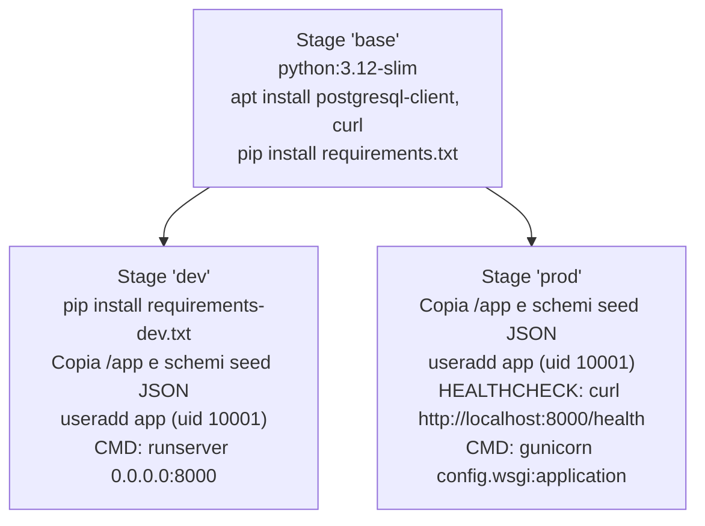
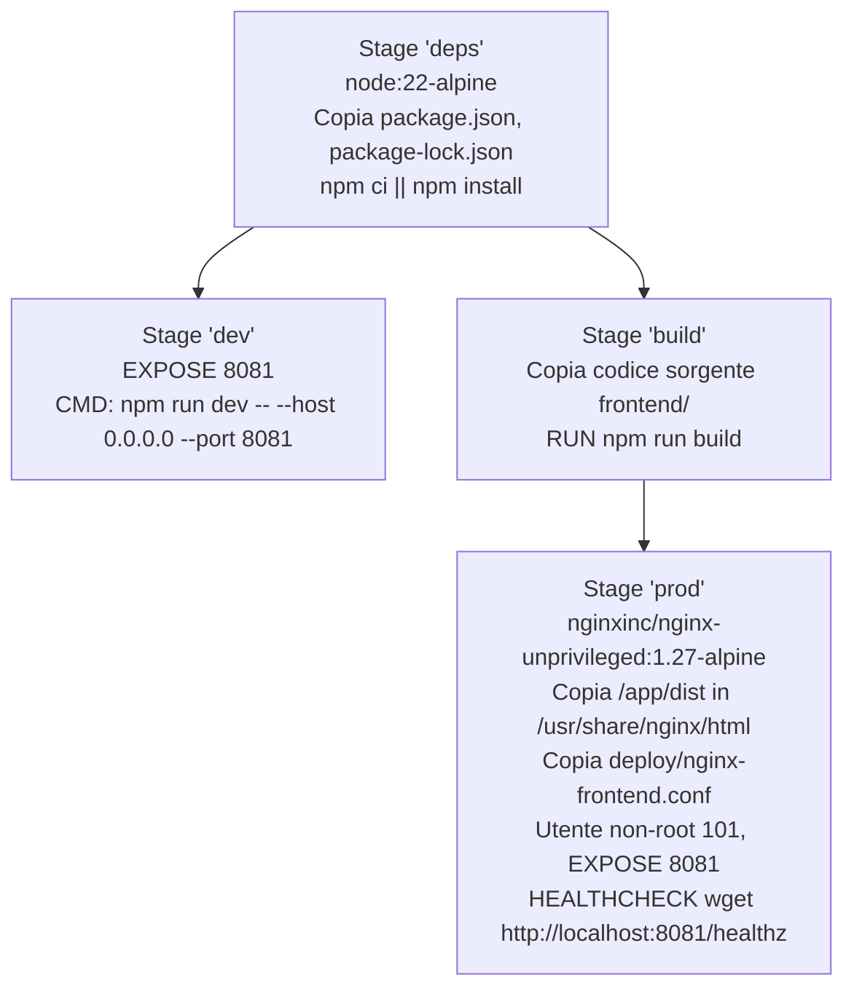
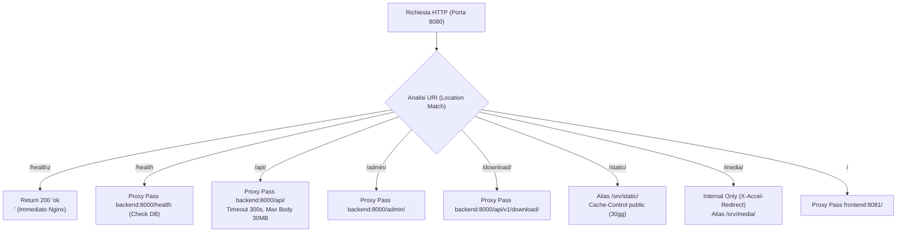
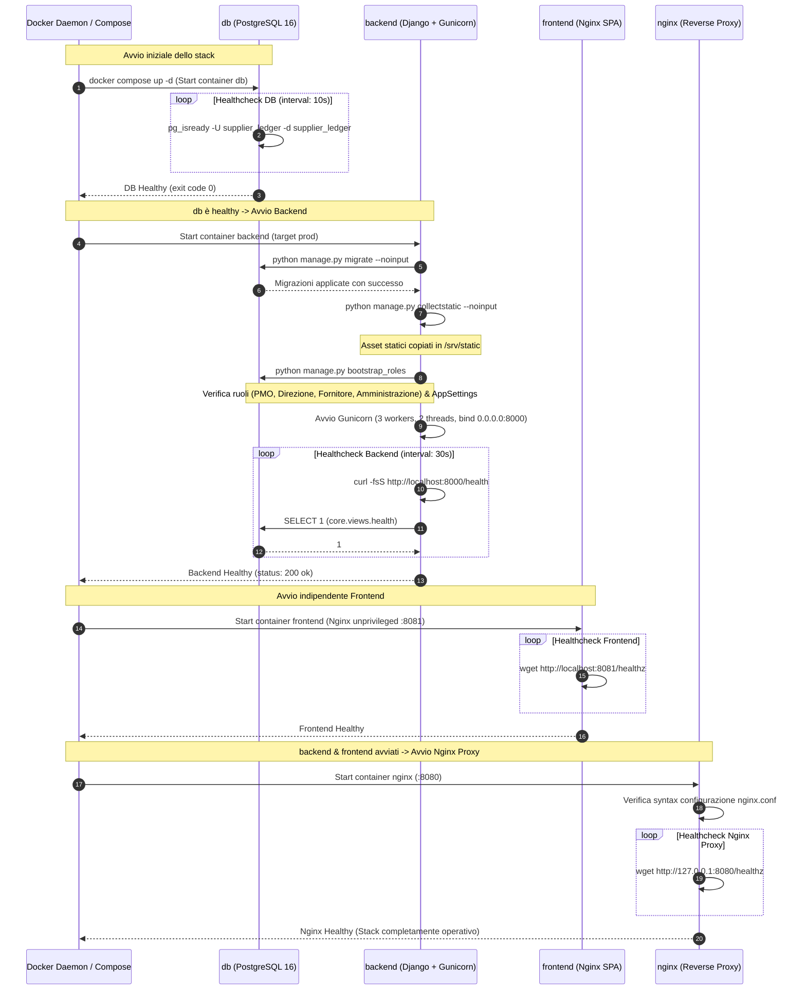
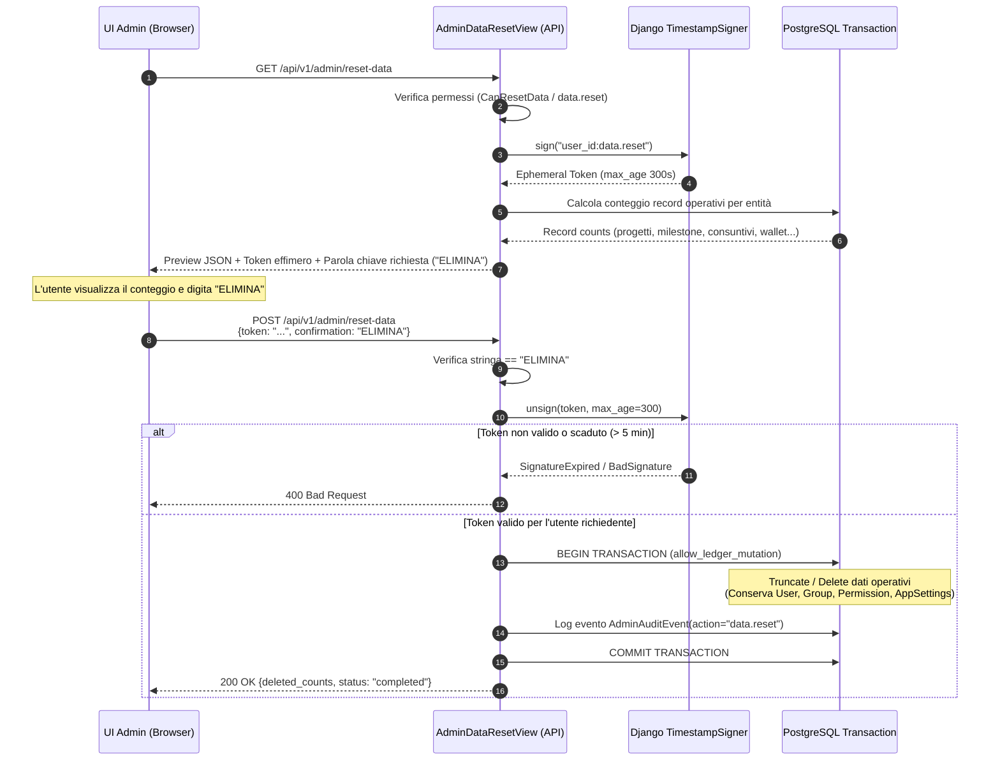
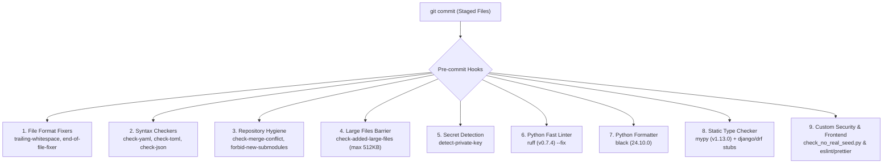

# 12. Deployment & Operations Assessment

> **Documento**: `docs/assestmant/12_DEPLOYMENT_OPERATIONS.md`  
> **Progetto**: Supplier Ledger (Consuntivazione, Wallet & Canone Fornitore)  
> **Stato Valutazione**: `COMPLETO`  
> **Data Analisi**: 2026-10-28  
> **Ambito**: Stack Docker, Dockerfile multi-stage, Nginx reverse proxy, variabili d'ambiente, automazioni Makefile, Django management commands, script di supporto, sicurezza pre-commit e rischi operativi.

---

## 1. Executive Summary dell'Infrastruttura Operativa

L'infrastruttura di erogazione e le procedure operative di **Supplier Ledger** sono state progettate per garantire l'isolamento a container, la portabilità su ambienti bare-metal/on-premises (con esplicita ottimizzazione per **Synology Container Manager / NAS Mediolanum**) e la separazione netta tra runtime di produzione e ambiente di sviluppo.

### Caratteristiche Architetturali Chiave
1. **Containerizzazione Completa**: L'applicazione è incapsulata in 4 servizi Docker orchestrati tramite Docker Compose: database relazionale PostgreSQL 16, backend applicativo Python/Django con server WSGI Gunicorn, frontend SPA statico servito da Nginx unprivileged, e un reverse proxy di ingresso Nginx.
2. **Conformità ai Vincoli Synology Container Manager**:
   - Nessuna porta privilegiata (<1024) utilizzata all'interno dei container o esposta sull'host (porta HTTP pubblica standard: `8080`).
   - Volumi montati come cartelle bind locali situate sotto una directory unificata `${SL_DATA_DIR}` (tipicamente `/volume1/docker/supplier-ledger` in ambiente di produzione NAS).
   - Esecuzione dei processi con utenti non-root dedicati (`app` con UID `10001` per il backend; UID `101` per il container frontend unprivileged).
   - Meccanismi nativi di `healthcheck` su ciascun servizio per garantire il riavvio supervisionato e l'ordine sequenziale di bootstrap.
3. **Flusso di Startup Autonomo**: Il backend esegue automaticamente ad ogni avvio la migrazione dello schema database (`migrate`), la raccolta degli asset statici (`collectstatic`) e il bootstrap idempotente dei ruoli e dei parametri globali (`bootstrap_roles`).
4. **Tooling Operativo Dedicato**: Il sistema include comandi di backup/restore compresso con retention automatica, strumenti per l'esecuzione in locale di PostgreSQL portatile, script di estrazione e verifica bit-a-bit dei seed Excel e hook rigorosi di pre-commit per prevenire la fuga di dati di produzione riservati.

---

## 2. Docker Compose

L'orchestrazione è organizzata secondo il pattern standard Docker Compose v2 a due livelli: un file base di produzione ([`docker-compose.yml`](file:///c:/Users/gianvito.bleve/OneDrive%20-%20Banca%20Mediolanum%20SPA/Documenti/Progetti/imola/docker-compose.yml)) affiancato da un file di sovrascrittura automatica per lo sviluppo locale ([`docker-compose.override.yml`](file:///c:/Users/gianvito.bleve/OneDrive%20-%20Banca%20Mediolanum%20SPA/Documenti/Progetti/imola/docker-compose.override.yml)).

### 2.1 Stack di Produzione (`docker-compose.yml`)

Lo stack di produzione definisce 4 servizi interconnessi su una rete bridge interna non esposta all'esterno, tranne che per la porta HTTP del reverse proxy:

```mermaid
graph TD
    Client["Client / Browser / NAS Reverse Proxy (TLS)"] -->|HTTP :8080| Nginx["nginx (Reverse Proxy)<br/>nginx:1.27-alpine"]
    
    subgraph "Docker Compose Internal Network"
        Nginx -->|/api/, /admin/, /download/| Backend["backend (Django WSGI)<br/>Gunicorn (3w, 2t, 120s)"]
        Nginx -->|/static/, /media/| VolumesStatic["Volumi Bind Locali<br/>/srv/static, /srv/media (ro)"]
        Nginx -->|/ (SPA fallback)| Frontend["frontend (Nginx Unprivileged)<br/>nginxinc:1.27-alpine (:8081)"]
        Backend -->|TCP :5432| DB[("db (PostgreSQL 16)<br/>postgres:16-alpine")]
        Backend -->|rw| VolumesStorage["Storage Persistente<br/>pgdata, media, static, backups, seed (ro)"]
    end
```

#### Dettaglio dei Servizi di Produzione

| Servizio | Immagine / Build | Healthcheck Probe | Volumi Persistenti | Dipendenze | Evidenza Codice |
| :--- | :--- | :--- | :--- | :--- | :--- |
| **`db`** | `postgres:16-alpine` | `pg_isready -U ${POSTGRES_USER} -d ${POSTGRES_DB}`<br/>(10s interval, 5s timeout, 10 retries) | `${SL_DATA_DIR}/pgdata:/var/lib/postgresql/data` | Nessuna | [`docker-compose.yml#L4-L18`](file:///c:/Users/gianvito.bleve/OneDrive%20-%20Banca%20Mediolanum%20SPA/Documenti/Progetti/imola/docker-compose.yml#L4-L18) |
| **`backend`** | `context: .`<br/>`dockerfile: deploy/Dockerfile.backend`<br/>`target: prod` | `curl -fsS http://localhost:8000/health \|\| exit 1`<br/>(definito nel Dockerfile: 30s int, 5s to, 20s start) | `${SL_DATA_DIR}/media:/srv/media`<br/>`${SL_DATA_DIR}/static:/srv/static`<br/>`${SL_DATA_DIR}/backups:/srv/backups`<br/>`${SL_DATA_DIR}/seed:/srv/seed:ro` | `db` (condition: `service_healthy`) | [`docker-compose.yml#L20-L54`](file:///c:/Users/gianvito.bleve/OneDrive%20-%20Banca%20Mediolanum%20SPA/Documenti/Progetti/imola/docker-compose.yml#L20-L54) |
| **`frontend`** | `context: .`<br/>`dockerfile: deploy/Dockerfile.frontend`<br/>`target: prod` | `wget -q -O /dev/null http://localhost:8081/healthz \|\| exit 1`<br/>(30s interval, 5s timeout, 3 retries) | Nessuno (asset statici compilati e incorporati nell'immagine) | Nessuna | [`docker-compose.yml#L55-L60`](file:///c:/Users/gianvito.bleve/OneDrive%20-%20Banca%20Mediolanum%20SPA/Documenti/Progetti/imola/docker-compose.yml#L55-L60) |
| **`nginx`** | `context: .`<br/>`dockerfile: deploy/Dockerfile.nginx` | `wget -q -O /dev/null http://127.0.0.1:8080/healthz \|\| exit 1`<br/>(30s interval, 5s timeout, 3 retries) | `${SL_DATA_DIR}/static:/srv/static:ro`<br/>`${SL_DATA_DIR}/media:/srv/media:ro` | `backend`<br/>`frontend` | [`docker-compose.yml#L62-L79`](file:///c:/Users/gianvito.bleve/OneDrive%20-%20Banca%20Mediolanum%20SPA/Documenti/Progetti/imola/docker-compose.yml#L62-L79) |

#### Parametri e Vincoli di Esecuzione in Produzione
1. **Configurazione Database**: `POSTGRES_INITDB_ARGS: "--encoding=UTF8 --locale=it_IT.UTF-8 --lc-collate=C"` ([`docker-compose.yml#L11`](file:///c:/Users/gianvito.bleve/OneDrive%20-%20Banca%20Mediolanum%20SPA/Documenti/Progetti/imola/docker-compose.yml#L11)). Garantisce codifica UTF-8 nativa e ordinamento standard C conforme ai formati contabili e alfanumerici.
2. **Sequenza di Comando Backend**:
   ```bash
   python manage.py migrate --noinput && \
   python manage.py collectstatic --noinput && \
   python manage.py bootstrap_roles && \
   gunicorn config.wsgi:application --bind 0.0.0.0:8000 --workers 3 --threads 2 \
     --timeout 120 --access-logfile - --error-logfile -
   ```
   ([`docker-compose.yml#L49-L53`](file:///c:/Users/gianvito.bleve/OneDrive%20-%20Banca%20Mediolanum%20SPA/Documenti/Progetti/imola/docker-compose.yml#L49-L53)).
3. **Impostazioni Django di Produzione**: `DJANGO_SETTINGS_MODULE: config.settings.prod`. Obbligatorietà di `DJANGO_SECRET_KEY` e `POSTGRES_PASSWORD` (il mancato passaggio genera errore di validazione variabile `?Serve ...`).

---

### 2.2 Stack di Sviluppo (`docker-compose.override.yml`)

Il file [`docker-compose.override.yml`](file:///c:/Users/gianvito.bleve/OneDrive%20-%20Banca%20Mediolanum%20SPA/Documenti/Progetti/imola/docker-compose.override.yml) viene applicato automaticamente da Docker Compose durante l'esecuzione su workstation di sviluppo, riconfigurando lo stack per consentire hot-reloading del codice e accesso diretto ai servizi:

```mermaid
graph LR
    subgraph "Host Sviluppatore"
        DevBrowser["Browser / Postman"]
        HostIDE["IDE / Editor Codice"]
        DBTools["DBeaver / DataGrip / psql"]
    end

    subgraph "Docker Compose (Dev Mode)"
        DBDev[("db: postgres:16-alpine<br/>Porta host :5433 -> 5432")]
        BackendDev["backend (Target: dev)<br/>Django runserver 0.0.0.0:8000<br/>Porta host :8000"]
        FrontendDev["frontend (Target: dev)<br/>Vite dev server (:8081)<br/>Porta host :5173"]
    end

    DevBrowser -->|:8080| NginxProxy["nginx (Proxy)"]
    DevBrowser -->|:5173 (Hot Reload)| FrontendDev
    DevBrowser -->|:8000 (API Diretta)| BackendDev
    DBTools -->|:5433 (Accesso DB)| DBDev
    HostIDE -.->|Bind mount ./backend| BackendDev
    HostIDE -.->|Bind mount ./frontend| FrontendDev
```

#### Differenze Chiave: Produzione vs Sviluppo

| Caratteristica | Produzione (`docker-compose.yml`) | Sviluppo (`docker-compose.override.yml`) | Note e Riferimenti |
| :--- | :--- | :--- | :--- |
| **Porta Database Host** | Nessuna esposizione diretta | `${SL_DB_PORT:-5433}:5432` | Evita collisioni con istanze PostgreSQL locali ([`override.yml#L5-L6`](file:///c:/Users/gianvito.bleve/OneDrive%20-%20Banca%20Mediolanum%20SPA/Documenti/Progetti/imola/docker-compose.override.yml#L5-L6)) |
| **Target Build Backend** | `prod` (senza tool dev) | `dev` (include `requirements-dev.txt`) | [`override.yml#L11-L12`](file:///c:/Users/gianvito.bleve/OneDrive%20-%20Banca%20Mediolanum%20SPA/Documenti/Progetti/imola/docker-compose.override.yml#L11-L12) |
| **Server Backend** | Gunicorn (3 workers, 2 threads) | Django `runserver 0.0.0.0:8000` | Supporta autoreload automatico ([`override.yml#L34`](file:///c:/Users/gianvito.bleve/OneDrive%20-%20Banca%20Mediolanum%20SPA/Documenti/Progetti/imola/docker-compose.override.yml#L34)) |
| **Volumi Codice Backend** | Immagine autocontenuta | `./backend:/app` (bind mount) | Modifiche al codice attive in tempo reale ([`override.yml#L23`](file:///c:/Users/gianvito.bleve/OneDrive%20-%20Banca%20Mediolanum%20SPA/Documenti/Progetti/imola/docker-compose.override.yml#L23)) |
| **Rate Limit Login** | `10/min` | `1000/min` | Previene blocchi durante test ripetuti ([`override.yml#L18`](file:///c:/Users/gianvito.bleve/OneDrive%20-%20Banca%20Mediolanum%20SPA/Documenti/Progetti/imola/docker-compose.override.yml#L18)) |
| **CORS / CSRF Origins** | Ristretto al reverse proxy / dominio | `http://localhost:5173`, `http://localhost:8080`, `http://nginx:8080` | Consente chiamate dirette tra frontend e backend in dev ([`override.yml#L19-L20`](file:///c:/Users/gianvito.bleve/OneDrive%20-%20Banca%20Mediolanum%20SPA/Documenti/Progetti/imola/docker-compose.override.yml#L19-L20)) |
| **Server Frontend** | Nginx servente build dist (`/usr/share/nginx/html`) | Node Vite dev server (`npm run dev -- --host 0.0.0.0 --port 8081`) | Hot Module Replacement (HMR) su porta 5173 ([`override.yml#L39-L44`](file:///c:/Users/gianvito.bleve/OneDrive%20-%20Banca%20Mediolanum%20SPA/Documenti/Progetti/imola/docker-compose.override.yml#L39-L44)) |
| **Volumi Frontend** | Nessuno | `./frontend:/app` e volume nominale `frontend_node_modules` | Preserva i pacchetti installati in container ([`override.yml#L40-L42`](file:///c:/Users/gianvito.bleve/OneDrive%20-%20Banca%20Mediolanum%20SPA/Documenti/Progetti/imola/docker-compose.override.yml#L40-L42)) |

---

## 3. Dockerfiles Multi-Stage

I Dockerfile risiedono nella directory [`deploy/`](file:///c:/Users/gianvito.bleve/OneDrive%20-%20Banca%20Mediolanum%20SPA/Documenti/Progetti/imola/deploy) e implementano pattern multi-stage per minimizzare la superficie di attacco e le dimensioni finali delle immagini di produzione.

### 3.1 `deploy/Dockerfile.backend`

Il file [`deploy/Dockerfile.backend`](file:///c:/Users/gianvito.bleve/OneDrive%20-%20Banca%20Mediolanum%20SPA/Documenti/Progetti/imola/deploy/Dockerfile.backend) definisce il runtime Python 3.12:



#### Dettagli Implementativi dello Stage Backend
- **Dipendenze di Sistema OS**: `postgresql-client` (obbligatorio per permettere al comando `manage.py backup` di eseguire `pg_dump` verso PostgreSQL 16) e `curl` (necessario per l'healthcheck) ([`Dockerfile.backend#L10-L12`](file:///c:/Users/gianvito.bleve/OneDrive%20-%20Banca%20Mediolanum%20SPA/Documenti/Progetti/imola/deploy/Dockerfile.backend#L10-L12)).
- **Variabili d'Ambiente Core**:
  - `PYTHONDONTWRITEBYTECODE=1`: evita la scrittura di file `.pyc`.
  - `PYTHONUNBUFFERED=1`: garantisce che i log di Django e Gunicorn vengano emessi immediatamente su stdout senza bufferizzazione ([`Dockerfile.backend#L4-L7`](file:///c:/Users/gianvito.bleve/OneDrive%20-%20Banca%20Mediolanum%20SPA/Documenti/Progetti/imola/deploy/Dockerfile.backend#L4-L7)).
- **Sicurezza Non-Root**: Creazione esplicita dell'utente `app` con UID `10001` (`RUN useradd --uid 10001 --create-home app`). Tutti i file applicativi e le cartelle media/static hanno ownership assegnata ad `app:app` ([`Dockerfile.backend#L38-L41`](file:///c:/Users/gianvito.bleve/OneDrive%20-%20Banca%20Mediolanum%20SPA/Documenti/Progetti/imola/deploy/Dockerfile.backend#L38-L41)).
- **Schemi Seed JSON Inclusi**: Inclusione dei 4 schemi di validazione del workbook (`seed_schema_v1.json`, `seed_workbook_schema_v2.json`, `seed_workbook_schema_v3.json`, `seed_workbook_schema_v4.json`) alla radice del container per consentire la validazione offline dei seed importati ([`Dockerfile.backend#L34-L37`](file:///c:/Users/gianvito.bleve/OneDrive%20-%20Banca%20Mediolanum%20SPA/Documenti/Progetti/imola/deploy/Dockerfile.backend#L34-L37)).

---

### 3.2 `deploy/Dockerfile.frontend`

Il file [`deploy/Dockerfile.frontend`](file:///c:/Users/gianvito.bleve/OneDrive%20-%20Banca%20Mediolanum%20SPA/Documenti/Progetti/imola/deploy/Dockerfile.frontend) organizza la compilazione del client React/Vite su base Node 22:



#### Dettagli Implementativi dello Stage Frontend
- **Isolamento dell'Ambiente di Build**: L'immagine finale di produzione non contiene Node.js, `npm`, né i moduli di build. Contiene unicamente i file statici compilati (`dist/`) serviti dall'immagine ufficiale `nginxinc/nginx-unprivileged:1.27-alpine` ([`Dockerfile.frontend#L16-L23`](file:///c:/Users/gianvito.bleve/OneDrive%20-%20Banca%20Mediolanum%20SPA/Documenti/Progetti/imola/deploy/Dockerfile.frontend#L16-L23)).
- **Porta Unprivileged**: Ascolto nativo sulla porta `8081` con permessi di esecuzione limitati all'UID di sistema `101` ([`Dockerfile.frontend#L22-L23`](file:///c:/Users/gianvito.bleve/OneDrive%20-%20Banca%20Mediolanum%20SPA/Documenti/Progetti/imola/deploy/Dockerfile.frontend#L22-L23)).
- **Healthcheck Integrato**: `wget -q -O /dev/null http://localhost:8081/healthz || exit 1` ([`Dockerfile.frontend#L24-L25`](file:///c:/Users/gianvito.bleve/OneDrive%20-%20Banca%20Mediolanum%20SPA/Documenti/Progetti/imola/deploy/Dockerfile.frontend#L24-L25)).

---

### 3.3 `deploy/Dockerfile.nginx`

Il file [`deploy/Dockerfile.nginx`](file:///c:/Users/gianvito.bleve/OneDrive%20-%20Banca%20Mediolanum%20SPA/Documenti/Progetti/imola/deploy/Dockerfile.nginx) deriva direttamente da `nginx:1.27-alpine`:
- Sostituisce la configurazione standard con [`deploy/nginx.conf`](file:///c:/Users/gianvito.bleve/OneDrive%20-%20Banca%20Mediolanum%20SPA/Documenti/Progetti/imola/deploy/nginx.conf).
- Non include certificati TLS all'interno del container: la terminazione SSL/TLS è demandata al reverse proxy perimetrale di rete o al modulo NAS Synology ([`Dockerfile.nginx#L1-L3`](file:///c:/Users/gianvito.bleve/OneDrive%20-%20Banca%20Mediolanum%20SPA/Documenti/Progetti/imola/deploy/Dockerfile.nginx#L1-L3)).

---

## 4. Configurazione del Reverse Proxy NGINX e Servizio Statici

L'architettura separa nettamente il routing di ingresso e il serving dei file statici dall'application server Python.

### 4.1 NGINX Principale (`deploy/nginx.conf`)

Il file [`deploy/nginx.conf`](file:///c:/Users/gianvito.bleve/OneDrive%20-%20Banca%20Mediolanum%20SPA/Documenti/Progetti/imola/deploy/nginx.conf) configura l'unico punto di ingresso dello stack:



#### Regole e Direttive di Configurazione

| Direttiva / Location | Target / Azione | Parametri Specifici | Rationale Tecnico | Evidenza |
| :--- | :--- | :--- | :--- | :--- |
| `listen 8080;` | Bind su porta non privilegiata | Porta HTTP standard configurabile | Compatibilità Synology NAS senza privilegi root | [`nginx.conf#L12`](file:///c:/Users/gianvito.bleve/OneDrive%20-%20Banca%20Mediolanum%20SPA/Documenti/Progetti/imola/deploy/nginx.conf#L12) |
| `client_max_body_size` | Limite upload corpo richiesta | `30m` | Supporta upload di workbook Excel e dump JSON di grandi dimensioni | [`nginx.conf#L15`](file:///c:/Users/gianvito.bleve/OneDrive%20-%20Banca%20Mediolanum%20SPA/Documenti/Progetti/imola/deploy/nginx.conf#L15) |
| `proxy_set_header` | Inoltro header proxy client | `Host`, `X-Real-IP`, `X-Forwarded-For`, `X-Forwarded-Proto`, `X-Forwarded-Host` | Corretta gestione di HTTPS, schemi URL e IP client autenticati in Django | [`nginx.conf#L18-L22`](file:///c:/Users/gianvito.bleve/OneDrive%20-%20Banca%20Mediolanum%20SPA/Documenti/Progetti/imola/deploy/nginx.conf#L18-L22) |
| `location = /healthz` | Healthcheck liveness proxy | Return `200 "ok\n"`, `access_log off;` | Sonda Docker/Kubernetes immediata senza impatto su backend | [`nginx.conf#L24-L27`](file:///c:/Users/gianvito.bleve/OneDrive%20-%20Banca%20Mediolanum%20SPA/Documenti/Progetti/imola/deploy/nginx.conf#L24-L27) |
| `location /health` | Healthcheck applicativo | `proxy_pass http://backend/health;` | Verifica end-to-end connettività DB | [`nginx.conf#L29-L31`](file:///c:/Users/gianvito.bleve/OneDrive%20-%20Banca%20Mediolanum%20SPA/Documenti/Progetti/imola/deploy/nginx.conf#L29-L31) |
| `location /api/` | Endpoint API REST | `proxy_pass http://backend/api/;`<br/>`proxy_read_timeout 300s;` | Timeout esteso a 5 minuti per import massivi di file Excel/PPM sincroni | [`nginx.conf#L33-L36`](file:///c:/Users/gianvito.bleve/OneDrive%20-%20Banca%20Mediolanum%20SPA/Documenti/Progetti/imola/deploy/nginx.conf#L33-L36) |
| `location /admin/` | Interfaccia Django Admin | `proxy_pass http://backend/admin/;` | Accesso all'amministrazione di sistema | [`nginx.conf#L38-L40`](file:///c:/Users/gianvito.bleve/OneDrive%20-%20Banca%20Mediolanum%20SPA/Documenti/Progetti/imola/deploy/nginx.conf#L38-L40) |
| `location /static/` | File statici Django | `alias /srv/static/;`<br/>`expires 30d; Cache-Control "public";` | Nginx serve direttamente i file statici senza coinvolgere Python | [`nginx.conf#L42-L46`](file:///c:/Users/gianvito.bleve/OneDrive%20-%20Banca%20Mediolanum%20SPA/Documenti/Progetti/imola/deploy/nginx.conf#L42-L46) |
| `location /media/` | File caricati protetti | `internal; alias /srv/media/;` | **Sicurezza critica**: i file media NON sono accessibili via URL diretto. L'accesso richiede autorizzazione preventiva del backend Django tramite header `X-Accel-Redirect` | [`nginx.conf#L48-L53`](file:///c:/Users/gianvito.bleve/OneDrive%20-%20Banca%20Mediolanum%20SPA/Documenti/Progetti/imola/deploy/nginx.conf#L48-L53) |
| `location /download/` | Download controllati | `proxy_pass http://backend/api/v1/download/;` | Proxying delle rotte di esportazione autorizzata | [`nginx.conf#L55-L57`](file:///c:/Users/gianvito.bleve/OneDrive%20-%20Banca%20Mediolanum%20SPA/Documenti/Progetti/imola/deploy/nginx.conf#L55-L57) |
| `location /` | Frontend Single Page Application | `proxy_pass http://frontend/;` | Inoltro al container SPA dedicato | [`nginx.conf#L59-L61`](file:///c:/Users/gianvito.bleve/OneDrive%20-%20Banca%20Mediolanum%20SPA/Documenti/Progetti/imola/deploy/nginx.conf#L59-L61) |

---

### 4.2 NGINX Frontend Interno (`deploy/nginx-frontend.conf`)

Il file [`deploy/nginx-frontend.conf`](file:///c:/Users/gianvito.bleve/OneDrive%20-%20Banca%20Mediolanum%20SPA/Documenti/Progetti/imola/deploy/nginx-frontend.conf) governa il serving della SPA compilata:

- **Routing Client-Side (SPA Fallback)**:
  ```nginx
  location / {
      add_header Cache-Control "no-cache";
      try_files $uri $uri/ /index.html;
  }
  ```
  Permette la navigazione client-side di React Router su qualsiasi percorso profondo (es. `/projects/PRJ-01`) restituendo `index.html` con flag `no-cache` per garantire l'aggiornamento immediato al rilascio di nuove versioni ([`nginx-frontend.conf#L20-L23`](file:///c:/Users/gianvito.bleve/OneDrive%20-%20Banca%20Mediolanum%20SPA/Documenti/Progetti/imola/deploy/nginx-frontend.conf#L20-L23)).
- **Cache Immutabile per Asset con Hash**:
  ```nginx
  location /assets/ {
      expires 1y;
      add_header Cache-Control "public, immutable";
      try_files $uri =404;
  }
  ```
  I file generati da Vite con fingerprint nel nome (es. `vendor-a8d29b.js`) vengono memorizzati in cache dai client per 1 anno senza revalidazione HTTP ([`nginx-frontend.conf#L9-L13`](file:///c:/Users/gianvito.bleve/OneDrive%20-%20Banca%20Mediolanum%20SPA/Documenti/Progetti/imola/deploy/nginx-frontend.conf#L9-L13)).
- **Liveness Interno**: Endpoint `/healthz` con risposta `200 "ok\n"` ([`nginx-frontend.conf#L15-L18`](file:///c:/Users/gianvito.bleve/OneDrive%20-%20Banca%20Mediolanum%20SPA/Documenti/Progetti/imola/deploy/nginx-frontend.conf#L15-L18)).

---

## 5. Variabili d'Ambiente e Configurazione

La configurazione dell'applicazione rispetta rigorosamente i principi del **Twelve-Factor App** (Config in the environment). I valori predefiniti e le istruzioni sono censiti nel file modello [`.env.example`](file:///c:/Users/gianvito.bleve/OneDrive%20-%20Banca%20Mediolanum%20SPA/Documenti/Progetti/imola/.env.example) e processati dal modulo [`backend/config/env.py`](file:///c:/Users/gianvito.bleve/OneDrive%20-%20Banca%20Mediolanum%20SPA/Documenti/Progetti/imola/backend/config/env.py).

### Catalogo Completo delle Variabili d'Ambiente

| Variabile | Valore Default | Tipo | Obbligatoria Prod | Descrizione Funzionale / Architetturale | Evidenza Codice |
| :--- | :--- | :--- | :---: | :--- | :--- |
| `DJANGO_SECRET_KEY` | *(Nessuno - placeholder)* | String | **SÌ** | Chiave crittografica per sessioni, token CSRF e firma HMAC. Deve essere generata con `secrets.token_urlsafe(64)` | [`.env.example#L8`](file:///c:/Users/gianvito.bleve/OneDrive%20-%20Banca%20Mediolanum%20SPA/Documenti/Progetti/imola/.env.example#L8)<br/>[`prod.py#L8`](file:///c:/Users/gianvito.bleve/OneDrive%20-%20Banca%20Mediolanum%20SPA/Documenti/Progetti/imola/backend/config/settings/prod.py#L8) |
| `DJANGO_DEBUG` | `False` | Boolean | NO | Abilita il debug di Django, stack trace visibili e disabilita controlli HTTPS. In produzione deve essere tassativamente `False` | [`.env.example#L9`](file:///c:/Users/gianvito.bleve/OneDrive%20-%20Banca%20Mediolanum%20SPA/Documenti/Progetti/imola/.env.example#L9)<br/>[`base.py#L15`](file:///c:/Users/gianvito.bleve/OneDrive%20-%20Banca%20Mediolanum%20SPA/Documenti/Progetti/imola/backend/config/settings/base.py#L15) |
| `DJANGO_ALLOWED_HOSTS` | `localhost,127.0.0.1,backend,supplier-ledger.mediolanum.local` | CSV List | **SÌ** | Lista degli hostname HTTP accettati nell'header `Host` per prevenire attacchi di Host Header Poisoning | [`.env.example#L10`](file:///c:/Users/gianvito.bleve/OneDrive%20-%20Banca%20Mediolanum%20SPA/Documenti/Progetti/imola/.env.example#L10)<br/>[`base.py#L16`](file:///c:/Users/gianvito.bleve/OneDrive%20-%20Banca%20Mediolanum%20SPA/Documenti/Progetti/imola/backend/config/settings/base.py#L16) |
| `CSRF_TRUSTED_ORIGINS` | `http://localhost:8080,https://supplier-ledger.mediolanum.local` | CSV List | **SÌ** | Origini autorizzate a inviare richieste POST/PUT con token CSRF | [`.env.example#L11`](file:///c:/Users/gianvito.bleve/OneDrive%20-%20Banca%20Mediolanum%20SPA/Documenti/Progetti/imola/.env.example#L11)<br/>[`base.py#L121`](file:///c:/Users/gianvito.bleve/OneDrive%20-%20Banca%20Mediolanum%20SPA/Documenti/Progetti/imola/backend/config/settings/base.py#L121) |
| `COOKIE_SECURE` | `False` | Boolean | **SÌ** (in HTTPS) | Imposta i flag `Secure` su cookie di sessione (`sl_session`) e CSRF (`sl_csrftoken`). In produzione HTTPS deve essere `True` | [`.env.example#L13`](file:///c:/Users/gianvito.bleve/OneDrive%20-%20Banca%20Mediolanum%20SPA/Documenti/Progetti/imola/.env.example#L13)<br/>[`prod.py#L12-L13`](file:///c:/Users/gianvito.bleve/OneDrive%20-%20Banca%20Mediolanum%20SPA/Documenti/Progetti/imola/backend/config/settings/prod.py#L12-L13) |
| `LOG_LEVEL` | `INFO` | String | NO | Livello minimo di logging per root logger (`DEBUG`, `INFO`, `WARNING`, `ERROR`). Formato JSON nativo | [`.env.example#L14`](file:///c:/Users/gianvito.bleve/OneDrive%20-%20Banca%20Mediolanum%20SPA/Documenti/Progetti/imola/.env.example#L14)<br/>[`base.py#L187`](file:///c:/Users/gianvito.bleve/OneDrive%20-%20Banca%20Mediolanum%20SPA/Documenti/Progetti/imola/backend/config/settings/base.py#L187) |
| `SESSION_COOKIE_AGE` | `28800` | Integer | NO | Durata massima della sessione applicativa in secondi (28800 secondi = 8 ore lavorative) | [`.env.example#L15`](file:///c:/Users/gianvito.bleve/OneDrive%20-%20Banca%20Mediolanum%20SPA/Documenti/Progetti/imola/.env.example#L15)<br/>[`base.py#L117`](file:///c:/Users/gianvito.bleve/OneDrive%20-%20Banca%20Mediolanum%20SPA/Documenti/Progetti/imola/backend/config/settings/base.py#L117) |
| `POSTGRES_DB` | `supplier_ledger` | String | NO | Nome del database PostgreSQL primario | [`.env.example#L18`](file:///c:/Users/gianvito.bleve/OneDrive%20-%20Banca%20Mediolanum%20SPA/Documenti/Progetti/imola/.env.example#L18)<br/>[`base.py#L79`](file:///c:/Users/gianvito.bleve/OneDrive%20-%20Banca%20Mediolanum%20SPA/Documenti/Progetti/imola/backend/config/settings/base.py#L79) |
| `POSTGRES_USER` | `supplier_ledger` | String | NO | Utente proprietario del database PostgreSQL | [`.env.example#L19`](file:///c:/Users/gianvito.bleve/OneDrive%20-%20Banca%20Mediolanum%20SPA/Documenti/Progetti/imola/.env.example#L19)<br/>[`base.py#L80`](file:///c:/Users/gianvito.bleve/OneDrive%20-%20Banca%20Mediolanum%20SPA/Documenti/Progetti/imola/backend/config/settings/base.py#L80) |
| `POSTGRES_PASSWORD` | *(Nessuno - placeholder)* | String | **SÌ** | Password di accesso al database PostgreSQL | [`.env.example#L20`](file:///c:/Users/gianvito.bleve/OneDrive%20-%20Banca%20Mediolanum%20SPA/Documenti/Progetti/imola/.env.example#L20)<br/>[`base.py#L81`](file:///c:/Users/gianvito.bleve/OneDrive%20-%20Banca%20Mediolanum%20SPA/Documenti/Progetti/imola/backend/config/settings/base.py#L81) |
| `POSTGRES_HOST` | `db` | String | NO | Hostname di rete per raggiungere PostgreSQL (`db` nel cluster compose) | [`.env.example#L21`](file:///c:/Users/gianvito.bleve/OneDrive%20-%20Banca%20Mediolanum%20SPA/Documenti/Progetti/imola/.env.example#L21)<br/>[`base.py#L82`](file:///c:/Users/gianvito.bleve/OneDrive%20-%20Banca%20Mediolanum%20SPA/Documenti/Progetti/imola/backend/config/settings/base.py#L82) |
| `POSTGRES_PORT` | `5432` | Integer | NO | Porta TCP del servizio PostgreSQL | [`.env.example#L22`](file:///c:/Users/gianvito.bleve/OneDrive%20-%20Banca%20Mediolanum%20SPA/Documenti/Progetti/imola/.env.example#L22)<br/>[`base.py#L83`](file:///c:/Users/gianvito.bleve/OneDrive%20-%20Banca%20Mediolanum%20SPA/Documenti/Progetti/imola/backend/config/settings/base.py#L83) |
| `SL_DATA_DIR` | `./.docker-data` | Path | NO | Radice filesystem sull'host per i volumi bind persistenti (es. `/volume1/docker/supplier-ledger`) | [`.env.example#L26`](file:///c:/Users/gianvito.bleve/OneDrive%20-%20Banca%20Mediolanum%20SPA/Documenti/Progetti/imola/.env.example#L26)<br/>[`docker-compose.yml#L13`](file:///c:/Users/gianvito.bleve/OneDrive%20-%20Banca%20Mediolanum%20SPA/Documenti/Progetti/imola/docker-compose.yml#L13) |
| `SL_HTTP_PORT` | `8080` | Integer | NO | Porta HTTP pubblica esposta sull'host dal reverse proxy Nginx | [`.env.example#L27`](file:///c:/Users/gianvito.bleve/OneDrive%20-%20Banca%20Mediolanum%20SPA/Documenti/Progetti/imola/.env.example#L27)<br/>[`docker-compose.yml#L71`](file:///c:/Users/gianvito.bleve/OneDrive%20-%20Banca%20Mediolanum%20SPA/Documenti/Progetti/imola/docker-compose.yml#L71) |
| `SL_BACKEND_PORT` | `8000` | Integer | NO | Porta host esposta in modalità sviluppo per raggiungere Django | [`.env.example#L28`](file:///c:/Users/gianvito.bleve/OneDrive%20-%20Banca%20Mediolanum%20SPA/Documenti/Progetti/imola/.env.example#L28)<br/>[`override.yml#L30`](file:///c:/Users/gianvito.bleve/OneDrive%20-%20Banca%20Mediolanum%20SPA/Documenti/Progetti/imola/docker-compose.override.yml#L30) |
| `SL_FRONTEND_PORT` | `5173` | Integer | NO | Porta host esposta in modalità sviluppo per il dev server Vite | [`.env.example#L29`](file:///c:/Users/gianvito.bleve/OneDrive%20-%20Banca%20Mediolanum%20SPA/Documenti/Progetti/imola/.env.example#L29)<br/>[`override.yml#L44`](file:///c:/Users/gianvito.bleve/OneDrive%20-%20Banca%20Mediolanum%20SPA/Documenti/Progetti/imola/docker-compose.override.yml#L44) |
| `SL_DB_PORT` | `5433` | Integer | NO | Porta host esposta in modalità sviluppo per client SQL esterni | [`.env.example#L30`](file:///c:/Users/gianvito.bleve/OneDrive%20-%20Banca%20Mediolanum%20SPA/Documenti/Progetti/imola/.env.example#L30)<br/>[`override.yml#L6`](file:///c:/Users/gianvito.bleve/OneDrive%20-%20Banca%20Mediolanum%20SPA/Documenti/Progetti/imola/docker-compose.override.yml#L6) |
| `RESIDUAL_EXPIRING_WINDOW_DAYS` | `90` | Integer | NO | Regola R2: intervallo in giorni entro cui un residuo economico è considerato in scadenza dopo la chiusura consuntivazione | [`.env.example#L34`](file:///c:/Users/gianvito.bleve/OneDrive%20-%20Banca%20Mediolanum%20SPA/Documenti/Progetti/imola/.env.example#L34)<br/>[`base.py#L162`](file:///c:/Users/gianvito.bleve/OneDrive%20-%20Banca%20Mediolanum%20SPA/Documenti/Progetti/imola/backend/config/settings/base.py#L162) |
| `MAX_UPLOAD_BYTES` | `26214400` | Integer | NO | Dimensione massima consentita per gli upload (25 MB = 26.214.400 bytes) | [`.env.example#L35`](file:///c:/Users/gianvito.bleve/OneDrive%20-%20Banca%20Mediolanum%20SPA/Documenti/Progetti/imola/.env.example#L35)<br/>[`base.py#L124`](file:///c:/Users/gianvito.bleve/OneDrive%20-%20Banca%20Mediolanum%20SPA/Documenti/Progetti/imola/backend/config/settings/base.py#L124) |
| `LOGIN_THROTTLE_RATE` | `10/min` | String | NO | Throttling di sicurezza per tentativi di autenticazione falliti (`ScopedRateThrottle`) | [`.env.example#L36`](file:///c:/Users/gianvito.bleve/OneDrive%20-%20Banca%20Mediolanum%20SPA/Documenti/Progetti/imola/.env.example#L36)<br/>[`base.py#L148`](file:///c:/Users/gianvito.bleve/OneDrive%20-%20Banca%20Mediolanum%20SPA/Documenti/Progetti/imola/backend/config/settings/base.py#L148) |
| `AUTH_PROVIDER` | `local` | String | NO | Provider di autenticazione attivo (`local` per sessioni v1; predisposto per `entra_id` / Microsoft OIDC) | [`.env.example#L40`](file:///c:/Users/gianvito.bleve/OneDrive%20-%20Banca%20Mediolanum%20SPA/Documenti/Progetti/imola/.env.example#L40)<br/>[`base.py#L112`](file:///c:/Users/gianvito.bleve/OneDrive%20-%20Banca%20Mediolanum%20SPA/Documenti/Progetti/imola/backend/config/settings/base.py#L112) |
| `VITE_API_BASE_URL` | `/api/v1` | String | NO | Prefisso base per le chiamate REST eseguite dal frontend React | [`.env.example#L43`](file:///c:/Users/gianvito.bleve/OneDrive%20-%20Banca%20Mediolanum%20SPA/Documenti/Progetti/imola/.env.example#L43) |

---

## 6. Startup Sequence e Dependency Graph

L'ordine di attivazione dei servizi rispetta vincoli rigorosi di dipendenza e prontezza applicativa.

### Diagramma Mermaid della Sequenza di Startup



### Dettaglio del Meccanismo di Sonda (`core.views.health`)
L'endpoint `/health` verificato da Docker e da Nginx non è una risposta statica, ma esegue una query reale sul database:
```python
def health(request: HttpRequest) -> JsonResponse:
    checks: dict[str, str] = {}
    ok = True
    try:
        with connection.cursor() as cursor:
            cursor.execute("SELECT 1")
            cursor.fetchone()
        checks["database"] = "ok"
    except Exception as exc:
        ok = False
        checks["database"] = f"errore: {exc.__class__.__name__}"
    return JsonResponse(
        {"status": "ok" if ok else "degraded", "checks": checks}, status=200 if ok else 503
    )
```
([`backend/core/views.py#L9-L23`](file:///c:/Users/gianvito.bleve/OneDrive%20-%20Banca%20Mediolanum%20SPA/Documenti/Progetti/imola/backend/core/views.py#L9-L23)). Se PostgreSQL si disconnette, il backend restituisce `503 Service Unavailable`, provocando il fallimento dell'healthcheck Docker.

---

## 7. Strategia di Persistenza e Layout del Filesystem

Tutti i dati permanenti risiedono all'esterno dei container, organizzati sotto la variabile di radice `${SL_DATA_DIR}` (default `./.docker-data`).

### Mappatura Volumi e Permessi

| Volume / Path Host | Path Container | Modalità Accesso | Servizi Coinvolti | Scopo e Contenuto |
| :--- | :--- | :---: | :--- | :--- |
| `${SL_DATA_DIR}/pgdata` | `/var/lib/postgresql/data` | `rw` | `db` | Database cluster PostgreSQL (tabelle relazionali, indici, transazioni WAL) |
| `${SL_DATA_DIR}/media` | `/srv/media` | `rw` (backend)<br/>`ro` (nginx) | `backend`, `nginx` | File caricati dall'utente (estratti PPM Excel/PDF, allegati offerte). Serviti da Nginx solo tramite autorizzazione Django (`internal`) |
| `${SL_DATA_DIR}/static` | `/srv/static` | `rw` (backend)<br/>`ro` (nginx) | `backend`, `nginx` | File statici di Django (admin CSS/JS, widget) generati da `collectstatic` e serviti ad alta efficienza da Nginx |
| `${SL_DATA_DIR}/backups` | `/srv/backups` | `rw` | `backend` | Destinazione dei dump compressi `db-*.sql.gz` e `media-*.tar.gz` generati da `manage.py backup` |
| `${SL_DATA_DIR}/seed` | `/srv/seed` | `ro` | `backend` | Directory contenente il file JSON seed iniziale verificato (in sola lettura per prevenire manomissioni) |

### Considerazioni Operative per Storage Synology NAS
1. **File System Btrfs**: Su Synology DiskStation, `${SL_DATA_DIR}` deve essere collocata su un volume Btrfs (es. `/volume1/docker/supplier-ledger`). Ciò consente di abilitare lo **Snapshot Replication** orario/giornaliero a livello di storage NAS come linea di difesa supplementare contro ransomware e corruzioni.
2. **Permessi Filesystem e UID/GID**: Il container backend gira con UID `10001`. È fondamentale che la directory `${SL_DATA_DIR}/media` e `${SL_DATA_DIR}/backups` abbiano permessi di scrittura per l'UID `10001` sull'host Synology (`chown -R 10001:10001 /volume1/docker/supplier-ledger/media`).

---

## 8. Catalogo dei Target Makefile

Il file [`Makefile`](file:///c:/Users/gianvito.bleve/OneDrive%20-%20Banca%20Mediolanum%20SPA/Documenti/Progetti/imola/Makefile) standardizza tutte le operazioni quotidiane di sviluppo, test e manutenzione:

| Target | Comando Sottostante | Descrizione Operativa | Evidenza |
| :--- | :--- | :--- | :--- |
| `help` | `grep ... awk ...` | Elenca tutti i comandi disponibili con formattazione colorata | [`Makefile#L9-L10`](file:///c:/Users/gianvito.bleve/OneDrive%20-%20Banca%20Mediolanum%20SPA/Documenti/Progetti/imola/Makefile#L9-L10) |
| `up` | `docker compose up -d --build` | Compila le immagini e avvia lo stack completo in background | [`Makefile#L12-L14`](file:///c:/Users/gianvito.bleve/OneDrive%20-%20Banca%20Mediolanum%20SPA/Documenti/Progetti/imola/Makefile#L12-L14) |
| `down` | `docker compose down` | Arresta e rimuove tutti i container e la rete bridge | [`Makefile#L16-L17`](file:///c:/Users/gianvito.bleve/OneDrive%20-%20Banca%20Mediolanum%20SPA/Documenti/Progetti/imola/Makefile#L16-L17) |
| `logs` | `docker compose logs -f --tail=100` | Esegue lo streaming dei log aggregati degli ultimi 100 eventi | [`Makefile#L19-L20`](file:///c:/Users/gianvito.bleve/OneDrive%20-%20Banca%20Mediolanum%20SPA/Documenti/Progetti/imola/Makefile#L19-L20) |
| `build` | `docker compose build` | Ricompila esplicitamente le immagini Docker dei servizi | [`Makefile#L22-L23`](file:///c:/Users/gianvito.bleve/OneDrive%20-%20Banca%20Mediolanum%20SPA/Documenti/Progetti/imola/Makefile#L22-L23) |
| `migrate` | `docker compose run --rm backend python manage.py migrate` | Esegue le migrazioni del database Django | [`Makefile#L25-L26`](file:///c:/Users/gianvito.bleve/OneDrive%20-%20Banca%20Mediolanum%20SPA/Documenti/Progetti/imola/Makefile#L25-L26) |
| `makemigrations` | `docker compose run --rm backend python manage.py makemigrations` | Genera nuovi file di migrazione a partire dai modelli Python | [`Makefile#L28-L29`](file:///c:/Users/gianvito.bleve/OneDrive%20-%20Banca%20Mediolanum%20SPA/Documenti/Progetti/imola/Makefile#L28-L29) |
| `superuser` | `docker compose run --rm backend python manage.py createsuperuser` | Avvia il prompt interattivo per creare un amministratore Django | [`Makefile#L31-L32`](file:///c:/Users/gianvito.bleve/OneDrive%20-%20Banca%20Mediolanum%20SPA/Documenti/Progetti/imola/Makefile#L31-L32) |
| `seed` | `docker compose run --rm backend python manage.py import_seed $(SEED)` | Importa il seed reale JSON specificato da variabile `SEED` | [`Makefile#L34-L35`](file:///c:/Users/gianvito.bleve/OneDrive%20-%20Banca%20Mediolanum%20SPA/Documenti/Progetti/imola/Makefile#L34-L35) |
| `seed-dry` | `docker compose run --rm backend python manage.py import_seed $(SEED) --dry-run` | Simula l'importazione del seed JSON senza scrivere nel database | [`Makefile#L37-L38`](file:///c:/Users/gianvito.bleve/OneDrive%20-%20Banca%20Mediolanum%20SPA/Documenti/Progetti/imola/Makefile#L37-L38) |
| `demo` | `docker compose run --rm backend python manage.py load_demo_data --run-checks` | Carica il dataset sintetico e deterministico con esecuzione controlli | [`Makefile#L40-L41`](file:///c:/Users/gianvito.bleve/OneDrive%20-%20Banca%20Mediolanum%20SPA/Documenti/Progetti/imola/Makefile#L40-L41) |
| `checks` | `docker compose run --rm backend python manage.py run_checks` | Esegue l'intero motore di rilevamento anomalie e regole | [`Makefile#L43-L44`](file:///c:/Users/gianvito.bleve/OneDrive%20-%20Banca%20Mediolanum%20SPA/Documenti/Progetti/imola/Makefile#L43-L44) |
| `shell` | `docker compose run --rm backend python manage.py shell` | Apre una shell interattiva Python con contesto Django caricato | [`Makefile#L46-L47`](file:///c:/Users/gianvito.bleve/OneDrive%20-%20Banca%20Mediolanum%20SPA/Documenti/Progetti/imola/Makefile#L46-L47) |
| `test` | `test-backend test-frontend` | Esegue la suite completa di test (backend unit/integrazione + Vitest) | [`Makefile#L49`](file:///c:/Users/gianvito.bleve/OneDrive%20-%20Banca%20Mediolanum%20SPA/Documenti/Progetti/imola/Makefile#L49) |
| `test-backend` | `docker compose exec -T backend python -m pytest --cov --cov-report=term-missing` | Esegue pytest all'interno del container con gate di copertura | [`Makefile#L51-L52`](file:///c:/Users/gianvito.bleve/OneDrive%20-%20Banca%20Mediolanum%20SPA/Documenti/Progetti/imola/Makefile#L51-L52) |
| `test-frontend` | `docker compose run --rm frontend npm run test -- --run` | Esegue i test frontend Vitest in modalità headless singola | [`Makefile#L54-L55`](file:///c:/Users/gianvito.bleve/OneDrive%20-%20Banca%20Mediolanum%20SPA/Documenti/Progetti/imola/Makefile#L54-L55) |
| `lint` | `docker compose run ... ruff && black && mypy && eslint` | Verifica statica completa di stile, formattazione e tipi | [`Makefile#L57-L59`](file:///c:/Users/gianvito.bleve/OneDrive%20-%20Banca%20Mediolanum%20SPA/Documenti/Progetti/imola/Makefile#L57-L59) |
| `format` | `docker compose run ... ruff --fix && black && prettier` | Riformatta automaticamente codice Python e TypeScript/CSS | [`Makefile#L61-L63`](file:///c:/Users/gianvito.bleve/OneDrive%20-%20Banca%20Mediolanum%20SPA/Documenti/Progetti/imola/Makefile#L61-L63) |
| `e2e` | `docker compose exec ... frontend npx playwright test e2e/phase6.spec.ts` | Esegue workflow End-to-End con Playwright contro lo stack attivo | [`Makefile#L65-L66`](file:///c:/Users/gianvito.bleve/OneDrive%20-%20Banca%20Mediolanum%20SPA/Documenti/Progetti/imola/Makefile#L65-L66) |
| `backup` | `docker compose run --rm backend python manage.py backup` | Esegue il backup a caldo del DB e della cartella media | [`Makefile#L68-L69`](file:///c:/Users/gianvito.bleve/OneDrive%20-%20Banca%20Mediolanum%20SPA/Documenti/Progetti/imola/Makefile#L68-L69) |
| `reset` | `docker compose down -v && rm -rf .docker-data/pgdata && up` | **Distruttivo**: azzera i dati e riavvia lo stack da zero | [`Makefile#L71-L74`](file:///c:/Users/gianvito.bleve/OneDrive%20-%20Banca%20Mediolanum%20SPA/Documenti/Progetti/imola/Makefile#L71-L74) |

---

## 9. Django Management Commands

L'applicazione include un ricco catalogo di management command dedicati alle operazioni amministrative, di sicurezza e di sincronizzazione dati.

### 9.1 `backup` (`backend/core/management/commands/backup.py`)
- **Scopo**: Esegue il dump compresso a caldo del database PostgreSQL e l'archivio della cartella media.
- **Funzionamento Tecnico**:
  - Esegue `pg_dump` con argomenti `--no-owner --no-comments` inviando lo stdout direttamente in pipe a un processo `gzip -9`, generando il file compresso `db-YYYYMMDD-HHMMSS.sql.gz` ([`backup.py#L36-L62`](file:///c:/Users/gianvito.bleve/OneDrive%20-%20Banca%20Mediolanum%20SPA/Documenti/Progetti/imola/backend/core/management/commands/backup.py#L36-L62)).
  - Archivia la cartella `${MEDIA_ROOT}` in `media-YYYYMMDD-HHMMSS.tar.gz` tramite la libreria Python `tarfile` ([`backup.py#L64-L69`](file:///c:/Users/gianvito.bleve/OneDrive%20-%20Banca%20Mediolanum%20SPA/Documenti/Progetti/imola/backend/core/management/commands/backup.py#L64-L69)).
  - **Retention Policy**: Mantiene di default gli ultimi 14 backup per ciascuna tipologia (`db-` e `media-`), cancellando automaticamente i file più vecchi (`--keep 14`) ([`backup.py#L71-L76`](file:///c:/Users/gianvito.bleve/OneDrive%20-%20Banca%20Mediolanum%20SPA/Documenti/Progetti/imola/backend/core/management/commands/backup.py#L71-L76)).

### 9.2 `restore` (`backend/core/management/commands/restore.py`)
- **Scopo**: Ripristino controllato di un dump `.sql.gz` generato da `backup.py`.
- **Funzionamento Tecnico**:
  - Richiede obbligatoriamente il flag di sicurezza `--confirm` ([`restore.py#L26-L27`](file:///c:/Users/gianvito.bleve/OneDrive%20-%20Banca%20Mediolanum%20SPA/Documenti/Progetti/imola/backend/core/management/commands/restore.py#L26-L27)).
  - Decomprime in memoria il file compresso per aggirare problemi di compatibilità di seek su stream gzip in container.
  - Esegue un filtraggio preventivo rimuovendo le righe `SET transaction_timeout` non supportate da versioni eterogenee di PostgreSQL ([`restore.py#L50-L54`](file:///c:/Users/gianvito.bleve/OneDrive%20-%20Banca%20Mediolanum%20SPA/Documenti/Progetti/imola/backend/core/management/commands/restore.py#L50-L54)).
  - Esegue il ripristino tramite `psql` con opzione `ON_ERROR_STOP=1` per abortire immediatamente l'operazione in caso di violazioni di vincoli o errori SQL ([`restore.py#L44-L57`](file:///c:/Users/gianvito.bleve/OneDrive%20-%20Banca%20Mediolanum%20SPA/Documenti/Progetti/imola/backend/core/management/commands/restore.py#L44-L57)).

### 9.3 `bootstrap_roles` (`backend/core/management/commands/bootstrap_roles.py`)
- **Scopo**: Inizializzazione deterministica e idempotente del modello di autorizzazione RBAC e delle impostazioni di sistema.
- **Funzionamento Tecnico**:
  - Invoca `core.roles.ensure_groups()` che crea i 4 gruppi Django standard: `PMO`, `Direzione`, `Fornitore`, `Amministrazione` assegnando i relativi permessi di modello ([`bootstrap_roles.py#L17-L18`](file:///c:/Users/gianvito.bleve/OneDrive%20-%20Banca%20Mediolanum%20SPA/Documenti/Progetti/imola/backend/core/management/commands/bootstrap_roles.py#L17-L18)).
  - Inizializza il singleton `AppSettings` con valori operativi standard: `hours_per_day = 8.0000`, `reconciliation_tolerance_days = 5`, `residual_years_after_closure = 1` ([`bootstrap_roles.py#L19-L25`](file:///c:/Users/gianvito.bleve/OneDrive%20-%20Banca%20Mediolanum%20SPA/Documenti/Progetti/imola/backend/core/management/commands/bootstrap_roles.py#L19-L25)).

### 9.4 `load_demo_data` (`backend/core/management/commands/load_demo_data.py`)
- **Scopo**: Generazione di un dataset completo, anonimizzato e deterministico per test funzionali ed E2E.
- **Funzionamento Tecnico**:
  - Crea utenti demo con ruoli preassegnati (`pmo_user`, `direzione_user`, `fornitore_user`, `admin_user`) con password comune configurabile (default: `Demo-Local-2026!`) ([`load_demo_data.py#L37-L60`](file:///c:/Users/gianvito.bleve/OneDrive%20-%20Banca%20Mediolanum%20SPA/Documenti/Progetti/imola/backend/core/management/commands/load_demo_data.py#L37-L60)).
  - Genera progetti con differenti stati contrattuali (Offerta, Ordine, Chiuso), milestone di fatturazione, allocazioni wallet, snapshot PPM, contratti di canone e registrazioni di consuntivo.
  - Con il flag `--run-checks`, al termine del caricamento esegue automaticamente il motore anomalie per validare la coerenza del dataset sintetico ([`load_demo_data.py#L50-L53`](file:///c:/Users/gianvito.bleve/OneDrive%20-%20Banca%20Mediolanum%20SPA/Documenti/Progetti/imola/backend/core/management/commands/load_demo_data.py#L50-L53)).

### 9.5 `import_seed` (`backend/imports/management/commands/import_seed.py`)
- **Scopo**: Validazione formale e importazione transazionale del seed JSON master del fornitore.
- **Funzionamento Tecnico**:
  - Accetta un percorso file (default `${SEED_FILE}`) e opzioni `--dry-run`, `--apply`, `--schema`, `--json` ([`import_seed.py#L18-L47`](file:///c:/Users/gianvito.bleve/OneDrive%20-%20Banca%20Mediolanum%20SPA/Documenti/Progetti/imola/backend/imports/management/commands/import_seed.py#L18-L47)).
  - Valida la conformità del payload JSON allo schema `seed_schema_v1.json` prima di avviare qualsiasi scrittura.
  - In modalità `--dry-run`, esegue tutte le trasformazioni in una transazione isolata con rollback automatico finale, producendo il report dettagliato dei record che verrebbero inseriti ([`import_seed.py#L53-L57`](file:///c:/Users/gianvito.bleve/OneDrive%20-%20Banca%20Mediolanum%20SPA/Documenti/Progetti/imola/backend/imports/management/commands/import_seed.py#L53-L57)).

### 9.6 `rollback_seed` (`backend/imports/management/commands/rollback_seed.py`)
- **Scopo**: Annullamento mirato e chirurgico di uno specifico batch seed precedentemente applicato.
- **Funzionamento Tecnico**:
  - Richiede l'UUID del batch (`batch_id`) e la conferma `--confirm` ([`rollback_seed.py#L16-L23`](file:///c:/Users/gianvito.bleve/OneDrive%20-%20Banca%20Mediolanum%20SPA/Documenti/Progetti/imola/backend/imports/management/commands/rollback_seed.py#L16-L23)).
  - Cancella esclusivamente i record creati dal batch identificato, senza impattare record preesistenti o modifiche apportate successivamente da utenti su altre entità ([`rollback_seed.py#L36-L48`](file:///c:/Users/gianvito.bleve/OneDrive%20-%20Banca%20Mediolanum%20SPA/Documenti/Progetti/imola/backend/imports/management/commands/rollback_seed.py#L36-L48)).

### 9.7 `import_ppm` (`backend/imports/management/commands/import_ppm.py`)
- **Scopo**: Acquisizione append-only degli estratti PPM periodici bancari da file Excel (.xlsx) o PDF.
- **Funzionamento Tecnico**:
  - Supporta modalità dry-run (default) e applicazione effettiva `--apply` ([`import_ppm.py#L16-L23`](file:///c:/Users/gianvito.bleve/OneDrive%20-%20Banca%20Mediolanum%20SPA/Documenti/Progetti/imola/backend/imports/management/commands/import_ppm.py#L16-L23)).
  - Parsifica le righe di snapshot creando nuovi record `PpmSnapshot` e `PpmSnapshotRow`.
  - Non sovrascrive mai i dati storici precedenti: ogni caricamento crea un nuovo snapshot temporale marcato con data e checksum SHA-256.

### 9.8 `rollback_ppm` (`backend/imports/management/commands/rollback_ppm.py`)
- **Scopo**: Annullamento contabile append-only di un'importazione PPM.
- **Funzionamento Tecnico**:
  - Invece di eseguire cancellazioni distruttive su tabelle contabili, applica movimenti contabili di storno di segno opposto per preservare la tracciabilità delle operazioni di audit ([`rollback_ppm.py#L11-L26`](file:///c:/Users/gianvito.bleve/OneDrive%20-%20Banca%20Mediolanum%20SPA/Documenti/Progetti/imola/backend/imports/management/commands/rollback_ppm.py#L11-L26)).

### 9.9 `run_checks` (`backend/anomalies/management/commands/run_checks.py`)
- **Scopo**: Esecuzione del motore di riconciliazione e rilevamento anomalie.
- **Funzionamento Tecnico**:
  - Permette l'esecuzione selettiva di singole regole (`--rule`) o dell'intero set di controlli censiti in `domain.checks.RULES` ([`run_checks.py#L15-L16`](file:///c:/Users/gianvito.bleve/OneDrive%20-%20Banca%20Mediolanum%20SPA/Documenti/Progetti/imola/backend/anomalies/management/commands/run_checks.py#L15-L16)).
  - Supporta la verifica retrospettiva a una data specifica con `--as-of YYYY-MM-DD` ([`run_checks.py#L22-L29`](file:///c:/Users/gianvito.bleve/OneDrive%20-%20Banca%20Mediolanum%20SPA/Documenti/Progetti/imola/backend/anomalies/management/commands/run_checks.py#L22-L29)).
  - Restituisce il report in formato JSON strutturato con conteggio anomalie create, aggiornate o risolte.

---

### 9.10 Procedura di Reset Dati Operativi via API (`AdminDataResetView`)

Oltre al comando distruttivo da CLI `make reset` (che rimuove il volume `pgdata`), l'applicazione implementa un'operazione di reset applicativo a caldo accessibile da interfaccia web protetta ([`backend/api/admin_views.py#L590-L750`](file:///c:/Users/gianvito.bleve/OneDrive%20-%20Banca%20Mediolanum%20SPA/Documenti/Progetti/imola/backend/api/admin_views.py#L590-L750)):



#### Meccanismi di Protezione del Reset Applicativo
1. **Capability Riservata**: Accessibile esclusivamente agli utenti con capability `data.reset` (`CanResetData`), riservata al ruolo `Amministrazione` ([`admin_views.py#L597`](file:///c:/Users/gianvito.bleve/OneDrive%20-%20Banca%20Mediolanum%20SPA/Documenti/Progetti/imola/backend/api/admin_views.py#L597)).
2. **Token Effimero Crittografato**: Token HMAC generato da `TimestampSigner` legato all'ID dell'utente autenticato e con scadenza temporale rigida di 300 secondi (5 minuti) ([`admin_views.py#L691-L709`](file:///c:/Users/gianvito.bleve/OneDrive%20-%20Banca%20Mediolanum%20SPA/Documenti/Progetti/imola/backend/api/admin_views.py#L691-L709)).
3. **Conferma Esplicita a Tastiera**: Richiede l'invio del testo esatto `"ELIMINA"` ([`admin_views.py#L672-L682`](file:///c:/Users/gianvito.bleve/OneDrive%20-%20Banca%20Mediolanum%20SPA/Documenti/Progetti/imola/backend/api/admin_views.py#L672-L682)).
4. **Preservazione degli Account**: Non cancella mai le tabelle di identità (`auth_user`, `auth_group`, `auth_permission`) né la configurazione di sistema `AppSettings`.
5. **Tracciamento Audit Immutabile**: Registra l'azione in `AdminAuditEvent` con timestamp, utente e causale operativa ([`admin_views.py#L740-L745`](file:///c:/Users/gianvito.bleve/OneDrive%20-%20Banca%20Mediolanum%20SPA/Documenti/Progetti/imola/backend/api/admin_views.py#L740-L745)).

---

## 10. Script di Utilità e Tooling Ausiliario

Il repository dispone di script autonomi collocati nella cartella [`scripts/`](file:///c:/Users/gianvito.bleve/OneDrive%20-%20Banca%20Mediolanum%20SPA/Documenti/Progetti/imola/scripts) a supporto dello sviluppo e della migrazione dati.

### 10.1 PostgreSQL Locale senza Docker (`scripts/pg-local.ps1` e `scripts/pg-local.sh`)
- **Scopo**: Consente a sviluppatori che operano su workstation prive di permessi Docker/WSL2 o con policy aziendali restrittive di eseguire PostgreSQL in locale in modalità standalone.
- **Script Windows PowerShell** ([`scripts/pg-local.ps1`](file:///c:/Users/gianvito.bleve/OneDrive%20-%20Banca%20Mediolanum%20SPA/Documenti/Progetti/imola/scripts/pg-local.ps1)):
  - Localizza automaticamente `pg_ctl.exe` e `psql.exe` cercandoli nel PATH, in `C:\Program Files\PostgreSQL\` o nella directory portatile `C:\dev\pgsql\bin\` ([`pg-local.ps1#L13-L25`](file:///c:/Users/gianvito.bleve/OneDrive%20-%20Banca%20Mediolanum%20SPA/Documenti/Progetti/imola/scripts/pg-local.ps1#L13-L25)).
  - Supporta le azioni `start`, `stop`, `status`, `psql` con bind predefinito su porta `5433` e directory dati `C:\dev\pgdata`.
- **Script Bash Linux/Git Bash** ([`scripts/pg-local.sh`](file:///c:/Users/gianvito.bleve/OneDrive%20-%20Banca%20Mediolanum%20SPA/Documenti/Progetti/imola/scripts/pg-local.sh)):
  - Include ciclo di attesa con probe `pg_isready` (fino a 30 tentativi di polling) prima di dichiarare il server pronto ([`pg-local.sh#L16-L22`](file:///c:/Users/gianvito.bleve/OneDrive%20-%20Banca%20Mediolanum%20SPA/Documenti/Progetti/imola/scripts/pg-local.sh#L16-L22)).

### 10.2 Estrazione e Validazione Seed Excel Master
- **`scripts/export_full_workbook_seed.py`**:
  - Effettua la lettura integrale senza perdita di informazione (*lossless*) del foglio Excel sorgente master `2026S1-OrgAllargatoProgetti-Situazione.xlsx` tramite la libreria `openpyxl`.
  - Estrae il contenuto di ciascuna cella discriminando tra valori calcolati e formule Excel grezze (`formula_text`), memorizzando metadati di formattazione, celle unite e intervalli ([`export_full_workbook_seed.py#L41-L45`](file:///c:/Users/gianvito.bleve/OneDrive%20-%20Banca%20Mediolanum%20SPA/Documenti/Progetti/imola/scripts/export_full_workbook_seed.py#L41-L45)).
  - Valida il documento JSON risultante contro lo schema `seed_workbook_schema_v4.json` con `jsonschema.Draft202012Validator`.
- **`scripts/verify_full_workbook_seed.py`**:
  - Verifica l'integrità del seed JSON rispetto all'Excel di origine rigenerando il seed e confrontando bit-a-bit i metadati e il digest crittografico di audit ([`verify_full_workbook_seed.py#L25-L41`](file:///c:/Users/gianvito.bleve/OneDrive%20-%20Banca%20Mediolanum%20SPA/Documenti/Progetti/imola/scripts/verify_full_workbook_seed.py#L25-L41)).
- **`scripts/workbook_application_projection.py`**:
  - Implementa l'algoritmo deterministico di proiezione logica: traduce i dataset tabellari grezzi estratti dal foglio Excel nella struttura contrattuale dei modelli di dominio di Supplier Ledger (progetti, milestone, importi, consuntivi) normalizzando nomi di persone e alias ([`workbook_application_projection.py#L28-L40`](file:///c:/Users/gianvito.bleve/OneDrive%20-%20Banca%20Mediolanum%20SPA/Documenti/Progetti/imola/scripts/workbook_application_projection.py#L28-L40)).

### 10.3 Prevenzione Fuga Dati Riservati (`scripts/check_no_real_seed.py`)
- **Scopo**: Pre-commit hook personalizzato che intercetta i file in `staging` impedendo il commit accidentale nel repository Git di file contenenti dati reali del fornitore o budget bancari.
- **Meccanismo**: Ispeziona i path modificati: se un percorso inizia con `data/seed` e non corrisponde ai file ammessi (`.gitkeep`, `seed_schema_v1.json`), l'operazione di commit viene bloccata con exit code `1` ed emissione di messaggio di allarme ([`check_no_real_seed.py#L12-L31`](file:///c:/Users/gianvito.bleve/OneDrive%20-%20Banca%20Mediolanum%20SPA/Documenti/Progetti/imola/scripts/check_no_real_seed.py#L12-L31)).

---

## 11. Configurazione Pre-commit e Quality Gates

La qualità del codice e la conformità di sicurezza prima dell'immissione nel repository sono assicurate da [`.pre-commit-config.yaml`](file:///c:/Users/gianvito.bleve/OneDrive%20-%20Banca%20Mediolanum%20SPA/Documenti/Progetti/imola/.pre-commit-config.yaml) con 9 categorie di hook configurati:



### Dettaglio degli Hook Pre-commit

| # | Hook ID | Repository / Tool | Argomenti / File Target | Scopo e Rationale | Evidenza |
| :-: | :--- | :--- | :--- | :--- | :--- |
| **1** | `trailing-whitespace`<br/>`end-of-file-fixer` | `pre-commit-hooks` (v5.0.0) | Tutti i file di testo | Normalizzazione automatica di spaziature di fine riga e newline | [`.pre-commit-config.yaml#L10-L11`](file:///c:/Users/gianvito.bleve/OneDrive%20-%20Banca%20Mediolanum%20SPA/Documenti/Progetti/imola/.pre-commit-config.yaml#L10-L11) |
| **2** | `check-yaml`<br/>`check-toml`<br/>`check-json` | `pre-commit-hooks` (v5.0.0) | File di configurazione | Validazione sintattica preventiva (esclude file TSConfig con commenti) | [`.pre-commit-config.yaml#L12-L15`](file:///c:/Users/gianvito.bleve/OneDrive%20-%20Banca%20Mediolanum%20SPA/Documenti/Progetti/imola/.pre-commit-config.yaml#L12-L15) |
| **3** | `check-merge-conflict`<br/>`forbid-new-submodules` | `pre-commit-hooks` (v5.0.0) | Tutti i file | Impedisce il commit di file con marcatori git di conflitto (`<<<<<<<`) o sottomoduli non autorizzati | [`.pre-commit-config.yaml#L16-L21`](file:///c:/Users/gianvito.bleve/OneDrive%20-%20Banca%20Mediolanum%20SPA/Documenti/Progetti/imola/.pre-commit-config.yaml#L16-L21) |
| **4** | `check-added-large-files` | `pre-commit-hooks` (v5.0.0) | `args: ["--maxkb=512"]` | Blocca file binari o dataset pesanti superiori a 512 KB | [`.pre-commit-config.yaml#L17-L18`](file:///c:/Users/gianvito.bleve/OneDrive%20-%20Banca%20Mediolanum%20SPA/Documenti/Progetti/imola/.pre-commit-config.yaml#L17-L18) |
| **5** | `detect-private-key` | `pre-commit-hooks` (v5.0.0) | Tutti i file | Scansione per impedire il commit accidentale di certificati PEM o chiavi RSA | [`.pre-commit-config.yaml#L19`](file:///c:/Users/gianvito.bleve/OneDrive%20-%20Banca%20Mediolanum%20SPA/Documenti/Progetti/imola/.pre-commit-config.yaml#L19) |
| **6** | `ruff` | `astral-sh/ruff-pre-commit` (v0.7.4) | `args: [--fix]`<br/>`files: ^backend/` | Linter Python ultraveloce conforme a PEP 8 con correzione automatica | [`.pre-commit-config.yaml#L23-L28`](file:///c:/Users/gianvito.bleve/OneDrive%20-%20Banca%20Mediolanum%20SPA/Documenti/Progetti/imola/.pre-commit-config.yaml#L23-L28) |
| **7** | `black` | `psf/black` (24.10.0) | `files: ^backend/` | Formattatore deterministico del codice sorgente Python | [`.pre-commit-config.yaml#L33-L38`](file:///c:/Users/gianvito.bleve/OneDrive%20-%20Banca%20Mediolanum%20SPA/Documenti/Progetti/imola/.pre-commit-config.yaml#L33-L38) |
| **8** | `mypy` | `mirrors-mypy` (v1.13.0) | `django-stubs`<br/>`djangorestframework-stubs`<br/>`types-jsonschema` | Type checking statico rigoroso del backend con supporto tipizzazione ORM e DRF | [`.pre-commit-config.yaml#L39-L49`](file:///c:/Users/gianvito.bleve/OneDrive%20-%20Banca%20Mediolanum%20SPA/Documenti/Progetti/imola/.pre-commit-config.yaml#L39-L49) |
| **9** | `no-real-seed`<br/>`frontend-lint` | `local` | `scripts/check_no_real_seed.py`<br/>`eslint + prettier` | Rete di sicurezza anti-leak per il seed fornitore e validazione statica frontend TSX/CSS | [`.pre-commit-config.yaml#L50-L64`](file:///c:/Users/gianvito.bleve/OneDrive%20-%20Banca%20Mediolanum%20SPA/Documenti/Progetti/imola/.pre-commit-config.yaml#L50-L64) |

---

## 12. Valutazione dei Rischi Operativi e Misure di Mitigazione

L'analisi statica dei file di deployment e runtime ha identificato **7 rischi operativi principali** che richiedono attenzione specifica per la conduzione in produzione.

### Matrice di Valutazione dei Rischi Operativi

| # | Rischio Operativo Rilevato | Severità | Impatto | Stato Corrente | Mitigazione Attuale e Raccomandazioni |
| :-: | :--- | :---: | :---: | :---: | :--- |
| **1** | **Assenza di Schedulatore Interno per Backup Automatici** | `ALTO` | `CRITICO` | `PARTIAL` | Il comando `manage.py backup` esiste ed è testato, ma non c'è un demone cron o celery interno. **Mitigazione**: Configurare un Task Pianificato nel Synology Task Scheduler (es. ogni notte alle 02:00: `docker compose exec -T backend python manage.py backup`). |
| **2** | **Assenza di Monitoring Strutturato e Alerting** | `MEDIO` | `ALTO` | `NOT_IMPLEMENTED` | Nessuna integrazione nativa con metriche Prometheus, Grafana o alerting SMTP/Webhook per errori 5xx non intercettati. **Mitigazione**: Aggiungere un endpoint per metriche `/metrics` (django-prometheus) o configurare il monitoraggio container di Synology con notifica email in caso di container unhealthy. |
| **3** | **Logging Confinato su Stdout senza Log Shipper Centralizzato** | `MEDIO` | `MEDIO` | `IMPLEMENTED` | I log Django sono strutturati in formato JSON e inviati a stdout/stderr. In assenza di aggregatore (es. ELK o Grafana Loki), risiedono nei file JSON di Docker sull'host, soggetti a crescita se non configurata la rotazione nel demone Docker (`max-size`, `max-file`). |
| **4** | **Procedura di Disaster Recovery / Restore Dipendente da CLI Container** | `MEDIO` | `ALTO` | `IMPLEMENTED` | Il comando `restore.py` richiede accesso a riga di comando shell sul server host. Non esiste interfaccia guidata per il restore (scelta deliberata per motivi di sicurezza). Richiede un operatore IT con credenziali SSH per la procedura. |
| **5** | **Endpoint di Reset Dati Operativi Esposto via UI** | `ALTO` | `CRITICO` | `IMPLEMENTED` | L'endpoint `/api/v1/admin/reset-data` consente la cancellazione di tutti i dati applicativi. Sebbene protetto da 3 livelli di sicurezza (ruolo Amministrazione, token HMAC valido 300s, digitazione della parola chiave "ELIMINA"), rappresenta un potenziale vettore di errore umano. **Raccomandazione**: Prevedere flag di disabilitazione in ambiente prod (`ALLOW_DATA_RESET=False`). |
| **6** | **Import Massivi Sincroni Soggetti a Timeout HTTP** | `MEDIO` | `MEDIO` | `PARTIAL` | L'elaborazione di fogli Excel di grandi dimensioni avviene sincronicamente nel thread della richiesta HTTP. Il reverse proxy ha un timeout configurato di 300s (`proxy_read_timeout 300s`). Per file molto densi c'è il rischio di timeout del client o saturazione dei worker Gunicorn (limitati a 3). |
| **7** | **Assenza di Pipeline CI/CD Automatizzata nel Repository** | `BASSO` | `MEDIO` | `NOT_IMPLEMENTED` | Non sono presenti directory `.github/workflows` o `.gitlab-ci.yml`. I test e la build devono essere eseguiti manualmente dallo sviluppatore tramite `make test` e `make build`. **Raccomandazione**: Introdurre pipeline CI per build Docker e test automatici su pull request. |

---

## 13. Stato di Implementazione e Matrice di Valutazione dei Componenti

| Componente Operativo | File di Riferimento | Stato di Implementazione | Dettagli di Conformità |
| :--- | :--- | :---: | :--- |
| **Stack Prod Compose** | [`docker-compose.yml`](file:///c:/Users/gianvito.bleve/OneDrive%20-%20Banca%20Mediolanum%20SPA/Documenti/Progetti/imola/docker-compose.yml) | `IMPLEMENTED` | Conforme alle specifiche Synology Container Manager; 4 servizi completi con healthcheck. |
| **Stack Dev Compose** | [`docker-compose.override.yml`](file:///c:/Users/gianvito.bleve/OneDrive%20-%20Banca%20Mediolanum%20SPA/Documenti/Progetti/imola/docker-compose.override.yml) | `IMPLEMENTED` | Hot-reloading attivo su backend e frontend; porta DB 5433 esposta; CORS permissive per dev. |
| **Dockerfile Backend** | [`deploy/Dockerfile.backend`](file:///c:/Users/gianvito.bleve/OneDrive%20-%20Banca%20Mediolanum%20SPA/Documenti/Progetti/imola/deploy/Dockerfile.backend) | `IMPLEMENTED` | Multi-stage pulito (base, dev, prod); utente unprivileged `app` (UID 10001); client postgresql installato. |
| **Dockerfile Frontend** | [`deploy/Dockerfile.frontend`](file:///c:/Users/gianvito.bleve/OneDrive%20-%20Banca%20Mediolanum%20SPA/Documenti/Progetti/imola/deploy/Dockerfile.frontend) | `IMPLEMENTED` | Multi-stage (deps, dev, build, prod); server finale `nginx-unprivileged:1.27-alpine` (UID 101). |
| **Reverse Proxy Nginx** | [`deploy/nginx.conf`](file:///c:/Users/gianvito.bleve/OneDrive%20-%20Banca%20Mediolanum%20SPA/Documenti/Progetti/imola/deploy/nginx.conf) | `IMPLEMENTED` | Routing completo, gestione header, timeout 300s, protezione cartella `/media/` con `internal`. |
| **Nginx Frontend SPA** | [`deploy/nginx-frontend.conf`](file:///c:/Users/gianvito.bleve/OneDrive%20-%20Banca%20Mediolanum%20SPA/Documenti/Progetti/imola/deploy/nginx-frontend.conf) | `IMPLEMENTED` | SPA fallback su `/index.html` con no-cache; asset con hash memorizzati in cache per 1 anno. |
| **Variabili d'Ambiente** | [`.env.example`](file:///c:/Users/gianvito.bleve/OneDrive%20-%20Banca%20Mediolanum%20SPA/Documenti/Progetti/imola/.env.example) | `IMPLEMENTED` | Configurazione esaustiva, secret esclusi da git, conformità Twelve-Factor App. |
| **Comando Backup** | [`backend/core/management/commands/backup.py`](file:///c:/Users/gianvito.bleve/OneDrive%20-%20Banca%20Mediolanum%20SPA/Documenti/Progetti/imola/backend/core/management/commands/backup.py) | `IMPLEMENTED` | Dump compresso pg_dump + tar media con rotazione automatica (keep 14). |
| **Comando Restore** | [`backend/core/management/commands/restore.py`](file:///c:/Users/gianvito.bleve/OneDrive%20-%20Banca%20Mediolanum%20SPA/Documenti/Progetti/imola/backend/core/management/commands/restore.py) | `IMPLEMENTED` | Ripristino SQL compresso con flag `--confirm` e gestione incompatibilità di timeout. |
| **Comando Bootstrap** | [`backend/core/management/commands/bootstrap_roles.py`](file:///c:/Users/gianvito.bleve/OneDrive%20-%20Banca%20Mediolanum%20SPA/Documenti/Progetti/imola/backend/core/management/commands/bootstrap_roles.py) | `IMPLEMENTED` | Creazione idempotente dei 4 ruoli applicativi e singleton AppSettings. |
| **Comando Demo Data** | [`backend/core/management/commands/load_demo_data.py`](file:///c:/Users/gianvito.bleve/OneDrive%20-%20Banca%20Mediolanum%20SPA/Documenti/Progetti/imola/backend/core/management/commands/load_demo_data.py) | `IMPLEMENTED` | Generazione deterministica di dataset con utenti demo per test e validazioni. |
| **Comandi Import/Rollback** | [`backend/imports/management/commands/`](file:///c:/Users/gianvito.bleve/OneDrive%20-%20Banca%20Mediolanum%20SPA/Documenti/Progetti/imola/backend/imports/management/commands) | `IMPLEMENTED` | Importazione e rollback transazionali sia per seed Excel/JSON che per snapshot PPM bancari. |
| **Motore Controlli** | [`backend/anomalies/management/commands/run_checks.py`](file:///c:/Users/gianvito.bleve/OneDrive%20-%20Banca%20Mediolanum%20SPA/Documenti/Progetti/imola/backend/anomalies/management/commands/run_checks.py) | `IMPLEMENTED` | Esecuzione CLI di tutte le regole di anomalie con supporto filtri e data retrospettiva. |
| **Tooling Locale Standalone**| [`scripts/pg-local.ps1`](file:///c:/Users/gianvito.bleve/OneDrive%20-%20Banca%20Mediolanum%20SPA/Documenti/Progetti/imola/scripts/pg-local.ps1), [`scripts/pg-local.sh`](file:///c:/Users/gianvito.bleve/OneDrive%20-%20Banca%20Mediolanum%20SPA/Documenti/Progetti/imola/scripts/pg-local.sh) | `IMPLEMENTED` | Soluzione autonoma per eseguire PostgreSQL senza Docker su macchine limitate. |
| **Estrazione/Verifica Seed** | [`scripts/export_full_workbook_seed.py`](file:///c:/Users/gianvito.bleve/OneDrive%20-%20Banca%20Mediolanum%20SPA/Documenti/Progetti/imola/scripts/export_full_workbook_seed.py) | `IMPLEMENTED` | Pipeline lossless di estrazione Excel -> JSON con validazione schema Draft 2020-12. |
| **Pre-commit Quality Gate** | [`.pre-commit-config.yaml`](file:///c:/Users/gianvito.bleve/OneDrive%20-%20Banca%20Mediolanum%20SPA/Documenti/Progetti/imola/.pre-commit-config.yaml) | `IMPLEMENTED` | 9 hook attivi che impediscono commit di codice non conforme o dati reali del fornitore. |
| **Automazione Schedulazione**| N/A | `PARTIAL` | Nessun scheduler interno (richiede cron su host o task scheduler Synology NAS). |
| **Monitoring & Alerting** | N/A | `NOT_IMPLEMENTED` | Assenza di endpoint Prometheus e assenza di alerting integrato. |
| **Continuous Integration** | N/A | `NOT_IMPLEMENTED` | Pipeline CI/CD remota non configurata nel repository. |

---

## 14. Raccomandazioni Operative per il Rilascio in Produzione

1. **Schedulazione dei Backup su Synology DSM**:
   Configurare nel **Pannello di Controllo Synology > Utilità di Pianificazione** uno script utente root programmato giornalmente alle 02:00:
   ```bash
   /usr/local/bin/docker compose -f /volume1/docker/supplier-ledger/docker-compose.yml exec -T backend python manage.py backup --keep 30
   ```
2. **Rotazione Log Docker su Host**:
   Configurare `/etc/docker/daemon.json` o la sezione `logging` dei singoli servizi in `docker-compose.yml` per evitare saturazione del disco:
   ```yaml
   logging:
     driver: "json-file"
     options:
       max-size: "50m"
       max-file: "5"
   ```
3. **Hardening Sicurezza Reset Dati**:
   Aggiungere una variabile di ambiente `ALLOW_DATA_RESET=False` in `config/settings/prod.py` per disabilitare completamente a livello di codice l'endpoint `/api/v1/admin/reset-data` nei cluster di produzione bancari, prevenendo qualsiasi azzeramento accidentale anche da parte di utenti con credenziali amministrative.
4. **Introduzione Task Queue Asincrona per Import Massivi**:
   Per importazioni superiori a 50.000 righe o batch multi-anno, valutare la migrazione da esecuzione sincrona in thread HTTP a un worker asincrono (es. Celery con Redis o Django-Q con backend DB), svincolando la durata dell'importazione dai limiti di timeout del reverse proxy Nginx.

---

## 15. Riferimenti Incrociati e Documenti Correlati

- [05_TECHNICAL_ARCHITECTURE.md](./05_TECHNICAL_ARCHITECTURE.md) — Architettura applicativa, pattern WSGI, schema layer Django e integrazione SPA.
- [07_API_CATALOG.md](./07_API_CATALOG.md) — Catalogo completo degli endpoint REST inclusi `/api/v1/admin/reset-data` e `/health`.
- [09_SECURITY_AUTHORIZATION.md](./09_SECURITY_AUTHORIZATION.md) — Matrice dei permessi RBAC, token effimeri e sicurezza sessioni.
- [11_TEST_QUALITY_ASSESSMENT.md](./11_TEST_QUALITY_ASSESSMENT.md) — Suite di test backend, Vitest, Playwright e copertura del codice.
- [13_TECHNICAL_DEBT_RISKS.md](./13_TECHNICAL_DEBT_RISKS.md) — Analisi globale del debito tecnico, manutenibilità e rischi architetturali.
- [17_EVIDENCE_INDEX.md](./17_EVIDENCE_INDEX.md) — Indice delle evidenze di codice e corrispondenze tra requisiti e implementazione.
