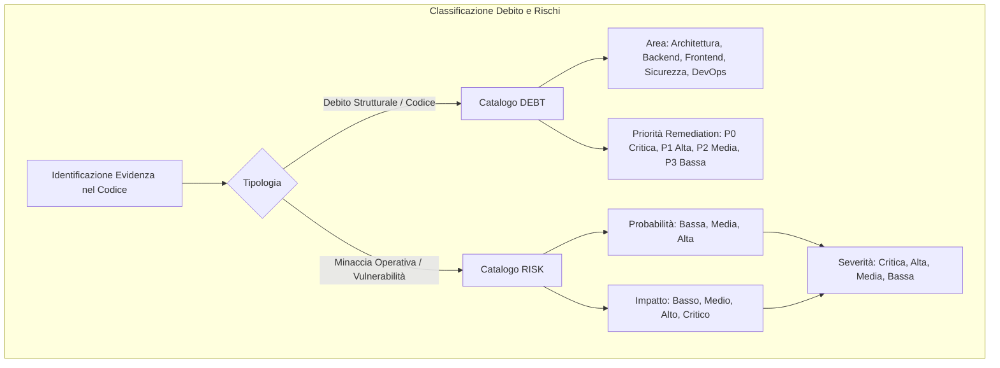
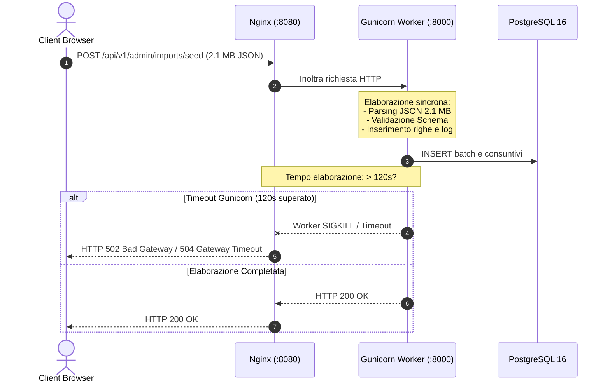
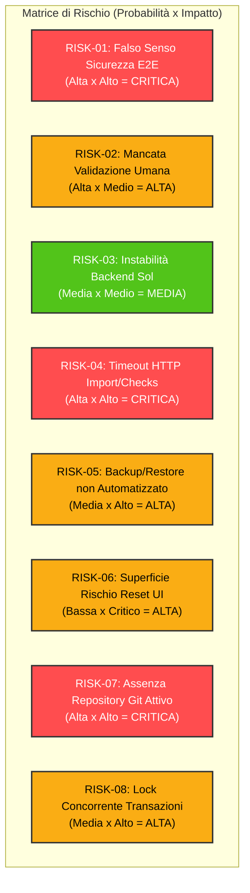
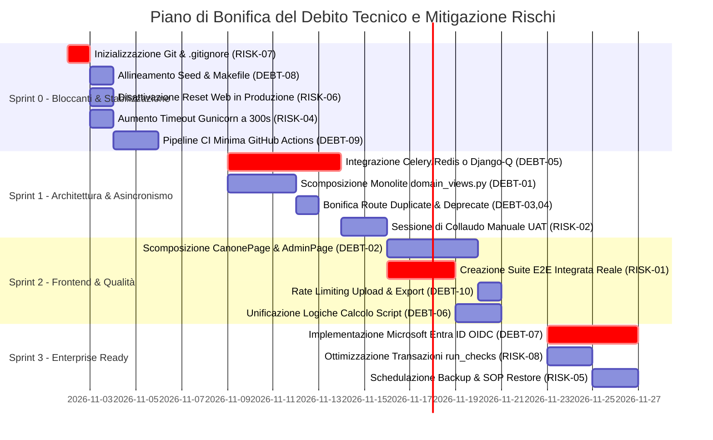

# 13. Technical Debt & Risks Assessment

> **Documento**: `docs/assestmant/13_TECHNICAL_DEBT_RISKS.md`  
> **Progetto**: Supplier Ledger (Consuntivazione, Wallet & Canone Fornitore)  
> **Stato Valutazione**: `COMPLETO`  
> **Data Analisi**: 2026-10-28  
> **Ambito**: Censimento analitico e classificazione del debito tecnico architetturale, backend, frontend, devops e sicurezza; matrice dei rischi operativi, contabili e di adozione basata su evidenze oggettive del codice sorgente.

---

## 1. Executive Summary del Debito Tecnico e dei Rischi

L'analisi tecnica e qualitativa della codebase di **Supplier Ledger** evidenzia una netta polarizzazione tra la solidità contabile del **Core di Dominio** e una serie di **fragilità strutturali e operative** maturate durante le fasi di sviluppo iterativo rapido.

```mermaid
quadrantChart
    title Mappa Qualitativa: Architettura e Governance
    x-axis Bassa Manutenibilità / Fragilità --> Alta Manutenibilità / Robustezza
    y-axis Basso Impatto di Dominio --> Alto Impatto di Dominio
    quadrant-1 Eccellenza di Dominio (Core Contabile)
    quadrant-2 Debito Tecnico Critico (Monoliti & Timeout)
    quadrant-3 Rischi Operativi Minori (Alias & Naming)
    quadrant-4 Rischi di Governance & Testing (Mock E2E, No Git)
    "Core Ledger & Append-Only": [0.88, 0.92]
    "Regole Dominio & 18 Controlli": [0.82, 0.88]
    "Deduplica & Fingerprint Seed": [0.85, 0.78]
    "Monolite API (domain_views.py)": [0.22, 0.85]
    "Componenti Frontend Oversize": [0.28, 0.65]
    "Assenza Background Worker (Celery)": [0.18, 0.89]
    "Test E2E basati su Mock Fixtures": [0.30, 0.82]
    "Disallineamento Seed Makefile/Config": [0.45, 0.58]
    "Assenza Repository Git (.git)": [0.15, 0.72]
    "Reset Database via Web API": [0.35, 0.80]
```

### 1.1 Punti di Forza Riconosciuti della Codebase
1. **Core di Dominio Contabile e Precisione Numerica**:
   - Tutte le grandezze temporali e monetarie utilizzano [`Decimal`](file:///c:/Users/gianvito.bleve/OneDrive%20-%20Banca%20Mediolanum%20SPA/Documenti/Progetti/imola/backend/config/settings/base.py#L160-L162) a 4 cifre decimali (`DAYS_DECIMAL_PLACES = 4`), azzerando gli errori di approssimazione in virgola mobile (standard IEEE 754).
   - Coercizione sistematica delle grandezze decimali in stringhe JSON serializzate tramite [`DaysJSONRenderer`](file:///c:/Users/gianvito.bleve/OneDrive%20-%20Banca%20Mediolanum%20SPA/Documenti/Progetti/imola/backend/config/settings/base.py#L136) per prevenire troncamenti nei client browser.
2. **Integrità Contabile Append-Only**:
   - Il registro di consuntivazione ([`TimesheetEntry`](file:///c:/Users/gianvito.bleve/OneDrive%20-%20Banca%20Mediolanum%20SPA/Documenti/Progetti/imola/backend/timesheets/models.py#L18-L85)) è vincolato da un trigger PostgreSQL non aggirabile (`timesheet_entry_append_only_trg`), impedendo `UPDATE` o `DELETE` fisici su righe storicizzate.
   - Le correzioni avvengono unicamente mediante storni contabili espliciti ([`reverses`](file:///c:/Users/gianvito.bleve/OneDrive%20-%20Banca%20Mediolanum%20SPA/Documenti/Progetti/imola/backend/timesheets/models.py#L48)).
3. **Motore di Rilevazione Anomalie Completo (18 Regole)**:
   - Presenza di 18 controlli di coerenza eseguiti dal runner idempotente ([`backend/anomalies/runner.py`](file:///c:/Users/gianvito.bleve/OneDrive%20-%20Banca%20Mediolanum%20SPA/Documenti/Progetti/imola/backend/anomalies/runner.py#L91-L146)), con gestione della fingerprint univoca e modello di supersessione dei seed storici.
4. **Tracciabilità e Audit Bilaterale**:
   - Adozione del modello astratto [`TrackedModel`](file:///c:/Users/gianvito.bleve/OneDrive%20-%20Banca%20Mediolanum%20SPA/Documenti/Progetti/imola/backend/core/models.py#L67-L106) e `django-simple-history` su 17 modelli di dominio, che garantisce l'archiviazione di autore, data e versione per ogni mutazione.

---

### 1.2 Aree di Debito Tecnico e Fragilità Strutturali
1. **Monoliti nel Layer di Presentazione e API**:
   - Il file [`backend/api/domain_views.py`](file:///c:/Users/gianvito.bleve/OneDrive%20-%20Banca%20Mediolanum%20SPA/Documenti/Progetti/imola/backend/api/domain_views.py) raggruppa 38 controller eterogenei in 2.067 righe (94.4 KB).
   - Componenti React mastodontici sul frontend come [`CanonePage.tsx`](file:///c:/Users/gianvito.bleve/OneDrive%20-%20Banca%20Mediolanum%20SPA/Documenti/Progetti/imola/frontend/src/features/canone/CanonePage.tsx) (1.168 righe) e [`AdminPage.tsx`](file:///c:/Users/gianvito.bleve/OneDrive%20-%20Banca%20Mediolanum%20SPA/Documenti/Progetti/imola/frontend/src/features/admin/AdminPage.tsx) (1.150 righe), che uniscono visualizzazione, routing interno, form modali multipli e gestione dello stato.
2. **Assenza di Elaborazione Asincrona (No Celery/Redis)**:
   - L'importazione di pesanti file Excel PPM e seed v4 (oltre 2 MB con decine di migliaia di celle), nonché l'esecuzione sequenziale dei 18 controlli di conformità, avvengono interamente nel ciclo sincrono richiesta/risposta HTTP. Tale configurazione espone il sistema al timeout forzato di Gunicorn (120s) e Nginx (300s).
3. **Configurazioni e Script Disallineati**:
   - [`Makefile`](file:///c:/Users/gianvito.bleve/OneDrive%20-%20Banca%20Mediolanum%20SPA/Documenti/Progetti/imola/Makefile#L3) e [`backend/config/settings/base.py`](file:///c:/Users/gianvito.bleve/OneDrive%20-%20Banca%20Mediolanum%20SPA/Documenti/Progetti/imola/backend/config/settings/base.py#L165-L173) referenziano un file `seed_imola_2026-10-16.json` inesistente sul filesystem.
   - Formule di business e calcoli di bilancio duplicati tra il package `domain/` e lo script di proiezione offline [`scripts/workbook_application_projection.py`](file:///c:/Users/gianvito.bleve/OneDrive%20-%20Banca%20Mediolanum%20SPA/Documenti/Progetti/imola/scripts/workbook_application_projection.py).
4. **Fragilità Operative e Falso Senso di Sicurezza sul Testing**:
   - I test browser E2E (suite Sol Playwright) poggiano interamente sull'intercettazione mock delle chiamate HTTP tramite [`frontend/e2e/sol/fixtures.ts`](file:///c:/Users/gianvito.bleve/OneDrive%20-%20Banca%20Mediolanum%20SPA/Documenti/Progetti/imola/frontend/e2e/sol/fixtures.ts#L27), non testando in alcun modo l'integrazione reale con il container Docker Python/Django e PostgreSQL.
   - La cartella di lavoro non risulta essere un repository Git attivo, lasciando il codice esposto a modifiche non tracciate o perdite accidentali.

---

### 1.3 Metodologia di Valutazione e Scoring

I problemi identificati sono catalogati secondo la tassonomia standard di ingegneria del software:



#### Definizioni di Severità e Priorità:
- **P0 / Severità Critica**: Compromette l'operatività di produzione, espone a potenziale perdita di dati, impedisce il bootstrap o introduce un blocco non aggirabile. Remediation immediata richiesta prima del go-live.
- **P1 / Severità Alta**: Forte degrado di manutenibilità o affidabilità (timeout su carichi elevati, monoliti ingestibili, autenticazione incompleta, assenza di test integrati reali). Remediation nel primo ciclo di release (Sprint 1-2).
- **P2 / Severità Media**: Duplicazioni di logica, alias ridondanti, componenti UI sovradimensionati, mancanza di rate limiting su endpoint non critici. Remediation pianificata a medio termine.
- **P3 / Severità Bassa**: Refactoring cosmetico, ottimizzazione formati, allineamento commenti o bonifica di endpoint dismessi. Remediation continua.

---

## 2. Catalogo Analitico del Debito Tecnico (DEBT)

### DEBT-01: File API Monolitico `backend/api/domain_views.py`

| Attributo | Valore |
| :--- | :--- |
| **ID Debito** | **DEBT-01** |
| **Titolo** | File API Monolitico ad alta concentrazione di responsabilità |
| **Categoria** | Architettura del Codice / Monolite di Presentazione |
| **Evidenza Sorgente** | [`backend/api/domain_views.py`](file:///c:/Users/gianvito.bleve/OneDrive%20-%20Banca%20Mediolanum%20SPA/Documenti/Progetti/imola/backend/api/domain_views.py#L1-L2067) (94.4 KB, 2.067 righe, 38 classi di vista) |
| **Severità** | **Alta** |
| **Priorità** | **P1** |
| **Stato Implementativo** | **IMPLEMENTED** (funzionante ma strutturalmente ingestibile) |

#### Descrizione Tecnica Approfondita
Il modulo [`backend/api/domain_views.py`](file:///c:/Users/gianvito.bleve/OneDrive%20-%20Banca%20Mediolanum%20SPA/Documenti/Progetti/imola/backend/api/domain_views.py) aggrega in un unico file 38 distinte classi derivate da `DocumentedAPIView` / `APIView`. Il file copre 9 sottodomini applicativi concettualmente disgiunti:
1. *Impostazioni & Costi*: `SettingsView`, `CostAnalysisView` (L43-L135).
2. *Dashboard & Ricerca*: `DashboardView`, `CommandSearchView` (L137-L200, L1280-L1360).
3. *Gestione Progetti*: `ProjectListCreateView`, `ProjectBalancesView`, `ProjectLedgerView`, `ProjectTimesheetDetailView`, `ProjectReviewQueueView`, `ProjectDetailUpdateView`, `ProjectFormOptionsView`, `ProjectConfirmReviewView`, `ProjectValidateClosureView`, `ReleaseProjectToWalletView` (L202-L620, L682-L697, L1480-L1750).
4. *Anomalie & Controlli*: `AnomalyListView`, `ChecksRunView`, `AnomalyActionView` (L622-L680).
5. *Wallet & Ripartizioni*: `WalletBalanceView`, `WalletFlowView`, `WalletAssigneeSummaryView`, `WalletAllocationCreateView`, `WalletAllocationOptionsView`, `WalletAllocationDetailUpdateView`, `WalletAllocationAdjustView` (L700-L980, L1760-L1950).
6. *Canone & Sottoattività*: `CanoneListView`, `CanoneDetailView`, `CanoneSubactivityListView`, `CanoneSubactivityDetailView`, `CanoneSubactivityTimesheetListView`, `CanoneSubactivityTimesheetDetailView`, `CanoneStatusView` (L982-L1275, L1410-L1475).
7. *Riconciliazione PPM*: `ReconciliationView` (L1430-L1478).
8. *Audit Trail*: `AuditHistoryView` (L1960-L2020).
9. *Export Multi-formato*: `ExportJsonView`, `ExportCsvView`, `ExportExcelView` (L1365-L1408).

#### Impatto su Manutenibilità, Performance ed Evoluzione
- **Merge Conflicts Sistematici**: Qualsiasi sviluppo contemporaneo su Progetti, Wallet, Canone o Export insiste sullo stesso file, causando frequenti conflitti di versioning.
- **Cognitive Overhead**: La navigazione tra 2.067 righe rende gravosa l'analisi e l'onboarding di nuovi sviluppatori.
- **Rischio Regressioni**: Le funzioni helper locali e gli import concentrati in testa al modulo creano accoppiamenti impliciti tra sottodomini contabili differenti.

#### Soluzione Tecnica Proposta (Remediation)
Scomporre il file in un package modulare `backend/api/views/` organizzato per dominio:
- `backend/api/views/projects.py`
- `backend/api/views/wallet.py`
- `backend/api/views/canone.py`
- `backend/api/views/anomalies.py`
- `backend/api/views/reconciliation.py`
- `backend/api/views/exports.py`
- `backend/api/views/system.py` (settings, dashboard, search, audit)
Mantenere in `backend/api/domain_views.py` solo re-export di retrocompatibilità se necessario, aggiornando [`backend/api/urls.py`](file:///c:/Users/gianvito.bleve/OneDrive%20-%20Banca%20Mediolanum%20SPA/Documenti/Progetti/imola/backend/api/urls.py).

---

### DEBT-02: Componenti Frontend Oversize `CanonePage.tsx` e `AdminPage.tsx`

| Attributo | Valore |
| :--- | :--- |
| **ID Debito** | **DEBT-02** |
| **Titolo** | Componenti React monolitici con concentrazione di sub-panel e stati interni |
| **Categoria** | Architettura Frontend / Monolite di Componente |
| **Evidenza Sorgente** | [`frontend/src/features/canone/CanonePage.tsx`](file:///c:/Users/gianvito.bleve/OneDrive%20-%20Banca%20Mediolanum%20SPA/Documenti/Progetti/imola/frontend/src/features/canone/CanonePage.tsx) (52.3 KB, 1.168 righe)<br/>[`frontend/src/features/admin/AdminPage.tsx`](file:///c:/Users/gianvito.bleve/OneDrive%20-%20Banca%20Mediolanum%20SPA/Documenti/Progetti/imola/frontend/src/features/admin/AdminPage.tsx) (42.8 KB, 1.150 righe) |
| **Severità** | **Alta** |
| **Priorità** | **P1** |
| **Stato Implementativo** | **PARTIAL** (funzionanti ma non conformi ai principi di modularità React) |

#### Descrizione Tecnica Approfondita
I due componenti principali di Canone e Amministrazione violano il principio di singola responsabilità (SRP):
1. **`CanonePage.tsx`**: Contiene 14 stati `useState` indipendenti (righe 122-165), gestendo simultaneamente filtri semestrali, ricerca testo, stato operativo, ufficio, drawer laterale di modifica canone, form di creazione nuovo semestre, form di creazione/modifica sottoattività, tab panel di visualizzazione consuntivi e form modale per l'inserimento di un nuovo timesheet. Tutto il rendering JSX (oltre 900 righe) è in linea senza subcomponenti isolati.
2. **`AdminPage.tsx`**: Gestisce 15 stati `useState` e 7 sottosezioni operative completamente eterogenee:
   - Gestione Utenti e reset password (L290-L420);
   - Gestione Referenti aziendali (L820-L920);
   - Matrice Capability / Ruoli (L560-L630);
   - Viewer Dataset di Import e storicizzazione (L720-L810);
   - Import Seed e Import PPM con dry-run e apply (L430-L550);
   - Backup e Restore database con download file (L635-L715);
   - Reset totale distruttivo del database con dialog di sicurezza (L980-L1080).

#### Impatto su Manutenibilità, Performance ed Evoluzione
- **Re-rendering Incontrollati**: Ogni variazione di input testuale o filtro scatena il re-render dell'intero albero DOM della pagina.
- **Difficoltà di Test Unitario**: Testare isolatamente il form di cambio password o l'upload del file PPM richiede il rendering dell'intera pagina amministrativa con tutti i suoi contesti.
- **Rischio Regressione Visiva**: La modifica dei fogli di stile o della griglia Tailwind su una sezione ha effetti collaterali involontari sui modali adiacenti.

#### Soluzione Tecnica Proposta (Remediation)
1. **Refactoring `features/canone/`**:
   - `CanonePage.tsx`: Container orchestratore leggero con routing interno.
   - `components/CanoneFilters.tsx`: Barra filtri e controlli di selezione semestre.
   - `components/CanoneSummaryCard.tsx`: KPI di avanzamento e proiezione target.
   - `components/SubactivitiesTable.tsx`: Tabella sottoattività con azioni contestuali.
   - `components/SubactivityDetailDrawer.tsx`: Dettaglio, consuntivi e timesheet form.
   - `components/CanoneFormModal.tsx`: Creazione e modifica semestre.
2. **Refactoring `features/admin/`**:
   - `AdminPage.tsx`: Shell con navigazione a tab verticali.
   - `panels/UsersAdminPanel.tsx`
   - `panels/ReferentsAdminPanel.tsx`
   - `panels/RolesCapabilitiesPanel.tsx`
   - `panels/ImportsAdminPanel.tsx`
   - `panels/DatabaseBackupPanel.tsx`
   - `panels/DatabaseResetPanel.tsx`

---

### DEBT-03: Duplicazione e Ridondanza delle Route API in `backend/api/urls.py`

| Attributo | Valore |
| :--- | :--- |
| **ID Debito** | **DEBT-03** |
| **Titolo** | Duplicazione delle route API con alias ridondanti e trailing slash inconsistenti |
| **Categoria** | Architettura API / Routing e Standardizzazione REST |
| **Evidenza Sorgente** | [`backend/api/urls.py`](file:///c:/Users/gianvito.bleve/OneDrive%20-%20Banca%20Mediolanum%20SPA/Documenti/Progetti/imola/backend/api/urls.py#L65-L73), [`#L116-L174`](file:///c:/Users/gianvito.bleve/OneDrive%20-%20Banca%20Mediolanum%20SPA/Documenti/Progetti/imola/backend/api/urls.py#L116-L174), [`#L202-L205`](file:///c:/Users/gianvito.bleve/OneDrive%20-%20Banca%20Mediolanum%20SPA/Documenti/Progetti/imola/backend/api/urls.py#L202-L205) |
| **Severità** | **Media** |
| **Priorità** | **P2** |
| **Stato Implementativo** | **IMPLEMENTED** (funzionante ma tecnicamente ridondante) |

#### Descrizione Tecnica Approfondita
In [`backend/api/urls.py`](file:///c:/Users/gianvito.bleve/OneDrive%20-%20Banca%20Mediolanum%20SPA/Documenti/Progetti/imola/backend/api/urls.py) sono censite 12 route duplicate esplicite per compensare incongruenze dei client relative al trailing slash o a prefissi URL eterogenei:
- Reset dati: `admin/reset-data` vs `admin/reset-data/` (L65, L70).
- Dettaglio Allocazione: `wallet/allocations/<uuid:pk>` vs `wallet/allocations/<uuid:pk>/` vs `allocations/<uuid:pk>` vs `allocations/<uuid:pk>/` (L116, L121, L126, L131).
- Creazione Allocazione: `allocations` vs `allocations/` vs `wallet/allocations` vs `wallet/allocations/` (L141, L146, L151, L156).
- Opzioni Allocazione: `allocations/options` vs `wallet/allocation-options` vs `wallet/allocation-options/` (L161, L166, L171).
- Canoni: `canoni` vs `canoni/` (L202, L203), `canoni/<uuid:pk>` vs `canoni/<uuid:pk>/` (L204, L205).

#### Impatto su Manutenibilità, Performance ed Evoluzione
- **Documentazione OpenAPI Inquinata**: Lo schema generato da `drf-spectacular` duplica le operazioni nello Swagger, presentando doppi endpoint per la medesima risorsa.
- **Metriche e Access Log Frammentati**: Nei log di Nginx e nelle statistiche APM, le richieste si disperdono su 4 percorsi diversi per la stessa operazione contabile.
- **Rischio Disallineamento Permission**: Se un giorno viene aggiunta una classe di permission o un decorator su una route specifica, la gemella potrebbe rimanere priva di vincolo se non referenziata tramite lo stesso viewset.

#### Soluzione Tecnica Proposta (Remediation)
1. Standardizzare la convenzione REST: o tutte con trailing slash (standard idiomatico Django) o tutte senza trailing slash (standard idiomatico REST SPA).
2. Abilitare la direttiva Django `APPEND_SLASH = False` oppure affidare la normalizzazione a un middleware Nginx dedicato con redirect HTTP 308 (Permanent Redirect).
3. Eliminare i prefissi deprecati (`allocations/...` non preceduti da `wallet/`).

---

### DEBT-04: Endpoint Deprecato non Bonificato `release-to-wallet`

| Attributo | Valore |
| :--- | :--- |
| **ID Debito** | **DEBT-04** |
| **Titolo** | Presenza di endpoint legacy disabilitato che restituisce HTTP 409 fisso |
| **Categoria** | Qualità del Codice / Dead Code & Legacy API |
| **Evidenza Sorgente** | [`backend/api/urls.py#L187-L190`](file:///c:/Users/gianvito.bleve/OneDrive%20-%20Banca%20Mediolanum%20SPA/Documenti/Progetti/imola/backend/api/urls.py#L187-L190), [`backend/api/domain_views.py#L682-L697`](file:///c:/Users/gianvito.bleve/OneDrive%20-%20Banca%20Mediolanum%20SPA/Documenti/Progetti/imola/backend/api/domain_views.py#L682-L697) |
| **Severità** | **Bassa** |
| **Priorità** | **P3** |
| **Stato Implementativo** | **IMPLEMENTED** (funziona restituendo errore deterministico) |

#### Descrizione Tecnica Approfondita
La classe [`ReleaseProjectToWalletView`](file:///c:/Users/gianvito.bleve/OneDrive%20-%20Banca%20Mediolanum%20SPA/Documenti/Progetti/imola/backend/api/domain_views.py#L682-L697) è stata disattivata a seguito della formalizzazione della regola contabile per cui un progetto attivo non può riversare arbitrariamente residui nel wallet (il residuo entra nel wallet solo alla chiusura formale del progetto con data effettiva).
Tuttavia, anziché rimuovere la route, è stato mantenuto un endpoint che intercetta la richiesta HTTP `POST` e restituisce incondizionatamente un errore HTTP 409 Conflict:
```python
class ReleaseProjectToWalletView(DocumentedAPIView):
    permission_classes = [ReadOnlyOrLedgerWriter]

    def post(self, request, pk):
        return Response(
            {
                "detail": (
                    "Operazione non più consentita: il residuo entra nel wallet soltanto "
                    "alla chiusura del progetto con data effettiva."
                ),
                "code": "PROJECT_WALLET_RELEASE_DEPRECATED",
            },
            status=status.HTTP_409_CONFLICT,
        )
```

#### Impatto su Manutenibilità, Performance ed Evoluzione
- Confonde gli integratori di terze parti e lo sviluppatore frontend, apparendo nello schema OpenAPI come operazione valida.
- Costringe la suite di test a mantenere una verifica esplicita per asserire che l'endpoint ritorni 409 ([`backend/tests/test_phase2_refinements.py:40`](file:///c:/Users/gianvito.bleve/OneDrive%20-%20Banca%20Mediolanum%20SPA/Documenti/Progetti/imola/backend/tests/test_phase2_refinements.py#L40)).

#### Soluzione Tecnica Proposta (Remediation)
- Rimuovere la route da [`backend/api/urls.py`](file:///c:/Users/gianvito.bleve/OneDrive%20-%20Banca%20Mediolanum%20SPA/Documenti/Progetti/imola/backend/api/urls.py) e la classe da `domain_views.py`.
- Aggiornare i test unitari rimuovendo il test di retrocompatibilità o sostituendolo con un'asserzione di HTTP 404 Not Found.

---

### DEBT-05: Assenza di Framework di Background Worker / Code Asincrone (Celery/Redis)

| Attributo | Valore |
| :--- | :--- |
| **ID Debito** | **DEBT-05** |
| **Titolo** | Assenza di elaborazione asincrona per importazioni massive ed esecuzione controlli |
| **Categoria** | Architettura di Sistema / Concorrenza & Throughput |
| **Evidenza Sorgente** | [`docker-compose.yml#L20-L54`](file:///c:/Users/gianvito.bleve/OneDrive%20-%20Banca%20Mediolanum%20SPA/Documenti/Progetti/imola/docker-compose.yml#L20-L54) (nessun container Redis/RabbitMQ/Celery);<br/>[`backend/api/admin_views.py#L55-L160`](file:///c:/Users/gianvito.bleve/OneDrive%20-%20Banca%20Mediolanum%20SPA/Documenti/Progetti/imola/backend/api/admin_views.py#L55-L160) (`SeedImportView`, `PpmImportView`);<br/>[`backend/api/domain_views.py#L624-L643`](file:///c:/Users/gianvito.bleve/OneDrive%20-%20Banca%20Mediolanum%20SPA/Documenti/Progetti/imola/backend/api/domain_views.py#L624-L643) (`ChecksRunView`);<br/>[`deploy/nginx.conf#L35`](file:///c:/Users/gianvito.bleve/OneDrive%20-%20Banca%20Mediolanum%20SPA/Documenti/Progetti/imola/deploy/nginx.conf#L35) (`proxy_read_timeout 300s`);<br/>[`docker-compose.yml#L53`](file:///c:/Users/gianvito.bleve/OneDrive%20-%20Banca%20Mediolanum%20SPA/Documenti/Progetti/imola/docker-compose.yml#L53) (Gunicorn `--timeout 120`). |
| **Severità** | **Critica** |
| **Priorità** | **P0** |
| **Stato Implementativo** | **NOT_IMPLEMENTED** |

#### Descrizione Tecnica Approfondita
Il sistema non include alcun gestore di code asincrone (Celery, Dramatiq o Django-Q) né un message broker (Redis o RabbitMQ).
Di conseguenza, tutte le operazioni computazionalmente onerose vengono eseguite **in-process** all'interno del worker WSGI sincrono di Gunicorn nel ciclo richiesta/risposta HTTP:
1. **Import Seed JSON**: Parsing di file JSON da oltre 2 MB contenenti l'intero snapshot di progetti, allocazioni e consuntivi, validazione dello schema, hashing crittografico e inserimento a database.
2. **Import PPM Excel**: Parsing di file `.xlsx` o `.pdf` multi-foglio tramite `openpyxl`, estrazione tabellare, matching dei codici progetto e inserimento delle righe di snapshot.
3. **Esecuzione Controlli Idempotenti**: Invocazione sincrona dei 18 controlli di integrità tramite [`run_checks()`](file:///c:/Users/gianvito.bleve/OneDrive%20-%20Banca%20Mediolanum%20SPA/Documenti/Progetti/imola/backend/anomalies/runner.py#L91-L146), il quale blocca l'intero database all'interno di una transazione atomica (`@transaction.atomic`) per l'intera durata della scansione.



#### Impatto su Manutenibilità, Performance ed Evoluzione
- **Saturazione del Pool WSGI**: Gunicorn è configurato con soli 3 worker e 2 thread (`3 workers * 2 threads = 6 richieste concorrenti massime`). Un import massivo PPM o Seed tiene occupato un intero worker al 100% della CPU per decine di secondi. Se 3 utenti lanciano contemporaneamente un import o un ricalcolo controlli, l'intera applicazione smette di rispondere (Denial of Service applicativo).
- **Disallineamento dei Timeout**: Nginx attende fino a **300 secondi** (`proxy_read_timeout 300s;`), ma Gunicorn killa il worker dopo **120 secondi** (`--timeout 120`). L'utente riceve un errore `502 Bad Gateway` opaco mentre la transazione sul database potrebbe essere troncata bruscamente a metà o andare in rollback.

#### Soluzione Tecnica Proposta (Remediation)
1. Introdurre **Redis** come servizio container leggero nel compose.
2. Integrare **Celery** o **django-tasks** (o `django-q2` senza dipendenza Redis, basato su tabelle Postgres) per l'elaborazione dei job in background.
3. Riscrivere gli endpoint `/admin/imports/*` e `/checks/run` per restituire immediatamente uno stato `HTTP 202 Accepted` con l'ID del job (`job_id`), fornendo un endpoint di polling `/tasks/<uuid:job_id>` o notifiche Server-Sent Events (SSE).

---

### DEBT-06: Duplicazione di Logica di Calcolo tra Backend e Script Offline

| Attributo | Valore |
| :--- | :--- |
| **ID Debito** | **DEBT-06** |
| **Titolo** | Duplicazione delle formule di ripartizione e bilancio contabile nello script di proiezione offline |
| **Categoria** | Duplicazione del Codice / Domain Logic Sprawl |
| **Evidenza Sorgente** | [`scripts/workbook_application_projection.py#L367-L436`](file:///c:/Users/gianvito.bleve/OneDrive%20-%20Banca%20Mediolanum%20SPA/Documenti/Progetti/imola/scripts/workbook_application_projection.py#L367-L436);<br/>[`backend/domain/`](file:///c:/Users/gianvito.bleve/OneDrive%20-%20Banca%20Mediolanum%20SPA/Documenti/Progetti/imola/backend/domain/) (regole di ripartizione FIFO e target Canone) |
| **Severità** | **Media** |
| **Priorità** | **P2** |
| **Stato Implementativo** | **IMPLEMENTED** (due implementazioni parallele disallineabili) |

#### Descrizione Tecnica Approfondita
Nello script [`scripts/workbook_application_projection.py`](file:///c:/Users/gianvito.bleve/OneDrive%20-%20Banca%20Mediolanum%20SPA/Documenti/Progetti/imola/scripts/workbook_application_projection.py) (523 righe), impiegato per proiettare i dataset estratti dall'Excel originale nel formato `seed_v1`, le logiche contabili essenziali sono state riscritte da zero in Python puro con tipi `float` anziché richiamare i moduli di dominio Django:
- **Ordinamento e Consumo FIFO del Wallet** (righe 367-391): L'attribuzione delle tranche per anno provenienza, data conferimento e sequenza di consumo riproduce la logica di `backend/wallet/services.py`.
- **Formule Target e Forecast del Canone** (righe 428-436): Formula lineare `base_gg + (gg_per_settimana * settimane_trascorse)` codificata cablando `6.69` gg/settimana e `26`/`15` settimane trascorse.
- **Normalizzazione delle Grandezze Numeriche**: Funzione `_number()` nello script che utilizza `round(value, 4)` e `float` invece di [`Decimal`](file:///c:/Users/gianvito.bleve/OneDrive%20-%20Banca%20Mediolanum%20SPA/Documenti/Progetti/imola/backend/config/settings/base.py#L160).

#### Impatto su Manutenibilità, Performance ed Evoluzione
- Se una regola contabile o una formula di deroga cambia nel backend, lo script offline continua a generare seed v1 secondo la vecchia convenzione, creando discrepanze al primo import.
- L'uso di float nello script offline può introdurre imprecisioni di arrotondamento (es. `0.0001` gg) che fanno fallire i controlli di riconciliazione esatti del database.

#### Soluzione Tecnica Proposta (Remediation)
Centralizzare le funzioni pure di calcolo contabile (FIFO, proiezioni, normalizzazioni) in un package condiviso `backend/domain/calculator/` e fare in modo che `scripts/workbook_application_projection.py` importi ed esegua esattamente le stesse funzioni del runtime Django.

---

### DEBT-07: Provider Microsoft Entra ID OIDC non Implementato

| Attributo | Valore |
| :--- | :--- |
| **ID Debito** | **DEBT-07** |
| **Titolo** | Provider di autenticazione enterprise Microsoft Entra ID stubbato con NotImplementedError |
| **Categoria** | Sicurezza & Autenticazione / Integrazione Esterna |
| **Evidenza Sorgente** | [`backend/core/auth/providers.py#L62-L73`](file:///c:/Users/gianvito.bleve/OneDrive%20-%20Banca%20Mediolanum%20SPA/Documenti/Progetti/imola/backend/core/auth/providers.py#L62-L73) |
| **Severità** | **Alta** |
| **Priorità** | **P1** |
| **Stato Implementativo** | **NOT_IMPLEMENTED** |

#### Descrizione Tecnica Approfondita
Sebbene l'architettura di autenticazione preveda un pattern Provider elegante ([`backend/core/auth/providers.py`](file:///c:/Users/gianvito.bleve/OneDrive%20-%20Banca%20Mediolanum%20SPA/Documenti/Progetti/imola/backend/core/auth/providers.py)), la classe [`EntraIdOidcProvider`](file:///c:/Users/gianvito.bleve/OneDrive%20-%20Banca%20Mediolanum%20SPA/Documenti/Progetti/imola/backend/core/auth/providers.py#L62) è un mero segnaposto privo di logica reale:
```python
class EntraIdOidcProvider:
    """Segnaposto per l'accesso federato: non implementato in v1."""
    name = "entra_id"
    interactive = False

    def login(self, request: HttpRequest, **credentials: str) -> AuthResult:
        raise NotImplementedError("Il provider Microsoft Entra ID non è attivo in questa versione.")
```
Se la variabile d'ambiente `AUTH_PROVIDER` viene impostata a `entra_id` in produzione, qualsiasi tentativo di autenticazione scatena una eccezione non gestita `NotImplementedError` a runtime.

#### Impatto su Manutenibilità, Performance ed Evoluzione
- L'applicazione può operare **esclusivamente con credenziali locali** archiviate nel database relazionale PostgreSQL (`LocalSessionProvider`).
- Incompatibilità con le policy di sicurezza aziendale di Banca Mediolanum (MFA obbligatoria, Single Sign-On aziendale, revoca centralizzata delle identità, conformità agli standard bancari).

#### Soluzione Tecnica Proposta (Remediation)
Implementare il flusso OpenID Connect (Authorization Code Flow con PKCE):
1. Integrare la libreria `authlib` o `mozilla-django-oidc`.
2. Configurare gli endpoint di discovery Entra ID (`/.well-known/openid-configuration`), `client_id`, `client_secret` e `tenant_id`.
3. Mappare i claim dei ruoli o gruppi Azure AD (`groups` o `roles`) sui 4 ruoli applicativi di sistema (`admin`, `responsabile_bmed`, `referente_bmed`, `fornitore`) tramite [`backend/core/roles.py`](file:///c:/Users/gianvito.bleve/OneDrive%20-%20Banca%20Mediolanum%20SPA/Documenti/Progetti/imola/backend/core/roles.py).

---

### DEBT-08: Disallineamento Configurazione Seed tra Makefile, Settings e Storage

| Attributo | Valore |
| :--- | :--- |
| **ID Debito** | **DEBT-08** |
| **Titolo** | Percorso file seed predefinito punta a un file inesistente sul filesystem |
| **Categoria** | Configurazione / DevOps & Automation |
| **Evidenza Sorgente** | [`Makefile#L3`](file:///c:/Users/gianvito.bleve/OneDrive%20-%20Banca%20Mediolanum%20SPA/Documenti/Progetti/imola/Makefile#L3);<br/>[`backend/config/settings/base.py#L165-L173`](file:///c:/Users/gianvito.bleve/OneDrive%20-%20Banca%20Mediolanum%20SPA/Documenti/Progetti/imola/backend/config/settings/base.py#L165-L173);<br/>Directory [`data/seed/`](file:///c:/Users/gianvito.bleve/OneDrive%20-%20Banca%20Mediolanum%20SPA/Documenti/Progetti/imola/data/seed/) |
| **Severità** | **Media** |
| **Priorità** | **P2** |
| **Stato Implementativo** | **PARTIAL** (configurazione puntata su risorsa non presente) |

#### Descrizione Tecnica Approfondita
Nel [`Makefile`](file:///c:/Users/gianvito.bleve/OneDrive%20-%20Banca%20Mediolanum%20SPA/Documenti/Progetti/imola/Makefile#L3) la variabile di default è valorizzata come:
```makefile
SEED ?= /srv/seed/seed_imola_2026-10-16.json
```
Similmente, in [`backend/config/settings/base.py`](file:///c:/Users/gianvito.bleve/OneDrive%20-%20Banca%20Mediolanum%20SPA/Documenti/Progetti/imola/backend/config/settings/base.py#L165-L173):
```python
_seed_in_app = Path("/app/data/seed/seed_imola_2026-10-16.json")
_seed_in_repo = REPO_DIR / "data" / "seed" / "seed_imola_2026-10-16.json"
```
Tuttavia, l'ispezione della directory [`data/seed/`](file:///c:/Users/gianvito.bleve/OneDrive%20-%20Banca%20Mediolanum%20SPA/Documenti/Progetti/imola/data/seed/) mostra esclusivamente la presenza di:
- `seed_imola_v3_2026-10-09.json` (2.110.582 byte)
- `seed_imola_v4_2026-10-09.json` (2.175.187 byte)
Il file `seed_imola_2026-10-16.json` non esiste.

#### Impatto su Manutenibilità, Performance ed Evoluzione
- L'esecuzione del comando standard `make seed` o `make seed-dry` fallisce immediatamente con errore `FileNotFoundError` / file inesistente se l'operatore non specifica manualmente la variabile d'ambiente `SEED=/srv/seed/seed_imola_v4_2026-10-09.json`.
- Confusione per gli operatori DevOps durante le procedure di installazione bare-metal o disaster recovery.

#### Soluzione Tecnica Proposta (Remediation)
Aggiornare il `Makefile` e `backend/config/settings/base.py` per puntare al seed canonico più recente (`seed_imola_v4_2026-10-09.json`), introducendo un controllo di esistenza con fallback automatico e messaggio d'errore esplicito.

---

### DEBT-09: Assenza di Pipeline CI/CD Automatizzata nel Repository

| Attributo | Valore |
| :--- | :--- |
| **ID Debito** | **DEBT-09** |
| **Titolo** | Totale assenza di definizioni per Continuous Integration e Continuous Deployment |
| **Categoria** | DevOps & Quality Assurance / Automazione |
| **Evidenza Sorgente** | Radice del progetto (assenza di `.github/workflows/`, `.gitlab-ci.yml`, `azure-pipelines.yml`, `Jenkinsfile`) |
| **Severità** | **Alta** |
| **Priorità** | **P1** |
| **Stato Implementativo** | **NOT_IMPLEMENTED** |

#### Descrizione Tecnica Approfondita
Non esiste alcun descrittore di pipeline CI/CD nel repository.
La verifica del codice (linter Ruff, type checker Mypy, unit test Pytest, test frontend Vitest e build Docker) è interamente demandata alla disciplina manuale del singolo sviluppatore tramite i comandi del [`Makefile`](file:///c:/Users/gianvito.bleve/OneDrive%20-%20Banca%20Mediolanum%20SPA/Documenti/Progetti/imola/Makefile#L48-L60) (`make test`, `make lint`).

#### Impatto su Manutenibilità, Performance ed Evoluzione
- Rischio continuo di introduzione di codice difettoso, incompatibilità di build Docker o regressioni funzionali non intercettate prima del merge.
- Impossibilità di applicare branch protection rules (es. obbligo di CI verde per approvare pull request).
- Rilascio in produzione dipendente da build manuali non riproducibili e prive di firma crittografica dell'artifact.

#### Soluzione Tecnica Proposta (Remediation)
Predisporre un workflow GitHub Actions (`.github/workflows/ci.yml`) o GitLab CI articolato in 4 job paralleli:
1. `backend-lint-test`: Ruff + Mypy + Pytest con report di coverage.
2. `frontend-lint-test`: ESLint + TypeScript `tsc --noEmit` + Vitest.
3. `docker-build-smoke`: Compilazione multi-stage delle 3 immagini (`backend`, `frontend`, `nginx`) e bootstrap in ambiente effimero.
4. `e2e-real`: Esecuzione dei test Playwright contro lo stack Docker reale avviato.

---

### DEBT-10: Rate Limiting Limitato Unicamente alla Vista di Login

| Attributo | Valore |
| :--- | :--- |
| **ID Debito** | **DEBT-10** |
| **Titolo** | Assenza di rate limiting e throttling su upload, export pesanti ed esecuzione controlli |
| **Categoria** | Sicurezza Operativa / Throttling & DoS Protection |
| **Evidenza Sorgente** | [`backend/core/throttles.py`](file:///c:/Users/gianvito.bleve/OneDrive%20-%20Banca%20Mediolanum%20SPA/Documenti/Progetti/imola/backend/core/throttles.py#L1-L6);<br/>[`backend/config/settings/base.py#L147-L148`](file:///c:/Users/gianvito.bleve/OneDrive%20-%20Banca%20Mediolanum%20SPA/Documenti/Progetti/imola/backend/config/settings/base.py#L147-L148);<br/>[`backend/api/auth_views.py#L52`](file:///c:/Users/gianvito.bleve/OneDrive%20-%20Banca%20Mediolanum%20SPA/Documenti/Progetti/imola/backend/api/auth_views.py#L52) |
| **Severità** | **Media** |
| **Priorità** | **P2** |
| **Stato Implementativo** | **PARTIAL** (attivo solo su login) |

#### Descrizione Tecnica Approfondita
L'infrastruttura di throttling DRF è configurata esclusivamente per la chiave `login`:
```python
REST_FRAMEWORK = {
    ...
    "DEFAULT_THROTTLE_CLASSES": ["rest_framework.throttling.ScopedRateThrottle"],
    "DEFAULT_THROTTLE_RATES": {"login": env("LOGIN_THROTTLE_RATE", "10/min")},
}
```
In [`backend/core/throttles.py`](file:///c:/Users/gianvito.bleve/OneDrive%20-%20Banca%20Mediolanum%20SPA/Documenti/Progetti/imola/backend/core/throttles.py) esiste un'unica classe `LoginRateThrottle`.
Tutti gli altri endpoint applicativi ad altissimo consumo computazionale ne sono privi:
- Upload file Seed e PPM: [`SeedImportView`](file:///c:/Users/gianvito.bleve/OneDrive%20-%20Banca%20Mediolanum%20SPA/Documenti/Progetti/imola/backend/api/admin_views.py#L55), [`PpmImportView`](file:///c:/Users/gianvito.bleve/OneDrive%20-%20Banca%20Mediolanum%20SPA/Documenti/Progetti/imola/backend/api/admin_views.py#L93).
- Esecuzione controlli: [`ChecksRunView`](file:///c:/Users/gianvito.bleve/OneDrive%20-%20Banca%20Mediolanum%20SPA/Documenti/Progetti/imola/backend/api/domain_views.py#L624).
- Generazione export XLSX e JSON: [`ExportExcelView`](file:///c:/Users/gianvito.bleve/OneDrive%20-%20Banca%20Mediolanum%20SPA/Documenti/Progetti/imola/backend/api/domain_views.py#L1390), [`ExportJsonView`](file:///c:/Users/gianvito.bleve/OneDrive%20-%20Banca%20Mediolanum%20SPA/Documenti/Progetti/imola/backend/api/domain_views.py#L1365).
- Generazione dump e restore database: [`DatabaseBackupView`](file:///c:/Users/gianvito.bleve/OneDrive%20-%20Banca%20Mediolanum%20SPA/Documenti/Progetti/imola/backend/api/database_backup.py#L80).

#### Impatto su Manutenibilità, Performance ed Evoluzione
Un utente autenticato (anche con ruolo a bassa fiducia o sessione compromessa) può innescare decine di esportazioni pesanti o esecuzioni di controlli in parallelo, esaurendo la memoria RAM del container backend e mandando in crash l'intero runtime WSGI (Application-level Denial of Service).

#### Soluzione Tecnica Proposta (Remediation)
1. Definire nuovi scope di rate limiting in `settings/base.py`:
   - `"uploads": "5/min"`
   - `"heavy_reports": "10/min"`
   - `"db_operations": "3/min"`
2. Assegnare `throttle_scope = "..."` alle rispettive viste o configurare zone di throttling a livello di reverse proxy Nginx (`limit_req_zone $binary_remote_addr zone=api_heavy:10m rate=5r/m;`).

---

### DEBT-11: Assenza di Paginazione su Endpoint di Sintesi e Liste dense

| Attributo | Valore |
| :--- | :--- |
| **ID Debito** | **DEBT-11** |
| **Titolo** | Alcuni endpoint di aggregazione e liste storiche trasferiscono payload integrali non paginati |
| **Categoria** | Performance Backend & Consumo Risorse Client |
| **Evidenza Sorgente** | [`backend/api/domain_views.py#L225`](file:///c:/Users/gianvito.bleve/OneDrive%20-%20Banca%20Mediolanum%20SPA/Documenti/Progetti/imola/backend/api/domain_views.py#L225) (`ProjectBalancesView`);<br/>[`backend/api/domain_views.py#L700`](file:///c:/Users/gianvito.bleve/OneDrive%20-%20Banca%20Mediolanum%20SPA/Documenti/Progetti/imola/backend/api/domain_views.py#L700) (`WalletFlowView`) |
| **Severità** | **Media** |
| **Priorità** | **P2** |
| **Stato Implementativo** | **PARTIAL** |

#### Descrizione Tecnica Approfondita
Mentre DRF imposta [`StandardCursorPagination`](file:///c:/Users/gianvito.bleve/OneDrive%20-%20Banca%20Mediolanum%20SPA/Documenti/Progetti/imola/backend/config/settings/base.py#L137) globalmente, diverse viste specializzate serializzano liste complete calcolate in memoria:
- `ProjectBalancesView`: Restituisce tutti i progetti con relativi consuntivi aggregati, allocazioni e residui calcolati a runtime.
- `WalletFlowView`: Serializza l'intera storia delle allocazioni annuali e dei relativi finanziamenti senza paginazione server-side.

#### Impatto su Manutenibilità, Performance ed Evoluzione
Con l'aumento degli anni di esercizio e delle commesse registrate (centinaia di progetti e migliaia di allocazioni), il payload JSON trasferito supererà svariati megabyte, degradando drasticamente il First Contentful Paint del frontend React e la memoria del server.

#### Soluzione Tecnica Proposta (Remediation)
Introdurre paginazione server-side basata su cursore o offset per le tabelle di riepilogo o permettere il filtraggio temporale predefinito sull'anno corrente.

---

### DEBT-12: Gestione Segreti e Variabili d'Ambiente con Fallback Permissivi

| Attributo | Valore |
| :--- | :--- |
| **ID Debito** | **DEBT-12** |
| **Titolo** | Fallback predefiniti non sicuri per variabili d'ambiente critiche in ambiente di produzione |
| **Categoria** | Sicurezza delle Configurazioni / Secret Management |
| **Evidenza Sorgente** | [`docker-compose.yml#L34-L35`](file:///c:/Users/gianvito.bleve/OneDrive%20-%20Banca%20Mediolanum%20SPA/Documenti/Progetti/imola/docker-compose.yml#L34-L35);<br/>[`backend/config/settings/prod.py#L1-L30`](file:///c:/Users/gianvito.bleve/OneDrive%20-%20Banca%20Mediolanum%20SPA/Documenti/Progetti/imola/backend/config/settings/prod.py) |
| **Severità** | **Media** |
| **Priorità** | **P2** |
| **Stato Implementativo** | **PARTIAL** |

#### Descrizione Tecnica Approfondita
In [`docker-compose.yml`](file:///c:/Users/gianvito.bleve/OneDrive%20-%20Banca%20Mediolanum%20SPA/Documenti/Progetti/imola/docker-compose.yml#L34) le impostazioni di sicurezza dei cookie presentano fallback permissivi se non esplicitamente valorizzati nel file `.env`:
```yaml
COOKIE_SECURE: ${COOKIE_SECURE:-False}
SECURE_SSL_REDIRECT: ${SECURE_SSL_REDIRECT:-True}
```
Se un amministratore esegue il deploy omettendo `COOKIE_SECURE=True`, i cookie di sessione `sl_session` viaggeranno privi del flag `Secure`, esponendoli a sniffing su canali HTTP in chiaro se il reverse proxy non forza TLS internamente.

#### Impatto su Manutenibilità, Performance ed Evoluzione
Rischio di intercettazione della sessione amministrativa in ambienti on-premises non configurati con estremo rigore.

#### Soluzione Tecnica Proposta (Remediation)
Impostare `COOKIE_SECURE = True` in [`backend/config/settings/prod.py`](file:///c:/Users/gianvito.bleve/OneDrive%20-%20Banca%20Mediolanum%20SPA/Documenti/Progetti/imola/backend/config/settings/prod.py) come valore tassativo non sovrascrivibile, consentendo `False` unicamente nel profilo di sviluppo `dev.py`.

---

## 3. Catalogo Analitico dei Rischi (RISK)



---

### RISK-01: Rischio di Falso Senso di Sicurezza sui Test E2E basati su Mock Fixtures

| Attributo | Valore |
| :--- | :--- |
| **ID Rischio** | **RISK-01** |
| **Titolo** | Rischio di falso senso di sicurezza sui test end-to-end con mock in-memory |
| **Categoria** | Test & Quality Assurance / Rischio di Regressione Silente |
| **Probabilità** | **Alta** |
| **Impatto** | **Alto** |
| **Severità Globale** | **CRITICA** |
| **Evidenza Sorgente** | [`frontend/e2e/sol/fixtures.ts#L7-L65`](file:///c:/Users/gianvito.bleve/OneDrive%20-%20Banca%20Mediolanum%20SPA/Documenti/Progetti/imola/frontend/e2e/sol/fixtures.ts#L7-L65);<br/>[`outputs/SOL_UX_GAP_ANALYSIS.md#L3`](file:///c:/Users/gianvito.bleve/OneDrive%20-%20Banca%20Mediolanum%20SPA/Documenti/Progetti/imola/outputs/SOL_UX_GAP_ANALYSIS.md#L3);<br/>[`outputs/UX_REDESIGN_FINAL_REPORT.md#L31`](file:///c:/Users/gianvito.bleve/OneDrive%20-%20Banca%20Mediolanum%20SPA/Documenti/Progetti/imola/outputs/UX_REDESIGN_FINAL_REPORT.md#L31) |

#### Scenario di Rischio Concreto
I 73 test eseguiti dal subagente Sol e integrati nella suite browser di Playwright poggiano interamente sulla funzione [`installFixtures(page)`](file:///c:/Users/gianvito.bleve/OneDrive%20-%20Banca%20Mediolanum%20SPA/Documenti/Progetti/imola/frontend/e2e/sol/fixtures.ts#L7):
```typescript
await page.route('**/api/v1/**', async route => {
    ...
    if(p==='/auth/session') return route.fulfill({json: ...});
    if(p==='/projects') return route.fulfill({status: 201, json: {id: 'p-new'}});
    ...
});
```
Tutte le richieste dirette a `/api/v1/**` vengono intercettate a monte dal runtime di Playwright e soddisfatte restituendo oggetti JSON statici cablati.
Il browser non invia alcuna chiamata HTTP reale al backend Gunicorn, né interagisce con il database PostgreSQL, né innesca serializer, validazioni di modello, permessi RBAC o trigger append-only.

#### Conseguenze Operative
- Il report di test dichiara uno stato `PASS` con il 100% di successo, inducendo il management o il team di rilascio a credere che l'applicazione funzioni perfettamente end-to-end.
- In ambiente di staging o produzione, una modifica a un serializer Django, una colonna rinominata nel DB o una violazione di foreign key causerà un crash immediato in produzione (`500 Internal Server Error`), senza che nessun test E2E abbia intercettato l'errore.

#### Misure di Mitigazione Attuali e Raccomandazioni
- **Stato Attuale**: NOT_VERIFIED. La suite è un test di sola interfaccia grafica (UI Component Harness) isolata.
- **Raccomandazione**: Sdoppiare la suite E2E:
  1. Mantenere `e2e/mock/` per verificare la sola resilienza visiva e gestione degli stati UI;
  2. Creare una suite `e2e/integration/` che esegua i test contro il container Docker reale avviato con dati demo deterministici (`make demo`), verificando le scritture effettive su PostgreSQL.

---

### RISK-02: Rischio Mancata Adozione o Bug Operativi per Assenza di Validazione Umana

| Attributo | Valore |
| :--- | :--- |
| **ID Rischio** | **RISK-02** |
| **Titolo** | Checklist di validazione manuale non eseguita da utenti reali prima del rilascio |
| **Categoria** | Adozione Utente & User Acceptance Testing (UAT) |
| **Probabilità** | **Alta** |
| **Impatto** | **Medio** |
| **Severità Globale** | **ALTA** |
| **Evidenza Sorgente** | [`docs/MANUAL_VALIDATION_FASE7.md#L10-L88`](file:///c:/Users/gianvito.bleve/OneDrive%20-%20Banca%20Mediolanum%20SPA/Documenti/Progetti/imola/docs/MANUAL_VALIDATION_FASE7.md#L10-L88) |

#### Scenario di Rischio Concreto
Il documento [`docs/MANUAL_VALIDATION_FASE7.md`](file:///c:/Users/gianvito.bleve/OneDrive%20-%20Banca%20Mediolanum%20SPA/Documenti/Progetti/imola/docs/MANUAL_VALIDATION_FASE7.md#L10) recita espressamente:
> *"Stato: checklist predisposta ma **non eseguita**. Le caselle devono essere selezionate dall'utente durante la verifica personale da browser."*
Tutte le caselle di controllo da riga 14 a riga 88 risultano spuntate come non eseguite (`- [ ]`):
- Login per ciascuno dei 4 ruoli (Admin, Responsabile BMED, Referente, Fornitore);
- Esplorazione Dashboard e indicatori;
- Filtri e navigazione della Lista Progetti;
- Dettaglio Progetto su tutte le 7 schede;
- Consultazione del Wallet e movimenti;
- Gestione della coda Anomalie e Revisione.

#### Conseguenze Operative
Se il sistema viene rilasciato in produzione senza questa validazione umana:
- Gli utenti finali (es. controller di gestione o referenti di progetto) potrebbero riscontrare ostacoli ergonomici, terminologie contabili fuorvianti o blocchi nei flussi di lavoro non rilevati dagli agenti di sviluppo.
- Rifiuto dell'adozione dello strumento e ritorno a fogli Excel non controllati.

#### Misure di Mitigazione Attuali e Raccomandazioni
- **Stato Attuale**: NOT_IMPLEMENTED (checklist vuota).
- **Raccomandazione**: Organizzare una sessione formale di collaudo UAT (User Acceptance Testing) di 2 ore con i referenti applicativi di Banca Mediolanum, compilando e firmando la checklist con le evidenze di accettazione prima del deploy su NAS Synology.

---

### RISK-03: Rischio di Instabilità e Riavvio Ciclico del Container Docker Backend

| Attributo | Valore |
| :--- | :--- |
| **ID Rischio** | **RISK-03** |
| **Titolo** | Riavvio ciclico del container backend causato da modifiche non consolidate |
| **Categoria** | Operatività / Stabilità dell'Ambiente Locale |
| **Probabilità** | **Media** |
| **Impatto** | **Medio** |
| **Severità Globale** | **MEDIA** |
| **Evidenza Sorgente** | [`outputs/SOL_UX_GAP_ANALYSIS.md#L21`](file:///c:/Users/gianvito.bleve/OneDrive%20-%20Banca%20Mediolanum%20SPA/Documenti/Progetti/imola/outputs/SOL_UX_GAP_ANALYSIS.md#L21) (`SOL-BE: Backend in riavvio per modifica preesistente esclusa`);<br/>[`outputs/UX_REDESIGN_FINAL_REPORT.md#L31`](file:///c:/Users/gianvito.bleve/OneDrive%20-%20Banca%20Mediolanum%20SPA/Documenti/Progetti/imola/outputs/UX_REDESIGN_FINAL_REPORT.md#L31) (`Il backend locale continua a riavviarsi; il file backend/api/admin_views.py ha modifiche preesistenti...`) |

#### Scenario di Rischio Concreto
Nei report di avanzamento UX redatti durante le sessioni precedenti, è stato esplicitamente verbalizzato un comportamento anomalo dell'ambiente Docker: il container `backend` entra in uno stato di crash/restart ciclico a causa di modifiche non completate o conflitti di importazione residenti in [`backend/api/admin_views.py`](file:///c:/Users/gianvito.bleve/OneDrive%20-%20Banca%20Mediolanum%20SPA/Documenti/Progetti/imola/backend/api/admin_views.py).
Poiché il file contiene import dinamici all'interno dei metodi (`from ppm.models import PpmSnapshot, ...`, `from timesheets.mutations import ...`), eventuali dipendenze circolari o mancate inizializzazioni delle app Django esplodono a runtime all'avvio di Gunicorn o durante il check di bootstrap.

#### Conseguenze Operative
- Impossibilità di eseguire test reali da browser in locale.
- Se replicato in produzione sul Synology Container Manager, la policy `restart: unless-stopped` porterà il container in crash-loop, saturando i log di sistema del NAS.

#### Misure di Mitigazione Attuali e Raccomandazioni
- **Stato Attuale**: Parzialmente risolto (la compilazione bytecode `py_compile` ha successo, ma l'avvio congiunto con Gunicorn e Postgres richiede verifica).
- **Raccomandazione**: Eseguire un'ispezione approfondita del bootstrap con `docker compose logs backend --tail 100`, bonificare gli import interni spostandoli a livello di modulo e validare il comando di healthcheck HTTP: `curl -fsS http://localhost:8000/health`.

---

### RISK-04: Rischio Timeout HTTP (HTTP 502/504) su Import Massivi ed Esecuzione Controlli

| Attributo | Valore |
| :--- | :--- |
| **ID Rischio** | **RISK-04** |
| **Titolo** | Gateway Timeout ed interruzione brusca delle transazioni su file Excel/Seed pesanti |
| **Categoria** | Architettura & Concorrenza / Resilienza Operativa |
| **Probabilità** | **Alta** |
| **Impatto** | **Alto** |
| **Severità Globale** | **CRITICA** |
| **Evidenza Sorgente** | [`deploy/nginx.conf#L35`](file:///c:/Users/gianvito.bleve/OneDrive%20-%20Banca%20Mediolanum%20SPA/Documenti/Progetti/imola/deploy/nginx.conf#L35);<br/>[`docker-compose.yml#L53`](file:///c:/Users/gianvito.bleve/OneDrive%20-%20Banca%20Mediolanum%20SPA/Documenti/Progetti/imola/docker-compose.yml#L53);<br/>[`backend/anomalies/runner.py#L91-L146`](file:///c:/Users/gianvito.bleve/OneDrive%20-%20Banca%20Mediolanum%20SPA/Documenti/Progetti/imola/backend/anomalies/runner.py#L91-L146) |

#### Scenario di Rischio Concreto
Quando l'amministratore carica un file di seed v4 reale (2.2 MB) o un export PPM con decine di fogli di lavoro e oltre 10.000 righe, oppure richiede il ricalcolo forzato di tutte le 18 regole di anomalia:
1. Gunicorn impegna il worker per elaborare il file sincronicamente;
2. Se il parsing, l'elaborazione dei vincoli e l'inserimento nel DB superano i **120 secondi**, il master process di Gunicorn invia un segnale `SIGABRT` al worker WSGI e lo termina;
3. Il reverse proxy Nginx non ricevendo risposta invia al browser un errore `HTTP 502 Bad Gateway`;
4. Se invece l'elaborazione si prolunga oltre i **300 secondi**, è Nginx stesso a troncare la connessione restituendo `HTTP 504 Gateway Timeout`.

#### Conseguenze Operative
- L'utente percepisce il fallimento dell'operazione e tenta ripetuti re-upload, aggravando il carico del server.
- Se l'operazione non è perfettamente atomica o se si verificano scritture intermedie su file temporanei o log, si generano inconsistenze di stato a livello di file system e database.

#### Misure di Mitigazione Attuali e Raccomandazioni
- **Stato Attuale**: Mitigazione parziale tramite l'incremento di `proxy_read_timeout 300s` in Nginx, ma vanificata dal limite `--timeout 120` di Gunicorn nel compose.
- **Raccomandazione**:
  1. Come tampone immediato: aumentare il timeout Gunicorn a 300s in `docker-compose.yml`.
  2. Come soluzione definitiva: implementare background tasks asincroni (DEBT-05).

---

### RISK-05: Rischio Operativo su Procedure di Backup & Restore

| Attributo | Valore |
| :--- | :--- |
| **ID Rischio** | **RISK-05** |
| **Titolo** | Assenza di schedulazione autonoma dei backup e fragilità nel restore da Web API |
| **Categoria** | Disaster Recovery & Operatività Dati |
| **Probabilità** | **Media** |
| **Impatto** | **Alto** |
| **Severità Globale** | **ALTA** |
| **Evidenza Sorgente** | [`backend/api/database_backup.py#L39-L70`](file:///c:/Users/gianvito.bleve/OneDrive%20-%20Banca%20Mediolanum%20SPA/Documenti/Progetti/imola/backend/api/database_backup.py#L39-L70);<br/>[`backend/core/management/commands/backup_db.py`](file:///c:/Users/gianvito.bleve/OneDrive%20-%20Banca%20Mediolanum%20SPA/Documenti/Progetti/imola/backend/core/management/commands/backup_db.py) |

#### Scenario di Rischio Concreto
Il sistema prevede ottimi comandi CLI (`backup_db`, `restore_db`) e una coppia di endpoint API dedicati ([`database_backup.py`](file:///c:/Users/gianvito.bleve/OneDrive%20-%20Banca%20Mediolanum%20SPA/Documenti/Progetti/imola/backend/api/database_backup.py)). Tuttavia emergono tre vulnerabilità operative:
1. **Nessun Cron / Schedulatore Autonomo**: Lo stack Docker non include un container cron; se l'amministratore non configura un task pianificato esterno nell'OS Synology o su crontab host, i backup non vengono mai eseguiti in automatico.
2. **Dipendenza dai Binari Client nel Container Backend**: `create_dump` e `restore_dump` eseguono un subprocess chiamando i binari `pg_dump` e `pg_restore`. Se l'immagine Docker del backend non include esattamente i `postgresql16-client` compilati per la stessa major version del DB, l'operazione fallisce con errore di compatibilità cataloghi.
3. **Restore Sincrono con Connessioni Attive**: Eseguire il restore del database mentre altri utenti o worker sono connessi a PostgreSQL genera lock e fallimenti nella direttiva `--clean --if-exists`, lasciando il database in uno stato ibrido corrotto.

#### Misure di Mitigazione Attuali e Raccomandazioni
- **Stato Attuale**: IMPLEMENTED a livello di script manuale.
- **Raccomandazione**:
  - Configurare un task pianificato nel pannello "Task Scheduler" di Synology DSM che esegua quotidianamente:
    `docker exec supplier-ledger-backend-1 python manage.py backup_db --keep 30`
  - Per il restore, formalizzare una procedura operativa (SOP) che richieda lo spegnimento preventivo del container backend: `docker compose stop backend && docker compose run --rm backend python manage.py restore_db ...`.

---

### RISK-06: Rischio di Perdita Dati da Interfaccia Web (Reset Database)

| Attributo | Valore |
| :--- | :--- |
| **ID Rischio** | **RISK-06** |
| **Titolo** | Superficie di attacco critica esposta via Web per la cancellazione integrale del database |
| **Categoria** | Sicurezza Dati / Prevenzione Disastri Operativi |
| **Probabilità** | **Bassa** |
| **Impatto** | **Critico** |
| **Severità Globale** | **ALTA** |
| **Evidenza Sorgente** | [`backend/api/admin_views.py#L651-L750`](file:///c:/Users/gianvito.bleve/OneDrive%20-%20Banca%20Mediolanum%20SPA/Documenti/Progetti/imola/backend/api/admin_views.py#L651-L750) (`AdminDataResetView`);<br/>[`backend/timesheets/mutations.py#L1-L80`](file:///c:/Users/gianvito.bleve/OneDrive%20-%20Banca%20Mediolanum%20SPA/Documenti/Progetti/imola/backend/timesheets/mutations.py#L1-L80) |

#### Scenario di Rischio Concreto
La vista [`AdminDataResetView`](file:///c:/Users/gianvito.bleve/OneDrive%20-%20Banca%20Mediolanum%20SPA/Documenti/Progetti/imola/backend/api/admin_views.py#L651) consente di svuotare completamente il database di tutte le tabelle applicative (`TimesheetEntry`, `Project`, `WalletAllocation`, `Canone`, `Anomaly`, ecc.).
Gli sviluppatori hanno implementato una robusta difesa a triplo strato:
1. Permesso riservato a utenti con capability `data.reset` (solo Admin);
2. Generazione di un token HMAC crittografico valido massimo 300 secondi (`TimestampSigner`);
3. Obbligo di digitare esattamente la parola d'ordine `ELIMINA`.
Inoltre, per aggirare il trigger PostgreSQL append-only su `TimesheetEntry`, la vista invoca il context manager speciale [`allow_ledger_mutation()`](file:///c:/Users/gianvito.bleve/OneDrive%20-%20Banca%20Mediolanum%20SPA/Documenti/Progetti/imola/backend/timesheets/mutations.py#L1-L80), disattivando temporaneamente la protezione contabile.

#### Conseguenze Operative
Nonostante le protezioni, mantenere un endpoint HTTP esposto capace di azzerare i bilanci contabili presenta gravi rischi:
- **Session Hijacking / CSRF**: Se un token amministrativo o un cookie di sessione viene sottratto, o se l'amministratore cade vittima di social engineering o XSS in una pagina contigua, il database di produzione può essere cancellato irreparabilmente da remoto con una semplice richiesta HTTP.
- **Errore Umano Catastrofico**: Un amministratore convinto di operare sull'ambiente demo o di collaudo locale esegue la cancellazione sull'istanza di produzione reale.

#### Misure di Mitigazione Attuali e Raccomandazioni
- **Stato Attuale**: IMPLEMENTED e protetto da HMAC + parola chiave.
- **Raccomandazione**:
  - In ambiente di produzione (`prod.py`), disabilitare categoricamente la vista impostando una variabile d'ambiente:
    `ALLOW_WEB_RESET=False`. Se `False`, la vista restituisce `HTTP 403 Forbidden` a prescindere dal token.
  - Limitare l'operazione di reset esclusivamente alla riga di comando interna al container: `docker compose run --rm backend python manage.py reset_data`.

---

### RISK-07: Rischio Disallineamento Git / Ambiente Operativo non Versionato

| Attributo | Valore |
| :--- | :--- |
| **ID Rischio** | **RISK-07** |
| **Titolo** | La directory di lavoro locale non è un repository Git inizializzato |
| **Categoria** | Configuration Management & Integrità del Codice Sorgente |
| **Probabilità** | **Alta** |
| **Impatto** | **Alto** |
| **Severità Globale** | **CRITICA** |
| **Evidenza Sorgente** | Comando shell `git status` restituisce: `fatal: not a git repository (or any of the parent directories): .git` |

#### Scenario di Rischio Concreto
La cartella `c:\Users\gianvito.bleve\OneDrive - Banca Mediolanum SPA\Documenti\Progetti\imola` risiede all'interno di una cartella sincronizzata da Microsoft OneDrive, ma **non possiede la sottocartella `.git`**.
Non è presente alcuno storico di versionamento locale, nessun tracciamento dei branch (`main`, `develop`), nessun tag di release e nessun commit hash associabile allo stato dell'applicazione.

#### Conseguenze Operative
1. **Conflitti di Sincronizzazione OneDrive**: OneDrive sincronizza i file in tempo reale sul cloud personale. Se più processi o agenti modificano file contemporaneamente o durante la compilazione di `node_modules` / file temporanei, OneDrive crea copie in conflitto (`* - Copia.tsx`), corrompendo la codebase.
2. **Impossibilità di Rollback**: Qualsiasi modifica errata o cancellazione accidentale di un file di dominio non può essere annullata con un semplice `git checkout` o `git revert`.
3. **Mancanza di Tracciabilità e Conformità**: Impossibile certificare quale versione esatta del codice sia stata distribuita in collaudo o produzione (requisito stringente per i sistemi bancari di Banca Mediolanum).

#### Misure di Mitigazione Attuali e Raccomandazioni
- **Stato Attuale**: NOT_IMPLEMENTED (nessun repository attivo).
- **Raccomandazione**:
  1. Inizializzare immediatamente il repository: `git init`.
  2. Aggiungere un `.gitignore` completo escludendo `node_modules/`, `.venv/`, `.docker-data/`, `outputs/visual-review/`.
  3. Eseguire il commit iniziale dello stato certificato e collegare il remote repository aziendale ufficiale (GitLab/GitHub Mediolanum).
  4. Disattivare o spostare la cartella di sviluppo fuori dall'albero di sincronizzazione attiva di OneDrive.

---

### RISK-08: Rischio Concorrenza e Deadlock Transazionale su `run_checks()`

| Attributo | Valore |
| :--- | :--- |
| **ID Rischio** | **RISK-08** |
| **Titolo** | Blocco atomico prolungato del database durante l'esecuzione sincrona dei controlli |
| **Categoria** | Concorrenza Database & Lock Contention |
| **Probabilità** | **Media** |
| **Impatto** | **Alto** |
| **Severità Globale** | **ALTA** |
| **Evidenza Sorgente** | [`backend/anomalies/runner.py#L91-L146`](file:///c:/Users/gianvito.bleve/OneDrive%20-%20Banca%20Mediolanum%20SPA/Documenti/Progetti/imola/backend/anomalies/runner.py#L91-L146) |

#### Scenario di Rischio Concreto
La funzione [`run_checks()`](file:///c:/Users/gianvito.bleve/OneDrive%20-%20Banca%20Mediolanum%20SPA/Documenti/Progetti/imola/backend/anomalies/runner.py#L91) è decorata con `@transaction.atomic`.
Durante l'esecuzione, il runner:
1. Itera sequenzialmente su tutte le 18 regole di validazione;
2. Esegue query pesanti di join e aggregazione su `Project`, `TimesheetEntry`, `WalletAllocation`, `CanoneSubactivity`;
3. Esegue `Anomaly.objects.get_or_create()` e update multipli su tutte le anomalie esistenti;
4. Esegue una query di risoluzione su tutti i record obsoleti (`Anomaly.objects.filter(...).exclude(...)`).

#### Conseguenze Operative
Se un utente o un'API sta inserendo un timesheet contabile o modificando un'allocazione wallet mentre `run_checks` è in esecuzione, si possono verificare:
- Attese prolungate con timeout della connessione al database;
- Errori di `DeadlockDetected` in PostgreSQL, causando il rollback forzato dell'inserimento dell'utente o del controllo stesso.

#### Misure di Mitigazione Attuali e Raccomandazioni
- **Stato Attuale**: Il codice isola tutto in una transazione per evitare anomalie spurie, ma al prezzo di blocchi concorrenziali.
- **Raccomandazione**: Rimuovere `@transaction.atomic` dal loop globale ed applicare transazioni atomiche puntuali per singola regola analizzata o eseguire i check in sola lettura su una replica DB di lettura.

---

## 4. Matrice Riepilogativa di Correlazione e Prioritizzazione

La tabella seguente incrocia tutti i Debiti Tecnici (DEBT) e i Rischi (RISK), ordinati per priorità decrescente di intervento, correlando l'impatto sul business alla complessità stimata di remediation:

| ID | Titolo Sintetico | Tipologia | Severità | Priorità | Complessità | Documenti Assessment Correlati |
| :--- | :--- | :--- | :---: | :---: | :---: | :--- |
| **DEBT-05** | Assenza Framework Background Worker (Celery/Redis) | Debito | Critica | **P0** | Alta (3-5 gg) | [05_TECHNICAL_ARCHITECTURE.md](05_TECHNICAL_ARCHITECTURE.md), [12_DEPLOYMENT_OPERATIONS.md](12_DEPLOYMENT_OPERATIONS.md) |
| **RISK-01** | Test E2E basati esclusivamente su Mock Fixtures | Rischio | Critica | **P0** | Media (2-3 gg) | [10_FRONTEND_UX_ASSESSMENT.md](10_FRONTEND_UX_ASSESSMENT.md), [11_TEST_QUALITY_ASSESSMENT.md](11_TEST_QUALITY_ASSESSMENT.md) |
| **RISK-04** | Timeout HTTP (502/504) su Import Massivi e Controlli | Rischio | Critica | **P0** | Bassa (immediata) | [12_DEPLOYMENT_OPERATIONS.md](12_DEPLOYMENT_OPERATIONS.md), [07_API_CATALOG.md](07_API_CATALOG.md) |
| **RISK-07** | Directory di Lavoro non è un Repository Git | Rischio | Critica | **P0** | Bassa (0.5 gg) | [01_REPOSITORY_INVENTORY.md](01_REPOSITORY_INVENTORY.md), [12_DEPLOYMENT_OPERATIONS.md](12_DEPLOYMENT_OPERATIONS.md) |
| **DEBT-01** | Monolite API `domain_views.py` (2.067 righe) | Debito | Alta | **P1** | Media (2 gg) | [05_TECHNICAL_ARCHITECTURE.md](05_TECHNICAL_ARCHITECTURE.md), [07_API_CATALOG.md](07_API_CATALOG.md) |
| **DEBT-02** | Componenti Oversize `CanonePage` e `AdminPage` | Debito | Alta | **P1** | Media (2-3 gg) | [10_FRONTEND_UX_ASSESSMENT.md](10_FRONTEND_UX_ASSESSMENT.md) |
| **DEBT-07** | Provider Microsoft Entra ID non Implementato | Debito | Alta | **P1** | Media (3 gg) | [09_SECURITY_AUTHORIZATION.md](09_SECURITY_AUTHORIZATION.md) |
| **DEBT-09** | Assenza di Pipeline CI/CD Automatizzata | Debito | Alta | **P1** | Bassa (1 gg) | [12_DEPLOYMENT_OPERATIONS.md](12_DEPLOYMENT_OPERATIONS.md) |
| **RISK-02** | Checklist Validazione Manuale Utente non Eseguita | Rischio | Alta | **P1** | Bassa (1 gg) | [04_WORKFLOW_CATALOG.md](04_WORKFLOW_CATALOG.md), [10_FRONTEND_UX_ASSESSMENT.md](10_FRONTEND_UX_ASSESSMENT.md) |
| **RISK-05** | Backup/Restore privo di Cron e Dipendente da CLI | Rischio | Alta | **P1** | Bassa (1 gg) | [12_DEPLOYMENT_OPERATIONS.md](12_DEPLOYMENT_OPERATIONS.md) |
| **RISK-06** | Reset Database integrale esposto via Web API | Rischio | Alta | **P1** | Bassa (0.5 gg) | [09_SECURITY_AUTHORIZATION.md](09_SECURITY_AUTHORIZATION.md), [07_API_CATALOG.md](07_API_CATALOG.md) |
| **RISK-08** | Lock Concorrente su `@transaction.atomic` Checks | Rischio | Alta | **P1** | Media (1-2 gg) | [08_BUSINESS_RULES.md](08_BUSINESS_RULES.md), [06_DATA_MODEL.md](06_DATA_MODEL.md) |
| **DEBT-03** | Duplicazione Route API e Alias Ridondanti | Debito | Media | **P2** | Bassa (0.5 gg) | [07_API_CATALOG.md](07_API_CATALOG.md) |
| **DEBT-06** | Calcoli Duplicati tra Backend e Script Offline | Debito | Media | **P2** | Media (1 gg) | [08_BUSINESS_RULES.md](08_BUSINESS_RULES.md), [06_DATA_MODEL.md](06_DATA_MODEL.md) |
| **DEBT-08** | Disallineamento File Seed Makefile vs Storage | Debito | Media | **P2** | Bassa (0.2 gg) | [12_DEPLOYMENT_OPERATIONS.md](12_DEPLOYMENT_OPERATIONS.md) |
| **DEBT-10** | Rate Limiting assente su Upload ed Export | Debito | Media | **P2** | Bassa (0.5 gg) | [09_SECURITY_AUTHORIZATION.md](09_SECURITY_AUTHORIZATION.md) |
| **DEBT-11** | Liste storiche e sintesi non paginate | Debito | Media | **P2** | Bassa (1 gg) | [07_API_CATALOG.md](07_API_CATALOG.md) |
| **DEBT-12** | Fallback permissivi su variabili di produzione | Debito | Media | **P2** | Bassa (0.2 gg) | [12_DEPLOYMENT_OPERATIONS.md](12_DEPLOYMENT_OPERATIONS.md) |
| **RISK-03** | Riavvio ciclico container Docker backend | Rischio | Media | **P2** | Bassa (0.5 gg) | [12_DEPLOYMENT_OPERATIONS.md](12_DEPLOYMENT_OPERATIONS.md) |
| **DEBT-04** | Endpoint deprecato `release-to-wallet` (409) | Debito | Bassa | **P3** | Bassa (0.1 gg) | [07_API_CATALOG.md](07_API_CATALOG.md) |

---

## 5. Piano Operativo di Bonifica e Remediation (Roadmap Consigliata)



### Sintesi delle Fasi di Intervento:
1. **Sprint 0 (Quick Wins e Zero Risk)**:
   - Inizializzare il controllo di versione Git con `.gitignore` rigido per arrestare l'instabilità da file non tracciati.
   - Allineare il `Makefile` e le `settings` sul seed v4 esistente.
   - Disabilitare da impostazioni di produzione il reset web del database (`ALLOW_WEB_RESET = False`).
   - Portare il timeout di Gunicorn a 300s in attesa delle code asincrone.
2. **Sprint 1 (Architettura Core)**:
   - Introdurre il worker di background per sganciare gli import e l'esecuzione dei controlli dal ciclo HTTP.
   - Scomporre il monolite `domain_views.py` nei rispettivi package verticali.
   - Condurre e archiviare formalmente la checklist di validazione manuale con gli utenti.
3. **Sprint 2 (Frontend & E2E Reali)**:
   - Modularizzare `CanonePage.tsx` e `AdminPage.tsx` riducendo i re-render e migliorando la manutenibilità.
   - Affiancare ai mock fixture di Playwright una suite di test end-to-end reale eseguita contro il backend Docker.
4. **Sprint 3 (Enterprise Compliance)**:
   - Completare il provider OIDC Microsoft Entra ID per l'integrazione con la federazione identità bancaria di Mediolanum.
   - Rilasciare in produzione con procedure automatizzate di backup e disaster recovery validate.
