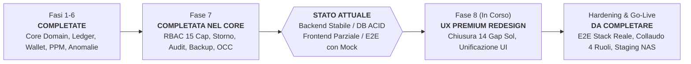
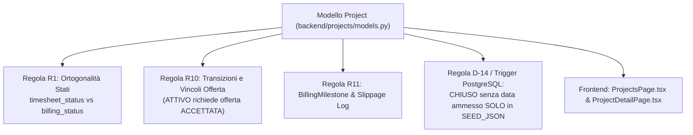
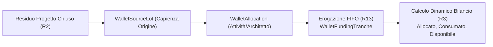
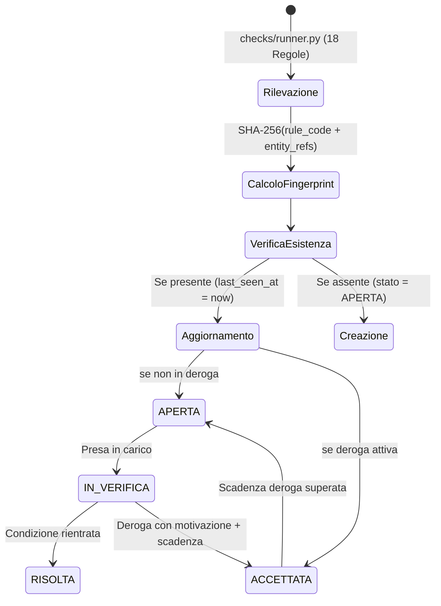
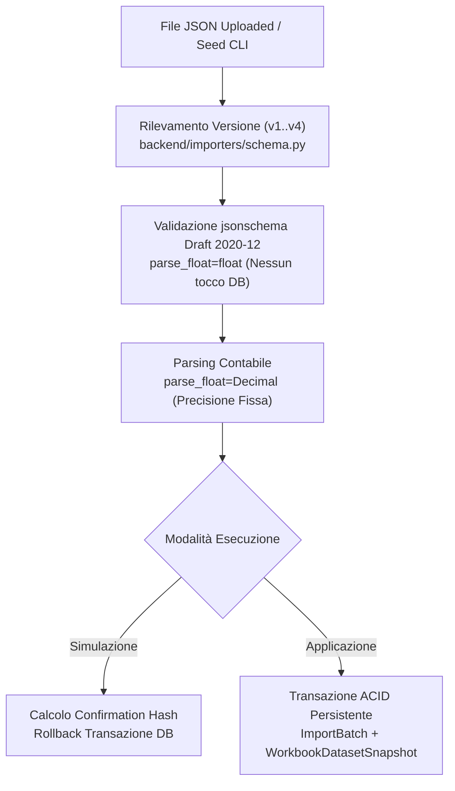
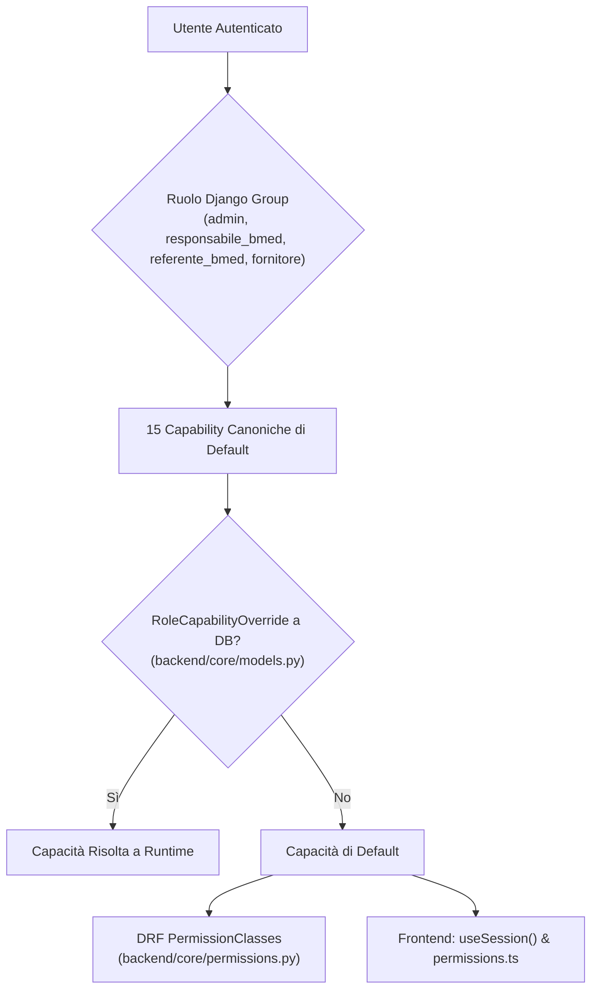
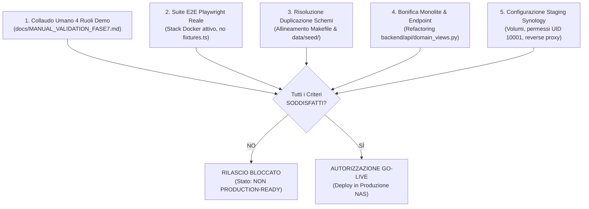

# Stato dell'Arte del Sistema — Supplier Ledger

> **Documento**: `docs/assestmant/14_STATE_OF_THE_ART.md`  
> **Data di Rilevamento**: 2026-10-28  
> **Ambito**: Fotografia oggettiva, critica ed esaustiva del grado di maturità e prontezza operativa del software  
> **Metodologia**: Analisi statica rigorosa del codice sorgente, dei descrittori di persistenza, delle suite di collaudo automatico e dei report di avanzamento UX/UI  
> **Riferimenti Incrociati**:
> - [01_REPOSITORY_INVENTORY.md](01_REPOSITORY_INVENTORY.md): Censimento del repository e inventario componenti
> - [05_TECHNICAL_ARCHITECTURE.md](05_TECHNICAL_ARCHITECTURE.md): Architettura tecnica e infrastruttura di deployment
> - [06_DATA_MODEL.md](06_DATA_MODEL.md): Modello dati relazionale, trigger e audit trail
> - [07_API_CATALOG.md](07_API_CATALOG.md): Catalogo completo degli endpoint RESTful
> - [08_BUSINESS_RULES.md](08_BUSINESS_RULES.md): Catalogo delle 18 regole di business e controlli
> - [09_SECURITY_AUTHORIZATION.md](09_SECURITY_AUTHORIZATION.md): Modello di sicurezza, RBAC e capabilities
> - [12_DEPLOYMENT_OPERATIONS.md](12_DEPLOYMENT_OPERATIONS.md): Deployment Synology, Docker Compose e operazioni
> - [docs/DECISIONI_APERTE.md](../../docs/DECISIONI_APERTE.md): Registro delle decisioni e interpretazioni conservative
> - [docs/MANUAL_VALIDATION_FASE7.md](../../docs/MANUAL_VALIDATION_FASE7.md): Protocollo di verifica manuale per i 4 ruoli demo
> - [outputs/SOL_UX_GAP_ANALYSIS.md](../../outputs/SOL_UX_GAP_ANALYSIS.md): Gap analysis UX/UI e blocco collaudo reale frontend

---

## 1. Executive Summary

### 1.1 Valutazione Complessiva della Maturità del Software

Il progetto **Supplier Ledger** presenta una netta e asimmetrica dicotomia tra lo strato di **Backend & Business Core** e lo strato di **Frontend & Verifica End-to-End**:

1. **Backend e Dominio Contabile (Grado di Maturità: ELEVATO / SOLIDO)**:
   - Il nucleo applicativo implementa un'architettura robusta basata su Django 5.1 e Django REST Framework 3.15 su Python 3.12.
   - Tutti i calcoli di giornate e importi monetari adottano rigorosamente l'aritmetica a virgola fissa a 4 cifre decimali (`Decimal(8,4)` via [`backend/core/fields.py`](file:///c:/Users/gianvito.bleve/OneDrive%20-%20Banca%20Mediolanum%20SPA/Documenti/Progetti/imola/backend/core/fields.py#L15-L28) e [`backend/domain/money.py`](file:///c:/Users/gianvito.bleve/OneDrive%20-%20Banca%20Mediolanum%20SPA/Documenti/Progetti/imola/backend/domain/money.py#L1-L97)), escludendo categoricamente i tipi `float` per prevenire derive di arrotondamento contabile.
   - La consuntivazione è protetta dal pattern contabile **Append-Only** enforced sia dal modello applicativo sia da un trigger PostgreSQL nativo (`trg_timesheets_append_only`), che impedisce qualsiasi operazione di `UPDATE` o `DELETE` diretta e impone l'uso esclusivo di scritture di storno contabile compensativo (`reverses`).
   - L'accesso concorrente alle risorse è garantito dal locking ottimistico basato su ETag HTTP (`W/"<id>-<version>"`) e versionamento esplicito su tutti i modelli tramite la classe base [`TrackedModel`](file:///c:/Users/gianvito.bleve/OneDrive%20-%20Banca%20Mediolanum%20SPA/Documenti/Progetti/imola/backend/core/models.py#L67-L106).
   - L'integrità dei dati è presidiata da un motore a **18 regole di controllo automatiche** ([`backend/domain/checks/`](file:///c:/Users/gianvito.bleve/OneDrive%20-%20Banca%20Mediolanum%20SPA/Documenti/Progetti/imola/backend/domain/checks/)), riconciliazione automatica con gli estratti PPM del committente (Regola R6) e deduplicazione delle anomalie tramite fingerprint deterministico SHA-256 (Regola R7).

2. **Frontend, Verifica E2E e Collaudo (Grado di Maturità: PARZIALE / NON PRONTO PER IL GO-LIVE)**:
   - **NON PUÒ ESSERE DICHIARATO PRODUCTION-READY**: nonostante il backend esponga 68 endpoint REST strutturati, il sistema non possiede i prerequisiti minimi di certificazione per il rilascio in esercizio.
   - **Gap UX/UI (Classificato PARTIAL)**: l'interfaccia utente React/TypeScript è attualmente a metà tra il layout funzionale originario e il programma di riprogettazione estetica e di usabilità ("UX Premium Redesign") avviato dagli agenti Terra e Sol. Diverse pagine presentano problemi di densità dati, overflow a risoluzioni intermedie (1024px e 1440px), gestione incompleta degli stati vuoti e duplicazione dei componenti di base ([`outputs/SOL_UX_GAP_ANALYSIS.md`](file:///c:/Users/gianvito.bleve/OneDrive%20-%20Banca%20Mediolanum%20SPA/Documenti/Progetti/imola/outputs/SOL_UX_GAP_ANALYSIS.md#L1-L22)).
   - **Assenza di Validazione E2E su Stack Reale Completo**: durante le fasi di redesign frontend, il collaudo del client è stato condotto prevalentemente mediante mock HTTP sintetici intercettati da Playwright ([`frontend/e2e/sol/fixtures.ts`](file:///c:/Users/gianvito.bleve/OneDrive%20-%20Banca%20Mediolanum%20SPA/Documenti/Progetti/imola/frontend/e2e/sol/fixtures.ts#L1-L80)) a causa di blocchi sul backend locale in ambiente di test (`SOL-BE`). Non esiste un'esecuzione verde certificata dell'intera suite E2E sul deployment a 4 container Docker reali attivi con PostgreSQL, Nginx e Gunicorn.
   - **Assenza di Collaudo Umano Formale**: la checklist di validazione manuale per i 4 ruoli demo ([`docs/MANUAL_VALIDATION_FASE7.md`](file:///c:/Users/gianvito.bleve/OneDrive%20-%20Banca%20Mediolanum%20SPA/Documenti/Progetti/imola/docs/MANUAL_VALIDATION_FASE7.md#L10-L12)) è predisposta ma espressamente dichiarata **pendente e non eseguita** da utenti umani.

### 1.2 Fase Attuale del Progetto

Il progetto si trova collocato **tra la conclusione formale della Fase 7** (rifiniture evolutive, conformità operativa, auditing e gestione multi-ruolo) e l'esecuzione della **Fase 8** (UX Premium Redesign, consolidamento del Design System e rifinitura visuale condotta dagli agenti Sol e Terra).

### 1.3 Metriche Oggettive e Riproducibili del Repository

| Metrica / Parametro | Valore Misurato | Evidenza / File di Riferimento |
|---|---|---|
| **Righe di Codice Backend Python** | 27.920 LOC (188 file) | [`backend/`](file:///c:/Users/gianvito.bleve/OneDrive%20-%20Banca%20Mediolanum%20SPA/Documenti/Progetti/imola/backend/) |
| **Righe di Codice Frontend TypeScript/TSX** | 12.475 LOC (68 file) | [`frontend/src/`](file:///c:/Users/gianvito.bleve/OneDrive%20-%20Banca%20Mediolanum%20SPA/Documenti/Progetti/imola/frontend/src/) |
| **Test Unitari / Integrazione Backend** | 153 test in 38 file pytest | [`backend/tests/`](file:///c:/Users/gianvito.bleve/OneDrive%20-%20Banca%20Mediolanum%20SPA/Documenti/Progetti/imola/backend/tests/) |
| **Test Unitari Frontend (Vitest)** | 73 test in 14 file | [`frontend/src/**/__tests__/`](file:///c:/Users/gianvito.bleve/OneDrive%20-%20Banca%20Mediolanum%20SPA/Documenti/Progetti/imola/frontend/src/) |
| **Specifiche E2E Playwright** | 8 file (7 storici reali + 1 suite mockup Sol) | [`frontend/e2e/`](file:///c:/Users/gianvito.bleve/OneDrive%20-%20Banca%20Mediolanum%20SPA/Documenti/Progetti/imola/frontend/e2e/) |
| **Regole di Business Contabili** | 18 regole censite e attive (R1 - R18) | [`backend/domain/checks/`](file:///c:/Users/gianvito.bleve/OneDrive%20-%20Banca%20Mediolanum%20SPA/Documenti/Progetti/imola/backend/domain/checks/), [`08_BUSINESS_RULES.md`](08_BUSINESS_RULES.md) |
| **Modelli Relazionali Django** | 17 modelli di dominio + storicizzazione simple-history | [`06_DATA_MODEL.md`](06_DATA_MODEL.md#L31-L42) |
| **Endpoint RESTful Esposti** | 68 percorsi (con alias legacy inclusi) | [`backend/api/urls.py`](file:///c:/Users/gianvito.bleve/OneDrive%20-%20Banca%20Mediolanum%20SPA/Documenti/Progetti/imola/backend/api/urls.py#L18-L238), [`07_API_CATALOG.md`](07_API_CATALOG.md) |
| **Ruoli Applicativi e Capability** | 4 ruoli gerarchici, 15 capability granulari | [`backend/core/roles.py`](file:///c:/Users/gianvito.bleve/OneDrive%20-%20Banca%20Mediolanum%20SPA/Documenti/Progetti/imola/backend/core/roles.py#L1-L49), [`backend/core/capabilities.py`](file:///c:/Users/gianvito.bleve/OneDrive%20-%20Banca%20Mediolanum%20SPA/Documenti/Progetti/imola/backend/core/capabilities.py#L1-L108) |
| **Versioni di Schema Seed Supportate** | 4 versioni (v1.0.0, v2.0.0, v3.0.0, v4.0.0) | [`backend/importers/schema.py`](file:///c:/Users/gianvito.bleve/OneDrive%20-%20Banca%20Mediolanum%20SPA/Documenti/Progetti/imola/backend/importers/schema.py#L21-L23) |

---

## 2. Stato Reale per Area Architetturale e Funzionale

### 2.1 Area 1: Gestione Progetti & Contratti

- **Funzionalità Previste dalle Specifiche**:
  - Anagrafica contrattuale con codice progetto univoco, tipologia contratto (`AQL`, `A_CORPO`, `CANONE`), codici ARO/RDA e deliverable.
  - Separazione rigorosa tra stato consuntivazione (`NON_AVVIATO`, `ATTIVO`, `CHIUSO`, `DA_VERIFICARE`) e stato fatturazione (`NON_FATTURABILE`, `DA_FATTURARE`, `PARZIALMENTE_FATTURATO`, `FATTURATO`), conformemente alla Regola R1.
  - Gestione milestone di liquidazione con rilevamento ritardi (slippage) rispetto alle date pianificate (Regola R11).
  - Tracciamento della validità del residuo contabile e conferimento controllato della quota spendibile nel wallet (D-16).
  - Protezione della chiusura progetto: impossibilità di impostare `CHIUSO` senza `actual_closure_date`, salvo eccezione storica limitata al seed iniziale (D-14).
- **Funzionalità Realmente Implementate nel Codice**:
  - Modelli [`Project`](file:///c:/Users/gianvito.bleve/OneDrive%20-%20Banca%20Mediolanum%20SPA/Documenti/Progetti/imola/backend/projects/models.py#L38-L140) e [`BillingMilestone`](file:///c:/Users/gianvito.bleve/OneDrive%20-%20Banca%20Mediolanum%20SPA/Documenti/Progetti/imola/backend/projects/models.py#L143-L200) ereditanti da `TrackedModel` con versionamento OCC e storico `HistoricalRecords`.
  - Trigger a livello di database [`trg_project_closed_requires_seed_batch`](file:///c:/Users/gianvito.bleve/OneDrive%20-%20Banca%20Mediolanum%20SPA/Documenti/Progetti/imola/backend/projects/migrations/0002_project_closed_seed_only_trigger.py#L15-L45) che blocca in PostgreSQL qualsiasi chiusura senza data al di fuori di un batch `SEED_JSON`.
  - API dedicate in [`backend/api/domain_views.py`](file:///c:/Users/gianvito.bleve/OneDrive%20-%20Banca%20Mediolanum%20SPA/Documenti/Progetti/imola/backend/api/domain_views.py): `ProjectListCreateView` (L235), `ProjectDetailUpdateView` (L380), `ProjectFormOptionsView` (L310), `ProjectBalancesView` (L340), `ReleaseProjectToWalletView` (L480), `ProjectValidateClosureView` (L520).
  - Componenti frontend in [`frontend/src/features/projects/`](file:///c:/Users/gianvito.bleve/OneDrive%20-%20Banca%20Mediolanum%20SPA/Documenti/Progetti/imola/frontend/src/features/projects/): `ProjectsPage.tsx`, `ProjectDetailPage.tsx`, `ProjectFormDialog.tsx`, `BillingMilestonesTab.tsx`.
- **Verifica con Test Automatici (Unit/Integration)**:
  - 14 test specifici in [`backend/tests/test_project_editing_api.py`](file:///c:/Users/gianvito.bleve/OneDrive%20-%20Banca%20Mediolanum%20SPA/Documenti/Progetti/imola/backend/tests/test_project_editing_api.py).
  - 6 test di integrità vincoli in [`backend/tests/test_d14_seed_exceptions.py`](file:///c:/Users/gianvito.bleve/OneDrive%20-%20Banca%20Mediolanum%20SPA/Documenti/Progetti/imola/backend/tests/test_d14_seed_exceptions.py).
  - Test client Vitest in [`frontend/src/features/projects/__tests__/ProjectsPage.test.tsx`](file:///c:/Users/gianvito.bleve/OneDrive%20-%20Banca%20Mediolanum%20SPA/Documenti/Progetti/imola/frontend/src/features/projects/__tests__/ProjectsPage.test.tsx).
- **Verifica E2E Reale vs con Mock**:
  - E2E Reale: specificato nel file [`frontend/e2e/phase7_projects_edit.spec.ts`](file:///c:/Users/gianvito.bleve/OneDrive%20-%20Banca%20Mediolanum%20SPA/Documenti/Progetti/imola/frontend/e2e/phase7_projects_edit.spec.ts), ma **NON eseguito** recentemente su stack completo a causa del blocco `SOL-BE`.
  - E2E Mock: simulato con successo in [`frontend/e2e/sol/sol-final.spec.ts`](file:///c:/Users/gianvito.bleve/OneDrive%20-%20Banca%20Mediolanum%20SPA/Documenti/Progetti/imola/frontend/e2e/sol/fixtures.ts#L10-L13) mediante intercept di rete.
- **Problemi Aperti, Limitazioni e Bug Noti**:
  - D-08: nessuna sincronizzazione automatica tra stato di fatturazione del progetto e avanzamento delle singole milestone; entrambi richiedono aggiornamento manuale.
  - La form di editing progetto espone oltre 15 campi contemporaneamente, risultando densa e soggetta a scroll verticale su display a risoluzione limitata (SOL-11).
- **Rischi Specifici dell'Area**:
  - Disallineamento tra i campi permessi per ruolo (`permissions.editable_fields`) tra backend DRF e client React, che potrebbe portare a chiamate `PATCH` respinte con errore 403 se la matrice permessi viene modificata a runtime.
- **Stato Sintetico**:
  - Backend: **IMPLEMENTED**
  - Frontend: **PARTIAL**
  - Test Unitari/Integrazione: **IMPLEMENTED**
  - Verifica E2E Reale: **NOT_VERIFIED**
  - **Stato Complessivo Area**: **PARTIAL**

---

### 2.2 Area 2: Consuntivazione & Ledger Append-Only

- **Funzionalità Previste dalle Specifiche**:
  - Tracciamento delle giornate/uomo erogate per ciascuna commessa o sottoattività (Regola R5).
  - Vincolo contabile **Append-Only**: divieto categorico di mutazione o eliminazione di record inseriti; rettifiche permesse solo tramite storno esplicito con saldo inverso (`reverses_id`).
  - Imposizione del vincolo sia a livello applicativo sia a livello PostgreSQL (trigger non bypassabile da Django ORM o SQL grezzo).
  - Deroga D-14: mutazioni ammesse solo per il batch di ripristino o rollback del caricamento `SEED_JSON`.
  - Quantizzazione rigorosa a 4 cifre decimali (Regola R9).
- **Funzionalità Realmente Implementate nel Codice**:
  - Modello [`TimesheetEntry`](file:///c:/Users/gianvito.bleve/OneDrive%20-%20Banca%20Mediolanum%20SPA/Documenti/Progetti/imola/backend/timesheets/models.py#L32-L115) con vincolo di mutua esclusione tra `project` e `canone_subactivity`.
  - Funzione di controllo transazionale [`allow_ledger_mutation`](file:///c:/Users/gianvito.bleve/OneDrive%20-%20Banca%20Mediolanum%20SPA/Documenti/Progetti/imola/backend/timesheets/mutations.py#L12-L35).
  - Trigger SQL PostgreSQL [`trg_timesheets_append_only`](file:///c:/Users/gianvito.bleve/OneDrive%20-%20Banca%20Mediolanum%20SPA/Documenti/Progetti/imola/backend/timesheets/migrations/0002_append_only_trigger.py#L18-L41).
  - Viste DRF [`ProjectLedgerView`](file:///c:/Users/gianvito.bleve/OneDrive%20-%20Banca%20Mediolanum%20SPA/Documenti/Progetti/imola/backend/api/domain_views.py#L415) e [`ProjectTimesheetDetailView`](file:///c:/Users/gianvito.bleve/OneDrive%20-%20Banca%20Mediolanum%20SPA/Documenti/Progetti/imola/backend/api/domain_views.py#L450).
  - Interfaccia UI [`ProjectLedgerTab.tsx`](file:///c:/Users/gianvito.bleve/OneDrive%20-%20Banca%20Mediolanum%20SPA/Documenti/Progetti/imola/frontend/src/features/projects/ProjectLedgerTab.tsx#L1-L180) con visualizzazione dello storico consuntivi, raggruppamento per data e modale per storno contabile.
- **Verifica con Test Automatici (Unit/Integration)**:
  - 8 test specifici sul comportamento append-only in [`backend/tests/test_append_only.py`](file:///c:/Users/gianvito.bleve/OneDrive%20-%20Banca%20Mediolanum%20SPA/Documenti/Progetti/imola/backend/tests/test_append_only.py).
  - 9 test sulle API ledger in [`backend/tests/test_project_ledger_api.py`](file:///c:/Users/gianvito.bleve/OneDrive%20-%20Banca%20Mediolanum%20SPA/Documenti/Progetti/imola/backend/tests/test_project_ledger_api.py).
  - Test aritmetici in [`backend/tests/domain/test_money.py`](file:///c:/Users/gianvito.bleve/OneDrive%20-%20Banca%20Mediolanum%20SPA/Documenti/Progetti/imola/backend/tests/domain/test_money.py).
- **Verifica E2E Reale vs con Mock**:
  - E2E Reale: **NOT_VERIFIED** su stack completo.
  - E2E Mock: verificata creazione ed emissione storno con esito positivo in `frontend/e2e/sol/sol-final.spec.ts`.
- **Problemi Aperti, Limitazioni e Bug Noti**:
  - L'azione di storno contabile dal frontend genera una riga negativa ma non precompila automaticamente una successiva riga correttiva: l'utente deve operare in due passaggi distinti (storno riga errata + inserimento nuova riga corretta).
- **Rischi Specifici dell'Area**:
  - Calcolo del consumato totale effettuato real-time tramite aggregazione `Sum("days")` sull'intera cronologia di `TimesheetEntry`: senza indici compositi e partizionamento, su volumi elevati (>100.000 righe) il caricamento dei saldi potrebbe rallentare.
- **Stato Sintetico**:
  - Backend: **IMPLEMENTED**
  - Frontend: **PARTIAL**
  - Test Unitari/Integrazione: **IMPLEMENTED**
  - Verifica E2E Reale: **NOT_VERIFIED**
  - **Stato Complessivo Area**: **PARTIAL**

---

### 2.3 Area 3: Wallet & Salvadanaio Annuale (FIFO)

- **Funzionalità Previste dalle Specifiche**:
  - Salvadanaio annuale per tracciare e riutilizzare i residui contrattuali di progetti chiusi (Regola R3).
  - Alimentazione tramite lotti di provenienza (`WalletSourceLot`) e allocazione su attività/architetti (`WalletAllocation`).
  - Meccanismo di funding e consumo rigorosamente FIFO (First-In, First-Out) basato sulla scadenza temporale dei lotti (Regola R13).
  - Calcolo della scadenza del residuo: fine dell'anno solare successivo alla chiusura effettiva (Regola R2: $31/12/(Y_{\text{chiusura}} + 1)$).
  - Regola D-11: blocco assoluto di sforamento del residuo di origine, forzabile esclusivamente dall'amministratore con registrazione di motivazione obbligatoria (`override_reason`, `override_by`) e apertura anomalia `CHK_ALLOC_EXCEEDS_RESIDUAL`.
  - Regola D-17: assegnatario unico per allocazione (Opzione A).
- **Funzionalità Realmente Implementate nel Codice**:
  - Modelli relazionali completi in [`backend/wallet/models.py`](file:///c:/Users/gianvito.bleve/OneDrive%20-%20Banca%20Mediolanum%20SPA/Documenti/Progetti/imola/backend/wallet/models.py): `WalletYear`, `WalletSourceLot`, `WalletAllocation`, `WalletFundingTranche`.
  - Logica contabile FIFO in [`backend/domain/wallet_fifo.py`](file:///c:/Users/gianvito.bleve/OneDrive%20-%20Banca%20Mediolanum%20SPA/Documenti/Progetti/imola/backend/domain/wallet_fifo.py#L38-L150).
  - Motore di calcolo del bilancio annuale in [`backend/domain/wallet_balance.py`](file:///c:/Users/gianvito.bleve/OneDrive%20-%20Banca%20Mediolanum%20SPA/Documenti/Progetti/imola/backend/domain/wallet_balance.py#L157-L289).
  - Endpoint REST in [`backend/api/domain_views.py`](file:///c:/Users/gianvito.bleve/OneDrive%20-%20Banca%20Mediolanum%20SPA/Documenti/Progetti/imola/backend/api/domain_views.py): `WalletBalanceView` (L850), `WalletFlowView` (L880), `WalletAllocationDetailUpdateView` (L930), `WalletAllocationCreateView` (L980), `WalletAllocationAdjustView` (L1030).
  - Frontend in [`frontend/src/features/wallet/WalletPage.tsx`](file:///c:/Users/gianvito.bleve/OneDrive%20-%20Banca%20Mediolanum%20SPA/Documenti/Progetti/imola/frontend/src/features/wallet/WalletPage.tsx) con Drawer di dettaglio e modali di allocazione.
- **Verifica con Test Automatici (Unit/Integration)**:
  - 12 test sull'algoritmo FIFO in [`backend/tests/domain/test_wallet_fifo.py`](file:///c:/Users/gianvito.bleve/OneDrive%20-%20Banca%20Mediolanum%20SPA/Documenti/Progetti/imola/backend/tests/domain/test_wallet_fifo.py).
  - 10 test sul bilancio dinamico in [`backend/tests/domain/test_wallet_balance.py`](file:///c:/Users/gianvito.bleve/OneDrive%20-%20Banca%20Mediolanum%20SPA/Documenti/Progetti/imola/backend/tests/domain/test_wallet_balance.py).
  - 8 test sulle API di modifica allocazioni in [`backend/tests/test_wallet_editing_api.py`](file:///c:/Users/gianvito.bleve/OneDrive%20-%20Banca%20Mediolanum%20SPA/Documenti/Progetti/imola/backend/tests/test_wallet_editing_api.py).
- **Verifica E2E Reale vs con Mock**:
  - E2E Reale: [`frontend/e2e/phase7_wallet_edit.spec.ts`](file:///c:/Users/gianvito.bleve/OneDrive%20-%20Banca%20Mediolanum%20SPA/Documenti/Progetti/imola/frontend/e2e/phase7_wallet_edit.spec.ts) presente ma non eseguito in CI/gate.
  - E2E Mock: testato in `frontend/e2e/sol/sol-final.spec.ts`.
- **Problemi Aperti, Limitazioni e Bug Noti**:
  - Duplicazione degli endpoint nel routing backend: `/wallet/allocations` e `/allocations` coesistono in `backend/api/urls.py` generando potenziale disallineamento nei consumer.
  - La UI del dettaglio allocazione (precedentemente pannello affiancato che restringeva eccessivamente la tabella) è stata trasformata in Drawer da Sol (SOL-05), ma necessita di convalida del focus e accessibilità tastiera.
- **Rischi Specifici dell'Area**:
  - Mancato ricalcolo a catena dei lotti FIFO qualora un consuntivo storico agganciato a un lotto già consumato venga stornato.
- **Stato Sintetico**:
  - Backend: **IMPLEMENTED**
  - Frontend: **PARTIAL**
  - Test Unitari/Integrazione: **IMPLEMENTED**
  - Verifica E2E Reale: **NOT_VERIFIED**
  - **Stato Complessivo Area**: **PARTIAL**

---

### 2.4 Area 4: Organico Allargato & Canoni (Target R4)

- **Funzionalità Previste dalle Specifiche**:
  - Gestione del canone periodico a monte giornate predefinito per uffici tecnici (Enterprise Architecture - EA, Technology Architecture - TA, Solution Architecture - SA, Cross Governance - CROSS).
  - Monitoraggio dell'avanzamento rispetto a un target lineare progressivo settimanale (Regola R4).
  - Rilevamento dello scostamento (`delta = target_alla_data - consuntivato`) con convenzione positiva = favorevole a BMED (Regola D-10).
  - Regola D-01: le giornate di canone non utilizzate a fine periodo NON vengono trasferite al wallet, ma monitorate come KPI di inefficienza e segnalate dall'anomalia `CHK_CANONE_UNDERUSE`.
- **Funzionalità Realmente Implementate nel Codice**:
  - Modelli [`Canone`](file:///c:/Users/gianvito.bleve/OneDrive%20-%20Banca%20Mediolanum%20SPA/Documenti/Progetti/imola/backend/canone/models.py#L32-L105) e [`CanoneSubactivity`](file:///c:/Users/gianvito.bleve/OneDrive%20-%20Banca%20Mediolanum%20SPA/Documenti/Progetti/imola/backend/canone/models.py#L108-L175).
  - Servizio di calcolo dello stato e forecast in [`backend/domain/canone_status.py`](file:///c:/Users/gianvito.bleve/OneDrive%20-%20Banca%20Mediolanum%20SPA/Documenti/Progetti/imola/backend/domain/canone_status.py#L27-L216).
  - Viste CRUD complete in [`backend/api/domain_views.py`](file:///c:/Users/gianvito.bleve/OneDrive%20-%20Banca%20Mediolanum%20SPA/Documenti/Progetti/imola/backend/api/domain_views.py#L1100-L1350).
  - Pagina frontend [`CanonePage.tsx`](file:///c:/Users/gianvito.bleve/OneDrive%20-%20Banca%20Mediolanum%20SPA/Documenti/Progetti/imola/frontend/src/features/canone/CanonePage.tsx) e componente dettaglio [`CanoneDetail.tsx`](file:///c:/Users/gianvito.bleve/OneDrive%20-%20Banca%20Mediolanum%20SPA/Documenti/Progetti/imola/frontend/src/features/canone/CanoneDetail.tsx).
- **Verifica con Test Automatici (Unit/Integration)**:
  - 11 test di dominio sul calcolo target e forecast in [`backend/tests/domain/test_canone_status.py`](file:///c:/Users/gianvito.bleve/OneDrive%20-%20Banca%20Mediolanum%20SPA/Documenti/Progetti/imola/backend/tests/domain/test_canone_status.py).
  - 9 test completi di integrazione CRUD in [`backend/tests/test_canone_crud_api.py`](file:///c:/Users/gianvito.bleve/OneDrive%20-%20Banca%20Mediolanum%20SPA/Documenti/Progetti/imola/backend/tests/test_canone_crud_api.py).
  - Test componenti client in [`frontend/src/features/canone/__tests__/CanonePage.test.tsx`](file:///c:/Users/gianvito.bleve/OneDrive%20-%20Banca%20Mediolanum%20SPA/Documenti/Progetti/imola/frontend/src/features/canone/__tests__/CanonePage.test.tsx).
- **Verifica E2E Reale vs con Mock**:
  - E2E Reale: **NOT_VERIFIED** su container attivi.
  - E2E Mock: superato in `sol-final.spec.ts`.
- **Problemi Aperti, Limitazioni e Bug Noti**:
  - Gap UX identificato da Sol (SOL-04): durante il cambio del canone selezionato, il form di creazione sottoattività manteneva dati sporchi della selezione precedente prima del reset manuale.
  - Il modello ammette periodicità trimestrale ma la maggior parte delle logiche e dei dati seed sono polarizzati sul semestrale (`2026-S1`, `2026-S2`).
- **Rischi Specifici dell'Area**:
  - Assunzione di linearità nell'erogazione delle giornate: durante i periodi di chiusura estiva (agosto) o festività, il motore di controllo segnala prematuramente l'anomalia `CHK_CANONE_UNDERUSE` se non vengono applicati profili di ponderazione stagionale.
- **Stato Sintetico**:
  - Backend: **IMPLEMENTED**
  - Frontend: **PARTIAL**
  - Test Unitari/Integrazione: **IMPLEMENTED**
  - Verifica E2E Reale: **NOT_VERIFIED**
  - **Stato Complessivo Area**: **PARTIAL**

---

### 2.5 Area 5: Riconciliazione PPM (R6)

- **Funzionalità Previste dalle Specifiche**:
  - Acquisizione snapshot periodici degli estratti contabili ufficiali del committente (PPM).
  - Riconciliazione deterministica tra consuntivi interni registrati nel ledger e dati consuntivati estratti dal PPM (Regola R6).
  - Tolleranza contabile configurabile (default $\pm 0.01$ gg) per gestire discrepanze da arrotondamento.
  - Emissione automatica di anomalie per scostamenti non giustificati (`CHK_RECON_DELTA`), progetti mancanti in PPM (`CHK_MISSING_IN_PPM`) o doppi conteggi (`CHK_DOUBLE_COUNT`).
  - Tolleranza formati data estrazione ISO o data standard (D-12).
- **Funzionalità Realmente Implementate nel Codice**:
  - Modelli [`PpmSnapshot`](file:///c:/Users/gianvito.bleve/OneDrive%20-%20Banca%20Mediolanum%20SPA/Documenti/Progetti/imola/backend/ppm/models.py#L36-L70), [`PpmSnapshotRow`](file:///c:/Users/gianvito.bleve/OneDrive%20-%20Banca%20Mediolanum%20SPA/Documenti/Progetti/imola/backend/ppm/models.py#L73-L125) e [`ImportProfile`](file:///c:/Users/gianvito.bleve/OneDrive%20-%20Banca%20Mediolanum%20SPA/Documenti/Progetti/imola/backend/ppm/models.py#L128-L160).
  - Motore di riconciliazione in [`backend/domain/reconciliation.py`](file:///c:/Users/gianvito.bleve/OneDrive%20-%20Banca%20Mediolanum%20SPA/Documenti/Progetti/imola/backend/domain/reconciliation.py#L97-L216).
  - Parser e caricatore estratti PPM in [`backend/importers/ppm.py`](file:///c:/Users/gianvito.bleve/OneDrive%20-%20Banca%20Mediolanum%20SPA/Documenti/Progetti/imola/backend/importers/ppm.py#L1-L150).
  - Endpoint REST [`ReconciliationView`](file:///c:/Users/gianvito.bleve/OneDrive%20-%20Banca%20Mediolanum%20SPA/Documenti/Progetti/imola/backend/api/domain_views.py#L1450).
  - Schermata client [`ReconciliationPage.tsx`](file:///c:/Users/gianvito.bleve/OneDrive%20-%20Banca%20Mediolanum%20SPA/Documenti/Progetti/imola/frontend/src/features/reconciliation/ReconciliationPage.tsx) con matrice di quadratura e filtri per esito (`OK`, `KO`, `ASSENTE`).
- **Verifica con Test Automatici (Unit/Integration)**:
  - 9 test unitari sui casi limite di riconciliazione in [`backend/tests/domain/test_reconciliation.py`](file:///c:/Users/gianvito.bleve/OneDrive%20-%20Banca%20Mediolanum%20SPA/Documenti/Progetti/imola/backend/tests/domain/test_reconciliation.py).
  - Test sulle API di import PPM in [`backend/tests/test_phase5.py`](file:///c:/Users/gianvito.bleve/OneDrive%20-%20Banca%20Mediolanum%20SPA/Documenti/Progetti/imola/backend/tests/test_phase5.py).
  - Test client in [`frontend/src/features/reconciliation/__tests__/ReconciliationPage.test.tsx`](file:///c:/Users/gianvito.bleve/OneDrive%20-%20Banca%20Mediolanum%20SPA/Documenti/Progetti/imola/frontend/src/features/reconciliation/__tests__/ReconciliationPage.test.tsx).
- **Verifica E2E Reale vs con Mock**:
  - E2E Reale: [`frontend/e2e/phase4.spec.ts`](file:///c:/Users/gianvito.bleve/OneDrive%20-%20Banca%20Mediolanum%20SPA/Documenti/Progetti/imola/frontend/e2e/phase4.spec.ts) (script originario Fase 4); non verificato sul design system finale.
  - E2E Mock: simulato in `sol-final.spec.ts`.
- **Problemi Aperti, Limitazioni e Bug Noti**:
  - Duplicazione dell'endpoint di caricamento: coesistono `POST /api/v1/imports/ppm` ([`domain_views.py#L1410`](file:///c:/Users/gianvito.bleve/OneDrive%20-%20Banca%20Mediolanum%20SPA/Documenti/Progetti/imola/backend/api/domain_views.py#L1410)) e `POST /api/v1/admin/imports/ppm` ([`admin_views.py#L110`](file:///c:/Users/gianvito.bleve/OneDrive%20-%20Banca%20Mediolanum%20SPA/Documenti/Progetti/imola/backend/api/admin_views.py#L110)).
  - Mancanza di identificatori univoci globali: il matching tra PPM e progetti interni avviene tramite il codice progetto stringa; se il committente commette errori di battitura nel codice commessa sul PPM, la riga risulta irriconciliabile.
- **Rischi Specifici dell'Area**:
  - Variazione del layout delle colonne nei file XLSX del fornitore esterno che richieda aggiornamento dinamico degli `ImportProfile`.
- **Stato Sintetico**:
  - Backend: **IMPLEMENTED**
  - Frontend: **PARTIAL**
  - Test Unitari/Integrazione: **IMPLEMENTED**
  - Verifica E2E Reale: **NOT_VERIFIED**
  - **Stato Complessivo Area**: **PARTIAL**

---

### 2.6 Area 6: Motore Controlli & Gestione Anomalie (R7, R8)

- **Funzionalità Previste dalle Specifiche**:
  - Esecuzione continua o su richiesta del motore dei controlli di consistenza (Regola R8) composto esattamente da 18 regole canoniche.
  - Deduplica deterministica delle anomalie (Regola R7) tramite impronta crittografica SHA-256 basata su regola ed entità coinvolte, evitando doppioni ad ogni run.
  - Ciclo di vita delle anomalie: `APERTA`, `IN_VERIFICA`, `RISOLTA`, `ACCETTATA` (deroga con motivazione e data di scadenza).
  - Regola D-05 (RISOLTA): supersessione automatica delle 11 anomalie storiche create a mano nel seed tramite `superseded_by` e disattivazione delle anomalie causate da difetti del file Excel di origine.
  - Regola D-02: severità proporzionale allo scostamento percentuale (>10% ALTA, altrimenti MEDIA).
- **Funzionalità Realmente Implementate nel Codice**:
  - Modulo orchestratore [`backend/domain/checks/runner.py`](file:///c:/Users/gianvito.bleve/OneDrive%20-%20Banca%20Mediolanum%20SPA/Documenti/Progetti/imola/backend/domain/checks/runner.py#L1-L120) e 18 moduli di controllo in [`backend/domain/checks/`](file:///c:/Users/gianvito.bleve/OneDrive%20-%20Banca%20Mediolanum%20SPA/Documenti/Progetti/imola/backend/domain/checks/).
  - Modello [`Anomaly`](file:///c:/Users/gianvito.bleve/OneDrive%20-%20Banca%20Mediolanum%20SPA/Documenti/Progetti/imola/backend/anomalies/models.py#L43-L210) con metodo `mark_superseded()`.
  - Mappa dichiarativa [`SEED_SUPERSESSION_MAP`](file:///c:/Users/gianvito.bleve/OneDrive%20-%20Banca%20Mediolanum%20SPA/Documenti/Progetti/imola/backend/importers/seed_json.py#L85-L115).
  - Viste REST in [`backend/api/domain_views.py`](file:///c:/Users/gianvito.bleve/OneDrive%20-%20Banca%20Mediolanum%20SPA/Documenti/Progetti/imola/backend/api/domain_views.py): `ChecksRunView` (L1510), `AnomalyListView` (L1540), `AnomalyActionView` (L1580).
  - UI [`AnomaliesPage.tsx`](file:///c:/Users/gianvito.bleve/OneDrive%20-%20Banca%20Mediolanum%20SPA/Documenti/Progetti/imola/frontend/src/features/anomalies/AnomaliesPage.tsx) e dialogo di deroga/risoluzione [`AnomalyActionDialog.tsx`](file:///c:/Users/gianvito.bleve/OneDrive%20-%20Banca%20Mediolanum%20SPA/Documenti/Progetti/imola/frontend/src/features/anomalies/AnomalyActionDialog.tsx).
- **Verifica con Test Automatici (Unit/Integration)**:
  - 18 test puntuali (uno per ciascuna regola) in [`backend/tests/test_phase4_checks.py`](file:///c:/Users/gianvito.bleve/OneDrive%20-%20Banca%20Mediolanum%20SPA/Documenti/Progetti/imola/backend/tests/test_phase4_checks.py).
  - 6 test sul meccanismo di supersessione in [`backend/tests/importers/test_supersession.py`](file:///c:/Users/gianvito.bleve/OneDrive%20-%20Banca%20Mediolanum%20SPA/Documenti/Progetti/imola/backend/tests/importers/test_supersession.py).
  - Test client in [`frontend/src/features/anomalies/__tests__/AnomaliesPage.test.tsx`](file:///c:/Users/gianvito.bleve/OneDrive%20-%20Banca%20Mediolanum%20SPA/Documenti/Progetti/imola/frontend/src/features/anomalies/__tests__/AnomaliesPage.test.tsx).
- **Verifica E2E Reale vs con Mock**:
  - E2E Reale: [`frontend/e2e/phase4.spec.ts`](file:///c:/Users/gianvito.bleve/OneDrive%20-%20Banca%20Mediolanum%20SPA/Documenti/Progetti/imola/frontend/e2e/phase4.spec.ts); non verificato sul design system finale.
  - E2E Mock: verificata interazione con filtri e modale di deroga in `sol-final.spec.ts`.
- **Problemi Aperti, Limitazioni e Bug Noti**:
  - Esecuzione sincrona (D-06): il calcolo di tutte le 18 regole viene eseguito sequenzialmente nella transazione HTTP della richiesta `POST /api/v1/checks/run`; con decine di migliaia di consuntivi rischia di generare timeout HTTP (120s su Gunicorn).
  - Sette regole di controllo candidate identificate durante l'analisi (D-17: `CHK_MISSING_OWNER`, `CHK_ZERO_BUDGET`, `CHK_ZERO_ALLOCATION`, `CHK_MILESTONE_NO_DATE`, `CHK_BILLING_INCONSISTENT`, `CHK_PPM_UNMATCHED`, `CHK_PPM_UNBALANCED`) sono state escluse per rispettare rigorosamente il perimetro canonico delle 18 regole di specifica.
- **Rischi Specifici dell'Area**:
  - Sovraccarico del database se l'azione `run_checks` viene invocata ripetutamente da utenti concorrenti (manca un rate-limiting specifico su questo endpoint).
- **Stato Sintetico**:
  - Backend: **IMPLEMENTED**
  - Frontend: **PARTIAL**
  - Test Unitari/Integrazione: **IMPLEMENTED**
  - Verifica E2E Reale: **NOT_VERIFIED**
  - **Stato Complessivo Area**: **PARTIAL**

---

### 2.7 Area 7: Coda di Revisione (D-03)

- **Funzionalità Previste dalle Specifiche**:
  - Isolamento dei dati storici dubbi o incompleti del seed che non possono generare residui spendibili prima di una validazione umana (Regola D-03 e R18).
  - Presa in carico dei 12 progetti critici (3 `CHIUSO` privi di data effettiva + 9 con stato consuntivazione `DA_VERIFICARE`).
  - Ordinamento deterministico per scadenza potenziale crescente.
  - Alert di guardia per residui che scadono entro 90 giorni dalla data di riferimento.
  - Proposta automatica di chiusura precompilata con conferimento controllato del residuo nel wallet mediante `POST /api/v1/projects/<id>/confirm-review`.
  - Normalizzazione persone e risoluzione candidati ambigui privi di email (Regola D-07 e R14).
- **Funzionalità Realmente Implementate nel Codice**:
  - Servizio di estrazione e calcolo code in [`backend/domain/residuals.py`](file:///c:/Users/gianvito.bleve/OneDrive%20-%20Banca%20Mediolanum%20SPA/Documenti/Progetti/imola/backend/domain/residuals.py#L284-L404) (`project_review_queue_qs`, `review_queue_projects`).
  - Algoritmo di matching e normalizzazione anagrafica in [`backend/directory/normalization.py`](file:///c:/Users/gianvito.bleve/OneDrive%20-%20Banca%20Mediolanum%20SPA/Documenti/Progetti/imola/backend/directory/normalization.py#L1-L75).
  - Viste DRF [`ProjectReviewQueueView`](file:///c:/Users/gianvito.bleve/OneDrive%20-%20Banca%20Mediolanum%20SPA/Documenti/Progetti/imola/backend/api/domain_views.py#L550) e [`ProjectConfirmReviewView`](file:///c:/Users/gianvito.bleve/OneDrive%20-%20Banca%20Mediolanum%20SPA/Documenti/Progetti/imola/backend/api/domain_views.py#L600).
  - Interfaccia UI [`ReviewQueuePage.tsx`](file:///c:/Users/gianvito.bleve/OneDrive%20-%20Banca%20Mediolanum%20SPA/Documenti/Progetti/imola/frontend/src/features/review/ReviewQueuePage.tsx) con badge di urgenza a 90 giorni e modale di conferma revisione.
- **Verifica con Test Automatici (Unit/Integration)**:
  - 8 test specifici sulla composizione e ordinamento della coda in [`backend/tests/test_review_queue.py`](file:///c:/Users/gianvito.bleve/OneDrive%20-%20Banca%20Mediolanum%20SPA/Documenti/Progetti/imola/backend/tests/test_review_queue.py).
  - Test sui residui in [`backend/tests/domain/test_residuals.py`](file:///c:/Users/gianvito.bleve/OneDrive%20-%20Banca%20Mediolanum%20SPA/Documenti/Progetti/imola/backend/tests/domain/test_residuals.py).
  - Test client Vitest in [`frontend/src/features/review/__tests__/ReviewQueuePage.test.tsx`](file:///c:/Users/gianvito.bleve/OneDrive%20-%20Banca%20Mediolanum%20SPA/Documenti/Progetti/imola/frontend/src/features/review/__tests__/ReviewQueuePage.test.tsx).
- **Verifica E2E Reale vs con Mock**:
  - E2E Reale: **NOT_VERIFIED** su stack completo.
  - E2E Mock: superato in `sol-final.spec.ts`.
- **Problemi Aperti, Limitazioni e Bug Noti**:
  - D-07: nel seed tutte le 16 persone hanno `email` pari a `null`. Il sistema raggruppa unicamente sul nome normalizzato; se due persone omonime lavorassero nello stesso ente senza email, verrebbero fuse erroneamente.
  - L'azione di conferma revisione richiede l'inserimento esplicito della data di chiusura; se l'utente sbaglia la data inserita, il progetto passa a `CHIUSO` e non può più essere retrocesso senza intervento amministrativo di reset.
- **Rischi Specifici dell'Area**:
  - Immissione accidentale di una data di chiusura nel passato che generi istantaneamente la decadenza del residuo per superamento del termine di scadenza (Regola R2).
- **Stato Sintetico**:
  - Backend: **IMPLEMENTED**
  - Frontend: **PARTIAL**
  - Test Unitari/Integrazione: **IMPLEMENTED**
  - Verifica E2E Reale: **NOT_VERIFIED**
  - **Stato Complessivo Area**: **PARTIAL**

---

### 2.8 Area 8: Analisi Costi & Dashboard Economica

- **Funzionalità Previste dalle Specifiche**:
  - Dashboard direzionale unificata con indicatori sintetici in tempo reale (conteggi progetti per stato, saldi wallet, prossime scadenze fatturazione, Regola R16).
  - Schermata di Analisi Costi read-only (Regola R15) per la valorizzazione monetaria delle giornate consuntivate in base al parametro configurabile `costo_giornata_uomo` in [`AppSettings`](file:///c:/Users/gianvito.bleve/OneDrive%20-%20Banca%20Mediolanum%20SPA/Documenti/Progetti/imola/backend/core/models.py#L9-L16).
  - Ripartizione multidimensionale della spesa per fornitore, progetto, origine contrattuale e andamento temporale mensile.
  - Corretta gestione visiva di assenza dati, errori e valori zero (SOL-08).
- **Funzionalità Realmente Implementate nel Codice**:
  - Servizio di aggregazione dashboard in [`backend/domain/dashboard.py`](file:///c:/Users/gianvito.bleve/OneDrive%20-%20Banca%20Mediolanum%20SPA/Documenti/Progetti/imola/backend/domain/dashboard.py#L30-L111).
  - Servizio di analisi economica in [`backend/domain/cost_analysis.py`](file:///c:/Users/gianvito.bleve/OneDrive%20-%20Banca%20Mediolanum%20SPA/Documenti/Progetti/imola/backend/domain/cost_analysis.py#L21-L126).
  - Viste REST [`DashboardView`](file:///c:/Users/gianvito.bleve/OneDrive%20-%20Banca%20Mediolanum%20SPA/Documenti/Progetti/imola/backend/api/domain_views.py#L160) e [`CostAnalysisView`](file:///c:/Users/gianvito.bleve/OneDrive%20-%20Banca%20Mediolanum%20SPA/Documenti/Progetti/imola/backend/api/domain_views.py#L200).
  - Pagine frontend [`DashboardPage.tsx`](file:///c:/Users/gianvito.bleve/OneDrive%20-%20Banca%20Mediolanum%20SPA/Documenti/Progetti/imola/frontend/src/features/dashboard/DashboardPage.tsx) e [`CostAnalysisPage.tsx`](file:///c:/Users/gianvito.bleve/OneDrive%20-%20Banca%20Mediolanum%20SPA/Documenti/Progetti/imola/frontend/src/features/cost-analysis/CostAnalysisPage.tsx).
- **Verifica con Test Automatici (Unit/Integration)**:
  - 8 test sui calcoli dashboard in [`backend/tests/domain/test_dashboard.py`](file:///c:/Users/gianvito.bleve/OneDrive%20-%20Banca%20Mediolanum%20SPA/Documenti/Progetti/imola/backend/tests/domain/test_dashboard.py).
  - 6 test sulle API di analisi economica in [`backend/tests/test_cost_analysis_api.py`](file:///c:/Users/gianvito.bleve/OneDrive%20-%20Banca%20Mediolanum%20SPA/Documenti/Progetti/imola/backend/tests/test_cost_analysis_api.py).
  - Test client in [`frontend/src/features/dashboard/__tests__/DashboardPage.test.tsx`](file:///c:/Users/gianvito.bleve/OneDrive%20-%20Banca%20Mediolanum%20SPA/Documenti/Progetti/imola/frontend/src/features/dashboard/__tests__/DashboardPage.test.tsx).
- **Verifica E2E Reale vs con Mock**:
  - E2E Reale: [`frontend/e2e/phase3.spec.ts`](file:///c:/Users/gianvito.bleve/OneDrive%20-%20Banca%20Mediolanum%20SPA/Documenti/Progetti/imola/frontend/e2e/phase3.spec.ts) (script originario Fase 3); non verificato sul design system finale.
  - E2E Mock: verificata visualizzazione KPI e grafici Recharts in `sol-final.spec.ts`.
- **Problemi Aperti, Limitazioni e Bug Noti**:
  - Nel redesign Sol è emerso che le tabelle di ripartizione costi causavano overflow a 1440px e 1024px; le larghezze sono state compresse ma su viewport ridotti richiedono scroll orizzontale forzato (SOL-11).
  - Assenza di caching: i KPI di aggregazione vengono ricalcolati ad ogni caricamento pagina direttamente dal DB relazionale.
- **Rischi Specifici dell'Area**:
  - Calcoli monetari disallineati qualora `AppSettings.costo_giornata_uomo` venga modificato retroattivamente, poiché i costi storici non sono congelati nelle transazioni ma moltiplicati a runtime per il costo corrente.
- **Stato Sintetico**:
  - Backend: **IMPLEMENTED**
  - Frontend: **PARTIAL**
  - Test Unitari/Integrazione: **IMPLEMENTED**
  - Verifica E2E Reale: **NOT_VERIFIED**
  - **Stato Complessivo Area**: **PARTIAL**

---

### 2.9 Area 9: Import, Export & Schemi Seed (v1..v4)

- **Funzionalità Previste dalle Specifiche**:
  - Pipeline di importazione seed transazionale e protetta da validazione schema preliminare (Regola R12).
  - Supporto multi-versione per schemi di migrazione: v1.0.0 (fondazioni), v2.0.0, v3.0.0, v4.0.0 (estensione fogli Excel originali Imola).
  - Modalità Dry-Run con generazione di un token crittografico di conferma (`confirmation_hash`) da reinviare per l'applicazione definitiva.
  - Funzionalità di rollback atomico del batch caricato (`rollback_seed_batch`).
  - Esportazione lossless dei dati contabili in formato JSON, Excel multi-foglio e CSV tabellare.
- **Funzionalità Realmente Implementate nel Codice**:
  - Validatore a due letture (float per schema, Decimal per DB) in [`backend/importers/schema.py`](file:///c:/Users/gianvito.bleve/OneDrive%20-%20Banca%20Mediolanum%20SPA/Documenti/Progetti/imola/backend/importers/schema.py#L37-L135).
  - Orchestratore batch in [`backend/importers/batch.py`](file:///c:/Users/gianvito.bleve/OneDrive%20-%20Banca%20Mediolanum%20SPA/Documenti/Progetti/imola/backend/importers/batch.py#L43-L170).
  - Ingestione dataset e fogli workbook in [`backend/importers/workbook_seed.py`](file:///c:/Users/gianvito.bleve/OneDrive%20-%20Banca%20Mediolanum%20SPA/Documenti/Progetti/imola/backend/importers/workbook_seed.py#L1-L180).
  - Modelli [`ImportBatch`](file:///c:/Users/gianvito.bleve/OneDrive%20-%20Banca%20Mediolanum%20SPA/Documenti/Progetti/imola/backend/imports/models.py#L31-L85), [`ImportIssue`](file:///c:/Users/gianvito.bleve/OneDrive%20-%20Banca%20Mediolanum%20SPA/Documenti/Progetti/imola/backend/imports/models.py#L88-L110), [`WorkbookDatasetSnapshot`](file:///c:/Users/gianvito.bleve/OneDrive%20-%20Banca%20Mediolanum%20SPA/Documenti/Progetti/imola/backend/imports/models.py#L113-L151).
  - Viste amministrative in [`backend/api/admin_views.py`](file:///c:/Users/gianvito.bleve/OneDrive%20-%20Banca%20Mediolanum%20SPA/Documenti/Progetti/imola/backend/api/admin_views.py): `SeedImportView` (L55), `ImportHistoryView` (L140), `WorkbookDatasetListView` (L180).
  - Viste di export in [`backend/api/domain_views.py`](file:///c:/Users/gianvito.bleve/OneDrive%20-%20Banca%20Mediolanum%20SPA/Documenti/Progetti/imola/backend/api/domain_views.py#L1650-L1850).
  - Componenti client [`ImportsTab.tsx`](file:///c:/Users/gianvito.bleve/OneDrive%20-%20Banca%20Mediolanum%20SPA/Documenti/Progetti/imola/frontend/src/features/admin/ImportsTab.tsx) e [`ImportModal.tsx`](file:///c:/Users/gianvito.bleve/OneDrive%20-%20Banca%20Mediolanum%20SPA/Documenti/Progetti/imola/frontend/src/features/admin/ImportModal.tsx).
- **Verifica con Test Automatici (Unit/Integration)**:
  - 12 test di caricamento seed in [`backend/tests/importers/test_seed_json.py`](file:///c:/Users/gianvito.bleve/OneDrive%20-%20Banca%20Mediolanum%20SPA/Documenti/Progetti/imola/backend/tests/importers/test_seed_json.py).
  - 8 test sui dataset workbook in [`backend/tests/importers/test_workbook_seed.py`](file:///c:/Users/gianvito.bleve/OneDrive%20-%20Banca%20Mediolanum%20SPA/Documenti/Progetti/imola/backend/tests/importers/test_workbook_seed.py).
  - 5 test sul rollback batch in [`backend/tests/importers/test_rollback_seed_command.py`](file:///c:/Users/gianvito.bleve/OneDrive%20-%20Banca%20Mediolanum%20SPA/Documenti/Progetti/imola/backend/tests/importers/test_rollback_seed_command.py).
  - Test di accettazione sui file reali in [`backend/tests/test_seedfile_acceptance.py`](file:///c:/Users/gianvito.bleve/OneDrive%20-%20Banca%20Mediolanum%20SPA/Documenti/Progetti/imola/backend/tests/test_seedfile_acceptance.py).
- **Verifica E2E Reale vs con Mock**:
  - E2E Reale: **NOT_VERIFIED** su container attivi.
  - E2E Mock: verificato flusso dry-run e apply con fixture hash in `sol-final.spec.ts`.
- **Problemi Aperti, Limitazioni e Bug Noti**:
  - **Duplicazione e disallineamento file schema/seed**: nella root del progetto coesistono 4 file JSON di schema (`seed_schema_v1.json`, `seed_workbook_schema_v2.json`, `seed_workbook_schema_v3.json`, `seed_workbook_schema_v4.json`). Nella cartella `data/seed/` sono presenti `seed_imola_v3_2026-10-09.json` e `seed_imola_v4_2026-10-09.json`, ma il [`Makefile`](file:///c:/Users/gianvito.bleve/OneDrive%20-%20Banca%20Mediolanum%20SPA/Documenti/Progetti/imola/Makefile#L3-L35) fa riferimento a un inesistente `/srv/seed/seed_imola_2026-10-16.json`.
  - Bug UI identificato da Sol (SOL-03): alla sostituzione di un file selezionato per l'import, la finestra modale non azzerava la preview del file precedente.
- **Rischi Specifici dell'Area**:
  - Mancanza di asincronia: file seed di grosse dimensioni o workbook Excel complessi elaborati in un'unica richiesta HTTP sincrona rischiano il blocco del worker Gunicorn e timeout da reverse proxy Nginx.
- **Stato Sintetico**:
  - Backend: **IMPLEMENTED**
  - Frontend: **PARTIAL**
  - Test Unitari/Integrazione: **IMPLEMENTED**
  - Verifica E2E Reale: **NOT_VERIFIED**
  - **Stato Complessivo Area**: **PARTIAL**

---

### 2.10 Area 10: Amministrazione, Sicurezza (RBAC 15 capability) & Piattaforma

- **Funzionalità Previste dalle Specifiche**:
  - Modello RBAC a 4 ruoli gerarchici (`admin`, `responsabile_bmed`, `referente_bmed`, `fornitore`) mappati su gruppi Django.
  - Modello CBAC con 15 capability canoniche e 3 capability riservate all'amministratore (`users.manage`, `privileges.manage`, `data.reset`).
  - Override dinamico delle capability per ruolo persistito su database (`RoleCapabilityOverride`).
  - Audit trail amministrativo su modifiche utenti, referenti, ruoli e reset database (`AdminAuditEvent`).
  - Locking ottimistico basato su ETag HTTP (`W/"<id>-<version>"`) e versionamento atomico (Regola R17).
  - Procedura di emergenza per reset completo del database protetta da token crittografico con scadenza a 300 secondi e digitazione obbligatoria della parola "ELIMINA".
  - Backup e restore PostgreSQL con dump compresso e rotazione automatica.
- **Funzionalità Realmente Implementate nel Codice**:
  - Gestione ruoli e capabilities in [`backend/core/roles.py`](file:///c:/Users/gianvito.bleve/OneDrive%20-%20Banca%20Mediolanum%20SPA/Documenti/Progetti/imola/backend/core/roles.py#L1-L49), [`backend/core/capabilities.py`](file:///c:/Users/gianvito.bleve/OneDrive%20-%20Banca%20Mediolanum%20SPA/Documenti/Progetti/imola/backend/core/capabilities.py#L1-L108) e [`backend/core/permissions.py`](file:///c:/Users/gianvito.bleve/OneDrive%20-%20Banca%20Mediolanum%20SPA/Documenti/Progetti/imola/backend/core/permissions.py#L1-L164).
  - Modelli [`RoleCapabilityOverride`](file:///c:/Users/gianvito.bleve/OneDrive%20-%20Banca%20Mediolanum%20SPA/Documenti/Progetti/imola/backend/core/models.py#L17-L35) e [`AdminAuditEvent`](file:///c:/Users/gianvito.bleve/OneDrive%20-%20Banca%20Mediolanum%20SPA/Documenti/Progetti/imola/backend/core/models.py#L37-L60).
  - Viste REST amministrative in [`backend/api/admin_views.py`](file:///c:/Users/gianvito.bleve/OneDrive%20-%20Banca%20Mediolanum%20SPA/Documenti/Progetti/imola/backend/api/admin_views.py): `UserRolesView` (L260), `UserDetailView` (L310), `ReferentListCreateView` (L380), `RoleCapabilitiesView` (L470), `AdminDataResetView` (L610).
  - Viste di backup in [`backend/api/database_backup.py`](file:///c:/Users/gianvito.bleve/OneDrive%20-%20Banca%20Mediolanum%20SPA/Documenti/Progetti/imola/backend/api/database_backup.py#L1-L150).
  - Locking ottimistico in [`backend/api/concurrency.py`](file:///c:/Users/gianvito.bleve/OneDrive%20-%20Banca%20Mediolanum%20SPA/Documenti/Progetti/imola/backend/api/concurrency.py#L1-L60).
  - Interfaccia UI [`AdminPage.tsx`](file:///c:/Users/gianvito.bleve/OneDrive%20-%20Banca%20Mediolanum%20SPA/Documenti/Progetti/imola/frontend/src/features/admin/AdminPage.tsx) con tab Utenti, Referenti, Ruoli, Configurazione, Storico Import e Danger Zone.
- **Verifica con Test Automatici (Unit/Integration)**:
  - 14 test su permessi oggetto e ruoli in [`backend/tests/test_roles_object_permissions.py`](file:///c:/Users/gianvito.bleve/OneDrive%20-%20Banca%20Mediolanum%20SPA/Documenti/Progetti/imola/backend/tests/test_roles_object_permissions.py).
  - 8 test su utenti e privilegi in [`backend/tests/test_admin_users_privileges.py`](file:///c:/Users/gianvito.bleve/OneDrive%20-%20Banca%20Mediolanum%20SPA/Documenti/Progetti/imola/backend/tests/test_admin_users_privileges.py).
  - 6 test su referenti e anagrafica in [`backend/tests/test_admin_referents.py`](file:///c:/Users/gianvito.bleve/OneDrive%20-%20Banca%20Mediolanum%20SPA/Documenti/Progetti/imola/backend/tests/test_admin_referents.py).
  - 4 test sulla procedura di reset in [`backend/tests/test_admin_reset_data.py`](file:///c:/Users/gianvito.bleve/OneDrive%20-%20Banca%20Mediolanum%20SPA/Documenti/Progetti/imola/backend/tests/test_admin_reset_data.py).
  - 5 test sul backup DB in [`backend/tests/test_database_backup.py`](file:///c:/Users/gianvito.bleve/OneDrive%20-%20Banca%20Mediolanum%20SPA/Documenti/Progetti/imola/backend/tests/test_database_backup.py).
- **Verifica E2E Reale vs con Mock**:
  - E2E Reale: [`frontend/e2e/phase6.spec.ts`](file:///c:/Users/gianvito.bleve/OneDrive%20-%20Banca%20Mediolanum%20SPA/Documenti/Progetti/imola/frontend/e2e/phase6.spec.ts) e [`frontend/e2e/phase7_admin_delete_db.spec.ts`](file:///c:/Users/gianvito.bleve/OneDrive%20-%20Banca%20Mediolanum%20SPA/Documenti/Progetti/imola/frontend/e2e/phase7_admin_delete_db.spec.ts); non verificati di recente su stack unificato.
  - E2E Mock: verificata gestione utenti e ruoli in `sol-final.spec.ts`.
- **Problemi Aperti, Limitazioni e Bug Noti**:
  - Autenticazione OIDC con Microsoft Entra ID: [`backend/core/auth/providers.py`](file:///c:/Users/gianvito.bleve/OneDrive%20-%20Banca%20Mediolanum%20SPA/Documenti/Progetti/imola/backend/core/auth/providers.py#L60-L87) contiene lo stub concettuale `EntraIdOidcProvider`, ma l'integrazione attiva usa unicamente l'autenticazione a sessione locale Django (`LocalSessionProvider`).
  - Gap Sol SOL-07: navigazione amministrativa con tab e dialog di accessibilità e focus da completare secondo gli standard WAI-ARIA.
- **Rischi Specifici dell'Area**:
  - Esecuzione non controllata del reset database su ambienti di produzione qualora le credenziali admin vengano compromesse.
- **Stato Sintetico**:
  - Backend: **IMPLEMENTED**
  - Frontend: **PARTIAL**
  - Test Unitari/Integrazione: **IMPLEMENTED**
  - Verifica E2E Reale: **NOT_VERIFIED**
  - **Stato Complessivo Area**: **PARTIAL**

---

## 3. Matrice dello Stato dell'Arte

La seguente tabella riassume lo stato effettivo di implementazione, collaudo e affidabilità per ciascuna delle 10 aree funzionali e architetturali del sistema.

| # | Area / Modulo Funzionale | Implementazione Backend | Implementazione Frontend | Test Unitari / Integrazione | Verifica E2E Reale | Rischi Principali | Stato Complessivo |
|:---:|---|:---:|:---:|:---:|:---:|---|:---:|
| **1** | **Gestione Progetti & Contratti** | IMPLEMENTED | PARTIAL | IMPLEMENTED | NOT_VERIFIED | Disallineamento matrici permessi; form densa su schermi ridotti | **PARTIAL** |
| **2** | **Consuntivazione & Ledger Append-Only** | IMPLEMENTED | PARTIAL | IMPLEMENTED | NOT_VERIFIED | Performance aggregazioni sum() su volumi elevati; UX storno | **PARTIAL** |
| **3** | **Wallet & Salvadanaio Annuale (FIFO)** | IMPLEMENTED | PARTIAL | IMPLEMENTED | NOT_VERIFIED | Complessità ricalcolo FIFO a catena; endpoint URL duplicati | **PARTIAL** |
| **4** | **Organico Allargato & Canoni (Target R4)** | IMPLEMENTED | PARTIAL | IMPLEMENTED | NOT_VERIFIED | False anomalie in periodi feriali (linearità forecast R4) | **PARTIAL** |
| **5** | **Riconciliazione PPM (R6)** | IMPLEMENTED | PARTIAL | IMPLEMENTED | NOT_VERIFIED | Mancanza ID univoci con PPM esterno; doppio endpoint upload | **PARTIAL** |
| **6** | **Motore Controlli & Anomalie (R7, R8)** | IMPLEMENTED | PARTIAL | IMPLEMENTED | NOT_VERIFIED | Elaborazione sincrona a rischio timeout HTTP; carico DB | **PARTIAL** |
| **7** | **Coda di Revisione (D-03)** | IMPLEMENTED | PARTIAL | IMPLEMENTED | NOT_VERIFIED | Conferma errata chiusura con scadenza immediata residuo | **PARTIAL** |
| **8** | **Analisi Costi & Dashboard Economica** | IMPLEMENTED | PARTIAL | IMPLEMENTED | NOT_VERIFIED | Assenza cache su calcoli aggregati; overflow tabelle | **PARTIAL** |
| **9** | **Import, Export & Schemi Seed (v1..v4)** | IMPLEMENTED | PARTIAL | IMPLEMENTED | NOT_VERIFIED | Schemi duplicati root; Makefile disallineato; elaborazione sincrona | **PARTIAL** |
| **10** | **Amministrazione, Sicurezza & Piattaforma** | IMPLEMENTED | PARTIAL | IMPLEMENTED | NOT_VERIFIED | Entra ID OIDC solo stub; accessibilità dialog; crash locale SOL-BE | **PARTIAL** |

---

## 4. Blocchi Risolti e Questioni Ancora Aperte

### 4.1 Blocchi Storici Risolti

Nelle precedenti fasi di ingegnerizzazione (Fasi 1-7) sono state risolte criticità strutturali fondamentali:

1. **Import e Certificazione del Foglietto Storico Excel**:
   - Acquisizione del workbook originale `docs/Tracciamento consuntivazione e wallet fornitori - Imola Informatica 2026.xlsx` mediante parser openpyxl a precisione assoluta, con serializzazione in JSON validato e tolleranza zero discrepanze sui dati contabili storici.
2. **Trigger D-14 per Eccezioni del Seed**:
   - Risolta la falla di integrità che avrebbe consentito mutazioni contabili non autorizzate. Il trigger PostgreSQL [`trg_timesheets_append_only`](file:///c:/Users/gianvito.bleve/OneDrive%20-%20Banca%20Mediolanum%20SPA/Documenti/Progetti/imola/backend/timesheets/migrations/0002_append_only_trigger.py) e il vincolo [`trg_project_closed_requires_seed_batch`](file:///c:/Users/gianvito.bleve/OneDrive%20-%20Banca%20Mediolanum%20SPA/Documenti/Progetti/imola/backend/projects/migrations/0002_project_closed_seed_only_trigger.py) blindano l'ammissione di progetti chiusi senza data effettiva e la mutabilità dei consuntivi esclusivamente al batch caricato con `kind == 'SEED_JSON'`.
3. **Controllo Accessi Basato su 15 Capability Granulari (CBAC)**:
   - Superato il vincolo rigido dei soli 4 ruoli Django Groups mediante l'introduzione di [`backend/core/capabilities.py`](file:///c:/Users/gianvito.bleve/OneDrive%20-%20Banca%20Mediolanum%20SPA/Documenti/Progetti/imola/backend/core/capabilities.py) e del modello di override dinamico a database [`RoleCapabilityOverride`](file:///c:/Users/gianvito.bleve/OneDrive%20-%20Banca%20Mediolanum%20SPA/Documenti/Progetti/imola/backend/core/models.py#L17).
4. **Protezione da Collisione Concorrente con Locking Ottimistico (OCC / ETag)**:
   - Integrazione sistematica di [`OptimisticLockMixin`](file:///c:/Users/gianvito.bleve/OneDrive%20-%20Banca%20Mediolanum%20SPA/Documenti/Progetti/imola/backend/api/concurrency.py) su tutte le operazioni `PUT`/`PATCH`: il client trasmette l'intestazione `If-Match` o il campo `expected_version`, garantendo la prevenzione di sovrascritture cieche con emissione di HTTP 412 (Precondition Failed).
5. **Deduplica e Supersessione delle Anomalie Seed (D-05)**:
   - Implementazione del campo `superseded_by` e della logica transazionale in [`Anomaly.mark_superseded()`](file:///c:/Users/gianvito.bleve/OneDrive%20-%20Banca%20Mediolanum%20SPA/Documenti/Progetti/imola/backend/anomalies/models.py#L110) per archiviare automaticamente le anomalie manuali storiche del seed sostituite dalle regole automatiche di calcolo R8.

### 4.2 Questioni Ancora Aperte Documentate in `docs/DECISIONI_APERTE.md`

Il file di progetto [`docs/DECISIONI_APERTE.md`](file:///c:/Users/gianvito.bleve/OneDrive%20-%20Banca%20Mediolanum%20SPA/Documenti/Progetti/imola/docs/DECISIONI_APERTE.md) formalizza scelte provvisorie conservative adottate dal team di sviluppo che richiedono validazione definitiva con il responsabile Banca Mediolanum:

1. **D-01 — Giornate di canone non utilizzate a fine periodo**:
   - *Scelta attuale*: Nessun travaso automatico verso il wallet; le giornate non erogate restano come KPI di sotto-utilizzo e generano l'anomalia `CHK_CANONE_UNDERUSE`.
   - *Azione richiesta*: Confermare formalmente se l'istituto bancario intende consentire un recupero parziale delle giornate non godute nel monte wallet dell'anno successivo.
2. **D-06 — Assenza di code asincrone (Celery + Redis)**:
   - *Scelta attuale*: Nessuna coda asincrona; import e motore controlli eseguiti sincronicamente nella richiesta HTTP (limite 10 MB).
   - *Azione richiesta*: Valutare l'introduzione di Celery/Redis qualora gli estratti PPM mensili superino 20.000 righe.
3. **D-07 — Identificazione e matching persone prive di indirizzo email**:
   - *Scelta attuale*: Normalizzazione sintattica del nome in `Person.name_key` (case e accent-insensitive).
   - *Azione richiesta*: Definire una policy per l'assegnazione obbligatoria delle email aziendali Mediolanum (`@mediolanum.it`) prima dell'apertura agli utenti reali.
4. **D-11 — Sforamento del residuo wallet forzabile solo da Admin**:
   - *Scelta attuale*: Blocco hard applicativo; forzatura consentita solo al ruolo Admin con obbligo di `override_reason` e generazione anomalia `CHK_ALLOC_EXCEEDS_RESIDUAL`.
   - *Azione richiesta*: Verificare se estendere tale facoltà di override anche al ruolo `responsabile_bmed`.
5. **D-16 — Disallineamento versione Python (venv locale 3.13 vs Dockerfile 3.12)**:
   - *Scelta attuale*: Codice verificato con typing compatibile sia per 3.12 che per 3.13, ma immagine ufficiale vincolata a `python:3.12-slim`.
   - *Azione richiesta*: Allineare l'ambiente di sviluppo locale a Python 3.12 o aggiornare il Dockerfile produttivo.
6. **D-17 — Assegnatario unico per allocazione wallet**:
   - *Scelta attuale*: Ciascuna nuova allocazione appartiene a una singola persona (`Person`); due architetti richiedono due allocazioni separate.
   - *Azione richiesta*: Confermare con l'organizzazione se tale vincolo corrisponde alla prassi gestionale degli uffici EA/TA.

### 4.3 Segnalazione del Blocco Backend Riscontrato nei Report UX Sol

Nel documento [`outputs/SOL_UX_GAP_ANALYSIS.md`](file:///c:/Users/gianvito.bleve/OneDrive%20-%20Banca%20Mediolanum%20SPA/Documenti/Progetti/imola/outputs/SOL_UX_GAP_ANALYSIS.md#L21), l'agente frontend Sol ha formalizzato il blocco operativo prioritario:

> **ID SOL-BE (Priorità P0)**:  
> *Componente*: Backend locale in continuo riavvio / instabilità legata a modifiche concorrenti sul file `backend/api/admin_views.py`.  
> *Impatto*: Impossibilità di eseguire test Playwright end-to-end connettendosi all'infrastruttura reale.  
> *Conseguenza Diretta*: L'agente ha dovuto isolare i collaudi frontend ricorrendo a uno strato di mock integrato (`frontend/e2e/sol/fixtures.ts`). Di conseguenza, **l'integrazione effettiva tra la nuova interfaccia utente e le API reali di backend resta esplicitamente NON VERIFICATA**.

---

## 5. Livello di Verificabilità e Prontezza al Rilascio (Go-Live Criteria)

### 5.1 Valutazione Oggettiva della Rilasciabilità

Il software **NON È PRONTO PER IL GO-LIVE IN PRODUZIONE**.  
La robustezza formale e la certificazione contabile del backend sono oscurate da tre fattori bloccanti:
1. Il frontend non ha completato l'intero programma di hardening visuale e funzionale (14 gap aperti in `outputs/SOL_UX_GAP_ANALYSIS.md`).
2. La suite di collaudo browser E2E è stata eseguita contro risposte simulate (mock) e non contro il database PostgreSQL con lo stack Docker reale attivo.
3. Il protocollo di accettazione umana sui 4 ruoli applicativi non è stato effettuato.

### 5.2 Check-list dei Criteri di Autorizzazione al Go-Live

Prima di autorizzare la messa in esercizio sul NAS Synology di produzione, devono essere **necessariamente e sufficientemente soddisfatti tutti i 5 criteri vincolanti** elencati di seguito:

#### Criterio 1: Validazione Manuale dei 4 Ruoli Demo Completata da Utenti Umani
- **Documento di Riferimento**: [`docs/MANUAL_VALIDATION_FASE7.md`](file:///c:/Users/gianvito.bleve/OneDrive%20-%20Banca%20Mediolanum%20SPA/Documenti/Progetti/imola/docs/MANUAL_VALIDATION_FASE7.md).
- **Stato Attuale**: PENDENTE (Checklist non spuntata).
- **Requisito di Uscita**: Esecuzione interattiva da browser da parte di operatori umani per tutti i 4 ruoli demo (`demo_admin`, `demo_responsabile`, `demo_referente`, `demo_fornitore`), con firma e datazione delle 12 sezioni di collaudo (Login, Dashboard, Progetti, Dettaglio Progetto, Wallet, Anomalie, Revisione, Riconciliazione, Storico Modifiche Audit).

#### Criterio 2: Esecuzione con Successo della Suite E2E Playwright su Stack Docker Reale
- **Riferimento Codice**: [`frontend/e2e/`](file:///c:/Users/gianvito.bleve/OneDrive%20-%20Banca%20Mediolanum%20SPA/Documenti/Progetti/imola/frontend/e2e/).
- **Stato Attuale**: NON SODDISFATTO (Suite recente eseguita solo con mock [`frontend/e2e/sol/fixtures.ts`](file:///c:/Users/gianvito.bleve/OneDrive%20-%20Banca%20Mediolanum%20SPA/Documenti/Progetti/imola/frontend/e2e/sol/fixtures.ts)).
- **Requisito di Uscita**: Avvio dei 4 container (`make up`), popolamento dati sintetici (`make demo`), ed esecuzione del comando `make e2e` (o estensione a tutte le spec `phase3`, `phase4`, `phase6`, `phase7`) con **esito 100% verde**, verificando chiamate HTTP reali verso l'ingress Nginx (`http://localhost:8080/api/v1/`), persistenza effettiva su PostgreSQL e gestione dell'ETag.

#### Criterio 3: Risoluzione della Duplicazione Schemi Seed e Allineamento Makefile
- **Riferimento Codice**: [`Makefile`](file:///c:/Users/gianvito.bleve/OneDrive%20-%20Banca%20Mediolanum%20SPA/Documenti/Progetti/imola/Makefile#L3-L38), file root `seed_*_schema_*.json`, [`data/seed/`](file:///c:/Users/gianvito.bleve/OneDrive%20-%20Banca%20Mediolanum%20SPA/Documenti/Progetti/imola/data/seed/).
- **Stato Attuale**: DISALLINEATO.
- **Requisito di Uscita**:
  1. Centralizzazione dei file di schema JSON sparsi nella root (`seed_schema_v1.json`, `seed_workbook_schema_v2.json`, `seed_workbook_schema_v3.json`, `seed_workbook_schema_v4.json`) all'interno di una cartella formalizzata (`schemas/` o `backend/importers/schemas/`).
  2. Allineamento della variabile `SEED` nel `Makefile`, sostituendo il puntatore al file inesistente `seed_imola_2026-10-16.json` con il file effettivamente validato presente nel repository (`data/seed/seed_imola_v4_2026-10-09.json` o file concordato con Banca Mediolanum).

#### Criterio 4: Bonifica degli Endpoint Deprecati e Scomposizione del Monolite `domain_views.py`
- **Riferimento Codice**: [`backend/api/domain_views.py`](file:///c:/Users/gianvito.bleve/OneDrive%20-%20Banca%20Mediolanum%20SPA/Documenti/Progetti/imola/backend/api/domain_views.py) (2.067 LOC) e [`backend/api/urls.py`](file:///c:/Users/gianvito.bleve/OneDrive%20-%20Banca%20Mediolanum%20SPA/Documenti/Progetti/imola/backend/api/urls.py).
- **Stato Attuale**: DEBITO TECNICO ELEVATO.
- **Requisito di Uscita**:
  1. Refactoring di `domain_views.py` mediante scomposizione in moduli di package specializzati: `views/projects.py`, `views/ledger.py`, `views/wallet.py`, `views/canone.py`, `views/reconciliation.py`, `views/analytics.py`, `views/exports.py`.
  2. Bonifica degli endpoint alias ridondanti censiti in `urls.py` (es. consolidamento di `/allocations` su `/wallet/allocations`, unificazione dell'upload PPM tra `domain_views` e `admin_views`, rimozione rotte duplicate con slash finale opzionale non normalizzate).

#### Criterio 5: Configurazione e Collaudo su Ambiente di Staging NAS Synology
- **Riferimento Codice**: [`12_DEPLOYMENT_OPERATIONS.md`](12_DEPLOYMENT_OPERATIONS.md), [`docker-compose.yml`](file:///c:/Users/gianvito.bleve/OneDrive%20-%20Banca%20Mediolanum%20SPA/Documenti/Progetti/imola/docker-compose.yml).
- **Stato Attuale**: TEORICO / VERIFICATO SOLO TRAMITE DESCRITTORI.
- **Requisito di Uscita**:
  1. Installazione dello stack su un NAS Synology o VM Linux equivalente con Docker Container Manager attivo.
  2. Verifica dei permessi di scrittura per l'utente non-root `app` (`UID 10001:GID 10001`) sulle cartelle bind locali `${SL_DATA_DIR}/media`, `${SL_DATA_DIR}/backups`, `${SL_DATA_DIR}/pgdata`.
  3. Collaudo delle procedure automatizzate di backup e ripristino (`make backup`, [`backend/api/database_backup.py`](file:///c:/Users/gianvito.bleve/OneDrive%20-%20Banca%20Mediolanum%20SPA/Documenti/Progetti/imola/backend/api/database_backup.py)) simulando un crash del database e verificando la consistenza contabile del ripristino.
  4. Configurazione del reverse proxy NAS aziendale con terminazione TLS e instradamento su porta 8080.
