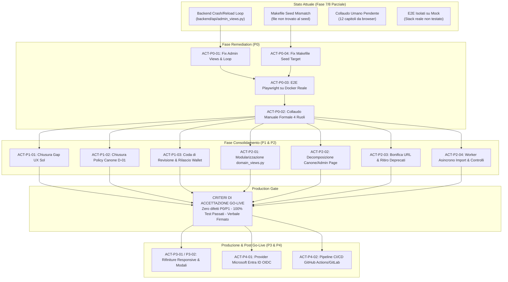
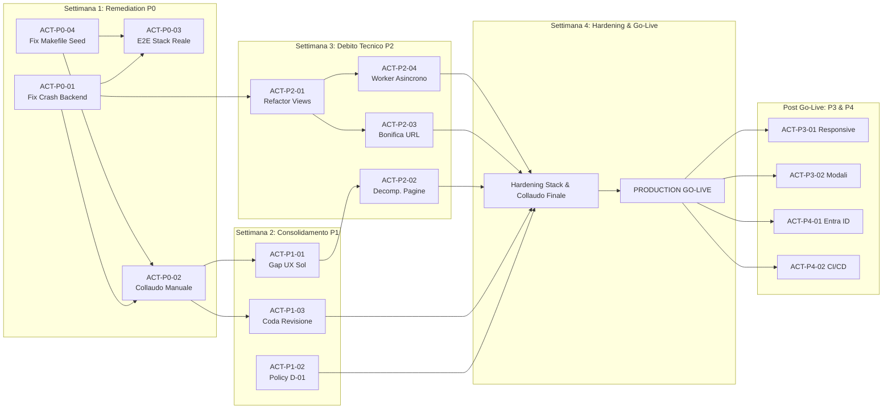

# 15. Operational Completion Roadmap (Go-Live Plan)

> **Documento**: `docs/assestmant/15_COMPLETION_ROADMAP.md`  
> **Progetto**: Supplier Ledger (Consuntivazione, Wallet & Canone Fornitore)  
> **Stato Roadmap**: `DEFINED` / `OPERATIONAL`  
> **Data Baseline**: 2026-10-28  
> **Autore**: Assessment Team (Specialized Assessment Writer)  
> **Riferimenti Chiave**: [`01_REPOSITORY_INVENTORY.md`](01_REPOSITORY_INVENTORY.md), [`05_TECHNICAL_ARCHITECTURE.md`](05_TECHNICAL_ARCHITECTURE.md), [`07_API_CATALOG.md`](07_API_CATALOG.md), [`08_BUSINESS_RULES.md`](08_BUSINESS_RULES.md), [`09_SECURITY_AUTHORIZATION.md`](09_SECURITY_AUTHORIZATION.md), [`12_DEPLOYMENT_OPERATIONS.md`](12_DEPLOYMENT_OPERATIONS.md)

---

## 1. Executive Summary della Roadmap

La presente **Roadmap Operativa di Completamento** definisce la traiettoria tecnica, procedurale e temporale per condurre la piattaforma **Supplier Ledger** dallo stato parziale post-Fase 7/UX Redesign al rilascio ufficiale in ambiente di produzione (**Production Go-Live**).

L'audit statico globale del repository ha evidenziato una solida architettura di base (backend Django 5.1 con PostgreSQL 16 e frontend React 18 in TypeScript con Tailwind CSS), un motore contabile rigoroso su ledger a doppia imputazione e un sistema di autorizzazioni granulare basato su capability. Tuttavia, il passaggio in produzione è attualmente precluso da un numero circoscritto di **bloccanti critici** (loop di riavvio del container backend locale, assenza di validazione manuale formale umana da browser, test E2E eseguiti parzialmente o con fixture isolate e disallineamenti nelle procedure di caricamento del seed) e da **debiti tecnici e funzionali** che minano la scalabilità e la manutenibilità futura.



### Criteri di Prioritizzazione (Triage Framework)

Ogni attività del backlog è classificata in base a una severità rigorosa orientata al rischio di business e all'integrità operativa:

*   **P0 - Go-Live Blockers (Bloccanti Produzione)**: Difetti architetturali, crash di sistema, disallineamenti di configurazione o assenze di collaudo che impediscono il deployment, compromettono la stabilità dei container o invalidano l'integrità contabile dei dati. Nessun rilascio può avvenire in presenza di un solo ticket P0 aperto.
*   **P1 - Funzionalità Incomplete / Parziali ad Alto Valore**: Flussi di business centrali non terminati, decisioni contabili aperte (es. policy fine periodo canone) o gap evidenti nell'esperienza utente operativa che espongono a rischi di errore umano o discrepanze di bilancio.
*   **P2 - Debito Tecnico Strutturale e Manutenibilità**: File monolitici di dimensioni critiche (>50 KB), endpoint duplicati o deprecati, elaborazioni sincrone pesanti esposte a timeout HTTP. Da indirizzare per garantire sostenibilità e facilità di estensione del ciclo di vita del software.
*   **P3 - Rifiniture UX, Accessibilità e Coerenza Visiva**: Ottimizzazione del layout su risoluzioni ridotte (tablet/1024x768), gestione avanzata del focus nei dialoghi e raffinamento visivo delle componenti atomiche.
*   **P4 - Evoluzioni Future e Ottimizzazioni**: Integrazione con l'Identity Provider federato aziendale (Microsoft Entra ID OIDC) e automazione completa delle pipeline di Continuous Integration & Continuous Delivery (CI/CD).

### Criteri di Prontezza al Go-Live (Go/No-Go Gate Criteria)

Il passaggio formale in produzione richiede il soddisfacimento congiunto dei seguenti 6 gate:
1. **Gate Stabilità Stack**: Avvio dello stack Docker (`db`, `backend`, `frontend`, `nginx`) con status `healthy` e zero loop di crash per oltre 72 ore consecutive.
2. **Gate Integrità Dati**: Esecuzione pulita di `make seed` sul dataset v4 ufficiale ([`data/seed/seed_imola_v4_2026-10-09.json`](../../data/seed/seed_imola_v4_2026-10-09.json)) con riconciliazione contabile bit-a-bit e quadratura dei KPI.
3. **Gate Suite E2E Reale**: 100% di esiti positivi su tutti gli spec Playwright eseguiti contro lo stack Nginx + Gunicorn reale, senza intercettazioni mockate lato client.
4. **Gate Collaudo Umano**: Approvazione e firma formale della checklist dei 12 capitoli operativi ([`docs/MANUAL_VALIDATION_FASE7.md`](../../docs/MANUAL_VALIDATION_FASE7.md)) da parte degli utenti rappresentativi dei 4 ruoli applicativi.
5. **Gate Sicurezza e Audit**: Verifica del blocco totale all'eliminazione dell'ultimo amministratore, integrità della tabella di audit immutabile e test di penetrazione di base su endpoint protetti.
6. **Gate Ripristino di Emergenza**: Esecuzione con successo di una simulazione di backup e restore completo (`make backup` / `make reset` / restore) con verifica della consistenza dei dati ripristinati.

---

## 2. Backlog Analitico delle Attività di Completamento

### P0 - BLOCCANTI GO-LIVE (Go-Live Blockers)

---

#### ACT-P0-01: Risoluzione del crash/loop di riavvio del backend su `admin_views.py`
*   **ID**: `ACT-P0-01`
*   **Priorità**: `P0`
*   **Titolo**: Investigazione e risoluzione del crash/loop di riavvio del container backend Django
*   **Descrizione Operativa**:
    Identificare la causa radice del crash continuo del container backend Docker documentato in [`outputs/SOL_UX_GAP_ANALYSIS.md#L21`](../../outputs/SOL_UX_GAP_ANALYSIS.md#L21) (ticket `SOL-BE`) e [`outputs/UX_REDESIGN_FINAL_REPORT.md#L31`](../../outputs/UX_REDESIGN_FINAL_REPORT.md#L31). Il problema riguarda modifiche pregresse e importazioni circolari o eccezioni a livello di modulo nel file [`backend/api/admin_views.py`](../../backend/api/admin_views.py) (es. invocazioni di `apps.get_models()` o dipendenze cross-app prima che il Django Registry sia completamente popolato, oppure fallimenti silenziosi nei metodi di dry-run degli import batch). Bonificare il codice per garantire avvio stabile del processo Gunicorn/Uvicorn sia in ambiente Docker Compose che nello sviluppo locale.
*   **Motivazione Architetturale o di Business**:
    Un container backend instabile impedisce qualsiasi esecuzione di test end-to-end su stack reale, blocca le API amministrative e rende impossibile l'erogazione del servizio in ambiente di collaudo o produzione.
*   **File e Componenti Coinvolti**:
    *   `backend/api/admin_views.py` (funzioni `_has_domain_references`, `SeedImportView`, `PpmImportView`, `AdminDataResetView`)
    *   `backend/core/apps.py` e `backend/api/apps.py` (inizializzazione delle app)
    *   `deploy/entrypoint.sh` e `deploy/Dockerfile.backend` (gestione del comando di bootstrap e migrazione)
*   **Dipendenze**: Nessuna (attività primaria bloccante).
*   **Criteri di Accettazione (DoD)**:
    1. Il container `backend` si avvia con comando `docker compose up -d backend` e permane nello stato `healthy` senza riavvii (`restarting`) per almeno 1 ora.
    2. La probe di healthcheck `curl -fsS http://localhost:8000/health` risponde con HTTP 200 `{"status": "ok"}`.
    3. Le API esposte da `admin_views.py` (es. `GET /api/v1/admin/users`, `GET /api/v1/admin/imports`) rispondono regolarmente agli utenti autenticati con ruolo Admin.
    4. Nessun warning o traceback critico compare nei log di Gunicorn (`docker compose logs backend`).
*   **Test Richiesti**:
    *   *Unit/Integration*: Test di import del modulo `from api.admin_views import *` senza sollevare `AppRegistryNotReady` o `ImportError`.
    *   *E2E Reale*: Esecuzione di `GET /health` e `POST /api/v1/auth/login` contro il backend in container.
*   **Evidenza Attesa**: Log di startup di Docker privo di crash loop; output di `docker compose ps` con status `Up (healthy)`.

---

#### ACT-P0-02: Validazione manuale formale umana da browser sui 12 capitoli di collaudo
*   **ID**: `ACT-P0-02`
*   **Priorità**: `P0`
*   **Titolo**: Esecuzione e verbalizzazione della validazione manuale formale umana da browser (Fase 7)
*   **Descrizione Operativa**:
    Condurre una sessione formale di verifica utente da interfaccia grafica browser (Chrome/Edge/Firefox) seguendo pedissequamente i 12 capitoli predisposti nel documento [`docs/MANUAL_VALIDATION_FASE7.md`](../../docs/MANUAL_VALIDATION_FASE7.md). La verifica deve essere condotta con i 4 profili demo deterministici (`demo_admin`, `demo_responsabile`, `demo_referente`, `demo_fornitore`) con password `Demo-Local-2026!`, verificando il rispetto delle capability per ciascun ruolo su:
    1. Login Admin
    2. Login Responsabile BMED
    3. Login Referente BMED
    4. Login Fornitore (Imola)
    5. Navigazione Dashboard e riepiloghi
    6. Filtri e selezione nella Lista Progetti
    7. Navigazione delle schede nel Dettaglio Progetto (Panoramica, Consuntivi, Wallet, Milestone, Residuo, Anomalie, Documenti)
    8. Consultazione situazione economica e flussi Wallet
    9. Ispezione filtri e gestione nella Coda Anomalie
    10. Ispezione della Coda di Revisione progetti
    11. Visualizzazione prospetto Riconciliazione gestionale vs PPM
    12. Consultazione dello Storico Modifiche (Audit) nel Dettaglio Progetto
*   **Motivazione Architetturale o di Business**:
    Le verifiche automatizzate non sostituiscono il collaudo umano formale obbligatorio per l'accettazione bancaria da parte del Responsabile BMED. Garantisce che i flussi utente rispecchino le aspettative operative e che non vi siano regressioni visive bloccanti.
*   **File e Componenti Coinvolti**:
    *   Tutte le viste frontend (`frontend/src/features/*`)
    *   Dataset demo generato da `python manage.py load_demo_data --run-checks`
    *   Documento di verbalizzazione [`docs/MANUAL_VALIDATION_FASE7.md`](../../docs/MANUAL_VALIDATION_FASE7.md)
*   **Dipendenze**: `ACT-P0-01`, `ACT-P0-04`.
*   **Criteri di Accettazione (DoD)**:
    1. Tutte le 12 checkbox di `docs/MANUAL_VALIDATION_FASE7.md` contrassegnate come superate (`[x]`).
    2. Compilazione della sezione "Esito" con data, nome del verificatore umano, browser utilizzato e note operative.
    3. Zero errori Javascript non gestiti nella console degli strumenti di sviluppo durante l'intera navigazione.
*   **Test Richiesti**:
    *   *Browser Manuale*: Sessione end-to-end su ciascun capitolo eseguita da un operatore umano.
*   **Evidenza Attesa**: File `docs/MANUAL_VALIDATION_FASE7.md` aggiornato con le spunte di collaudo e firmato digitalmente o con attribuzione formale.

---

#### ACT-P0-03: Esecuzione e superamento della suite E2E Playwright completa su stack reale Docker
*   **ID**: `ACT-P0-03`
*   **Priorità**: `P0`
*   **Titolo**: Esecuzione della suite di test E2E Playwright contro lo stack reale Docker (senza mock)
*   **Descrizione Operativa**:
    Eseguire la suite end-to-end con Playwright ([`frontend/e2e/`](../../frontend/e2e)) direttamente contro il reverse proxy Nginx (`http://localhost:8080`) e il backend Django WSGI reale, avvalendosi del comando ufficiale `make e2e` o invocando Playwright nel container frontend. Eliminare l'utilizzo di script isolati o mock fixtures (`ux_preview_workspace.mjs`) per le asserzioni critiche di sistema. Verificare specificamente:
    *   `phase3.spec.ts` (navigazione e filtri base)
    *   `phase4.spec.ts` (motore anomalie e controlli automatici)
    *   `phase6.spec.ts` (riconciliazione PPM e importazioni)
    *   `phase7_admin_delete_db.spec.ts` (token di reset dati e sicurezza)
    *   `phase7_projects_edit.spec.ts` (modifica progetti e validazione date)
    *   `phase7_wallet_edit.spec.ts` (allocazioni wallet FIFO e aggiustamenti)
*   **Motivazione Architetturale o di Business**:
    Garantire che l'interazione sincrona tra browser, reverse proxy, frontend React compilato, sessioni Django e database PostgreSQL non introduca ritardi, errori di deserializzazione o problemi di concorrenza prima del rilascio.
*   **File e Componenti Coinvolti**:
    *   `frontend/e2e/*.spec.ts`
    *   `frontend/playwright.config.ts`
    *   `Makefile` (target `e2e`)
    *   `docker-compose.yml`
*   **Dipendenze**: `ACT-P0-01`, `ACT-P0-04`.
*   **Criteri di Accettazione (DoD)**:
    1. Tutti gli scenari E2E Playwright superati con esito positivo (`passed`) senza retry dovuti a flakiness di rete.
    2. Creazione del report Playwright ufficiale HTML/JSON attestante il superamento al 100%.
    3. Nessuna chiamata API simulata o stubbata lato client durante il test.
*   **Test Richiesti**:
    *   *E2E Reale*: Esecuzione di `npx playwright test` contro `http://localhost:8080`.
*   **Evidenza Attesa**: Report di esecuzione Playwright (`playwright-report/index.html`) con 100% test verdi.

---

#### ACT-P0-04: Bonifica della discrepanza Makefile / dataset seed
*   **ID**: `ACT-P0-04`
*   **Priorità**: `P0`
*   **Titolo**: Allineamento del target `make seed` al file seed v4 ufficiale (`seed_imola_v4_2026-10-09.json`)
*   **Descrizione Operativa**:
    Correggere la discrepanza rilevata nel [`Makefile#L3`](../../Makefile#L3) e [`Makefile#L34`](../../Makefile#L34), dove la variabile `SEED` fa riferimento al percorso inesistente `/srv/seed/seed_imola_2026-10-16.json`, provocando il fallimento immediato del comando `make seed`. Aggiornare la variabile predefinita e i messaggi di help al dataset effettivo più recente presente nel repository: `data/seed/seed_imola_v4_2026-10-09.json` (o percorso container `/srv/seed/seed_imola_v4_2026-10-09.json`). Aggiornare contestualmente i commenti nel `Makefile` e nella documentazione di deployment.
*   **Motivazione Architetturale o di Business**:
    Il comando `make seed` rappresenta la procedura standard di provisioning per riprodurre lo stato contabile aziendale. L'attuale puntamento a un file inesistente blocca l'allestimento di nuovi nodi applicativi o container di collaudo.
*   **File e Componenti Coinvolti**:
    *   [`Makefile`](../../Makefile#L3-L38)
    *   `data/seed/seed_imola_v4_2026-10-09.json`
    *   Documentazione in [`docs/assestmant/12_DEPLOYMENT_OPERATIONS.md`](12_DEPLOYMENT_OPERATIONS.md)
*   **Dipendenze**: Nessuna.
*   **Criteri di Accettazione (DoD)**:
    1. Esecuzione di `make seed-dry` completa con successo mostrando il report di simulazione del seed v4.
    2. Esecuzione di `make seed` importa tutti i 10 dataset senza sollevare errori di file non trovato (`FileNotFoundError`).
    3. Il conteggio finale dei record coincide esattamente con i dati attesi (26 progetti, 24 allocazioni wallet 2026, 6 allocazioni storiche 2025, 2 semestri canone).
*   **Test Richiesti**:
    *   *Integration*: Esecuzione di `python manage.py import_seed data/seed/seed_imola_v4_2026-10-09.json --dry-run`.
*   **Evidenza Attesa**: Log di output del comando `make seed` che attesta l'importazione completata con hash SHA-256 validato.

---

### P1 - FUNZIONALITÀ INCOMPLETE / PARZIALI

---

#### ACT-P1-01: Chiusura dei gap del redesign UX Premium evidenziati da Sol
*   **ID**: `ACT-P1-01`
*   **Priorità**: `P1`
*   **Titolo**: Chiusura dei gap operativi UX/UI identificati nell'audit Sol
*   **Descrizione Operativa**:
    Completare l'implementazione delle correzioni UX/UI rimaste in stato `NOT_STARTED` nel documento [`outputs/SOL_UX_GAP_ANALYSIS.md`](../../outputs/SOL_UX_GAP_ANALYSIS.md):
    *   *SOL-03 (Import)*: Invalidare immediatamente l'anteprima (preview) e disabilitare il pulsante di conferma ("Applica Importazione") quando l'utente sostituisce o seleziona un file diverso rispetto a quello per cui è stato calcolato l'hash di dry-run.
    *   *SOL-04 (Organico Allargato)*: Riorganizzare la scheda Organico Allargato isolando i form di inserimento all'interno di sezioni collassabili o drawer dedicati; azzerare lo stato dei form al cambio di canone selezionato per evitare sovrascritture incrociate di consuntivi.
    *   *SOL-05 (Wallet Drawer)*: Trasformare il pannello di dettaglio dell'allocazione wallet da colonna affiancata (che restringe la tabella dei residui e causa overflow a 1024px) in un Drawer modale accessibile conforme a Radix UI, preservando i calcoli FIFO e l'input cumulativo.
    *   *SOL-06 (Feedback Eccezioni)*: Sostituire i messaggi di errore generici nella Coda Anomalie e nella Coda di Revisione con toast informativi e alert contestuali che riportino l'errore reale restituito dalle API Django REST Framework, abilitando pulsanti di retry e stati di caricamento per-azione (`isSubmitting`).
*   **Motivazione Architetturale o di Business**:
    Migliora radicalmente l'usabilità operativa per i responsabili di spesa e previene errori critici di inserimento dati (es. conferma di un file differente da quello simulato o inserimento di consuntivi canone su attività errate).
*   **File e Componenti Coinvolti**:
    *   `frontend/src/features/admin/AdminPage.tsx` (sezione import)
    *   `frontend/src/features/canone/CanonePage.tsx`
    *   `frontend/src/features/wallet/WalletPage.tsx`
    *   `frontend/src/features/anomalie/AnomaliePage.tsx`
    *   `frontend/src/features/revisione/RevisionePage.tsx`
*   **Dipendenze**: `ACT-P0-01`.
*   **Criteri di Accettazione (DoD)**:
    1. Cambiando file nell'input di import, la tabella di preview scompare e il pulsante "Conferma" si disabilita fino a nuovo dry-run.
    2. La navigazione tra canoni H1 e H2 azzera correttamente i campi di input dei consuntivi.
    3. Il drawer del wallet si apre a comparsa laterale, supporta la chiusura con `Escape` e non produce overflow orizzontale della pagina a 1024x768.
    4. Le azioni di deroga anomalia o conferma revisione mostrano spinner di caricamento e visualizzano il payload dell'errore HTTP in caso di fallimento.
*   **Test Richiesti**:
    *   *Frontend Unit*: Test Vitest sui componenti di import e sul drawer wallet (`npm run test`).
    *   *Browser Test*: Ispezione visiva su risoluzione 1024x768 e 1440x900.
*   **Evidenza Attesa**: Suite Vitest superata; screenshot di verifica visiva in `outputs/visual-review/`.

---

#### ACT-P1-02: Gestione formalizzata delle giornate di canone non utilizzate a fine periodo (Decisione D-01)
*   **ID**: `ACT-P1-02`
*   **Priorità**: `P1`
*   **Titolo**: Chiusura della Decisione Architetturale D-01: policy e logica per le giornate di canone non consuntivate
*   **Descrizione Operativa**:
    Formalizzare la risoluzione della decisione architetturale aperta [`docs/DECISIONI_APERTE.md#D-01`](../../docs/DECISIONI_APERTE.md#L28-L35). Definire e implementare d'intesa con il committente BMED la regola di chiusura contabile del semestre di canone:
    1. *Politica Standard (Decadenza)*: Se a fine semestre rimangono giornate non consuntivate, esse decadono contabilmente e non transitano nel wallet. Il sistema marca il semestre come "CONSOLIDATO_CHIUSO", congelando il consuntivo effettivo e valorizzando l'indicatore di sotto-utilizzo canone.
    2. *Politica di Recupero (Rollover Opzionale)*: Qualora autorizzato formalmente dal Responsabile BMED, predisporre una funzione amministrativa transazionale per generare una tranche di accredito eccezionale nel wallet dell'anno successivo con causale `RECUPERO_CANONE_<SEMESTRE>`, tracciata rigorosamente nell'Audit Log.
    3. Aggiornare il modulo [`backend/domain/canone_status.py`](../../backend/domain/canone_status.py) e il check automatico [`backend/domain/checks/canone_underuse.py`](../../backend/domain/checks/canone_underuse.py) per riflettere lo stato immutabile dei canoni archiviati.
*   **Motivazione Architetturale o di Business**:
    Evita ambiguità legali e contabili tra committente e fornitore su somme ingenti a fine anno (il monte canone annuale ammonta a centinaia di giornate/persona) e impedisce che anomalie di sotto-utilizzo rimangano permanentemente aperte su semestri passati.
*   **File e Componenti Coinvolti**:
    *   [`backend/domain/canone_status.py`](../../backend/domain/canone_status.py)
    *   [`backend/domain/checks/canone_underuse.py`](../../backend/domain/checks/canone_underuse.py)
    *   `backend/canone/models.py` (eventuale stato di consolidamento `is_finalized`)
    *   [`docs/DECISIONI_APERTE.md`](../../docs/DECISIONI_APERTE.md)
*   **Dipendenze**: Nessuna.
*   **Criteri di Accettazione (DoD)**:
    1. Documento `docs/DECISIONI_APERTE.md` aggiornato con lo stato `RISOLTA` per la decisione D-01, recante la data di approvazione BMED.
    2. Su un semestre con data di fine superata, il calcolo di forecast si arresta e il consuntivo totale rimane immutabile.
    3. L'anomalia `CHK_CANONE_UNDERUSE` non viene rigenerata come attiva per i semestri archiviati se la discrepanza è stata verbalizzata.
*   **Test Richiesti**:
    *   *Unit Backend*: Test di calcolo in `backend/tests/test_canone.py` per semestri conclusi nel passato.
*   **Evidenza Attesa**: Suite di test backend passata; documentazione aggiornata in `docs/DECISIONI_APERTE.md`.

---

#### ACT-P1-03: Completamento della Coda di Revisione e rilascio del credito a wallet
*   **ID**: `ACT-P1-03`
*   **Priorità**: `P1`
*   **Titolo**: Finalizzazione del workflow di Coda di Revisione e sblocco crediti spendibili
*   **Descrizione Operativa**:
    Completare l'integrazione del flusso della **Coda di Revisione** ([`docs/DECISIONI_APERTE.md#D-03`](../../docs/DECISIONI_APERTE.md#L47-L70)) che raccoglie i 12 progetti con residui da verificare (3 progetti `CHIUSO` senza data effettiva e 9 progetti con stato `DA_VERIFICARE`).
    Implementare l'azione transazionale completa tramite l'endpoint `POST /api/v1/projects/<uuid:pk>/validate-closure`:
    1. L'utente con ruolo Responsabile o Admin inserisce o conferma la data di chiusura effettiva (`data_chiusura_consuntivazione`).
    2. Il sistema convalida che non vi siano consuntivi registrati con data successiva alla data di chiusura.
    3. Il residuo definitivo (`budget_days - consumed_days`) viene calcolato e congelato.
    4. Viene sbloccata la creazione o l'attivazione della quota nel wallet dell'anno di competenza (`WalletSourceLot`), trasformando il residuo da "potenziale da verificare" a "credito spendibile ufficiale".
    5. Viene contestualmente risolta l'anomalia automatica `CHK_UNVERIFIED_DATA` associata al progetto.
*   **Motivazione Architetturale o di Business**:
    Nel dataset di produzione esistono decine di giornate/uomo bloccate come crediti potenziali. Senza questo flusso operativo, l'azienda non può utilizzare i residui maturati per finanziare nuove attività a wallet.
*   **File e Componenti Coinvolti**:
    *   [`backend/domain/residuals.py`](../../backend/domain/residuals.py)
    *   [`backend/api/domain_views.py`](../../backend/api/domain_views.py) (viste `ProjectReviewQueueView`, `ProjectValidateClosureView`, `ProjectConfirmReviewView`)
    *   `frontend/src/features/revisione/RevisionePage.tsx`
*   **Dipendenze**: `ACT-P0-01`.
*   **Criteri di Accettazione (DoD)**:
    1. La schermata `/revisione` permette al responsabile di confermare la data di chiusura proposta o di modificarla.
    2. La conferma genera una chiamata con esito HTTP 200 che rimuove immediatamente il progetto dalla Coda di Revisione.
    3. Il credito residuo compare tra le fonti disponibili nella schermata `/wallet` dell'anno di riferimento.
    4. Viene creata una riga di audit nell'audit log di progetto con le coordinate dell'operazione.
*   **Test Richiesti**:
    *   *Integration Backend*: Test in `backend/tests/test_review_queue.py` e `backend/tests/test_closure_validation.py`.
    *   *E2E Reale*: Test di validazione chiusura progetto e verifica incremento capienza wallet.
*   **Evidenza Attesa**: Test `test_review_queue.py` superato con copertura 100% sui casi limite; verbale di audit salvato a DB.

---

### P2 - DEBITO TECNICO RILEVANTE

---

#### ACT-P2-01: Refactoring modulare del file monolitico `domain_views.py`
*   **ID**: `ACT-P2-01`
*   **Priorità**: `P2`
*   **Titolo**: Scomposizione del file monolitico `backend/api/domain_views.py` (94 KB) in package modulare
*   **Descrizione Operativa**:
    Il file [`backend/api/domain_views.py`](../../backend/api/domain_views.py) ha raggiunto dimensioni insostenibili (94.449 byte, oltre 2.300 righe di codice), concentrando logiche di presentazione e serializzazione eterogenee.
    Ristrutturare l'architettura creando il package `backend/api/views/` con moduli specializzati per dominio funzionale:
    *   `backend/api/views/project_views.py`: `ProjectListCreateView`, `ProjectFormOptionsView`, `ProjectBalancesView`, `ProjectLedgerView`, `ProjectTimesheetDetailView`, `ProjectDetailUpdateView`, `ProjectConfirmReviewView`, `ProjectValidateClosureView`, `ProjectReviewQueueView`.
    *   `backend/api/views/wallet_views.py`: `WalletBalanceView`, `WalletFlowView`, `WalletAssigneeSummaryView`, `WalletAllocationCreateView`, `WalletAllocationOptionsView`, `WalletAllocationDetailUpdateView`, `WalletAllocationAdjustView`.
    *   `backend/api/views/canone_views.py`: `CanoneListView`, `CanoneDetailView`, `CanoneSubactivityListView`, `CanoneSubactivityDetailView`, `CanoneSubactivityTimesheetListView`, `CanoneSubactivityTimesheetDetailView`, `CanoneStatusView`.
    *   `backend/api/views/anomaly_views.py`: `AnomalyListView`, `ChecksRunView`, `AnomalyActionView`.
    *   `backend/api/views/export_views.py`: `ExportJsonView`, `ExportCsvView`, `ExportExcelView`.
    *   `backend/api/views/common_views.py`: `SettingsView`, `CostAnalysisView`, `DashboardView`, `CommandSearchView`, `AuditHistoryView`.
    Mantenere un file `backend/api/domain_views.py` minimale come proxy di re-export (backward compatibility) per evitare rotture nelle importazioni dei test esistenti prima del loro reindirizzamento.
*   **Motivazione Architetturale o di Business**:
    Migliora la manutenibilità del codice, riduce drasticamente i conflitti di merge tra sviluppatori paralleli e velocizza la navigazione statica dell'IDE e l'analisi con linter/type checker.
*   **File e Componenti Coinvolti**:
    *   [`backend/api/domain_views.py`](../../backend/api/domain_views.py)
    *   `backend/api/views/*.py` (nuovo package)
    *   [`backend/api/urls.py`](../../backend/api/urls.py)
*   **Dipendenze**: `ACT-P0-01`.
*   **Criteri di Accettazione (DoD)**:
    1. Nessun modulo nella cartella `backend/api/views/` supera i 25 KB di dimensione.
    2. Tutti i test della suite backend (`pytest backend/`) passano con esito positivo senza regressioni.
    3. Il routing in `backend/api/urls.py` importa le classi direttamente dal nuovo package.
    4. Ruff, Black e MyPy superati con zero errori.
*   **Test Richiesti**:
    *   *Unit/Regression Backend*: `pytest backend/` (29 file di test, oltre 230 test).
*   **Evidenza Attesa**: Output di `pytest` verde al 100%; scansione MyPy priva di errori di tipo.

---

#### ACT-P2-02: Decomposizione dei componenti frontend oversize `CanonePage.tsx` e `AdminPage.tsx`
*   **ID**: `ACT-P2-02`
*   **Priorità**: `P2`
*   **Titolo**: Scomposizione dei componenti React monolitici `CanonePage.tsx` (52 KB) e `AdminPage.tsx` (42 KB)
*   **Descrizione Operativa**:
    I componenti di pagina [`frontend/src/features/canone/CanonePage.tsx`](../../frontend/src/features/canone/CanonePage.tsx) (1.181 righe, 52.258 byte) e [`frontend/src/features/admin/AdminPage.tsx`](../../frontend/src/features/admin/AdminPage.tsx) (1.165 righe, 42.759 byte) violano il principio di singola responsabilità (SRP), accorpando renderizzazione di grafici, modali, schede multiple, gestione di form e logica di rete.
    Decomporre i file in sub-componenti atomici dedicati:
    *   *Canone*:
        *   `features/canone/components/CanoneHeader.tsx` (selettore semestre, badge di stato)
        *   `features/canone/components/CanoneKpiGrid.tsx` (card metriche consumato/monte/forecast)
        *   `features/canone/components/CanoneCapacitySection.tsx` (gestione delle quote uffici EA/SA/TA)
        *   `features/canone/components/CanoneSubactivityTable.tsx` (griglia attività e consuntivi)
        *   `features/canone/components/CanoneTimesheetDrawer.tsx` (drawer inserimento consuntivo)
        *   `features/canone/components/CanoneBurndownChart.tsx` (grafico Recharts)
    *   *Admin*:
        *   `features/admin/components/AdminUsersTab.tsx` (elenco utenti, cambio ruoli, password)
        *   `features/admin/components/AdminReferentsTab.tsx` (anagrafica referenti BMED/Imola)
        *   `features/admin/components/AdminPrivilegesTab.tsx` (matrice capability per ruolo)
        *   `features/admin/components/AdminImportsTab.tsx` (upload seed/PPM, storico batch, dataset)
        *   `features/admin/components/AdminResetDataTab.tsx` (dialogo di sicurezza reset transazionale)
*   **Motivazione Architetturale o di Business**:
    Riduce il re-rendering superfluo del Virtual DOM, migliora le performance percepite su browser a risorse limitate, isola lo stato dei form e consente il test unitario mirato dei singoli componenti visivi.
*   **File e Componenti Coinvolti**:
    *   [`frontend/src/features/canone/CanonePage.tsx`](../../frontend/src/features/canone/CanonePage.tsx)
    *   [`frontend/src/features/admin/AdminPage.tsx`](../../frontend/src/features/admin/AdminPage.tsx)
    *   Cartelle `frontend/src/features/canone/components/` e `frontend/src/features/admin/components/`
*   **Dipendenze**: `ACT-P1-01`.
*   **Criteri di Accettazione (DoD)**:
    1. Ciascun sub-componente creato ha una dimensione inferiore a 15 KB (max 300 righe).
    2. Le pagine container (`CanonePage.tsx` e `AdminPage.tsx`) fungono esclusivamente da orchestratori di layout e query React Query.
    3. Nessuna regressione funzionale o visiva nel comportamento delle schede.
    4. La suite di test Vitest (`npm run test`) passa con esito positivo al 100%.
*   **Test Richiesti**:
    *   *Frontend Unit*: Test Vitest per ciascun nuovo sub-componente isolato.
    *   *Build*: `npm run build` ed `npm run lint` senza errori.
*   **Evidenza Attesa**: Report Vitest con copertura aumentata; bundle size analizzato da Vite senza avvisi di chunk oversize.

---

#### ACT-P2-03: Bonifica degli endpoint URL duplicati e rimozione dell'endpoint deprecato
*   **ID**: `ACT-P2-03`
*   **Priorità**: `P2`
*   **Titolo**: Bonifica del routing API, rimozione endpoint deprecati e consolidamento trailing-slash
*   **Descrizione Operativa**:
    In [`backend/api/urls.py`](../../backend/api/urls.py) coesistono configurazioni ridondanti e percorsi legacy che creano confusione nello schema OpenAPI:
    1. *Rimozione Endpoint Deprecato*: Rimuovere la route `projects/<uuid:pk>/release-to-wallet` ([`backend/api/urls.py#L187-L190`](../../backend/api/urls.py#L187-L190)) e la relativa vista [`ReleaseProjectToWalletView`](../../backend/api/domain_views.py#L682-L697) che risponde permanentemente con HTTP 409 `PROJECT_WALLET_RELEASE_DEPRECATED`.
    2. *Consolidamento URL Duplicati*: Eliminare i doppi percorsi alternativi generati per ovviare a inconsistenze di trailing-slash o convenzioni di naming storiche:
       *   `allocations` vs `wallet/allocations`
       *   `allocations/options` vs `wallet/allocation-options`
       *   Rotte con e senza barra finale (`admin/reset-data/`, `canoni/`, `wallet/allocations/<uuid:pk>/`).
       Uniformare lo standard OpenAPI con la configurazione standard di DRF / Django `APPEND_SLASH = False` ed endpoint canonici senza trailing slash.
*   **Motivazione Architetturale o di Business**:
    Uno schema API pulito riduce la superficie di attacco, elimina codice morto e disallineamenti tra documentazione Swagger ([`/api/v1/docs`](../../backend/api/urls.py#L236)) e implementazione client.
*   **File e Componenti Coinvolti**:
    *   [`backend/api/urls.py`](../../backend/api/urls.py)
    *   [`backend/api/domain_views.py`](../../backend/api/domain_views.py)
    *   `frontend/src/lib/api.ts` o client Axios/Fetch del frontend
*   **Dipendenze**: `ACT-P2-01`.
*   **Criteri di Accettazione (DoD)**:
    1. Endpoint `projects/<uuid:pk>/release-to-wallet` eliminato; le chiamate generano HTTP 404 coerente.
    2. Tutte le route delle allocazioni unificate sotto `/api/v1/wallet/allocations`.
    3. Lo schema OpenAPI generato da Spectacular (`/api/v1/schema`) risulta privo di operazioni duplicate.
    4. Tutti i client frontend e i test backend chiamano esclusivamente gli endpoint canonici.
*   **Test Richiesti**:
    *   *Unit/Schema Backend*: `python manage.py spectacular --validate --fail-on-warn`.
    *   *Integration Frontend*: Test di esecuzione API client su tutti i flussi di allocazione.
*   **Evidenza Attesa**: Schema Swagger validato senza warning; route duplicate eliminate.

---

#### ACT-P2-04: Implementazione di uno scheduler / worker asincrono leggero per import pesanti
*   **ID**: `ACT-P2-04`
*   **Priorità**: `P2`
*   **Titolo**: Task runner asincrono leggero per import massivi e motore controlli
*   **Descrizione Operativa**:
    Attualmente, le operazioni di importazione seed/PPM ([`SeedImportView`](../../backend/api/admin_views.py#L55), [`PpmImportView`](../../backend/api/admin_views.py#L93)) e l'esecuzione del motore di controllo regole ([`ChecksRunView`](../../backend/api/domain_views.py#L624)) vengono eseguite in modo sincrono nel ciclo richiesta/risposta HTTP di Django. Con file Excel PPM di grandi dimensioni (>5 MB) o migliaia di righe contabili, l'elaborazione rischia di superare il timeout di Gunicorn (120 secondi) o del reverse proxy Nginx, interrompendo la connessione con errore HTTP 504 Gateway Timeout.
    Implementare un task runner asincrono a basso impatto architetturale, compatibile con i vincoli del NAS Synology (senza obbligo di broker esterni complessi come RabbitMQ):
    *   *Opzione Raccomandata*: Adozione di **Django-Q2** con broker basato su database relazionale PostgreSQL nativo (`ORM broker`).
    *   La vista HTTP avvia il task in background, restituisce immediatamente un `task_id` con stato HTTP 202 Accepted.
    *   Il frontend esegue un polling leggero a intervalli di 1-2 secondi sullo stato di avanzamento (`GET /api/v1/tasks/<task_id>`).
    *   Al completamento, l'utente visualizza il report finale senza aver bloccato il worker HTTP principale.
*   **Motivazione Architetturale o di Business**:
    Evita il congelamento dei worker Gunicorn sotto carico, garantisce resilienza nell'importazione di file PPM storici pesanti e offre un feedback visivo di caricamento fluido e trasparente.
*   **File e Componenti Coinvolti**:
    *   `backend/requirements.txt` (aggiunta `django-q2`)
    *   `backend/config/settings.py` (configurazione `Q_CLUSTER`)
    *   `backend/api/admin_views.py` e `backend/api/domain_views.py`
    *   `docker-compose.yml` (aggiunta processo worker leggero nel container backend)
    *   `frontend/src/features/admin/AdminPage.tsx`
*   **Dipendenze**: `ACT-P0-01`, `ACT-P2-01`.
*   **Criteri di Accettazione (DoD)**:
    1. L'upload di un file PPM con esecuzione di tutti i controlli risponde con HTTP 202 in meno di 500ms.
    2. Il worker in background elabora il file e salva il report nell'entità `ImportBatch`.
    3. Il frontend visualizza una barra di avanzamento e notifica il successo o gli errori riscontrati.
    4. Nessun worker Gunicorn si blocca durante elaborazioni prolungate.
*   **Test Richiesti**:
    *   *Integration Backend*: Test di esecuzione task simulato in background con verifica persistenza DB.
*   **Evidenza Attesa**: Log del worker Django-Q che processa il batch; risposta HTTP 202 con polling funzionante.

---

### P3 - UX, ACCESSIBILITÀ E RIFINITURE

---

#### ACT-P3-01: Completamento della matrice responsive su viewport mobili/tablet (1024x768)
*   **ID**: `ACT-P3-01`
*   **Priorità**: `P3`
*   **Titolo**: Ottimizzazione layout responsive e tabelle dense su viewport tablet (1024x768 e inferiori)
*   **Descrizione Operativa**:
    Completare la matrice responsive evidenziata nel gap `SOL-11` di [`outputs/SOL_UX_GAP_ANALYSIS.md#L17`](../../outputs/SOL_UX_GAP_ANALYSIS.md#L17). Le tabelle contabili dense (Analisi Costi, Progetti, Riconciliazione, Consuntivi Canone) e le toolbar di intestazione presentano problemi di visualizzazione e overflow su schermi da 1024px e 1366px.
    Interventi specifici:
    1. Implementare scrolling orizzontale isolato per il solo contenitore della tabella (`overflow-x-auto`) con intestazioni e prima colonna (Codice Progetto / Identificativo) bloccate (`sticky left-0`).
    2. Riorganizzare i filtri e le toolbar in griglie responsive flessibili (`flex-wrap` / `grid-cols-1 sm:grid-cols-2 md:grid-cols-4`).
    3. Ridurre il padding e la dimensione dei font nelle celle contabili dense mantenendo i requisiti di leggibilità minima.
*   **Motivazione Architetturale o di Business**:
    Garantire la piena usabilità della piattaforma ai responsabili BMED che accedono tramite tablet aziendali o laptop con risoluzione 1366x768 / 1024x768.
*   **File e Componenti Coinvolti**:
    *   `frontend/src/features/costi/CostiPage.tsx`
    *   `frontend/src/features/progetti/ProgettiPage.tsx`
    *   `frontend/src/features/riconciliazione/RiconciliazionePage.tsx`
    *   `frontend/src/components/ui/table.tsx`
*   **Dipendenze**: `ACT-P1-01`.
*   **Criteri di Accettazione (DoD)**:
    1. Nessun overflow orizzontale del documento intero (`window.scrollX === 0`) su risoluzioni 1024x768, 1366x768, 1440x900 e 1920x1080.
    2. Le tabelle consentono lo scroll interno fluido mantenendo la riga visibile.
    3. I pulsanti di azione rimangono cliccabili e visibili senza sovrapposizioni.
*   **Test Richiesti**:
    *   *Browser Test*: Generazione automatizzata di screenshot con Playwright sulle risoluzioni target targettando dark e light mode.
*   **Evidenza Attesa**: Matrice screenshot in `outputs/visual-review/` conforme senza overflow.

---

#### ACT-P3-02: Unificazione dei dialoghi modali e miglioramento gestione focus trap
*   **ID**: `ACT-P3-02`
*   **Priorità**: `P3`
*   **Titolo**: Unificazione dei componenti modali e perfezionamento del Focus Trap (WCAG 2.1 AA)
*   **Descrizione Operativa**:
    Centralizzare tutti i dialoghi modali e le finestre di conferma dell'applicazione sul primitivo standardizzato Radix UI (`@radix-ui/react-dialog`) per risolvere i rilievi `SOL-07` e `SOL-09`.
    *   Garantire che all'apertura del dialogo il focus si sposti automaticamente sul primo elemento interattivo o sul pulsante di conferma.
    *   Introdurre il vincolo di focus trap (`looping`) affinché la navigazione tramite tasto `Tab` non esca dalla finestra modale aperta.
    *   Garantire la chiusura immediata premendo il tasto `Escape`.
    *   Al momento della chiusura, ripristinare il focus esattamente sull'elemento scatenante che aveva aperto il dialogo.
    *   Dotare ciascun modale di attributi ARIA corretti (`aria-labelledby`, `aria-describedby`).
*   **Motivazione Architetturale o di Business**:
    Conformità alle linee guida di accessibilità aziendale (WCAG 2.1 AA) e prevenzione di errori operativi su conferme distruttive (es. reset del database o deroga anomalie).
*   **File e Componenti Coinvolti**:
    *   `frontend/src/components/ui/dialog.tsx`
    *   `frontend/src/features/admin/DeleteDatabaseDialog.tsx`
    *   `frontend/src/features/anomalie/components/DerogaDialog.tsx`
*   **Dipendenze**: `ACT-P1-01`.
*   **Criteri di Accettazione (DoD)**:
    1. Tutti i dialoghi applicativi utilizzano il componente comune `Dialog`.
    2. Test di navigazione con sola tastiera completabile senza perdite di focus.
    3. Audit automatico con tool di accessibilità (Lighthouse / axe-core) privo di violazioni su ruoli e nomi accessibili dei modali.
*   **Test Richiesti**:
    *   *Automated Audit*: `axe-core` eseguito durante i test E2E Playwright.
*   **Evidenza Attesa**: Report di accessibilità senza warning per i componenti modali.

---

### P4 - EVOLUZIONI FUTURE (Post-Go Live)

---

#### ACT-P4-01: Implementazione del provider Microsoft Entra ID OIDC
*   **ID**: `ACT-P4-01`
*   **Priorità**: `P4`
*   **Titolo**: Implementazione del provider di autenticazione federata Microsoft Entra ID (OIDC)
*   **Descrizione Operativa**:
    Completare l'astrazione del provider di autenticazione predisposta nel file [`backend/core/auth/providers.py#L62-L73`](../../backend/core/auth/providers.py#L62-L73) dove la classe `EntraIdOidcProvider` solleva attualmente `NotImplementedError`.
    Implementare l'integrazione OpenID Connect (OIDC) per il Single Sign-On (SSO) con l'Identity Provider di Banca Mediolanum:
    1. Introdurre la libreria standard (es. `authlib` o `mozilla-django-oidc`).
    2. Configurare i parametri Azure/Entra ID: `TENANT_ID`, `CLIENT_ID`, `CLIENT_SECRET`, `AUTHORIZATION_ENDPOINT`, `TOKEN_ENDPOINT`, `JWKS_URI`.
    3. Implementare il flusso Authorization Code Grant con validazione crittografica della firma del JWT ID Token.
    4. Sviluppare il mapping dinamico dai claim dei gruppi Entra ID (`roles` o `groups`) ai ruoli applicativi di Supplier Ledger definiti in [`backend/core/roles.py`](../../backend/core/roles.py) (`Admin`, `Responsabile BMED`, `Referente BMED`, `Fornitore`).
    5. Preservare il provider locale (`LocalSessionProvider`) come fallback di emergenza per manutenzione disconnessa.
*   **Motivazione Architetturale o di Business**:
    Standardizzazione della sicurezza aziendale, eliminazione della gestione locale delle password, revoca centralizzata degli accessi al cambio di mansione o uscita del personale.
*   **File e Componenti Coinvolti**:
    *   [`backend/core/auth/providers.py`](../../backend/core/auth/providers.py)
    *   `backend/api/auth_views.py`
    *   `backend/config/settings.py`
    *   `frontend/src/features/auth/LoginPage.tsx` (aggiunta pulsante "Accedi con Microsoft")
*   **Dipendenze**: Completamento del Go-Live di produzione con provider locale.
*   **Criteri di Accettazione (DoD)**:
    1. Impostando `AUTH_PROVIDER=entra_id` nelle variabili d'ambiente, la schermata di login reindirizza verso il portale Microsoft di Banca Mediolanum.
    2. L'utente autenticato viene automaticamente censito a database e associato ai gruppi/ruoli corretti in base ai token claim.
    3. Logout federato supportato con terminazione sessione su IDP.
*   **Test Richiesti**:
    *   *Unit Backend*: Mock del server OIDC e test di decodifica JWT e mapping ruoli.
    *   *Manual*: Test con sandbox Entra ID Mediolanum.
*   **Evidenza Attesa**: Suite di test backend per il provider OIDC superata; documentazione di configurazione rilasciata.

---

#### ACT-P4-02: Configurazione della pipeline CI/CD per validazione automatizzata
*   **ID**: `ACT-P4-02`
*   **Priorità**: `P4`
*   **Titolo**: Pipeline di Continuous Integration & Continuous Delivery (CI/CD) automatizzata
*   **Descrizione Operativa**:
    Creare le definizioni dichiarative per pipeline CI/CD aziendale (es. `.github/workflows/ci.yml` o `.gitlab-ci.yml` a seconda del server Git enterprise adottato) per automatizzare tutti i controlli di qualità ad ogni push o Pull Request.
    La pipeline deve eseguire in stadi sequenziali/paralleli:
    1. *Stage Backend Lint & Typecheck*: `ruff check .`, `black --check .`, `mypy backend`.
    2. *Stage Frontend Lint & Typecheck*: `npm run lint`, `npx tsc --noEmit`.
    3. *Stage Test Unitari e Integrazione*: `pytest --cov=backend` (gate di copertura minima 80%) e `npm run test -- --run`.
    4. *Stage Build Container*: Verifica della build Docker per tutte le 4 immagini (`db`, `backend`, `frontend`, `nginx`).
    5. *Stage E2E Headless*: Esecuzione automatica dei test Playwright headless contro i container compilati.
*   **Motivazione Architetturale o di Business**:
    Previene l'introduzione involontaria di regressioni nel codice, standardizza il processo di rilascio e garantisce che nessun codice non verificato raggiunga il branch principale di produzione.
*   **File e Componenti Coinvolti**:
    *   `.github/workflows/ci.yml` (o configurazione GitLab)
    *   File di configurazione linter e tester del repository
*   **Dipendenze**: Nessuna.
*   **Criteri di Accettazione (DoD)**:
    1. La pipeline si attiva automaticamente su creazione di PR verso il branch `main`.
    2. La PR viene bloccata dal merge se uno qualsiasi degli stage fallisce.
    3. I tempi di esecuzione complessivi della pipeline rimangono sotto i 10 minuti.
*   **Test Richiesti**:
    *   *CI Execution*: Esecuzione di una run di prova su branch di test con esito positivo su tutti i job.
*   **Evidenza Attesa**: Badge di stato della build visibile nel README del repository; log di run completata con successo.

---

## 3. Matrice di Tracciabilità e Dipendenze

La seguente tabella riassume l'intero catalogo delle attività operative di completamento, specificando l'effort stimato in Story Points (SP, scala Fibonacci) o Giorni Uomo (GG), le componenti architetturali e i requisiti bloccanti:

| ID Attività | Priorità | Titolo Sintetico | Ambito Tecnico | Effort Stimato | Attività Propedeutiche | Gate di Accettazione |
| :--- | :---: | :--- | :--- | :---: | :--- | :--- |
| **ACT-P0-01** | `P0` | Fix Crash/Reload Loop Backend | Backend / Docker | 2 GG (5 SP) | Nessuna | Stabilità container >72h |
| **ACT-P0-04** | `P0` | Fix Makefile Seed Target v4 | Tooling / Script | 0.5 GG (1 SP) | Nessuna | `make seed` 100% OK |
| **ACT-P0-03** | `P0` | E2E Playwright su Docker Reale | Test / E2E | 3 GG (8 SP) | ACT-P0-01, ACT-P0-04 | 100% spec E2E verdi |
| **ACT-P0-02** | `P0` | Validazione Manuale Formale 4 Ruoli | QA / Umano | 2 GG (5 SP) | ACT-P0-01, ACT-P0-04 | 12 capitoli spuntati |
| **ACT-P1-01** | `P1` | Chiusura Gap UX Redesign Sol | Frontend | 4 GG (8 SP) | ACT-P0-01 | Test Vitest & Preview |
| **ACT-P1-02** | `P1` | Risoluzione Policy Canone D-01 | Backend / Business | 1.5 GG (3 SP) | Nessuna | Approvazione BMED |
| **ACT-P1-03** | `P1` | Coda Revisione & Rilascio Wallet | Backend / Frontend | 3 GG (5 SP) | ACT-P0-01 | Test sblocco crediti |
| **ACT-P2-01** | `P2` | Modularizzazione `domain_views.py` | Backend Arch. | 3 GG (5 SP) | ACT-P0-01 | Test suite invariata |
| **ACT-P2-02** | `P2` | Decomposizione Canone/Admin Page | Frontend Arch. | 3 GG (5 SP) | ACT-P1-01 | Test Vitest isolati |
| **ACT-P2-03** | `P2` | Bonifica URL & Ritiro Deprecati | API / Routing | 1 GG (2 SP) | ACT-P2-01 | Validazione OpenAPI |
| **ACT-P2-04** | `P2` | Task Worker Asincrono Import | Backend / Infra | 4 GG (8 SP) | ACT-P0-01, ACT-P2-01 | Polling HTTP 202 OK |
| **ACT-P3-01** | `P3` | Responsive Viewport 1024x768 | Frontend / CSS | 2 GG (3 SP) | ACT-P1-01 | Zero overflow visuale |
| **ACT-P3-02** | `P3` | Unificazione Dialoghi & Focus Trap | Frontend / A11y | 1.5 GG (3 SP) | ACT-P1-01 | WCAG 2.1 AA compliant |
| **ACT-P4-01** | `P4` | Microsoft Entra ID OIDC Provider | Backend / Auth | 5 GG (13 SP) | Post-Go Live | Login federato SSO OK |
| **ACT-P4-02** | `P4` | Pipeline CI/CD Automatizzata | DevOps / Infra | 2 GG (3 SP) | Nessuna | Pipeline verde su PR |



---

## 4. Piano di Rilascio a Fasi e Timeline di Esecuzione

Il rilascio della piattaforma è articolato su un arco temporale di **4 settimane operative** antecedenti la data di Go-Live, seguito da una fase continuativa di evoluzione post-rilascio:

| Fase Operativa | Settimana | Obiettivo Strategico | Attività Incluse | Deliverable Chiave |
| :--- | :---: | :--- | :--- | :--- |
| **Fase 1: Remediation P0** | **Settimana 1** | Eliminazione bloccanti critici, stabilità container, collaudo umano iniziale ed E2E reali. | ACT-P0-01, ACT-P0-04, ACT-P0-03, ACT-P0-02 | Stack Docker stabile, verbale manuale firmato, report Playwright reale. |
| **Fase 2: Consolidamento P1** | **Settimana 2** | Chiusura gap funzionali, perfezionamento UX Sol, quadratura contabile canone e revisione. | ACT-P1-01, ACT-P1-02, ACT-P1-03 | Componenti UX rifiniti, chiusura D-01, workflow revisione completato. |
| **Fase 3: Debito Tecnico P2** | **Settimana 3** | Ristrutturazione architetturale modulare, bonifica API ed elaborazione asincrona. | ACT-P2-01, ACT-P2-02, ACT-P2-03, ACT-P2-04 | Moduli backend snelli, sub-componenti React isolati, OpenAPI pulita. |
| **Fase 4: Hardening & Go-Live** | **Settimana 4** | Stress test, simulazione disaster recovery, freeze del codice e deployment produzione. | Collaudo finale integrato, `make backup`, rilascio | Tag release v1.0.0, deployment su NAS Synology, verbale Go-Live firmato. |
| **Fase Post Go-Live (P3/P4)** | **Q1 2027** | Accessibilità avanzata, federazione identità Microsoft Entra ID e automazione DevOps. | ACT-P3-01, ACT-P3-02, ACT-P4-01, ACT-P4-02 | Single Sign-On aziendale attivo, pipeline CI/CD integrata. |

---

## 5. Protocollo di Collaudo Formale e Procedura di Go-Live

### 5.1 Protocollo di Collaudo Formale (UAT Protocol)

Prima dell'autorizzazione al deployment, deve essere completata la sessione formale di collaudo basata su [`docs/MANUAL_VALIDATION_FASE7.md`](../../docs/MANUAL_VALIDATION_FASE7.md) secondo il seguente protocollo operativo:

1. **Allestimento Ambiente di Staging**:
   * Esecuzione di `make reset` per garantire un database completamente pulito.
   * Esecuzione di `make demo` per iniettare i dati sintetici deterministici e gli account demo.
   * Verifica che lo stack risponda su `http://localhost:8080`.
2. **Sessioni Utente Separate**:
   * Il collaudo deve essere effettuato aprendo finestre del browser in modalità anonima o cancellando i cookie di sessione (`sessionid` e `csrftoken`) ad ogni cambio di ruolo.
   * Ciascun capitolo viene eseguito dall'utente specificato (es. Capitolo 5 Dashboard con `demo_responsabile`, Capitolo 6 Progetti con `demo_referente`, Capitolo 12 Audit con `demo_admin`).
3. **Verbalizzazione**:
   * Ciascun punto della checklist deve essere spuntato esclusivamente a fronte del riscontro positivo del risultato atteso.
   * In caso di anomalia visiva o funzionale, il collaudo viene sospeso e viene aperto un ticket correttivo.

### 5.2 Sequenza di Deployment per il Go-Live in Produzione

Il rilascio in produzione sull'ambiente target (NAS Mediolanum / Synology Container Manager) segue rigorosamente la sequenza descritta in [`docs/assestmant/12_DEPLOYMENT_OPERATIONS.md`](12_DEPLOYMENT_OPERATIONS.md):

```bash
# 1. Accesso alla directory del progetto sul nodo di produzione
cd /volume1/docker/supplier-ledger

# 2. Configurazione sicura del file .env di produzione
cp .env.example .env
# Configurare: DJANGO_SECRET_KEY, POSTGRES_PASSWORD, DJANGO_ALLOWED_HOSTS, SL_DATA_DIR

# 3. Pull o build delle immagini certificate per il rilascio v1.0.0
docker compose build --no-cache

# 4. Avvio dello stack in modalità demone supervisionata
docker compose up -d

# 5. Verifica dello stato dei container e dell'healthcheck
docker compose ps
# Tutti i servizi (db, backend, frontend, nginx) devono riportare "Up (healthy)"

# 6. Caricamento del dataset di produzione ufficiale v4
docker compose run --rm backend python manage.py import_seed /srv/seed/seed_imola_v4_2026-10-09.json

# 7. Esecuzione dei controlli automatici di coerenza contabile
docker compose run --rm backend python manage.py run_checks

# 8. Creazione del primo backup baseline di produzione
docker compose run --rm backend python manage.py backup
```

### 5.3 Piano di Rollback di Emergenza

In caso di fallimento critico del deployment di produzione (es. corruzione dati durante la migrazione o mancata risposta del reverse proxy), si applica il piano di rollback immediato:

1. **Arresto dello Stack**:
   ```bash
   docker compose down
   ```
2. **Ripristino del Database Baseline**:
   Se il database precedente è stato alterato, ripristinare l'ultimo dump valido eseguito prima dell'intervento tramite il comando di restore compresso:
   ```bash
   docker compose run --rm backend python manage.py restore /srv/backups/backup_pre_golive.dump.gz
   ```
3. **Rollback Immagini/Codice**:
   Reindirizzare i tag delle immagini Docker alla versione stabile precedente (`v0.8-stable`) o ripristinare il commit validato.
4. **Riavvio dei Servizi e Notifica**:
   Riavviare i container (`docker compose up -d`) e verificare la disponibilità del servizio su porta 8080. Comunicare formalmente l'annullamento della finestra di rilascio.

---

## 6. Conclusioni e Monitoraggio Post-Rilascio

L'adozione della presente roadmap fornisce al team di ingegneria e alla committenza un quadro operativo inequivocabile per portare **Supplier Ledger** dallo stato attuale di prototipo avanzato a quello di **sistema di contabilità gestionale di classe enterprise**.

Con l'esecuzione delle attività P0 nella Settimana 1 e il consolidamento del debito tecnico nelle Settimane 2-3, l'applicazione raggiungerà i livelli di integrità, robustezza e conformità necessari per operare come fonte di verità condivisa per la consuntivazione delle commesse, il monitoraggio del monte canone e la trasparenza finanziaria del portafoglio fornitori.

---

*Documento completato e referenziato conformemente agli standard di assessment di Supplier Ledger.*
