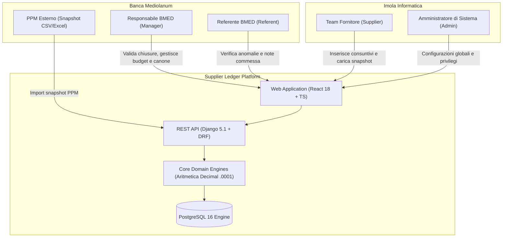
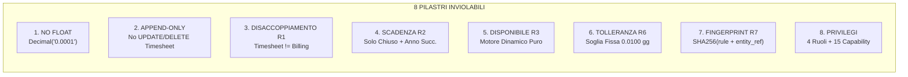
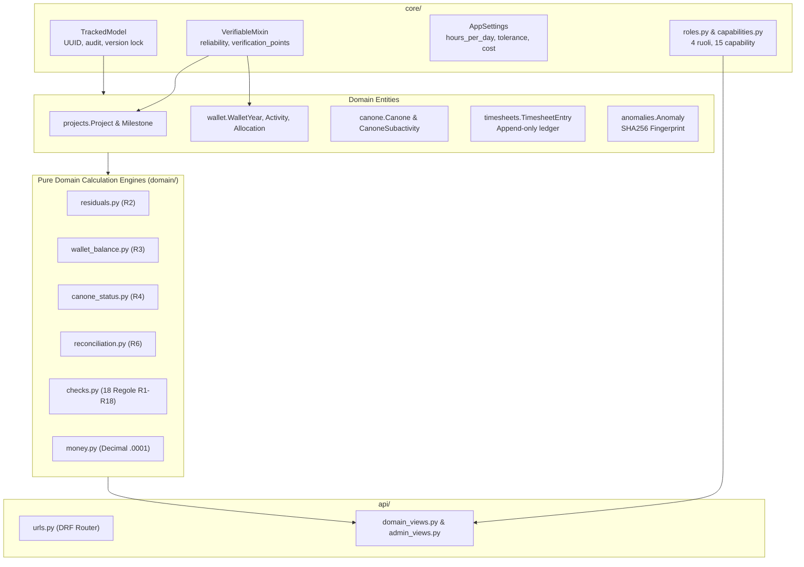
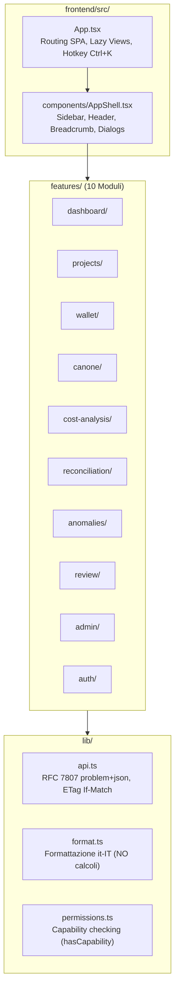
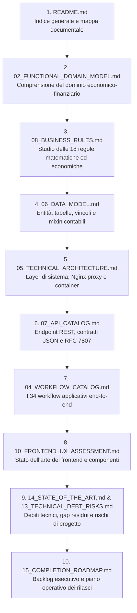
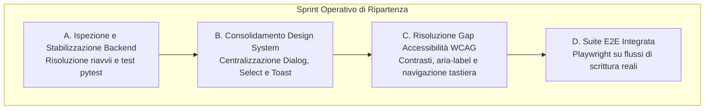

# 16. AI Handover & Solution Architect Guide - Supplier Ledger

> **Destinatari**: Agenti AI subentranti, Lead Software Architects, Senior Full-Stack Engineers.  
> **Oggetto**: Guida definitiva di transizione tecnica, vincoli architetturali inviolabili e piano operativo.  
> **Stato Repository**: Fase 7 completata, Fase 8 (UX Redesign) classificata come **PARTIAL**.  
> **Data Redazione**: 28 Ottobre 2026.

---

## 1. Executive Onboarding

### 1.1 Che cos'è Supplier Ledger
**Supplier Ledger** è la piattaforma contabile ed economica per il governo delle commesse IT fornite da **Imola Informatica S.p.A.** a **Banca Mediolanum S.p.A.**  
Il sistema governa l'intero ciclo di vita economico dei contratti:
- **Organico Allargato (Canone)**: contratti semestrali o trimestrali a monte giornate con burn-down settimanale lineare programmato.
- **Progetti a Commessa (AQL - Accordo Quadro di Lavoro)**: iniziative a consuntivo o a forfait con monitoraggio del consumato rispetto al monte acquistato.
- **Contratti a Corpo e Attività PPM**: contratti con milestone di fatturazione prefissate e attività dirette su strumenti della Banca.
- **Wallet Annuale dei Residui**: salvadanaio contabile che raccoglie le giornate acquistate e non consumate su commesse chiuse, consentendone il riutilizzo (entro precise scadenze legali/contrattuali) per finanziare nuove attività.
- **Riconciliazione PPM**: motore di quadratura bidirezionale con il sistema aziendale PPM (Project Portfolio Management) di Banca Mediolanum, assunto come fonte primaria esterna di verità per i consuntivi operativi.



### 1.2 Architettura ad Alto Livello

La soluzione è strutturata su quattro layer architetturali completamente containerizzati tramite Docker Compose (`docker-compose.yml`):

1. **Reverse Proxy**: Nginx 1.25 Alpine
   - Espone la porta HTTP esterna `8080` (configurabile via variabile d'ambiente `SL_HTTP_PORT`).
   - Smista le richieste: route `/api/v1/*` al backend Django (porta `8000`), route statiche/SPA `/*` al container frontend.
   - Fornisce compressione gzip, gestione header di sicurezza e proxying streaming/ETag.
2. **Frontend SPA**: React 18.3, TypeScript 5.6, Tailwind CSS 3.4, Vite 5.4
   - Layout shell unificato ([`frontend/src/components/AppShell.tsx`](file:///c:/Users/gianvito.bleve/OneDrive%20-%20Banca%20Mediolanum%20SPA/Documenti/Progetti/imola/frontend/src/components/AppShell.tsx)) con navigazione gerarchica, Command Palette (`Ctrl+K`), supporto dark/light theme e localizzazione italiana con i18next.
   - 10 feature modules isolati in [`frontend/src/features/`](file:///c:/Users/gianvito.bleve/OneDrive%20-%20Banca%20Mediolanum%20SPA/Documenti/Progetti/imola/frontend/src/features/).
   - Client HTTP specializzato ([`frontend/src/lib/api.ts`](file:///c:/Users/gianvito.bleve/OneDrive%20-%20Banca%20Mediolanum%20SPA/Documenti/Progetti/imola/frontend/src/lib/api.ts)) conforme allo standard RFC 7807 (`application/problem+json`) e supporto concurrency lock ottimistico (`If-Match` / ETag).
3. **Backend REST**: Python 3.12, Django 5.1.2, Django REST Framework 3.15, drf-spectacular 0.27
   - Modelli di tracciamento universale ([`backend/core/models.py`](file:///c:/Users/gianvito.bleve/OneDrive%20-%20Banca%20Mediolanum%20SPA/Documenti/Progetti/imola/backend/core/models.py#L67-L106)) con lock ottimistico tramite campo `version` e audit trail immutabile via `django-simple-history`.
   - Modulo di dominio puro ([`backend/domain/`](file:///c:/Users/gianvito.bleve/OneDrive%20-%20Banca%20Mediolanum%20SPA/Documenti/Progetti/imola/backend/domain/)): calcoli contabili, scadenze residui, disponibilità wallet e quadratura PPM isolati dal layer HTTP/DB.
4. **Data Layer**: PostgreSQL 16
   - Persistenza con transazioni ACID, chiavi primarie UUID v4 (`uuid_generate_v4()`), trigger DB per blocco modifiche non consentite e vincoli di integrità relazionale avanzati (Check Constraints).

### 1.3 Lo Stato Attuale del Progetto

| Ambito | Stato | Evidenza Chiave | Descrizione |
|---|---|---|---|
| **Fasi 1-7 Core & Business Logic** | **IMPLEMENTED** | [`backend/domain/`](file:///c:/Users/gianvito.bleve/OneDrive%20-%20Banca%20Mediolanum%20SPA/Documenti/Progetti/imola/backend/domain/), [`backend/api/`](file:///c:/Users/gianvito.bleve/OneDrive%20-%20Banca%20Mediolanum%20SPA/Documenti/Progetti/imola/backend/api/) | Motore regole R1-R18, importatori Seed v4 e PPM, audit trail, gestione capability e controlli contabili operativi. |
| **Fase 8 UX Redesign** | **PARTIAL** | [`outputs/UX_REDESIGN_FINAL_REPORT.md`](file:///c:/Users/gianvito.bleve/OneDrive%20-%20Banca%20Mediolanum%20SPA/Documenti/Progetti/imola/outputs/UX_REDESIGN_FINAL_REPORT.md#L1-L46) | Riprogettate le 7 aree operative, 73/73 test Vitest superati su 14 file, catture visive multi-viewport generate. Rimangono parziali: centralizzazione totale del design system, conformità WCAG 2.1 AA su tutti i dialog e verifiche E2E reali contro backend attivo. |
| **Ambiente Backend Locale** | **PARTIAL** | Host Windows / Docker | Il container backend su alcuni ambienti host risente di riavvii periodici legati al reload hot-swap o a configurazioni Postgres locali (porta 5433). Richiede verifica operativa prima del rilascio. |

---

## 2. "WHAT NOT TO CHANGE" - Regole e Vincoli Inviolabili

> [!CAUTION]
> I seguenti 8 vincoli architetturali e di business sono categorici. La loro violazione compromette l'integrità contabile, la validità legale dei bilanci di commessa o causa corruzione irreversibile della base dati. NESSUN AGENTE AI O SVILUPPATORE DEVE MODIFICARLI.



### Vincolo 1: NON USARE MAI FLOAT PER LE GIORNATE (Decisione Architetturale D-15)
- **Motivazione Contabile**: In JavaScript e Python i numeri `float` a 64 bit a virgola mobile non possono rappresentare esattamente frazioni decimali (es. `0.1 + 0.2 = 0.30000000000000004`). In un ledger contabile dove si sommano migliaia di consuntivi e si calcolano valori economici da centinaia di migliaia di euro, un errore di rappresentazione binaria genera ammanchi o eccedenze fittizie.
- **Implementazione Backend**:
  * Tutte le quantità di giornate devono essere istanze di `Decimal` con precisione minima di 4 cifre decimali (`Decimal("0.0001")`), arrotondate rigorosamente con `ROUND_HALF_UP`.
  * Riferimento codice: [`backend/domain/money.py`](file:///c:/Users/gianvito.bleve/OneDrive%20-%20Banca%20Mediolanum%20SPA/Documenti/Progetti/imola/backend/domain/money.py#L12-L17):
    ```python
    DAYS_QUANT = Decimal("0.0001")
    DISPLAY_QUANT = Decimal("0.01")
    MONEY_QUANT = Decimal("0.01")
    ZERO = Decimal("0.0000")
    PPM_GRANULARITY = Decimal("0.0625")
    ```
  * Campo Django standard per i modelli: [`backend/core/fields.py`](file:///c:/Users/gianvito.bleve/OneDrive%20-%20Banca%20Mediolanum%20SPA/Documenti/Progetti/imola/backend/core/fields.py) -> `DaysField` (`DecimalField(max_digits=12, decimal_places=4)`).
  * Serializzazione API: [`backend/api/renderers.py`](file:///c:/Users/gianvito.bleve/OneDrive%20-%20Banca%20Mediolanum%20SPA/Documenti/Progetti/imola/backend/api/renderers.py) converte ogni valore `Decimal` in `string` nel JSON.
- **Implementazione Frontend**:
  * Nel frontend le giornate arrivano come stringhe e **devono rimanere stringhe** ([`frontend/src/lib/format.ts`](file:///c:/Users/gianvito.bleve/OneDrive%20-%20Banca%20Mediolanum%20SPA/Documenti/Progetti/imola/frontend/src/lib/format.ts#L1-L18)).
  * **DIVIETO DI CALCOLO LATO CLIENT**: Nel frontend non si esegue MAI alcun calcolo aritmetico contabile (somme, sottrazioni, percentuali, residui). Se occorre un indicatore aggregato, DEVE essere calcolato nel backend (`backend/domain/`) ed esposto via endpoint.
  * L'unica operazione concessa sul client è la formattazione visiva tramite `Intl.NumberFormat("it-IT", { minimumFractionDigits: 2, maximumFractionDigits: 2, useGrouping: true })` prima della visualizzazione nelle celle.

### Vincolo 2: DIVIETO ASSOLUTO DI UPDATE E DELETE SU TIMESHEET ENTRY (Decisione D-14)
- **Motivazione Contabile**: I consuntivi formano il giornale mastro (General Ledger). La cancellazione o la modifica sul posto di una riga distrugge la catena di custodia e rende impossibile la revisione contabile.
- **Implementazione Backend**:
  * Modello [`backend/timesheets/models.py`](file:///c:/Users/gianvito.bleve/OneDrive%20-%20Banca%20Mediolanum%20SPA/Documenti/Progetti/imola/backend/timesheets/models.py#L146-L156):
    ```python
    def save(self, *args: Any, **kwargs: Any) -> None:
        if not self._state.adding:
            raise ValidationError(
                "I consuntivi sono append-only: per correggere, registrare uno storno."
            )
        super().save(*args, **kwargs)

    def delete(self, *args: Any, **kwargs: Any) -> Any:
        raise ValidationError(
            "I consuntivi non si cancellano: registrare una riga di storno (reverses)."
        )
    ```
  * Correzioni: si effettuano ESCLUSIVAMENTE tramite storno contabile invocando [`TimesheetEntry.build_reversal()`](file:///c:/Users/gianvito.bleve/OneDrive%20-%20Banca%20Mediolanum%20SPA/Documenti/Progetti/imola/backend/timesheets/models.py#L158-L169), che genera una riga nuova con `days = -self.days`, `source = TimesheetSource.STORNO` e puntatore `reverses = self`.
  * Trigger DB: a livello PostgreSQL è attivo un trigger che inibisce istruzioni SQL `UPDATE` o `DELETE` sulla tabella `timesheets_timesheetentry`, disabilitabile temporaneamente solo durante l'import batch seed controllato.
  * Check Constraint Target Esclusivo: ogni riga di consuntivo DEVE avere esattamente uno e un solo target valorizzato tra `project`, `canone_subactivity`, `wallet_allocation` (`timesheet_exactly_one_target`). Le giornate non possono essere zero (`timesheet_days_not_zero`).

### Vincolo 3: DISACCOPPIAMENTO STATI PROGETTO (Regola R1)
- **Motivazione di Business**: Lo stato operativo di erogazione e consuntivazione delle giornate non coincide con lo stato amministrativo/finanziario di fatturazione e incasso. Un progetto può aver terminato le attività tecniche da mesi pur avendo milestone di fatturazione bloccate da verifiche amministrative, o viceversa essere fatturato in anticipo contrattuale ad avvio lavori.
- **Implementazione**:
  * [`backend/projects/models.py`](file:///c:/Users/gianvito.bleve/OneDrive%20-%20Banca%20Mediolanum%20SPA/Documenti/Progetti/imola/backend/projects/models.py#L36-L49):
    * `timesheet_status`: `NON_AVVIATO`, `ATTIVO`, `CHIUSO`, `DA_VERIFICARE`.
    * `billing_status`: `DA_FATTURARE`, `PARZIALE`, `TOTALE`, `NON_FATTURABILE`, `DA_VERIFICARE`.
  * **Regola**: È severamente vietato introdurre vincoli, trigger o logiche applicative che impongano transizioni sincronizzate o dipendenze implicite tra `timesheet_status` e `billing_status`.

### Vincolo 4: REGOLA R2 DI SCADENZA DEI RESIDUI PROGETTO
- **Formula Giuridica/Contabile**:
  $$\text{Data Scadenza} = 31\text{ Dicembre dell'anno }(Y_{\text{chiusura}} + 1)$$
  dove $Y_{\text{chiusura}}$ è l'anno estratto **esclusivamente** dal campo `actual_closure_date` del modello `Project`.
- **Implementazione**:
  * [`backend/domain/residuals.py`](file:///c:/Users/gianvito.bleve/OneDrive%20-%20Banca%20Mediolanum%20SPA/Documenti/Progetti/imola/backend/domain/residuals.py#L48-L60):
    ```python
    def last_usable_day(closure_date: date, years_valid_after_closure: int = 1) -> date:
        return date(closure_date.year + years_valid_after_closure, 12, 31)
    ```
  * **Condizioni Tassative**:
    1. Un progetto in stato `ATTIVO` con saldo positivo ($\text{giornate acquistate} - \text{giornate consuntivate} > 0$) ha un saldo operativo, ma **NON genera credito spendibile nel wallet** (`NON_DISPONIBILE`).
    2. Solo quando il progetto è validato nello stato `CHIUSO` e possiede una valida `actual_closure_date`, il residuo diventa spendibile (`VALIDO`).
    3. Se `timesheet_status == DA_VERIFICARE`, il residuo è classificato `DA_VERIFICARE` e non entra nel disponibile ufficiale.
    4. Superato il 31/12 dell'anno successivo, il residuo transita automaticamente a `SCADUTO` e non è più allocabile.

### Vincolo 5: REGOLA R3 DISPONIBILE WALLET
- **Motivazione**: Il totale delle giornate disponibili all'interno del wallet annuale non è un campo statico su una tabella, né un dato inserito manualmente dall'utente.
- **Implementazione**:
  * È sempre una proprietà derivata pura calcolata in tempo reale da [`backend/domain/wallet_balance.py`](file:///c:/Users/gianvito.bleve/OneDrive%20-%20Banca%20Mediolanum%20SPA/Documenti/Progetti/imola/backend/domain/wallet_balance.py):
    $$\text{Disponibile Anno} = \sum_{\text{allocazioni aperte}} (\text{gg allocati} - \text{gg consumati}) + \sum_{\text{progetti chiusi R2 validi}} (\text{residuo non allocato})$$
  * È fatto divieto assoluto di creare colonne `available_days` memorizzate o editabili sul modello `WalletYear`.

### Vincolo 6: REGOLA R6 RICONCILIAZIONE PPM
- **Autorità del Dato**: Il sistema PPM Mediolanum rappresenta la fonte di verità esterna contrattuale per le giornate consuntivate sul cliente.
- **Implementazione**:
  * La tolleranza ammessa per considerare una voce `QUADRATO` è fissata a **0.0100 giornate** (pari a un centesimo di giornata uomo).
  * È codificata e letta da [`backend/core/models.py`](file:///c:/Users/gianvito.bleve/OneDrive%20-%20Banca%20Mediolanum%20SPA/Documenti/Progetti/imola/backend/core/models.py#L124-L129): `AppSettings.reconciliation_tolerance_days = Decimal("0.0100")`.
  * Qualsiasi scostamento superiore in valore assoluto a `0.0100 gg` deve generare uno stato di `SCOSTAMENTO_POSITIVO` o `SCOSTAMENTO_NEGATIVO` e attivare la creazione del finding contabile.

### Vincolo 7: FINGERPRINT DELLE ANOMALIE (Regola R7)
- **Meccanismo di Deduplica**:
  * Il rilevamento automatico delle anomalie ([`backend/domain/checks.py`](file:///c:/Users/gianvito.bleve/OneDrive%20-%20Banca%20Mediolanum%20SPA/Documenti/Progetti/imola/backend/domain/checks.py)) deve essere idempotente.
  * Il fingerprint deve identificare l'anomalia indipendentemente dall'evoluzione numerica del dato nel tempo.
- **Implementazione**:
  * [`backend/anomalies/models.py`](file:///c:/Users/gianvito.bleve/OneDrive%20-%20Banca%20Mediolanum%20SPA/Documenti/Progetti/imola/backend/anomalies/models.py#L43-L47):
    ```python
    def build_fingerprint(rule_code: str, *refs: object) -> str:
        payload = "|".join([rule_code, *(str(ref) for ref in refs if ref is not None)])
        return hashlib.sha256(payload.encode("utf-8")).hexdigest()
    ```
  * **DIVIETO**: Non inserire MAI importi, date o valori descrittivi all'interno di `refs` per il calcolo dell'hash. Se il delta di riconciliazione passa da 1.25 gg a 2.50 gg, il fingerprint deve rimanere identico in modo che il runner aggiorni il `context` JSON dell'anomalia esistente anziché generare un record duplicato.

### Vincolo 8: MODELLO DEI RUOLI E DELLE CAPABILITY
- **Matrice di Sicurezza**:
  * 4 Ruoli applicativi: `admin`, `responsabile_bmed`, `referente_bmed`, `fornitore` ([`backend/core/roles.py`](file:///c:/Users/gianvito.bleve/OneDrive%20-%20Banca%20Mediolanum%20SPA/Documenti/Progetti/imola/backend/core/roles.py#L7-L12)).
  * 15 Capability canoniche definite in [`backend/core/capabilities.py`](file:///c:/Users/gianvito.bleve/OneDrive%20-%20Banca%20Mediolanum%20SPA/Documenti/Progetti/imola/backend/core/capabilities.py#L9-L24).
  * Risoluzione dinamica con persistenza su tabella [`RoleCapabilityOverride`](file:///c:/Users/gianvito.bleve/OneDrive%20-%20Banca%20Mediolanum%20SPA/Documenti/Progetti/imola/backend/core/models.py#L17-L35).
  * Le tre capability di sicurezza `data.reset`, `users.manage` e `privileges.manage` sono `RESERVED_CAPABILITIES`: appartengono esclusivamente all'amministratore e non possono essere assegnate o revocate tramite interfaccia a ruoli non-admin.

---

## 3. Mappa Fondamentale dei Moduli e dei File Chiave

### 3.1 Backend Architecture Map



#### File Chiave Backend
- [`backend/core/models.py`](file:///c:/Users/gianvito.bleve/OneDrive%20-%20Banca%20Mediolanum%20SPA/Documenti/Progetti/imola/backend/core/models.py):
  * `TrackedModel` (L67-L106): fornitore di UUID v4, date `created_at`/`updated_at`, autore `created_by`/`updated_by` da thread locale e contatore `version` per la gestione dell'ETag (`If-Match`).
  * `VerifiableMixin` (L182-L233): implementa i campi `reliability` (`CERTO`, `DA_VERIFICARE`) e `verification_points` (JSON dei punti aperti da verificare con nota obbligatoria).
  * `AppSettings` (L108-L164): singleton su DB con i parametri globali contabili.
- [`backend/core/roles.py`](file:///c:/Users/gianvito.bleve/OneDrive%20-%20Banca%20Mediolanum%20SPA/Documenti/Progetti/imola/backend/core/roles.py) & [`backend/core/capabilities.py`](file:///c:/Users/gianvito.bleve/OneDrive%20-%20Banca%20Mediolanum%20SPA/Documenti/Progetti/imola/backend/core/capabilities.py):
  * Definizione canonica di permessi atomici e associazione di default per ruolo con fallback trasparente.
- [`backend/projects/models.py`](file:///c:/Users/gianvito.bleve/OneDrive%20-%20Banca%20Mediolanum%20SPA/Documenti/Progetti/imola/backend/projects/models.py):
  * `Project` (L64-L180): entità centrale di commessa, codici ARO/RDA, deliverable, date contrattuali ed effettive, budget giornate.
  * `BillingMilestone` (L185-L290): rate e milestone di fatturazione collegate a slot `START`/`END` o date specifiche.
- [`backend/wallet/models.py`](file:///c:/Users/gianvito.bleve/OneDrive%20-%20Banca%20Mediolanum%20SPA/Documenti/Progetti/imola/backend/wallet/models.py):
  * `WalletYear` (L43-L60): contenitore dell'anno contabile.
  * `WalletActivity` (L62-L110): destinazione contabile (progetto o ticket Redmine).
  * `WalletSourceLot` (L112-L170): lotto originario derivante dal residuo di un progetto chiuso.
  * `WalletAllocation` (L172-L260): impegno di giornate su una specifica attività.
  * `WalletFundingTranche` (L262-L319): tranches di finanziamento collegate ad ARO/RDA.
- [`backend/timesheets/models.py`](file:///c:/Users/gianvito.bleve/OneDrive%20-%20Banca%20Mediolanum%20SPA/Documenti/Progetti/imola/backend/timesheets/models.py):
  * `TimesheetEntry` (L34-L170): mastro giornate append-only con puntatori univoci e supporto storni.
- [`backend/canone/models.py`](file:///c:/Users/gianvito.bleve/OneDrive%20-%20Banca%20Mediolanum%20SPA/Documenti/Progetti/imola/backend/canone/models.py):
  * `Canone` (L49-L130): contratto organico allargato per semestre/trimestre.
  * `CanoneSubactivity` (L132-L194): sotto-attività tecnica con attribuzione all'ufficio di competenza (EA, SA, TA, CROSS) ed estrazione automatica ticket Redmine (`#300228`).
- [`backend/anomalies/models.py`](file:///c:/Users/gianvito.bleve/OneDrive%20-%20Banca%20Mediolanum%20SPA/Documenti/Progetti/imola/backend/anomalies/models.py):
  * `Anomaly` (L49-L160): violazioni contabili tracciate con fingerprint univoco, contesto JSON e ciclo di vita dello stato.
- [`backend/domain/`](file:///c:/Users/gianvito.bleve/OneDrive%20-%20Banca%20Mediolanum%20SPA/Documenti/Progetti/imola/backend/domain/):
  * `residuals.py`: calcolo saldi di commessa, validità e scadenze (R2).
  * `wallet_balance.py`: disponibilità economica annuale (R3).
  * `canone_status.py`: burn-down target settimanale e consuntivazione (R4).
  * `reconciliation.py`: confronto bidirezionale Timesheet vs PPM (R6).
  * `checks.py`: detector per le 18 regole di audit contabile (R1-R18).
  * `money.py`: aritmetica contabile `Decimal("0.0001")`.
- [`backend/api/urls.py`](file:///c:/Users/gianvito.bleve/OneDrive%20-%20Banca%20Mediolanum%20SPA/Documenti/Progetti/imola/backend/api/urls.py) & [`backend/api/domain_views.py`](file:///c:/Users/gianvito.bleve/OneDrive%20-%20Banca%20Mediolanum%20SPA/Documenti/Progetti/imola/backend/api/domain_views.py):
  * Esposizione endpoint RESTful, calcolo aggregati di dominio e supporto OpenAPI/Swagger.

---

### 3.2 Frontend Architecture Map



#### File e Directory Chiave Frontend
- [`frontend/src/App.tsx`](file:///c:/Users/gianvito.bleve/OneDrive%20-%20Banca%20Mediolanum%20SPA/Documenti/Progetti/imola/frontend/src/App.tsx):
  * Gestione stato sessione (`loading`, `anonymous`, `authenticated`).
  * Intercettazione globale della scorciatoia da tastiera `Ctrl+K` per l'apertura immediata della `CommandPalette`.
  * Lazy loading asincrono di tutte le 10 viste primarie tramite React `Suspense`.
- [`frontend/src/components/AppShell.tsx`](file:///c:/Users/gianvito.bleve/OneDrive%20-%20Banca%20Mediolanum%20SPA/Documenti/Progetti/imola/frontend/src/components/AppShell.tsx):
  * Layout principale dell'applicazione, include la barra di navigazione laterale collassabile, la barra superiore con le briciole di pane (breadcrumbs), il selettore del tema visivo e il menu contestuale utente con indicatore dei ruoli attivi.
- **Le 10 Directory di Feature** ([`frontend/src/features/`](file:///c:/Users/gianvito.bleve/OneDrive%20-%20Banca%20Mediolanum%20SPA/Documenti/Progetti/imola/frontend/src/features/)):
  1. `dashboard`: cruscotto direzionale KPI, anomalie critiche e stato del canone.
  2. `projects`: elenco progetti con filtri complessi, ricerca testo e vista dettaglio commessa con tab consuntivi e milestone.
  3. `wallet`: situazione annuale del salvadanaio residui, allocazioni aperte ed evoluzione storica.
  4. `canone`: monitoraggio dell'organico allargato, burn-rate settimanale e suddivisione per ufficio di architettura.
  5. `cost-analysis`: valorizzazione economica delle giornate uomo consuntivate con filtri temporali e Top-N fornitori.
  6. `reconciliation`: matrice di quadratura consuntivi SL contro snapshot PPM con dettaglio scostamenti.
  7. `anomalies`: elenco anomalie contabili con filtri per severità e dialog di concessione deroga motivata.
  8. `review`: coda di verifica dei punti aperti (VerifiableMixin) con chiusura tramite nota obbligatoria.
  9. `admin`: pannello di controllo per import seed v4/PPM, backup/ripristino DB, gestione utenti e matrice dei privilegi.
  10. `auth`: gestione login, recupero credenziali e intercettazione sessione scaduta (`SessionExpiredDialog`).
- [`frontend/src/lib/api.ts`](file:///c:/Users/gianvito.bleve/OneDrive%20-%20Banca%20Mediolanum%20SPA/Documenti/Progetti/imola/frontend/src/lib/api.ts):
  * Client HTTP `request<T>()` basato su Fetch API nativa.
  * Riconoscimento ed estrazione automatica del payload RFC 7807 `ProblemDetail` con mapping degli errori puntuali sui campi form.
  * Iniezione automatica dell'header `X-CSRFToken` estratto dal cookie sicuro `sl_csrftoken`.
  * Supporto concorrenza ottimistica tramite parametro `ifMatch` con header HTTP `If-Match`.
  * Gestione graceful della scadenza sessione: quando il backend restituisce HTTP 401 con codice `session_expired`, il client non esegue redirect distruttivi, ma invoca `notifySessionExpired()` consentendo il re-login in modale senza perdere i dati inseriti nei form.
- [`frontend/src/lib/format.ts`](file:///c:/Users/gianvito.bleve/OneDrive%20-%20Banca%20Mediolanum%20SPA/Documenti/Progetti/imola/frontend/src/lib/format.ts):
  * Funzioni `formatDays` (con suffisso "gg"), `formatDaysCell` (per tabelle dense), `formatPercent`, `formatCurrency`.
- [`frontend/src/lib/permissions.ts`](file:///c:/Users/gianvito.bleve/OneDrive%20-%20Banca%20Mediolanum%20SPA/Documenti/Progetti/imola/frontend/src/lib/permissions.ts):
  * Funzione `hasCapability(session, capability)` per il controllo granulare dell'abilitazione/visibilità di elementi UI e azioni.

---

## 4. Ambiente Operativo e Comandi Essenziali

L'infrastruttura di automazione si basa interamente su comandi esposti tramite `Makefile` per ambienti Linux/macOS/WSL e su script PowerShell dedicati per ambienti Windows host.

### 4.1 Tabella dei Comandi di Sviluppo e Controllo

| Operazione | Comando Docker / Makefile | Comando Diretto / Windows PS | Scopo e Note |
|---|---|---|---|
| **Avvio Stack Completo** | `make up` oppure `docker compose up -d --build` | N/A | Compila le immagini ed avvia i container `db`, `backend`, `frontend`, `nginx`. URL: `http://localhost:8080`. |
| **Arresto Stack** | `make down` oppure `docker compose down` | N/A | Ferma tutti i servizi preservando i volumi dati. |
| **Log in Tempo Reale** | `make logs` | `docker compose logs -f --tail=100` | Ispezione combinata dei flussi di output dei servizi. |
| **Applicazione Migrazioni** | `make migrate` | `docker compose run --rm backend python manage.py migrate` | Applica le migrazioni Django su PostgreSQL. |
| **Creazione Migrazioni** | `make makemigrations` | `docker compose run --rm backend python manage.py makemigrations` | Rileva modifiche ai modelli e genera nuovi file di migrazione. |
| **Creazione Superuser** | `make superuser` | `docker compose run --rm backend python manage.py createsuperuser` | Crea un utente amministratore interattivo. |
| **Caricamento Dati Demo** | `make demo` | `docker compose run --rm backend python manage.py load_demo_data --run-checks` | Inserisce utenti di prova per tutti i 4 ruoli, progetti sintetici ed esegue i controlli contabili. |
| **Importazione Seed Reale** | `make seed` | `docker compose run --rm backend python manage.py import_seed data/seed/seed_imola_v4_2026-10-09.json` | Importa l'estratto ufficiale delle commesse e dei contratti Imola Informatica. |
| **Simulazione Seed (Dry-Run)**| `make seed-dry` | `docker compose run --rm backend python manage.py import_seed data/seed/... --dry-run` | Valida l'integrità del file seed senza persistere record nel database. |
| **Motore Controlli Contabili**| `make checks` | `docker compose run --rm backend python manage.py run_checks` | Esegue le 18 regole di rilevamento anomalie e aggiorna i record nella tabella `anomalies_anomaly`. |
| **Test Backend & Copertura** | `make test-backend` | `docker compose exec -T backend python -m pytest --cov --cov-report=term-missing` | Esegue l'intera suite pytest con gate di copertura all'interno del container Linux. |
| **Test Frontend (Vitest)** | `make test-frontend` | `docker compose run --rm frontend npm run test -- --run` | Esegue i test di unità e componenti React tramite Vitest. |
| **Test End-to-End (E2E)** | `make e2e` | Vedere sezione 4.2 | Esegue i test Playwright contro l'istanza attiva di Nginx. |
| **Verifica Statica e Linter** | `make lint` | Backend: `ruff check . && black --check . && mypy .`<br/>Frontend: `npm run lint` | Verifica la conformità stilistica e la validazione tipologica. |
| **Formattazione Automatica** | `make format` | Backend: `ruff check --fix . && black .`<br/>Frontend: `npm run format` | Applica la formattazione automatica del codice. |
| **Backup Completo Database** | `make backup` | `docker compose run --rm backend python manage.py backup` | Genera un dump atomico di schema e dati in `backups/`. |
| **Reset Totale Ambiente** | `make reset` | `docker compose down -v && rm -rf .docker-data/pgdata` | Cancella interamente i dati del database locale e riparte da zero. |

### 4.2 Dettaglio Test E2E con Playwright

I test end-to-end devono essere eseguiti contro lo stack di container in esecuzione per simulare flussi browser realistici:
```bash
docker compose exec -e PLAYWRIGHT_CHROMIUM_EXECUTABLE_PATH=/usr/bin/chromium-browser -e E2E_BASE_URL=http://nginx:8080 frontend npx playwright test e2e/phase6.spec.ts
```

### 4.3 Gestione PostgreSQL Locale su Windows (senza Docker)

Qualora si sviluppi direttamente su host Windows utilizzando un cluster PostgreSQL locale (installato su `C:\Program Files\PostgreSQL\16` o binari portabili in `C:\dev\pgsql`):
- Script di gestione: [`scripts/pg-local.ps1`](file:///c:/Users/gianvito.bleve/OneDrive%20-%20Banca%20Mediolanum%20SPA/Documenti/Progetti/imola/scripts/pg-local.ps1)
- Parametri di default: Porta `5433`, Directory dati `C:\dev\pgdata`, Database `supplier_ledger`, Utente `supplier_ledger`.
- Comandi:
  ```powershell
  # Verifica stato del servizio locale
  powershell -File scripts/pg-local.ps1 status

  # Avvio del cluster PostgreSQL
  powershell -File scripts/pg-local.ps1 start

  # Arresto del cluster PostgreSQL
  powershell -File scripts/pg-local.ps1 stop

  # Connessione immediata alla shell psql
  powershell -File scripts/pg-local.ps1 psql
  ```

---

## 5. Ordine di Lettura Consigliato per il Nuovo Agente

Per raggiungere la piena padronanza del sistema ed evitare assunzioni errate, il nuovo agente o architetto DEVE seguire rigorosamente il seguente percorso di lettura all'interno della cartella `docs/assestmant/`:



### Guida Dettagliata ai 10 Passi di Lettura

1. [**`README.md`**](file:///c:/Users/gianvito.bleve/OneDrive%20-%20Banca%20Mediolanum%20SPA/Documenti/Progetti/imola/docs/assestmant/README.md):  
   *Obiettivo*: Acquisire la struttura complessiva della knowledge base dell'assessment e orientarsi tra i 17 documenti analitici.
2. [**`02_FUNCTIONAL_DOMAIN_MODEL.md`**](file:///c:/Users/gianvito.bleve/OneDrive%20-%20Banca%20Mediolanum%20SPA/Documenti/Progetti/imola/docs/assestmant/02_FUNCTIONAL_DOMAIN_MODEL.md):  
   *Obiettivo*: Comprendere il glossario di business: Canone vs AQL, meccanismo del Wallet annuale, natura degli snapshot PPM e cicli di approvazione BMED.
3. [**`08_BUSINESS_RULES.md`**](file:///c:/Users/gianvito.bleve/OneDrive%20-%20Banca%20Mediolanum%20SPA/Documenti/Progetti/imola/docs/assestmant/08_BUSINESS_RULES.md):  
   *Obiettivo*: Imparare a memoria le 18 regole di calcolo e quadratura (R1 disaccoppiamento, R2 scadenza residui, R3 disponibilità wallet, R4 target canone, R6 riconciliazione PPM, R7 fingerprint anomalie).
4. [**`06_DATA_MODEL.md`**](file:///c:/Users/gianvito.bleve/OneDrive%20-%20Banca%20Mediolanum%20SPA/Documenti/Progetti/imola/docs/assestmant/06_DATA_MODEL.md):  
   *Obiettivo*: Esaminare ogni singola tabella, colonna, chiave esterna, check constraint e mixin (`TrackedModel`, `VerifiableMixin`).
5. [**`05_TECHNICAL_ARCHITECTURE.md`**](file:///c:/Users/gianvito.bleve/OneDrive%20-%20Banca%20Mediolanum%20SPA/Documenti/Progetti/imola/docs/assestmant/05_TECHNICAL_ARCHITECTURE.md):  
   *Obiettivo*: Comprendere i layer di astrazione del software, il flusso tra Nginx, Vite e Django, e la gestione delle sessioni tramite cookie `sl_sessionid`.
6. [**`07_API_CATALOG.md`**](file:///c:/Users/gianvito.bleve/OneDrive%20-%20Banca%20Mediolanum%20SPA/Documenti/Progetti/imola/docs/assestmant/07_API_CATALOG.md):  
   *Obiettivo*: Conoscere il contratto di interfaccia di tutte le API v1, gli schemi di request/response, i query parameter supportati e la gestione del locking ottimistico (`If-Match`).
7. [**`04_WORKFLOW_CATALOG.md`**](file:///c:/Users/gianvito.bleve/OneDrive%20-%20Banca%20Mediolanum%20SPA/Documenti/Progetti/imola/docs/assestmant/04_WORKFLOW_CATALOG.md):  
   *Obiettivo*: Mappare i 34 casi d'uso concreti eseguiti dagli utenti (es. creazione commessa, registrazione storno, concessione deroga anomalia, import snapshot PPM).
8. [**`10_FRONTEND_UX_ASSESSMENT.md`**](file:///c:/Users/gianvito.bleve/OneDrive%20-%20Banca%20Mediolanum%20SPA/Documenti/Progetti/imola/docs/assestmant/10_FRONTEND_UX_ASSESSMENT.md):  
   *Obiettivo*: Valutare la struttura dell'interfaccia utente, la coerenza dei componenti del design system e lo stato di avanzamento delle 7 viste operative.
9. [**`14_STATE_OF_THE_ART.md`**](file:///c:/Users/gianvito.bleve/OneDrive%20-%20Banca%20Mediolanum%20SPA/Documenti/Progetti/imola/docs/assestmant/14_STATE_OF_THE_ART.md) & [**`13_TECHNICAL_DEBT_RISKS.md`**](file:///c:/Users/gianvito.bleve/OneDrive%20-%20Banca%20Mediolanum%20SPA/Documenti/Progetti/imola/docs/assestmant/13_TECHNICAL_DEBT_RISKS.md):  
   *Obiettivo*: Conoscere i debiti tecnici noti, le dipendenze da aggiornare, le criticità di performance e i gap architetturali ancora aperti.
10. [**`15_COMPLETION_ROADMAP.md`**](file:///c:/Users/gianvito.bleve/OneDrive%20-%20Banca%20Mediolanum%20SPA/Documenti/Progetti/imola/docs/assestmant/15_COMPLETION_ROADMAP.md):  
    *Obiettivo*: Consultare il backlog dettagliato dei task prioritari e il piano operativo per portare l'intero repository a completamento.

---

## 6. Come Riprendere lo Sviluppo e Dove Mettere le Mani

Per chi subentra nel progetto e deve pianificare il prossimo sprint operativo basato sulla roadmap [**`15_COMPLETION_ROADMAP.md`**](file:///c:/Users/gianvito.bleve/OneDrive%20-%20Banca%20Mediolanum%20SPA/Documenti/Progetti/imola/docs/assestmant/15_COMPLETION_ROADMAP.md), di seguito sono fornite le linee guida di ingaggio operativo immediato.



### 6.1 Task Operativo A: Ispezione e Stabilizzazione del Backend
- **Problema Noto**: Nelle sessioni precedenti è stato segnalato che il processo Django backend su alcuni ambienti tende a riavviarsi o a generare eccezioni se avviato in combinazione con script ausiliari.
- **Punto di Ingresso**:
  1. Ispezionare [`backend/api/admin_views.py`](file:///c:/Users/gianvito.bleve/OneDrive%20-%20Banca%20Mediolanum%20SPA/Documenti/Progetti/imola/backend/api/admin_views.py) per verificare che non vi siano pendenze o errori di sintassi non committati.
  2. Eseguire all'interno del container `backend`:
     ```bash
     docker compose exec -T backend python manage.py check
     docker compose exec -T backend python -m pytest --cov
     ```
  3. Verificare che il motore controlli `make checks` completi l'analisi senza generare traceback.

### 6.2 Task Operativo B: Consolidamento del Design System UI
- **Problema Noto**: Nel report di avanzamento UX ([`outputs/UX_REDESIGN_FINAL_REPORT.md`](file:///c:/Users/gianvito.bleve/OneDrive%20-%20Banca%20Mediolanum%20SPA/Documenti/Progetti/imola/outputs/UX_REDESIGN_FINAL_REPORT.md)) lo stato è `PARTIAL`. Sono stati implementati miglioramenti visivi locali, ma manca la centralizzazione formale dei componenti riutilizzabili.
- **Punto di Ingresso**:
  1. Cartella componenti: [`frontend/src/components/`](file:///c:/Users/gianvito.bleve/OneDrive%20-%20Banca%20Mediolanum%20SPA/Documenti/Progetti/imola/frontend/src/components/).
  2. Centralizzare i componenti:
     - `Dialog` e modali di conferma (attualmente instanziati con varianti locali nelle singole feature).
     - Componenti di selezione (`Select`, filtri a discesa).
     - Gestione unificata dei messaggi toast di notifica esito azioni.
  3. Evitare duplicazioni di stili Tailwind e utilizzare esclusivamente i design token semantici definiti in [`frontend/tailwind.config.js`](file:///c:/Users/gianvito.bleve/OneDrive%20-%20Banca%20Mediolanum%20SPA/Documenti/Progetti/imola/frontend/tailwind.config.js).

### 6.3 Task Operativo C: Verifica dell'Accessibilità (WCAG 2.1 AA) e Viewport Dense
- **Punto di Ingresso**:
  1. Pagine con densità di dati elevata:
     - [`frontend/src/features/cost-analysis/CostAnalysisPage.tsx`](file:///c:/Users/gianvito.bleve/OneDrive%20-%20Banca%20Mediolanum%20SPA/Documenti/Progetti/imola/frontend/src/features/cost-analysis/CostAnalysisPage.tsx): verificare l'assenza di overflow orizzontale a risoluzione `1440x900` e `1024x768`.
     - [`frontend/src/features/reconciliation/ReconciliationPage.tsx`](file:///c:/Users/gianvito.bleve/OneDrive%20-%20Banca%20Mediolanum%20SPA/Documenti/Progetti/imola/frontend/src/features/reconciliation/ReconciliationPage.tsx): verificare il contrasto del testo nelle celle di scostamento e la navigabilità via tastiera (`Tab` / frecce).
     - [`frontend/src/features/anomalies/AnomaliesPage.tsx`](file:///c:/Users/gianvito.bleve/OneDrive%20-%20Banca%20Mediolanum%20SPA/Documenti/Progetti/imola/frontend/src/features/anomalies/AnomaliesPage.tsx): verificare il dialog di concessione deroga (`visual-review/anomalie-deroga-dark-1440x900.png`) e il corretto bind dell'input data di scadenza della deroga.

### 6.4 Task Operativo D: Completamento dei Flussi di Scrittura End-to-End
- **Punto di Ingresso**:
  1. File test E2E: [`frontend/e2e/`](file:///c:/Users/gianvito.bleve/OneDrive%20-%20Banca%20Mediolanum%20SPA/Documenti/Progetti/imola/frontend/e2e/).
  2. Implementare gli scenari completi di test automatizzato per:
     - Creazione di una nuova commessa con milestone associate.
     - Inserimento di una riga di timesheet append-only e successiva generazione di storno contabile (`reverses`).
     - Importazione di un file PPM con verifica automatica dell'aggiornamento dei badge di scostamento nella matrice di riconciliazione.
     - Risoluzione o deroga di un'anomalia contabile da parte di un utente con ruolo `responsabile_bmed`.

---

## 7. Checklist di Auto-Valutazione per l'Agente AI Subentrante

Prima di dichiarare completata qualsiasi modifica al codice, ogni agente AI DEVE verificare i seguenti punti:

- [ ] Ho verificato che NESSUNA operazione matematica sulle giornate sia stata introdotta nel frontend TypeScript?
- [ ] Ho garantito che ogni valore di giornata nel backend sia un'istanza pura di `Decimal` arrotondata a 4 cifre decimali (`ROUND_HALF_UP`)?
- [ ] Ho verificato che non sia stata aggiunta alcuna operazione di `UPDATE` o `DELETE` su record di `TimesheetEntry`?
- [ ] Ho controllato che le modifiche non abbiano introdotto dipendenze sincrone tra `timesheet_status` e `billing_status` (Regola R1)?
- [ ] Ho verificato che il calcolo della disponibilità del wallet continui a dipendere esclusivamente dalle formule pure di `backend/domain/wallet_balance.py` (Regola R3)?
- [ ] Ho controllato che la deduplica delle anomalie utilizzi tassativamente `build_fingerprint(rule_code, *refs)` escludendo qualsiasi valore contabile mutevole dall'impronta (Regola R7)?
- [ ] Ho eseguito `make lint` e `make test-backend` con esito 100% positivo e copertura conforme ai gate?
- [ ] Ho eseguito `make test-frontend` assicurando che tutti i test Vitest passino senza errori?
- [ ] Ho eseguito `make checks` verificando che l'integrità del ledger non sia stata compromessa?

---
*Documento redatto nell'ambito dell'Assessment Globale della piattaforma Supplier Ledger. Conservare come riferimento principale per tutte le future iterazioni architetturali e di sviluppo.*
