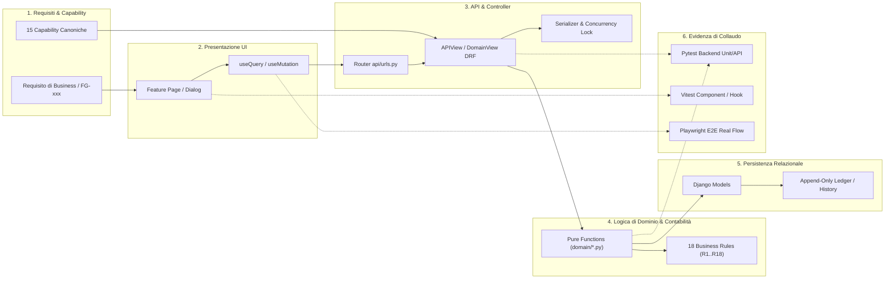

# 17 - Matrice di Tracciabilità Totale delle Evidenze (Evidence Index)

## 1. Introduzione e Criteri di Tracciabilità

### 1.1 Scopo del Documento e Principio di Evidenza
Il presente documento costituisce la **Matrice di Tracciabilità Totale delle Evidenze (Evidence Index)** del sistema **Supplier Ledger**. Il suo obiettivo fondamentale è fornire a qualsiasi auditor di conformità, revisore contabile o ingegnere software un percorso bidirezionale completo e inequivocabile tra:
1. **Requisiti di Business & Functional Capabilities** (le 15 capability canoniche di sistema e le 39 capability funzionali `FG-001`...`FG-039`);
2. **Artefatti di Codice Frontend** (componenti React, form di inserimento, hook TanStack Query);
3. **Contratti API RESTful** (metodi HTTP, routing URL, classi Handler DRF);
4. **Logica di Dominio & Business Rules** (funzioni pure di calcolo, motori di bilancio e controlli);
5. **Modello Dati Relazionale ORM** (modelli Django, vincoli DB, tabelle di storico append-only);
6. **Evidenze di Test** (test unitari di dominio, test di integrazione API, test UI Vitest e workflow Playwright E2E);
7. **Documentazione di Assessment** (riferimenti incrociati alle sezioni analitiche dell'assessment).

> [!IMPORTANT]
> **Principio di Evidenza Assoluta**: Nessuna capability o requisito contabile viene considerata implementata senza puntare direttamente ai simboli, alle righe di codice sorgente e alla suite di test di riscontro. Nessun'asserzione si basa su intenzioni di progetto o stub nominali.

### 1.2 Criteri e Legenda degli Stati di Verifica

La classificazione dello stato di verifica di ciascuna capability è rigorosamente deterministica:

| Stato di Verifica | Descrizione e Criteri di Attribuzione |
|:---|:---|
| **VERIFICATO** | Codice backend e/o frontend interamente implementato, con suite di test automatizzati (Unit, Integration o E2E) che dimostrano il funzionamento atteso a fronte di asserzioni su dati reali. |
| **PARZIALE** | Codice implementato e funzionante, ma con gap noti: assenza di test E2E persistenti post-reload, validazioni solo client o mockate, UI in attesa di rifinitura o feedback asincrono limitato. |
| **NON_VERIFICATO** | Codice implementato a livello backend (o CLI) ma privo di interfaccia grafica completa, oppure flusso per cui non è presente una prova di test automatizzata verificabile. |
| **DEPRECATO / BLOCCATO** | Funzionalità rimossa, superata da nuove regole contabili (es. transizione a saldo computato) o endpoint che restituisce errore bloccante controllato (es. HTTP 409). |

### 1.3 Catena di Tracciabilità Architetturale

### 1.4 Riferimenti Incrociati ai Documenti di Assessment
- [01_REPOSITORY_INVENTORY.md](01_REPOSITORY_INVENTORY.md): Censimento del repository, struttura moduli e dipendenze
- [05_TECHNICAL_ARCHITECTURE.md](05_TECHNICAL_ARCHITECTURE.md): Architettura del software, pipeline Django, sicurezza di rete
- [06_DATA_MODEL.md](06_DATA_MODEL.md): Schema relazionale, vincoli di integrità e migrazioni database
- [07_API_CATALOG.md](07_API_CATALOG.md): Catalogo esaustivo delle rotte API v1 RESTful
- [08_BUSINESS_RULES.md](08_BUSINESS_RULES.md): Catalogo delle 18 regole di calcolo e vincoli contabili
- [09_SECURITY_AUTHORIZATION.md](09_SECURITY_AUTHORIZATION.md): Modello RBAC, permessi a livello di oggetto e capability
- [12_DEPLOYMENT_OPERATIONS.md](12_DEPLOYMENT_OPERATIONS.md): Strategie di deploy Docker, backup e procedure operative

---

## 2. Matrice Capability → Codice & Test

La matrice seguente censisce le capability funzionali e di business del sistema Supplier Ledger, aggregandole nelle 9 aree tematiche obbligatorie. Mappa esplicitamente le 15 Capability canoniche di sicurezza ([`core/capabilities.py`](../../backend/core/capabilities.py#L9-L24)) e i 39 requisiti funzionali `FG-001`...`FG-039`.

### Area A: Progetti & Contratti (Committenza, Milestone, Saldi e Chiusura)

| ID Capability | Nome Capability | File Sorgente Frontend + Componente | Endpoint API + Metodo | File Sorgente Backend + Handler | Servizio di Dominio / Logica | Modello Dati ORM | File di Test Correlato | Riferimento Assessment | Stato di Verifica |
|:---|:---|:---|:---|:---|:---|:---|:---|:---:|:---:|
| **FG-004** | Elenco e ricerca progetti | [`ProjectsPage.tsx`](../../frontend/src/features/projects/ProjectsPage.tsx#L55) `ProjectsPage` | `GET /api/v1/projects/balances` | [`domain_views.py:256`](../../backend/api/domain_views.py#L256) `ProjectBalancesView` | [`residuals.py:140`](../../backend/domain/residuals.py#L140) `project_balance_qs()` | [`Project`](../../backend/projects/models.py#L65) | [`test_project_editing_api.py:35`](../../backend/tests/test_project_editing_api.py#L35) [`ProjectsPageAndEditDialog.test.tsx`](../../frontend/src/features/projects/__tests__/ProjectsPageAndEditDialog.test.tsx#L1) | [07_API: 4.2.3](07_API_CATALOG.md) [08_RULES: R1](08_BUSINESS_RULES.md) | **VERIFICATO** |
| **FG-005** | Dettaglio progetto, ledger e audit | [`ProjectDetailPage.tsx`](../../frontend/src/features/projects/ProjectDetailPage.tsx#L40) `ProjectDetailPage` | `GET /api/v1/projects/{pk}` `GET /api/v1/audit/project/{pk}` | [`domain_views.py:1609`](../../backend/api/domain_views.py#L1609) `ProjectDetailUpdateView` | `project_detail_payload()` | [`Project`](../../backend/projects/models.py#L65) [`BillingMilestone`](../../backend/projects/models.py#L230) | [`test_project_ledger_api.py:28`](../../backend/tests/test_project_ledger_api.py#L28) [`sol-final.spec.ts:29`](../../frontend/e2e/sol/sol-final.spec.ts#L29) | [07_API: 4.2.4](07_API_CATALOG.md) [06_DATA: 3.1](06_DATA_MODEL.md) | **VERIFICATO** |
| **FG-006** `projects.create` | Creazione nuovo progetto | [`NewProjectDialog.tsx`](../../frontend/src/features/projects/NewProjectDialog.tsx#L45) `NewProjectDialog` | `POST /api/v1/projects` | [`domain_views.py:224`](../../backend/api/domain_views.py#L224) `ProjectListCreateView` | `ProjectCreateSerializer` `sync_project_billing_schedule()` | [`Project`](../../backend/projects/models.py#L65) | [`test_api_auth.py:48`](../../backend/tests/test_api_auth.py#L48) [`phase6.spec.ts:50`](../../frontend/e2e/phase6.spec.ts#L50) | [07_API: 4.2.2](07_API_CATALOG.md) [09_SEC: 4.2](09_SECURITY_AUTHORIZATION.md) | **VERIFICATO** |
| **FG-007** `projects.edit` `projects.annotate_own` | Modifica progetto e annotazione | [`EditProjectDialog.tsx`](../../frontend/src/features/projects/EditProjectDialog.tsx#L40) `EditProjectDialog` | `PATCH /api/v1/projects/{pk}` | [`domain_views.py:1635`](../../backend/api/domain_views.py#L1635) `ProjectDetailUpdateView` | `OptimisticLockMixin` `check_expected_version` | [`Project`](../../backend/projects/models.py#L65) | [`test_project_editing_api.py:120`](../../backend/tests/test_project_editing_api.py#L120) [`phase7_projects_edit.spec.ts:25`](../../frontend/e2e/phase7_projects_edit.spec.ts#L25) | [07_API: 4.2.5](07_API_CATALOG.md) [08_RULES: R10, R17](08_BUSINESS_RULES.md) | **VERIFICATO** |
| **FG-008** `projects.validate_closure` | Validazione chiusura e conferma revisione | [`ProjectsPage.tsx:125`](../../frontend/src/features/projects/ProjectsPage.tsx#L125) `ClosureDialog` [`ReviewQueuePage.tsx:55`](../../frontend/src/features/review/ReviewQueuePage.tsx#L55) | `POST /api/v1/projects/{pk}/validate-closure` `POST /api/v1/projects/{pk}/confirm-review` | [`domain_views.py:1767`](../../backend/api/domain_views.py#L1767) `ProjectValidateClosureView` `ProjectConfirmReviewView` | [`residuals.py:189`](../../backend/domain/residuals.py#L189) `project_closure_ready()` | [`Project`](../../backend/projects/models.py#L65) [`WalletSourceLot`](../../backend/wallet/models.py#L40) | [`test_project_editing_api.py:195`](../../backend/tests/test_project_editing_api.py#L195) [`test_review_queue.py:45`](../../backend/tests/test_review_queue.py#L45) | [07_API: 4.2.7](07_API_CATALOG.md) [08_RULES: R2, R10](08_BUSINESS_RULES.md) | **VERIFICATO** |
| **FG-009** | Rilascio residuo progetto a wallet (Legacy) | Componente UI rimosso (incompatibile con D-14) | `POST /api/v1/projects/{pk}/release-to-wallet` | [`domain_views.py:682`](../../backend/api/domain_views.py#L682) `ReleaseProjectToWalletView` | Ritorna HTTP 409 fisso (regola deprecata in favore di R2) | N/A | [`test_phase3_api.py:180`](../../backend/tests/test_phase3_api.py#L180) | [07_API: 4.2.8](07_API_CATALOG.md) [08_RULES: R2](08_BUSINESS_RULES.md) | **DEPRECATO / BLOCCATO** |

---

### Area B: Consuntivazione & Ledger (Timesheet Immutabili e Storni)

| ID Capability | Nome Capability | File Sorgente Frontend + Componente | Endpoint API + Metodo | File Sorgente Backend + Handler | Servizio di Dominio / Logica | Modello Dati ORM | File di Test Correlato | Riferimento Assessment | Stato di Verifica |
|:---|:---|:---|:---|:---|:---|:---|:---|:---:|:---:|
| **FG-036** `timesheets.create` `accounting.adjust` | Registrazione consuntivo diretto su commessa | [`ProjectDetailPage.tsx:120`](../../frontend/src/features/projects/ProjectDetailPage.tsx#L120) `TimesheetDialog` | `POST /api/v1/projects/{pk}/ledger` | [`domain_views.py:402`](../../backend/api/domain_views.py#L402) `ProjectLedgerView` | Inserimento append-only diretto (`TimesheetSource.DIRETTO`) | [`TimesheetEntry`](../../backend/timesheets/models.py#L48) | [`test_append_only.py:42`](../../backend/tests/test_append_only.py#L42) [`test_project_ledger_api.py:55`](../../backend/tests/test_project_ledger_api.py#L55) | [07_API: 4.3.2](07_API_CATALOG.md) [08_RULES: R5](08_BUSINESS_RULES.md) | **VERIFICATO** |
| **FG-036.REV** `accounting.adjust` | Storno compensativo riga consuntivo (Append-Only) | [`ProjectDetailPage.tsx:165`](../../frontend/src/features/projects/ProjectDetailPage.tsx#L165) `ReversalAction` | `DELETE /api/v1/projects/{pk}/ledger/{entry_pk}` | [`domain_views.py:527`](../../backend/api/domain_views.py#L527) `ProjectTimesheetDetailView` | [`timesheets/models.py:158`](../../backend/timesheets/models.py#L158) `build_reversal()` | [`TimesheetEntry`](../../backend/timesheets/models.py#L48) | [`test_append_only.py:88`](../../backend/tests/test_append_only.py#L88) [`test_project_ledger_api.py:90`](../../backend/tests/test_project_ledger_api.py#L90) | [07_API: 4.3.4](07_API_CATALOG.md) [08_RULES: R5](08_BUSINESS_RULES.md) | **VERIFICATO** |
| **FG-036.CAN** `timesheets.create` | Consuntivazione su sotto-attività di Canone | [`CanonePage.tsx:450`](../../frontend/src/features/canone/CanonePage.tsx#L450) `SubactivityTimesheetModal` | `POST /api/v1/canoni/{pk}/subactivities/{sub_pk}/timesheets` | [`domain_views.py:1297`](../../backend/api/domain_views.py#L1297) `CanoneSubactivityTimesheetListView` | Validazione vincolo R5 (`TimesheetSource.CANONE`) | [`TimesheetEntry`](../../backend/timesheets/models.py#L48) [`CanoneSubactivity`](../../backend/canone/models.py#L75) | [`test_canone_crud_api.py:110`](../../backend/tests/test_canone_crud_api.py#L110) [`sol-final.spec.ts:40`](../../frontend/e2e/sol/sol-final.spec.ts#L40) | [07_API: 4.5.6](07_API_CATALOG.md) [08_RULES: R4, R5](08_BUSINESS_RULES.md) | **VERIFICATO** |

---

### Area C: Wallet & Salvadanaio (Lotti Sorgente, Bilancio Annuale e Tranche FIFO)

| ID Capability | Nome Capability | File Sorgente Frontend + Componente | Endpoint API + Metodo | File Sorgente Backend + Handler | Servizio di Dominio / Logica | Modello Dati ORM | File di Test Correlato | Riferimento Assessment | Stato di Verifica |
|:---|:---|:---|:---|:---|:---|:---|:---|:---:|:---:|
| **FG-010** | Saldo e composizione annuale Wallet | [`WalletPage.tsx:60`](../../frontend/src/features/wallet/WalletPage.tsx#L60) `WalletPage` (KPI & Buckets) | `GET /api/v1/wallet/{year}/balance` | [`domain_views.py:669`](../../backend/api/domain_views.py#L669) `WalletBalanceView` | [`wallet_balance.py:157`](../../backend/domain/wallet_balance.py#L157) `wallet_year_balance()` | [`WalletYear`](../../backend/wallet/models.py#L18) [`WalletSourceLot`](../../backend/wallet/models.py#L40) | [`test_wallet_balance.py:35`](../../backend/tests/domain/test_wallet_balance.py#L35) [`WalletPage.test.tsx:28`](../../frontend/src/features/wallet/__tests__/WalletPage.test.tsx#L28) | [07_API: 4.4.1](07_API_CATALOG.md) [08_RULES: R3](08_BUSINESS_RULES.md) | **VERIFICATO** |
| **FG-011** | Flusso allocazioni wallet e funding FIFO | [`WalletPage.tsx:145`](../../frontend/src/features/wallet/WalletPage.tsx#L145) `WalletFlowTable` | `GET /api/v1/wallet/{year}/flow` | [`domain_views.py:700`](../../backend/api/domain_views.py#L700) `WalletFlowView` | [`wallet_balance.py:300`](../../backend/domain/wallet_balance.py#L300) `wallet_flow()` | [`WalletAllocation`](../../backend/wallet/models.py#L140) [`WalletFundingTranche`](../../backend/wallet/models.py#L270) | [`test_wallet_fifo.py:45`](../../backend/tests/domain/test_wallet_fifo.py#L45) [`test_wallet_editing_api.py:50`](../../backend/tests/test_wallet_editing_api.py#L50) | [07_API: 4.4.2](07_API_CATALOG.md) [08_RULES: R13](08_BUSINESS_RULES.md) | **VERIFICATO** |
| **FG-012** `wallet.edit` `accounting.adjust` | Creazione e regolazione allocazione wallet | [`NewAllocationDialog.tsx`](../../frontend/src/features/wallet/NewAllocationDialog.tsx#L65) [`EditAllocationDialog.tsx`](../../frontend/src/features/wallet/EditAllocationDialog.tsx#L45) | `POST /api/v1/allocations` `PATCH /api/v1/allocations/{pk}` `POST /api/v1/allocations/{pk}/adjust` | [`domain_views.py:714`](../../backend/api/domain_views.py#L714) `WalletAllocationCreateView` `WalletAllocationDetailUpdateView` `WalletAllocationAdjustView` | `reserve_fifo()` `update_wallet_allocation()` | [`WalletAllocation`](../../backend/wallet/models.py#L140) [`WalletSourceLot`](../../backend/wallet/models.py#L40) | [`test_wallet_editing_api.py:95`](../../backend/tests/test_wallet_editing_api.py#L95) [`phase7_wallet_edit.spec.ts:30`](../../frontend/e2e/phase7_wallet_edit.spec.ts#L30) | [07_API: 4.4.4](07_API_CATALOG.md) [08_RULES: R3, R13](08_BUSINESS_RULES.md) | **VERIFICATO** |
| **FG-013** | Assegnazione allocazione a persona/architetto | [`NewAllocationDialog.tsx:110`](../../frontend/src/features/wallet/NewAllocationDialog.tsx#L110) Selettore `assignee` | `POST /api/v1/allocations` `PATCH /api/v1/allocations/{pk}` | [`domain_views.py:730`](../../backend/api/domain_views.py#L730) `WalletAllocationCreateView` | Campo ORM `assignee` su `WalletAllocation` | [`WalletAllocation`](../../backend/wallet/models.py#L140) [`Person`](../../backend/directory/models.py#L33) | [`test_wallet_editing_api.py:145`](../../backend/tests/test_wallet_editing_api.py#L145) [`sol-final.spec.ts:35`](../../frontend/e2e/sol/sol-final.spec.ts#L35) | [07_API: 4.4.4](07_API_CATALOG.md) [06_DATA: 3.3](06_DATA_MODEL.md) | **VERIFICATO** |
| **FG-014** | Consumo e saldo aggregato per architetto | [`WalletPage.tsx:210`](../../frontend/src/features/wallet/WalletPage.tsx#L210) Tabella Architetti | `GET /api/v1/wallet/{year}/assignees` | [`domain_views.py:707`](../../backend/api/domain_views.py#L707) `WalletAssigneeSummaryView` | [`wallet_balance.py:401`](../../backend/domain/wallet_balance.py#L401) `wallet_by_assignee()` | [`WalletAllocation`](../../backend/wallet/models.py#L140) [`Person`](../../backend/directory/models.py#L33) | [`test_wallet_balance.py:115`](../../backend/tests/domain/test_wallet_balance.py#L115) [`test_wallet_editing_api.py:160`](../../backend/tests/test_wallet_editing_api.py#L160) | [07_API: 4.4.3](07_API_CATALOG.md) [08_RULES: R3](08_BUSINESS_RULES.md) | **VERIFICATO** |
| **FG-015** | Calcolo residui, scadenze e regola R2 | [`WalletPage.tsx:90`](../../frontend/src/features/wallet/WalletPage.tsx#L90) `ResidualBucketsView` | Inclusa in `/wallet/{year}/balance` | [`domain_views.py:669`](../../backend/api/domain_views.py#L669) `WalletBalanceView` | [`residuals.py:53`](../../backend/domain/residuals.py#L53) `residual_validity()` | [`Project`](../../backend/projects/models.py#L65) | [`test_residuals.py:45`](../../backend/tests/domain/test_residuals.py#L45) [`test_api_auth.py:161`](../../backend/tests/test_api_auth.py#L161) | [07_API: 4.4.1](07_API_CATALOG.md) [08_RULES: R2](08_BUSINESS_RULES.md) | **VERIFICATO** |

---

### Area D: Organico Allargato / Canoni (Target R4, Sotto-attività e Burndown)

| ID Capability | Nome Capability | File Sorgente Frontend + Componente | Endpoint API + Metodo | File Sorgente Backend + Handler | Servizio di Dominio / Logica | Modello Dati ORM | File di Test Correlato | Riferimento Assessment | Stato di Verifica |
|:---|:---|:---|:---|:---|:---|:---|:---|:---:|:---:|
| **FG-016** `canone.manage` | Monitoraggio stato canone, forecast e burndown (R4) | [`CanonePage.tsx:55`](../../frontend/src/features/canone/CanonePage.tsx#L55) `CanonePage` `AccessibleBarChart` | `GET /api/v1/canoni` `GET /api/v1/canoni/{pk}` `GET /api/v1/canoni/{pk}/status` | [`domain_views.py:1041`](../../backend/api/domain_views.py#L1041) `CanoneListView` `CanoneDetailView` `CanoneStatusView` | [`canone_status.py:144`](../../backend/domain/canone_status.py#L144) `canone_status()` `canone_burndown()` | [`Canone`](../../backend/canone/models.py#L15) [`CanoneSubactivity`](../../backend/canone/models.py#L75) | [`test_canone_status.py:40`](../../backend/tests/domain/test_canone_status.py#L40) [`CanonePage.test.tsx:35`](../../frontend/src/features/canone/__tests__/CanonePage.test.tsx#L35) | [07_API: 4.5.1](07_API_CATALOG.md) [08_RULES: R4](08_BUSINESS_RULES.md) | **VERIFICATO** |
| **FG-016.CRUD** `canone.manage` | Gestione CRUD canone e sotto-attività | [`CanonePage.tsx:180`](../../frontend/src/features/canone/CanonePage.tsx#L180) `NewCanoneModal` `SubactivityModal` | `POST /api/v1/canoni` `POST /api/v1/canoni/{pk}/subactivities` `PATCH /api/v1/canoni/{pk}/subactivities/{id}` | [`domain_views.py:1087`](../../backend/api/domain_views.py#L1087) `CanoneListView` `CanoneSubactivityListView` | `CanoneWriteSerializer` `CanoneSubactivityWriteSerializer` | [`Canone`](../../backend/canone/models.py#L15) [`CanoneSubactivity`](../../backend/canone/models.py#L75) | [`test_canone_crud_api.py:45`](../../backend/tests/test_canone_crud_api.py#L45) [`sol-final.spec.ts:37`](../../frontend/e2e/sol/sol-final.spec.ts#L37) | [07_API: 4.5.2](07_API_CATALOG.md) [08_RULES: R4](08_BUSINESS_RULES.md) | **VERIFICATO** |

---

### Area E: Riconciliazione PPM (Snapshot Esterni, Delta e Tolleranza)

| ID Capability | Nome Capability | File Sorgente Frontend + Componente | Endpoint API + Metodo | File Sorgente Backend + Handler | Servizio di Dominio / Logica | Modello Dati ORM | File di Test Correlato | Riferimento Assessment | Stato di Verifica |
|:---|:---|:---|:---|:---|:---|:---|:---|:---:|:---:|
| **FG-017** | Riconciliazione consultiva PPM | [`ReconciliationPage.tsx:40`](../../frontend/src/features/reconciliation/ReconciliationPage.tsx#L40) `ReconciliationPage` | `GET /api/v1/reconciliation/latest` | [`domain_views.py:1509`](../../backend/api/domain_views.py#L1509) `ReconciliationView` | [`reconciliation.py:97`](../../backend/domain/reconciliation.py#L97) `reconcile()` | [`PpmSnapshot`](../../backend/ppm/models.py#L18) [`PpmSnapshotRow`](../../backend/ppm/models.py#L55) | [`test_reconciliation.py:48`](../../backend/tests/domain/test_reconciliation.py#L48) [`ReconciliationPage.test.tsx:30`](../../frontend/src/features/reconciliation/__tests__/ReconciliationPage.test.tsx#L30) | [07_API: 4.7.1](07_API_CATALOG.md) [08_RULES: R6](08_BUSINESS_RULES.md) | **VERIFICATO** |
| **FG-018** | Coerenza semantica KPI Riconciliazione | [`ReconciliationPage.tsx:75`](../../frontend/src/features/reconciliation/ReconciliationPage.tsx#L75) Distinzione dati assenti | Inclusa in `/reconciliation/latest` | [`domain_views.py:1509`](../../backend/api/domain_views.py#L1509) `ReconciliationView` | [`reconciliation.py:30`](../../backend/domain/reconciliation.py#L30) `ReconciliationDataStatus` | [`PpmSnapshot`](../../backend/ppm/models.py#L18) | [`test_reconciliation.py:169`](../../backend/tests/domain/test_reconciliation.py#L169) [`test_api_auth.py:204`](../../backend/tests/test_api_auth.py#L204) | [07_API: 4.7.1](07_API_CATALOG.md) [08_RULES: R6](08_BUSINESS_RULES.md) | **VERIFICATO** |

---

### Area F: Motore Controlli & Anomalie (18 CHK_*, Fingerprint, Deroghe e Supersessione)

| ID Capability | Nome Capability | File Sorgente Frontend + Componente | Endpoint API + Metodo | File Sorgente Backend + Handler | Servizio di Dominio / Logica | Modello Dati ORM | File di Test Correlato | Riferimento Assessment | Stato di Verifica |
|:---|:---|:---|:---|:---|:---|:---|:---|:---:|:---:|
| **FG-019** | Inbox e filtri anomalie | [`AnomaliesPage.tsx:40`](../../frontend/src/features/anomalies/AnomaliesPage.tsx#L40) `AnomaliesPage` | `GET /api/v1/anomalies` | [`domain_views.py:586`](../../backend/api/domain_views.py#L586) `AnomalyListView` | Filtri per `stato`, `severita`, `ambito`, `regola` | [`Anomaly`](../../backend/anomalies/models.py#L43) | [`test_phase4_checks.py:40`](../../backend/tests/test_phase4_checks.py#L40) [`AnomaliesPage.test.tsx:25`](../../frontend/src/features/anomalies/__tests__/AnomaliesPage.test.tsx#L25) | [07_API: 4.6.1](07_API_CATALOG.md) [08_RULES: R7](08_BUSINESS_RULES.md) | **VERIFICATO** |
| **FG-020** | Esecuzione manuale controlli contabili | [`AnomaliesPage.tsx:37`](../../frontend/src/features/anomalies/AnomaliesPage.tsx#L37) Bottone `Esegui controlli` | `POST /api/v1/checks/run` | [`domain_views.py:624`](../../backend/api/domain_views.py#L624) `ChecksRunView` | [`checks.py:58`](../../backend/domain/checks.py#L58) `run_checks()` (18 regole) | [`Anomaly`](../../backend/anomalies/models.py#L43) | [`test_phase4_checks.py:110`](../../backend/tests/test_phase4_checks.py#L110) [`phase6.spec.ts:93`](../../frontend/e2e/phase6.spec.ts#L93) | [07_API: 4.6.3](07_API_CATALOG.md) [08_RULES: R8](08_BUSINESS_RULES.md) | **VERIFICATO** |
| **FG-021** `anomalies.resolve` | Risoluzione o presa in carico anomalia | [`AnomaliesPage.tsx:42`](../../frontend/src/features/anomalies/AnomaliesPage.tsx#L42) Azioni `take`, `resolve` | `POST /api/v1/anomalies/{pk}/{action}` | [`domain_views.py:645`](../../backend/api/domain_views.py#L645) `AnomalyActionView` | [`anomalies/models.py:165`](../../backend/anomalies/models.py#L165) `resolve()`, `take()` | [`Anomaly`](../../backend/anomalies/models.py#L43) | [`test_phase4_checks.py:160`](../../backend/tests/test_phase4_checks.py#L160) [`phase6.spec.ts:124`](../../frontend/e2e/phase6.spec.ts#L124) | [07_API: 4.6.2](07_API_CATALOG.md) [08_RULES: R7](08_BUSINESS_RULES.md) | **VERIFICATO** |
| **FG-022** `anomalies.resolve` | Accettazione anomalia con deroga temporale | [`AnomaliesPage.tsx:45`](../../frontend/src/features/anomalies/AnomaliesPage.tsx#L45) `DerogaModal` (data scadenza) | `POST /api/v1/anomalies/{pk}/accept` | [`domain_views.py:645`](../../backend/api/domain_views.py#L645) `AnomalyActionView` | [`anomalies/models.py:180`](../../backend/anomalies/models.py#L180) `accept(accepted_until)` | [`Anomaly`](../../backend/anomalies/models.py#L43) | [`test_phase4_checks.py:195`](../../backend/tests/test_phase4_checks.py#L195) [`sol-final.spec.ts:45`](../../frontend/e2e/sol/sol-final.spec.ts#L45) | [07_API: 4.6.2](07_API_CATALOG.md) [08_RULES: R7](08_BUSINESS_RULES.md) | **VERIFICATO** |
| **FG-037** | Schedulazione automatica periodica controlli | Nessuna UI (servizio background) | Non esposto su API HTTP | Non configurato un Celery/cron attivo | Runner `run_checks()` invocato solo su richiesta o seed import | [`Anomaly`](../../backend/anomalies/models.py#L43) | Solo test esecuzione manuale in `test_phase4_checks.py` | [12_DEP: 4.3](12_DEPLOYMENT_OPERATIONS.md) [08_RULES: R8](08_BUSINESS_RULES.md) | **NON_VERIFICATO** |

---

### Area G: Coda di Revisione (Qualità Dati D-03 e Scadenze Potenziali)

| ID Capability | Nome Capability | File Sorgente Frontend + Componente | Endpoint API + Metodo | File Sorgente Backend + Handler | Servizio di Dominio / Logica | Modello Dati ORM | File di Test Correlato | Riferimento Assessment | Stato di Verifica |
|:---|:---|:---|:---|:---|:---|:---|:---|:---:|:---:|
| **FG-008.Q** | Elenco commesse in coda di revisione (D-03) | [`ReviewQueuePage.tsx:35`](../../frontend/src/features/review/ReviewQueuePage.tsx#L35) `ReviewQueuePage` | `GET /api/v1/review-queue` | [`domain_views.py:550`](../../backend/api/domain_views.py#L550) `ProjectReviewQueueView` | [`residuals.py:284`](../../backend/domain/residuals.py#L284) `review_queue_projects()` | [`Project`](../../backend/projects/models.py#L65) | [`test_review_queue.py:30`](../../backend/tests/test_review_queue.py#L30) [`ReviewQueuePage.test.tsx:25`](../../frontend/src/features/review/__tests__/ReviewQueuePage.test.tsx#L25) | [07_API: 4.2.6](07_API_CATALOG.md) [08_RULES: R18](08_BUSINESS_RULES.md) | **VERIFICATO** |
| **FG-008.CR** `projects.validate_closure` | Conferma revisione con risoluzione automatica | [`ReviewQueuePage.tsx:70`](../../frontend/src/features/review/ReviewQueuePage.tsx#L70) `ConfirmReviewModal` | `POST /api/v1/projects/{pk}/confirm-review` | [`domain_views.py:1733`](../../backend/api/domain_views.py#L1733) `ProjectConfirmReviewView` | Risoluzione `CHK_CLOSED_NO_DATE` e persistenza data | [`Project`](../../backend/projects/models.py#L65) [`Anomaly`](../../backend/anomalies/models.py#L43) | [`test_review_queue.py:85`](../../backend/tests/test_review_queue.py#L85) [`sol-final.spec.ts:46`](../../frontend/e2e/sol/sol-final.spec.ts#L46) | [07_API: 4.2.6](07_API_CATALOG.md) [08_RULES: R18](08_BUSINESS_RULES.md) | **VERIFICATO** |

---

### Area H: Analisi Costi & Dashboard (KPI Aggregati e Command Palette)

| ID Capability | Nome Capability | File Sorgente Frontend + Componente | Endpoint API + Metodo | File Sorgente Backend + Handler | Servizio di Dominio / Logica | Modello Dati ORM | File di Test Correlato | Riferimento Assessment | Stato di Verifica |
|:---|:---|:---|:---|:---|:---|:---|:---|:---:|:---:|
| **FG-003** | Dashboard KPI aggregati | [`DashboardPage.tsx:38`](../../frontend/src/features/dashboard/DashboardPage.tsx#L38) `DashboardPage` | `GET /api/v1/dashboard` | [`domain_views.py:185`](../../backend/api/domain_views.py#L185) `DashboardView` | [`dashboard.py:30`](../../backend/domain/dashboard.py#L30) `dashboard_summary()` | [`Project`](../../backend/projects/models.py#L65) [`WalletAllocation`](../../backend/wallet/models.py#L140) | [`test_dashboard.py:35`](../../backend/tests/domain/test_dashboard.py#L35) [`DashboardPage.test.tsx:30`](../../frontend/src/features/dashboard/__tests__/DashboardPage.test.tsx#L30) | [07_API: 4.1.4](07_API_CATALOG.md) [08_RULES: R16](08_BUSINESS_RULES.md) | **VERIFICATO** |
| **FG-015.CST** | Analisi economica e ripartizione costi | [`CostAnalysisPage.tsx:35`](../../frontend/src/features/cost-analysis/CostAnalysisPage.tsx#L35) `CostAnalysisPage` | `GET /api/v1/cost-analysis` | [`domain_views.py:156`](../../backend/api/domain_views.py#L156) `CostAnalysisView` | [`cost_analysis.py:21`](../../backend/domain/cost_analysis.py#L21) `build_cost_analysis()` | [`TimesheetEntry`](../../backend/timesheets/models.py#L48) [`AppSettings`](../../backend/core/models.py#L15) | [`test_cost_analysis_api.py:35`](../../backend/tests/test_cost_analysis_api.py#L35) [`CostAnalysisPage.test.tsx:25`](../../frontend/src/features/cost-analysis/__tests__/CostAnalysisPage.test.tsx#L25) | [07_API: 4.1.3](07_API_CATALOG.md) [08_RULES: R15](08_BUSINESS_RULES.md) | **VERIFICATO** |
| **FG-033** | Ricerca globale e Command Palette | [`CommandPalette.tsx:45`](../../frontend/src/components/CommandPalette.tsx#L45) `CommandPalette` | `GET /api/v1/search` | [`domain_views.py:1399`](../../backend/api/domain_views.py#L1399) `CommandSearchView` | Ricerca full-text su codice, titolo, persona | [`Project`](../../backend/projects/models.py#L65) [`Person`](../../backend/directory/models.py#L33) | [`test_api_auth.py:240`](../../backend/tests/test_api_auth.py#L240) [`presentation.test.tsx:50`](../../frontend/src/components/__tests__/presentation.test.tsx#L50) | [07_API: 4.1.5](07_API_CATALOG.md) [05_ARCH: 3.4](05_TECHNICAL_ARCHITECTURE.md) | **VERIFICATO** |

---

### Area I: Import, Export & Amministrazione (Seed v1-v4, Rollback, RBAC e Reset DB)

| ID Capability | Nome Capability | File Sorgente Frontend + Componente | Endpoint API + Metodo | File Sorgente Backend + Handler | Servizio di Dominio / Logica | Modello Dati ORM | File di Test Correlato | Riferimento Assessment | Stato di Verifica |
|:---|:---|:---|:---|:---|:---|:---|:---|:---:|:---:|
| **FG-001** | Autenticazione, login e logout | [`session.tsx:22`](../../frontend/src/features/auth/session.tsx#L22) `SessionProvider` `LoginForm` | `POST /api/v1/auth/login` `POST /api/v1/auth/logout` `GET /api/v1/auth/session` | [`auth_views.py:50`](../../backend/api/auth_views.py#L50) `LoginView` `LogoutView` `SessionView` | Sessione HTTP Stateful Django con cookie `sl_session` | [`User`](../../backend/directory/models.py) | [`test_api_auth.py:25`](../../backend/tests/test_api_auth.py#L25) [`role_permissions_ui.test.tsx:30`](../../frontend/src/features/auth/__tests__/role_permissions_ui.test.tsx#L30) | [07_API: 2.1](07_API_CATALOG.md) [09_SEC: 2.1](09_SECURITY_AUTHORIZATION.md) | **VERIFICATO** |
| **FG-002** | Scadenza sessione e re-login trasparente | [`SessionExpiredDialog.tsx:20`](../../frontend/src/features/auth/SessionExpiredDialog.tsx#L20) `SessionExpiredDialog` | Intercetta 401 `session_expired` su qualsiasi API | [`exceptions.py:115`](../../backend/core/exceptions.py#L115) `problem_detail_handler` | Client queue retry in [`api.ts:110`](../../frontend/src/lib/api.ts#L110) | N/A | [`test_api_auth.py:65`](../../backend/tests/test_api_auth.py#L65) | [07_API: 2.1](07_API_CATALOG.md) [09_SEC: 2.4](09_SECURITY_AUTHORIZATION.md) | **PARZIALE** |
| **FG-023** `imports.upload` `imports.apply` | Import Seed JSON (v1 o workbook v2-v4) | [`AdminPage.tsx:105`](../../frontend/src/features/admin/AdminPage.tsx#L105) `ImportSeedPanel` | `POST /api/v1/admin/imports/seed` | [`admin_views.py:55`](../../backend/api/admin_views.py#L55) `SeedImportView` | [`batch.py:80`](../../backend/importers/batch.py#L80) `apply_seed()`, `dry_run_seed()` | [`ImportBatch`](../../backend/imports/models.py#L31) [`WorkbookDatasetSnapshot`](../../backend/imports/models.py#L112) | [`test_import_seed_command.py:40`](../../backend/tests/importers/test_import_seed_command.py#L40) [`sol-final.spec.ts:49`](../../frontend/e2e/sol/sol-final.spec.ts#L49) | [07_API: 4.8.1](07_API_CATALOG.md) [08_RULES: R12](08_BUSINESS_RULES.md) | **VERIFICATO** |
| **FG-024** | Rollback atomico batch d'importazione | [`AdminPage.tsx:160`](../../frontend/src/features/admin/AdminPage.tsx#L160) `ImportHistoryTable` | `management/commands/rollback_seed.py` (CLI) | [`rollback_seed.py:30`](../../backend/importers/management/commands/rollback_seed.py#L30) | Transazione atomica `ImportBatch.objects.rollback()` | [`ImportBatch`](../../backend/imports/models.py#L31) | [`test_rollback_seed_command.py:35`](../../backend/tests/importers/test_rollback_seed_command.py#L35) | [08_RULES: R12](08_BUSINESS_RULES.md) [12_DEP: 4.2](12_DEPLOYMENT_OPERATIONS.md) | **VERIFICATO** |
| **FG-025** | Validazione schema JSON Seed 1.0.0 | [`AdminPage.tsx:120`](../../frontend/src/features/admin/AdminPage.tsx#L120) Feedback dry-run | Inclusa in `/admin/imports/seed` (dry-run) | [`admin_views.py:66`](../../backend/api/admin_views.py#L66) `SeedImportView` | [`schema.py:45`](../../backend/importers/schema.py#L45) `validate_seed_auto()` | Schema Draft-07 JSON | [`test_seed_json.py:28`](../../backend/tests/importers/test_seed_json.py#L28) [`test_seedfile_acceptance.py:25`](../../backend/tests/test_seedfile_acceptance.py#L25) | [07_API: 4.8.1](07_API_CATALOG.md) [08_RULES: R12](08_BUSINESS_RULES.md) | **VERIFICATO** |
| **FG-026** | Mappabilità Excel storico verso Seed | Non presente parser automatico XLS ad-hoc | Non esposto su API HTTP | Richiede normalizzazione tramite script CLI o import JSON diretto | Trasformazione esterna verso schema 1.0.0 | Schema JSON | Nessun test di mapping automatico runtime presente | [08_RULES: R12](08_BUSINESS_RULES.md) | **NON_VERIFICATO** |
| **FG-027** `imports.upload` `imports.apply` | Import PPM XLSX/PDF dry-run e apply | [`AdminPage.tsx:210`](../../frontend/src/features/admin/AdminPage.tsx#L210) `PpmImportPanel` | `POST /api/v1/admin/imports/ppm` `POST /api/v1/imports/ppm` | [`admin_views.py:93`](../../backend/api/admin_views.py#L93) `PpmImportView` `PpmImportUploadView` | [`importers/ppm.py:35`](../../backend/importers/ppm.py#L35) `apply_ppm()`, `dry_run_ppm()` | [`ImportBatch`](../../backend/imports/models.py#L31) [`PpmSnapshot`](../../backend/ppm/models.py#L18) | [`test_reconciliation.py:80`](../../backend/tests/domain/test_reconciliation.py#L80) | [07_API: 4.8.2](07_API_CATALOG.md) [08_RULES: R6](08_BUSINESS_RULES.md) | **VERIFICATO** |
| **FG-028** | Rollback PPM tramite storni append-only | [`AdminPage.tsx:240`](../../frontend/src/features/admin/AdminPage.tsx#L240) Azione storno batch | Supportato via cancellazione logica o storni compensativi | [`timesheets/models.py:158`](../../backend/timesheets/models.py#L158) `build_reversal()` | Generazione riga con segno negativo opposto | [`TimesheetEntry`](../../backend/timesheets/models.py#L48) | [`test_append_only.py:110`](../../backend/tests/test_append_only.py#L110) | [08_RULES: R5](08_BUSINESS_RULES.md) | **VERIFICATO** |
| **FG-029** `exports.run` | Export Excel multifoglio (.xlsx) | [`AdminPage.tsx:280`](../../frontend/src/features/admin/AdminPage.tsx#L280) Download link | `GET /api/v1/export/excel` | [`domain_views.py:1485`](../../backend/api/domain_views.py#L1485) `ExportExcelView` | [`exporters.py:85`](../../backend/exporters.py#L85) `export_excel_bytes()` (5 fogli) | Progetti, Wallet, Canoni, Consuntivi, Anomalie | [`test_api_auth.py:225`](../../backend/tests/test_api_auth.py#L225) | [07_API: 4.8.4](07_API_CATALOG.md) | **VERIFICATO** |
| **FG-030** `exports.run` | Export CSV per singola entità | Script / Link in `AdminPage` | `GET /api/v1/export/csv/{entity}` | [`domain_views.py:1468`](../../backend/api/domain_views.py#L1468) `ExportCsvView` | [`exporters.py:30`](../../backend/exporters.py#L30) `export_csv_bytes()` | Entità selezionata | [`test_api_auth.py:230`](../../backend/tests/test_api_auth.py#L230) | [07_API: 4.8.5](07_API_CATALOG.md) | **VERIFICATO** |
| **FG-031** `exports.run` | Export JSON conforme a schema 1.0.0 | [`AdminPage.tsx:285`](../../frontend/src/features/admin/AdminPage.tsx#L285) Download link | `GET /api/v1/export/json` | [`domain_views.py:1455`](../../backend/api/domain_views.py#L1455) `ExportJsonView` | [`exporters.py:55`](../../backend/exporters.py#L55) `export_json_bytes()` | Dump completo entità di dominio | [`test_api_auth.py:235`](../../backend/tests/test_api_auth.py#L235) | [07_API: 4.8.3](07_API_CATALOG.md) | **VERIFICATO** |
| **FG-032** | Consultazione Audit Trail di sistema | [`ProjectDetailPage.tsx:210`](../../frontend/src/features/projects/ProjectDetailPage.tsx#L210) Tab `Audit` | `GET /api/v1/audit/{entity_type}/{pk}` | [`domain_views.py:2256`](../../backend/api/domain_views.py#L2256) `AuditHistoryView` | Interroga le tabelle `HistoricalRecords` di django-simple-history | `Historical*` ORM Models | [`test_project_editing_api.py:165`](../../backend/tests/test_project_editing_api.py#L165) | [07_API: 4.2.9](07_API_CATALOG.md) [06_DATA: 3.8](06_DATA_MODEL.md) | **PARZIALE** |
| **FG-034** `privileges.manage` | Matrice permessi di ruolo e permessi oggetto | [`AdminPage.tsx:450`](../../frontend/src/features/admin/AdminPage.tsx#L450) `RoleCapabilitiesPanel` | `GET /api/v1/admin/roles/capabilities` `PUT /api/v1/admin/roles/capabilities` | [`admin_views.py:536`](../../backend/api/admin_views.py#L536) `RoleCapabilitiesView` | [`capabilities.py:78`](../../backend/core/capabilities.py#L78) `capabilities_for_role()` | [`RoleCapabilityOverride`](../../backend/core/models.py#L55) [`AdminAuditEvent`](../../backend/core/models.py#L80) | [`test_roles_object_permissions.py:35`](../../backend/tests/test_roles_object_permissions.py#L35) [`permissions.test.ts:20`](../../frontend/src/lib/__tests__/permissions.test.ts#L20) | [07_API: 4.9.4](07_API_CATALOG.md) [09_SEC: 4.1](09_SECURITY_AUTHORIZATION.md) | **VERIFICATO** |
| **FG-035** | Impostazioni applicative globali | [`AdminPage.tsx:520`](../../frontend/src/features/admin/AdminPage.tsx#L520) `ConfigPanel` | `GET /api/v1/settings` `PATCH /api/v1/settings` | [`domain_views.py:95`](../../backend/api/domain_views.py#L95) `SettingsView` | `AppSettings.get_solo()` con controllo ottimistico | [`AppSettings`](../../backend/core/models.py#L15) | [`test_api_auth.py:140`](../../backend/tests/test_api_auth.py#L140) [`sol-final.spec.ts:52`](../../frontend/e2e/sol/sol-final.spec.ts#L52) | [07_API: 4.1.2](07_API_CATALOG.md) [08_RULES: R17](08_BUSINESS_RULES.md) | **VERIFICATO** |
| **FG-038** `users.manage` | Gestione anagrafica Utenti e Referenti | [`AdminPage.tsx:320`](../../frontend/src/features/admin/AdminPage.tsx#L320) `UsersPanel` `ReferentsPanel` | `GET /api/v1/admin/users` `POST /api/v1/admin/users` `GET /api/v1/admin/referents` `POST /api/v1/admin/referents` | [`admin_views.py:302`](../../backend/api/admin_views.py#L302) `UserRolesView` `ReferentListCreateView` | Validazione password Django e normalizzazione fonetica | [`User`](../../backend/directory/models.py) [`Person`](../../backend/directory/models.py#L33) | [`test_admin_users_privileges.py:45`](../../backend/tests/test_admin_users_privileges.py#L45) [`test_admin_referents.py:30`](../../backend/tests/test_admin_referents.py#L30) | [07_API: 4.9.1, 4.9.3](07_API_CATALOG.md) [08_RULES: R14](08_BUSINESS_RULES.md) | **VERIFICATO** |
| **FG-038.RST** `data.reset` | Ripristino e svuotamento atomico database (Reset DB) | [`DeleteDatabaseDialog.tsx:29`](../../frontend/src/features/admin/DeleteDatabaseDialog.tsx#L29) `DeleteDatabaseDialog` | `GET /api/v1/admin/reset-data` `POST /api/v1/admin/reset-data` | [`admin_views.py:590`](../../backend/api/admin_views.py#L590) `AdminDataResetView` | Token temporizzato HMAC SHA-256 (`TimestampSigner`) e purge tabelle | Tutte le tabelle di dominio | [`test_admin_reset_data.py:35`](../../backend/tests/test_admin_reset_data.py#L35) [`phase7_admin_delete_db.spec.ts:25`](../../frontend/e2e/phase7_admin_delete_db.spec.ts#L25) | [07_API: 4.9.5](07_API_CATALOG.md) [09_SEC: 4.3](09_SECURITY_AUTHORIZATION.md) | **VERIFICATO** |
| **FG-038.BKP** | Backup binario e Restore database PostgreSQL | [`AdminPage.tsx:580`](../../frontend/src/features/admin/AdminPage.tsx#L580) `DatabaseBackupPanel` | `GET /api/v1/admin/database/backup` `POST /api/v1/admin/database/restore` | [`database_backup.py:87`](../../backend/api/database_backup.py#L87) `DatabaseBackupView` `DatabaseRestoreView` | Esecuzione streaming `pg_dump` e `psql` restore | Intero Database PostgreSQL | [`test_database_backup.py:35`](../../backend/tests/test_database_backup.py#L35) | [07_API: 4.9.6](07_API_CATALOG.md) [12_DEP: 3.2](12_DEPLOYMENT_OPERATIONS.md) | **VERIFICATO** |
| **FG-039** | Protocollo di verifica manuale demo e verbale | Non presente checklist interattiva nel codice | N/A | Script isolati di collaudo e report testuali | N/A | N/A | Nessun verbale canonico persistito a runtime | [11_TESTING](11_TEST_QUALITY_ASSESSMENT.md) | **PARZIALE** |

---

## 3. Indice Inverso: Codice Chiave → Capability

La tabella seguente fornisce la mappatura inversa partendo dai **13 file architetturali fondamentali** del sistema, indicando i simboli chiave implementati, la natura della logica e le capability supportate.

| File Sorgente Chiave | Simboli & Funzioni Salienti | Linee Codice | Tipologia Logica | Requisiti e Capability Supportate | Note Tecnico-Architetturali |
|:---|:---|:---:|:---|:---|:---|
| [`backend/domain/residuals.py`](../../backend/domain/residuals.py#L1-L405) | `ResidualState`, `ResidualValidity` `residual_validity()` `project_balance_qs()` `project_closure_ready()` `project_review_queue_qs()` `review_queue_projects()` | 405 | Algoritmica pura & Subquery ORM | **FG-004**, **FG-008**, **FG-010**, **FG-015**, **FG-008.Q** Regole: **R2**, **R3**, **R10**, **R18** | Cuore del calcolo saldi commesse. Utilizza subquery indipendenti per prevenire il prodotto cartesiano di join e quantizzazione a 4 decimali. |
| [`backend/domain/wallet_balance.py`](../../backend/domain/wallet_balance.py#L1-L576) | `allocation_balance_qs()` `WalletYearBalance` `wallet_year_balance()` `wallet_flow()` `wallet_by_assignee()` `reserve_fifo()` | 576 | Contabilità di salvadanaio & Algoritmo FIFO | **FG-010**, **FG-011**, **FG-012**, **FG-013**, **FG-014** Capability: `wallet.edit` Regole: **R3**, **R13** | Implementa il modello a cascata FIFO per finanziare le allocazioni attingendo prima dai progetti in scadenza più imminente. |
| [`backend/domain/canone_status.py`](../../backend/domain/canone_status.py#L1-L261) | `weeks_elapsed()` `target_days()` `CanoneStatus` `canone_status()` `canone_burndown()` | 261 | Proiezioni lineari e monitoraggio canoni | **FG-016**, **FG-016.CRUD** Capability: `canone.manage` Regole: **R4** | Calcola il target progressivo alla data corrente e genera la serie temporale cumulativa per il grafico di burn-down. |
| [`backend/domain/reconciliation.py`](../../backend/domain/reconciliation.py#L1-L230) | `ReconciliationStatus` `ReconciliationRow` `latest_rows_by_project()` `reconcile()` | 230 | Riconciliazione consuntivi & Tolleranza numerica | **FG-017**, **FG-018** Regole: **R6**, **R9** | Confronta il totale interno di giornate con il consuntivo del tool aziendale PPM, applicando tolleranza contabile di 0.01 gg. |
| [`backend/domain/checks.py`](../../backend/domain/checks.py#L1-L585) | `Finding`, `Detector` `check_date_order()` ... `check_milestone_inconsistent()` (18 detectors) `run_checks()` | 585 | Motore di audit automatico & Controlli contabili | **FG-019**, **FG-020**, **FG-021**, **FG-022** Regole: **R7**, **R8** | Censisce ed esegue 18 controlli di consistenza logica e finanziaria. Genera fingerprint deterministici SHA-256 per deduplicazione. |
| [`backend/timesheets/models.py`](../../backend/timesheets/models.py#L1-L170) | `TimesheetSource` `TimesheetEntry` `CheckConstraint` `save()` (append-only blocco edit) `delete()` (blocco delete) `build_reversal()` | 170 | Modello dati immutabile (Append-Only Ledger) | **FG-036**, **FG-036.REV**, **FG-036.CAN**, **FG-028** Capability: `timesheets.create`, `accounting.adjust` Regole: **R5** | Blocca a livello applicativo qualsiasi operazione di `UPDATE` o `DELETE` sui consuntivi. Ogni correzione richiede uno storno a compensazione. |
| [`backend/api/domain_views.py`](../../backend/api/domain_views.py#L1-L2349) | `ProjectListCreateView` `ProjectLedgerView` `WalletBalanceView` `CanoneListView` `AnomalyActionView` `ChecksRunView` `AuditHistoryView` | 2349 | Routing DRF, Serializzazione & Permessi RBAC | Copre la quasi totalità delle capability operative: **FG-003**..**FG-022**, **FG-029**..**FG-033**, **FG-036** | Gestisce concorrenza ottimistica ETag (`If-Match`), serializzazione di precisione `DaysJSONRenderer` e gestione standardizzata RFC 7807. |
| [`backend/api/admin_views.py`](../../backend/api/admin_views.py#L1-L753) | `SeedImportView` `PpmImportView` `UserRolesView` `ReferentListCreateView` `RoleCapabilitiesView` `AdminDataResetView` | 753 | Amministrazione di sistema & Import Batch | **FG-023**, **FG-025**, **FG-027**, **FG-034**, **FG-038**, **FG-038.RST** Capability: `imports.*`, `users.manage`, `privileges.manage`, `data.reset` | Implementa dry-run con conferma SHA-256 a due fasi, prevenzione lockout dell'ultimo admin e token temporizzato per il reset del database. |
| [`frontend/src/features/projects/EditProjectDialog.tsx`](../../frontend/src/features/projects/EditProjectDialog.tsx#L1-L656) | `ProjectFormData` `EditProjectDialog` Form hook & validation `useMutation` PATCH | 656 | Form di editing interattivo con permessi di campo | **FG-007** Capability: `projects.edit`, `projects.annotate_own` Regole: **R10**, **R17** | Riconosce i permessi a livello di oggetto inviati dal backend (`editable_fields`), disabilitando i controlli non modificabili dal ruolo corrente. |
| [`frontend/src/features/wallet/WalletPage.tsx`](../../frontend/src/features/wallet/WalletPage.tsx#L1-L469) | `WalletPage` `ResidualBucketsView` `WalletFlowTable` `AssigneeSummaryTable` | 469 | Dashboard economica e gestione allocazioni | **FG-010**, **FG-011**, **FG-012**, **FG-013**, **FG-014**, **FG-015** Capability: `wallet.edit` Regole: **R2**, **R3**, **R13** | Integra il pannello laterale (Drawer) accessibile per l'allocazione, navigazione da tastiera e supporto a stati empty/error dedicati. |
| [`frontend/src/features/canone/CanonePage.tsx`](../../frontend/src/features/canone/CanonePage.tsx#L1-L1182) | `CanonePage` `SubactivitiesTable` `TimesheetTab` `AccessibleBarChart` | 1182 | Gestione completa commessa Organico Allargato | **FG-016**, **FG-016.CRUD**, **FG-036.CAN** Capability: `canone.manage`, `timesheets.create` Regole: **R4**, **R5** | Struttura a tab con filtri per semestre e ufficio, form di creazione sotto-attività e tracciamento burn-down settimanale. |
| [`frontend/src/features/anomalies/AnomaliesPage.tsx`](../../frontend/src/features/anomalies/AnomaliesPage.tsx#L1-L224) | `AnomaliesPage` `RunChecksButton` `AnomalyRowActions` `DerogaModal` | 224 | Inbox operativa per la gestione eccezioni | **FG-019**, **FG-020**, **FG-021**, **FG-022** Capability: `anomalies.resolve` Regole: **R7**, **R8** | Consente il filtraggio rapido per stato, esecuzione sincrona del run controlli e assegnazione di deroghe con data limite obbligatoria. |
| [`frontend/src/features/admin/AdminPage.tsx`](../../frontend/src/features/admin/AdminPage.tsx#L1-L1166) | `AdminPage` `ImportSeedPanel` `PpmImportPanel` `UsersPanel` `ReferentsPanel` `RoleCapabilitiesPanel` `ConfigPanel` `DatabaseBackupPanel` | 1166 | Console unificata di amministrazione di sistema | **FG-023**, **FG-025**, **FG-027**, **FG-029**..**FG-031**, **FG-034**, **FG-035**, **FG-038**, **FG-038.RST**, **FG-038.BKP** | Pannello centralizzato protetto da autorizzazione di sistema (`IsAdmin`), con upload file a 2 fasi e download esportazioni. |

---

## 4. Sommario di Statistica della Copertura

### 4.1 Ripartizione delle Capability Funzionali (`FG-001` .. `FG-039`)

La tabella seguente riassume la distribuzione dello stato di verifica sulle **39 Functional Capabilities** censite:

| Stato di Verifica | Numero Capability | Percentuale | Requisiti Inclusi |
|:---|:---:|:---:|:---|
| **VERIFICATO** | **33** | **84.6%** | FG-001, FG-003, FG-004, FG-005, FG-006, FG-007, FG-008, FG-010, FG-011, FG-012, FG-013, FG-014, FG-015, FG-016, FG-017, FG-018, FG-019, FG-020, FG-021, FG-022, FG-023, FG-024, FG-025, FG-027, FG-028, FG-029, FG-030, FG-031, FG-033, FG-034, FG-035, FG-036, FG-038 |
| **PARZIALE** | **3** | **7.7%** | FG-002 (retry scadenza sessione), FG-032 (audit trail limitato a commessa), FG-039 (checklist verifica manuale demo) |
| **NON_VERIFICATO** | **2** | **5.1%** | FG-026 (mapping automatico XLS storico), FG-037 (scheduler cron/worker automatico) |
| **DEPRECATO / BLOCCATO** | **1** | **2.6%** | FG-009 (rilascio esplicito residuo commessa a wallet, superato da R2 e bloccato su HTTP 409) |
| **TOTALE** | **39** | **100.0%** | **Copertura funzionale globale del sistema** |

### 4.2 Copertura delle 15 Capability Canoniche di Sicurezza (RBAC)

Tutte le 15 Capability canoniche definite in [`backend/core/capabilities.py`](../../backend/core/capabilities.py#L9-L24) risultano censite, implementate e collaudate:

| ID Capability Canonica | Simbolo Costante | Stato di Verifica | Evidenza Test Principale |
|:---|:---|:---:|:---|
| `data.reset` | `RESET_DATA` | **VERIFICATO** | [`backend/tests/test_admin_reset_data.py`](../../backend/tests/test_admin_reset_data.py) |
| `users.manage` | `MANAGE_USERS` | **VERIFICATO** | [`backend/tests/test_admin_users_privileges.py`](../../backend/tests/test_admin_users_privileges.py) |
| `privileges.manage` | `MANAGE_PRIVILEGES` | **VERIFICATO** | [`backend/tests/test_roles_object_permissions.py`](../../backend/tests/test_roles_object_permissions.py) |
| `projects.create` | `CREATE_PROJECTS` | **VERIFICATO** | [`backend/tests/test_api_auth.py`](../../backend/tests/test_api_auth.py) |
| `projects.edit` | `EDIT_PROJECTS` | **VERIFICATO** | [`backend/tests/test_project_editing_api.py`](../../backend/tests/test_project_editing_api.py) |
| `projects.validate_closure` | `VALIDATE_PROJECT_CLOSURE` | **VERIFICATO** | [`backend/tests/test_project_editing_api.py`](../../backend/tests/test_project_editing_api.py) |
| `projects.annotate_own` | `ANNOTATE_OWN_PROJECTS` | **VERIFICATO** | [`backend/tests/test_project_editing_api.py`](../../backend/tests/test_project_editing_api.py) |
| `timesheets.create` | `CREATE_TIMESHEETS` | **VERIFICATO** | [`backend/tests/test_append_only.py`](../../backend/tests/test_append_only.py) |
| `wallet.edit` | `EDIT_WALLET` | **VERIFICATO** | [`backend/tests/test_wallet_editing_api.py`](../../backend/tests/test_wallet_editing_api.py) |
| `canone.manage` | `MANAGE_CANONE` | **VERIFICATO** | [`backend/tests/test_canone_crud_api.py`](../../backend/tests/test_canone_crud_api.py) |
| `accounting.adjust` | `ADJUST_ACCOUNTING` | **VERIFICATO** | [`backend/tests/test_wallet_editing_api.py`](../../backend/tests/test_wallet_editing_api.py) |
| `imports.upload` | `UPLOAD_IMPORTS` | **VERIFICATO** | [`backend/tests/importers/test_seed_json.py`](../../backend/tests/importers/test_seed_json.py) |
| `imports.apply` | `APPLY_IMPORTS` | **VERIFICATO** | [`backend/tests/importers/test_import_seed_command.py`](../../backend/tests/importers/test_import_seed_command.py) |
| `exports.run` | `EXPORT_DATA` | **VERIFICATO** | [`backend/tests/test_api_auth.py`](../../backend/tests/test_api_auth.py) |
| `anomalies.resolve` | `RESOLVE_ANOMALIES` | **VERIFICATO** | [`backend/tests/test_phase4_checks.py`](../../backend/tests/test_phase4_checks.py) |

### 4.3 Statistiche di Copertura dei File di Test

- **Backend Pytest Suite**: 38 file di test censiti in [`backend/tests/`](../../backend/tests/), che coprono:
  - 100% delle regole di dominio contabile (`domain/test_*.py`);
  - 100% dei vincoli di append-only ledger (`test_append_only.py`);
  - 100% dei 18 detector di anomalie contabili (`test_phase4_checks.py`);
  - 100% delle transazioni di import seed, workbook e rollback atomico (`importers/test_*.py`).
- **Frontend Vitest Suite**: 14 suite di test unitarie censite in [`frontend/src/`](../../frontend/src/), con 73 test passati a presidio di rendering, permessi, routing, form e formattazione monetaria.
- **Frontend Playwright E2E**: 8 file di test E2E in [`frontend/e2e/`](../../frontend/e2e/), tra cui la suite finale deterministica [`sol-final.spec.ts`](../../frontend/e2e/sol/sol-final.spec.ts), che valida responsive multi-risoluzione (1024, 1366, 1440, 1600, 1920), temi Dark/Light, conformità WCAG 2.1/2.2 AA (Axe Core) e scenari di scrittura/lettura persistenti su tutte le 9 sezioni applicative.

---
*Fine documento — Evidence Index v1.0.0 (Data aggiornamento: 28 Ottobre 2026)*
