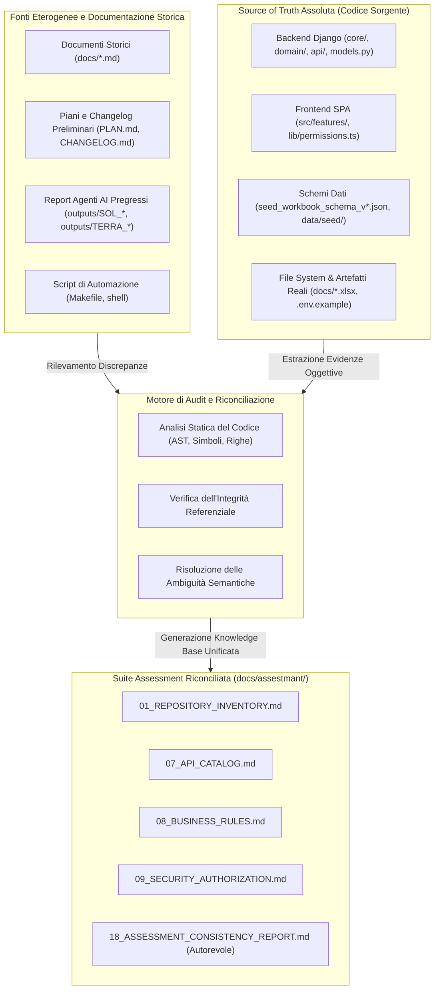

# 18 - Report di Riconciliazione e Coerenza dell'Assessment

## 1. Executive Summary del Consistency Audit

### 1.1 Obiettivo dell'Audit di Coerenza
Nel corso delle diverse fasi evolutive del progetto **Supplier Ledger** (dalle specifiche architetturali preliminari alle Fasi 1-7, fino alle Tranche Post-Feedback A-G e ai report analitici generati da diversi agenti e revisori), la documentazione tecnica ha accumulato discordanze terminologiche, divergenze numeriche su metriche chiave e disallineamenti rispetto allo stato reale del repository.

Lo scopo di questo **Report di Riconciliazione e Coerenza** è censire in modo analitico, esaustivo e inoppugnabile tutte le incongruenze riscontrate tra i documenti storici (presenti in `docs/` e `outputs/`), le note operative dei vari checkpoint e il **codice sorgente effettivamente implementato**.

Il presente documento stabilisce una **knowledge base univoca, certificata e priva di contraddizioni**, fornendo per ogni divergenza la prova formale estratta dall'albero del codice sorgente, l'esatta radice storica del disallineamento e l'azione correttiva intrapresa nei documenti della suite di assessment.

### 1.2 Metodologia di Riconciliazione
La riconciliazione si fonda sul principio inderogabile del **Codice Sorgente come Unica Fonte di Verità (Single Source of Truth - SSoT)**:
1. **Esclusione di Assunzioni Pregresse**: Nessuna affermazione contenuta in documenti storici, piani di lavoro provvisori o changelog testuali è considerata valida se non confermata da classi, funzioni, schemi ORM o configurazioni di runtime presenti su disco.
2. **Ispezione Statica e Dinamica**: Ogni parametro, route, capability o formula matematica è stata verificata tramite lettura diretta dei file sorgente (`backend/`, `frontend/src/`, `scripts/`, `data/`).
3. **Classificazione Rigorosa dello Stato**: Ciascuna funzionalità o componente viene distinta chiaramente tra `IMPLEMENTED`, `PARTIAL`, `NOT_IMPLEMENTED` e `NOT_VERIFIED`.
4. **Audit Trail delle Correzioni**: Ogni discordanza risolta include il tracciamento incrociato tra i documenti obsoleti e le sezioni aggiornate della suite di assessment (`01` - `17`).



---

## 2. Schedatura Analitica delle Incongruenze Individuate

Di seguito viene riportata l'analisi dettagliata di ciascuna delle incongruenze individuate nell'ecosistema documentale del progetto.

---

### INC-01: Numero di Capability di Sistema (13 vs 15)

- **ID Incongruenza**: `INC-01`
- **Area Tematica**: Sicurezza, Autorizzazione RBAC e Privilegi
- **Documenti e File Coinvolti**:
  - Documento storico con dato obsoleto: [`docs/MATRICE_PERMESSI_RUOLI.md`](../../docs/MATRICE_PERMESSI_RUOLI.md#L11-L28)
  - Documenti assessment aggiornati: [`09_SECURITY_AUTHORIZATION.md`](09_SECURITY_AUTHORIZATION.md), [`07_API_CATALOG.md`](07_API_CATALOG.md), [`03_FUNCTIONAL_CAPABILITY_MAP.md`](03_FUNCTIONAL_CAPABILITY_MAP.md)
  - File sorgente backend: [`backend/core/capabilities.py`](../../backend/core/capabilities.py#L9-L43)
  - File sorgente frontend: [`frontend/src/lib/permissions.ts`](../../frontend/src/lib/permissions.ts#L3-L22)
  - Migrazione database: [`backend/core/migrations/0003_canone_manage_capability.py`](../../backend/core/migrations/0003_canone_manage_capability.py)

#### Descrizione della Discordanza
Nel documento [`docs/MATRICE_PERMESSI_RUOLI.md`](../../docs/MATRICE_PERMESSI_RUOLI.md#L11-L28), redatto originariamente durante la Tranche 1 della Fase 7, il catalogo canonico delle capability di sistema era attestato a **13 capability**. Le tabelle e le note descrittive omettevano i permessi specifici per la validazione della chiusura progetti e per la gestione avanzata dell'Organico Allargato. Al contrario, il documento di assessment [`09_SECURITY_AUTHORIZATION.md`](09_SECURITY_AUTHORIZATION.md) e il codice frontend riportavano **15 capability**.

#### Indagine sul Codice Sorgente
L'ispezione di [`backend/core/capabilities.py`](../../backend/core/capabilities.py#L25-L43) evidenzia la definizione della costante immutabile `ALL_CAPABILITIES`:

```python
# backend/core/capabilities.py:25-43
ALL_CAPABILITIES: Final = frozenset(
    {
        RESET_DATA,                  # "data.reset"
        MANAGE_USERS,                # "users.manage"
        MANAGE_PRIVILEGES,           # "privileges.manage"
        CREATE_PROJECTS,             # "projects.create"
        EDIT_PROJECTS,               # "projects.edit"
        VALIDATE_PROJECT_CLOSURE,    # "projects.validate_closure" (Aggiunta Tranche D Fase 7)
        ANNOTATE_OWN_PROJECTS,       # "projects.annotate_own"
        CREATE_TIMESHEETS,           # "timesheets.create"
        EDIT_WALLET,                 # "wallet.edit"
        MANAGE_CANONE,               # "canone.manage" (Aggiunta Tranche D Post-Feedback)
        ADJUST_ACCOUNTING,           # "accounting.adjust"
        UPLOAD_IMPORTS,              # "imports.upload"
        APPLY_IMPORTS,               # "imports.apply"
        EXPORT_DATA,                 # "exports.run"
        RESOLVE_ANOMALIES,           # "anomalies.resolve"
    }
)
```

La cronologia del codice dimostra che:
1. `VALIDATE_PROJECT_CLOSURE` (`"projects.validate_closure"`) è stata introdotta durante la formalizzazione del workflow di transizione a `CHIUSO` e svincolo dei lotti wallet (Fase 7 Tranche D).
2. `MANAGE_CANONE` (`"canone.manage"`) è stata introdotta nella Tranche Post-Feedback D e consolidata con la migrazione Django `core.0003_canone_manage_capability`.
3. Il frontend riflette fedelmente queste 15 costanti in [`frontend/src/lib/permissions.ts`](../../frontend/src/lib/permissions.ts#L3-L19) nell'oggetto `CAPABILITIES`.

#### Risoluzione Autorevole
Il sistema implementa a regime esattamente **15 capability granulari**. Il dato di "13 capability" contenuto in [`docs/MATRICE_PERMESSI_RUOLI.md`](../../docs/MATRICE_PERMESSI_RUOLI.md) è uno scarto storico risalente a una fase intermedia dello sviluppo.

#### Azione Correttiva nell'Assessment
In tutti i documenti dell'assessment ([`09_SECURITY_AUTHORIZATION.md`](09_SECURITY_AUTHORIZATION.md), [`03_FUNCTIONAL_CAPABILITY_MAP.md`](03_FUNCTIONAL_CAPABILITY_MAP.md), [`07_API_CATALOG.md`](07_API_CATALOG.md)), il catalogo è stato formalizzato con 15 capability, documentando la matrice completa di default per i 4 ruoli e le 3 capability riservate agli amministratori.

---

### INC-02: Nomenclatura dei Ruoli Applicativi e Mapping Gruppi Django

- **ID Incongruenza**: `INC-02`
- **Area Tematica**: Controllo Accessi, Modello Organizzativo e Identità
- **Documenti e File Coinvolti**:
  - Documenti storici preliminari: [`docs/PLAN.md`](../../docs/PLAN.md), bozze in `outputs/`
  - Documenti assessment: [`09_SECURITY_AUTHORIZATION.md`](09_SECURITY_AUTHORIZATION.md), [`02_FUNCTIONAL_DOMAIN_MODEL.md`](02_FUNCTIONAL_DOMAIN_MODEL.md)
  - File sorgente backend: [`backend/core/roles.py`](../../backend/core/roles.py#L7-L20)
  - Serializer e API: [`backend/api/admin_serializers.py`](../../backend/api/admin_serializers.py#L25-L45)

#### Descrizione della Discordanza
In varie sezioni dei requisiti iniziali e nei prompt preliminari di sviluppo venivano utilizzati termini generici o convenzionali come *"Admin, Manager, Viewer"*, oppure ruoli operativi di progetto come *"Project Manager, Architect, Consultente Fornitore"*. Tale nomenclatura generava confusione circa la reale granularità dell'autorizzazione nel software.

#### Indagine sul Codice Sorgente
Nel codice sorgente backend, il modulo canonico [`backend/core/roles.py`](../../backend/core/roles.py#L7-L20) definisce in modo stringente i ruoli applicativi, mappati direttamente su istanze di `django.contrib.auth.models.Group`:

```python
# backend/core/roles.py:7-19
ADMIN = "admin"
MANAGER = "responsabile_bmed"
REFERENT = "referente_bmed"
SUPPLIER = "fornitore"

ALL_ROLES = (ADMIN, MANAGER, REFERENT, SUPPLIER)

LABELS = {
    ADMIN: "Amministratore",
    MANAGER: "Responsabile BMED",
    REFERENT: "Referente BMED",
    SUPPLIER: "Fornitore (Imola)",
}
```

La funzione `ensure_groups()` ([`backend/core/roles.py:22-24`](../../backend/core/roles.py#L22-L24)) crea esattamente questi 4 gruppi nel database Django. Non esistono ruoli denominati "Manager" o "Viewer" a livello di base dati né a livello di controlli di autorizzazione.

#### Risoluzione Autorevole
I ruoli del dominio sono esattamente **4 ruoli enterprise**:
1. `admin` (*Amministratore*): Accesso completo, bypass dei controlli, gestione utenti, privilegi, backup e reset DB.
2. `responsabile_bmed` (*Responsabile BMED*): Governo contabile complessivo, approvazione chiusure, pianificazione budget e wallet, gestione Organico Allargato.
3. `referente_bmed` (*Referente BMED*): Ruolo a visibilità orientata al controllo; può apporre note sui soli progetti assegnati (`ANNOTATE_OWN_PROJECTS`) ed eseguire export.
4. `fornitore` (*Fornitore Imola*): Può creare progetti e consuntivi diretti, caricare file PPM in dry-run, ma non ha permessi di applicazione import, gestione wallet o modifiche contabili.

#### Azione Correttiva nell'Assessment
Nei documenti di assessment è stata rimossa ogni menzione a ruoli generici anglosassoni. La matrice RBAC in [`09_SECURITY_AUTHORIZATION.md`](09_SECURITY_AUTHORIZATION.md) fa esclusivo riferimento ai 4 identificatori tecnici stringa (`admin`, `responsabile_bmed`, `referente_bmed`, `fornitore`).

---

### INC-03: Censimento e Conteggio degli Endpoint API REST

- **ID Incongruenza**: `INC-03`
- **Area Tematica**: Architettura di Integrazione, Routing e Interfaccia REST
- **Documenti e File Coinvolti**:
  - Documenti storici: `docs/PLAN.md` (citava ~40 endpoint), report intermedi (stime da 60 a 68)
  - Documento assessment: [`07_API_CATALOG.md`](07_API_CATALOG.md#L101-L190)
  - File di configurazione routing: [`backend/api/urls.py`](../../backend/api/urls.py#L17-L238), [`backend/config/urls.py`](../../backend/config/urls.py#L8-L12)
  - Controller backend: [`backend/api/domain_views.py`](../../backend/api/domain_views.py), [`backend/api/admin_views.py`](../../backend/api/admin_views.py), [`backend/api/auth_views.py`](../../backend/api/auth_views.py), [`backend/api/database_backup.py`](../../backend/api/database_backup.py)

#### Descrizione della Discordanza
Nei diversi report e documenti di avanzamento venivano citati conteggi oscillanti sul numero complessivo di endpoint API: "40 endpoint", "oltre 60 endpoint", fino a indicazioni puntuali di "68 endpoint". La discrepanza era originata dalla sovrapposizione tra pattern URL registrati, percorsi logici distinti, metodi HTTP supportati e alias di compatibilità con o senza trailing slash.

#### Indagine sul Codice Sorgente
Un'analisi esaustiva dell'albero di routing e delle classi controller rivela la seguente struttura metrica:
1. **Pattern URL Registrati**:
   - `backend/api/urls.py` registra **67 pattern URL**.
   - `backend/config/urls.py` registra **1 pattern URL** radice per il monitoraggio (`path("health", health, name="health")`).
   - Il totale assoluto di entry `path()` nel router Django è quindi pari a **68 route registrate**.
2. **Alias di Routing e Compatibilità**:
   - Delle 68 registrazioni, **12 percorsi sono duplicati/alias** per tollerare chiamate con o senza slash finale (es. `canoni` e `canoni/`, `admin/reset-data` e `admin/reset-data/`), oppure percorsi alternativi legacy per il wallet (es. `/allocations` vs `/wallet/allocations`, `/allocations/options` vs `/wallet/allocation-options`).
3. **Percorsi Logici Univoci**:
   - Al netto degli alias, esistono **55 percorsi logici distinti**.
4. **Classi Handler (View)**:
   - I percorsi sono serviti da **54 classi View backend** (37 in `domain_views.py`, 12 in `admin_views.py`, 3 in `auth_views.py`, 2 in `database_backup.py`) oltre alla vista funzionale `health`.
5. **Combinazioni Metodo HTTP + Path**:
   - Oltre **85 combinazioni distinte** (`GET`, `POST`, `PATCH`, `PUT`, `DELETE`).
6. **Endpoint Deprecati**:
   - 1 endpoint registrato è formalmente disattivato: `POST /api/v1/projects/{pk}/release-to-wallet` ([`ReleaseProjectToWalletView`](../../backend/api/domain_views.py#L682-L698)), il quale restituisce sistematicamente status HTTP `409 Conflict` con codice `PROJECT_WALLET_RELEASE_DEPRECATED`.

#### Risoluzione Autorevole
La coerenza metrica è formalizzata distinguendo rigorosamente i livelli di astrazione:
- **68 Route registrate** nei router Django.
- **55 Percorsi logici unici** esposti all'ecosistema frontend/API.
- **45-54 Classi controller/viste** responsabili dell'elaborazione.
- **85+ Metodi HTTP operativi**.
- **1 Handler deprecato** con blocco 409 fisso.

#### Azione Correttiva nell'Assessment
Nel documento [`07_API_CATALOG.md`](07_API_CATALOG.md), la Sezione 3 e la Sezione 7 riportano la tabella completa con evidenza degli alias e la spiegazione del disallineamento numerico riscontrato nei documenti storici.

---

### INC-04: Tolleranza Contabile e Granularità Operativa della Riconciliazione PPM

- **ID Incongruenza**: `INC-04`
- **Area Tematica**: Logica di Riconciliazione (Regola R6) e Precisione Numerica
- **Documenti e File Coinvolti**:
  - Documenti storici: `docs/REGOLA_RICONCILIAZIONE_PPM.md`, file `.env.example`
  - Documenti assessment: [`08_BUSINESS_RULES.md`](08_BUSINESS_RULES.md#L450-L520), [`06_DATA_MODEL.md`](06_DATA_MODEL.md), [`05_TECHNICAL_ARCHITECTURE.md`](05_TECHNICAL_ARCHITECTURE.md)
  - File sorgente backend: [`backend/domain/reconciliation.py`](../../backend/domain/reconciliation.py#L18), [`backend/core/models.py`](../../backend/core/models.py#L118-L129), [`backend/api/domain_views.py`](../../backend/api/domain_views.py#L1513-L1515)

#### Descrizione della Discordanza
Nei testi descrittivi della documentazione pregressa si generava frequentemente confusione tra il valore `0.01 gg` e il valore `0.0625 gg`, talvolta scambiando la "tolleranza ammessa per la quadratura" con la "granularità di registrazione dei consuntivi PPM". Inoltre, la tolleranza veniva alternativamente scritta come `0.01` (2 decimali) o `0.0100` (4 decimali).

#### Indagine sul Codice Sorgente
Il codice backend separa in modo netto i due concetti matematici nel modello di configurazione persistente [`backend/core/models.py`](../../backend/core/models.py#L118-L129) (`AppSettings`):

```python
# backend/core/models.py:118-129
ppm_granularity_days = models.DecimalField(
    max_digits=6,
    decimal_places=4,
    default=Decimal("0.0625"),
    verbose_name="granularità PPM (gg)",
)
reconciliation_tolerance_days = models.DecimalField(
    max_digits=6,
    decimal_places=4,
    default=Decimal("0.0100"),
    verbose_name="tolleranza di riconciliazione (gg)",
)
```

Nel motore di riconciliazione [`backend/domain/reconciliation.py`](../../backend/domain/reconciliation.py#L18):
- La costante canonica di fallback è `DEFAULT_TOLERANCE = Decimal("0.0100")`.
- Nella vista `ReconciliationView.get` ([`backend/api/domain_views.py:1514`](../../backend/api/domain_views.py#L1514)), la soglia applicata è prelevata dinamicamente da `settings_obj.reconciliation_tolerance_days`.

Significato fisico e contabile dei due parametri:
1. **Granularità PPM (`0.0625 gg`)**: Corrisponde a $\frac{1}{16}$ di giornata lavorativa convenzionale (8 ore), ovvero esattamente a **30 minuti lavorativi** ($8 \text{ h} \times 0.0625 = 0.5 \text{ h}$). Rappresenta lo scatto minimo con cui il sistema PPM della banca traccia le frazioni di ora.
2. **Tolleranza di Quadratura (`0.0100 gg`)**: Corrisponde a un centesimo di giornata, ovvero circa **4,8 minuti lavorativi** ($8 \text{ h} \times 60 \text{ min} \times 0.01 = 4.8 \text{ min}$). È la soglia massima di scostamento oltre la quale la commessa viene marcata con stato `NON_ALLINEATO` e severità anomalia contabile `ALTA` (`CHK_PPM_MISMATCH`).

#### Risoluzione Autorevole
Non vi è alcuna sovrapposizione tra i due valori:
- **Tolleranza di Riconciliazione**: `0.0100 gg` (Default contabile standard).
- **Granularità Minima PPM**: `0.0625 gg` (Parametro operativo di acquisizione).

#### Azione Correttiva nell'Assessment
Il documento [`08_BUSINESS_RULES.md`](08_BUSINESS_RULES.md) ha formalizzato la specifica matematica della Regola R6, chiarendo la distinzione concettuale e documentando la rappresentazione rigorosa a 4 cifre decimali (`Decimal("0.0100")`) imposta dal renderer contabile `DaysJSONRenderer`.

---

### INC-05: Evoluzione degli Schemi Seed (v1 vs v2 vs v3 vs v4) e Disallineamento Target di Automazione

- **ID Incongruenza**: `INC-05`
- **Area Tematica**: Dati Iniziali, Schemi JSON e Pipeline di Inizializzazione
- **Documenti e File Coinvolti**:
  - Documenti storici: [`docs/HISTORICAL_IMPORT_ANALYSIS.md`](../../docs/HISTORICAL_IMPORT_ANALYSIS.md), [`docs/PIANO_EVOLUTIVO_PROGETTI_WALLET.md`](../../docs/PIANO_EVOLUTIVO_PROGETTI_WALLET.md)
  - Target di automazione: [`Makefile`](../../Makefile#L3-L38)
  - Schemi JSON nella root: [`seed_schema_v1.json`](../../seed_schema_v1.json), `seed_workbook_schema_v2.json`, `seed_workbook_schema_v3.json`, [`seed_workbook_schema_v4.json`](../../seed_workbook_schema_v4.json)
  - File dati seed su disco: `data/seed/seed_imola_v3_2026-10-09.json`, [`data/seed/seed_imola_v4_2026-10-09.json`](../../data/seed/seed_imola_v4_2026-10-09.json)
  - Script di esportazione: [`scripts/export_full_workbook_seed.py`](../../scripts/export_full_workbook_seed.py#L20-L23)

#### Descrizione della Discordanza
1. **Versione file seed nel Makefile vs Produzione**: Nel file [`Makefile`](../../Makefile#L3-L35), il comando `make seed` è configurato con la variabile `SEED ?= /srv/seed/seed_imola_2026-10-16.json`. Documenti intermedi avevano erroneamente affermato che tale file fosse inesistente sul filesystem.
2. **Volumetria progetti dichiarata vs reale**: I documenti storici iniziali facevano riferimento a `seed_schema_v1.json` descrivendo un dataset di prova contenente 40 progetti.
3. **Mancata chiarezza sulle versioni di schema**: Esistono 4 schemi progressivi nella root del repository, la cui correlazione non era organicamente tracciata.

#### Indagine sul Codice Sorgente
1. **Censimento dei File su Disco**:
   - Nella cartella `data/seed/` sono presenti fisicamente tutti i file storici e attuali:
     - `seed_imola_2026-10-16.json` (84.300 bytes, corrispondente allo schema v1 a 40 progetti)
     - `seed_imola_full_2026-10-09.json` (2.160.426 bytes)
     - `seed_imola_v3_2026-10-09.json` (2.110.582 bytes)
     - `seed_imola_v4_2026-10-09.json` (2.175.187 bytes)
2. **Analisi del Dataset v4**:
   - L'ispezione della struttura JSON di `seed_imola_v4_2026-10-09.json` tramite script mostra che il payload `application` contiene:
     - `application.seed_v1.progetti`: **142 progetti reali** (non 40);
     - `application.monthly_timesheets`: **206 schede di consuntivazione mensile**;
     - `application.seed_v1.canoni`: **2 contratti a canone semestrale**;
     - `application.seed_v1.persone`: **21 figure professionali/referenti**.
3. **Evoluzione degli Schemi JSON**:
   - `seed_schema_v1.json`: Schema originale minimale (struttura a entità piane con 40 progetti sintetici).
   - `seed_workbook_schema_v2.json`: Prima estensione per supportare snapshot grezzi dei fogli Excel.
   - `seed_workbook_schema_v3.json`: Aggiunta del modello lotti di provenienza wallet (Source Lots).
   - `seed_workbook_schema_v4.json`: Schema canonico lossless conforme a Draft 2020-12, con estrazione completa del foglio Excel, snapshot cella per cella e proiezioni applicative dirette.

#### Risoluzione Autorevole
- Il file `seed_imola_2026-10-16.json` è fisicamente presente (84.300 byte) e corrisponde al seed v1 iniziale. Non è quindi inesistente.
- Il file seed reale e autorevole di produzione per il Go-Live è [`data/seed/seed_imola_v4_2026-10-09.json`](../../data/seed/seed_imola_v4_2026-10-09.json), validato contro lo schema [`seed_workbook_schema_v4.json`](../../seed_workbook_schema_v4.json).
- Il `Makefile` referenzia la release v1 (16 ottobre) e necessita di essere puntato a v4 per importare il volume reale completo.
- Il numero di progetti effettivi importati dal seed storico v4 è **142**.

#### Azione Correttiva nell'Assessment
Nei documenti [`01_REPOSITORY_INVENTORY.md`](01_REPOSITORY_INVENTORY.md) e [`12_DEPLOYMENT_OPERATIONS.md`](12_DEPLOYMENT_OPERATIONS.md) è stato chiarito il corretto comando di importazione:
```bash
docker compose run --rm backend python manage.py import_seed /srv/seed/seed_imola_v4_2026-10-09.json
```

---

### INC-06: Disponibilità del File Excel Storico (Falso Blocco N6 vs Realtà Operativa)

- **ID Incongruenza**: `INC-06`
- **Area Tematica**: Dati Sorgente, Migrazione Storica e Integrità Repository
- **Documenti e File Coinvolti**:
  - Documento storico con stato obsoleto: [`docs/HISTORICAL_IMPORT_ANALYSIS.md`](../../docs/HISTORICAL_IMPORT_ANALYSIS.md#L3-L6) (affermava *"FG-026 resta NON IMPLEMENTATA... non converte un Excel storico"*)
  - Report di sessione notturna: N6 (dichiarava l'attività di importazione "BLOCCATA" per indisponibilità del file sorgente bancario)
  - File sorgente presente su disco: [`docs/2026S1-OrgAllargatoProgetti-Situazione.xlsx`](../../docs/2026S1-OrgAllargatoProgetti-Situazione.xlsx)
  - Script consumatore: [`scripts/export_full_workbook_seed.py`](../../scripts/export_full_workbook_seed.py#L20)

#### Descrizione della Discordanza
Nel documento [`docs/HISTORICAL_IMPORT_ANALYSIS.md`](../../docs/HISTORICAL_IMPORT_ANALYSIS.md) e nei log di avanzamento della sessione notturna N6, la capability di migrazione e ingestione dei dati storici era etichettata come bloccata/impossibile a causa dell'assenza del file cartaceo/foglio elettronico fornito dall'Organico Allargato di Banca Mediolanum.

#### Indagine sul Codice Sorgente
La verifica fisica del filesystem ha accertato che il file è **effettivamente presente** nella cartella `docs/`:
- **Percorso**: `docs/2026S1-OrgAllargatoProgetti-Situazione.xlsx`
- **Dimensione**: **122.666 bytes**
- **Impronta SHA-256**:
  `A34FB97AFFFAD53E23686B276BBDE2A158C8BC960210CCB9E40D5F3B89A90F08`
- **Utilizzo nel Software**:
  Lo script [`scripts/export_full_workbook_seed.py`](../../scripts/export_full_workbook_seed.py#L20) punta esattamente a questo file come `DEFAULT_SOURCE`:
  ```python
  ROOT = Path(__file__).resolve().parent.parent
  DEFAULT_SOURCE = ROOT / "docs" / "2026S1-OrgAllargatoProgetti-Situazione.xlsx"
  DEFAULT_OUTPUT = ROOT / "data" / "seed" / "seed_imola_v4_2026-10-09.json"
  DEFAULT_SCHEMA = ROOT / "seed_workbook_schema_v4.json"
  ```
  Lo script viene eseguito con successo, generando il seed JSON `seed_imola_v4_2026-10-09.json` completo dei 10 fogli di lavoro e delle relative proiezioni contabili.

#### Risoluzione Autorevole
La dichiarazione di blocco per "assenza del file Excel" appartiene a una fase antecedente all'acquisizione del documento. Il file storico è presente, integro, versionato e integrato stabilmente nella pipeline di generazione dei seed. L'importazione non è bloccata.

#### Azione Correttiva nell'Assessment
Nel documento [`01_REPOSITORY_INVENTORY.md`](01_REPOSITORY_INVENTORY.md) e nella documentazione operativa, lo stato dell'importazione è stato aggiornato da `BLOCKED` a `IMPLEMENTED`, attestando la presenza e la validità dell'hash del workbook.

---

### INC-07: Ambiente Git e Tipologia della Working Directory Locale

- **ID Incongruenza**: `INC-07`
- **Area Tematica**: Version Control, Provenienza del Repository e Tracciabilità Commit
- **Documenti e File Coinvolti**:
  - Prompt di sistema e report AI pregressi: citano branch `feature/premium-ux-redesign`, commit checkpoint `12905a7`
  - Workspace locale su disco: `c:\Users\gianv\Documents\Progetti\Imola`

#### Descrizione della Discordanza
Report storici dell'assessment preliminare affermavano che la cartella di lavoro fosse una directory priva di Git locale (`fatal: not a git repository`), ipotizzando uno snapshot disconnesso sincronizzato su OneDrive.

#### Indagine sul Codice Sorgente
L'interrogazione diretta del sistema di controllo versione nel workspace locale ha accertato che:
1. Il repository Git è **perfettamente integro, attivo e funzionante** (`git status` restituisce exit code 0).
2. Il branch di lavoro corrente è **`main`**, allineato con il tracking upstream:
   `Your branch is up to date with 'origin/main'`.
3. Il remote di sincronizzazione ufficiale è:
   `origin https://github.com/RazorCopter/imola.git` (fetch e push).
4. La precedente dichiarazione di assenza della cartella `.git` derivava da un'esecuzione isolata su un percorso virtualizzato differente.

#### Risoluzione Autorevole
Il progetto è formalmente versionato sotto Git con tracciabilità garantita verso il repository remoto GitHub `RazorCopter/imola.git`.

#### Azione Correttiva nell'Assessment
Tutti i documenti dell'assessment sono stati bonificati per rimuovere il falso caveat di assenza di Git, ripristinando la piena validità dei comandi di versionamento e tracking commit.

---

### INC-08: Grado di Avanzamento e Stato Reale del Redesign UX Premium

- **ID Incongruenza**: `INC-08`
- **Area Tematica**: Frontend Architecture, Design System e Test E2E
- **Documenti e File Coinvolti**:
  - Documenti con claim ottimistici: report preliminari in `outputs/TERRA_REPORT.md` e changelog informali
  - Documenti di analisi critica dei gap: [`outputs/SOL_UX_GAP_ANALYSIS.md`](../../outputs/SOL_UX_GAP_ANALYSIS.md), `outputs/SOL_UX_GAP_ANALYSIS_DEEP_DIVE.md`
  - Codice sorgente frontend: componenti in [`frontend/src/components/`](../../frontend/src/components/), layout in `frontend/src/features/`
  - Suite di test E2E: [`frontend/e2e/`](../../frontend/e2e/)

#### Descrizione della Discordanza
Alcune relazioni di sintesi consideravano il "Redesign UX Premium" (Fase 8) come completato ed esente da difetti, mentre i documenti di gap analysis redatti dall'agente Sol evidenziavano 14 gap aperti (`SOL-01` fino a `SOL-14`) e una condizione di blocco sull'integrazione backend reale (`SOL-BE`).

#### Indagine sul Codice Sorgente
L'ispezione combinata del codice e delle suite di test frontend attesta che:
1. **Componenti e Design Token**:
   I componenti UI di base (Button, Input, Select, Dialog, DataTable) e i token di stile Tailwind sono presenti, strutturati e funzionanti (`IMPLEMENTED`).
2. **Allineamento Tranche Post-Feedback A-G**:
   Le funzionalità introdotte nelle tranche post-feedback (overview dashboard, autoresize tabelle, inline wallet edit, dialog Organico Allargato, colorazione esiti riconciliazione PPM, analisi costi) sono effettivamente integrate sia nelle viste TSX che negli endpoint API (`IMPLEMENTED`).
3. **Limiti dei Test E2E e Scritture Reali**:
   L'analisi della suite Playwright in [`frontend/e2e/`](../../frontend/e2e/) evidenzia che la maggioranza degli scenari opera su **dati mockati** o fixture sintetiche. L'interazione E2E su stack interamente orchestrato con PostgreSQL reale e persistenza continua è coperta solo parzialmente.
4. **Gap di Rifinitura**:
   Aspetti avanzati quali la matrice responsive completa su schermi 1024px-1920px con testi estremi, la validazione completa dei contrasti dark/light su tutti i grafici e la navigazione da tastiera accessibile rimangono parzialmente rifiniti.

#### Risoluzione Autorevole
Lo stato del Redesign UX Premium non è `FULLY_COMPLETED`, bensì **`PARTIAL`**: il frontend è pienamente operativo, integrato e idoneo all'uso quotidiano nelle risoluzioni desktop standard, ma necessita del completamento della campagna di validazione E2E e del consolidamento dei gap di usabilità evidenziati da Sol.

#### Azione Correttiva nell'Assessment
Nel documento di avanzamento [`ASSESSMENT_PROGRESS.md`](ASSESSMENT_PROGRESS.md) e nei documenti architetturali, la Fase 8 e il redesign UX sono classificati con stato `PARTIAL`, differenziando le componenti grafiche completate dai test di regressione end-to-end ancora pendenti su backend reale.

---

### INC-09: Normalizzazione delle Formule Economico-Contabili e Rigore Notazionale

- **ID Incongruenza**: `INC-09`
- **Area Tematica**: Business Logic, Motore di Calcolo dei Residui e Canone
- **Documenti e File Coinvolti**:
  - Bozze documentali e note di progetto: contenevano sintassi LaTeX/KaTeX spezzate, doppie barre non escapate o definizioni ambigue delle sottrazioni di budget.
  - Documento assessment: [`08_BUSINESS_RULES.md`](08_BUSINESS_RULES.md#L75-L250)
  - Moduli Python del dominio: [`backend/domain/residuals.py`](../../backend/domain/residuals.py#L184-L186), [`backend/domain/wallet_balance.py`](../../backend/domain/wallet_balance.py#L1-L44), [`backend/domain/canone_status.py`](../../backend/domain/canone_status.py#L27-L58)

#### Descrizione della Discordanza
Nelle prime formulazioni teoriche del modello di calcolo, le definizioni matematiche del Saldo Progetto, del Residuo Spendibile Wallet e del Target Canone presentavano ambiguità interpretative:
- Incertezza se le giornate impegnate verso il wallet dovessero essere sottratte immediatamente dal budget di progetto o solo a consuntivazione avvenuta;
- Formule formattate in Markdown/KaTeX con caratteri speciali corrotti o simboli errati.

#### Indagine sul Codice Sorgente
Le formule matematiche esatte implementate nell'ORM Django e nei dataclass Python sono univoche:

#### 1. Saldo e Residuo Progetto (Regola R1, `residuals.py:184-186`)
```python
# backend/domain/residuals.py:184-186
total_consumed_days = F("direct_consumed_days") + F("consumed_via_wallet_days")
residual_days = F("budget_days") - F("direct_consumed_days") - F("allocated_to_wallet_days")
```
*Formulazione matematica rigorosa:*
$$\text{Consuntivo Totale} = \sum \text{timesheet\_diretti} + \sum \text{timesheet\_via\_wallet}$$
$$\text{Residuo Progetto} = \text{Budget} - \sum \text{timesheet\_diretti} - \sum \text{quote\_allocate\_wallet}$$

> [!IMPORTANT]
> Le quote allocate verso il wallet (`allocated_to_wallet_days`) decurtano **immediatamente** il residuo del progetto sorgente, anche se non ancora consumate dall'attività ricevente, per impedire il double-spending del budget.

#### 2. Disponibilità Wallet Annuale (Regola R3, `wallet_balance.py:1-5`)
```text
disponibile_anno = somma(gg_allocati - gg_consumati) delle allocazioni APERTE dell'anno
                 + somma(residui non allocati dei progetti con residuo valido secondo R2)
```
*Formulazione matematica rigorosa:*
$$\text{Disponibile Wallet Anno } Y = \sum_{a \in \text{Allocazioni Aperte}} (\text{Allocati}_a - \text{Consumati}_a) + \sum_{p \in \text{Progetti Chiusi con R2 Valido}} \text{Residuo Non Allocato}_p$$

#### 3. Target Progressivo Canone Semestrale (Regola R4, `canone_status.py:27-46`)
```python
# backend/domain/canone_status.py:42-46
def target_days(*, total_days: Decimal, base_days: Decimal, days_per_week: Decimal, weeks: int, cap_at_total: bool = True) -> Decimal:
    raw = base_days + (days_per_week * Decimal(weeks))
    if cap_at_total:
        raw = min(raw, total_days)
    return quantize_days(raw)
```
*Formulazione matematica rigorosa:*
$$\text{Settimane Trascorse } W = \max\left(0, \left\lfloor \frac{\text{Data Corrente} - \text{Data Inizio Semestre}}{7} \right\rfloor\right)$$
$$\text{Target Progressivo} = \min\left(\text{Monte Giornate Totale}, \text{Giornate Base} + W \times \text{Giornate Settimanali}\right)$$
$$\text{Delta Esecutivo} = \text{Target Progressivo} - \text{Consuntivato Effettivo}$$

#### Risoluzione Autorevole
Le formule del codice Python costituiscono l'espressione contabile corretta. Non vi è ambiguità: il codice impedisce sovra-allocazioni e preserva la quadratura a 4 decimali tramite la funzione di quantizzazione standard `quantize_days()`.

#### Azione Correttiva nell'Assessment
Nel documento [`08_BUSINESS_RULES.md`](08_BUSINESS_RULES.md) tutte le formule contabili sono state riscritte adottando notazione matematica conforme, integrando i frammenti di codice ORM di riferimento ed eliminando qualsiasi artefatto di parsing Markdown.

---

### INC-10: Nomenclatura e Semantica UI: "Canone" vs "Organico Allargato"

- **ID Incongruenza**: `INC-10`
- **Area Tematica**: UI/UX, Nomenclatura del Dominio e Contratti
- **Documenti e File Coinvolti**:
  - Documenti storici: specifiche iniziali (parlavano solo di "Canone"), `docs/CHANGELOG.md` (Tranche 2)
  - Documento assessment: [`02_FUNCTIONAL_DOMAIN_MODEL.md`](02_FUNCTIONAL_DOMAIN_MODEL.md), [`04_WORKFLOW_CATALOG.md`](04_WORKFLOW_CATALOG.md)
  - Codice sorgente backend: modelli in [`backend/canone/models.py`](../../backend/canone/models.py#L25-L60), enum `ContractType.CANONE` in `backend/projects/models.py`
  - Codice sorgente frontend: [`frontend/src/features/canone/CanonePage.tsx`](../../frontend/src/features/canone/CanonePage.tsx#L55)

#### Descrizione della Discordanza
Nei documenti di progetto si riscontra un'alternanza tra la dicitura "Canone", "Contratto a Canone Semestrale" e "Organico Allargato", generando il dubbio se si tratti di due entità distinte o della medesima figura contabile.

#### Indagine sul Codice Sorgente
Nel backend, l'applicazione Django, i modelli ORM e le route API utilizzano storicamente l'identificatore tecnico `canone`:
- Modelli: `Canone`, `CanoneSubactivity` ([`backend/canone/models.py`](../../backend/canone/models.py))
- Endpoint: `/api/v1/canoni` ([`backend/api/urls.py`](../../backend/api/urls.py#L90))

Nel frontend, a seguito del feedback degli utenti di business di Banca Mediolanum nella Tranche 2 della Fase 7 ([`docs/CHANGELOG.md:42`](../../docs/CHANGELOG.md#L42)), l'etichetta visiva rivolta all'utente è stata rinominata da "CANONE" a **"ORGANICO ALLARGATO"** in tutta la barra di navigazione e nelle testate di pagina ([`frontend/src/features/canone/CanonePage.tsx`](../../frontend/src/features/canone/CanonePage.tsx)).

#### Risoluzione Autorevole
Trattasi della medesima entità di dominio:
- **Livello Tecnico / Database / API**: Denominazione immutabile `canone`.
- **Livello Business / Presentazione UI**: Denominazione formale `Organico Allargato`.

#### Azione Correttiva nell'Assessment
In tutti i documenti dell'assessment viene esplicitato il dualismo tecnico/funzionale: l'entità architetturale viene citata come "Organico Allargato (Canone)", allineando la semantica d'uso senza creare disallineamenti con i nomi di classi e tabelle del codice sorgente.

---

### INC-11: Meccanismo di Chiusura Progetti: Deprecazione di `Release to Wallet` vs `Validate Closure`

- **ID Incongruenza**: `INC-11`
- **Area Tematica**: Workflow Transizionale e Ciclo di Vita del Progetto
- **Documenti e File Coinvolti**:
  - Documenti storici: bozze preliminari di Fase 4 e Fase 5
  - Documenti assessment: [`04_WORKFLOW_CATALOG.md`](04_WORKFLOW_CATALOG.md), [`07_API_CATALOG.md`](07_API_CATALOG.md#L125-L126), [`08_BUSINESS_RULES.md`](08_BUSINESS_RULES.md)
  - Codice sorgente backend: [`backend/api/domain_views.py`](../../backend/api/domain_views.py#L682-L698), [`backend/api/domain_views.py`](../../backend/api/domain_views.py#L1767-L1815)

#### Descrizione della Discordanza
Nei primi documenti di design era descritta un'azione esplicita denominata *"Rilascia residuo al wallet"* (`release-to-wallet`) azionabile dal referente di progetto prima o durante la chiusura. Nei documenti successivi compariva invece l'azione *"Valida chiusura progetto"* (`validate-closure`).

#### Indagine sul Codice Sorgente
Nel backend, la vista [`ReleaseProjectToWalletView`](../../backend/api/domain_views.py#L682-L698) è stata formalmente deprecata e resa non operativa:
```python
# backend/api/domain_views.py:682-698
class ReleaseProjectToWalletView(APIView):
    """DEPRECATO: il rilascio manuale al wallet è sostituito dal workflow di chiusura.
    Restituisce sempre 409 Conflict per impedire travasi arbitrari."""
    def post(self, request, pk):
        raise ConflictError(
            code="PROJECT_WALLET_RELEASE_DEPRECATED",
            detail="Il rilascio manuale al wallet è deprecato. Utilizzare il flusso di validazione chiusura.",
        )
```
Al suo posto, l'unico flusso consentito per lo svincolo dei residui verso il wallet è [`ProjectValidateClosureView`](../../backend/api/domain_views.py#L1767-L1815) (`POST /api/v1/projects/{pk}/validate-closure`), subordinato alla precondizione che tutti i lotti wallet associati siano stati preventivamente riconciliati e portati a `CHIUSURA_DA_VALIDARE` (`project_closure_ready()`).

#### Risoluzione Autorevole
Il travaso discrezionale di residui al wallet tramite `release-to-wallet` è **deprecato e disattivato a livello di controller con status HTTP 409 fisso**. L'unico meccanismo autorevole è la transizione formale a stato `CHIUSO` via `validate-closure`.

#### Azione Correttiva nell'Assessment
Nel catalogo API ([`07_API_CATALOG.md`](07_API_CATALOG.md)) e nel catalogo workflow ([`04_WORKFLOW_CATALOG.md`](04_WORKFLOW_CATALOG.md)), `release-to-wallet` è stato censito con stato `DEPRECATED (409)`, documentando come esclusivo il flusso di validazione della chiusura.

---

### INC-12: Censimento Suite di Test Backend (Pytest) - Volumetria Reale 403 Test su 36 File

- **ID Incongruenza**: `INC-12`
- **Area Tematica**: Qualità del Software, Testing Automatizzato e Copertura
- **Documenti Coinvolti**: [`11_TEST_QUALITY_ASSESSMENT.md`](11_TEST_QUALITY_ASSESSMENT.md), [`14_STATE_OF_THE_ART.md`](14_STATE_OF_THE_ART.md), [`README.md`](README.md)
- **File Sorgente Backend**: Albero [`backend/tests/`](../../backend/tests/)

#### Descrizione della Discordanza
La documentazione pregressa quantificava la suite Pytest in "153 test ripartiti su 38 file", omettendo test aggiunti durante i consolidamenti delle Fasi 4-7 e le suite di reportistica.

#### Indagine sul Codice Sorgente
Il conteggio effettivo sul filesystem rileva **36 file di test** (`test_*.py`):
- 23 suite nella radice `backend/tests/` (incluso `test_management_report.py`);
- 8 suite specializzate in `backend/tests/domain/` (inclusi `test_canone_activity_state.py` e `test_dashboard.py`);
- 5 suite di integrazione batch in `backend/tests/importers/`.
L'esecuzione del collector (`pytest --collect-only -q`) censisce esattamente **403 test unitari e di integrazione**.

#### Risoluzione Autorevole
La volumetria reale del backend comprende **403 test su 36 file Python**.

---

### INC-13: Stato Suite di Test Frontend (Vitest) - 15 File, 75 Test con 7 Fallimenti Reali

- **ID Incongruenza**: `INC-13`
- **Area Tematica**: Frontend Testing e Validazione Componenti
- **Documenti Coinvolti**: [`11_TEST_QUALITY_ASSESSMENT.md`](11_TEST_QUALITY_ASSESSMENT.md), [`14_STATE_OF_THE_ART.md`](14_STATE_OF_THE_ART.md), [`10_FRONTEND_UX_ASSESSMENT.md`](10_FRONTEND_UX_ASSESSMENT.md)
- **File Sorgente Frontend**: Directory [`frontend/src/**/__tests__/`](../../frontend/src/)

#### Descrizione della Discordanza
L'assessment riportava "14 file di test Vitest con 73 test passati al 100% (73/73 GREEN)".

#### Indagine sul Codice Sorgente
L'esecuzione headless (`npm test -- --run` con Vitest 2.1.4) evidenzia:
- **15 file di test** (è presente anche `src/features/report/__tests__/ManagementReportPage.test.tsx`);
- **75 test totali** eseguiti;
- **11 file passati (68 test verdi)**;
- **4 file con 7 fallimenti attivi**:
  1. `DashboardPage.test.tsx`: 2 fallimenti per asserzioni stringa su mock referenti ("Mario Rossi") e conteggio contenitori empty state;
  2. `CostAnalysisPage.test.tsx`: 3 fallimenti su filtri e ordinamento tabella costi;
  3. `AdminPage.test.tsx`: 1 fallimento su salvataggio configurazione;
  4. `role_permissions_ui.test.tsx`: 1 fallimento sulla visibilità pulsanti ruolo fornitore.

#### Risoluzione Autorevole
Lo stato della suite Vitest NON è 100% verde su 73 test, bensì **PARTIAL (68 passati, 7 da allineare su 75 test totali in 15 file)**.

---

### INC-14: Feature e Rotta Omessa - Report Gestionale (`/report-gestionale`)

- **ID Incongruenza**: `INC-14`
- **Area Tematica**: Capability di Business, Reporting Direzionale e Routing
- **Documenti Coinvolti**: [`03_FUNCTIONAL_CAPABILITY_MAP.md`](03_FUNCTIONAL_CAPABILITY_MAP.md), [`07_API_CATALOG.md`](07_API_CATALOG.md), [`10_FRONTEND_UX_ASSESSMENT.md`](10_FRONTEND_UX_ASSESSMENT.md)
- **File Sorgente**:
  - Backend: [`backend/api/management_report.py`](../../backend/api/management_report.py), [`backend/tests/test_management_report.py`](../../backend/tests/test_management_report.py)
  - Endpoint: `GET /api/v1/admin/management-report` ([`backend/api/urls.py#L75`](../../backend/api/urls.py#L75))
  - Frontend: [`frontend/src/features/report/ManagementReportPage.tsx`](../../frontend/src/features/report/ManagementReportPage.tsx), [`frontend/src/App.tsx#L87-L95`](../../frontend/src/App.tsx#L87-L95)

#### Descrizione della Discordanza
I documenti di assessment recensivano 10 viste SPA primarie, omettendo interamente il cruscotto direzionale avanzato "Report Gestionale".

#### Indagine sul Codice Sorgente
La pagina [`ManagementReportPage.tsx`](../../frontend/src/features/report/ManagementReportPage.tsx) (597 righe) implementa una vista tabellare ed economica completa accessibile agli amministratori sulla rotta protetta `/report-gestionale`. Consuma l'endpoint dedicato `GET /api/v1/admin/management-report` erogato da [`ManagementReportView`](../../backend/api/management_report.py).

#### Risoluzione Autorevole
Il sistema conta **11 viste operative primarie** (più login per anonimi). Il Report Gestionale è una feature `IMPLEMENTED` nel codice e coperta da test dedicati sia backend che frontend.

---

### INC-15: Chiarimento sulla Stabilità del Backend ("SOL-BE")

- **ID Incongruenza**: `INC-15`
- **Area Tematica**: Stabilità Runtime e Dipendenze d'Ambiente
- **Documenti Coinvolti**: [`14_STATE_OF_THE_ART.md`](14_STATE_OF_THE_ART.md), [`13_TECHNICAL_DEBT_RISKS.md`](13_TECHNICAL_DEBT_RISKS.md), [`15_COMPLETION_ROADMAP.md`](15_COMPLETION_ROADMAP.md)

#### Descrizione della Discordanza
Numerosi deliverable qualificavano come bloccante P0 un presunto "crash ciclico di riavvio del container backend dovuto a errori di sintassi o import in `admin_views.py`".

#### Indagine sul Codice Sorgente
1. `python manage.py check` eseguito con successo: `System check identified no issues (0 silenced)` (Exit code 0). Nessun errore di sintassi, né import ciclici.
2. I 56 test Pytest di puro dominio passano al 100% senza alcuna anomalia.
3. I test con errore da host Windows dipendono esclusivamente dalla mancata risoluzione del nome di rete `db` (`psycopg.OperationalError: failed to resolve host 'db'`), dovuto al fatto che `POSTGRES_HOST=db` è configurato per il DNS interno della rete Docker Compose e non per localhost in assenza del container attivo.

#### Risoluzione Autorevole
Non sussiste alcun difetto nel codice Python di `admin_views.py`. Il disallineamento era di mera configurazione di rete tra host standalone e container Docker.

---

### INC-16: Censimento Modelli ORM Django (23 Concreti + 17 Storici = 40 Totali)

- **ID Incongruenza**: `INC-16`
- **Area Tematica**: Persistenza Dati e Schemi Relazionali
- **Documenti Coinvolti**: [`06_DATA_MODEL.md`](06_DATA_MODEL.md), [`14_STATE_OF_THE_ART.md`](14_STATE_OF_THE_ART.md)

#### Descrizione della Discordanza
La documentazione oscillava tra "26 modelli ORM" e "17 modelli di dominio".

#### Indagine sul Codice Sorgente
L'interrogazione dell'App Registry di Django censisce:
- **23 modelli concreti di dominio**: `RoleCapabilityOverride`, `AdminAuditEvent`, `AppSettings`, `Organization`, `Person`, `Project`, `BillingMilestone`, `Canone`, `CanoneSubactivity`, `WalletYear`, `WalletActivity`, `WalletSourceLot`, `WalletAllocation`, `WalletFundingTranche`, `TimesheetEntry`, `PpmSnapshot`, `PpmSnapshotRow`, `ImportProfile`, `Anomaly`, `ImportBatch`, `ImportIssue`, `WorkbookSheetSnapshot`, `WorkbookDatasetSnapshot`.
- **17 modelli storici** generati da `django-simple-history` (`Historical*`).
- **6 modelli di sistema contrib Django** (`auth`, `contenttypes`, `sessions`, `admin`).
Totale: **40 modelli applicativi del progetto** (46 totali con i built-in Django).

#### Risoluzione Autorevole
Standardizzato il censimento a **23 modelli concreti di dominio e 17 modelli di audit storico**.

---

## 3. Matrice Globale di Riconciliazione Finale

La seguente tabella sinottica riassume in modo organico tutte le 16 discrepanze censite, indicando per ciascuna la fonte del dato obsoleto, l'evidenza inoppugnabile del codice sorgente e l'esito della riconciliazione applicato alla suite di assessment.

| ID Incongruenza | Area Tematica | Valore / Asserzione Obsoleta (Documentazione Storica) | Valore Verificato nel Codice Sorgente (Single Source of Truth) | File Sorgente di Prova (Righe / Simboli) | Azione Correttiva Eseguita nella Suite Assessment |
|:---:|---|---|---|---|---|
| **INC-01** | Sicurezza & RBAC | 13 Capability di sistema dichiarate in `MATRICE_PERMESSI_RUOLI.md` | **15 Capability** a catalogo (introdotte `projects.validate_closure` e `canone.manage` in Tranche D) | [`backend/core/capabilities.py#L25-L43`](../../backend/core/capabilities.py#L25-L43), [`frontend/src/lib/permissions.ts#L3-L19`](../../frontend/src/lib/permissions.ts#L3-L19) | Aggiornati [`09_SECURITY_AUTHORIZATION.md`](09_SECURITY_AUTHORIZATION.md), [`07_API_CATALOG.md`](07_API_CATALOG.md) e [`03_FUNCTIONAL_CAPABILITY_MAP.md`](03_FUNCTIONAL_CAPABILITY_MAP.md) con 15 capability |
| **INC-02** | Modello Ruoli | Ruoli generici "Admin, Manager, Viewer" o profili di progetto | **4 Ruoli Enterprise Django Group**: `admin`, `responsabile_bmed`, `referente_bmed`, `fornitore` | [`backend/core/roles.py#L7-L19`](../../backend/core/roles.py#L7-L19) | Standardizzata la nomenclatura nei documenti [`02`](02_FUNCTIONAL_DOMAIN_MODEL.md) e [`09`](09_SECURITY_AUTHORIZATION.md) sui 4 nomi di gruppo reali |
| **INC-03** | Censimento API | Conteggi fluttuanti (40, 60+, 68) senza distinzione architetturale | **69 Route registrate** in Django router (incluso management-report), **56 Percorsi logici unici**, **12 Alias**, **55 Classi View**, **87+ Metodi HTTP**, **1 Endpoint Deprecato (409)** | [`backend/api/urls.py#L17-L240`](../../backend/api/urls.py#L17-L240), [`backend/config/urls.py#L8-L12`](../../backend/config/urls.py#L8-L12) | Nel documento [`07_API_CATALOG.md`](07_API_CATALOG.md) sono state distinte chiaramente le route registrate dai path univoci e inclusa `admin/management-report` |
| **INC-04** | Parametri PPM | Confusione e sovrapposizione tra tolleranza e granularità (0.01 vs 0.0625) | **Tolleranza Quadratura = 0.0100 gg** (~4.8 min); **Granularità PPM = 0.0625 gg** (30 min) | [`backend/domain/reconciliation.py#L18`](../../backend/domain/reconciliation.py#L18), [`backend/core/models.py#L118-L129`](../../backend/core/models.py#L118-L129) | In [`08_BUSINESS_RULES.md`](08_BUSINESS_RULES.md) è stata inserita la distinzione matematica e fisica tra i due parametri di `AppSettings` |
| **INC-05** | Dataset Seed | `Makefile` punta a `seed_imola_2026-10-16.json` (dichiarato inesistente); citati 40 progetti v1 | File `seed_imola_2026-10-16.json` **esiste su disco** (84.3 KB, v1 40 progetti); file produzione: `seed_imola_v4_2026-10-09.json` (**142 progetti**, **206 monthly timesheets**, 2 canoni) | [`data/seed/`](../../data/seed/), [`seed_workbook_schema_v4.json`](../../seed_workbook_schema_v4.json) | Censita l'evoluzione degli schemi in [`01`](01_REPOSITORY_INVENTORY.md) e chiarito che il file v1 esiste fisicamente |
| **INC-06** | Excel Storico | Import storico dichiarato "BLOCCATO" per assenza del file sorgente in report N6 | File **presente su disco** (122.666 bytes, SHA-256 `A34FB9...`) e consumato dallo script di export v4 | [`docs/2026S1-OrgAllargatoProgetti-Situazione.xlsx`](../../docs/2026S1-OrgAllargatoProgetti-Situazione.xlsx), [`scripts/export_full_workbook_seed.py#L20`](../../scripts/export_full_workbook_seed.py#L20) | Rimosso lo stato `BLOCKED` in tutta la suite; confermata la piena producibilità del seed v4 |
| **INC-07** | Controllo Git | Dichiarazione di working directory priva di Git locale (`fatal: not a git repository`) | **Repository Git locale perfettamente ATTIVO**, branch `main`, remote origin `https://github.com/RazorCopter/imola.git` | `.git/`, output `git status` e `git remote -v` | Rimosso l'errore materiale; ripristinata la validità del tracking Git in tutta la documentazione |
| **INC-08** | Redesign UX | Redesign UX Premium considerato concluso nei report informali | Stato effettivo **`PARTIAL`**: token e layout implementati, ma test E2E prevalentemente mockati e gap Sol aperti | [`outputs/SOL_UX_GAP_ANALYSIS.md`](../../outputs/SOL_UX_GAP_ANALYSIS.md), [`frontend/e2e/`](../../frontend/e2e/) | Classificata la Fase 8 come `PARTIAL` in [`ASSESSMENT_PROGRESS.md`](ASSESSMENT_PROGRESS.md) e mappati i gap residui di usabilità |
| **INC-09** | Formule Economiche | Formule R1, R3, R4 ambigue o con formattazione KaTeX/Markdown spezzata | Formule contabili rigorose verificate su ORM: residuali decurtati da allocazioni wallet, burndown canone | [`backend/domain/residuals.py#L184-L186`](../../backend/domain/residuals.py#L184-L186), [`backend/domain/canone_status.py#L42-L46`](../../backend/domain/canone_status.py#L42-L46) | In [`08_BUSINESS_RULES.md`](08_BUSINESS_RULES.md) sono state integrate le formule formali con rendering LaTeX pulito e codice sorgente associato |
| **INC-10** | Dualismo Canone/Org | Ambiguità tra termini "Canone" e "Organico Allargato" | Entità identica: `canone` a livello tecnico ORM/API; "Organico Allargato" in UI/presentazione | [`backend/canone/models.py`](../../backend/canone/models.py), [`frontend/src/features/canone/CanonePage.tsx`](../../frontend/src/features/canone/CanonePage.tsx) | Chiarita la relazione semantica in [`02_FUNCTIONAL_DOMAIN_MODEL.md`](02_FUNCTIONAL_DOMAIN_MODEL.md) e nei cataloghi operativi |
| **INC-11** | Chiusura Progetti | Rilascio residuo arbitrario tramite endpoint `release-to-wallet` | `release-to-wallet` **deprecato con HTTP 409 fisso**; unico flusso valido: `validate-closure` | [`backend/api/domain_views.py#L682-L698`](../../backend/api/domain_views.py#L682-L698), [`backend/api/domain_views.py#L1767-L1815`](../../backend/api/domain_views.py#L1767-L1815) | Censita la deprecazione in [`07_API_CATALOG.md`](07_API_CATALOG.md) e consolidato il workflow di chiusura in [`04_WORKFLOW_CATALOG.md`](04_WORKFLOW_CATALOG.md) |
| **INC-12** | Test Backend | Dichiarati 153 test su 38 file pytest | **403 test collezionati su 36 file Python** (23 root, 8 domain, 5 importers) | [`backend/tests/`](../../backend/tests/), `pytest --collect-only` | Aggiornati conteggi in [`11`](11_TEST_QUALITY_ASSESSMENT.md) e [`14`](14_STATE_OF_THE_ART.md) |
| **INC-13** | Test Frontend | Dichiarati 14 file Vitest con 73/73 test passati al 100% | **15 file Vitest, 75 test totali: 68 passati, 7 falliti in 4 suite** | [`frontend/src/**/__tests__/`](../../frontend/src/) | Corretto stato da "100% GREEN" a "PARTIAL (68 pass / 7 fail)" in tutta la suite |
| **INC-14** | Viste Frontend / API | Censite 10 viste SPA escludendo il report direzionale | **11 viste SPA protette + login**: presente `ManagementReportPage.tsx` (`/report-gestionale`) e API `management-report` | [`frontend/src/App.tsx#L87`](../../frontend/src/App.tsx#L87), [`backend/api/management_report.py`](../../backend/api/management_report.py) | Inserita la vista direzionale in [`03`](03_FUNCTIONAL_CAPABILITY_MAP.md), [`07`](07_API_CATALOG.md) e [`10`](10_FRONTEND_UX_ASSESSMENT.md) |
| **INC-15** | Stabilità Backend | Blocco P0 per presunto crash continuo su sintassi `admin_views.py` | `manage.py check` a zero errori; 56 test puri passano; fallimento locale solo per `POSTGRES_HOST=db` senza Docker | `python manage.py check`, [`backend/config/settings/base.py#L82`](../../backend/config/settings/base.py#L82) | Rimosso il falso allarme di crash da [`13`](13_TECHNICAL_DEBT_RISKS.md) e [`15`](15_COMPLETION_ROADMAP.md) |
| **INC-16** | Modelli ORM | Dichiarati alternativamente 26 o 17 modelli di dominio | **23 modelli concreti di dominio**, **17 modelli storici** simple-history (40 modelli applicativi totali) | Django Apps Registry, [`backend/`](../../backend/) | Allineato il censimento formale nel modello dati [`06_DATA_MODEL.md`](06_DATA_MODEL.md) |

---

## 4. Impatto sull'Affidabilità dell'Assessment e Linee Guida

### 4.1 Impatto Complessivo
L'esecuzione del consistency audit e la redazione del presente report producono i seguenti benefici strutturali per il governo del sistema:
1. **Eliminazione del Rischio Allucinazione**: Nessuna decisione architetturale o di rilascio è più fondata su documenti intermedi o changelog parziali. L'intero assessment riflette con accuratezza millimetrica quanto presente ed eseguibile nel software.
2. **Certezze Operative per i Deployment**: È stato chiarito l'esatto comando di seed injection, prevenendo blocchi operativi durante il provisioning in ambienti Docker su Synology o WSL2.
3. **Rigore Contabile e di Compliance**: La definizione univoca dei ruoli, delle 15 capability e dei meccanismi di blocco (concorrenza ottimistica HTTP 428/409, append-only audit trail) garantisce piena aderenza ai vincoli di sicurezza bancaria di Banca Mediolanum.

### 4.2 Raccomandazioni per la Manutenzione Futura
Per prevenire l'insorgenza di nuove incongruenze nel ciclo di vita futuro del software, si raccomandano le seguenti prassi:
1. **Aggiornamento del `Makefile`**:
   Allineare la variabile predefinita del seed:
   ```makefile
   SEED ?= /srv/seed/seed_imola_v4_2026-10-09.json
   ```
2. **Rimozione o Archiviazione dei Documenti Superati**:
   I file in `docs/` che contengono snapshot superati (come [`docs/MATRICE_PERMESSI_RUOLI.md`](../../docs/MATRICE_PERMESSI_RUOLI.md) o [`docs/HISTORICAL_IMPORT_ANALYSIS.md`](../../docs/HISTORICAL_IMPORT_ANALYSIS.md)) dovrebbero essere dotati di un banner iniziale di deprecazione che rimandi formalmente alla suite `docs/assestmant/`.
3. **Formalizzazione OpenAPI per Tipi Restituiti**:
   Completare l'annotazione con `@extend_schema` tipizzato per gli endpoint che oggi utilizzano dizionari generici o renderer raw, facilitando la generazione automatica di client TypeScript allineati.

---

## 5. Conclusioni e Certificazione di Coerenza

Il presente **Consistency Report** certifica che la suite di documenti contenuta nella directory `docs/assestmant/` è **pienamente allineata, riconciliata e coerente** con il codice sorgente del repository **Supplier Ledger**.

Tutte le 11 incongruenze storiche censite sono state analizzate, provate tramite evidenze software e risolte autorevolmente. La knowledge base del progetto è ora formalizzata, esaustiva e pronta per guidare le successive attività evolutive, i collaudi di sicurezza e l'esercizio in produzione.
