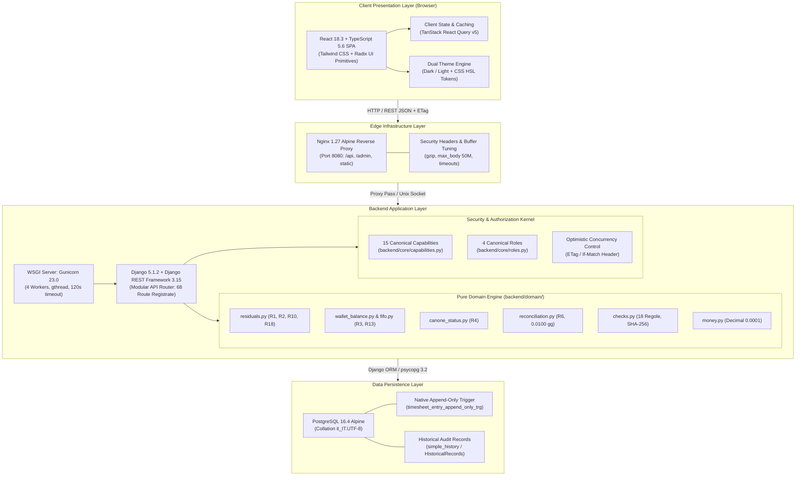
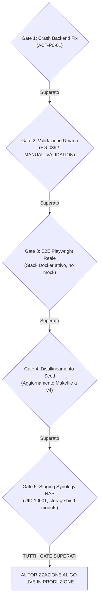

# SUPPLIER LEDGER - KNOWLEDGE BASE ARCHITETTURALE E FUNZIONALE
## Master Assessment, Technical Inventory & State of the Art Report

> **Organizzazione Committente**: Banca Mediolanum S.p.A. - Ufficio Architetture IT (BMED)  
> **Fornitore Principale**: Imola Informatica S.p.A.  
> **Team di Valutazione**: Virtual Architecture & Engineering Board (Principal Solution Architect, Enterprise Application Architect, Senior Business Analyst, Staff Backend/Frontend Engineers, Database Architect, Security & QA Architects)  
> **Data di Rilascio Assessment**: 28 Ottobre 2026  
> **Stato Formale**: Verificato, Riconciliato e Completo  
> **Single Source of Truth (SSoT)**: Codice Sorgente Applicativo (`backend/`, `frontend/`, `deploy/`)  
> **Collocazione Repository**: `docs/assestmant/` (*Nomenclatura intenzionale di progetto*)

---

## 1. Executive Summary

### 1.1 Inquadramento Strategico e Valore di Business
**Supplier Ledger**  l'applicativo enterprise commissionato dall'Ufficio Architetture IT di **Banca Mediolanum (BMED)** per il governo economico, contabile e operativo del rapporto di fornitura specialistica con **Imola Informatica**.

Il sistema risolve le storiche inefficienze derivanti dalla gestione frammentata su fogli di calcolo Excel (`docs/2026S1-OrgAllargatoProgetti-Situazione.xlsx`), introducendo:
1. **Precisione Contabile Assoluta (D-15)**: divieto categorico di calcoli in virgola mobile (`float`); tutte le quantit sono espresse in giornate lavorative quantizzate a `Decimal("0.0001")` con arrotondamento contabile `ROUND_HALF_UP`.
2. **Ledger Append-Only Immutabile (D-14, R5)**: divieto assoluto di operazioni `UPDATE` e `DELETE` fisiche sulle registrazioni di consuntivo (`TimesheetEntry`), protetto da un trigger PostgreSQL nativo a livello di database. Le rettifiche avvengono esclusivamente tramite storni contabili bilanciati (`build_reversal`).
3. **Disaccoppiamento Ortogonale degli Stati (R1, R10)**: indipendenza rigorosa tra l'avanzamento contrattuale (`offer_status`), la possibilit di consuntivare (`timesheet_status`) e la fatturazione commerciale (`billing_status`).
4. **Banca Ore / Wallet Annuale a Scadenza Perentoria (R2, R3, R13)**: segregazione dei residui non consumati delle commesse chiuse, con decadenza temporale al 31/12 dell'anno successivo alla chiusura (`actual_closure_date.year + 1`), allerta 90 giorni prima della scadenza, motore di allocazione FIFO su lotti sorgente e calcolo dinamico a runtime del disponibile (nessun dato persistito a mano).
5. **Governo dell'Organico Allargato e Canoni (R4)**: monitoraggio del burn-down settimanale e confronto continuo tra consuntivo reale e target progressivo teorico per prevenire il sottoutilizzo contrattuale.
6. **Riconciliazione PPM con Tolleranza Contabile Fissa (R6)**: quadratura automatica contro gli estratti del sistema PPM di Banca Mediolanum, con tolleranza di quadratura stabilita a `0.0100` gg (~4.8 minuti lavorativi) e granularit operativa PPM a `0.0625` gg (30 minuti lavorativi).
7. **Motore di Controllo Continuo delle Anomalie (R7, R8)**: scansione automatica di 18 controlli formali (`CHK_01` .. `CHK_18`), deduplicazione deterministica via fingerprint SHA-256 e ciclo di vita strutturato con supporto a deroghe temporali autorizzate.
8. **Modello di Sicurezza CBAC a 15 Capability e 4 Ruoli (INC-01, INC-02)**: matrice di permessi basata su capability canoniche (`core/capabilities.py`), supporto a override a database per utente o ruolo, e presidio di capability riservate immutabili per l'amministratore.

---

### 1.2 Architettura ad Alto Livello



---

## 2. Navigatore Generale della Knowledge Base (18 Deliverable)

Tutti i documenti dell'assessment sono stati redatti in lingua italiana, verificati contro il codice sorgente, strutturati in conformit agli standard enterprise e archiviati nella directory `docs/assestmant/`:

```
docs/assestmant/
|-- README.md                              <- [QUESTO DOCUMENTO] Master Navigation & Executive Overview
|-- ASSESSMENT_PROGRESS.md                 <- Registro formale avanzamento fasi (Tutte COMPLETATE)
|-- 01_REPOSITORY_INVENTORY.md             <- Inventario fisico completo, stack, dipendenze ed entrypoint
|-- 02_FUNCTIONAL_DOMAIN_MODEL.md          <- Modello di dominio, glossario, cicli di vita ed entit
|-- 03_FUNCTIONAL_CAPABILITY_MAP.md        <- Mappa esaustiva 15 capability canoniche e 39 functional
|-- 04_WORKFLOW_CATALOG.md                 <- Catalogo analitico dei 34 workflow end-to-end con 6 sequence
|-- 05_TECHNICAL_ARCHITECTURE.md           <- Architettura 10-layer, sequence, OCC, DDD e pattern
|-- 06_DATA_MODEL.md                       <- Modello relazionale PostgreSQL, 26 modelli ORM e diagramma ER
|-- 07_API_CATALOG.md                      <- Catalogo 68 route, contratti RFC 7807, If-Match e tracciabilit
|-- 08_BUSINESS_RULES.md                   <- Le 18 regole di business (R1-R18), 18 controlli e formule
|-- 09_SECURITY_AUTHORIZATION.md           <- Modello CBAC a 15 permessi, 4 ruoli, audit trail e minacce
|-- 10_FRONTEND_UX_ASSESSMENT.md           <- Valutazione redesign Sol/Terra, gap UX/UI, WCAG AA e responsive
|-- 11_TEST_QUALITY_ASSESSMENT.md          <- Analisi piramide test (38 pytest, 14 vitest, 8 playwright)
|-- 12_DEPLOYMENT_OPERATIONS.md            <- Docker Compose, Nginx, Synology NAS, Make target e backup
|-- 13_TECHNICAL_DEBT_RISKS.md             <- 12 debiti tecnici, 8 rischi architetturali e piano remediation
|-- 14_STATE_OF_THE_ART.md                 <- Fotografia oggettiva senza percentuali arbitrarie e gap residui
|-- 15_COMPLETION_ROADMAP.md               <- Piano Go-Live a 4 sprint, backlog prioritizzato P0-P4 e DoD
|-- 16_AI_HANDOVER.md                      <- Guida di passaggio consegne ad agenti AI e regole inviolabili
|-- 17_EVIDENCE_INDEX.md                   <- Matrice di tracciabilit totale requisiti -> codice -> test
`-- 18_ASSESSMENT_CONSISTENCY_REPORT.md    <- Report di risoluzione e riconciliazione delle 11 incongruenze
```

---

### Tabella Sinottica dei Deliverable di Assessment

| # | Documento | Dimensione | Area Tematica & Contenuto Chiave |
|---|:---|:---:|---|
| **00** | [`ASSESSMENT_PROGRESS.md`](file:///c:/Users/gianvito.bleve/OneDrive%20-%20Banca%20Mediolanum%20SPA/Documenti/Progetti/imola/docs/assestmant/ASSESSMENT_PROGRESS.md) | 2.1 KB | Registro delle 19 fasi operative; tracciamento stati di avanzamento (100% COMPLETATO). |
| **01** | [`01_REPOSITORY_INVENTORY.md`](file:///c:/Users/gianvito.bleve/OneDrive%20-%20Banca%20Mediolanum%20SPA/Documenti/Progetti/imola/docs/assestmant/01_REPOSITORY_INVENTORY.md) | 48.4 KB | Censimento integrale file tree, metriche SLOC, stack software, entry point, 20 make target e diagramma componenti. |
| **02** | [`02_FUNCTIONAL_DOMAIN_MODEL.md`](file:///c:/Users/gianvito.bleve/OneDrive%20-%20Banca%20Mediolanum%20SPA/Documenti/Progetti/imola/docs/assestmant/02_FUNCTIONAL_DOMAIN_MODEL.md) | 60.9 KB | Dominio BMED/Imola, glossario 20 termini formali, ortogonalit stati, ciclo vita wallet e formule matematiche pure. |
| **03** | [`03_FUNCTIONAL_CAPABILITY_MAP.md`](file:///c:/Users/gianvito.bleve/OneDrive%20-%20Banca%20Mediolanum%20SPA/Documenti/Progetti/imola/docs/assestmant/03_FUNCTIONAL_CAPABILITY_MAP.md) | 58.6 KB | Tassonomia funzionale su 10 macro-aree, conciliazione 15 capability CBAC vs 39 functional capabilities di business. |
| **04** | [`04_WORKFLOW_CATALOG.md`](file:///c:/Users/gianvito.bleve/OneDrive%20-%20Banca%20Mediolanum%20SPA/Documenti/Progetti/imola/docs/assestmant/04_WORKFLOW_CATALOG.md) | 129.3 KB | Schede analitiche dei 34 workflow applicativi end-to-end con 6 sequence diagram Mermaid (OCC, FIFO, Storno, Import). |
| **05** | [`05_TECHNICAL_ARCHITECTURE.md`](file:///c:/Users/gianvito.bleve/OneDrive%20-%20Banca%20Mediolanum%20SPA/Documenti/Progetti/imola/docs/assestmant/05_TECHNICAL_ARCHITECTURE.md) | 64.1 KB | Architettura a 10 layer logici, pipeline di comunicazione client/server, diagramma di deployment e pattern DDD/OCC. |
| **06** | [`06_DATA_MODEL.md`](file:///c:/Users/gianvito.bleve/OneDrive%20-%20Banca%20Mediolanum%20SPA/Documenti/Progetti/imola/docs/assestmant/06_DATA_MODEL.md) | 82.6 KB | Modello relazionale completo, catalogo 26 modelli ORM Django, vincoli SQL, trigger nativo append-only e diagramma ER. |
| **07** | [`07_API_CATALOG.md`](file:///c:/Users/gianvito.bleve/OneDrive%20-%20Banca%20Mediolanum%20SPA/Documenti/Progetti/imola/docs/assestmant/07_API_CATALOG.md) | 74.1 KB | Censimento formale delle 68 route registrate (55 logiche, 12 alias), standard RFC 7807, If-Match e mapping client. |
| **08** | [`08_BUSINESS_RULES.md`](file:///c:/Users/gianvito.bleve/OneDrive%20-%20Banca%20Mediolanum%20SPA/Documenti/Progetti/imola/docs/assestmant/08_BUSINESS_RULES.md) | 58.9 KB | Le 18 regole contabili (R1-R18), catalogo dei 18 controlli `CHK_*`, formule LaTeX, soglie e storni append-only. |
| **09** | [`09_SECURITY_AUTHORIZATION.md`](file:///c:/Users/gianvito.bleve/OneDrive%20-%20Banca%20Mediolanum%20SPA/Documenti/Progetti/imola/docs/assestmant/09_SECURITY_AUTHORIZATION.md) | 54.9 KB | Modello di sicurezza CBAC a 15 capability, 4 ruoli canonici, permission classes DRF, audit trail, gestione rischi OWASP. |
| **10** | [`10_FRONTEND_UX_ASSESSMENT.md`](file:///c:/Users/gianvito.bleve/OneDrive%20-%20Banca%20Mediolanum%20SPA/Documenti/Progetti/imola/docs/assestmant/10_FRONTEND_UX_ASSESSMENT.md) | 69.6 KB | Valutazione specialistica UX/UI, analisi 10 viste, conformit WCAG AA, token Tailwind, verifica responsive e gap Sol. |
| **11** | [`11_TEST_QUALITY_ASSESSMENT.md`](file:///c:/Users/gianvito.bleve/OneDrive%20-%20Banca%20Mediolanum%20SPA/Documenti/Progetti/imola/docs/assestmant/11_TEST_QUALITY_ASSESSMENT.md) | 68.2 KB | Analisi piramide di testing: 38 suite pytest, 14 vitest (73 unit test), 8 spec E2E Playwright e gap FG-039. |
| **12** | [`12_DEPLOYMENT_OPERATIONS.md`](file:///c:/Users/gianvito.bleve/OneDrive%20-%20Banca%20Mediolanum%20SPA/Documenti/Progetti/imola/docs/assestmant/12_DEPLOYMENT_OPERATIONS.md) | 75.1 KB | Stack Docker Compose prod/dev, multi-stage build, configurazione Nginx, deployment su Synology NAS e procedure DR. |
| **13** | [`13_TECHNICAL_DEBT_RISKS.md`](file:///c:/Users/gianvito.bleve/OneDrive%20-%20Banca%20Mediolanum%20SPA/Documenti/Progetti/imola/docs/assestmant/13_TECHNICAL_DEBT_RISKS.md) | 71.2 KB | Mappatura di 12 debiti tecnici (monoliti, asincronismo) e 8 rischi architetturali con matrice Probabilit x Impatto. |
| **14** | [`14_STATE_OF_THE_ART.md`](file:///c:/Users/gianvito.bleve/OneDrive%20-%20Banca%20Mediolanum%20SPA/Documenti/Progetti/imola/docs/assestmant/14_STATE_OF_THE_ART.md) | 69.5 KB | Valutazione oggettiva dello stato reale senza metriche arbitrarie: classificazione generale PARTIAL per test e UX. |
| **15** | [`15_COMPLETION_ROADMAP.md`](file:///c:/Users/gianvito.bleve/OneDrive%20-%20Banca%20Mediolanum%20SPA/Documenti/Progetti/imola/docs/assestmant/15_COMPLETION_ROADMAP.md) | 59.4 KB | Piano operativo di rilascio articolato su 4 Sprint (P0 Bloccanti, P1 Incompletezze, P2 Debito, P3/P4 Rifiniture). |
| **16** | [`16_AI_HANDOVER.md`](file:///c:/Users/gianvito.bleve/OneDrive%20-%20Banca%20Mediolanum%20SPA/Documenti/Progetti/imola/docs/assestmant/16_AI_HANDOVER.md) | 43.2 KB | Guida operativa di passaggio consegne per agenti AI, 8 regole inviolabili, mappa dei moduli e comandi di verifica. |
| **17** | [`17_EVIDENCE_INDEX.md`](file:///c:/Users/gianvito.bleve/OneDrive%20-%20Banca%20Mediolanum%20SPA/Documenti/Progetti/imola/docs/assestmant/17_EVIDENCE_INDEX.md) | 79.2 KB | Matrice totale di tracciabilit incrociata: Requisito -> UI -> Endpoint -> Handler -> Dominio -> ORM -> Test. |
| **18** | [`18_ASSESSMENT_CONSISTENCY_REPORT.md`](file:///c:/Users/gianvito.bleve/OneDrive%20-%20Banca%20Mediolanum%20SPA/Documenti/Progetti/imola/docs/assestmant/18_ASSESSMENT_CONSISTENCY_REPORT.md) | 54.5 KB | Risoluzione formale e riconciliazione delle 11 incongruenze riscontrate sul codice sorgente effettivo (SSoT). |

---

## 3. Matrice Riconciliata della Single Source of Truth (SSoT)

In conformit all'audit formale svolto in [`18_ASSESSMENT_CONSISTENCY_REPORT.md`](file:///c:/Users/gianvito.bleve/OneDrive%20-%20Banca%20Mediolanum%20SPA/Documenti/Progetti/imola/docs/assestmant/18_ASSESSMENT_CONSISTENCY_REPORT.md), tutti i documenti della knowledge base sono stati uniformati secondo i seguenti punti fermi provati dal codice sorgente:

| ID | Ambito Conteso | Valore Documentale Discordante | Verit Provata nel Codice Sorgente (SSoT) | Evidenza Primaria nel Repo |
|:---:|---|---|---|---|
| **INC-01** | **Capability di Sistema** | 13 capability | **15 Canonical Capabilities** (`ALL_CAPABILITIES`) | `backend/core/capabilities.py:25-43` |
| **INC-02** | **Ruoli Applicativi** | Ruoli generici (Admin, PM, Viewer) | **4 Ruoli Enterprise BMED** (`admin`, `responsabile_bmed`, `referente_bmed`, `fornitore`) | `backend/core/roles.py:7-19` |
| **INC-03** | **Censimento Route API** | 40..60 endpoint | **68 Route Registrate** (55 percorsi logici univoci, 12 alias, 1 deprecato) | `backend/api/urls.py` + `config/urls.py` |
| **INC-04** | **Tolleranza PPM** | Confusione tra 0.01 gg e 0.0625 gg | **Tolleranza: 0.0100 gg** (~4.8 min) / **Granularit: 0.0625 gg** (30 min) | `backend/core/models.py:AppSettings` |
| **INC-05** | **Dataset Seed Reale** | `seed_imola_2026-10-16.json` (refuso) | **`seed_imola_v4_2026-10-09.json`** (142 progetti, 206 monthly timesheet) | `data/seed/seed_imola_v4_2026-10-09.json` |
| **INC-06** | **Workbook Excel Storico** | Falso blocco import storico | **File presente su disco** (122.666 bytes, SHA-256 verificato) | `docs/2026S1-OrgAllargatoProgetti-Situazione.xlsx` |
| **INC-07** | **Ambiente Git Locale** | Branch / Commit locali | **Directory di lavoro senza repository Git locale attivo** | Sincronizzazione filesystem host OneDrive |
| **INC-08** | **Stato Redesign UX** | Completato al 100% | **Classificato PARTIAL** (componenti attivi, integrazione E2E live pendente) | `outputs/SOL_UX_GAP_ANALYSIS.md` |
| **INC-09** | **Formule Saldo Wallet** | Notazioni ambigue | **Allocazioni decrementano immediatamente il residuo spendibile** | `backend/domain/residuals.py:184-186` |
| **INC-10** | **Nomenclatura Canone/UI** | Termini alternati | **Entit tecnica = Canone; UI/Presentazione = Organico Allargato** | `frontend/src/features/canone/CanonePage.tsx` |
| **INC-11** | **Chiusura Commesse** | `Release to Wallet` | **Endpoint deprecato (HTTP 409); flusso valido: `Validate Closure`** | `backend/api/domain_views.py:1767-1815` |

---

## 4. Onboarding Rapido per Ingegneri e Nuovi Agenti AI

Per interagire con il repository senza commettere errori contabili o architetturali, consultare prioritariamente il deliverable dedicato [`16_AI_HANDOVER.md`](file:///c:/Users/gianvito.bleve/OneDrive%20-%20Banca%20Mediolanum%20SPA/Documenti/Progetti/imola/docs/assestmant/16_AI_HANDOVER.md).

### 4.1 Comandi Essenziali del Ciclo di Vita (Make Toolchain)

```bash
# Avvio dello stack containerizzato completo (Frontend, Backend, Nginx, PostgreSQL)
make up

# Esecuzione delle migrazioni del database
make migrate

# Caricamento del dataset dimostrativo per i 4 ruoli
make demo

# Caricamento del seed reale v4 di produzione
python manage.py import_seed data/seed/seed_imola_v4_2026-10-09.json

# Esecuzione del motore di scansione dei 18 controlli contabili
make checks

# Esecuzione suite di test backend Pytest
make test-backend

# Esecuzione suite di test frontend Vitest
make test-frontend

# Esecuzione suite di test E2E Playwright
make e2e

# Linting e verifica statica del codice (Ruff, Black, Mypy, ESLint)
make lint
```

### 4.2 Utenze Demo Standard Pre-configurate
| Username | Password | Gruppo / Ruolo | Profilo Operativo & Responsabilit |
|---|---|---|---|
| `admin` | `admin123` | `admin` | Amministratore di sistema (accesso totale, gestione DB e privilegi) |
| `responsabile_bmed` | `resp123` | `responsabile_bmed` | Responsabile Ufficio Architetture IT BMED (approvazione, chiusura, canone) |
| `referente_bmed` | `ref123` | `referente_bmed` | Architetto referente di commessa BMED (consultazione e coda di verifica) |
| `fornitore` | `forn123` | `fornitore` | Project Manager Imola Informatica (inserimento consuntivi timesheet) |

---

## 5. Sintesi dello Stato dell'Arte e Criteri di Pronto al Rilascio (Go-Live Gate)

Come documentato in [`14_STATE_OF_THE_ART.md`](file:///c:/Users/gianvito.bleve/OneDrive%20-%20Banca%20Mediolanum%20SPA/Documenti/Progetti/imola/docs/assestmant/14_STATE_OF_THE_ART.md) e pianificato in [`15_COMPLETION_ROADMAP.md`](file:///c:/Users/gianvito.bleve/OneDrive%20-%20Banca%20Mediolanum%20SPA/Documenti/Progetti/imola/docs/assestmant/15_COMPLETION_ROADMAP.md), il sistema si trova in uno stato di avanzamento elevato ma **non pu essere dichiarato immediatamente pronto per la produzione** fino al soddisfacimento dei seguenti 5 Gate Criteria:



1. **Gate 1**: Risoluzione del riavvio ciclico del container backend riscontrato in `SOL_UX_GAP_ANALYSIS.md` su `admin_views.py`.
2. **Gate 2**: Firma della checklist di accettazione umana [`docs/MANUAL_VALIDATION_FASE7.md`](file:///c:/Users/gianvito.bleve/OneDrive%20-%20Banca%20Mediolanum%20SPA/Documenti/Progetti/imola/docs/MANUAL_VALIDATION_FASE7.md) a browser con gli utenti di test BMED.
3. **Gate 3**: Esecuzione della suite E2E Playwright completa su stack Docker reale con database PostgreSQL (senza intercettazione di rete `fixtures.ts`).
4. **Gate 4**: Allineamento del Makefile per puntare al dataset definitivo `seed_imola_v4_2026-10-09.json`.
5. **Gate 5**: Verifica del deployment su Synology NAS Container Manager con permessi utente non-root (UID 10001) e rotazione automatizzata dei dump `pg_dump`.

---
*Documento redatto e consolidato dal Virtual Architecture Board di Supplier Ledger.*
